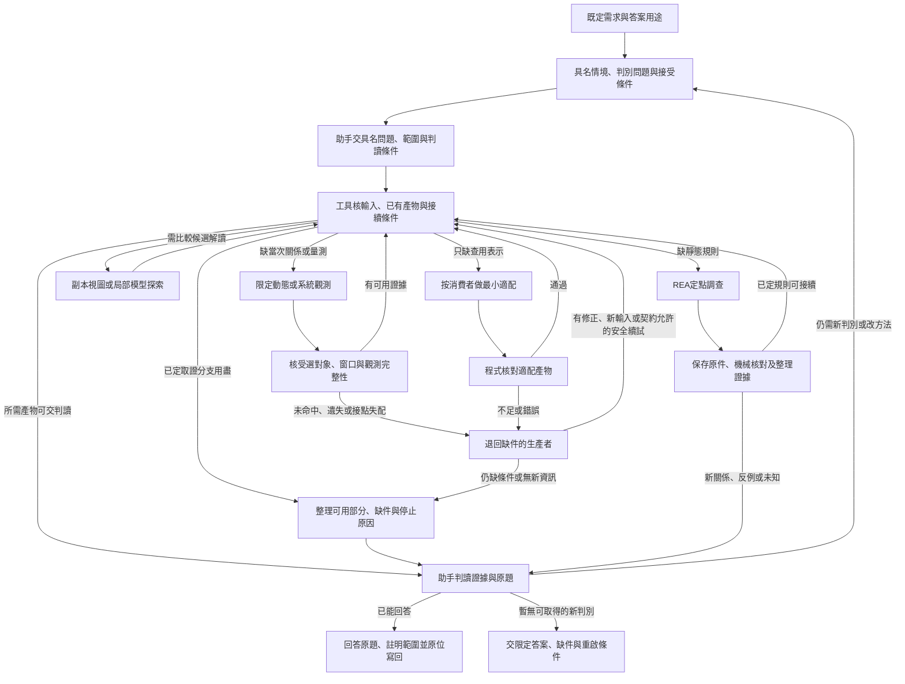
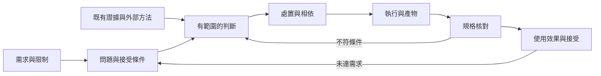

# 整體研究與開發計畫

本頁只維護現行目標、執行順序、相依與完成條件。方法、證據、即時進度及歷史各有主位置；日常從下表選入口，不必讀完整沿革。文件調整不啟動遊戲、生成或部署。

## 1．依工作選入口

| 要做的事 | 直接入口 | 能取得什麼 |
| --- | --- | --- |
| 確認目標與邊界 | [目標與範圍](#execution-objective) | 研究與產品各要達成什麼、保留什麼、何時算完成 |
| 接續「GE2RB 引擎原理探索與條件預測計畫」 | [研究需求](#engine-research-needs) → [全局範圍與選題](#engine-predictive-plan) → [決策取捨](決策表.md#engine-research-decisions)；實際工作沿研究Issue #4（內部追溯，未隨公開版提供） | 各領域與跨域問題、選題／轉向條件及進入設計的依據 |
| 接著做貼圖工作 | [六階段流程](#texture-improvement-execution-plan) → Issue #2：AI高清與漏換（內部追溯，未隨公開版提供） | 流程相依；實際任務、缺件與下一動作 |
| 規劃兩作共用模組與載入加速 | [需求清單／階段目標](#shared-mod-framework-plan) → [整合方法](../04_工作封包/03_首輪判別設計.md#shared-framework-integration-method) → [收斂門檻](../04_工作封包/04_最小交付驗收.md#shared-framework-acceptance) | GER／GE2RB共用核心、分作適配與資料、管理器及實機接受範圍 |
| 整理原碼、文件、工具與發布包 | [來源與發布整理計畫](#source-release-organization-plan) → [現況盤點與案例依據](../03_證據與歷史/來源索引.md#source-release-inventory) | 單一來源、建置／成品對照、版本與附件規格；目前只完成規劃，不公開發布 |
| 查目前階段或產品交付 | [Project Status](https://github.com/users/40939138-sudo/projects/1)、產品 #1（內部追溯，未隨公開版提供）、交付 #3（內部追溯，未隨公開版提供） | 唯一階段與任務狀態；本頁不複寫進度數字 |
| 查來源、分類與覆蓋依據 | [逐來源處置](../03_證據與歷史/來源索引.md#texture-processing-decisions)、[差集快照](../03_證據與歷史/來源索引.md#texture-hd-followup-inputs) | 來源身份、方法建議、包收錄及尚缺的使用證據 |
| 製作或驗證一批貼圖 | [AI製作方法](../04_工作封包/03_首輪判別設計.md#texture-ai-production-workflow)、[品質／成本驗收](../04_工作封包/04_最小交付驗收.md#accept-quality) | 通道、尺度、mip、載入、畫質與成本的操作條件 |
| 判斷技術缺口或改變路線 | [相依與研究分流](#next-static-priorities)、[路線決策](決策表.md#current-candidate-route)、[引擎理論](../02_引擎理論/機制總覽.md#v08-mechanism) | 已支持的關係、未知與會改變選擇的證據 |
| 評估成熟工具候選與REA對接 | [工具評估與順序](#rea-tool-integration-plan) → [接法與最小試題](../04_工作封包/03_首輪判別設計.md#rea-unused-tool-handoffs) | 排除已用工具的新推薦；候選規劃與具名採用證據分列 |
| 找實際工具或啟動入口 | [工具交接表](../04_工作封包/03_首輪判別設計.md#tool-handoffs)、[Steam啟動流程](../04_工作封包/03_首輪判別設計.md#steam-launch-procedure) | 既有入口、必要輸入、產物與失敗去向；此連結不表示工具已執行 |
| 規劃全案邏輯、機制與分類改善 | [全案改善規劃](#project-coherence-plan) | 共同邏輯、盤點／案例結果及後續修改條件；非全案重構已完成 |
| 規劃引擎知識管理工具 | [成熟工具管理規劃](#engine-knowledge-management-plan) | 正文、命題索引、版本及外部來源的管理安排；目前僅列規劃 |
| 查舊安排與修正原因 | [計畫沿革](../03_證據與歷史/計畫沿革.md)、[活動紀錄](../03_證據與歷史/歷史研究紀錄.md) | 計畫版本與實際活動分開追溯 |

## 2．目標與範圍

**計畫名稱：GE2RB 引擎原理探索與條件預測計畫。** 本名稱統指需求、開放領域與跨域選題、研究方法、REA及連動工具、派調／恢復、證據接受、知識管理與介入評估的整套安排；各主位置共同沿用此名稱。命令題C與存讀題N是首批活動，不是計畫總範圍。各項選擇及其外部依據統整於[全計畫決策對照](決策表.md#engine-research-decisions)，具體操作回封包3，完成判準回封包4。

**引擎研究的需求。** 依使用者既定目的，先讓既有引擎知識足以安排有方向、可接續的研究：知道後續要查什麼、為何先查、怎麼查，以及結果如何決定下一步。在此基礎上補足GE2RB運行原理，逐步建立能解釋行為、在明確條件內預測結果、並可反覆查用的模型；研究有其獨立交付，不以貼圖批次收尾作完成判準。依使用者明確澄清，研究對象是GE2RB引擎及解釋其運行所需的遊戲規則、資料與執行環境；圖形運行是既有切入點，不能成為總範圍上限。純原理、尚無產品症狀及非圖形問題，均可因增加理解、條件預測或可重用知識而獨立成題。[外部方法對照](../03_證據與歷史/來源索引.md#engine-needs-planning-sources)用來修正目標與接受方式，需求本身來自使用者，外部案例不替本案選定渲染路線。

| 使用需求／要能回答的問題 | 本計畫應交付的能力 | 成立範圍與接受方向 |
| --- | --- | --- |
| 有計畫地接續研究（目前最低需求）：已有理解足以告訴我們接下來怎麼做嗎？ | 從已知與缺口選出具名下一步，交代順序理由、必要輸入／取得方法、預期產物，以及成立、不成立或仍不足時的接續 | 近期安排具體到能開始查；較遠工作保留條件分支。規劃可先成立，研究結論與預測能力再由後續證據驗證 |
| 以工具接續執行：助手能把注意力放在推理，讓REA與連動工具承接重複操作嗎？ | 助手定問題、假說與判讀；工具執行已定查詢、取證、轉換、機械核對、保存與例行交接，未知或規則外結果再交助手 | 以可重跑的實際入口及收據驗收。角色代表助手／工具責任，不預設使用者逐步點選、搬檔或放行；已有能力、待接線與需判讀部分分列 |
| 理解：系統如何組成、機制如何運作、行為為何成立？ | 將所問對象、資料／控制流、規則、狀態及使用時點連成有邊界的解釋；未知領域可先形成問題與候選關係 | 純原理可獨立成題，不以圖形影響、產品阻塞、已知函式或現成工具為入場條件；探索、理解、預測與介入各按用途接受 |
| 預測：給定模式、前態、輸入或改動，接下來會採哪條路、哪份資料／狀態，何時失效？ | 產生有條件的分支、值、先後或有效期預測，指出可推翻結果及未知 | 先聲明所預測的狀態、值、順序、持久化或交互行為；有隨機／非決定性因素時限定前提及可判範圍。圖形題另分CPU順序、API返回、GPU完成與畫面效果。需要精確耗時才加入時間資料與誤差要求，不先承諾全引擎準確率 |
| 重用：換一個資產、場景或問題時，哪些規則仍可用？ | 從既有T／總覽找到規則、來源、前提與適用反例，指出只需補查的差異 | 能用同一規則回答新問題或明確拒絕外推；不以文件數、工具數或函式數計成理解程度 |
| 介入評估：日後改變規則、系統行為或畫面效果，要控制什麼，會連帶影響哪裡？ | 依所選行為／效果比較控制點、所需資料、相依、失效／恢復及驗證方法 | 成為需求時才展開相應路線；共通證據可先研究，不以完整引擎重建、可見高清成果或採用RTX作本研究的共同前置 |

研究成果依[需求與預測接受](../04_工作封包/04_最小交付驗收.md#evidence-use-levels)分清已推導、回溯支持、新案例核對及實際用途已驗。使用者既定問題可直接作選題輸入；只有尚缺且會改變範圍或取捨的資訊才補問，不為套外部框架重開需求訪談。

**高清產品的既定目標。** 在3840×2160下改善GE2RB可見貼圖，保留原作風格、顯示尺寸、骨架／動作及材質必要語義，提供可停用恢復的自用模組。顏色覆蓋範圍包括角色、武器、場景、怪物、物件及已確認顏色髮絲；環境貼圖仍為優先產品方向，全庫按已定範圍評估，分類數量與包收錄不等遊戲可見覆蓋或品質接受。

- **先整體高清覆蓋、後集中品質修正：**已確認顏色圖先生成暫用高清版、累積入包並載入遊戲；階段1–4持續循環，整體可製作集合覆蓋後才集中修細節。技術保護與基本可用性仍核，外觀待修不逐批阻擋；未知及暫用原版不等未使用或高清完成。
- **功能圖原版、已確認髮色納入：**UI／劇情既定保留範圍保持；圖集、透明及平鋪依內容選方法。髮絲顏色已有原圖或既有准入證據者納入，染色／打包通道未解者仍待辦。功能候選已有收錄的疑點另列複核，本計畫不自行移包。
- **尺度按證據：**已選2／4倍處理項比較差異不大時優先4倍，2倍作有依據的替代；不全庫統填倍率，不新增1倍替換支援。工作倍率與交付倍率分開。
- **操作按當次範圍：**既有持續授權依[決策契約](決策表.md#v09-dialogue-decisions)承接；文件任務不自動變成遊戲活動。不用電腦操作技能代操作遊戲，使用既有入口、日誌／觀測輸出及使用者目視；正常退出、所有權與恢復條件保持。

產品最低里程碑是同一受檢版本中，一項環境貼圖從來源、實際使用、可見高清改善到停用恢復有可追溯證據；這不等整包完成。全包或批次完成只能限已驗場景／資產宣告，詳[產品接受](../04_工作封包/04_最小交付驗收.md#purpose)。

## 3．六階段流程

依使用者指定，先完成已確認顏色圖高清覆蓋並載入遊戲，再集中修細節。詳細步驟、範圍及完成條件由[顏色貼圖高清覆蓋執行計畫](顏色貼圖高清覆蓋執行計畫.md#execution-workflow)維護；主線的整體覆蓋與集中修正順序保持，另依專項的[使用者指定提前預覽](顏色貼圖高清覆蓋執行計畫.md#nunchaku-library-classification)提供已有DDS技術資格的子集，預覽不代全庫完成。日常進度與缺件由Issue維護，本頁不複寫即時階段。

後續由使用者指定的Nunchaku整張重繪與批次擴充，另沿同一專項的[離線候選安排](顏色貼圖高清覆蓋執行計畫.md#nunchaku-batch-plan)及[操作規則](../04_工作封包/03_首輪判別設計.md#nunchaku-serial-batch)進行；此分支只製作與檢查貼圖，不啟動遊戲，不把候選生成或短批穩定性當成全庫品質／部署完成。原覆蓋包與固定來源批次保留。

GER另沿[顏色貼圖高清製作與整合計畫](顏色貼圖高清覆蓋執行計畫.md#ger-color-hd-plan)接續使用者已確認的純色再入結果，完成顏色候選製作、修正與離線整合；原件和回退版本保留，遊戲由使用者操作。[來源與候選身份](../03_證據與歷史/來源索引.md#ger-color-hd-evidence)回既有證據索引，任務與缺件由Issue #5（內部追溯，未隨公開版提供）維護，不另建即時進度表。

兩作接合問題另依同一專項的[接合修正規劃](顏色貼圖高清覆蓋執行計畫.md#texture-join-repair-plan)分流：共用移動雲層優先，接其餘天空／柔光、遠山及已確認場景表面，再擴查循環大圖、跨圖與UV島。按既有接回整張、限區修補、連續場及交付修正方法接續；待辨配對只阻相依項。此處是集中修正的相依安排，不表示候選已修復或已部署，兩作任務仍分屬原Issue。

## 3.1．GER／GE2RB共用模組框架：需求與目標計畫

**目標。** 把兩作可重用的貼圖載入、完整驗證、CPU準備與預讀保存能力收斂為同一份核心，讓一次修正可分別建置及驗證兩作；共用管理器與本地安裝流程，同時隔離遊戲適配、資料與還原責任。本節是需求／目標主位置，不是即時任務看板。使用者已要求執行至收斂，後續已授權兩作暫時部署驗收並回復；最新要求以固定候選及小範圍實機測試完成本輪交付，具體接受範圍沿[共用框架驗收](../04_工作封包/04_最小交付驗收.md#shared-framework-acceptance)。具名成果與失敗控制回[共用框架執行證據](../03_證據與歷史/來源索引.md#shared-framework-execution)，不將未測情境改標通過。

**承接基線。** GE2RB已有[固定r6框架與完整候選包](../03_證據與歷史/來源索引.md#texture-loading-framework)，其SHA／預篩、2 worker、有界預讀及跨程序保存按原離線資格重用；GER已有[專用載入器與替換命中證據](../03_證據與歷史/來源索引.md#ger-solid-full)，尚不能借用GE2RB最新框架的整合及效能資格。小圖保存競爭的[原因分析](../02_引擎理論/命題與證據關聯.md#t19-checkpoint-interference)已形成待驗改法，不列已完成優化。兩作素材製作／接合修正仍沿原專項，這次不重畫或混合DDS。

| 需求 | 須交付的能力／限制 |
| --- | --- |
| F01．兩作明確適配 | 首版限已核PC版GER與GE2RB；逐版本綁EXE身分、入口及參數契約。未知版本明確拒絕，不能只看檔名或任意配置位址便啟用 |
| F02．同一核心原碼 | 共用SHA後端／完整驗證、可排除請求預篩、準備池、需求優先、預讀與保存；保留同步／僅worker對照和正常回退。D3D仍由原呼叫執行緒處理，不傳來源pointer或D3D物件給背景工作 |
| F03．兩個薄適配層 | 首版規劃由共用核心建置GER／GE2RB專用DLL；差異由具名遊戲描述與必要適配函式承接，避免維護兩份演算法副本。單一自動辨識DLL不列首版完成條件 |
| F04．資料與身分隔離 | game ID、EXE版本、mapping、release及所選適配一致才採用。DDS對照各作獨立；相同檔名／HASH不自動授權跨遊戲共享，既有素材重用另依來源與品質證據 |
| F05．預讀紀錄隔離 | 明確按遊戲／安裝實例與EXE、release、schema／predictor及相關語言組態綁定；資料外置搬移可保留相同安裝的有效規則，跨作或不相容版本不得串用。不保存可直接免驗的DDS狀態；最後有效快照可回復 |
| F06．共用管理器 | 依安裝／版本、日常使用、資料管理、載入設定分組；目前安裝位置與操作目的地／來源分欄，日常啟用與首次接管分開。一個管理器程式可辨識或選取兩作安裝，清楚顯示目前目標、資料版、路徑與模式；操作綁定所選安裝。提供預讀模式與清除／重學的最低操作入口，狀態不能把「已啟用」當命中率；日常仍由各作Steam入口啟動，不需管理器常駐 |
| F07．兩種本地交付 | 共用管理器獨立下載，另取GER或GE2RB遊戲包；選包安裝沿既有Setup，亦保留手動解壓。各作包含專用載入器、DDS及對照／版本資料；管理器可在遊戲目錄外控制兩作。預設GEHD資料，可搬外置；不引入線上伺服器或執行期直接讀7z |
| F08．獨立維護與還原 | 收據、鎖、stage、備份及移除責任按目標安裝隔離；安裝／啟停／搬移／更新／中斷續作／還原不能改到另一作、中文包或未知檔。程序檢查須涵蓋選定遊戲，不能繼續只查GE2RB.exe |
| F09．畫面與驗證契約 | 不改圖像、mip、alpha、原SourceInfo或既有D3D建立語義來換速度；完整來源／替換SHA、錯版及損壞回退維持，兩作獨立核對 |
| F10．有界且可退化的加速 | 首版沿2個準備worker、256 MiB DDS總額／64 MiB投機子額，模型／執行緒等另計。優先減少無效保存、讓新需求在安全邊界延後保存及小圖多餘派工；不承諾所有硬體皆快，不把自動硬體調校當已存在 |
| F11．可比較效能與適用範圍 | 分兩作、已測硬體及冷暖／首次／重複路線，報首張、整批／場景等待、尖峰、全程序記憶體及保存新鮮度；分開無高清、原同步高清及加速候選，不混用基線或累加改善率 |
| F12．版本與驗收可追溯 | 核心版本、適配版本、資料release、資格結果及交付媒體相互綁定；重用測試須核未變身分，共用核心修改仍要跑兩作受影響回歸。已驗一作不自動通過另一作 |

**執行順序與階段產物。** 下表是相依計畫，完成狀態仍由既有Issue／Project維護；不預估未量工期。

| 階段 | 工作與具體產物 | 進入下一階段的條件 |
| --- | --- | --- |
| P1．固定基線與介面 | 綁既有兩作原碼／binary／資料／資格；列出寫死的遊戲身分、hook、語言組態、控制器與打包差異，形成共用核心與適配介面 | 已知差異逐一有主責；不以複製檔案或角色文件代實作 |
| P2．純重構與雙作建置 | 先維持r6演算法，抽共用核心及兩個適配，產生兩個獨立候選；把身分拒收與既有內容／回退案例接到各作 | 行為等價及錯作／錯版拒收通過，沒有把重構收益與演算法收益混算；GER新增整合另有資格 |
| P3．小圖與保存穩定化 | 沿[既定對照](../04_工作封包/03_首輪判別設計.md#shared-framework-integration-method)連到保存分段試驗，先隔離writer成本，再分別驗真正dirty、需求讓路及必要的小圖策略 | 完整驗證／恢復不退化；效能有可重複證據，失敗改法撤回或縮限。長尾原因未明不得宣稱已消除 |
| P4．共用管理與本地媒體 | 管理器／控制器／安裝器採同一目標識別，分作資料與所有權；形成可單獨交付的兩作包及共用管理入口 | 錯作包、並存兩作、外置路徑、模式／清除、更新／還原與中斷控制通過 |
| P5．隔離整合驗收 | 兩作內容、完整SHA、預讀失效／恢復、記憶體上限、載入與控制器交叉回歸；依未變hash重用既有資料包及合格證據 | 固定候選與支援矩陣可交實機；不等正式發布或實機驗收完成 |
| P6．實機收斂與交付 | 在部署限制明確解除且活動具體化後，依Steam流程分作做pilot、固定成本門檻、正式效能比較與生命週期驗收，按[收斂門檻](../04_工作封包/04_最小交付驗收.md#shared-framework-acceptance)裁定 | 只在證據覆蓋範圍發布預設值；無穩定收益的模式降為選用或同步保守值，保留回復版本 |

依使用者縮限，本框架不將完整中文共存重測列為P6或發布的必過項；既有已驗範圍可沿用，不將未測範圍改標通過。僅保留不誤改中文包等外來檔的所有權檢查；若實際改到語言相關載入／路徑，或出現具名衝突，再驗受影響部分。預讀profile的組態失效控制仍屬離線完整性檢查，不擴成中文遊戲全流程重跑。

P2與P3須使用分開的固定build和對照，避免同時改架構及策略後無法歸因。P4可先準備介面，但完整交付依賴P2的身分契約及P3選定策略。每階段可獨立交候選／限制；第一版不以所有研究方向耗盡為完成條件。

**後置方向與重開條件。** 單一通用DLL、超64 MiB大DDS前綴預讀、進階路線預測／自動硬體調校、執行期壓縮容器及GPU資源共用暫不作首版必備；只有具名效益證據及新增相容／恢復條件成立才接入。不同硬體的效能資格分別取得，沒有跨機證據便縮限宣稱，不無限等待所有電腦。數值成本容忍依[已固定的實機驗收條件](../04_工作封包/04_最小交付驗收.md#shared-framework-acceptance)，正式量測的路線及可比性仍須成立；完整性與錯作隔離屬硬門檻。

**責任入口。** 共用交付／載入框架沿Issue #3（內部追溯，未隨公開版提供），GER專屬素材與其整合相依沿Issue #5（內部追溯，未隨公開版提供），階段沿既有Project；此處不建立第二份任務狀態。本次本機計畫寫回不表示遠端Issue已同步。

## 3.2．原碼、文件、工具與發布包整理計畫

**目的與執行界線。** 使用者已要求依本計畫完成原碼、文件、工具與發布包整合及驗證，做到本機待發布版。採一個來源庫、一個整體發布版本、多個用途明確的附件；共用管理器與兩作內容沿用[既有分離式交付](../03_證據與歷史/來源索引.md#shared-framework-delivery)。本次實作落在 `v0.1.0-preview.1`：來源依白名單本機納管、隔離建置，下載候選集中 `dist/v0.1.0-preview.1`。該次本機整理沒有推送、Tag、遠端Release、可見性變更或真實遊戲部署。後續使用者已要求公開發布，自製程式碼及其隨附文件採MIT；本次發布包含原碼、文件、工具、管理器及兩作GamePack，沿同一預覽版的已驗支援範圍。使用者指定只公開目前版本：另建 `40939138-sudo/GEHD`，由本版來源快照建立單一初始提交，不帶入私人庫的舊分支、提交歷史與議題；原 `GE2RB-HD` 保持私人。公開附件輸出到 `dist/github/v0.1.0-preview.1`，保留先前封存的本機候選。

**概念與採用理由。** Repository保存程式、建置、測試、文件及必要的小型定義；Tag固定對應提交；Release說明該版本的用途、變更與限制；Assets提供可直接使用的成品。研究正文是文件，母圖是素材來源，原始觀測是證據，不能把全工作區都叫原始碼。GitHub自動產生的Source code封存只有該Tag內已納管內容，不含本機未提交資料。DXVK的原碼／DLL發布與RenderDoc的多元件原碼／安裝版／可攜版支持這種分工，沒有要求每支工具單獨一個Release；[官方定義與案例](../03_證據與歷史/來源索引.md#source-release-inventory)只支持組織方法，不授本案新技術資格。

### 既有內容與整理去向

下表保留各類整理規格；已選元件的實際落位以[來源對照](../../../source-map.json)、[工具目錄](../../../tools/catalog.json)及[BUILDING](../../../BUILDING.md)為準。產品原碼、測試、內層builder、離線分析與DDS轉換已建立新維護位置；舊原件／固定build留作凍結追溯。engine_research／source_observation保留既有來源路徑，避免無必要改動runtime／lease相依，並經工具導覽統一連入。

| 內容／現有主位置 | 整理方式及後續目標 | 發布角色與保存界線 |
| --- | --- | --- |
| 產品原碼：`草稿區/有界取證/texture_pack`的loader、game_profile、product_*、shared_manager* | 分為`src/loader`共用核心、`src/games`兩作適配、`src/management`控制器／管理器；先核固定build來源，不按副檔名把全部215份候選都視為產品核心 | 原碼進來源庫；DLL、控制器、GUI進對應成品。每作舊管理器／Setup仍按原交付保留，獨立前端不等全部後端已抽離 |
| 建置／封裝：同目錄的build_*、product_installer.iss及固定build的executed-build | 整理到`scripts/build`、`scripts/package`，分正式入口、測試建置、歷史遷移腳本；補工具版本、架構、旗標、輸入與輸出 | 必須可從指定原碼與已聲明相依建置；既有BaseBuild的sha256.obj／vendor追回來源與產生方式，fixture只作測試相依；不把歷史改寫原碼腳本當例行build |
| 研究工具：engine_research、offline_observation、source_observation及有界取證根入口 | 可維護部分按CLI／輸入輸出分到`tools/research`；README連回原T／來源／操作契約；純合成控制進`tests/research` | 可獨立執行、相依與支持範圍清楚者才列工具包候選；具遊戲／EXE限定的profile不包裝成通用工具 |
| 貼圖製作：texture_pack、GER專項及顏色製作活動中的生成／合成／DDS／組包程式 | 可重用流程整理到`tools/textures`，按輸入、配方、母圖、DDS、審查、組包分清入口；實驗用一次性修復／寫回腳本留原活動 | 工具原碼、配方結構與小型示例可納管；模型權重、原遊戲貼圖及全部生成結果不隨原碼庫自動納入 |
| 測試與證據：test_*、qualify_*、fixture、verified、build／活動快照 | 可重跑的測試原碼／生成器進`tests`；最小合成樣本按用途納管；舊source、失敗版、原始日誌及不可重建證據仍原位保存 | 測試binary、捕捉原件與舊收據不混入一般下載；資格摘要連固定版本，移路徑不能替舊證據改綁hash |
| 文件：根README、研究與開發計畫、工程README、previous-research | 沿既有正文唯一主責與錨點；根README整理成使用／開發／研究三個入口。公開選集由同版正文產生相對路徑可讀的文件包，不另維護一份完整理論 | `BUILDING.md`、`CHANGELOG.md`、授權／第三方聲明日後各承擔獨立用途；詳細GE機制仍回T／總覽，歷史交接原件不改寫 |
| 現行交付：shared-distribution的共用管理器及兩作GamePack | 保留已驗payload，建立來源提交→元件build→資料release→下載檔的對照；輸出集中到獨立`dist/<發布版>/` | 管理器、兩作遊戲包、可選工具包與文件包分列；目前本機成品不因此自動成為公開版 |
| 舊預覽／純色／mip0／歷次AI包及根.cmd | 按一般使用、診斷、歷史回退分欄；核每個wrapper實際目標，更新入口前保留回復對照 | 不因名稱含「新版」就選為正式版；舊包與回退不刪，診斷模式不成一般使用預設 |
| 第三方工具／runtime：rea-toolchain、Ghidra、DirectXTex、OpenSSL等 | 建置與工具相依清單記版本、來源、完整性、取得方法、用途及授權；需要隨包的最小部分另列 | 不整份複製本機工具庫、快取或模型庫；自製原碼、第三方原碼、遊戲衍生素材的授權範圍分別確認 |
| 工作環境：.git、.worktrees、快取、暫存、存檔／安裝備份與未知歸屬資料 | 沿既有保存責任留本機；未知項保留待辨，僅在其被選為交付輸入時解除缺件 | 不進公開來源或下載包；不以此次整理進行刪除或完整環境備份 |

**來源遷移方式。** 先在原位置確認每個元件的唯一維護檔、固定快照及相依，建立最小可回復版本；再逐元件移到上述目標位置並修正include、腳本相對根與測試入口，舊入口必要時保留薄轉接。固定build與歷史原碼保持原樣，不以新來源覆寫；不長期維護兩份可編輯原碼。文件保留現有中文路徑，不為符合`docs/`外觀硬搬全部正文。任何路徑遷移只重驗受影響的建置、查找及操作，不重跑未變貼圖品質或整體遊戲實驗。

### 版本、附件與文件規格

**版本關係。** 計畫文件的v0.9、活動的r3／r6與資料release雜湊各保原義，不能直接當產品發行號。預定採`vMAJOR.MINOR.PATCH`並容許`-preview.N`先行版；首次本機候選固定為`v0.1.0-preview.1`，不宣告1.0或穩定版。依SemVer使用前先明定對外契約：工具CLI、設定／mapping／收據格式、管理器與遊戲包相容性；不相容變更升主版、相容新增升次版、相容修正升修訂。資料內容另保各作release身份，整體發布清單指定可用組合；管理器單獨修訂不必重編或改名未變的兩作payload，附件也不要求與全部元件內部版本號相同。已發布版本不覆寫內容，修正形成新版本並保留取代關係。

**單一發布清單。** 後續新增`release-manifest.json`作機器可讀對照，最少列：整體版本／來源commit與Tag、元件名稱／來源路徑及hash、建置入口／工具版本／旗標／相依、binary完整SHA、GER／GE2RB適配身份、各作資料release／mapping hash、附件名稱／大小／SHA、相容組合與資格摘要／限制。由既有build.json、game-pack.tsv、delivery.json及資格收據產生，不能手填一份與原收據不一致的清單；公開視圖使用相對位置及可取得的來源，內部絕對路徑仍留本機追溯。標記來源可建置須實際在隔離目錄完成；若未做到逐位元重現，列差異與可接受的等價核對，不將成功編譯稱bit-for-bit重現。

| 附件／說明 | 內容與驗收界線 |
| --- | --- |
| `GEHD-Manager-<版>.zip` | 現用共用前端及它實際需要的原生控制器／設定；保留已有專屬名稱與遊戲目標隔離，不能只包單一EXE便宣稱獨立可用 |
| `GEHD-GER-<版>`、`GEHD-GE2RB-<版>`遊戲包 | 各作專用核心、資料、Setup、game-pack.tsv、校驗與操作說明；保留既有9份7z及Setup的內部檔名／相依，不重新壓縮DDS或更換已驗內容 |
| 遊戲包的下載外層 | 兩作內部均有GEHD_Core.7z／GEHD_Data_*／GEHD_Setup.exe等同名檔，不能平鋪到同一Release附件集合或下載目錄。規劃以帶遊戲／版本名的外層ZIP分卷封裝保留各自GamePack目錄，採儲存模式、每卷小於2 GiB；下載後先完整還原該目錄，再交既有管理器。外層由新的封裝／驗證腳本處理，完整解開、缺卷／錯卷及原媒體SHA沿本機接受收據；現管理器仍選還原後的GamePack目錄，不直接吃外層分卷 |
| `GEHD-Tools-<版>.zip`（符合獨立使用條件才附） | 列受支持的研究／製作工具、runtime與必要設定、最小示例；使用者自備遊戲輸入。歷史遷移器、調查中observer、測試注入binary不混入一般工具包 |
| `GEHD-Docs-<版>`（可選） | 由同版既有正文選取使用、建置、架構、研究與證據界線；無法公開的本機證據明列不可取得範圍，不保留假可點的D槽連結，也不把完整證據搬進Git |
| `SHA256SUMS.txt`、發布說明 | 校驗所有下載附件。說明固定含版本／日期、支援遊戲與環境、下載選擇、安裝／升級／還原、變更、已驗範圍、已知問題、來源／建置與授權入口；不堆全部研究活動日誌 |

根README服務首次讀者；BUILDING只承擔可執行的建置步驟／相依，詳細原理仍連既有正文；CHANGELOG以使用者可感知變更整理，Release notes取同一版內容加下載及限制，不各自維護矛盾版本。LICENSE只覆蓋已選定可授權內容，第三方與素材另列；尚未決定自製程式授權、未核散布範圍者明列缺件，不由私人庫或本機可用推為可公開。這些文件已按獨立用途建立於根目錄；完整理論仍沿既有正文，文件包只產生同版閱讀視圖。

### 整理順序與完成條件

| 順序 | 具體工作／產物 | 通過條件與相依 |
| --- | --- | --- |
| O1．選定來源與成品基線 | 由[盤點](../03_證據與歷史/來源索引.md#source-release-inventory)逐元件核主原碼、固定build、依賴、遊戲資料及授權；列正式／試驗／歷史與未判明 | 每個選定下載項都能找到實際來源與資格；只阻擋缺來源或散布條件的項目，不要求先整理所有歷史活動 |
| O2．建立可維護來源版本 | 按白名單納管產品原碼、必要研究工具／測試／文件，隔離遷移並補建置參數、相依取得與單一入口 | 乾淨來源副本能建置所選元件；不靠未聲明的本機OBJ／工具路徑。保留已驗binary與舊快照；未變部分重用資格 |
| O3．整理文件與版本對照 | 改根導航、補獨立BUILDING／CHANGELOG／授權聲明與發布清單；公開文件選集由既有正文生成 | 新讀者能找到下載、使用、研究、建置與回退；所有附件／版本／hash能回來源，私有證據與限制明示，無雙份理論正文 |
| O4．本機候選組包 | 重用現管理器與兩作payload，做獨立外層下載分卷、可選工具／文件包及校驗；輸出到新的dist版本位置 | 隔離解包核回原媒體SHA、檔名／目錄及相容組合；錯作／錯卷不誤用；只驗新增交接，不更換真實遊戲部署 |
| O5．固定待發布版本 | 核來源提交、版本號、所有附件、授權範圍、發布說明與已知限制，形成可檢視的本機候選 | 能明確回答「使用哪包、原碼在哪、怎麼重建、已驗到哪裡、如何還原」。公開發布仍未執行；Tag／Release／可見性變更留到使用者要求發布時處理 |

**本機交付落位。** O1–O5的執行接受以[來源／資格索引](../03_證據與歷史/來源索引.md#source-release-local-candidate)及候選目錄的`release-manifest.json`／`VERIFICATION.json`為準，並非僅憑本表定案。來源包由本機固定commit輸出；Tag留空， proposedTag為`v0.1.0-preview.1`。文件／工具包與管理器、兩作分卷各自提供，SHA256SUMS涵蓋所有下載檔與發布清單。重新建置有具名metadata／assert路徑／RTTI差異，不宣稱逐位元重現；仍交原已驗binary。原碼授權已定為[MIT](../../../LICENSE.md)，第三方程式保留原授權。公開準備使用 `scripts/package/prepare_public_release.py` 重新核對未變分卷、驗證管理器既有檔案不變並加入MIT文字，從發布提交重新產生原碼／文件／工具包及清單；遠端成果以[版本頁](https://github.com/40939138-sudo/GEHD/releases/tag/v0.1.0-preview.1)為準，本機上傳／核對收據存於 `toolchain/public-release-v0.1.0-preview.1`。後續任務由Issue #3（內部追溯，未隨公開版提供）既有「原碼與執行檔／交付入口與版本對照整理」承接，研究知識與素材修正仍各沿#4、#2／#5；階段由Project管，本節不複製即時待辦或自動宣告遠端已更新。HELLO永久修復、完整任務計時、預讀進階優化等保留原任務，不因整理發布而默認擴充；是否成為某版阻擋，依該版明示支援範圍裁定。

## 4．相依與研究分流

**依需求選研究題。** 上節[研究需求](#engine-research-needs)是目標主位置；本節維護範圍與相依。使用者已要求依[修正後決策](決策表.md#engine-research-decisions)進入具體設計，前一階段「只做決策」的限制不再適用本次設計。下列順序與[封包3活動設計](../04_工作封包/03_首輪判別設計.md#tool-led-execution-method)固定第一批問題、工具交接、產物、停止及分流；設計、實作與取證各沿具名產物判：窄控制器及N2靜態接續已有[執行證據](../03_證據與歷史/來源索引.md#engine-research-controller-execution)，動態適配及各領域能力仍須按自身資格接受。本文的流程順序描述相依，不要求重做已完成的接線，也不以局部成果宣告整體研究完成。

**研究範圍以引擎理解需求為界，領域索引保持開放。** 撤回「六個圖形相關核心＋其他系統須影響它們才納入」的範圍安排。各領域都有獨立選題資格；每個題目說明希望理解的對象／關係、已知或待形成的問題、預期知識增量及適用範圍。這不要求同時研究所有子系統，也不把本專案改為完整復刻／移植。外部案例提供候選問題與方法；系統是否存在、實際分界及執行模型須由GE證據確認，不能把通用引擎分類當成已發現架構。

| 可獨立研究的面向（非封閉清單、非排程） | 可提出的原理問題與成果用途 | 與既有資料的銜接／尚未核定處 |
| --- | --- | --- |
| 啟動、配置、模組與平台相依 | 初始化先後、配置來源／覆寫、模式切換及部分初始化失敗如何處置？可形成啟停與配置條件模型 | 既有啟動／工具身份紀錄可供定位，不等於GE完整初始化原理；不以是否出畫面接受 |
| 資料表示、載入、I/O與快取 | 誰選取來源，如何轉換、快取及失效，錯誤如何傳回？可形成資料供給與一致性規則 | 承接原14題01、02及T13／T19等的原範圍；其他資料類型不套貼圖格式 |
| 型別、物件、記憶體與生命週期 | 對象如何建立、識別、共享、持有、更新與回收？可形成身份／所有權及失效模型 | 原03、05、11、12已有部分入口；不由handle名稱推相同持有策略 |
| 執行控制、排程、事件、時鐘與同步 | 請求何時生效，更新／暫停／等待如何運作，順序由什麼保證？可形成時間與狀態轉移規則 | 原11的命令／執行緒是部分案例，不代表完整主迴圈、job、timer或事件系統 |
| 遊戲規則、屬性、腳本／行為控制 | 條件如何被求值，事件如何改任務／物件狀態，規則來源與執行機制如何分工？ | 原05可提供局部求值參照；腳本VM是否存在及規則承載方式仍須查，不先假定Lua或特定架構 |
| AI、感知、決策與導引 | 目標／路徑如何選取，何時重算或放棄，不可達如何處置？可獨立理解決策條件 | 本輪沒有建立此領域的GE技術結論或完成全庫有無盤點；缺現成入口不取消選題資格 |
| 模擬、物理、碰撞、場景、動畫與相機 | 時步、接觸、座標、姿態與空間狀態如何更新並相互作用？ | 原06–08保留場景／矩陣／骨架局部證據；不能由可見移動推碰撞或AI規則，也不要求以draw為終點 |
| 輸入、互動、UI、音訊與媒體時間 | 輸入由誰消費，焦點／暫停如何改事件派送，音訊或媒體完成如何通知？ | 可用事件、狀態、輸出或時序回答；本輪未核定GE完整輸入／音訊管線，不以截圖相同代行為相同 |
| 狀態保存、存檔、載入、重建與版本 | 哪些狀態被保存，哪些重算，引用如何重接，舊版與錯誤資料如何處置？ | 原12的資源恢復不是存檔完整模型；檔案可讀、狀態可恢復及行為相容分判 |
| 通訊、協作、同步、隨機性與重播 | 若所選模式含相關機制，誰決定狀態、如何處理事件順序／分歧，重播需要哪些前態？ | 可先研究機制／模式是否存在及邊界；不從外部案例認定GE為lockstep、主從或可決定性重播 |
| 圖形、材質、光照與呈現 | 資源與狀態如何進入繪製，pass如何產生／消費結果，畫面作用在哪裡成立？ | 原04、09–11、13及既有命令題續用；它是研究面向之一，不裁定其他領域的研究資格 |

記憶體／時間／I/O成本、錯誤傳播、版本差異與觀測限制可跨上述領域，也可作獨立原理題；數值與統計預測另按[模型及案例方法](../04_工作封包/03_首輪判別設計.md#research-composition-and-cases)核原指令運算語義、比較判據與觀測單位，只有相關條件會改變答案時才補查；涉及排隊、等待或恢復的題目另沿[進展與失敗傳播方法](../04_工作封包/03_首輪判別設計.md#research-progress-and-failure)選所需前提，不把「已呼叫」等同「最終生效」，也不把研究工具可恢復當GE自身可恢復；原14的觀測／效能資格僅覆蓋其既有活動。各領域的起手判別、工具定位、產物及分流已由[全領域首題設計](../04_工作封包/03_首輪判別設計.md#research-domain-entry-design)承接。表內列為可研究，不等GE存在同名子系統、已確認全部入口或已排入執行。未列領域仍可按需求加入，變更問題分類不必等待圖形受益。

**跨域關係不必以畫面收尾。** 可研究「事件→規則求值→狀態改變→後續行為」「保存狀態→重建引用／系統→恢復行為」「時鐘／隨機／輸入→排程／模擬→可重現性」「感知→AI決策→移動／碰撞→回饋」等關係；它們是候選問題形式，不是已證GE流程。既有來源→資源→材質、更新→提交、狀態→呈現三線保留為部分案例。獨立領域有自己的答案即可交付，跨域聯結只在能增加所問理解時擴展。

**未知領域也能起題。** 已有明確疑點時比較競爭解釋；入口、邊界或假說尚未形成時，先作定向探索，以形成可追溯的對象／關係候選及下一個問題為成果，不先要求兩種完整假說、已知函式或可執行profile。索引／名字／可能關係只作探索產物，不冒充機制已確認。真正需要的低層定位交REA及相關工具，既有可讀資料直接用合適工具；成熟入口影響取得代價，不是研究價值的替代判準。

**排序、深度與轉向。** 採全局問題圖持續修正、具名題局部深化；理解本身、形成未知領域問題、條件預測與重用各有價值。調整優先時比較既有題深化及尚未定位的知識盲點，明列為何選擇或延後；不因非圖形、資料少、沒有產品故障或工具未接就永久後置，也不設平均領域配額。取得代價可影響近期安排，但不能把高代價改稱不在範圍。深度按所問用途選局部行為、狀態／關係或內部機制模型；不知道內部時可交限定行為規則，不能宣稱因果已解。與題目有關的隱藏狀態、持有、分支或同步仍能翻轉答案時再深化；已答部分可重用，無新判別則交限制與重開條件，轉向另一個有知識增量的問題。依[逆向過程與功能定位研究](../03_證據與歷史/來源索引.md#engine-plan-review-sources)，下一輪要說明新增材料能改變哪個關係、適用範圍或未知問題；更多名稱或同一helper的更多引用不自動代表值得深化。切換工具的成本可納入比較，但不能把熟悉現方法當成證據增量。

**開放範圍如何形成可收尾的研究批次。** 全局沿上表保留各領域及跨域問題；近期批次在既有Issue／scope指定要回答的問題、答案用途、必要產物及接受條件。這份範圍先於取材固定，並列原題需要區分的後果或界線；允許結果涵蓋全部相關候選時，只交相容性／不確定性整理，不能靠案例都落在集合內宣稱新增判別能力。新增線索可帶理由調整；不能在某步失敗後，刪掉必要問題使批次看似完成。尚無入口的領域保留定向探索資格，不要求先寫出全部實驗細節。每次選題或階段收尾，核已選題的未解邊、未觸及盲點及新跨域關係，說明何者值得接續；具體比較一項目前鏈的深化與一項相關盲點／跨域候選，記各自可改變的答案、所缺輸入及延後理由；若無可比較候選就記已查範圍，不能憑空造題。這是選題理由的最小呈現，不是領域輪替配額；不建立與Issue平行的進度表，不按十一個分類平均分配工作。

依[整合、狀態學習及遊戲案例](../03_證據與歷史/來源索引.md#engine-plan-composition-sources)，從局部函式走向可預測模型時，優先補會翻轉答案的連接：對象是否同一且仍有效、上一步產物是否滿足下一步前提、中途有無覆寫／重建，以及事件順序有何根據。這些連接可以把存讀帶到初始化、事件、規則或時間，也能把圖形題帶到共同生命期；不要求最後回到draw。已證局部關係可先交付，跨域推論另沿[接合與案例設計](../04_工作封包/03_首輪判別設計.md#research-composition-and-cases)核其條件。

**既有成果的接續入口。** 先核保存成果能否滿足所選問題，再決定新取證。C沿T16已解建立／stub關係選真正inner或底層writer；N沿T43已解參數基底及配置長度copy，選入向實際長度／buffer填入、選路保存或狀態consumer；T44沿已解工作派送及SceneTime條件鏈，選增量／property來源、app接合／重入、其他child或時鐘欄位writer；已有但尚未接受的中間輸出先核原件／範圍，不能當已證，也不因回報未完成便重跑。選擇其他領域時，同樣從具名問題、可用線索與必要產物開始，不必等C／N或所有工具完成。任務的實際選擇及下一動作仍回Issue；以下順序維持為可跳過已完成步驟的相依設計。

**具體研究順序與相依。** 先恢復可用輸入，再讓「已有題深化」與「未知領域定位」各自取得成果。第一批保留命令狀態題，另選存檔／載入的狀態邊界作非圖形探索：已有檔案身份線索，可研究持久化與初始化關係，且能檢查流程是否真的容納沒有draw的答案。這是本次起步選擇，後續AI、事件／時鐘、規則、音訊等照共同準則選入；不以存檔研究完成作新前置。下表是工作相依，不是任務狀態副本。

| 順序／可並行部分 | 要補的缺口與主導入口 | 必交產物及下一步 |
| --- | --- | --- |
| 0．固定問題與可重用基線 | 助手定本批具名題的用途及需要區分的結果；首批C／N沿用，其他領域按同責任選入。程式沿來源／保存Evidence核原件、範圍、所需facet與未接邊 | 每題輸入及缺口清單，分可沿用、需判讀、需定位、需取證；已有答案直接交第4步。已有未接受輸出先核、不重取；大小未知的必要內容先選可保存的取得方式。同題沿既有scope／任務說明引用[本次選用的方法](../04_工作封包/03_首輪判別設計.md#v08-core-contract)及觸發條件，只讀所需段落與直接相依；未觸發方法不作前置，不另填全方法適用表 |
| 1．補最小自動接續；N的既有資料定位可同時做 | 以現有run_rea_queries及保存命令案例接機械驗收、同session傳參、例外及恢復；N先用檔案／索引工具，不等此接線完成才形成問題 | [接線規格與資格案例](../04_工作封包/03_首輪判別設計.md#research-controller-design)；需跨結果傳參者在相應接線通過後使用。已有固定plan／合格入口足以答題者可直接取材；接線不足只阻相依步驟，缺口不默認交使用者手搬參數 |
| 2．所選領域定位與深化各自接續 | 按[十一領域首題設計](../04_工作封包/03_首輪判別設計.md#research-domain-entry-design)選所缺producer、consumer或控制邊；C／N是已有起步例，已解部分直接沿用。共用REA程序按真實資源容量排隊，資料定位可獨立並行 | 交所問領域的關係／規則或候選責任圖；例如C的狀態傳播、N的保存／重建。新歧義回助手修題，相關跨域題依實際主責轉向，不預設AI問題只能回碰撞或所有題最後回draw；靜態足夠就交第4步 |
| 3．只為尚缺的當次事實取證 | 先比較已存trace／原件、局部模型與窄觀測；缺實際關係才準備具名profile、觸發及控制。遊戲由單一執行者管理 | [動態分支設計](../04_工作封包/03_首輪判別設計.md#research-dynamic-handoff)交所問身份／事件／前後狀態及完整性；無樣本、工具失敗或控制不足回各自生產者，不當機制反例 |
| 4．按用途接受並寫回 | 工具核身份／產物／差異；助手分探索、理解及預測主張，按原T／來源／總覽寫回 | 有條件答案、有效反例或形成的問題及取得方向；核答案精度及模型是否排空待驗路徑，疑似反例先核具體路徑。跨輪次主張按[界限／保持性方法](../04_工作封包/03_首輪判別設計.md#research-composition-and-cases)補所需推導；新預測已驗另用未參與建模案例，不要求理解題都升格 |
| 5．用結果決定下一題 | 助手按[全領域首題設計](../04_工作封包/03_首輪判別設計.md#research-domain-entry-design)比較C／N／更新等未解邊與盲點／跨域候選；用會改變答案的未知判優先，工具重用有效產物、只重開受影響依賴 | Issue留下一動作、理由及成立／不成立／不足時去向。沒有新增判別就交限制並轉題；隱藏狀態或新反例會改答案才深化，不回到固定圖形順位 |

起步接線及N定位的實際產物回[控制器／N2來源](../03_證據與歷史/來源索引.md#engine-research-controller-execution)。後續沿其已核範圍重用控制器；C已解的建立／stub關係不重查；N沿[T43](../02_引擎理論/命題與證據關聯.md#t43)選尚缺的平台讀取→轉換輸入或受選狀態consumer，已接的初始化／發布及轉換方向可重用。[T44平台訊息→工作派送](../02_引擎理論/命題與證據關聯.md#t44)已分轉送、計時／等待與具名清單receiver；SceneTime的建立、條件加入及局部回呼已可沿用；接續查其增量／property來源、app身份或其他child及所問進展條件，不再把已解第一context責任重列待定位。實際選題仍由Issue記理由及下一動作，不因完成首批就縮小全局研究範圍。兩者不以彼此完成為前置。C／N需要自動跨結果傳參的步驟沿新接線；既有固定plan或合格工具能直接交所需產物時不等控制器，仍明記未自動化的接點，不能以助手逐call搬參數代接通。資料已可用而共享程序尚未收尾時，離線判讀可續，下一次共用該環境的操作另等釋放。全文中的C／N只是本批問題標記，不新增T編號或看板狀態。

**已選命令鏈切入題（保留接續，不限定總範圍）。** 保留使用者指定的「命令排隊到實際繪製」切入點；近期要回答的是：**給定設定請求、模式與前態，它何時、在什麼條件下會成為受選draw的有效狀態；未採用或不同時，哪些原因仍相容？** 這是交付目標，追effect、查指標或增加觀測是依缺口選的方法。

重用[T16六組條件預測](../02_引擎理論/命題與證據關聯.md#t16-command-predictions)，先選能回答這一題的分支與所需證據層；現有資料已足夠就交限定答案，需要聲稱新案例預測已驗才補未參與建模的案例，不要求六組全部重驗。已補場景／effect收尾、VB／IB差異及draw空操作仍按靜態範圍採用。依[外部命令案例](../03_證據與歷史/來源索引.md#command-prediction-evidence)，下列按需求分流，不是固定先後清單：

| 接續問題與相依 | 下一個最小成果／轉進條件 |
| --- | --- |
| 若關鍵未知是中途狀態writer：已知effect Begin(null,1)／CommitChanges到受選DIP之間，誰改底層狀態？ | 先取得受選effect、device／manager與使用窗口的關係；既有合格邊界收據可直接採用，缺建立／替換規則才追caller與註冊，缺當次對象則選窄範圍觀測。再接實際callback／底層setter，不固定先追完建立鏈。模式、資料保存或發布／有效期若才是關鍵，回相應接點 |
| 可獨立補：排隊資源何時能回收？ | 沿已接EndScene清單轉移，查一種受選資源的追加／持有與最後消費；不因裸指標就要求所有方法新增AddRef，也不以清單清空宣告GPU安全 |
| 按適用性補：tag0x4e／0x50的producer及UP長度 | 公開wrapper相應入口為空操作，先定位其他生產端／可達條件；type6長度差異未判遊戲bug。沒有適用caller時交未解支線，不阻塞已接DIP的狀態研究 |
| 需要驗證預測或GPU／畫面作用時 | 先固定本題預測與條件，再讀保留案例或取得必要觀測；CPU／API就足以答題則直接寫回，只有GPU／像素主張才加相應query／RT證據 |

**命令鏈內的接續選擇。** 這一題縮到SetSamplerState→CommitChanges→DIP的狀態傳播；全局其他題依上方共同準則選入，不以本題完成為前置。T16已有入口分流、命令保存、發布與消費規則；會限制「設定能否保持到draw」判斷的具名未知，是effect實際接到哪個device／manager，以及是否會改寫同一狀態。因此先補這個接點，起手與結果分支見[近期調查順序](../04_工作封包/03_首輪判別設計.md#command-research-next-actions)。依[介面、實作與重播案例](../03_證據與歷史/來源索引.md#research-execution-case-sources)，安排以所需產物為準：已核關係可直接交下游，當次關係可由合格邊界觀測取得，只有缺靜態規則或形成歷史時才追建立鏈。這些是可替代或互補的取證途徑，不因方法名稱排成串行前置。這是按現有缺口選的下一題；若發現receiver、模式或順序前提不成立，就回該前提修正安排，不將effect全鏈查完列為固定關卡。

其他圖形與非圖形領域均可依獨立的理解需求接續，可獨立者並行，不以完成本鏈作全部領域前置。每次交付說明原先不能回答什麼、現在能在哪些條件下回答、還缺哪個會改變答案的接點，並給出下一個可開始的動作及改向條件；支線不足可結束該次調查，不能把整項需求標為已達成。方法與派調回[封包3](../04_工作封包/03_首輪判別設計.md#common-evidence-method)，任務與階段仍由Issue／Project主責。

已有用途研究、髮絲通道待確認與品質複核沿Issue維護，不在本頁複製清單。研究只隔離真正相依的候選，其他具條件來源可繼續；不以全庫映射、七項疑點歸零、管理工具增加或完整引擎還原作前置。

| 發現的問題 | 下一個可辨別動作 | 不足時的界線 |
| --- | --- | --- |
| 原件／身份／表示不可信 | 沿[來源與資產方法](../04_工作封包/03_首輪判別設計.md#current-asset-execution)補取件或獨立判據 | 同源往返不補獨立正確性；不把新解碼當尋回舊原件 |
| 同名來源、材質或表面關係不明 | 追具名provider、屬性、模型／動作、shader及同次消費；沿[條件模型](../02_引擎理論/機制總覽.md#hypotheses)列不同預測 | 載入、draw與可見貢獻分判；沒新判別資料不重複同場景等候 |
| 內容已到資源但效果不足 | 比較內容、通道、mip、取樣及實際觀看需求 | 不一律擴尺寸；無收益回原版，不能由模糊直接推定採樣故障 |
| 觀測工具妨礙回答問題 | 修具名入口與控制，或改用能交同責任證據的工具 | 只重驗受影響資格；無效活動不判資產失敗 |

離線／上游／下游／混合的取捨只由[路線決策](決策表.md#current-candidate-route)維護；不按工具數量、已讀篇幅或最快完成排名。既有Elevator_01、Ceil、r36等證據各限原活動，由[理論關係](../02_引擎理論/機制總覽.md#v08-relations)接續，不拼成其他資產或新包已驗。

### 成熟工具：候選評估與REA對接

**範圍。** 依使用者澄清，本項評估能與REA協作的成熟工具及其增量用途；先前14個領域保留作[需求／試題對照](../04_工作封包/03_首輪判別設計.md#rea-domain-gap-method)，不當本次已選定的逆向排程。本表維護工具評估，不因列為候選就安裝、註冊MCP或啟動遊戲；引擎探索沿[獨立研究目標](#engine-predictive-plan)及當次任務選題，不被工具表的規劃狀態凍結。原理及缺口仍回各T，工具成熟不代表GE適配已通過。

**先排除已有使用。** Ghidra、Frida、apitrace、DirectXTex、PresentMon與既有observer／離線入口不作新增推薦；Git等已用管理工具亦不重列。排除依實際使用紀錄，不要求先有全功能資格：apitrace已有合成使用，PresentMon已有[GE 2,442幀pilot](../03_證據與歷史/來源索引.md#texture-ai-production)，因此都排除；不能沿早期「待pilot」文字當尚未使用。候選的「未使用」限本專案保存紀錄未見導入／執行證據，不聲稱整台機器沒有安裝。Unicorn後續已有[原等待指令隔離核對](../03_證據與歷史/來源索引.md#engine-wait-emulation)，也不再作未用工具推薦；只沿用其已核局部能力，新對象仍核所需相依。Kaitai、BinDiff等曾查過資料的候選，與本次新查的ImHex、Perfetto、ReClass.NET、TTD及angr分別標明。補查另納入WPR／WPA／GPUView；Blender、Procmon是其他段落已有的候選，此處補齊用途及相依，不稱首次發現。

| 需求及進入條件（不是串行排程） | 工具／預期增量與進入條件 |
| --- | --- |
| 需探索布局或重用解析時 | ImHex可在副本比較候選欄位／位元序；Kaitai可試小段規格，穩定且驗過的子集才作批次解析依據。未知保留原bytes並標候選，不必先解完才用工具；按需求選用，兩者不互為前置，已有效parser可直接重用 |
| 已有合格時間資料且需時序查用時 | Perfetto承接帶來源時間的REA＋Frida／observer事件，查不同執行緒與物件關係；先核時間戳、配對與身份。現有read observer模板沒有逐事件來源時間，不能直接作耗時輸入，見[本地契約核對](../03_證據與歷史/來源索引.md#rea-event-input-contract)。官方AI skill／Windows入口不補這項缺件 |
| 下一個動態題才評估 | ReClass.NET針對一個相機／材質物件查看欄位、指標及writer，補靜態結構到執行中實例；先限定x86布局與變動窗口。此順位不啟動遊戲或要求現在重新取證 |
| 有空間檢查需求才評估 | Blender可比較具來源的候選stride、軸向、UV或變換，也可檢查已核幾何；先做局部假說視圖，保存解讀設定及未證部分。預覽支持後續判別，正式重用再核轉換；不必先做完整GE匯入器或解完全部布局 |
| 有效能原因缺口才評估 | WPR／WPA／GPUView以Windows系統事件查CPU等待、I/O、分頁或GPU排程；PresentMon已有幀時間pilot；候選Perfetto著重已有事件查用，均不能補出未錄的系統事件。先指定可重現或間歇問題及必要事件，不要求先找出根因，也不把所有工具一起常駐 |
| 有檔案／程序差異才評估 | Procmon承接現有啟動或來源紀錄仍解不開的路徑／操作差異，將事件與stack交REA定位；不讀出payload、不解碼，也不能由沒有讀檔事件推定沒有記憶體快取命中 |
| 具名條件成立才採 | WinDbg TTD用於同次執行的前態、路徑、呼叫或例外，已有trace與新錄製分評成本；BinDiff＋BinExport限EXE跨版重定位；angr可試具名可達性、輸入或反例問題，仍暫緩整體導入。IDA／x32dbg沿既有替代候選，僅在現工具不足時再評 |

**已採用子集的重用。** Unicorn已能承接REA／原bytes指定的等待、工作派送及SceneTime局部body、明示初態與fixture；各批預測先固定再核對，已接受範圍及限制回T44。此能力可作下一個局部問題的選項，不強制各領域先模擬，也不把mock的API視為真環境。需實際遊戲關係或時間仍沿動態分支；適配與限制回[交接方法](../04_工作封包/03_首輪判別設計.md#rea-unused-tool-handoffs)。

**評估及導入接受。** 按能否回答具名疑點、提供不同判別或減少重複工作，以及Windows／GE x86適用、可保存產物、適配與維護負擔判斷，不按星數或工具數量排名。工具本體、AI skill／MCP橋接及GE適配分開評成熟度。接法分REA原生provider、獨立CLI／MCP協同及規格／資料交接；本輪新候選多屬後兩者，未核adapter不稱直接整合。詳細輸入、產物、成本與小試判準回[工具交接](../04_工作封包/03_首輪判別設計.md#rea-unused-tool-handoffs)，一手依據與未實測界線回[來源](../03_證據與歷史/來源索引.md#rea-unused-tool-sources)。

**流程與派工修正。** 參照[openage、OpenGOAL、Perfetto與代理協作案例](../03_證據與歷史/來源索引.md#rea-workflow-case-sources)，先從[研究需求](#engine-research-needs)指定情境、答案用途及下一個消費者，再沿有效契約核已有產物；已有資格者直接沿用，不重做全庫盤點。保存資料重用與時序查用是不同需求分支，不是先裝ImHex、再Kaitai、再Perfetto的流水線。相依只在下游確實需要上游產物時成立；新增工具不成為高清製作的共同前置。依[保守程度評估](決策表.md#workflow-proportionality)，探索可先用明示假說的副本視圖或局部模型，正式重用及產品接受才提高相應證明要求，詳[按用途接受](../04_工作封包/04_最小交付驗收.md#evidence-use-levels)。這是結果的不同用途，不新增三道排隊關卡。

派調以「解析出的欄位／事件→有條件的語義→工具需要的表示→核對結果」交接，按已具備的層次進入，不每次走完整鏈。動態收件另分「所選對象／窗口已命中」「資料收尾完整」「足以裁決原問題」，局部可用證據仍可交接；分工須涵蓋適配後的實際取證責任。可獨立的靜態補查與觀測方案準備可並行，真正使用遊戲／部署仍單一執行者。每個分支以可交付且能回答問題的產物拆分，不按工具名各派一輪；只等本分支真正需要的輸入。部分成立先解除其對應相依，剩餘缺口保留取得／重啟條件；相同條件無新資訊且不符合既有安全續試條件時，不在圖中原樣循環。調查者交缺件及規則，適配者交可重建表示，審查者核原件與轉換，主代理決定接受或改派；這些是工作責任，可由同一人依序承擔。具體輸入、消費者、相依與失敗去向見[派調對應](../04_工作封包/03_首輪判別設計.md#rea-tool-workflow)，回報過期及共享環境沿[協作契約](../04_工作封包/03_首輪判別設計.md#v09-collaboration-method)。

**工具主導執行、助手主導推理。** 使用者要求減少研究中的逐步操作負擔；研究執行主線以REA與已接工具的API／CLI為預設。助手負責需求、假說、證據意義、矛盾與改向；已定流程的參數展開、查詢、取證、格式轉換、機械核對、證據保存及下游輸入交接由工具承接。固定規則內的下一步自動接續，不為每個工具回傳另設人工簽收；使用者只承接真正缺少的資訊、產品偏好及新代價取捨。

接線前的[能力核對](../03_證據與歷史/來源索引.md#rea-automation-capability)與後續[實作資格](../03_證據與歷史/來源索引.md#engine-research-controller-execution)分開閱讀：窄控制器已承接所選靜態查詢的傳參、機械核對、相依分流及收據，N2有實際接續鏈；Frida沿具名profile重用。[替代產物匯流與必要內容保存](../04_工作封包/03_首輪判別設計.md#research-product-join-design)仍待實作；新領域適配、跨程序自動恢復與語義選題不由這項成果自動取得資格，尚不能稱完整自主研究迴圈。現有值流／型別／間接目標能力與本機入口限制分判，不因runner未開放就永久改成人工追指令。

**首個自動化單位的設計與沿用。** 既有窄控制器沿scope／plan／result／Evidence承擔必要產物核對、已定查詢模板的參數傳遞、同session接續及收據；確切介面、界線與失敗案例見[封包3](../04_工作封包/03_首輪判別設計.md#research-controller-design)。先用保存案例核接續，再用C或N的具名缺邊取得新資料；既有查詢入口不重寫成新逆向框架。動態取得按[所選題的交接](../04_工作封包/03_首輪判別設計.md#research-dynamic-handoff)接合，不把現有read observer改稱通用渲染／存讀觀測器。既有接線的已執行子集依上列收據沿用；新接點只補受影響責任，不再將首個控制器實作列為所有研究的待辦前置。

第一單位只是驗證接續責任的起點；後續依各領域或跨域問題的輸入／產物需求檢查可重用部分，不把所有領域套成靜態命令批次或繪圖觀測。可接續活動包括形成問題與理解規則，不必都以產品修改或畫面為下游。其實作與活動定值沿[既定取捨及剩餘未知](決策表.md#engine-research-decisions)，未知接點由定位步驟產出，不填造地址或參數。此項不預選光照路線，不把所有工具導入或全引擎還原作高清製作前置。知識查用的Obsidian／Zotero沿[既有管理規劃](#engine-knowledge-management-plan)，不充當REA原生接口。正式任務與階段仍由Issue／Project主責；本節只保存評估與相依。

## 5．工作責任與寫回

| 層次 | 唯一主責與交接 |
| --- | --- |
| 決策與知識 | 使用者定產品取捨；本頁管目標／相依，決策表管選擇，T／總覽管GE機制 |
| 任務與版本 | Issue管任務／缺件／下一動作，Project Status管階段；Git只保已納管差異，不代全案備份 |
| 專業執行 | REA／成熟工具沿已定入口自動執行分析、轉換與量測，交原件、版本、範圍及限制；按機械條件接下游，未決語義交助手 |
| 專案適配與協作 | 助手補必要窄接線，使已驗步驟可重跑與自動交接；主代理整合推理，按需要分工／隔離，同檔一位寫者、共享環境一位執行者 |
| 證據與接受 | 原始產物存觀察，來源索引定位，T解釋，工作封包定驗收；工具成功與產品接受分開 |

新內容依「目標→已有證據→選擇→相依→方法→任務交接」落位；新證據只重開受影響部分。外部通則不升格GE實證；理論變動才同步T／總覽。詳細規則只讀[共用寫回契約](../04_工作封包/04_最小交付驗收.md#v08-theory-writeback)、[協作契約](../04_工作封包/03_首輪判別設計.md#v09-collaboration-method)及[工具導入方法](../04_工作封包/03_首輪判別設計.md#v09-native-method)。不為文件完整而安裝工具、新建Goal或增加排程。

### 全案邏輯、機制與內容框架改善規劃

**全案盤點與三案例驗證已落位，尚未實施完整機制重構。** 範圍包括需求／決策、GE理論、研究與工程原碼、工具／相依、素材／包／日誌、任務／版本，以及現行／歷史文件。沿用本頁五層責任與六階段產品流程；先建立共同邏輯及可核對的關係，再分段修正。全案盤點指每類內容與權威入口均有交代，不等逐張重看貼圖、重讀全部原碼或重跑歷史實驗。

核心是「需求限定問題，證據支持有範圍的判斷，判斷決定處置與相依，執行交付具身份的產物，核對與使用接受分別回饋」。外部通則、GE靜態／遊戲證據、本案推論與提案分欄；使用者需求與既定範圍優先，外部框架不替GE結論背書。下圖是專案工作關係，不宣稱GE有同樣的執行鏈。

**共同術語與關係。** 「來源內容」指可識別的原件內容；「使用關係」指該內容在特定來源位置、資產或消費者的關聯，同SHA不刪這些多對多關係。「處理方法」是推薦的操作路線；「製作准入」是可執行的範圍與前提。「工作組」是共用處理條件的來源集合；「執行段」才是一次資源預算內的工作量。「資格」是指定版本／條件下核對通過的能力；「接受」是指定使用範圍達成需求的判定。查詢入口使用這些名稱，不再以「能高清」「完成」「覆蓋」同時代表多種狀態。

內容分類採三個互不替代的視角，落在既有分類表／主位置：①**內容角色**：需求決策、理論解釋、操作方法、程式工具、原件證據、派生清單、交付物與歷史；②**研究／產品對象**：來源與表示、材質與消費、內容生命週期、貼圖製作、部署恢復、品質成本、協作管理；③**效力與資格**：現行或歷史、適用版本／範圍、已觀測或推論、已製作或已接受。每項只定一個正文主責，可以有多個對象標籤；實體目錄原位保留。r9資產分類、功能用途、證據可信度、處理方法與收錄狀態分開，不能用一個總分類互相覆蓋。

| 順序 | 要做的工作與交付 | 進入下一步的條件 |
| --- | --- | --- |
| P1．全案基線與差異 | 盤點上述全部內容類別、現行owner、版本及相依；區分已有效、失配、重複、過期與尚未判明。交主位置對照與具名問題清單；原始大檔按既有收據查身份 | 每類有入口與責任，未讀深度明列；「環境最低里程碑」與「五類顏色目標」先分清，不將局部目標當過期 |
| P2．共同邏輯與小範圍驗證 | 以既有14項品質不採用、34→95輸出範圍、dam041通道重用三案例，接需求、來源／消費者、配方、活動、產物、證據及處置修訂。再抽一條既有T→證據→工具資格鏈，證明規則能跨貼圖清單與研究資料使用 | 能回答「為何這樣做、依據何在、哪些輸出可重用、證據改變時哪些項目受影響」，不必重讀完整對話；通過才定最小欄位與連接方式 |
| P3．工作機制修正與有界實作 | 定現行判斷的選取／取代規則、共用資料產生多種視圖、影響範圍與失效重驗、任務交接及失敗回流。收錄、生成、檔案資格、原生載入、部署、可見與品質接受各自留狀態 | 可重算當前視圖並追到歷史原件；新證據只影響相關來源／通道／配方；不靠日期較新或檔名r較大挑權威，不增第二套任務狀態 |
| P4．依主位置逐段落地 | 先修會導錯包、分類或任務的入口，再整併現行規則／資料視圖，最後整理歷史導覽。README管導航，計畫管相依，決策表管取捨，T／總覽管理論，來源索引管證據，封包管方法與驗收；程式適配只補已確認缺口 | 每段有變更前後對照、相依連結與復原方式。舊原件／錨點保留，真正重複的派生視圖才合併；GE理論只在證據或論證需要時改，並同步總覽 |
| P5．一致性與使用驗收 | 核當前值可重算、集合無漏重、歷史可追溯、入口與實際檔案相符；以查下一步、查理由、查重用、查失敗去向、查交付五種任務走查 | 文件／資料機制完成與工具／產品完成分判；可查且可重算才完成本改善，不以減字數或畫完圖代替，也不宣稱已節省多少token或工時 |

**先修的機制與界線。** 現行視圖應將固定覆蓋快照與後續處置修訂接在一起，原快照不回改；已有DDS與只有母圖的輸出盤點需用同一來源集合交代範圍。繼承資格必須檢查內容身份、工具／條件與處置相容性，檔案PASS不推成整張可重用。僅在處置不同的未知上補證，批次組成不因全庫未知而停擺。此計畫不建立泛用知識圖譜平台、不硬套四層圖／四類目錄，也不把框架改善設為全部210組製作的前置。

外部依據沿[來源索引的全案方法](../03_證據與歷史/來源索引.md#project-coherence-methods)：承接已用PROV／NASA／Diátaxis，補需求追溯、版本一致性、規格核對與使用接受的連接；C4只幫助呈現必要邊界與關係，ADR原則沿既有決策表保存真正取捨。P1的[主位置／效力盤點](../README.md#project-content-audit)及P2的[三案例與T32追溯走查](../03_證據與歷史/來源索引.md#project-coherence-methods)已形成交付，並修正已確定過期的入口。P3的14項品質修訂已形成[可重算的現行覆蓋視圖](../03_證據與歷史/來源索引.md#current-color-coverage)，HTML、CSV、摘要及批次下一操作經一致性核對，舊快照與固定批次母體保留。這是已知修訂的有界實作，未擴成全庫重新研究或通用引擎；後續若有新判斷，先核來源／理由／取代範圍再重綁，只重驗受影響連接。P4／P5已沿[16項具名處置及五種使用核對](../03_證據與歷史/來源索引.md#project-coherence-methods)完成本次整理範圍：現行與歷史入口、最低產品里程碑與完整目標、候選優先與資格分開；重算改為新目錄發布，查下一步、理由、重用、失敗與交付均可追溯。後續回Issue的具名製作／研究／驗收，不再把這輪整理當全部210組的前置。dam041修正已由[實際製作結果](../03_證據與歷史/來源索引.md#texture-color-reuse-production)承接；後續依本頁先覆蓋流程接暫用選取與累積載入，詳細品質修正後置，固定批次不重建。孤立觀測未歸屬與其他用途／產品驗收限制仍保留；不將文件機制完成升為技術未知已解或高清產品完成。實際執行狀態仍回Issue／Project，本節只維護規劃、相依與完成條件。

### 引擎知識管理：成熟工具導入規劃

**範圍與安排。** 2026-11-08依使用者「先列入規劃」保存此項；本次只登錄規劃，不執行安裝、資料遷移、Git納管調整或遠端發布。目標是讓既有引擎原理能按命題查詢、追到證據、比較修訂並可靠沿用。既有Markdown／T／來源仍是主位置，延續[多種可重用表示](../02_引擎理論/命題與證據關聯.md#engine-reuse-representations)；本項不作貼圖製作或引擎研究的共同前置。知識版本除了檔案內容，還須保留解讀規則與適用條件；反例或解讀修訂即使不改原件，也沿[實際消費關係](../04_工作封包/03_首輪判別設計.md#research-knowledge-change)重判受影響答案；涉及多份正文時，以必要位置均完成核對的修訂集合供下游接續，部分寫回與整組完成分列。採用理由與暫緩執行的決定見[決策表](決策表.md#engine-knowledge-management-decision)。

| 規劃順序 | 候選工具與用途 | 導入前需處理的相依／完成條件 |
| --- | --- | --- |
| 1．正文版本保存 | [Git](https://git-scm.com/book/en/v2/Getting-Started-About-Version-Control)：差異、修訂理由及回復 | 先確認應納管的正文／小型定義與備份範圍；兩份主要引擎正文目前被Git忽略，不能沿用程式庫已納管的資格。導入時須有可回復基線及實際差異，不把原始大檔全量加入或直接發布 |
| 2．日常知識查用 | 優先評估[Obsidian](https://obsidian.md/help/bases)：沿用本機Markdown、連結導航與屬性視圖 | Bases以檔案為列，而既有多個T共用長文件；需評估命題粒度索引及原錨點／證據路徑相容性。索引連回唯一正文、可重建，不另維護完整結論副本或因工具限制先拆全部文件 |
| 3．外部來源管理 | 按需要評估[Zotero](https://www.zotero.org/support/adding_items_to_zotero)：網頁、PDF、網址及存取日期 | 外部條目須連回支持的T及來源索引，區分可變網頁與固定版本；新增工具是否能減少重複登錄、來源如何保存及交接，須以小範圍試用確認 |
| 4．原生定義重用 | 按具名分析需要評估[Ghidra Data Type Archives](https://raw.githubusercontent.com/NationalSecurityAgency/ghidra/master/Ghidra/Features/Base/src/main/help/help/topics/DataTypeManagerPlugin/data_type_manager_archives.html)：已核結構／型別定義 | 綁定EXE／工具版本、原欄位及證據；未知不填成已知。另核與現有REA流程的載入、同步及衝突處置，不能因Ghidra具備功能便宣稱本案已接通 |

**後續導入的接受條件。** 先以少量既有命題走查「找原理→查適用條件→回原件→看修訂→定位受影響項目」，保留已確認、推測、缺口及反例；能正確查用、版本可回復，且主位置沒有分裂，才擴大範圍。工具組合及命題索引形式仍待試用裁決，不預設所有工具都要導入。正式執行另依後續任務安排，任務／階段仍由Issue／Project主責，本節只保存目標、相依與接受條件。

## 6．完成與轉進

**研究計畫的完成分層。** 依[需求表](#engine-research-needs)逐項回驗規劃接續、工具執行、理解、條件預測、重用及介入評估；某一題只承擔其宣告用途，不要求全走成產品。研究批次完成須交齊預先指定的必要答案／產物，或有證據說明限定成果已滿足原用途；「還不知道但有下一步」可完成探索活動，不能代已承諾的機制解釋或預測驗證。全計畫完成須對既定需求及仍有效的必要工作逐項交代成果，不能由C／N完成、工具測試通過或列出十一領域推定。預測成果還須達到原題所需的區分；只證已受理、在有限窗口內未見結果或模型容許全部後果，不代最終生效／恢復或可用預測。開放索引不等無限窮盡，但縮小本來要交的能力也不能由助手在收尾時自行追認；必需工作未完成就保持整體目標進行。具體[需求回驗與階段接受](../04_工作封包/04_最小交付驗收.md#research-completion-acceptance)分開判定。

文件完成須內容落在唯一主位置、必要相依同步、連結與舊入口可用；不表示工具或遊戲驗收完成。技術里程碑按同版來源、內容、使用與恢復證據判；產品另需畫質及成本接受。缺哪一層就回相應工作，不把規劃、提交、研究結束或離線PASS當產品完成。

品質與新增代價由使用者在可比較成果上決定；成本先pilot再固定門檻，不能事後放寬。原件／母圖／原碼保留，清理限具名確認不再使用的衍生檔；不捏造工期、容量或效能保證。具體判準見[接受與回流](../04_工作封包/04_最小交付驗收.md#accept-verdict)。

## 7．沿革與舊入口

[計畫沿革](../03_證據與歷史/計畫沿革.md)保留整理前全文及限制，追溯時才讀。舊文件Goal的「不啟動遊戲」限當次範圍，不能代替目前[授權效力判讀](決策表.md#v09-dialogue-decisions)。本次文件整理不改動既有九項待辦、產品方向、貼圖包或遊戲。

舊錨點相容入口（僅導向歷史，不是現行工作清單）

- [v09-version-delivery：原安排](../03_證據與歷史/計畫沿革.md#v09-version-delivery)

- [v09-planning-topics：原安排](../03_證據與歷史/計畫沿革.md#v09-planning-topics)

- [v09-native-order：原安排](../03_證據與歷史/計畫沿革.md#v09-native-order)

- [v08-architecture-assessment：原安排](../03_證據與歷史/計畫沿革.md#v08-architecture-assessment)

- [v08-mechanism-deepening：原安排](../03_證據與歷史/計畫沿革.md#v08-mechanism-deepening)

- [v08-coverage-decision：原安排](../03_證據與歷史/計畫沿革.md#v08-coverage-decision)

- [v08-deep-decision：原安排](../03_證據與歷史/計畫沿革.md#v08-deep-decision)

- [v08-tool-decision：原安排](../03_證據與歷史/計畫沿革.md#v08-tool-decision)

- [v08-reassessment：原安排](../03_證據與歷史/計畫沿革.md#v08-reassessment)

- [v08-completion：原安排](../03_證據與歷史/計畫沿革.md#v08-completion)

- [v08-inference-decision：原安排](../03_證據與歷史/計畫沿革.md#v08-inference-decision)

- [v08-research-disposition：原安排](../03_證據與歷史/計畫沿革.md#v08-research-disposition)

- [v07-plan：原安排](../03_證據與歷史/計畫沿革.md#v07-plan)

- [v06-plan：原安排](../03_證據與歷史/計畫沿革.md#v06-plan)

- [classification-design-20261017：原安排](../03_證據與歷史/計畫沿革.md#classification-design-20261017)

- [current-plan-20261017：原安排](../03_證據與歷史/計畫沿革.md#current-plan-20261017)

- [goals：原安排](../03_證據與歷史/計畫沿革.md#goals)

- [t42：原安排](../03_證據與歷史/計畫沿革.md#t42)

- [requirements-history：原安排](../03_證據與歷史/計畫沿革.md#requirements-history)

- [scope：原安排](../03_證據與歷史/計畫沿革.md#scope)

- [stages：原安排](../03_證據與歷史/計畫沿革.md#stages)

- [rwp：原安排](../03_證據與歷史/計畫沿革.md#rwp)

- [decision-axes：原安排](../03_證據與歷史/計畫沿革.md#decision-axes)

- [packets：原安排](../03_證據與歷史/計畫沿革.md#packets)

- [prerequisites：原安排](../03_證據與歷史/計畫沿革.md#prerequisites)

- [changes：原安排](../03_證據與歷史/計畫沿革.md#changes)

- [history1099-plan：原安排](../03_證據與歷史/計畫沿革.md#history1099-plan)

- [convergence-update：原安排](../03_證據與歷史/計畫沿革.md#convergence-update)

