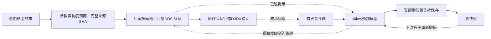

# 引擎命題與證據關聯

閱讀引擎原理先看[現行引擎工作理論](機制總覽.md#v08-mechanism)，再依連結進入本檔對應T正文。**T正文是各項現行理論的主位置；下方各輪工具分析是論證材料。** 新結果依[研究契約](../04_工作封包/04_最小交付驗收.md#v08-theory-writeback)整合進正文；僅更新分析區不算理論整合完成。

## 命題承接與閱讀分工

現行T承接R04、R24、R01的既有模型與後續具名證據；五個資料推斷單元分別見[來源辨識](#t13-inference-result)、[容量與資源](#t19-resource-inference)、[內容有效期](#t20-inference-result)、[品質與代價](#t29-inference-result)、[停用恢復](#t31-inference-result)。各批次原範圍保留，不能以早期「沒有新增GE結果」概括後續r30／r36，也不以後續正向抹除原失敗。

Floor對應T08／T09；生命週期對應T20–T22、T30–T31、T38，T18是Anagra增尺寸。L11內部R07仍按T15解讀，不與來源R07混用。同源轉述不增加獨立支持；[來源去重](../03_證據與歷史/來源索引.md#v08-dedup)保存判讀規則。任務沿[權威指標](../01_決策與計畫/研究支線狀態.md#current-handoff-checkpoint)查Issue／Project，T不維護活動進度。

按問題進入現行正文；T補充段仍屬該命題，C摘錄展開回查。歷史摘錄保留撤回、反例與原定位，不因折疊而失效。

| 需要查的內容 | 現行論證入口 |
| --- | --- |
| 身份、來源、封包及內容 | [分層身份T01](#t01)、[Ceil T03](#t03)、[Floor T08](#t08)、[來源選取T10](#t10)、[封包契約T34](#t34) |
| 載入、材質與消費 | [provider T13](#t13)、[IXO T16](#t16)、[Cafe T17](#t17)、[Anagra T18](#t18)、[端到端T24](#t24) |
| 容量、更新與觀測 | [容量T19](#t19)、[新鮮度T20](#t20)、[stateblock T21](#t21)、[draw T22](#t22)、[零命中T23](#t23) |
| 存讀與遊戲狀態 | [存讀入口、模式與採用T43](#t43) |
| 平台事件與更新責任 | [訊息、計時器與共同入口T44](#t44) |
| 品質、成本與恢復 | [mip T28](#t28)、[品質T29](#t29)、[持有T30](#t30)、[恢復T31](#t31) |
| 工具原理及採用界線 | [資格T32](#t32)、[解碼T33](#t33)、[封包T34](#t34)、[文字入口T35](#t35)、[實作承接T40](#t40) |
| 查程式定位與推理過程 | [代表原碼分析](#v08-tool-analysis)、[相依分析](#v08-tool-deepening)、[SK替代](#sk-d3d9-alternative)、[非同步／裝置](#sk-async-device)；均為支撐材料，現行結論仍回對應T |

## 1. 命題、來源與證據層級

每個T節是機制的現行主位置；C子節保存原帳本原義與歷史評估。承接狀態指該命題的證據資格，不是活動進度或新測試結果。T節的G／決／封包舊連結保留原交接關係；目前活動進度與缺件沿[支線權威指標](../01_決策與計畫/研究支線狀態.md#current-handoff-checkpoint)查Issue／Project，具體方法以[封包3](../04_工作封包/03_首輪判別設計.md#v08-core-contract)為準。當來源缺原件或身份異常，主張仍可保存，但不能用作直接複核的正證。支持、反例、未知與撤回分開；外部契約不補成遊戲行為。

每項命題仍保留「結論、版本／條件、直接證據、推導、反例／未知、修改影響」；重用時依問題選下列表示，不把所有材料壓成同一張摘要卡。GE原指令／當次觀測、舊工具模型、SDK契約、歷史轉述與條件推論須按來源辨識；REA的observed／derived／inferred是工具證據分類，不能取代本檔對引擎主張的審核。原始工具輸出與執行收尾回來源／歷史，操作步驟回封包。

### 依相似引擎案例選擇可重用的表示

以下是對既有資料的分析與轉化方式，對應[同條件案例及實讀範圍](../03_證據與歷史/來源索引.md#engine-research-recording-cases)。它們服務既有五視圖，不另立引擎架構或任務狀態。**共同定位鍵是既有T錨點＋來源／版本＋具名物件或分支；不同活動的同名物件不因共用名稱就合併。** 可讀正文保存解釋，表／圖保存關係與條件，原始證據保存實際值；目前沒有由這些表自動生成GE parser、REA型別庫或重播器。

| 要反覆使用的知識 | 借用的案例方法 | 本案採用的表示及已整理位置 | 重用時不能省略的條件 |
| --- | --- | --- | --- |
| 檔案內有哪些欄位、如何解讀 | NifTools將版本、型別、條件與繼承寫入格式描述；openage用欄位表及具名樣本 | **布局表**：基準、相對位置、位寬／數量、讀取條件、語義、未知；見[IXO header](#t16-ixo-layout)。完整封包規則仍在[T34](#t34) | 檔案offset、載入後offset及runtime成員分開；樣本可讀不證安全writer。只有布局足夠且有實際工具需求時，才把已核子集轉成可執行規格 |
| 哪個物件持有哪些資料、交給誰 | librw分Frame／Camera／Geometry／Atomic及Driver／Device；OpenGOAL保存型別與方法定義 | **物件關係表**：兩端型別、引用／計算／供值種類、欄位或入口、共享及未配對處；見[場景物件](#t16-scene-state-boundary)、[跨層接合](#conditional-model-joins) | 原名與推定名分開；引用不等擁有或獨占。只保留已核布局，不由相似類名搬入另一引擎欄位 |
| 輸入變動後何時重算、何時失效 | librw的dirty hierarchy；DX-Ball的state／transition表 | **狀態轉移表**：前態／旗標、觸發、動作、後態、輸出及未核上游；見[矩陣求值](#t16-property-evaluation)。資源公開／清理另見[T16](#t16-texture-publication) | getter可能有副作用；清旗標、清引用與GPU完成不同。未核觸發時機仍標缺口 |
| 一個請求如何到實際繪圖 | OpenGOAL分計算、渲染、顯示及bucket；Dolphin分frame／object／command | **時序表與流程圖**：生產者、發布／消費、使用資料的時點、返回值代表什麼；見[命令執行](#t16-command-execution)及[draw／target](#t16-draw-target) | GE的佇列、device與批次依本案證據命名；不搬PS2幀數、DMA或Dolphin的object定義。跨批次不能當同幀 |
| 局部演算法能否直接拿來實作 | REA／DX-Ball把函式、caller、常數、相依與驗證分列；OpenGOAL另存cast修正 | **函式契約表**：入口、實參、公式、寫回／副作用、有效輸入、驗證層級；見[half-texel](#t16-blend-texel-offset)、[變換](#t16-transform-camera)、[骨架](#t16-skin-matrix-update) | 原指令優先於漏參數偽碼；靜態公式不等數值差分已驗。矩陣慣例或未明相依不能以命名補齊 |
| 哪個說法被哪些資料支持 | DX-Ball分Evidence定位、維持的規則與Acceptance；OpenGOAL保留疑點 | **主張—證據—反例鏈**：主張限度在T，原件／Evidence ID在來源，實驗窗口及結果保持原活動；見[REA應用](#rea-application-method)與[11接點核對](../03_證據與歷史/來源索引.md#engine-edge-analysis) | 引用、原bytes相符及同源重述不增加獨立實驗。未知要保留能改判的觀察，不只寫「待確認」 |
| 哪些原理足以支援某項功能 | OpenRAC將既定、提議及未決分開，圖中標交接；既有GTA2筆記由現象回到修正 | **用途／條件矩陣**：所需資料、已有入口、尚缺橋梁、失效時重查哪個T；見[T32功能](#t32-feature-feasibility)及[光照方式](#t32-lighting-structure-options) | 機制已知、方法可提、路線採納及產品有效是不同欄；不由文件完整度選路 |

**更新與沿用。** 新問題先以用途矩陣找到所需關係，再查對應布局、物件、狀態或時序；從結論回到原件核版本與條件。新證據只改受影響的規則及其下游連結；未知欄位保留未知，反例保留適用條件。換EXE／資產版本要重核相依位址與布局；換來源或裝置不沿用原活動的物件身份；只換呈現格式不新增GE證據。這是不同表示共用同一理論的維護方式，不要求每個T複製七張表。

C摘錄的歷史檢視類型集中於[共用標記及適用C編號](../03_證據與歷史/來源索引.md#historical-review-coverage)，個別身份隔離、原義、反例及缺件仍留原C。

### REA的應用：從原件得到局部規則，再核對實際使用

REA在本案的角色是提供具名EXE、函式、指令、引用與資料的分析證據；**代理依證據提出解釋／實作，離線對照、原生宿主及GE觀測再各自檢驗不同主張。** REA不是高清圖生成器，也不自動決定介入位置。以下依[外部案例與讀取範圍](../03_證據與歷史/來源索引.md#rea-application-cases)整理用法；它們支持研究方式，不替GE補機制證據。

| 外部案例的做法 | 對應本案已有應用／可借用判讀 | 仍不能推出的結論 |
| --- | --- | --- |
| DX-Ball以原指令、caller與常數補反編譯缺漏，再分原函式差分及歷史編譯器吻合 | [T13](#t13)的參數／回傳／read鏈、[T19](#t19)的長度與SourceInfo，均須以原bytes及使用處核偽碼。已知caller與getter誤歸的修正保留，不能只留下乾淨公式 | 原指令支持的分支不表示指定資產已執行它；本案沒有因此取得DX-Ball式全函式差分資格 |
| TH04先核載入映像／重定位，再對運算寬度及回繞；保留命名常數漏掉unsigned造成編譯差異的反例 | [T34](#t34-runtime-relocation)分磁碟PRES欄位與執行期搬移，[T13名稱key](#t13-qpck-name-key)保留位元序、初值及名稱轉換。可讀名稱不取代位址／欄寬，整理後仍須保留原語義 | 16-bit DOS規則不套給GE；「可解析」與「完整原行為」仍分判，無須為貼圖修改追求整個EXE逐byte重建 |
| Notion沿API→wrapper→channel→receiver，另看後續port交接及模組測試 | [T16](#t16)沿FileTexture→resolver→holder→材質，以及命令入列→worker→底層裝置；每次交接需查實參、所持物件及執行責任 | 同名函式、成功返回或命令已送出，都不能省掉接收端／執行時點；JS的IPC機制不當GE實作 |
| Calculator分啟動器與真正模型DLL；用公開源碼協助解讀但不冒稱同build | 本案固定GE EXE、同族工具、SDK及他作案例分開。GECV等可給候選格式／命名，GE原件才決定本案規則 | 同系列工具可讀不證同版本引擎使用；公開source／反編譯名稱不能直接命名未知欄位 |
| Dinosaur把被動腳本分析、另行控制原程式、重建局部規則三者分開 | [T29](#t29-mip0-comparison)分控制已實作、取樣覆寫曾執行、地板是否改善；[T23](#t23)分觀測窗口與遊戲完整性 | 教學畫面能跑不證完整遊戲重建；mip0覆寫成功與純色覆蓋不能直接證正常材質變清楚 |
| 東方Factory把證據、語義命名、byte吻合與產品執行分開，保留跨作品方法而不轉移事實 | 依既有T／來源／歷史分工保留每項規則的依據、反例與未知；[T24](#t24)分局部鏈、基地暫用接受與完整品質 | 不能把所有東方歷史成果歸REA；也不能把其完整重建順序、完成率或重建需求加為本案全部前置 |

本次以四種標記閱讀各節：**已確認·靜態**是具名原指令／保存結構所支持的規則；**已確認·觀測**另標離線、宿主、GE或使用者回報及版本／窗口；**條件推論**寫明前提與可反駁點；**缺口**指尚缺哪項關係，包含明確未讀、觀測不到及競爭解釋未分。外部案例／API契約獨立標來源，不升格為GE觀測。REA的observed亦可能只是觀察到靜態指令，不能單由該標籤改判GE已執行。

同一規則的記錄仍用本節既有六項責任：輸入／輸出和條件在T正文，精確原件身份與Evidence定位回來源；從偽碼修正得來的規則保留原失敗／歧義。需要驗證實作時，按實際改動選離線表示、原生API、當次GE採用或畫面比較，不以增加REA查詢次數代替缺少的觀測。總覽的[流程與斷點](機制總覽.md#v08-relations)將這些規則接成可讀模型；[多種可重用表示](#engine-reuse-representations)承擔不同查詢，不用全案完成百分比或文件形式決定研究路線。

## 2. T01｜分層身份

**結論與適用條件：**入口識別粒度只有沿選檔、快取、綁定及使用時點保留，才能支撐相應作用域。下方工具反例與補救限定各自版本，不宣稱GE使用相同架構；當前修改基線與歷史身份沿用亦分開判斷。

**承接狀態：**保留機制界線。

同位元組、檔名、key 或指標均不自動等於語義 owner。封包身份與執行期身份要有明確 join。

**跨層接合的條件模型。** 本案理論對象是既有環境資產的來源、表示、載入、引用、消費及失效／恢復關係；不以高清產品通過替代理論充分，也不宣稱涵蓋整個遊戲引擎。既有五視圖共用這些對象與事件，不能把各視圖中的「貼圖」默認成同一實體。每項接合須指出兩端身份、關係種類、發生條件及有效區間；所需區別依下表判定，不建立新資料schema。

| 需要接合的關係 | 成立所需的橋梁 | 缺橋梁時保留的分支／可反駁主張 |
| --- | --- | --- |
| 封包記錄→實際讀入表示 | 同版選中記錄、來源開啟身份、讀取／轉換的輸入輸出區間；快取另接填入及失效世代。內容hash只核表示 | 來源身份與供給方式是兩軸：指定成員也可經快取供給，同次請求可含快取前段與補讀後段。只對實際覆蓋區間判傳遞；觀測不到底層I/O不反駁來源，另一來源的局部事件不反駁其餘區間。見[T13](#t13) |
| 載入物件→IXO引用→材質使用者 | 分開handle、實體、Texture／Surface及引用槽；查成功callback後誰寫哪個槽、是否配置／複製，及下游實際解參照 | 同一實體別名、不同實體共享資源、內容複製為獨立資源與fallback皆可能；同名／同hash不裁決。即使實體不同，也不能直接推GPU資源獨立。見[T16引用](#t16-ixo-consumption)、[公開／清理](#t16-texture-publication) |
| 記錄命令→API實際使用的內容 | 同次命令順序、目的device、所引用物件的有效期及真正讀取內容的時點 | 數值副本與指標延後讀取分判；記錄時內容可以和消費時不同。既有VB延後上傳反駁一般化的「入列即已凍結資料」，不代證IB或每個writer。見[T16命令](#t16-draw-target) |
| draw→目標→呈現 | 同次資源／狀態、有效觀測窗口、影像位置與必要後續消費；介入另核實際改到被消費的通道 | query計數、目標差分和內容特有可見作用不同。RT0零差分不排除其他draw／目標／時段；正值不證指定貼圖有像素。見[T16可見性](#t16-target-consumption)、[T23](#t23) |
| 停止介入→既存內容失效→恢復 | 分停用後新請求、已載物件／引用及新程序；每次恢復核對其聲稱的對象 | adapter不再准入不推出已載替換消失；重啟回原內容不推出原程序熱撤回或畫面已恢復。見[T20](#t20)、[T31](#t31) |

**接合不能由兩段各自成立自動推出。** 只有中間實體、關係及時間前提相容，才可連成條件路徑；跨活動可形成待驗模型，不能形成當次實測鏈。例：r30的D3DX輸入→返回→draw，與CafeWall的FileTexture→材質引用，尚無同次物件／實例橋梁；r36的幾何／投影又有來源採用前提，三者不能合成已知表面。反向由畫面相似尋來源同樣只能提出候選，不能把多對多關係反轉為唯一映射。

**模型的反駁責任。** 在同版及明列前提下，分支須產生不同的預期關係或事件；證據違反預期才否定該分支。兩分支對現有觀測同樣相容時，保留不可區分；缺區間、覆蓋或輸入資格時標不足／無效，不改稱反例。外部[PROV衍生概念](../03_證據與歷史/來源索引.md#theory-structure-methods)協助分開使用、生成與影響，不能自動證因果。全模型的分支與判別需求在[總覽](機制總覽.md#hypotheses)，各機制的原指令、反例及版本仍由對應T保存。

**歷史延續與當前修改基線（2026-10-19條件推論）：**建立當前資產基線不要求先與S64相同；它要求固定當前來源、可靠選中目標及所用表示，並另接相關使用、介入與恢復責任。S64相符只可能讓依賴相同bytes且前提仍成立的歷史證據沿用，不會補上歷史本就缺的獨立排列、owner／表面或當前工具資格。包／outer已有獨立身份也不表示成員身份已知。[現存來源](../03_證據與歷史/來源索引.md#baseline-current)與[T34的定位模型停止](#t34)支持此分層；這是研究相依的澄清，沒有新增GE行為證據。若仍用同一outer定位Ceil，既有模型及名稱歧義缺口不能因另立基線消失；另一條具名資源識別途徑若能獨立證明當前內容與作用範圍，才可不依賴PRES完整解析或S64同一性。兩途徑均未由本次推論授予可修改資格。

[四類解析](#v08-tool-analysis)與[相依深化](#v08-tool-deepening)進一步具名化分層身份：來源key、壓後payload hash、mip0有效列hash、完整表示、資源物件與表面owner是不同等價關係。Toolkit的tight-row hash未含尺寸／format／其餘mip／device；相同byte串可在不同表示下得到相同hash，無須發生隨機碰撞。故用較粗身份管理較細作用域時，須另有表示、有效期及使用者條件；不能由map唯一命中推單表面選擇性。固定codec／同源BLZ往返也只支持所用前提下自洽。這些是工具事實及條件模型；取得具名descriptor／使用關係可縮小歧義，不改寫既有GE正向範圍。

**位置相等與來源映射相等不同。** [QPCKHelper／TINY原碼](#v08-qpck-static)只要求兩包count相同，再以同index的GetData結果做SequenceEqual，未比hash／offset／宣告size。故每列payload相同而key改變時可報N；若key-content映射不變但記錄順序交換，可報Y。只在已另證key對應、順序及完整讀取成立時，才能把它用為對應成員的內容差異工具；仍不能證表面消費。這不是隨機hash碰撞問題，而是比較器沒有觀察該欄位。

GetData沒有核實讀長度；相同短讀前綴或兩個空實讀也可能相等，不能由SequenceEqual為真授完整成員。若兩包數目不同，caller明確拒比較，這是工具能力邊界，不是兩包內容不相容的引擎結論。以上是原碼與條件推演；新版本若按key及重複key政策匹配、逐項證長度，可縮限反例。Ceil同payload別名、L11成功record到使用的既有界線不受此取代。

**識別必須沿選取路徑保持，不能只核hash函式。** [Special K相容續析](#v08-sk-identity)把Toolkit的64位元mip0像素key，與另一個32位元SK查找值分開：D3D9一般上傳用mip0有效列CRC32C；D3DX入口若取得非零整份來源buffer CRC並成功tag／readback，則以該CRC覆寫SK查找值。來源檔header／其他mip是否被涵蓋因入口不同；D3DX要求的尺寸、filter等建立參數未直接加入這些key；先前「SK一律top-mip」只適用一般像素分支。這個補救不能解除粗粒度限制：tracked／replacement／failed／pending及SetTexture選替換仍用64位元像素hash；同device、同mip0但來源CRC不同的兩項，在已有成功替換時不各建一份，較細入口差異可在後續合併。

**相同CRC名稱也要核讀取範圍。** 固定兩庫均採CRC32C多項式與前後反相的串接約定，支持相同有效byte串及合格初始化下的條件相容；不證所有caller讀同bytes。Special K固定D3D9 BC padded分支每次讀stride×4，Toolkit只讀一個block row；Special K D3D11 BC tight分支用H/4+H%4，與ceil(H/4)在餘數2／3時不同。D3D11 padded分支另會跳過值為零的中間CRC。故正常相容與具名反例並存，註解「永不相異」不能代版本限定的路徑核對；是否在GE遇到該條件仍未知。

**Special K D3D9提供有條件的替代，並非所有下游實作都重落mip0鍵。** 固定提交的memory Ex路徑把整份來源CRC沿wrapper、候選表、cache、in-flight與override維持為同一32位元鍵；兩來源CRC非零且不同、正常獨立載入完成時，即使mip0相同也不因Toolkit的像素鍵合併。此正向限該入口，不授D3D11／Lock路徑或無碰撞保證。相反，同來源但不同device、尺寸／格式／mip請求及owner，仍未加入全域cache鍵；開啟cache時可先命中舊wrapper而略過新的建立參數。故它能保留一種原先丟失的來源差異，仍不能由CRC直接得到單表面控制。已定位boot→Init／Hook及D3DX9_43在場條件，沒有對應binary或GE實際hook／caller證據。[替代路徑與反例](#sk-d3d9-alternative)

**裝置身份不能由執行緒保護代替。** 固定SK的非dummy建置路徑在啟用d3d9_mod時加D3DCREATE_MULTITHREADED，確有背景D3D9呼叫的補救；但manager／datastore仍是程序內共用實例，cache鍵未含device。Present換裝置會清render backend持有者，Reset也有按primary／pool處理；不能概括成「外層完全沒清理」。這些路徑未把所有原cache清空或分裝置，且同checksum在途重導只改pDest而不改原job的pDevice。故原裝置建立的結果與新目的物件能否配對仍是獨立資格；只在舊cache／job仍存、相同key再用且沒有其他隔離時成立條件反例，未證GE發生。[非同步與裝置分析](#sk-async-device)

**缺口與下游：**[G06](../01_決策與計畫/研究支線狀態.md#g06)；[決01](../01_決策與計畫/決策表.md#decision-01) → [封包1](../04_工作封包/01_來源與基線.md#purpose)、[封包2](../04_工作封包/02_代表資產可比性.md#purpose)、[封包3](../04_工作封包/03_首輪判別設計.md#purpose)、[封包4](../04_工作封包/04_最小交付驗收.md#purpose) → [驗收：來源資格](../04_工作封包/04_最小交付驗收.md#accept-evidence)。

C42 原帳本摘錄與歷史評估（保留原義）

#### C42｜修訂5執行

**原義：**provider tuple對應與材質owner及實際consumer分離。

**來源：**[S16](../03_證據與歷史/來源索引.md#s16)；定位：/scope；本次來源狀態：已定位。

**原帳本摘錄（節錄）：**

> Exact equality is candidate correspondence, not material binding or actual game use.

**歷史評估（保存，不自動承接）：**共通身份契約不把名稱／bytes一致當相同語義。

**外部背景：**[X03](../03_證據與歷史/來源索引.md#x03)、[X34](../03_證據與歷史/來源索引.md#x34)。

**歷史交接：**[C42追溯列](../03_證據與歷史/來源索引.md#map-c42)。

C68 原帳本摘錄與歷史評估（保留原義）

#### C68｜理論繼承／角色證據／完成邊界

**原義：**Descriptor and catalogue are not independent corroboration.

**來源：**[S55](../03_證據與歷史/來源索引.md#s55)；定位：/qualification/constructedDescriptor；本次來源狀態：已定位。

**原帳本摘錄（節錄）：**

> Original query.provider and catalogue descriptor derive from same accepted report; no new independent provider observation.

**歷史評估（保存，不自動承接）：**Two consistent reports can share one observation; exact owner is not proven by equal content.

**外部背景：**[X03](../03_證據與歷史/來源索引.md#x03)、[X25](../03_證據與歷史/來源索引.md#x25)。

**歷史交接：**[C68追溯列](../03_證據與歷史/來源索引.md#map-c68)。

## 2. T01a｜批次替換的未知移轉

**承接狀態：**保留風險命題。

大量替換不會消除身份不確定，會把問題移到別名、材質語義、alpha、mip、記憶體與生命週期。

**命名相容不保證選擇粒度相容。** Toolkit接受Special K樣式的第一段8hex後，可接受多個8hex／TYPELESS後綴，但只將第一段放進單值索引；同資料夾排序後的先入項保留，跨mod依既有順位，等順位16hex Toolkit名稱優先。因此兩個同top、不同full後綴檔不能僅靠後綴分開。原版Special K的固定D3D11實作也不可理想化：雖有full-mip累積函式、複合tag與extended表，所讀scanner先登top-only，後登full；IsTexHashed檢查top存在而使後者略過。這是該呼叫路徑的靜態反例，不是全部Special K版本／API都沒有細分能力。批量採用前須核輸入域、登錄順序、快取及fallback；增加名稱欄位不等於增加可獨立控制的表面。[完整路徑與反轉條件](#v08-sk-identity)

**缺口與下游：**[G08](../01_決策與計畫/研究支線狀態.md#g08)；[決05](../01_決策與計畫/決策表.md#decision-05)、[決06](../01_決策與計畫/決策表.md#decision-06)、[決07](../01_決策與計畫/決策表.md#decision-07) → [封包2](../04_工作封包/02_代表資產可比性.md#purpose)、[封包3](../04_工作封包/03_首輪判別設計.md#purpose)、[封包4](../04_工作封包/04_最小交付驗收.md#purpose) → [驗收：高清品質](../04_工作封包/04_最小交付驗收.md#accept-quality)。

C46 原帳本摘錄與歷史評估（保留原義）

#### C46｜修訂5執行

**原義：**全量替換不能消除身份不確定性。

**來源：**[S03](../03_證據與歷史/來源索引.md#s03)；定位：/historicalConclusionLedger/2/correctedConclusion；本次來源狀態：已定位。

**原帳本摘錄（節錄）：**

> Bulk replacement converts identity uncertainty into semantic, alias, format, alpha, mip, memory and lifecycle risks.

**歷史評估（保存，不自動承接）：**支持按語義／適用範圍區分及未知fallback；不新增實作。

**外部背景：**[X28](../03_證據與歷史/來源索引.md#x28)、[X34](../03_證據與歷史/來源索引.md#x34)。

**歷史交接：**[C46追溯列](../03_證據與歷史/來源索引.md#map-c46)。

## 2. T02｜六別名與內容載體

**承接狀態：**有範圍支持。

同 payload 的六個別名不是六個獨立消費者；atlas rows 33/37 與 F8A2 identityAnalysis 只支持載體關係。

重開L01指定兩組rows與F8A2結果後，Ceil的set0–5/member33皆記同一absolute offset92432057、packed32873及同raw hash；Floor的set0–5/member37亦各記同一offset92508457、packed34552及自己的同raw hash。這是同一atlas活動的投影記錄，不是六次獨立讀取或runtime使用證據。**條件推論：只比較這兩組的匯出內容，可能無法揭露錯誤country遍歷，因為不同locator預期內容本來就相等。** 因此不能拿「六份匯出都一樣」驗證country parser；需要原始各表位置／record，或已具名且有差異的country資料。這是對判別力的推論，沒有證明該歷史atlas遍歷錯誤。[本次原件與實讀範圍](../03_證據與歷史/來源索引.md#case-static-sources)

[GECV／GEBCS／Sharp比較](#v08-core-results)顯示內容共用至少還要區分「同舊offset」「同新payload」及「同表面使用者」。GEBCS依舊offset去重遇新內容分歧的條件反例，與GECV按新內容hash去重，是不同工具責任；都不能證明六別名各自被誰消費。若要只改其中一項，共用引用是否必須拆開取決於預期作用範圍與實際引用，而非名稱數量。此為比較模型，未證六別名在本機符合某writer反例，也沒有新增或抹去歷史載體關係。

同起點聚合比同payload更弱。[RTBL／Global原碼](#v08-rtbl-global-analysis)的RDP字典以來源類別分表，再以RealOffset聚合檔名；沒有把長度、來源epoch或內容hash納入key。條件反例是同類RDP同起點而長度不同的兩個record：它們會落在同組，但讀出的範圍可以不同。此為工具投影的資訊損失，不撤回L01具備長度／hash的六別名歷史結果，也不推出GE有兩個已知consumer。離線拆引用或混合辨識若使用此投影，須回到原record補範圍與內容身份；不能由分組數推消費者數。

**後續研究來源：**[N01](../03_證據與歷史/來源索引.md#n01)（[L01](../03_證據與歷史/來源索引.md#l01)）。

**缺口與下游：**[G05](../01_決策與計畫/研究支線狀態.md#g05)；[決04](../01_決策與計畫/決策表.md#decision-04)、[決09](../01_決策與計畫/決策表.md#decision-09) → [封包2](../04_工作封包/02_代表資產可比性.md#purpose)、[封包3](../04_工作封包/03_首輪判別設計.md#purpose)、[封包4](../04_工作封包/04_最小交付驗收.md#purpose) → [驗收：材質／表面關聯](../04_工作封包/04_最小交付驗收.md#accept-surface)。

## 2. T03｜Ceil 封包與輸出配對

**承接狀態：**有範圍支持。

保留 packed 32873／raw 87544 的配對及研究包零基 1247／顯示 1248。配對不證明排列與表面。

**2026-10-20新基線與REA修正：**當前字面候選stored bytes仍與歷史packed相同。先按Candidate884實體順序重現L02 raw／舊normalizer hash，僅證舊模型可重現；REA對當前固定EXE的blockzip原地入口0x1e28862與vector入口0x1e28b75均確認「保存第一壓縮塊、依序解後塊、最後解首塊」。016原指令可區分暫存與解壓，024的vector helper按索引末尾追加，故不是偽碼表面順序造成的推定。這是binary對工具模型的外部判據，支持修正舊實體順序，不能再把舊預覽觀感或hash當遊戲內容正確的依據。vector的分段表／實得長度與AL返回契約另見[T13](#t13-vector-output)，不將第一段當連續完整raw。

0x2121b98的type 4分支先讀圖數及每圖長度，再逐圖交0x21210d7，後者按指定長度讀資料並呼D3DXCreateTextureFromFileInMemoryEx。將已保存候選按首塊延後規則解碼，開頭自然得到count=1、length=87536及DDS header；DDS取raw[8:]即可，不需Candidate884的固定65544位置或最高mip搬移。新raw／DDS與舊模型完整hash不同，9層BC3可解；舊高清衍生物退出採用。此為具當前引擎靜態依據的候選表示，仍需遊戲實際傳入內容或同次完整資源判據，才可確認這份Ceil實際採用與表面。記憶體stream的讀取實作現已接實，短讀與長度傳遞限制見T19；未解PRES語義與當次Ceil採用仍不由靜態鏈補造。[REA與修正版身份](../03_證據與歷史/來源索引.md#current-ceil-representation)

同一舊DDS的Pillow與GEHD_BC3_RGBA8_V1只差RGB最多1、alpha相同，仍是有效的正規化規格比較；它不能解釋或抵銷這次byte排列差異。新舊表示、解碼器規格及runtime證據分開。

本次重新取回L02兩原件，hash與既有登錄相符；按固定codec所述欄位唯讀檢視，未調用codec。packed在offset4宣告raw87544；UInt16長度位於32與24446，值為24412與8425，兩段終點恰為32873，沒有零長段或尾隨bytes。這排除「這份保存wrapper含零長塊」的解釋；不能推所有GE零長語義，也不能證明未來重編輸出或解壓行為。

保存raw開頭為FFFF0000，不能直接當標準DDS；offset65544則有`DDS `，header size124、pixel format size32、256×256、linear size65536、9mip與DXT5，前方private length欄87536。這些byte觀察與Candidate884固定表示相容，提供了欄位層的正向支持；Microsoft DDS契約能解釋標準header，不能選出GE實際排列、證成中間header的全部語義或像素正確。S64及L01是同生成／衍生鏈，未增加獨立解碼票數。[欄位與來源](../03_證據與歷史/來源索引.md#case-static-sources)

可反駁預測：若後續同身份原件顯示這些欄位／區間不同，先查原件身份及讀取位置；若獨立reader或實際consumer要求另一排列，修正表示模型，不能以header相容否定它。原始壓縮區間已回答；獨立排列、材質使用及替換接受仍不足。

**後續研究來源：**[N02](../03_證據與歷史/來源索引.md#n02)（[L02](../03_證據與歷史/來源索引.md#l02)）。

**缺口與下游：**[G02](../01_決策與計畫/研究支線狀態.md#g02)；[決03](../01_決策與計畫/決策表.md#decision-03)、[決09](../01_決策與計畫/決策表.md#decision-09) → [封包1](../04_工作封包/01_來源與基線.md#purpose)、[封包2](../04_工作封包/02_代表資產可比性.md#purpose)、[封包3](../04_工作封包/03_首輪判別設計.md#purpose)、[封包4](../04_工作封包/04_最小交付驗收.md#purpose) → [驗收：內容可信度](../04_工作封包/04_最小交付驗收.md#accept-content)。

C83 原帳本摘錄與歷史評估（保留原義）

#### C83｜交接保真／證明層級／候選內部決策

**原義：**Ceil_04 intersection resolves zeroIndex1247/display1248 only.

**來源：**[S64](../03_證據與歷史/來源索引.md#s64)；定位：/indexInterpretation/zeroBasedInterpretation/limitation；本次來源狀態：已定位。

**原帳本摘錄：**

> The intersection resolves this experiment source locally; it does not establish a universal legacy index convention.

**歷史評估（保存，不自動承接）：**保留兩種索引反證，不把本例慣例泛化；歷史package身份不是目前Gina carrier。

**外部背景：**[X23](../03_證據與歷史/來源索引.md#x23)、[X45](../03_證據與歷史/來源索引.md#x45)。

**歷史交接：**[C83追溯列](../03_證據與歷史/來源索引.md#map-c83)。

## T03 補充｜歷史載體容量與低熵 marker

來源 [R16](../03_證據與歷史/來源索引.md#r16)／[R17](../03_證據與歷史/來源索引.md#r17)。2026-10-08 的具名載體研究是另一個歷史包快照：entry1247 offset 91809625、outer 1706816 bytes、outer SHA-256 30DCEACD8A443DE3B57BE92ECB1CCAC74C6524DE0C0A5E6EA2EFBCB6A2EA0FBF。六列 Ceil 共用一個 span，原壓縮 32873 bytes、可原地容納 32880；重編碼 32884 超出 4 bytes。這支持拒絕該次直接覆寫，並不要求壓縮長度一定等於原來的 32873。

該布局若向後移動，涉及後方 52 個實體 spans／282 個 offset 記錄；它不是目前研究包 outer3175600 或現行安裝的已驗證布局。不能跨包套用槽位大小。歷史 marker 384 bytes、七項內容／載體檢查及三項變異負控制、六長度欄同步、81 其他 span 不變、outer 精確 inverse，支持該低熵配方的有界離線控制；不支持一般高清內容能塞入、原生 decoder 接受或安裝恢復。

決策影響：決03／決09 不必重做相同 marker 來取得相同資訊；若未來改尺寸／寫入，需另核實際版本容量與 metadata。[Ceil 停止條件](../01_決策與計畫/研究支線狀態.md#ceil) 保留。

## 2. T04｜編解碼自洽的證據上限

**承接狀態：**修正證據層級。

晚期七項離線檢查與 roundtrip 只支持所綁定工具的自洽；共同排列假設與同一 zlib 不構成獨立 oracle。

**後續研究來源：**[N03](../03_證據與歷史/來源索引.md#n03)（[L03](../03_證據與歷史/來源索引.md#l03)）；[N04](../03_證據與歷史/來源索引.md#n04)（[L04](../03_證據與歷史/來源索引.md#l04)）。

**缺口與下游：**[G02](../01_決策與計畫/研究支線狀態.md#g02)；[決03](../01_決策與計畫/決策表.md#decision-03)、[決09](../01_決策與計畫/決策表.md#decision-09) → [封包1](../04_工作封包/01_來源與基線.md#purpose)、[封包2](../04_工作封包/02_代表資產可比性.md#purpose)、[封包3](../04_工作封包/03_首輪判別設計.md#purpose)、[封包4](../04_工作封包/04_最小交付驗收.md#purpose) → [驗收：內容可信度](../04_工作封包/04_最小交付驗收.md#accept-content)。

## 2. T04a｜晚期 exact-slot 報告

**承接狀態：**來源身份異常。

S65 候選與歷史釘選不符；保留 C85/C86 原義，不能直接承接成已確認完整性或消費結果。

**缺口與下游：**[G11](../01_決策與計畫/研究支線狀態.md#g11)；[決03](../01_決策與計畫/決策表.md#decision-03)、[決09](../01_決策與計畫/決策表.md#decision-09) → [封包1](../04_工作封包/01_來源與基線.md#purpose)、[封包2](../04_工作封包/02_代表資產可比性.md#purpose)、[封包3](../04_工作封包/03_首輪判別設計.md#purpose)、[封包4](../04_工作封包/04_最小交付驗收.md#purpose) → [驗收：內容可信度](../04_工作封包/04_最小交付驗收.md#accept-content)。

C85 原帳本摘錄與歷史評估（保留原義）

#### C85｜交接保真／證明層級／候選內部決策

**原義：**Observed mismatched report claims one exact-slot feasibility result.

**來源：**[S65](../03_證據與歷史/來源索引.md#s65)；定位：/exactSlotResult/meaning；本次來源狀態：身份異常。

**原帳本摘錄：**

> At least one deterministic candidate-884 canary can occupy the original compressed member slot without changing the PRES member size or following package offsets.

**歷史評估（保存，不自動承接）：**僅記錄現檔主張，不提升為root接受事實；即使身份解釋成立，也不是通用HD增容或遊戲接受。

**歷史證據／決策標記：**AUTHOR_SOURCE_CHECK_NOT_INDEPENDENT_NOT_REPLAY；IDENTITY_QUARANTINED_REPORT_ONLY。

**目前限制：**所見候選與釘選雜湊不符；可保存內容線索，不可視為相同原件或據此接受結果。

**外部背景：**[X42](../03_證據與歷史/來源索引.md#x42)、[X35](../03_證據與歷史/來源索引.md#x35)。

**歷史交接：**[C85追溯列](../03_證據與歷史/來源索引.md#map-c85)。

C86 原帳本摘錄與歷史評估（保留原義）

#### C86｜交接保真／證明層級／候選內部決策

**原義：**Report itself excludes private-header semantic validity.

**來源：**[S65](../03_證據與歷史/來源索引.md#s65)；定位：/doesNotProve/1；本次來源狀態：身份異常。

**原帳本摘錄：**

> The preserved private BLZ4 header is semantically valid for changed content.

**歷史評估（保存，不自動承接）：**保留同槽位可行與私有語義／實機有效性的分界；不以文字hash等價補工程證據。

**歷史證據／決策標記：**AUTHOR_SOURCE_CHECK_NOT_INDEPENDENT_NOT_REPLAY；IDENTITY_QUARANTINED_REPORT_ONLY。

**目前限制：**所見候選與釘選雜湊不符；可保存內容線索，不可視為相同原件或據此接受結果。

**外部背景：**[X23](../03_證據與歷史/來源索引.md#x23)、[X35](../03_證據與歷史/來源索引.md#x35)。

**歷史交接：**[C86追溯列](../03_證據與歷史/來源索引.md#map-c86)。

## 2. T05｜first-stream-last 的適用範圍

**承接狀態：**同版機制已核；Ceil表示有靜態依據，遊戲當次採用待證。

[T03](#t03)承接同版EXE規則及Ceil r3表示，已超出舊工具之間同輸出的支持範圍；仍不能由兩工具相同輸出增加獨立支持，或外推其他資產及當次遊戲使用。

**後續研究來源：**[N05](../03_證據與歷史/來源索引.md#n05)（[L04](../03_證據與歷史/來源索引.md#l04)、[L05](../03_證據與歷史/來源索引.md#l05)）。

**缺口與下游：**[G02](../01_決策與計畫/研究支線狀態.md#g02)；[決03](../01_決策與計畫/決策表.md#decision-03)、[決09](../01_決策與計畫/決策表.md#decision-09) → [封包1](../04_工作封包/01_來源與基線.md#purpose)、[封包2](../04_工作封包/02_代表資產可比性.md#purpose)、[封包3](../04_工作封包/03_首輪判別設計.md#purpose)、[封包4](../04_工作封包/04_最小交付驗收.md#purpose) → [驗收：內容可信度](../04_工作封包/04_最小交付驗收.md#accept-content)。

## 2. T06｜Ceil 頭部 MD5 差異

**承接狀態：**差異確認／意義待證。

頭部 82edef055f0720826ad3939d92b26df0 與歷史舊模型 raw MD5 9e37990fb2863fea254ea29c53df1a31 不同；欄位意義、遊戲是否檢查與失配後果未證。此差異不改套到[T03修正版表示](#t03)，新舊raw身份分開。

**後續研究來源：**[N06](../03_證據與歷史/來源索引.md#n06)（[L02](../03_證據與歷史/來源索引.md#l02)）。

**缺口與下游：**[G02](../01_決策與計畫/研究支線狀態.md#g02)；[決03](../01_決策與計畫/決策表.md#decision-03)、[決09](../01_決策與計畫/決策表.md#decision-09) → [封包1](../04_工作封包/01_來源與基線.md#purpose)、[封包2](../04_工作封包/02_代表資產可比性.md#purpose)、[封包3](../04_工作封包/03_首輪判別設計.md#purpose)、[封包4](../04_工作封包/04_最小交付驗收.md#purpose) → [驗收：內容可信度](../04_工作封包/04_最小交付驗收.md#accept-content)。

## 2. T07｜Anagra 排列反例修正

**承接狀態：**修正推論。

修正記錄涉及 physical/runtime 來源與錯候選，不能直接拿來否定 first-stream-last，也不能替 Ceil 證順序。

**後續研究來源：**[N07](../03_證據與歷史/來源索引.md#n07)（[L05](../03_證據與歷史/來源索引.md#l05)）。

**缺口與下游：**[G02](../01_決策與計畫/研究支線狀態.md#g02)；[決03](../01_決策與計畫/決策表.md#decision-03)、[決09](../01_決策與計畫/決策表.md#decision-09) → [封包1](../04_工作封包/01_來源與基線.md#purpose)、[封包2](../04_工作封包/02_代表資產可比性.md#purpose)、[封包3](../04_工作封包/03_首輪判別設計.md#purpose)、[封包4](../04_工作封包/04_最小交付驗收.md#purpose) → [驗收：內容可信度](../04_工作封包/04_最小交付驗收.md#accept-content)。

## 2. T08｜Floor 原始輸出

**承接狀態：**部分支持／缺原件。

研究 QPCK 壓縮成員已找到；歷史 raw 的尺寸與雜湊見圖集，實體未找到。不可把重新解碼當找回舊原件。

[Atlas原碼分析](#v08-tool-analysis)所讀版本的返回契約是manifest／preview／數量，沒有raw產物；其hash與歷史活動pin不同。這足以說明「有atlas結果」不必然等於「交接中有raw實體」，卻不能證明歷史版本從未保存raw。保留歷史成果，缺件仍由原生成活動／具名成員取得；新輸出只另立新活動，不回填舊身份。

**後續研究來源：**[N08](../03_證據與歷史/來源索引.md#n08)（[L01](../03_證據與歷史/來源索引.md#l01)、[L13](../03_證據與歷史/來源索引.md#l13)）。

**缺口與下游：**[G03](../01_決策與計畫/研究支線狀態.md#g03)；[決03](../01_決策與計畫/決策表.md#decision-03)、[決09](../01_決策與計畫/決策表.md#decision-09) → [封包1](../04_工作封包/01_來源與基線.md#purpose)、[封包2](../04_工作封包/02_代表資產可比性.md#purpose)、[封包3](../04_工作封包/03_首輪判別設計.md#purpose)、[封包4](../04_工作封包/04_最小交付驗收.md#purpose) → [驗收：內容可信度](../04_工作封包/04_最小交付驗收.md#accept-content)。

## 2. T09｜Floor 預覽分區

**承接狀態：**待證。

預覽分區可能涉及排列，也可能涉及原圖內容／工具版本；現有材料不能判因。BC3 直接雜湊與 RGBA8 正規化雜湊比較無效。

[Atlas／Candidate884分析](#v08-tool-analysis)顯示所讀atlas沿同一固定布局解碼且preview非權威，因此預覽分區既可能來自布局，也可能來自內容、正規化或版本。沒有獨立raw及相同表示的對照，不能用同源preview互證排除其中一種。這是對判因能力的限定；本命題仍待證，未新增Floor像素結論。

**後續研究來源：**[N10](../03_證據與歷史/來源索引.md#n10)（[L01](../03_證據與歷史/來源索引.md#l01)、[L06](../03_證據與歷史/來源索引.md#l06)）。

**缺口與下游：**[G03](../01_決策與計畫/研究支線狀態.md#g03)；[決03](../01_決策與計畫/決策表.md#decision-03)、[決09](../01_決策與計畫/決策表.md#decision-09) → [封包1](../04_工作封包/01_來源與基線.md#purpose)、[封包2](../04_工作封包/02_代表資產可比性.md#purpose)、[封包3](../04_工作封包/03_首輪判別設計.md#purpose)、[封包4](../04_工作封包/04_最小交付驗收.md#purpose) → [驗收：內容可信度](../04_工作封包/04_最小交付驗收.md#accept-content)。

## 2. T10｜Cafe inline 缺席

**承接狀態：**保留推論界線。

未在已查 inline 範圍出現不代表 Cafe 不存在。較晚的[現存Cafe成員保存](../03_證據與歷史/來源索引.md#current-cafe-member)已有離線來源／解析結果；[T13](#t13-qpck-name-key)分開索引命中與實際resolver／provider選用，後者仍不能由離線保存推出。

**後續研究來源：**[N13](../03_證據與歷史/來源索引.md#n13)（[L10](../03_證據與歷史/來源索引.md#l10)、[L13](../03_證據與歷史/來源索引.md#l13)）。

**缺口與下游：**[G04](../01_決策與計畫/研究支線狀態.md#g04)；[決04](../01_決策與計畫/決策表.md#decision-04)、[決09](../01_決策與計畫/決策表.md#decision-09) → [封包2](../04_工作封包/02_代表資產可比性.md#purpose)、[封包3](../04_工作封包/03_首輪判別設計.md#purpose)、[封包4](../04_工作封包/04_最小交付驗收.md#purpose) → [驗收：材質／表面關聯](../04_工作封包/04_最小交付驗收.md#accept-surface)。

## 2. T11｜Cafe 外置 key 候選

**承接狀態：**條件式支持。

大寫完整路徑、無前導斜線的條件下 key 命中研究 QPCK entry 35066。現存來源的較晚命中與離線保存沿[T13](#t13-qpck-name-key)及[保存成員](../03_證據與歷史/來源索引.md#current-cafe-member)採用；兩者仍不等當次resolver／provider選擇。

**後續研究來源：**[N14](../03_證據與歷史/來源索引.md#n14)（[L13](../03_證據與歷史/來源索引.md#l13)）。

**缺口與下游：**[G04](../01_決策與計畫/研究支線狀態.md#g04)；[決04](../01_決策與計畫/決策表.md#decision-04)、[決09](../01_決策與計畫/決策表.md#decision-09) → [封包2](../04_工作封包/02_代表資產可比性.md#purpose)、[封包3](../04_工作封包/03_首輪判別設計.md#purpose)、[封包4](../04_工作封包/04_最小交付驗收.md#purpose) → [驗收：材質／表面關聯](../04_工作封包/04_最小交付驗收.md#accept-surface)。

## 2. T12｜Cafe 到 Floor 材質

**承接狀態：**待證。

目前沒有足以閉合 Cafe 原始成員→RoomFloor_04 材質引用→具體表面的證據。

**後續研究來源：**[N15](../03_證據與歷史/來源索引.md#n15)（[L10](../03_證據與歷史/來源索引.md#l10)、[L13](../03_證據與歷史/來源索引.md#l13)）。

**缺口與下游：**[G05](../01_決策與計畫/研究支線狀態.md#g05)；[決04](../01_決策與計畫/決策表.md#decision-04)、[決09](../01_決策與計畫/決策表.md#decision-09) → [封包2](../04_工作封包/02_代表資產可比性.md#purpose)、[封包3](../04_工作封包/03_首輪判別設計.md#purpose)、[封包4](../04_工作封包/04_最小交付驗收.md#purpose) → [驗收：材質／表面關聯](../04_工作封包/04_最小交付驗收.md#accept-surface)。

## 2. T13｜來源名稱、provider、讀取與解碼交接

**承接狀態：**同版靜態主鏈已有支持，資產當次採用逐案判定。

**流程與已確認：**請求名稱經轉換及64-bit key找到record，成功分支把record／provider存入file slot；後續slot read、resfile與原地／vector解碼已有靜態連接，未命中則存在OS檔案分支。下文另有Cafe具名保存成員，以及MCS選中Gallery的限定觀測。**推論與缺口：**規則能產生來源候選，不自行證明任意一次請求選了哪個實例、填入了哪份快取或由哪個表面使用。R01、R03–R06仍只支持原範圍，不能推成全域consumer或owner；也不能用這些舊局部邊界抹除較晚接出的read鏈。

**當前EXE的REA接線：**0x181874c是以rb開QPCK、檢magic／count並讀20-byte TOC的初始化，不能當成員payload reader；0x18188a5才是名稱callback、64-bit key及精確record查找。0x208dc78呼它後檢AL，再把provider交0x208f517；命中分支將完整record與provider存入file slot，設-2 sentinel，未命中分支才CreateFileA並設來源範圍。這補上「外層查找→file slot」的靜態連結；已保存遊戲populate stack與GNF／D3DX靜態caller相容，只支持該共同載入路徑有運作，不能與離線Ceil候選跨活動接成來源因果鏈。後續slot read的靜態傳遞已接於下段，Ceil當次選路與內容仍需動態證據；不能以record或指標存在代payload消費。[原始REA回覆](../03_證據與歷史/來源索引.md#rea-ge2rb-read-decode)

### 名稱轉換與QPCK key
**名稱轉換與QPCK key的可重現規則。** 重用早已保存的0x18188a5原件，補查0x18e7ad4／0x183cecb／0x1819ffd。provider先複製完整輸入名稱；+0x0c callback非空才呼它，完成後才取新字串指標與長度。已登錄0x208dbc5將[begin+1,end)逐字交toupper並向原begin寫回，最後長度減1、補NUL；helper已接實逐字操作，不是Windows全路徑正規化，也不是只取basename。此callback無條件去首字元，當前候選只在formatter產生開頭斜線的條件下套用，非ASCII／其他locale不由本離線ASCII模型概括。

0x181893c的原call以ECX交內容指標，長度作64-bit低／高欄（高欄0），初值低／高皆FFFFFFFF；0x183cecb逐byte做`crc = (crc >> 8) XOR table[(crc XOR byte) & 0xFF]`，直接回EDX:EAX，沒有末端反相。原EXE 0x13de3b0的256項64-bit表，全數符合反射多項式95AC9329AC4BC9B5；正向表示為AD93D23594C935A9。參數與pycrc的CRC-64/Jones相符，標準`123456789`向量為CAA717168609F281。它只hash轉換後的字串長度，不含末端NUL；因此不能拿含NUL、未轉大小寫、不同初值或CRC-64/XZ的值代用。工具表外逐bit實作與原表逐byte實作、256表項及具名負例已核符，這是離線算法對照，不是執行GE函式。

0x1819ffd在20-byte record的+8／+0x0c按unsigned高32位優先、再低32位做lower_bound；0x18188a5另核未到end且兩word精確相等，才複製20 bytes並回AL=1，否則回0。這依賴TOC的相應排序；相同key有多筆時lower_bound不提供來源唯一性，離線取得仍須列出歧義，不能把引擎取第一筆當作身份證明。

保存Cafe引用在空基底及ASCII大寫映射下，轉換後名稱為`BIN/RESCONV_PC/DATA/GAMEDATA/G999_BASE/MODEL/FIELD/BLOCK_1/PSVITA/FROMGMS/CAFE.IXO.BLZ`，不含NUL的候選key為**3E485C89D0AE7C5F**（檔內little-endian bytes為5F7CAED0895C483E）。[具名profile與資格](../03_證據與歷史/來源索引.md#rea-provider-key)綁回保存B字串及outer身份；後續已依此key完成[現存patch／base索引比對](../03_證據與歷史/來源索引.md#current-cafe-qpck-index)：patch的482筆沒有命中，base的144142筆只有一筆，record序號35066（零起算）、offset 2371306678、length 189450；兩索引unsigned排序及非空record界限均有效，選中範圍沒有其他record重疊。兩包完整hash前後一致，base亦與先前outer保存來源同完整身份。這把「外部B可由封包供給」的規則接到現存來源中的具名候選；後續已[保存及解碼](../03_證據與歷史/來源索引.md#current-cafe-member)，內容含Cafe具名mesh與下述材質引用。當次provider採用與表面仍未證，不將key或離線引用命中等同遊戲消費。當前來源下patch無該key，因此沒有同key patch／base選勝歧義；此結論不推及其他來源版本。

**名稱鍵負結果與程式入口的界線。** 已核算法只判定指定轉換字串能否匹配所查QPCK索引，不證所有模組都以該路徑封裝。[用途補查](../../../toolchain/texture-processing-decisions-r2/effects/result.json)對x011_particle.prx及對照creature_hannibal.prx／creature_wolf.prx皆無key命中，故不能區分「不存在」與「命名／封裝／內建映射不同」。[新增原PE連接](../../../toolchain/texture-processing-decisions-r3/test-entry/evidence.json)在同一保存EXE SHA256 `586F9A03…E6BFBB` 核0x18bd776將`/god_prot.prx`長度13交名稱鍵查找／插入，紀錄寫入原生函式0x1bf1d00與序號。該函式selector14分支把0x20644fd交給工作入口0x1c7d79b，補上模組名稱→原生實作，不再只列EXE字串線索。這仍不證當次初始化執行或特定子項可達。

**主入口與子資源選取仍分兩層。** 上述工作函式以物件+0x98保存0／1／2狀態；0x1d0f54e返回物件+0x34的值是傳給0x1bcc297的子項index。0x1d1a642只回傳0x1795948工作物件，不能當子項名稱字串。請求以4-byte payload經0x1bc934c接到既有resReadInst 0x1bcbf11；後者檢index界限、以32-byte stride選父表record，經0x1bca869產生路徑，接[既有PRES載入](#t34-runtime-relocation)。這是本輪新接到既有reader的呼叫鏈，不是重新宣稱reader首次解開。BoxA的god_user_yskz／god_x002_collision及god_prot→god_menu依賴仍屬保存資源證據；沒有當次父表、index與貼圖建立，不能閉合BoxA或x011_particle/bg0。反編譯器把已push參數誤歸getter的猜測已以原stack指令更正，未知selector的bad-instruction警告保留；[原bytes、成功／拒絕與限制](../../../toolchain/texture-processing-decisions-r3/test-entry/result.json)分列，衍生window未執行。

**BoxA的保存子表與當次MCS選取仍有缺邊。** [續查原件／原生證據](../../../toolchain/texture-purpose-followup-r1/consumer-followup/native-evidence.json)逐byte核三份直接相關bin.qpck root。保存god_prot.res的dataset0有22項，其中6為god_user_yskz、8為god_x002_collision，兩者封入同一BoxA來源；這是保存表索引。getter 0x1d0f54e返回0x15b35b8，所讀+0x34是全域0x15b35ec；保存EXE初值0不等當次值。帶gameChgModuleMCS診斷的0x1d0f1f2依目前／要求狀態比較，條件寫入該欄位；0x1d0a353把打包請求拆成高位帶符號欄、中8位及低16位三參數。共同決策後指令位址0x1d0f2f3可作後續只讀觀察點，不能拿operand位址當指令入口。若當次父表確綁本god_prot，索引6／8才指向兩個BoxA測試候選；仍缺實際選取、子程式消費及shader／alpha用途，未證正常路線可達或全庫不用。

**已觀測的當次選取。** [同版PID57848只讀窗口](../../../toolchain/texture-purpose-followup-r1/runtime-consumers/result.json)實讀MCS[2,6,3]，三層PRES選中名稱為god_menu→god_game→god_g002_Gallery；god_menu的index7另為god_prot。接保存god_prot的6／8索引，可形成候選請求[2,7,6]／[2,7,8]，但沒有在GE強制執行。這補到當次父表與所選名稱的限定關係，不能拿不同父表的同數字索引相互替代；名稱鏈也不是原檔完整hash。1376項的god_game表只讀選中index3，兩個120秒窗口的bookend一致仍非原子或完整呼叫史。本窗口沒有選BoxA子項，不是全遊戲未使用證明。

**BoxA候選的樹選單及名稱門已具體化。** [新取原件與同版原生鏈](../../../toolchain/texture-purpose-followup-r1/static-consumers/boxa/evidence.json)核god_prot_tree_rls root96831只有192 bytes、dataset1外引tree.prx，沒有序列化的子項選取命令。同版/tree.prx登錄→0x1be12d0→工作0x1acbb3a；後者按當前depth取得父表dataset0數量及index→record／name，輸入移cursor並clamp，確認後在0x1acc1b3…230寫MCS requested `base+0xc+depth*0xc`，清下一層；不是包內6／8自動執行。0x1d0a740移除god_並對13組4-byte前綴查表；兩候選的user_yskz與x002_collision均不命中，於0x1d0a81f回-1，依0x1acc1d4／1d7繞過_Start設定匹配門。這個門本身不阻兩候選，仍未證實際選取或子provider。兩子PRX在名稱索引無target、PE無完整literal是限定陰性；tree.prx同樣無QPCK target卻有原生實作，直接反駁「找不到名稱鍵就不存在」。BoxA空IXO及零alpha尚無材質／UV／shader消費鏈，維持原版。

**resfile讀取不是一次請求對一次I/O。** 同版EXE的0x1ce3f13接收(resfile、目的buffer、相對位移、請求長度)，先把相對位移加物件+0x108，另記+0x11c／+0x120。+0x104選擇欄為0時，已有快取（+0x10c指標、+0x114起點、+0x118實得長度）可直接複製全部或前段；缺額才走開檔／補讀。0x1ce38c0在非負有效位置按0x800邊界向下定位，以+0x110容量讀入快取，保存實際返回量；0x1ce39a0只複製快取可供區間。這是引擎預讀粒度，不是已證硬體sector或成員對齊規則。0x1ce3930將所選handle先交0x208fb8c，AL失敗回-1，成功才把目的buffer／長度交0x208fa60並回實讀量；兩個底層函式的provider／OS分支及欄位適用範圍如下。

0x1ce3f13在開啟失敗時等待重試，讀取失敗另清除相應狀態再重試，abort另回false；已有快取完全滿足可直接成功。故只有底層I/O事件不足覆蓋全部resfile成功供給，完整buffer應在該次成功返回且長度／有效期可核時比對，不能把函式入場或查找成功當內容已到。vector解壓回呼0x1ce39f0將context[0]作resfile、context[1]+本次相對offset作位移，接到同一reader；原地路徑仍經0x1ce3d6a。這接上兩種解壓的讀取呼叫關係，未證當次Ceil、PRES成員語義或全執行緒覆蓋。[新REA回覆與界線](../03_證據與歷史/來源索引.md#rea-ge2rb-source-read)

**來源身份與供給方式不能互作替代分支。** 上述快取命中後仍可補讀缺額，表示一次resfile輸出可由先前填入區間與當次I/O共同組成。「指定provider／record」回答內容來源，「快取／新讀／混合」回答這次供給方式；名稱resolver的既存物件快取又是另一層。沒有當次provider read並不能排除指定成員，只有一筆同hash的provider read也不足認領整段輸出。若要證整段來源，須按目的位移／長度覆蓋所有輸出區間，連到快取填入、保留／失效與補讀來源；若再經解碼，以輸入區間及轉換關係連結，不能假設輸入輸出byte offset一一相等。外層正常返回可支持其供給契約，不自動提供這份來源履歷；並行writer或配對不足仍是未知。

既有五角色Frida入口可記provider／slot／resfile／原地decode／close的巢狀呼叫與前後hash，但未輸出buffer地址／區間關係、resfile快取填入及失效世代、provider實際開啟檔案身份，也未含lookup／FileTexture引用／vector輸出觀測。這是固定腳本的能力界線，不是引擎無法觀察這些事實；同thread parent與相同hash不能填補缺欄。所需適配及拒絕條件回[封包3](../04_工作封包/03_首輪判別設計.md#common-evidence-method)，[腳本身份與實讀](../03_證據與歷史/來源索引.md#rea-companion-tools)保留舊資格。

**file slot依來源型別解讀，不能共用一組欄位語義。** 0x208fb8c／0x208fa60／0x208fc48確認首欄=-2為QPCK provider：slot+8保存20-byte record，slot+0x18是record長度，+0x1c持有provider，+0x20是成員內游標。seek只在位移≤長度時更新此游標，不立即移動底層FILE；read遇游標≥長度直接回0，其餘以ECX傳provider、stack傳record／目的buffer／要求量／位移至0x18189e5，非負返回才增加游標。另一分支首欄為Windows HANDLE，+8/+0xc是64-bit起點，+0x10/+0x14是結尾，+0x18/+0x1c是當前絕對位置；seek加上起點後核上界，再SetFilePointer，read依剩餘量限制讀取，要求同步ReadFile成功且實得量相符才更新位置。length getter在provider分支回32-bit record長度，一般分支回結尾低32位減起點低32位的32-bit差值；64-bit實體定位不等於這個getter提供64-bit長度。

**QPCK record已接到實際payload reader。** 0x18189e5使用provider+0x10的FILE（與0x181874c的rb開檔欄位相同），拒絕offset≥record長度與零要求；以min(要求量,record長度−offset)決定讀取量。0x1818a40–0x1818a50的PUSH 0／ADD／ADC／高低位PUSH指令證明_fseeki64定位為record開頭64-bit offset＋成員內位移、origin=0；該呼叫的偽碼將offset參數顯示不全且誤帶unaff_EDI，故此處依原指令解讀。fread以元素大小1讀限定量，seek失敗或短讀回-1，成功回精確實讀量。至此同版靜態鏈為名稱／key→record與provider→slot→相對seek／provider read→resfile供給→原地或vector解壓；仍未證某次Ceil請求、實際包路徑或畫面使用。

### vector解碼輸出契約
**vector解碼的輸出契約（同版EXE，REA／Ghidra與DUMPBIN交叉核指令）：**0x1e28b75的第一參數是輸出表指標的地址，入口先將其清零；它不是直接接收一塊連續raw buffer。0x1e28722按下表追加分段，容量不足時加倍、搬表並回寫第一參數所指位置。因此呼叫前快取的表地址可能失效，需在成功返回後重新取得表指標。

| 表內位移 | 已見指令支持的用途 |
| --- | --- |
| +0 | 目前段數；追加後加一 |
| +4 | 表容量；不足時加倍 |
| +8 + i×8 | 第i段的32-bit資料指標 |
| +12 + i×8 | 第i段長度；起初為要求配置量，解壓完成後改寫實得量 |

blz4分支為每個輸出段先配置0x10000 bytes；0x1e29024將容量地址交給0x20a4ccd，成功後回實際解壓長度。0x1e28fd4先核最後一項的資料指標，再呼0x19f9e20並更新最後項長度；其他段也有對應更新。0x19f9e20的完整配置器語義尚未核，不能只由名字或呼叫推定實體縮容。各段按追加順序組成邏輯輸出，仍是後續壓縮塊在前、暫存首塊在後，總實得量與header第二個32-bit欄位核對。不能把0x10000容量、第一段地址或各段之間的記憶體空隙當完整內容；此處沒有新增Ceil當次走vector分支的證據。

**返回值依原指令，不能照抄偽碼宣告。** 0x1e28b75正常返回設AL=1，完整映像的caller 0x1ce3eaa在0x1ce3ee9檢AL；不能採局部反編譯的void，亦不能要求整個EAX==1。0x1e28722偽碼同列void，但原指令保留配置結果於EAX，且decoder使用該指標。0x1ce3eaa將arg2作輸出表handle、arg5作stored長度、arg4放進callback基址context；這段103-byte函式沒有讀arg3，不能把它當此路徑已核raw長度。非blz4分支亦按段保存原bytes，不能由有表推為已解壓。

這些是程式的靜態欄位與控制流結論。初始count清零仍依賴0x19f9415的配置器行為；成功載入後的持有與清理已由下段補接，後續解析消費及並行有效期仍未完整核。不推定標準C++容器型別或無條件的長期有效性。雙工具讀同一來源不是兩次獨立引擎實驗；完整身份、439條指令bytes核對及原始回覆見[來源](../03_證據與歷史/來源索引.md#rea-vector-static)。

### 載入器選路、持有及清理
**載入器選路、持有與清理（REA靜態接續）：**0x1bc9877同時呼原地入口0x1ce3d6a與vector入口0x1ce3eaa，選擇由0x1ddd7d5返回AL決定。該selector將固定字串VA 0x1179604交0x1bca7fa；原EXE映射bytes為`ixo\0`。比較器取描述記錄+8所指名稱表的第二個指標（+4），前置為描述非空、名稱表非空及+0x0c名稱數>1，再逐byte精確比較至NUL；沒有大小寫轉換或路徑副檔名切割。第二指標為空回-1，缺表／不足兩項則比較空字串，均不等ixo。故本載入器只有第二名稱恰為小寫ixo才走vector，不能推所有資產或所有IXO consumer皆同此分支。

| 成功分支 | 第一參數所指載入物件的欄位更新 |
| --- | --- |
| 連續buffer：0x1bc99e4–0x1bc99fe | +0保存buffer、+4保存準備階段的長度；+0x18清0x20000000，再置0x06000000 |
| vector：0x1bc9a40–0x1bc9a55 | +0保存返回段表、+4保存同一準備長度；+0x18置0x26000000 |

0x20000000在這條承接／清理鏈區分兩種布局；其餘旗標只保留數值，未擅自命名全部狀態。+4的長度來自描述+0x1c及0x1ce3b00條件補值，vector成功後沒有改寫為逐段加總；不能把它直接當本次實測解碼總長度。原地失敗會釋放本次配置buffer；vector失敗在此函式不發布段表，也未見同位置呼段表清理，不能因此推定下層一定洩漏或已完整回收。返回仍以AL表示結果，局部偽碼的void不採為原型。

0x1bc9180要求物件旗標&0x3c0為0x80，接著依0x20000000分流：vector交0x1e28802按count、8-byte步距逐項呼0x19f9482，最後釋放表；連續buffer直接交同釋放callee。其後清0x20000000並置物件+0為0；另按旗標處理+0x10及+8所指區間。這提供具體清理路徑，不能據此判定全部caller、並行持有者、GPU資源或遊戲離場均已安全清空；0x1e28802在所讀入口未先檢空表，呼叫前置仍有意義。

**Ceil的範圍後果：**既存候選收據的六筆別名記錄第二名稱都是gnf；若同一描述以這些名稱進0x1bc9877，則此selector為false，走原地路徑。因此不再將vector直接觀測列為Ceil共同前置。這是附前提的靜態推論，未證保存PRES欄位已成為當次runtime描述、未證Ceil實際進入此載入器；來源、位移與暫時狀態的準備現已由下段接實；原始PRES到描述的限定轉換現已回[T34](#t34-runtime-relocation)，當次country選擇與Ceil供給仍未觀察。五函式283條指令交叉核對、原始回覆與保存metadata身份見[來源](../03_證據與歷史/來源索引.md#rea-vector-consumer)。

### 模組callback、型別派送及GNF消費
**模組 callback → 類型分派 → GNF 消費（同版靜態鏈）：**0x1bcc557不是直接按gnf選貼圖處理器。它檢查dataset1的count，非零時取首記錄前兩名稱，以精確格式%s.%s組名、經0x208f7e9整理後交0x1a110ff；同時把owner存入0x16aefb0。0x1bcdb6f的診斷名resSetOvlProcTbl已由原bytes核對：只在這個pending owner非零時，將傳入表指標寫owner+8，再清pending owner。既有0x1bcc2c7在資料載入後呼表首函式(2,descriptor,0)；0x1bcca54的引用載入則保存目的descriptor所屬owner的表，後以事件4呼叫。來源descriptor與消費owner因此不可直接合併為同一身份。[查詢與原始常數](../03_證據與歷史/來源索引.md#rea-handler-static)

**此路徑的模組名稱可對應EXE內建表。** 0x1a1111f在模組查找未命中已存handle時呼0x18bebd4；後者查0x167ec24的名稱樹，命中節點先處理+0x34 callback，再把非零+0x28欄所在地址交resSetOvlProcTbl，最後以EAX回節點+0x38。0x18bcdbd的建表原指令把/god_user_fukuda.prx與0x1dc8833存進同一value；0x18bc1a1返回node+0x28，與上述loader欄位接合。此為具名的內建註冊實例，不是執行時已選該模組；不能因.prx字尾便要求取得外部同名檔，也不宣稱所有模組路徑都不讀檔。模組快取命中只見增加引用計數及回handle，不把未經此bind分支的情況補成重新註冊成功。

0x1dc8833收到事件2／4時把descriptor傳0x1ddd435；後者用既有精確第二名稱比較器分派：gim／tga／gnf進0x1e8bd41，ixo進0x1e9e8df，res另進0x1bca252。這給出一個註冊callback到共同類型分派的完整靜態實例，沒有宣稱掃到的所有module caller均等價，也未解析IXO或res的內部reader。

**gnf的資料交接已接到既有圖封裝入口。** 0x1e8bd41再確認第二名稱為gnf，取descriptor+0資料指標及+4長度，經0x20bfb1a配置0x14-byte記憶體stream、交既有0x211f5be初始化；stream+8保存總長、+0x0c／+0x10保存起點／游標，對應T19已核的讀取與總長getter。接著以type=4呼0x20c43c7→0x2121b98，連到T03的圖數／長度→0x21210d7→D3DX路徑。0x20c43c7原指令只轉送四個參數，局部偽碼多出的第五個0不採用；0x1a110ff／0x18bebd4的void偽碼亦不能抹去實際EAX回值。後段把建立的持有物件寫descriptor+0x10，但尚未追完其GPU引用、材質使用或釋放，不能把它等同已到draw。

**Ceil適用界線及消費缺口：**保存outer的六個country之dataset1均為offset0、count0；在已核初始化caller先清owner+8的條件下，本outer不由0x1bcc557註冊模組。這不代表Ceil不會使用：引用載入可由另一目的descriptor的owner消費。保存gnf名稱支持進共同貼圖分支的條件式推論，尚缺當次owner／module與場景關係。_COMPATVITA其他用途與實際country仍不由此補造。IXO後續已接出[分段stream、FileTexture名稱解析及已有貼圖holder取得](#t16-ixo-consumption)；[兩種材質的引用清單與屬性連接](#t16-material-links)亦已核；同源CafeWall已接幾何／網格到材質與來源字串；當次來源選中及表面使用仍缺，不能再把已核鏈整段列為未知。

### 描述與暫時來源切換
**描述→來源準備與暫時切換（同版EXE靜態規則）：**0x1bcdf5d先將恢復標記置0，再讀描述+0x18的bits25–26作mode。mode=0且首word高nibble為C／D／E／F時，直接回低28位，留在既有resfile來源；本入口未乘dataset單位。mode=0的其他tag或mode=1轉0x1bca869產生來源名稱、保存／切換resfile、將恢復標記置1並回位移0；mode=2／3走assert分支。不能把原始PRES的tag與執行時描述未經核對地視為同一編碼。

| 0x1bca869分支 | 已見來源名稱構造 |
| --- | --- |
| mode=1 | 描述首word作字串指標，交0x208f7e9處理來源名稱 |
| mode=0、tag3 | 要求低28位為0；在額外名稱查找PATH鍵，取得值後交0x208f7e9；缺值走assert |
| mode=0、tag4／5／6 | 分別選package.rdp／data.rdp／patch.rdp；低28位與描述+4交0x208f859 |

0x208f859以SHLD／SHL把位移零擴為64-bit後左移11，並透過msvcr120.dll!sprintf按`%s/%s;%llu;%d`編碼「基底／RDP檔名；位移×0x800；長度」。原指令、字串及PE匯入表已對讀；不能把這個0x800換算搬到前一列C–F的直接位移或所有F／dataset5。兩個來源目錄全域buffer所讀的前32 bytes均為零，未證當次執行時目錄；格式化也不證檔案存在或已開啟。0x208f7e9先處理開頭^：去首字元並選基底0x17cb448；否則呼0x208ea7f與固定字串`.dll`比較。新REA的49條指令與DUMPBIN／原EXE bytes核符：helper先計算兩字串長度，再從第一字串的尾部按byte精確比較，未做大小寫轉換；在有效NUL結尾且第一字串不少於第二字串的條件下，是尾綴相等判斷。body未先防止長度相減越界，因此不提升成通用安全字串函式。尾綴相符也選0x17cb448；不符才檢第二字元是否為冒號，若是則以`%s`保留原字串，否則選0x17cb548。兩個基底分支都用`%s/%s`組字串，沒有在這個formatter直接產QPCK key。保存Cafe的B引用不以^開頭、第二字元非冒號、以`.ixo.blz`結尾，故在已核B→mode1交接條件下選0x17cb548；該目錄在下述初始化入口被清為空字串，但當次值與所有後續寫入仍未證；provider已接到封包優先／檔案後備分流，不能把引用字串當已存在的本機檔案。這是保存原碼與字串的條件式投影，未執行GE、讀Cafe內容或證完整Windows路徑正規化。[新增分支證據](../03_證據與歷史/來源索引.md#rea-source-selection)。

**來源名稱到封包／檔案的選路。** 新REA七函式866條指令與原EXE／DUMPBIN核符。0x208f1af先清0x17cb448及0x17cb548的首byte，初始化四個0x28-byte slot為首word −1，並逐項建立provider。全映像的兩個基底字面地址搜尋沒有找到其他直接寫入，惟這不是間接別名分析，不能因此宣稱基底永遠為空。另一初始化函式0x17f1a84向0x208c2f3依序交四組字串，建構器在每個0x30-byte項的+0／+0x18保存前綴與包名：`/bi → bin_patch.qpck`、`/bin → bin.qpck`、`/conf → conf.qpck`、`/data → data.qpck`。0x208f1af按同順序建立provider並在其+0x0c登錄0x208dbc5回呼；建立／載入失敗的項不視為有效provider。這是同版初始化規則，不證遊戲當次四包均存在或已載入。

0x208f517先以0x208ee9d拆名稱。沒有分號時複製原名稱並交64-bit位移0、長度−1；有分號時首段為檔名，其後分別用已核匯入atoll與atoi讀位移及長度，缺第二個分號走assert。沒有在此做嚴格數字驗證的依據，不將它包裝成通用安全parser。其後**原完整名稱**仍交0x208dc78，按四項順序比前綴並嘗試已登錄provider的0x18188a5；查找成功才回provider，失敗續項。故在基底為空、格式化出`/bin/.../Cafe.ixo.blz`且相關provider有效的條件下，先有`/bi`的patch查找機會，再有`/bin`的base查找；不是只看字面bin就直接選bin.qpck。provider命中把slot首word置−2，與一般OS handle分開。初始化正常末端EAX=1，開啟成功EAX=slot指標；局部偽碼的void不能抹掉原指令返回。

provider查找回0才走檔案後備：對拆出的檔名移除至多一個開頭`/`，以CreateFileA的GENERIC_READ／FILE_SHARE_READ／OPEN_EXISTING／FILE_ATTRIBUTE_NORMAL開啟；長度為負時取檔案長度，非零位移交SetFilePointer，成功後保存區間／目前位置。API與數字參數已由PE匯入及原call核對，但不證當次目錄或檔案存在。0x208dbc5把字串的[begin+1,end)、原begin與匯入toupper交0x18e7ad4，之後長度減1、補NUL；後續已重用provider原件接實callback先於hash，並補核helper的逐字操作與[具名key算法](#t13-qpck-name-key)；原始callback參數與執行期locale／基底的條件仍保留，不把離線key投影升為命中。[原件、誤定位排除與API依據](../03_證據與歷史/來源索引.md#rea-provider-open)。這將外部B的取得問題收斂為既有封包provider的名稱轉換／查找；後續Cafe內容及靜態引用已見[T16](#t16-cafe-references)，當次provider採用仍未知。

**第五名稱起的具名用途。** 0x1bcaa28從name index4開始，在描述+8名稱表及+0x0c數目內順序找`鍵=值`，逐byte比較鍵並要求下一byte為=，首個匹配回字串內值的指標。缺描述／表、達count或遇空字串即回空，不跳過空項繼續找後面；未見鍵大小寫轉換，回傳值亦未另配置。此caller指定PATH，因此PATH=的用途已有同版PC消費指令依據；後續[T34修正鏈](#t34-runtime-relocation)已證raw B轉成mode=1的字串指標，並非此tag3；_COMPATVITA的含義與其他鍵仍未證，不能據此授所有第五欄完整語義或Ceil唯一性。

**保存／切換／恢復的責任不同。** 0x1ce3d3a將resfile目前名稱（含NUL）複製至snapshot，並把resfile+0x108基底位移存至snapshot+0x100；沒有保存原handle或整個快取。0x1ce426d先清基底位移，再逐byte比較新舊名稱：相同則保留handle與快取；不同才關閉+0x100的slot、置0、複製名稱並清+0x114／+0x118快取區間。0x1ce424d只將+0x104選擇欄置0，不能稱它開檔或清掉全部快取；真正開啟仍由既有resfile reader按需要處理。

0x1bc9877正常走到尾段且恢復標記非零時，呼0x1ce3d0a以保存名稱重新選來源，再恢復+0x108，最後置+0x104為0。這是名稱／基底恢復，可能關閉臨時slot並讓原來源下次重開；沒有保證原handle、原cache、provider身份或異常／abort的全路徑復原。名稱複製helper掃NUL後複製length+1，本層沒有容量參數；指令支持這一契約，不證實際發生越界。當次有效來源應以名稱、基底與slot生命期分開綁定，不能僅憑同一resfile地址或恢復標記認定供給相同。[十一函式與常數證據](../03_證據與歷史/來源索引.md#rea-source-selection)

**讀取前後的呼叫不證明序列化，slot指標亦不是永久身份。** 0x208fc98只有MOV AL,1／RET，0x208fca8只有RET，不能稱它們已鎖住共享FILE的seek＋read；外層調度／其他同步仍未知，亦不能據此宣告已發生競態。0x208f0ff對-2 slot清空40 bytes後置-1，該分支不fclose provider；一般HANDLE分支CloseHandle後置-1。後續觀測需把thread／巢狀呼叫、slot開閉世代、provider及record內容分開綁定，不能只靠重用的slot位址或假定隱含全域鎖。[底層REA證據與收尾](../03_證據與歷史/來源索引.md#rea-ge2rb-source-read)

**後續研究來源：**[N16](../03_證據與歷史/來源索引.md#n16)（[L11](../03_證據與歷史/來源索引.md#l11)）。

**缺口與下游：**[G06](../01_決策與計畫/研究支線狀態.md#g06)；[決04](../01_決策與計畫/決策表.md#decision-04)、[決09](../01_決策與計畫/決策表.md#decision-09) → [封包2](../04_工作封包/02_代表資產可比性.md#purpose)、[封包3](../04_工作封包/03_首輪判別設計.md#purpose)、[封包4](../04_工作封包/04_最小交付驗收.md#purpose) → [驗收：材質／表面關聯](../04_工作封包/04_最小交付驗收.md#accept-surface)。

**v0.3 後續修正／範圍補充：**[T13 補充｜名稱／provider 拼接有版本與子集限制](命題與證據關聯.md#h1099-provider)。原C摘錄保留歷史原義，不以舊摘要覆蓋這些較晚的範圍修正。

## T13 補充｜provider 的成功邊界

來源 [R04](../03_證據與歷史/來源索引.md#r04) 的局部條件重建與 L11，現另以上述同版EXE的REA結果限定補強。名稱複製後按 object+0C callback 條件轉換，再計 key 與 lower-bound／精確比對。R02 的 output+0C/+08 key 先於查找 guard 寫入；正常返回的 AL=1、完整成功 record 與該次 request/provider 身份才支持該次命中，AL=0 即使 key 相同也不是命中。

外層node+28、member查找與file slot的靜態caller已由REA部分接上；provider有效期及當次payload read／decode仍缺動態連接。局部查找入出須按 invocation/thread／巢狀邊界配對並保留 provider 有效期；跨階段須有可追溯傳遞，相同指標或時間接近不能填邊。條件式 Top 名稱到 patch entry406 的離線映射不證實際 prefix、locale、provider 優先序或後續 read/decode。L11 內部的 relations R01–R07 是同組局部研究的關係，不是本索引的來源 R01–R07，也不是七次獨立實驗。

### v0.8 推斷結果｜名稱轉換、成功見證與來源使用

**來源選取還受取得時刻限制：**本次具名版本比較找到舊STR先開GE1 stream、後切GE2路徑及日誌的條件反例；發布前另一提交與現行pin已修正此順序。因此應核已取得stream／handle及其bytes，不能用稍後路徑字串當實際來源。舊反例不套修正版，修正版也不直接授未知build的發布DLL。[版本、補救與停止](#acquisition-followup-static)

**發布組合補強（2026-10-18）：**具名X38附件現已取得，實際包含7個CE_DATA插件及dinput8；設定只列HELLO、TITLE、BIN、STR、GE_FIX，沒有列FILE／GE_FIX_SUPER。這是發布包內容事實，不是執行觀察。固定GECV-OLD proxy在ini存在時只走清單，缺ini才遞迴掃CE_DATA；因此在這個source模型下，刪ini可能擴大候選集合，並非停用。ini開啟失敗／清單空也不回退掃描；相對路徑存在、DLL解析、載入完成與功能效果又是不同資格。發布DLL的build尚未綁此source，故該執行條件不直接歸到附件。來源鏈由「包內存在」進一步分為「設定選入→可解析來源→成功載入→具體功能」，能解釋候選插件沒有觀測輸出的另一種可能，不能將零命中排除GE資產。[原件及逐段判讀](#loader-release-static)

**總體整合的條件推論（2026-10-18）：**來源因果要連續保持請求政策、選中的來源實例／解析基準、返回表示與使用者。Global／Extra／Explorer補出前三者的工具反例，L11保留局部查找正向而未補成功record→read/decode；兩端同bytes不足自動接實中段。新原表可改表示適用，發布映射可改入口資格，實際caller／同活動傳遞才改來源使用。以上分層改判，避免以工具選取缺陷排除GE資產或以載入聲明認證provider。

**跨層選擇性與修改責任。** 沿本節名稱正規化／provider規則、[T16物件與消費](#t16)及[T31恢復](#t31)，只能逐邊判定所需區別是否保留：不同請求可能在名稱、key、cache或共用資源處合併，同一來源也可能建立多個資源或供多個實例使用。這是由既有局部規則形成的條件模型，未證Elevator當次合併點。上游若保留必要區別，仍須證供給及持有／fallback；下游若已有所需選擇性與恢復責任，可不經全部私有機制。上游較早、key較細、下游觀測較多，均不能單獨證明作用域較適合；更不能把已知共享頂點資料直接當共用貼圖。不同活動可支持一般機制，但不能補成當次來源→實例全鏈。這使缺口定位到「哪一邊丟失所需區別、哪個持有者會保留或重新採用修改」，而非要求上下游研究量相等；比較接受依[封包2](../04_工作封包/02_代表資產可比性.md#route-comparability)。

**機制與工具側條件。**[FILE／proxy／BIN分析](#v08-core-results)分出記錄寫入、載入插件與位址修補，沒有補成實際provider；FILE借用字串、覆寫dump與停hook期間的空窗也限制來源觀測完整性。[Toolkit檔案選取](#v08-tool-deepening)則有命名模式、來源優先序及rescan的具名規則。據此，本命題要求區分「入口角色、實際選中來源、觀測覆蓋、內容被使用」；選取規則存在不是使用見證，零命中也可能由觀測缺口造成。這些工具行為不代填L11私有caller；若取得新caller／觀測覆蓋證據，只重開受影響的一段關係。

**修改來源也必須經過實際選取。** [PC與跨平台分析](#v08-pc-comparison)已證固定GECV CLI產生Mod副本，但packer讀Data；Extra則可能從當前檔旁或SCRIPT_DIR取得同名RDP。這些是工具原碼事實，不能當GE provider的實作證據。它們支持將本命題的條件鏈明確延伸為：**預定修改項 → 實際選取的來源實例／版本 → 傳入轉換的bytes → 後續使用**。修改成功、名稱吻合或兩端hash相同，各自都不足補上中間的選取關係。

**選取政策必須沿相依邊傳遞。** 固定Global的`-LANG`在直接RES→RES及頂層RTBL→RES可傳到子層；但`GL_RESData.ExtractNestedRtblFiles`呼叫Unpack時不傳`_langFilter`，Global RTBL的預設null再傳給子RES，會選全部已解析語言。這反駁「有頂層篩選就能保證整棵樹範圍」的工具側泛化；若路徑沒有RTBL或採`-single`的RES入口停止遞迴，該漏傳反例不觸發。直接RTBL入口沒有接入`-single`，不能把RES入口的限制套到它。另因先完整解析再篩選，未選語言的解析失敗仍可能阻斷抽取；無可用語言時內部return也不阻止上層保存完整模型JSON。[正常、替代及失敗路徑](#v08-rtbl-global-analysis)

這些新分支把來源模型補為「輸入實例＋每一邊的選取政策＋實際處理範圍」，不是GE語言／provider的新觀察。只有取得該PC樣本的實際選取／caller，才能把工具側條件接成GE來源關係。

**來源實例還取決於查找環境。** [Extra固定路徑](#v08-extra-loader-analysis)顯示RES_Loader的RDP位於AppDomain.BaseDirectory，而NoSetPath先選輸出目錄已有檔、缺少才找工作目錄；它依第五名稱欄位優先分派，不由NoSet標記限定。ALPHA則取SCRIPT_DIR的RDP，Explorer先找輸入檔旁再退SCRIPT_DIR。故相同主封包及原碼版本仍可因查找位置／既有輸出不同而選到不同bytes。只有活動使用這些分支時，才需固定來源解析結果、來源hash及會影響選擇的初始目錄狀態；這不是新增全域管理框架。新caller若明確隔離或固定供給，可縮限此反例；未補L11實際reader或GE快取機制。

**巢狀解析還需保留外部依賴的基準。** Explorer雙擊RES／RTBL時重讀並解壓成暫存檔，load_file將current_file_path改為該暫存路徑；子項RDP仍依dirname(current_file_path)查找，再退SCRIPT_DIR，沒有傳入根封包目錄。故父檔旁RDP原可用、子暫存旁缺RDP時，子層可轉選SCRIPT_DIR的另一份或報缺件；父路徑已成功不能授子層相同來源。若RDP本就在SCRIPT_DIR、子檔無外置引用或另有具名供給，反例不必觸發。這是固定工具的來源上下文遺失條件，不證GE缺成員或來源優先序；取回原供給關係或補救caller可改判。[來源→暫存→子引用](#v08-explorer-lifecycle)

在離線／上游方案中，若實際輸入未隨預定修改改變，便不能把後續畫面無差異判成「引擎不採用這項資產」；也可能是變更根本沒有進入受檢路徑。這是排除競爭解釋所需的前置，沒有宣稱GE已出現該情境。若取得另一caller確實合併Mod、或明確的來源選取紀錄，則縮限此反例並更新來源鏈；L11原活動的成功record→read/decode仍未有自己的傳遞證據；後續同版REA的靜態鏈已在[T13現行論證](#t13)承接，不能回填為L11當次行為，也不能由這段歷史缺口抹除後來的靜態成果。詳細原碼與身份沿[本次來源](../03_證據與歷史/來源索引.md#v08-decision-sources)，不另複製證據。

日期 2026-10-17；第一單元的資料推理已完成。問題是：現有來源與查找證據足以支撐哪種辨識，何處仍不能據以重導或替換？以下是從保存研究推出的條件結論，沒有新增 GE 執行觀察。原件身份、欄位及外部用途見[本次讀取紀錄](../03_證據與歷史/來源索引.md#v08-inference-result-sources)。

**沿用前提。** L11 的局部分支與缺邊、其具名輸入 provider-key 報告的名稱轉換／固定索引結果、R04 條件模型、R24 H1、L10 名稱及文法邊界、R26 的窄範圍內容正向均為既有成果。key 先寫、命中未必使用、名稱不證材質不是新發現。本次增量是將這些前提推成辨識能力的限制、不能拼接的反例模型，以及按所問主張分開的最小補證。

#### 一、名稱轉換本身可能抹去原始請求差異

provider-key 報告 /confirmed 記錄：指定 callback/helper 移除第一個 byte，再經匯入的 msvcr120 toupper 轉換剩餘字元；member 路徑只有在 callback 非零時執行轉換。局部輸入有效、走到此 callback、轉換正常完成，以及本例字元按 ASCII 大小寫映射，是以下推理的必要前提。沒有證據表示每個 provider 都符合。

令 N 為這段名稱轉換，H 為相同 seed／表／長度規則的 key 計算。若兩個不同請求 q₁、q₂ 在轉換後相同，即 N(q₁)=N(q₂)，則 H(N(q₁))=H(N(q₂))。例如在上述條件下，示意字串 /Top 與 /top 都成為 TOP；這是紙上反例，不是兩筆已捕捉的 GE 請求。首 byte 被移除也代表該位置的區別不會由後續 hash 自行恢復，但呼叫者可能早已限制合法首 byte，不能據此宣布存在多種實際前綴。

因此，**key 相同至多保留轉換後的辨識能力，不能單獨證明原始拼字、前綴或請求者唯一。** 這個限制在 hash 完全沒有碰撞時仍成立，與「不同轉換後字串碰巧同 hash」是兩個問題。Microsoft 的 [toupper／to functions](../03_證據與歷史/來源索引.md#x79)只約束字元轉換及 locale 條件，沒有證實 GE 的當前 locale。

原報告在固定 ASCII 輸入、指定 carrier/index 中找到 Top 對應 patch entry 406，仍是有效的有界正向。它回答該輸入在該索引的候選位置，不證明所有 provider、請求、材質或時間中的唯一性。若合法請求域被另外證明只有單一拼字／前綴，該域內的歧義可縮小；若 callback 未執行或 locale 不符，撤回的是此轉換模型的適用性，不是否定所有查找。

**對做法的影響：**若要只改某個來源或表面，重導辨識不能僅因 key 唯一命中便省略 provider、原始請求／來源及後續使用的界線。若目的就是替換同一內容的所有使用者，是否需要進一步分辨則是另一項需求取捨；目前單一環境資產目標尚未授權擴成全體使用者。

#### 二、兩端正向不能自行補成中間的使用關係

L11::relations[R02] 的正常返回 AL=1 表示該次 member 查找成功；R03–R05 中 reader 的 AL 則屬不同呼叫及門檻，不能合併成「整體載入成功」。R06 的 node+28 也不是已連好的 member record。這些為既有分支解讀，本次沒有重新閱讀底層指令。

設某次查找已成功，而另一觀測顯示內容 C 到達資源。即使名字、key 或內容相符，至少仍有下列與兩端正向相容的模型：

| 分析用競爭模型（不是新增觀察） | 查找成功 | 下游出現 C | 仍缺什麼才能分辨 |
| --- | --- | --- | --- |
| 成功 record 隨後供給此次 read／decode，輸出 C | 相容 | 相容 | record／來源到實際輸入，再到輸出的連接 |
| 成功結果未使用；另一 provider 或變體供給相同 C | 相容 | 相容 | 下游輸入到底來自哪個 record／來源 |
| 成功結果未使用；已存在的內容 C 被沿用 | 相容 | 相容 | 本次輸入與既存內容的有效期／使用關係；沒有 read 本身不足以證快取 |

故「存在一次成功查找」加上「存在一次內容正向」不推出「此成功查找產生該內容」。即使放在同一研究活動，也仍要證明實際資料影響；這採用 [W3C PROV 2.1.2](https://www.w3.org/TR/prov-dm/#term-Derivation) 的關係界線，不以 PROV 代替 GE 證據。

最小缺邊應依已證終點挑選：已有可配對查找入出時，下一個有用資料是成功 record 被哪個讀取／轉換輸入使用；已有合格內容到 draw 見證時，可先保留該內容正向，不必退回重新證明全部 lookup。若來源介入的原版／標記、實際變更、下游差異、其他可能供給與恢復均可區分，它可回答限定的來源影響問題，卻不自動辨識私有 caller、DIRECT／file-backed 布局或 provider 優先序。

**同次關聯的精確含義：**局部函式的入口、返回、輸出必須按呼叫實例、執行緒及巢狀關係正確配對。跨階段若有明確傳遞紀錄，可以跨不同呼叫或執行緒；需要的是來源／資料關係連續及有效期相容，不是硬性要求整條鏈同一執行緒。這是證據模型的澄清，沒有推定 GE 採非同步載入。

#### 三、內容、來源與特定表面是不同的可證主張

L10 在具名 entry/country 範圍中的 stem／descriptor 唯一對應，不能替 runtime provider 選擇或材質槽補邊；R39 的局部文法正向及直接索引反例也不會因此消失。把同一個 Top 字串放在三層，仍未證明三層指的是同一個實際消費實例。

| 要回答的問題 | 足以向前推進的證據範圍 | 不能順帶宣布 |
| --- | --- | --- |
| 該次查找選中哪個 member？ | 同次成功返回、完整 record、request、provider 及其來源／有效期 | 已讀取、已解碼、畫面使用 |
| 哪個來源影響了這次內容？ | 可追溯的 read／decode 輸入輸出關係，或控制成立且可區分的來源介入 | 該來源是唯一可能來源、所有時段都採它、完整私有呼叫實作 |
| 某內容目前到了可採樣 draw 嗎？ | 合格內容見證與同資源／世代／修訂及 draw 的必要連接 | 某個精確封包 member 或具名表面必定是 owner；這沿用 R26 的窄範圍正向 |
| 能否只改善指定環境表面？ | 前述所需內容／消費關係，加上目標使用與其他共享使用的可區分邊界及可見對照 | 全內容相同就代表同材質語義，或一次 draw 正向即持續安全替換 |

推理結果是：**內容辨識即使成立，特定表面的選擇性仍可能不足。** 假設兩個用途共用完全相同內容，僅依內容的規則對兩者輸入相同，便不能讓兩者得到不同處置；須有額外可用的區別，或接受共同處置。這是條件反例，不是本輪證實 GE 某兩個表面共用。它也不否定內容辨識的原正向，只限制其用於「只改一處」的能力。

混合做法只有在上游身份能經有效連接帶到下游，且確實分開原本混淆的使用者時，才增加選擇性。兩端各有正向但沒有橋接，尚不能宣稱混合較準確；額外橋接與失效維護的成本應由所解決的具體歧義支持。

#### 判別、四種回寫與停止

| 結果 | 本單元如何改判／寫回 |
| --- | --- |
| 支持 | 得到具名有效傳遞或合格來源介入時，只把相應來源→內容邊接實；得到內容→draw 時只接該邊。若有合法請求域或共享使用範圍證據，再縮小辨識歧義；不一併升格材質與畫面 |
| 反例／縮限 | key 相同但查找失敗，否定「key 足以證命中」；成功未用且另一來源有供給見證，縮限該次來源解釋；不同目標共享辨識輸入且需不同處置，否定該單一辨識規則的選擇性 |
| 不足 | 只有名稱、兩端正向、缺覆蓋的零命中或未定義的同次關聯，保留競爭模型；不淘汰資產或路線 |
| 無效 | callback／版本前提錯用、混接不同呼叫／世代，或把 reader AL 當 member AL，撤回受影響連接；原件各自成立的結果繼續保留 |

本次取得的是**條件推理與決策限制**；實際 runtime 請求、成功 record→read／decode、PC 環境材質／表面仍未補證。選取活動前可依此表挑最近缺邊，沒有新的支持就不再累加相同名稱／key 比對。同型 NPC 擬合、未封閉 Top 零命中、跨案例拼接均不能填缺口；本輪到此完成第一單元，不啟動新逆向、測試或遊戲操作。

## 2. T13a｜formatter 與 consumer

**承接狀態：**保留區別。

格式化字串或建立名稱的函式不是實際消費者證明。

**缺口與下游：**[G06](../01_決策與計畫/研究支線狀態.md#g06)；[決04](../01_決策與計畫/決策表.md#decision-04)、[決09](../01_決策與計畫/決策表.md#decision-09) → [封包2](../04_工作封包/02_代表資產可比性.md#purpose)、[封包3](../04_工作封包/03_首輪判別設計.md#purpose)、[封包4](../04_工作封包/04_最小交付驗收.md#purpose) → [驗收：材質／表面關聯](../04_工作封包/04_最小交付驗收.md#accept-surface)。

C15 原帳本摘錄與歷史評估（保留原義）

#### C15｜名稱解析／語義關係

**原義：**PATH及rdp常數來源已綁定，實際IXO材質consumer仍未閉合。

**來源：**[S15](../03_證據與歷史/來源索引.md#s15)；定位：/facts/actualIxoMaterialConsumer；本次來源狀態：已定位。

**原帳本摘錄：**

> INCOMPLETE

**歷史評估（保存，不自動承接）：**package名稱格式器不能升格為材質解析器。

**外部背景：**[X03](../03_證據與歷史/來源索引.md#x03)、[X04](../03_證據與歷史/來源索引.md#x04)。

**歷史交接：**[C15追溯列](../03_證據與歷史/來源索引.md#map-c15)。

## 2. T13b｜有限 DIRECT 配對

**承接狀態：**條件式支持。

有限、具條件的 DIRECT 命中可保存；provider、owner 與 TAIL 尚未知，不能全域化。

**缺口與下游：**[G06](../01_決策與計畫/研究支線狀態.md#g06)；[決04](../01_決策與計畫/決策表.md#decision-04)、[決09](../01_決策與計畫/決策表.md#decision-09) → [封包2](../04_工作封包/02_代表資產可比性.md#purpose)、[封包3](../04_工作封包/03_首輪判別設計.md#purpose)、[封包4](../04_工作封包/04_最小交付驗收.md#purpose) → [驗收：材質／表面關聯](../04_工作封包/04_最小交付驗收.md#accept-surface)。

C67 原帳本摘錄與歷史評估（保留原義）

#### C67｜理論繼承／角色證據／完成邊界

**原義：**Finite conditional content matching exists.

**來源：**[S55](../03_證據與歷史/來源索引.md#s55)；定位：/claims/added/2；本次來源狀態：已定位。

**原帳本摘錄（節錄）：**

> Saved original and marker native content packets each conditionally match DIRECT in this finite catalogue.

**歷史評估（保存，不自動承接）：**Not an unresearched identity chain; actual provider/owner and unconsumed TAIL branch remain open.

**外部背景：**[X03](../03_證據與歷史/來源索引.md#x03)、[X50](../03_證據與歷史/來源索引.md#x50)。

**歷史交接：**[C67追溯列](../03_證據與歷史/來源索引.md#map-c67)。

## 2. T14｜key 寫入時序

**承接狀態：**局部支持／成功待證。

R02 的 key 寫入發生於 lookup guard 前；寫入不能當查找成功或資料已被採用。

**後續研究來源：**[N17](../03_證據與歷史/來源索引.md#n17)（[L11](../03_證據與歷史/來源索引.md#l11)）。

**缺口與下游：**[G06](../01_決策與計畫/研究支線狀態.md#g06)；[決04](../01_決策與計畫/決策表.md#decision-04)、[決09](../01_決策與計畫/決策表.md#decision-09) → [封包2](../04_工作封包/02_代表資產可比性.md#purpose)、[封包3](../04_工作封包/03_首輪判別設計.md#purpose)、[封包4](../04_工作封包/04_最小交付驗收.md#purpose) → [驗收：材質／表面關聯](../04_工作封包/04_最小交付驗收.md#accept-surface)。

## 2. T15｜provider initializer 推論

**承接狀態：**撤回舊語義。

[L11](../03_證據與歷史/來源索引.md#l11) 的 `relations` 陣列中 `id=R07`（完整稱呼 `L11::relations[id=R07]`）與 `correction` 顯示 0208C529 是 range iteration/count；撤回稱作 provider initializer 的過度推論。此處不是來源索引的 [R07](../03_證據與歷史/來源索引.md#r07) draw-scoped 報告。COMPLETE_NEGATIVE 只否定該 initializer 解釋，不否定整個 provider 系統。

**後續研究來源：**[N18](../03_證據與歷史/來源索引.md#n18)（[L11](../03_證據與歷史/來源索引.md#l11)）。

**缺口與下游：**[G06](../01_決策與計畫/研究支線狀態.md#g06)；[決04](../01_決策與計畫/決策表.md#decision-04)、[決09](../01_決策與計畫/決策表.md#decision-09) → [封包2](../04_工作封包/02_代表資產可比性.md#purpose)、[封包3](../04_工作封包/03_首輪判別設計.md#purpose)、[封包4](../04_工作封包/04_最小交付驗收.md#purpose) → [驗收：材質／表面關聯](../04_工作封包/04_最小交付驗收.md#accept-surface)。

## 2. T16｜IXO、材質／資源與繪製消費的證據鏈

**流程與已確認·靜態：**IXO分段stream建立物件、connections及entries；FileTexture解析assetPath後交resolver取得holder；Mesh經SG連Geometry與材質；選流／頂點宣告、UV／顏色及shader參數進入draw，裝置包裝器依模式直接或排隊交底層。保存SPS另有資源／粒子引用及屬性註冊，未等同完整parser或當次採用。

**已確認·觀測與範圍：**Elevator r30支持來源→返回內容→draw，r36支持同次資料的條件投影；它們是具名活動，不是所有高清包的進度上限。後來批量載入與基地限定接受回[T24](#t24)。**推論與缺口：**靜態引用圖不是當次場景圖；唯一可見表面、完整GPU有效狀態、場景更新與高清品質仍各需相應證據，不能跨活動拼接。

| 機制問題 | 詳細證據與判讀 |
| --- | --- |
| 名稱如何成為物件／材質引用 | [IXO讀取](#t16-ixo-consumption)、[材質屬性與entries](#t16-material-links)、[網格／SG](#t16-shading-group) |
| 粒子資源宣告如何接到採用，空屬性如何解讀 | [SPS保存格式、具名引用與枚舉界線](#t16-sps-adoption) |
| 哪些bytes成為頂點、UV與shader輸入 | [緩衝布局](#t16-buffer-layout)、[draw選流](#t16-geometry-draw)、[宣告／取樣](#t16-vertex-shader)、[局部表面](#t16-local-surface) |
| 場景座標、動畫與燈光知道到哪裡 | [場景狀態與完整場景的界線](#t16-scene-state-boundary) |
| 排隊、建立與真正消費有何差別 | [命令執行](#t16-command-execution)、[交易](#t16-device-transaction)、[建立／清理](#t16-texture-publication)、[目標與draw](#t16-draw-target) |
| 資產已對到哪一層畫面證據 | [來源實測](#t16-source-game-r21)、[RT／狀態／投影](#t16-target-consumption)、[query邊界](#t16-visibility-query) |

**修改影響：**重用已有來源與內容鏈，以具名draw的覆蓋／內容介入判別表面；只在實際缺邊需要時追consumer或完整狀態。具體操作與停止回[封包3](../04_工作封包/03_首輪判別設計.md#tool-handoffs)，本節維護成立理由與限制。

### 場景狀態：已有局部輸入，未形成完整場景模型

以下採物件／關係表示，方便查「已有什麼資料、由誰交給誰」。每列是具名靜態關係；不是同一場景已配對的物件清單，也不由引用關係推獨占持有。整理方法參照librw／OpenGOAL，GE欄位只沿本案原證據。

| 物件／資料兩端 | 關係種類及已確認的入口 | 尚缺橋梁與使用界線 |
| --- | --- | --- |
| FileTexture／holder → 材質屬性 | 名稱解析、handle解參照與屬性引用；[IXO消費](#t16-ixo-consumption)、[材質連接](#t16-material-links) | fallback、別名及同次實體／GPU資源仍須配對；材質欄位位置不等sampler槽，引用不證獨有資源 |
| Mesh → SG → Geometry／material | 清單選擇與繪圖供值；已接索引、選流、stride及DIP：[幾何](#t16-geometry-draw) | 場景實例的上游寫入、裁切及當幀值未齊；r36條件計算不代完整GPU採用證明 |
| Transform／Camera → effect矩陣 | [屬性getter求值](#t16-property-evaluation)、[世界／View／ViewProj計算與供值](#t16-transform-camera) | Camera持有FrameNode與矩陣欄位已有靜態鏈；具名場景相機選取與同幀draw仍缺 |
| SkinnedMesh輸入屬性／offset → matrixArray → effect | [逐項矩陣計算及getter](#t16-skin-matrix-update)；[Julius](#t16-julius-static-uv-sampler)另有具名宣告、UV及條件參數鏈 | 動畫時間／插值到輸入、骨頭身份、morph及同幀採用未齊；輸出可算不等動態角色可重播 |
| 光管理／ShadowParameter → effect光照與陰影輸入 | [變體選取](#t16-effect-selection)有fog及ShadowMap／Mask消費；[陰影參數](#t16-shadow-producer)有矩陣生產分支 | 相容型別不等global當次實例已證；光源填入、遮擋物提交及ShadowMap／Mask寫入仍缺，RGB／alpha按具名變體判 |
| _BlendFilter來源／目標 → effect／draw → 中間RT | [取樣偏移](#t16-blend-texel-offset)、[輸出](#t16-extra-effect)及[裝置交易](#t16-device-transaction)支持局部連接 | oC0–oC3不證當次MRT綁定或可讀G-buffer；仍缺具名pass、RT內容、後續消費至最終呈現 |

這些缺口對用途的影響不同：來源辨識成立的高清載入可依[T19](#t19-hd-load-boundary)繼續；若要換光照、重播場景或接完整場景光追，才依[T32](#t32-lighting-structure-options)所選做法補必要的幾何、變換、材質及輸出交接。這是相依分析，尚未選定光照路線，也不要求先解完整個引擎。

#### 屬性連接如何變成當次讀取的值

**已確認·靜態，轉為可查的狀態規則。** `_MatrixAttribute`建構0x211d2a0設虛表0x132bbe8，+0xc8→0x211d3c2；屬性+6是受查旗標、+8為owner、+0x10為直接來源、+0x20為矩陣快取。0x20dfc4d建構將owner存+8並令初始來源空。[原件與分支核對](../03_證據與歷史/來源索引.md#engine-edge-analysis)

| getter進入條件／前態 | 動作 | 返回／後態及責任 |
| --- | --- | --- |
| +6未設0x8000 | 不重算 | 返回自身+0x20快取 |
| 已設0x8000、0x4000成立且+0x10空 | 以+8 owner呼vtable+0x1c，傳目前屬性 | 再回自身快取；清更新標記由下游計算負責，getter本身不保證無條件清除 |
| 其餘需更新分支，+0x10非空 | 呼來源+0xc8，將結果複製至本地 | 該分支清0x8000後返回本地快取；來源getter仍可能自行求值 |

| 接線事件 | 目的／來源關係的改變 | 對後續讀取的意義 |
| --- | --- | --- |
| 0x20e001d直接連接 | 目的+0x10指向來源 | 取值可以沿來源getter複製；詳[屬性連接](#t16-material-links) |
| 0x20e0468，0x20e0358成功加入輸出相依 | 對目的設0xc000，按條件傳播更新標記；移除舊來源並清目的+0x10 | 建立計算相依，支持交owner求值；不是把輸入矩陣直接當結果 |
| 0x20e04d8 | 建立輸出相依並設目的0xc000 | 同樣區分計算相依與直接來源；具名Camera／Transform建構已有相依登錄 |

這裡以已核分支描述狀態轉移，沒有把旗標名稱當完整排程規格，也沒有對所有旗標／來源組合提供安全性保證。

**推測與缺口：**這使「匯入後的矩陣就是繪圖時的矩陣」不再成立為一般規則；有更新標記時，讀取本身可能改變快取。已確認的是上述類別／分支，不是整個引擎每幀都走同一排程。尚缺指定實例的輸入寫入、標記傳播、getter及draw之間的同次時間配對；動畫系統／腳本如何改值、循環相依與並行安全亦未由這些body證明。

#### 世界變換與相機：從具名屬性接到shader

**已確認·靜態：**原件RTTI、constructor命名、屬性查找及虛表共同將0x132c504定位為`_Transform`、0x1324234定位為`_Camera`。以下乘法按0x20c1ee8對連續16個float的實際順序記錄：`out[r,c] = Σ A[r,k] × B[k,c]`；caller的push順序與ECX目的位置已核，不能直接採偽碼漏掉的引數。此公式不自行規定外部渲染器的轉置、左右手或世界單位。

| 接點 | 已核規則 | 尚缺部分 |
| --- | --- | --- |
| Transform輸入→世界矩陣，0x2128676 | +0x170名為matrix、+0x110為parentMatrix、+0x230為worldMatrix；請求worldMatrix時計算matrix × parentMatrix，寫回目的屬性。+0x3b0名為localMatrix，另一分支算matrix × parentLocalMatrix（+0x350） | matrix本身另由rotate／translate／scale及三個數學helper建立；本輪未逐一驗完整四元數／縮放慣例。不得把matrix與原名localMatrix混成一欄 |
| Camera內部變換→View／ViewProj | Camera建構0x2105071配置+0x4c持有物件；0x217cd5d呼Transform建構後設`_FrameNode`表0x13b329c，+0x1c經0x217cddd轉交0x2128676。Camera求值0x210605b在+0x1a0分支將此物件的worldInverseMatrix（+0x290）乘projectionMatrix（Camera+0x140），寫入viewProjectionMatrix | worldInverseMatrix分支交0x20c13d8；本輪未完整數值驗證此逆矩陣helper／奇異矩陣處理。指定遊戲相機的持有、切換、裁切及當幀值仍缺 |
| 相機參數→投影，0x2105e23 | 取aspectRatio、nearClippingPlane、farClippingPlane；isOrtho為0時帶horizontalFov進0x20c2958；非0時以orthoWidth及旗標分支的第二尺寸進0x20c2421 | 已接輸入與分支，未把兩個投影helper的完整數值慣例、深度區間與所有旗標語義當已解。偽碼漏輸出stack參數，原caller 0x2106179及helper末端RET 4優先 |
| 物件值→effect，沿既有0x20ff804／0x21863e5 | effect+0x58是WorldTransform、+0x5c是ViewTransform、+0x60是ViewProjTransform；World以網格vtable+0x64回傳的陣列／數量送入，View取上述內部變換+0x290，ViewProj取Camera+0x1a0 | 這是具名繪圖helper的靜態連接，不表示全shader都相同；非同次的保存資產、矩陣與GE draw不能合併成完整場景 |

**用途與外部對照：**已可提出依實際求值後矩陣擷取局部實例／相機的介入點；仍須核當次物件身份與座標約定。OpenGOAL案例把相機常數準備、可見性資料及延後繪圖分開，支持本案分查這些邊。Remix官方的shader-based vertex capture說明另有簡單VS及fixed-function矩陣的適用條件；GE目前這條是effect參數鏈，不能因已找到ViewProj便推自動擷取相容。[外部實讀範圍](../03_證據與歷史/來源索引.md#engine-edge-analysis)

#### 燈光／陰影：參數供值與陰影圖生成分開

**已確認·靜態：**`_ShadowParameter`表0x13948a0的+0x1c指向0x21428e2；constructor的原指令與字串把+0xb0對成projectionMatrix、+0x270對成transformMatrix、+0x2d0對成direction。0x21428e2按所求屬性分支：transformMatrix計算讀global0x17cbe78所指物件的+0x2b4／+0x2d8、direction及投影相關輸入，並受global0x15dff80的0／1／2分支及陰影管理物件旗標影響；結果經矩陣運算後寫回+0x270。前兩欄與Camera近遠裁切布局相容，但此global當次物件型別／選取仍未接實。projectionMatrix另有自己的分支，不能拿一份固定矩陣代替整個陰影流程。偽碼把部分指標標成float並漏參數，僅採指令可核的欄位、分支與供值關係，不給三種模式強加尚未證實的演算法名稱。

既有0x20ff804從global0x17cbf60的+0x70屬性取得物件，再取其+0x270供LightViewProjTransform；同一helper另從管理物件+0xdc／+0x100取貼圖，供ShadowMap／ShadowMask。這次補到了相容型別的矩陣生產規則，尚未觀察+0x70當次確實持有該`_ShadowParameter`實例。另一條光照參數鏈0x215261f使用global0x17cea34的+0x94／+0x98或傳入光照context；新核初始化將0x2104201建立、虛表0x1324128的`_MgLight`放入此global，+0x94／+0x98按handle初始化，不能直接把這兩槽當光源數值或物理燈清單。[新舊原件定位](../03_證據與歷史/來源索引.md#engine-edge-analysis)

**缺口與可用推論：**光源如何被選入／更新兩個handle、ShadowMap與ShadowMask的建立／繪入／取樣配對、遮擋物與畫面外物件提交，以及同幀相機／光矩陣仍未接齊。因此可沿具名管理物件與求值分支定點追查，不能宣稱已取得完整場景光照或可直接轉成RTX光源。外部直接提交燈、人工布光與事件燈是不同取材方式，沿[T32比較](#t32-lighting-structure-options)保留；它們不代填GE的上述缺邊。

### 物件引用與來源名稱

#### 同版PC引擎的IXO讀取與貼圖引用

**輸入與持有：**描述第二名稱精確為ixo的分段選路沿[T13](#t13-vector-handoff)。共同consumer 0x1e9e8df把段表的pointer／length對交給0x20c6201→0x2125bc0；stream複製8-byte表項，累加各段長度，維護段索引、段內位置與邏輯游標。0x212603e依剩餘總長度限制讀量並可跨段複製，0x21260ce提供相對起點／目前／末端的seek；不是從首段指標連續讀取總長度。表項複製不等於payload另有副本，也不證任意畸形段表安全。非vector分支用0x1bcb1ba／0x1bcb20a取得連續資料及長度後包成記憶體stream；getter均有描述類別／旗標前提。

**分區布局與讀取基準。** 既有0x2198588的16-byte header規則轉為欄位表；基準B是本次stream開始讀header的位置。這是該PC reader支持的局部格式，不是完整IXO schema；原件沿[IXO分區reader](../03_證據與歷史/來源索引.md#rea-ixo-static)及下方消費分析定位。

| 相對B的位置 | 讀取型別／數量 | 已確認用途／條件 | 保留未知或限制 |
| --- | --- | --- | --- |
| +0x00 | u16 | 必須為0x7869（ix） | 不延伸為所有平台版本識別 |
| +0x02 | u16 | 本入口必須為3 | 只保留比較值，不自行命名完整格式版本 |
| +0x04至+0x0b | header內8 bytes | 本摘要不指定語義 | 不填0、不當可覆寫空間 |
| +0x0c | u32 | 相對位移表項數量 | 本body未見完整count≥3及實讀量防護 |
| header後 | 每項4 bytes，共上述數量 | offset[0]為物件區；offset[1]與offset[2]分界connections／entries，目標依B＋相對位移計 | 不把相對位移當runtime指標；完整位移界限仍須離線reader獨立核 |

外層及子區段中的0／1／2／3是程式比較的標記，不據此編造另一套版本號。下表另記「如何消費」；布局可解不等引用已接到當次材質，兩張表回答不同問題。

| 階段／入口 | 已核對的消費規則 | 尚不能推出 |
| --- | --- | --- |
| 外層，0x2198588 | 以外層起點＋offset[0]進物件區；offset[1]≠offset[2]才進connections；定位offset[2]後仍有剩餘才進entries | 未見此body完整檢查header／table實讀量、count≥3及全部位移界限，不能直接照抄為安全離線parser |
| 物件，0x2197d73，標記0 | 本區相對offset表之後讀型別名稱字典；各物件讀u16型別索引。精確FileTexture走專門匯入與貼圖callback，其他型別交0x2194901／0x2196a59 | 已知分派入口不等於全部型別、mesh或material欄位已解 |
| connections，0x2199143，標記1 | 各項讀u32物件索引，核實讀4 bytes及索引小於list count，再呼叫該物件vtable+0x3c | 外層索引選到物件後，內層再讀屬性連接；已核兩種材質共用方法，規則見下節 |
| entries，0x21992b6，標記2 | 各項讀u16物件索引，核實讀2 bytes及索引界限，再呼叫vtable+0x48，隨後可呼叫所傳callback | 外層索引選物件，材質內另有u16引用清單；兩層不能混成直接貼圖槽 |

connections／entries的名稱有EXE診斷字串支持。兩者在項目短讀／索引錯誤時會記錄並break，卻仍可在末端回AL=1；該值不能單獨證明所有項目完整處理。其他錯誤與虛函式結果也未全驗。0x1e9e8df正常末端EAX=0的歷史解讀再次獲原指令支持：產物另存descriptor+0x10的holder；它從輸出list另取虛型別值0x44的物件，再由0x1e9797a結合剩餘list及resolver資源建立wrapper，不把EAX或0x44自行命名為已知模型類別。

**FileTexture來源欄位與路徑轉換：**0x20c40a3配置0xfc並呼0x2120c78；實體虛表0x132c08c的+0x10為0x2121e9a，0x20bac56從handle+4取得實體後派送。constructor在實體+0x68建立名為assetPath的字串屬性（名稱常數0x132c0ec），另有fileFormat／mipMapLevel，不能用物件名代來源。匯入先呼0x20cc4d0：其基底0x20ca5cb僅RET 4，接著讀u16 flags（遮罩0xfff8）、u16自訂屬性數及NUL物件名，以包含先前type u16的整個已消費前綴向上補齊4 bytes；非零自訂屬性另有型別及body，未支持時不得跳過猜讀。自訂屬性為零後，0x2121e9a讀NUL字串寫入assetPath，再按該字串含NUL的消費量補齊4 bytes。這與物件盤點的未補齊nameEnd不同。

0x20c3f78從+0x68取得字串；物件reader先經0x20ce3e3，再由0x20ce2f1產生callback輸入。前者透過原PE匯入表所指msvcr120.dll!_fullpath（IAT 0x249f3dc）取得最多512-byte的完整路徑，將分隔符轉成反斜線，分存目錄+0、檔名主體+0x28、副檔名+0x50；後者只組合主體與非空副檔名，沒有附回目錄。0x20b3809原指令確認是與空字串的不等比較。原splitter記的是整條路徑最後一個點，未在分隔符重置；因此無副檔名、特殊路徑或CRT失敗不由一般basename模型代推。離線profile只條件投影一般ASCII且末檔有副檔名的路徑，不執行CRT，不證當次_fullpath成功。[指令、常數與來源](../03_證據與歷史/來源索引.md#current-ixo-filetextures)

**callback→已有貼圖物件：**上述檔名字串交0x1e962a2→0x1e98765→0x1e987a8。resolver由0x1e977ca保存目前IXO描述與名稱，以及名稱／資源兩個對應list；具體規則如下。

1. 從末端找最後一個點，副檔名須精確為.gim、.tga、.gnf或.gxt；移除該副檔名，以剩餘前綴作查找名稱。字串比較區分大小寫；resolver本體未再去目錄或轉小寫，但FileTexture上游已產生不含目錄的檔名，不能把本體的局部規則誤套整條鏈。不支持的副檔名回空handle。
2. 先查本resolver的名稱快取；未命中則以目前描述flags>>10 & 0xfff取得記錄索引，界定可往前回查的筆數，從目前記錄之前逐筆減0x20搜尋。仍無非空結果才以flags & 7取得instance，從該instance往0遞減，各自dataset2從第0筆起按0x20遞增搜尋；第一個非空結果優先。這是特定實作的搜尋順序，不證全域名稱唯一。
3. 候選0x1e96369須經0x1e8c2f5確認第二名稱精確為gnf／tga／gim，再用第一名稱與上述前綴精確比較。引用可接受.gxt不等於候選類型已支持gxt。命中後0x1e8b66a從descriptor+0x10持有的list取第0項，複製handle並增加所指物件的引用計數；它依賴已載入有效holder，不是只找到raw payload就已具備貼圖。
4. 全部搜尋未得物件時，resolver走建立替代物件及診斷分支；在配置／診斷正常返回的條件下，結果與名稱接續存入快取，替代內容／外觀未核。FileTexture reader另有callback空結果的本地fallback。故「IXO匯入有返回」不證命中原候選，也不證指定貼圖被材質採用。

**非空返回與來源命中須分判。** 保存指令中，resolver於0x1e98b1f建立替代物件，0x1e98b32複製handle；診斷call 0x1e98ba8後有接續指令，0x1e98be4／0x1e98bf6分別追加物件及名稱，再複製返回。這只支持正常返回時可形成非空替代並被快取，不保證診斷必返回或配置必成功。後次名稱快取命中可以沿同一實體返回；因而「兩次callback同實體」同時相容於候選holder共享及替代物件共享。物件reader的0x219805e是間接call，返回點為0x2198060；0x2198071複製返回handle，0x219808e／0x2198095判空後，非空才走既有重綁及原名保存，空結果走本地fallback，最後共用0x219811c追加。觀察非空、重綁或表追加，均不能單獨把返回認領為指定候選。需另有resolver選中descriptor／holder或快取填入的由來，再連當次D3DX輸出與底層資源；首見快取且無履歷時只保留物件共享，不補來源資格。[保存原件及回查範圍](../03_證據與歷史/來源索引.md#texture-publication-evidence)

**resolver交接與持有窗口。** 保存原指令把返回分支限定得更細：快取命中由0x1e98c75複製輸出，未命中後的候選／替代共同由0x1e98c08複製輸出；僅觀察後者仍不能分候選與替代。候選比對成功後，0x1e8b66a從descriptor+0x10的holder取第0項，以0x20b41ce複製handle並增加實體+4的16-bit引用；resolver再以0x20b4260採入局部handle，之後追加物件快取、複製輸出，最後釋放局部handle。正常返回、有效引用計數且無中途重綁／清理時，這段是持有權接續，不是每一步都重新配置實體。因此當次來源接合可先查這條具名持有鏈，不必先普查全域COM；但靜態順序不等於當次有效期已觀察。[完整bytes及18個直接call核對](../03_證據與歷史/來源索引.md#resolver-handoff-binding)

0x20b4214減引用後可能呼實體虛表首項，函式本身卻沒有清零handle儲存；故非零或前後相同的handle值可以是已結束持有的殘值，不能當存活見證。即使實體持有有效，也不凍結其Texture／Surface欄位或內容修訂；D3DX來源仍須另接建立與改寫／清理窗口。快取的物件追加0x1e98be4與名稱追加0x1e98bf6是分開的call，不能把前者返回當兩欄已共同公開，也不能僅用resolver地址、索引及相等指標長期繼承來源。已知快取由來須有對應填入及其有效窗口；首見快取、重建／清理未覆蓋或填入不完整均保留來源未知。這些是觀測必要條件，未證GE發生並行競態、引用溢位或實際重用。

**對候選的意義與界線：**在上述前提下，引用Ceil_04.tga可以用去副檔名後的Ceil_04匹配第一名稱Ceil_04、第二名稱gnf的已載入記錄；這是靜態條件例，不是本次樣本實際引用或遊戲命中的證明。順序、快取及已載入holder均會影響結果；同名異來源不能靠字面唯一性裁決。早期只核EXE的階段未讀資產；後續同源CafeWall的盤點、引用及assetPath已按下節分別資格化。後續Cafe已補[Ceil_01的保存owner／材質引用](#t16-cafe-references)；當次選中的holder、GPU槽、表面與像素仍未證，Top亦不由此推定。

[原始輸出與資格](../03_證據與歷史/來源索引.md#rea-ixo-static)保存REA／Ghidra及DUMPBIN對讀、原EXE常數和失敗範圍。後續型別與材質解析已接於下節；仍不把靜態可達性當成指定樣本或遊戲使用。

#### 同源 CafeWall 的物件盤點與字串規則

0x20be6fb逐byte讀取至返回值不再為正，含終止byte的消費長度向上補齊4 bytes；0x20cc6d7同樣逐byte但不補齊。前者用於物件型別字典，後者用於物件名稱；兩者皆不是長度前綴字串。所讀body未檢查目的buffer容量，也未把EOF與NUL嚴格分判，故離線入口另要求區間內確有NUL、最多255個可列印ASCII字元及補齊不越界。這是可拒絕的工具profile，不把引擎原方法描述為已有同等安全控制。[指令與來源](../03_證據與歷史/來源索引.md#current-ixo-inventory)

獨立盤點入口沿0x2198588／0x2197d73，只接受三分區與有效唯一物件offset，從表序保留物件索引，按實際排序的相鄰起點界定範圍；讀u16型別索引、保留4個opaque bytes後讀名稱，不解讀body或連接。22項合成控制通過後，同Ceil保存outer內的CafeWall字面F候選依首塊延後規則解碼並通過盤點：58物件、11型別，含8個FixedMaterial、8個FileTexture、3個3dMesh、8個PTCSG及8個Geometry；connections／entries只核header，未採引用。

實物出現PTCSG，故另追其派送而非套CgfxSG尾部。Cafe為B外部引用，本輪未追內容；CafeWall可檢驗環境候選的讀取模型，但不替代Cafe原樣本或據點表面證據。

**實際型別派送與引用驗證。** 既有factory 0x2194901以3加dMesh精確匹配，呼0x20c789f配置0x2b4並進已核0x21294a7；虛表0x132c5cc的connections／entries分別是0x20fd74b／0x21803d7。PTCSG以P加TCSG匹配，交0x20c7c72的selector 2，配置0x120並進0x212b63d→0x20fdaff；實體虛表0x134d938的connections為0x20cc2c3，entries為0x212bd88。後者四條原指令只尾跳0x20ffdf4，因此沿用geometryArray／surfaceMaterial而沒有CgfxSG專屬尾部；REA偽碼halt_baddata不採，原bytes及DUMPBIN交叉核符。[派送來源](../03_證據與歷史/來源索引.md#current-ixo-inventory)

**補充SG型別範圍。** [用途續查原PE證據](../../../toolchain/texture-processing-decisions-r2/native/pntc/evidence.json)在同一保存EXE SHA256 `586F9A03…E6BFBB`，核PNTCSG／PNTCW4SG／PNTCCSG的selector 6／7／11與建構器0x212c655／0x212d0ab／0x212da1f，虛表依序0x1369de8／0x1385b98／0x138ae40。三者+0x10均為SG import 0x20fffb9、+0x3c均為connections 0x20cc2c3；+0x48分別0x212cf14／0x212d894／0x212df6f，原bytes均尾跳entries 0x20ffdf4。因此可採既有SG引用布局，不再把這三型引用概括未支援；不據此擴稱shader、頂點語義或當次draw已證。PNTCSG建構器有成功REA分析，其餘兩個未被該window分析器識別，結論依原PE bytes與DUMPBIN，不把失敗請求算通過。衍生window僅供靜態分析、未執行。[材質控制與模型](../../../toolchain/texture-processing-decisions-r2/materials/result.json)保存21模型、20項控制及146筆無關Locator尾部解析失敗，未隱去未支援範圍。

另版引用入口經28項合成控制後，從同一raw讀得27筆選定entries及3筆網格connections。引用鏈由明確u16物件索引建立：mesh22經SG23／29／32／35／38／41，分別連geometry24／30／33／36／39／42、material1／3／5／7／9／11及FileTexture2／4／6／8／10／12；mesh44經SG45→geometry46／material15→FileTexture16；mesh51經SG52→geometry53／material13→FileTexture14。共8條鏈，對應材質名Elevator_01–03、Pc_02、Wall_Room_02／05、light_add、lamp_01；名字只作標籤，邊由索引及實際型別證明，不能用列表序位當GPU槽。

三個網格的外層connections均空，內層各三邊由Locator21的visibility／worldMatrix／localMatrix連到visibility／parentMatrix／parentLocalMatrix，支持先外後內的讀取規則；屬性查找／更新尚未模擬。GameObject0與Motion17的entries、Locator21的connections明列未解析；該引用器不讀FileTexture body，後續另版來源欄位結果如下。兩者均不是完整運行圖或Ceil排除證明。Geometry首引用在此樣本皆落IndexBuffer，四清單前三組落VertexBuffer、第四空；這是樣本型別關係，尚不把P／T／C名稱直接升為引擎語義。

#### FileTexture來源欄位與索引候選
**同樣本來源字串與索引候選。** 獨立入口經39項合成控制，以同一raw及完整身份讀八個FileTexture：object2／4／6／8／10／12／14／16的assetPath依序為Elevator_01.tga、Elevator_02.tga、Elevator_03.tga、Pc_02.tga、Wall_Room_02.tga、Wall_Room_05.tga、lamp_01.tga、light_add.tga。各自自訂屬性數為0，header及字串補齊後恰到物件界限；這是實際欄位內容，不由Tex_物件名猜出。

同outer完整保存索引中，各country的dataset2、CafeWall index82之前：Elevator_01／02／03及Pc_02分別有index74 F／75 B／76 F／77 F；Wall_Room_02有34 B與78 B、Wall_Room_05有38 B與79 B、lamp_01有64 F與80 F、light_add有72 F與81 F。六country各保留同樣候選關係，所有匹配第二名稱均gnf，與.tga輸入可進該分支的規則相容。後四名不能只靠同名或較接近路徑消歧；實際選中還需快取、目前descriptor／country及非空holder條件。B記錄只保存引用而未追payload。八個直接assetPath未出現Ceil，只能排除此八欄的字面引用，不能排除其他物件、資產或執行時依賴。完整比對與身份回[來源索引](../03_證據與歷史/來源索引.md#current-ixo-filetextures)。

#### Cafe引用及型別範圍
**Cafe的實際雙色SG與Ceil_01序列化引用。** 現存base依新索引保存的Cafe候選可按REA首塊延後規則解碼，271個物件中有39個PTCCSG與10個PTCSG。47個FileTexture的完整支援欄位讀畢，沒有Elevator_01字面引用；這排除本候選以該字面path直接引用Elevator_01，不排除快取、別名或其他來源在執行期供給相同內容。packed hash與歷史條件候選一致，包身份與offset不同，不能把歷史研究包定位沿用到現存包。[原件與身份](../03_證據與歷史/來源索引.md#current-cafe-member)

舊reader在mesh111引用物件112時因預期PTCSG而停止，屬工具支援限制。既有factory的PTCCSG字串分支把selector10交0x20c7c72，選0x212e053；新REA確認此建構器設vtable **0x138ff78**，+0x48指向0x212e58d，四條指令直接尾跳既有SG entries **0x20ffdf4**；+0x3c為既有connections **0x20cc2c3**。因此PTCCSG可採相同geometryArray／surfaceMaterial序列化引用與一層連接規則，並非憑名稱或樣本長度猜布局；此歷史PTCCSG結果本身不擴稱其他型別；PNTCCSG的import／引用布局已由上節另證，物件body、vertex stream或完整屬性求值仍需各自資格。顯式ptccsg-v2經新資格及舊版回歸後，保存Cafe的5個mesh接出49條鏈（39條PTCCSG）；3筆未支援entries及1筆connections仍列出，不宣稱完整materialGraph。

其中**mesh111 `Cafe|mesh0002` → PTCCSG121 `Cafe|mesh0002|mesh000Shape2Mat_Ceil_01` → Geometry122／FixedMaterial5 → FileTexture6 `Ceil_01.tga`**已由原始u16引用及path核對。這新增可用的Ceil靜態owner／材質線索與雙色幾何候選，解除「只有CafeWall普通PTCSG」「Ceil引用完全未知」的籠統限制；仍須按FileTexture resolver的快取／來源選中規則確認當次貼圖；該幾何的SG body、stream選取與V2屬性身份已由[同源幾何](#t16-cafe-geometry)核定。尚未取得其GE draw／像素，不能把它當保存Elevator_01資源的表面或直接加寬正式bridge。

#### SPS資源宣告、粒子採用與屬性值

**保存格式的局部讀取規則。** [14份原件與結構控制](../../../toolchain/texture-processing-decisions-r2/effects/sps-links-and-controls.json)支持一個有界離線profile：`.SPS` header後從offset16讀根節點；樣本的版本bytes有`01000000`與`00000100`，offset8的`PSP `是保存標記，不據此判斷PC遊戲是否使用。節點前12 bytes為kind／subtype／field／length及4-byte tag，length界定整個節點且按4-byte對齊。B節點以field（為0時採16）界定header／名稱區，再遞迴到父界限；V節點保留payload，subtype8解NUL字串，subtype1／7僅在payload長度等於field×4時按觀察布局讀u32／float32。原件全部讀至EOF，9項正反控制涵蓋越界、截斷、零長度、字串終止與不存在引用。這是[離線reader](../../../toolchain/texture-processing-decisions-r2/effects/read_sps_structure.py)的已測範圍及拒絕條件；尚未反編譯完整GE SPS reader，不將工具的ASCII、深度、padding限制說成引擎契約，也未指定所有版本bytes的數值語義。

**宣告與採用由具名邊分開。** 資源區RS的IMRS以名稱（例如T02）宣告影像；粒子群組內IMRF的VAL字串才建立到該宣告的候選採用邊。樣本還可按EMRF→EM、PTRF→PT及EVR1／2／3→EV建立各區的具名引用。兩份Propagation均有`2DPG:powder → IMRF:T02 → IMRS:T02 → P_Propagation_02`，並連到ExplosionEmitter、PlateParticleType及PlaneGravity；兩份powder／ExplosionEmitter子樹逐byte相同，ALP保存TIME／VAL鍵(0,1)、(約0.4,1)、(約0.6,0)。此處只證保存鍵值，未證時間單位、插值公式或執行期更新。AG_Spear_Hit反例中T01／T02只在資源表宣告，PG／PT／MD均空、沒有IMRF或非宣告T01／T02引用；可排除此份SPS的粒子採用鏈，不能排除外部程式直接取資源表。[逐來源結果](../../../toolchain/texture-processing-decisions-r2/effects/result.json)保存原件身份、區間與連接。名稱連接也未把gim／tga解到當次DDS hash；仍須另核來源選取、事件觸發及shader RGBA消費。

**屬性標籤不等render-state語義。** 同一保存EXE的[原指令與字串](../../../toolchain/texture-processing-decisions-r2/native/sps-tags/evidence.json)顯示CLBM在0x22a4424、APBM在0x22a4a38被送入共同註冊函式0x2297fab，相關標籤為None(0)、Replace(1)、Add(2)、Multiply(3)。兩份powder明確序列化APBM u32=0，因而可命名該枚舉值為None(0)；這不證D3D ALPHABLENDENABLE為false，也未證粒子property如何組合。CLBM／CLR／CLG／CLB在樣本中為空property，沒有可讀值，不能補成0或從名稱推預設。當實際處理依賴這些值時，缺口是初始化／property求值到render-state或shader輸入的傳遞，不是重複尋找已核標籤；材質混合的另一套已核規則見[材質狀態](#t16-material-state)，兩者不混用枚舉。

### 材質、幾何與shader輸入

#### 材質物件、entries清單與connections屬性邊

**UserMaterial名稱與貼圖handle對應。** [原PE補證](../../../toolchain/texture-processing-decisions-r2/native/user-material-lookup.json)及既有material-object指令核定：0x21388f7在共用body後讀u16數量及逐NUL字串至this+0x68；entries 0x213874f把材質texture handles寫入this+0x64。0x2138699逐索引比較+0x68名稱，命中後以同索引查+0x64並返回handle；0x2138649是名稱→索引，0x2138b9d則是匯出字串串列，不能當shader consumer。Mask樣本因而可把diffuseTexture對到FileTexture65 mask_col、UtilityTexture對到66 mask_col_utl；CgfxSG367引用幾何368（9712 triangles）及UserMaterial64，shaderName尾部為GE2B_Field_cgfx_static_shader。這證CPU靜態具名引用，未證GPU sampler、實際取樣或custom attribute全部子型別語義；有界reader／原件與限制見[材質補查](../../../toolchain/texture-processing-decisions-r2/materials/result.json)。

**用途與安全處理可窄於實際可見性。** [八項用途補查](../../../toolchain/texture-purpose-followup-r1/result.json)以已核UserMaterial名稱→handle規則，讀56份具名Hair模型：Hair.tga均為兩個Hair材質的UtilityTexture，接GE2B_Hair_cgfx_static_shader；此靜態綁定與疑似打包通道足以維持功能原版，尚不證精確染色公式或GPU消費。Pillar_6的8條同資產FixedMaterial→PNTCSG引用則支持普通顏色輸入。保存EXE中constructor 0x212c655給vtable 0x1369de8，+0x5c→0x212c845按0x17d0af4表選普通effect；0x212ca04以0x218629f建立8份FX（0x1361998至0x13680f8，各依原指令長度），原bytes、[REA](../../../toolchain/texture-purpose-followup-r1/pntc-draw-analysis/result.json)與[FX及反組譯](../../../toolchain/texture-purpose-followup-r1/pntc-shaders.json)分存。該8個PS的DiffuseSampler連DiffuseTexture，取樣RGB乘頂點色／BaseColor；令A=取樣alpha×頂點alpha×BaseColor.a，AlphaTestRef−A≥0時texkill，故關閉blend不能推成忽略alpha。保存材質reference=.5、來源全零alpha的組合會在該PS條件下丟棄；不能改填白alpha或宣稱已可見。這裡只採普通8變體，不把同窗口其他SG／shadow effect或保存值當本次GE選中。

此來源可作更窄的技術准入：RGB單獨高清，alpha在原6層與替換7層mip逐像素均保0，保持原尺寸描述、格式及UV比例；不改其alpha分支條件。通過原生全mip及SourceInfo資格後可暫用入包，實際變體／參數覆寫、draw與收益另列未觀測。這是Pillar_6的限定處理證據，不能外推所有零alpha來源、資料紋理或未知功能圖。

**Julius部位名、UV與Skin取樣須分別歸屬。** [模型與附加動作](../../../toolchain/texture-purpose-followup-r1/static-consumers/julius-geometry.json)沿demo1500_2的50／51資源，核C04603…模型3份VertexDeclaration與13組幾何索引／UV；0x211f224讀兩u16及count×8元素，再接已核0x211ee3d。這三份宣告的TEXCOORD0均為stream1／offset0／FLOAT2，選中UV buffer stride8且所用索引不越界；MorphBuffer位置／顏色未解，不能把它寫成完整幾何或當次active declaration。mesh_Head的兩組SG材質實綁Hair／Hair_utl／Env，並非Head貼圖；模型與2E41BB…附加動作FileTexture均無Head。模型7項Locator連接錯誤與動作71項reader錯誤保留，property graph及其他重綁未完整排除。

**Skin的靜態取樣路徑已有同版程式與bytecode支持。** [原生及FX索引](../../../toolchain/texture-purpose-followup-r1/static-consumers/native-evidence.json)核0x20a83dc以GE2_Skin及格式字串建立static／skinned shader名稱，並送入4份內建normal／shadow FX原bytes。兩個normal PS同hash，FX的BaseTexture sampler資源明文連DiffuseTexture，PS在s0以TEXCOORD0取樣RGB／alpha；normal VS把UV加OffsetU/V，PS依alpha約0.5裁切並輸出alpha。shadow VS沒有這個Offset加法，shadow PS把取樣alpha乘頂點alpha後裁切。這是分變體的靜態操作，沒有執行shader／preshader或證明畫面接受。

0x214f824的UserMaterial條件分支核名稱／索引；新入口0x215261f的case0x15、subtype5、type6或0xB在0x21532b9呼0x2138699，再由0x21532bf…ca把回傳物件+0x44與參數handle送到effect vtable+0xD0。這補CPU具名材質到effect參數的條件路徑，不替代當次呼叫、draw或Head來源綁定。原候選0x215260f其實是短thunk，halt偽碼與未建procedure拒絕均留存；改以真正stack-align入口建立新wrapper後才取得上述報告。Head仍缺自己的owner→材質／UV／取樣與通道安全證據，不據此准入或宣告全遊戲不用。

**handle型別判定與空值不同。** [原EXE與新增報告](../../../toolchain/texture-purpose-followup-r1/runtime-consumers/result.json)核0x20b44af先取handle首指標，非空才以實體vtable+4尾派送並保留型別參數；不把反編譯的間接jump警告補成固定callee。由已核constructor的vtable，GameObject 0x1390120+4→0x21341db接受0x44／0x37／0x19；FixedMaterial 0x13901d8+4→0x2137993接受0x9F／0x9E／0x19；UserMaterial 0x139028c+4→0x213871f接受0xA0／0x9E／0x19。這支持0x9E為兩種已核材質共用kind，也使0x1e9a8b9保留0x9E的支線不再概括未知；未據此給所有數字kind命名或證明Head重綁。0x20b44ff的原7-byte指令只比較handle首dword是否0並sete AL；該入口REA未識別的原回覆保留，結論依原指令，不計為成功函式報告。3dMesh factory鏈與virtual+0x78枚舉入口另有報告，未解callee不自行補材質／UV語義。

**型別必須沿建立鏈判定。** 0x2194901按型別首字元及後續字串精確分派，FixedMaterial走0x20c9990→0x2136b01（配置0x240 bytes、虛表0x13901d8），UserMaterial走0x20ca44d→0x2138198（配置0x74 bytes、虛表0x139028c）。兩者vtable+0x3c均為0x20cc2c3；+0x48分別為0x21379f3／0x213874f。備援0x2196a59另處理多種屬性／適配物件，不能將所有型別視作材質；本輪未建立全型別規格。

**connections是具名屬性之間的有向邊。** 在外層已選定目的物件後，共用0x20cc2c3先讀u32筆數；每筆依序由0x20be6fb讀目的屬性字串、讀u32來源物件list索引、再讀來源屬性字串。兩端用各自vtable+0x2c查屬性；來源查不到且型別檢查0x37成立時，另查來源物件+0x4c的物件，不自行將該型別命名。原指令確認以來源屬性為ECX、目的屬性為參數呼叫0x20e001d，偽碼省略ECX時不可倒置方向。

0x20e001d經0x20e0358把目的屬性加入來源的輸出陣列（+0x14指標、+0x18筆數、+0x1a容量），已存在同一目的則回AL=0而不重接；新連接以0x20e06f8設定目的+6的0x8000並依旗標向下游傳播，若目的+0x10有舊來源則由0x20e0518移除舊來源陣列中的目的，最後令目的+0x10指向新來源。這是有向依賴及更新標記的靜態實作，不是D3D SetTexture或已驗證的畫面更新。特殊worldMatrix→parentMatrix分支另有持有處理，不能推為所有貼圖連接共用的規則。

**屬性依賴不補貼圖引用：Glare反例。** [同模型補查](../../../toolchain/texture-processing-decisions-r2/materials/result.json)中FileTexture15 Glare進入ZBlack材質14／22及眼黑PNTCW4SG；ZGlare UserMaterial10／19的texture entries為[2,3,9,5]，沒有15。另一方面，ZGlare的LuminesGain接FloatAmplifier29.output，該物件coefficientA接Mat_ZGlare27.texOffsetU。這兩種關係可同時存在，卻不能由發光參數連線推得Glare圖被ZGlare取樣；r1的共同取樣推論因此撤回。FloatAmplifier計算、當次參數與shader消費仍未核，不能從物件名補出公式，也不以本模型清單排除其他外部使用者。

**entries是物件引用清單，與上述屬性邊分開。** 兩種材質的方法先呼叫0x20cc480（已核只有RET 8，無額外讀取），再讀u16數量及各項u16索引。0x20cc490只初始化為0xffff、讀2 bytes並在短讀時記診斷；沒有把第三個偽碼參數當實際轉碼規則。非0xffff以0x20bf628取既有物件list中的handle，實作為底層陣列＋index×4；這個helper未見界限檢查。0xffff則由全域0x17cd538所指物件建立handle，該物件的內容與外觀未核；0x1a13251經0x20b4198包裝傳入的物件指標，並非「清單第一項getter」。

| 材質 | 已核的存入與命名關係 | 採用界線 |
| --- | --- | --- |
| FixedMaterial，0x21379f3 | 清除this+0x84所指清單後，依序追加引用handle；末端把整份清單包成handle交this+0x64屬性的虛方法+0x48。constructor以字串texture命名該屬性，0x2137158以名稱匹配回this+0x64；尾端按實讀bytes作2-byte對齊 | 已接到具名texture屬性及所持物件清單；未將第幾項對成shader sampler、UV或具體表面 |
| UserMaterial，0x213874f | 先建暫存引用清單，再經0x20bf5e8→0x20eb6d0複製到this+0x64；+0x68名稱list由0x21388f7匯入，0x2138699按名稱命中索引取+0x64同項handle | CPU具名配對已由上段核定，不再列為未知；GPU sampler綁定、shader通道與當次取樣仍未證 |

清單追加／複製已核0x20eb573／0x20eb6d0，含handle複製及引用管理；清除以原指令補核0x20eb691。追加0x20eb573在0x20eb66e先令筆數+1，0x20eb671才呼handle複製；因此中途觀察到筆數成長不證新槽已完成，須核正常返回後的實際slot及其有效窗口。此順序不證GE發生競態，也不把返回後的非原子快照當完整writer排除。[原bytes續核與接線界線](../03_證據與歷史/來源索引.md#object-handoff-observation)接續查0x20b4260確認它將參數handle首dword指標存到目的handle，對所指實體+4作16-bit引用增減，不在此另建貼圖。故正常非0xffff且索引有效時，從IXO表到兩種材質持有清單的這段複製保留實體身份；它與[引用重綁](#t16-texture-publication)的wrapper+4是不同布局，不能直接混用offset。connections索引短讀只記診斷而繼續，所讀body亦未證所有null、型別或索引界限；entries數量／索引短讀也不等完整拒絕。因此可用規則重建具名引用的候選圖，尚不能直接宣告離線parser安全、任意樣本合格，或由函式成功旗標放行。

這些物件引用可連到前節FileTexture建立的物件list，但必須以同一樣本的實際索引、型別與屬性證明，不能以同名推定Ceil已被材質採用。後續幾何／網格的引用布局已核於[下節](#t16-mesh-links)，尚不能把列表序位當作材質槽。原件、分頁恢復與短函式拒絕範圍見[材質靜態取證](../03_證據與歷史/來源索引.md#rea-ixo-material)。

**來源路徑、建立器與同名provider的界線。** Standing的GameObject由0x20c8720→0x21333a7建立，虛表0x1390120的+0x10接0x2134dfa→0x20fd76b→通用custom-property importer 0x20cc4d0；後者依customPropertyCount經0x20cb678建立／匯入具型別屬性。保存的Standing只有一個StringAttribute assetPath，其值為Standing.gms，並不是FileTexture記錄。這撤除「缺外部.gms必然阻擋消費者追查」的既定前提，但不證該值永不被查詢或開檔；完整StringAttribute子型reader、下游屬性查詢及樣本body尾部仍未全解。Standing沒有FileTexture、mesh、material或connection記錄，仍未接到FakeChara。 OracleEditor兩個Block補查4個roots、10個PRES、45個模型後，四個武器預覽模型的UserMaterial具名引用各自子容器的Nozzle／Nozzle_utl／Env。原包逐項解碼的DDS SHA顯示四份本地Nozzle為D1C13F60…、1FA251C7…、2586AEAD…、19270925…，皆不是共享E7E8C75E…；內層Env 43EDA903…亦非外層A444F7E1…。這是既有FileTexture resolver之同名候選分層反例，不改寫已核查找順序；owner-relative候選仍須接當次快取、instance與所選來源，不能由四個模型直接認定共享圖已被使用。 [原件及原PE補證](../../../toolchain/texture-processing-decisions-r3/base-consumers/result.json)。

**Field utility的通道規則須連同變體與來源綁定。** [完整Fortress模型與原PE／FX補證](../../../toolchain/texture-processing-decisions-r3/fort-utility/result.json)讀七個模型及bgvbind，191個FileTexture中沒有Fort_komono_10_utl；Area_H另有156筆UtilityTexture具名配對作正對照，After僅以FixedMaterial引用主圖Fort_komono_10。後綴、同RGB或相鄰資產不能補成utility引用。

[六個內嵌FX](../../../toolchain/texture-processing-decisions-r3/fort-utility/channel-evidence.json)由0x20a6660建立流程的六組位址／長度陣列接到GE2B_Field及GE2B_Field.fxo；FX資源把同一UtilityTexture供NormalMap與UtilityMap。已讀PS資料流中RGB經2×值−1作切線法線；第一對變體不讀utility alpha，第二對以alpha×HeightFactor位移UV，第三對在迴圈式POM與PowFactor相關路徑使用alpha高度。這限已綁bytes的field家族，並非全遊戲_utl規格。IXO的GE2B_Field_pom0_s0.cgfx名稱不單獨證明當次選第一FX；原建立流程把五個替代handle掛到首handle，實際變體仍另核。因此alpha128不能直接解作透明度或中性控制，也不能把家族規則當9ED6已被採樣。該來源保持精確常數的理由是無可恢復空間細節；來源消費者仍未解。

#### Geometry／SkinnedMesh 的引用布局與網格 sgArray

**建立鏈與虛表分開核。** Geometry經0x21a0b7b配置0x64 bytes並呼0x2176637，實體虛表為0x13aa128；SkinnedMesh經0x20ca19c配置0x34c bytes並呼0x210f355，實體虛表為0x13277f8。後者的基底依序為0x21294a7→0x217fe42，不能由wrapper名稱推定每個繼承欄位的用途。原指令補足偽碼省略的ECX；0x20ca017未建函式的拒絕原樣保留，亦不把偶然查到的0x21767e1原子遞減helper當Geometry方法。

| 已核入口 | 引用及欄位規則 | 可採用範圍 |
| --- | --- | --- |
| Geometry entries：vtable+0x48→0x2176f0c | 先讀一個u16物件索引；非0xffff才把既有物件handle寫到this+0x44。再讀四組u16數量／u16索引清單，分別複製到this+0x48、+0x4c、+0x50、+0x54；每組先建指定長度的預設handle列表，0xffff項跳過寫入而保留該位置 | 四列表不是已知的四個材質槽。數量0跳過整組賦值；首索引0xffff亦不清除this+0x44，只有新建物件的初始狀態已核，不能將重用情境等同清空 |
| Geometry遍歷：vtable+0x54→0x2177169 | 遍歷四組列表，對項目呼0x20b44af檢查型別0x6b；成立才呼該物件vtable+0x54 | 有遞迴分派，尚未核0x6b的類別含義或證明這是材質選取 |
| 網格基底entries：0x21803d7 | u16數量及u16物件索引；非0xffff才追加handle，因此略去空索引並壓縮位置。末端整份列表交this+0x50屬性的vtable+0x48，再清更新標記並依條件傳播下游，按實讀量對齊 | 與Geometry保留空位置的語義不同；不可共用一種entries清單規則 |
| 網格基底constructor／查找：0x217fe42／0x218016a | constructor在this+0x50建屬性，將原字串sgArray（0x13b36dc）intern後存到this+0x5c；名稱查找匹配後回this+0x50 | 已把上述entries接到具名sgArray。鄰近appendShadingGroup診斷字串只提供調查線索，未據此斷定實際成員型別、材質選取或GPU槽 |
| SkinnedMesh entries／屬性查找：0x210fc94／0x210f601 | 先呼網格基底entries，另讀u16引用並交this+0x2b4的屬性；constructor與名稱查找將+0x2b4／+0x2d8分別對成offsetMatrix／matrixArray | 附加引用是offsetMatrix，不能誤標為材質。0x21294a7另以%s%d及morphWeight建立16個屬性，位於+0x74、步長0x24，名稱為morphWeight0–15；這些也不是貼圖槽 |

**matrixArray的更新與交出已有靜態連接。** SkinnedMesh表0x13277f8的+0x1c→0x210f740，只有所求屬性為this+0x2d8時才呼0x210f780，其他交基底。0x210f780從offsetMatrix屬性取得物件、讀其+0x48資料指標，以this+0x302的u16數量迭代：this+0x2fc所指屬性陣列每項步長0x60，經+0xc8取當次矩陣；offset資料及輸出陣列每項步長0x40。caller將offset項作0x20c1ee8第一輸入、屬性getter結果作第二輸入，以this+0x304對應項作目的，故逐項輸出為offset項 × 輸入矩陣。完成後把輸出指標交matrixArray屬性、清其0x8000並按條件通知下游。這比「已有matrixArray名稱」新增了計算及公開順序；不證越界／空指標均受保護。

表+0x64→0x210fb54經matrixArray的+0x8c取指標，另把u16 +0x302擴成32位數量回傳給caller；可接既有0x20ff804的網格虛呼叫及effect WorldTransform陣列設定。另一條UserMaterial的0x215261f在其型別條件成立時取相同欄位並把數量限到0x50，這個上限不外推全部draw。**缺口：**尚未把this+0x2fc每項輸入連回具名骨頭、動畫取樣時間／插值或當幀draw，也未解morphWeight的變形執行；offsetMatrix的名稱不自動授予完整bind-pose／座標定義。0x210fa38本次查明是配置／複製分支，不能因鄰近更新函式就當動畫更新。[REA、原指令與拒絕保留](../03_證據與歷史/來源索引.md#engine-edge-analysis)

**連接與剩餘缺口。** Geometry的connections仍為已核0x20cc2c3；SkinnedMesh及上述網格基底則用0x20fd74b；接續已核它串接兩個共用連接區塊，並定位CgfxSG的surfaceMaterial，規則見[下節](#t16-shading-group)。四組Geometry列表後續已由[draw及SG selector](#t16-geometry-draw)接為頂點流，不能再列為全部未知。同源樣本的型別與選定引用索引已見[同源盤點](#t16-ixo-inventory)；Ceil_01的保存引用後續已接出[具名鏈](#t16-cafe-references)，當次表面與GPU槽仍未證。數量、索引和short-read的既有風險未消失，這批靜態規則不等離線parser已資格化。

本節以同版EXE原bytes及REA／Ghidra、DUMPBIN核對；[來源及工具限制](../03_證據與歷史/來源索引.md#rea-ixo-mesh)保留全部成功、拒絕與偶然查詢，沒有讀取IXO樣本或操作遊戲。

#### 網格雙層 connections 與 CgfxSG 的材質引用

**網格的connections有兩層。** 0x20fd74b以原this及原引數呼0x20cc2c3，再將ECX設為this+0x4c所指內部物件，以保留原stack引數的尾跳轉進該物件vtable+0x3c。網格基底0x217fe42配置的內部物件經0x217cd5d設虛表0x13b329c，其+0x3c也指0x20cc2c3。因此此建立鏈依序消費外層與內部物件各一組connections，共用同一已前移的stream；不能只讀第一組便接entries，也不能把第二組的目的屬性歸給外層網格。這是指定建立鏈的靜態行為，不泛推每個類別皆兩組。

**sgArray是持有的物件列表。** 物件屬性constructor 0x211ad65將handle設於屬性+0x20，虛表0x132b288的+0x48→0x211b0b7原指令為ECX加0x20後尾跳0x20b4260。因此網格this+0x50屬性的保存handle位於this+0x70，與0x218005a使用的列表相接。後者的實際診斷字串為ix::gfx::_Mesh::appendShadingGroup；遍歷列表呼0x20b42dc，判定成立時警告已附加並返回，否則以既有0x20eb573追加。尚未由此證明輸入型別會被驗證；診斷名不代樣本成員型別。0x211b0b7的REA偽碼出現halt_baddata，該偽碼不採；五條assembly與DUMPBIN／原bytes一致，僅採這條可核轉交關係。

**已接出一種具名SG實體的幾何／材質欄位。** 既有0x2194901以C及gfxSG字尾精確選CgfxSG，經0x21a083f配置0x150 bytes、呼0x2231926，再呼基底0x20fdaff；實體虛表0x13c7ed4的connections仍為0x20cc2c3，entries為0x2231f7c。基底constructor以原字串命名下列屬性，不依靠推測的類別符號：

| 屬性／位移 | 本輪已核讀取與引用規則 | 限制 |
| --- | --- | --- |
| geometryArray：屬性+0x68、名稱+0x74、保存handle+0x88 | 基底entries 0x20ffdf4先清既有列表，讀u16數量及u16物件索引；非0xffff依序追加既有物件handle，0xffff跳過，最後把列表交回該屬性 | 是SG到幾何物件的引用清單；具體Geometry類型及樣本索引仍須驗證，不憑名稱指派四組列表角色 |
| surfaceMaterial：屬性+0x44、名稱+0x50 | 同一reader在幾何清單後讀一個u16物件索引；非0xffff取物件list中的handle，0xffff用全域0x17cbf50的handle，經屬性虛方法+0x48寫入並更新，最後按實讀量對齊 | 已支持單一具名材質引用欄；預設handle的具體材質／外觀未核，不能將0xffff當作沒有任何材質 |
| boundsCenter／boundsDimension／visibility | constructor分別建於+0x90／+0xc0／+0xf0，原名稱及初值保存於證據 | 不當作材質或貼圖槽；本輪未重建其完整更新流程 |

0x2231f7c先呼上述基底entries，再由0x20cc6d7讀名稱，透過全域0x17cf3e8物件的vtable+0x5c以該名及型別0x70查找，失敗有Shader診斷；另含特定shader名稱與_shadow分支、12個handle處理。這證明CgfxSG另有專屬尾部，名稱reader的NUL終止／不補齊規則已由[同源盤點](#t16-ixo-inventory)補核，查找器實作仍未核，也未把這次名稱查找描述成已取得外部檔案。其他PTSG等SG變體不能照抄此尾部。

**可用鏈與未完成處。** 現已可按具體類型重建「網格sgArray→SG物件→geometryArray／surfaceMaterial→既有材質texture清單」的候選引用圖；其中sgArray成員確屬哪個SG變體、surfaceMaterial索引確屬哪個材質類別，必須以同一IXO樣本的物件表證明。[同源盤點](#t16-ixo-inventory)已核CafeWall的型別與8條序列化引用鏈；FileTexture來源字串已接保存索引候選，普通PTCSG的shader sampler另見[宣告與取樣](#t16-vertex-shader)；Ceil_01的[保存引用](#t16-cafe-references)後續已成立，實際選用來源與當次draw仍未證，不把已核引用冒認遊戲消費。

[來源與失敗分類](../03_證據與歷史/來源索引.md#rea-ixo-sg)保留未建函式拒絕、相同payload改入口後的constructor恢復及setter偽碼失真。constructor與entries足以支持上述欄位命名／寫入；0x20fdfe0屬性查找未取得函式結果，不宣稱已驗其完整查找規則。

#### 緩衝區讀取與同樣本幾何範圍

**型別派送與序列化布局。** 既有factory精確IndexBuffer／VertexBuffer分別經0x21a0faa／0x21a16da配置0x50／0x70，建立0x21636a4／0x2162506實體。原虛表0x139fc24／0x139fbb0的+0x10對應0x21638f6／0x2162bcc；IndexBuffer短constructor未被REA建函式，採DUMPBIN與原bytes十條指令補證，不靠失敗偽碼。兩種匯入皆先走已核共同物件頭0x20cc4d0，再讀8-byte body header：

| 型別 | body header與資料長度 | 未決語義 |
| --- | --- | --- |
| IndexBuffer | u32 count、u8 widthFlag、u8 flag2、u16欄位；widthFlag為0時每筆2 bytes，任何非零值每筆4 bytes，資料長度count×width | flag2與末u16未由名稱定義；拓撲與繪製參數另核 |
| VertexBuffer | u32 count、u16 stride、u8 flags1、u8 flags2；資料長度count×stride | stride是每筆byte數，不是型別／位置／UV語義；宣告與stream綁定另核 |

非零資料量時配置、Lock、讀入、Unlock，按body header及資料實得消費量補齊4 bytes；零量分支不進配置／資料讀取／尾部補齊。所讀原body沒有完整短讀、乘法溢位或HRESULT拒絕控制，離線入口另限raw與資料16MiB、count≤1048576、非零筆數的stride>0，檢查精確區間／乘積／尾部，不能將其控制反稱為引擎保證。

**與D3D9的靜態對接。** 0x2162795對全域device物件vtable+0x68呼叫，依SDK槽及參數對應CreateVertexBuffer；FVF固定0，flags1的0x8映為Usage 0x8（WRITEONLY），0x4映為Usage 0x200（DYNAMIC）且Pool 0，否則Pool 1。當全域0x17cbc9c非零且flags2含0x2，另建三個buffer並在匯入後複製資料，該全域的完整模式意義未核。0x216381c對vtable+0x6c呼叫CreateIndexBuffer，Usage 8、Pool 1，widthFlag零／非零分別用format101／102，與INDEX16／INDEX32一致。Create／Lock結果未在這些body形成完整失敗處理，不據此宣告GPU已成功建置。SDK與官方參數定義只命名API，GE選路仍以原指令為據。[證據及外部來源](../03_證據與歷史/來源索引.md#current-ixo-buffers)

#### Geometry繪製參數與SG頂點流選取

**序列化欄位。** Geometry虛表0x13aa128的+0x10指向0x21770d4；共同物件頭後依序讀u16 topology、u16 startIndex、u32 primitiveCount，共8 bytes。原常數表0x10d58f0及兩個局部常數把topology 0–5映為D3D primitive type 1–6，分別為點、線列表、線帶、三角形列表、三角形帶與扇；未核範圍之外不得索引表。PTCSG虛表0x134d938的匯入入口0x20fffb9先讀4 bytes到SG+0x114，再讀12／16 bytes供兩個屬性；離線保留後28 bytes，不先賦予位置或包圍盒語義。共同頭自訂屬性非零不在本profile內。

**呼叫鏈與參數。** PTCSG正常draw 0x212b81d→0x20ff804→Geometry 0x2176877，呼叫前原指令將SG this作為第四參數傳入。Geometry先把+0x44的IndexBuffer交SetIndices，再逐組處理+0x48／4c／50／54引用列表；非空列表以SG+0x114+組號的byte選項，向同組號SetStreamSource提交buffer、offset 0與其u16 stride。空列表不發出綁定，不能解讀為清空既有裝置狀態。DrawIndexedPrimitive使用Geometry+0x58／5c／60作type／startIndex／primitiveCount，BaseVertexIndex及MinVertexIndex均0，NumVertices取第一列表第一個VertexBuffer的count，與SG所選buffer分開核。

**偽碼修正及採用限制。** device槽104／100／82以SDK命名SetIndices／SetStreamSource／DrawIndexedPrimitive。0x2162775實際只回this+0x4c且RET不清參數；其前推入的stride與0仍屬SetStreamSource，不能採反編譯器錯分給getter後缺參數的偽碼。0x20ff804／0x20fffb9因對齊stack導致偽碼遺失this，以保存ECX的原指令判定，不使用未初始化local變數。0x2176807的索引數helper對序列化type 0–5分別回n、2n、n+1、3n、n+2、n+2；並未在已核draw內被呼叫。離線另把primitiveCount=0的實際索引需求記0，保留helper結果；點列表雖可解析，官方indexed API不支持，不能稱有效繪製。原呼叫存在不證成功返回或當次執行。

**同樣本結果。** 26項合成控制通過後，保存CafeWall的8組Geometry全部為type3→D3D TRIANGLELIST、startIndex 0；依owner24／30／33／36／39／42／46／53的primitiveCount為44／30／2／94／168／24／16／108，索引需求正好等於各自buffer數量。8個SG的四個selector皆0，stream0／1／2因此各取原列表首項，stride12／8／4，stream3無綁定呼叫；所有用到索引均落在NumVertices與所選buffer count內。此結果本身只補靜態拓撲、範圍與stream對應；宣告及位置／UV用法另由下節接實，實際resolver選中與遊戲表面仍未證。原始查詢、實讀結果及API查讀範圍見[來源](../03_證據與歷史/來源索引.md#current-ixo-geometry)。

#### 普通PTCSG的頂點宣告與貼圖取樣

**建立與設定鏈。** 初始化0x212b9cd在stack組成三筆8-byte宣告，經0x20bef7a→0x211ec50按count×8複製；0x211ee3d逐欄複製成D3DVERTEXELEMENT9、追加D3DDECL_END，再以device槽86建立宣告，產物存宣告物件+0x44。三筆的Offset、Method、UsageIndex均0：stream0為type2 FLOAT3／usage0 POSITION，stream1為type1 FLOAT2／usage5 TEXCOORD，stream2為type4 D3DCOLOR／usage10 COLOR。這些是原指令組成的值，不是由stride或物件名推測。

初始化將同一宣告交給0x17d0aac的8個普通effect變體。0x218629f→0x2101eb9把宣告handle存effect+0x48；正常draw 0x212b81d選取表中變體，再呼0x2102133，以device槽87設定該宣告物件+0x44，之後接前節SG／Geometry繪製。effect建立在全域0x17cbc9c為0時由0x2358474轉入IAT 0x249f038的d3dx9_43.dll!D3DXCreateEffectEx；非零時轉0x217bbad；該body已核為取device wrapper+4、原樣傳其餘參數給同一D3DXCreateEffectEx，再將返回effect包裝為16-byte物件（vtable 0x13b2a8c、inner effect、device wrapper、refcount）。未見此body改寫shader bytes；Begin／BeginPass／CommitChanges的命令記錄行為見下節；GetDevice／GetStateManager／SetStateManager的空操作與建立失敗分支另見[effect關係](#t16-effect-device-relationship)；未查方法及當次模式仍不能外推全部等價。

**shader交叉證據。** 按初始化所給地址／長度從保存EXE取得8份內嵌FX；由各自T0／P0的state 0x92／0x93及resource記錄定位16份VS／PS body，再以D3DDisassemble取得指令。全部VS 3.0宣告position v0、texcoord v1、color v2；位置經WorldTransform及ViewProjTransform。全部含相同UV運算mad o1.xy, v1, c7.zwzw, c7，c7為TexCrop，故 uvSample = uvRaw * TexCrop.zw + TexCrop.xy。全部PS 3.0以texcoord v0及sampler s0作texld r0, v0, s0；FX的DiffuseSampler資源引用精確指向DiffuseTexture，取樣色再與頂點色及BaseColor相乘。這支持stream0的float3位置及stream1的float2原始UV；原始UV不能直接當最終取樣座標。

**材質到參數。** 0x21863e5以原字串定位TexCrop／BaseColor／DiffuseTexture，將handle分別放effect+0x64／68／6c。既有0x20ff804由SG+0x64取得材質，讀材質+0x210的四分量屬性傳到TexCrop；由材質+0x64的texture清單取首項，經0x2100280把texture物件+0x44傳給effect虛方法+0xd0與DiffuseTexture handle。後者另以device槽69設定sampler0狀態。這接出普通PTCSG的參數／sampler靜態關係，不將所有材質清單序位泛化為GPU槽。

**FixedMaterial裁切來源。** 虛表+0x10→0x2137ba1先呼0x2189960；共同物件頭之後，基底讀兩份16-byte到+0x44／54，離線保留opaque bytes。其後依序讀RGB三個float，補alpha=1存+0x90，再讀7個float存+0xc0／e4／108／150／174／198／1bc；依constructor命名分別為alphaGain、diffuseCoeff、alphaReference、texOffsetU、texOffsetV、texScaleU、texScaleV。reflectivity雖有屬性，未在此body讀入，不虛構對應欄。匯入偽碼遺失this，以原指令保存ECX、恢復ESI校正。

虛表+0x1c→0x213746a在目的屬性為+0x210時，依次讀上述四個UV屬性，組成[offsetU, offsetV, scaleU, scaleV]，交輸出屬性；名稱為outTexCrop。constructor把四項變更依賴接到該輸出。這使shader的TexCrop與序列化輸入相接，但connections／執行期寫入仍可覆寫；不能把保存值當當次GPU常數。

#### 局部幾何、UV及表示比較
**保存outer內的候選覆蓋。** 依既有REA導出的BLZ4／IXO reader，重新讀取保存outer的120筆IXO宣告：108筆F別名合為18個內嵌span，12筆B別名合為Cafe、Event兩個外部引用。18份物件盤點及已支援FileTexture欄位均讀畢，只有CafeWall字面命中Elevator_01；鏈為mesh22→PTCSG23→Geometry24、material1→texture2。這批盤點未見PTCCSG／PNTCCSG，不能以既有遊戲PS匹配推定CafeWall就是該雙色SG表面，也沒有支持加寬遊戲橋篩選的新候選。VB26／27／28由六個SG共用，但各有自己的材質及索引範圍，共用頂點資料不等於共用貼圖。結論限該次outer內嵌範圍；當時兩個B內容未讀，後續Cafe已另取件並核[保存引用](#t16-cafe-references)，Event仍未讀。未覆蓋執行期provider／其他資產，故不是全遊戲唯一性證明；內嵌盤點的負向也不適用新增Cafe內容。[覆蓋、原件與限制](../03_證據與歷史/來源索引.md#current-ixo-target-occurrences)。

**首案局部幾何與UV。** 新入口32項合成資格通過後，按同一保存CafeWall盤點重定位SG23→material1／Geometry24：Mat_Elevator_01的四個輸入為[0, -0, 1, 1]，選定材質沒有裁切相關輸入連接；條件式靜態投影下UV不變。44個三角形實際引用100個頂點，位置X約−136.629～136.613、Y約0～508.416、Z約679.319～696.357；這是物件局部座標，未指定世界位置或單位。U範圍0～2.120699、V範圍0.012636～1.559829。八組普通FX的DiffuseSampler均有AddressU／V值1，依格式模型及D3D9定義為WRAP，與超出0–1的UV相容，不可先裁掉或夾限這些值。對照圖展示局部邊線與重複候選貼圖，不模擬過濾、光照、世界變換或實際像素。[結果與圖](../03_證據與歷史/來源索引.md#current-ixo-surface)。

**UV用途決定素材比較的權重。** 沿已存REA的`uvSample = uvRaw * TexCrop.zw + TexCrop.xy`與WRAP關係，新增保存Geometry24的CPU對照：局部三角形面積加權下，約62.88%取樣落在0–1外；底部金色窄帶約占32.39%、下方鉚釘面板約占3.24%。這是同樣本靜態局部面積估計，不是世界／螢幕可見面積或當次材質使用率。因而全貼圖均色、UV圖面積與實際模型使用面積不能互代；素材修正應同時看分區及已知幾何。這條VS的UV只經TexCrop，不能因貼圖線性解析度變四倍就另將UV乘四，否則會改重複次數；未據此推及所有SG或當次GPU常數。CPU的bilinear只作具名比較方法，並未補證遊戲當次過濾器。該方法已識別一次金帶過亮的修訂失敗及r4相對r2的改善，來源、資格與限制見[候選對照](../03_證據與歷史/來源索引.md#current-elevator-hd-candidate)。

**與既有遊戲紀錄的條件對應。** 原DDS逐層比對仍是level0–6相符、7／8不同；2026-10-23改以已核REA建立參數載入保存Elevator_01，九層完整raw及正規化hash全部符合GE r5 resource251（frame4748）。依observer規則重算完整內容身份為5A42C4529B3B66D7AA1063DE7F57CBCB2BE3816E38BC2539FE42B3C4318E5B67，亦符合其26筆stage0、SAMPLING_ELIGIBLE的DrawIndexedPrimitive關係（frame4799–9846）。Ceil r3控制重現先前載入身份，Ceil r2反例未誤配；在r5已有完整內容識別的draw關係中，僅資源251符合。本次用既有宿主重現載入，沒有重新操作GE；主張因此提升為「保存候選可經已知載入轉換產生已觀測的完整資源內容」，不再只限七層相似。[來源與逐層結果](../03_證據與歷史/來源索引.md#current-elevator-loaded)。

**高清候選對載入模型的限定補證。** 同一REA載入參數與r21來源入口已在自有宿主接入1024²／11 mip Elevator_01候選；來源pSrcInfo、返回描述、完整mip內容、來源到draw及停用後重載分別核對。此候選十一層raw全部原樣載入，與原256² DDS末兩層變動的結果並存，故「D3DX一定改寫尾mip」不成立；是否改寫仍按具名輸入逐層核，不據此推定內部演算法。原圖九層與候選十一層alpha均255，保持這項貼圖輸入不等於整個材質必定不透明，因既有alpha路徑還乘頂點／BaseColor並比較門檻。來源hash、相容header及native結果回[來源](../03_證據與歷史/來源索引.md#current-elevator-hd-candidate)。該結果沿用既有REA原碼證據，未新增GE原碼調查或遊戲畫面證明。

上述與GE r5保存紀錄的比對仍不是同次來源record→載入buffer的因果證明，也不證全包唯一來源。兩次程序的資源ID不相接；當次綁定／更新、幾何、render target及可見像素仍須取得。既有26筆紀錄的pixelContributionProven仍false，未保存對應幾何，不能把CafeWall這44個三角形直接當成畫面表面。對實際修改的作用是可使用載入後完整內容識別篩選新觀察，避開原DDS尾層差異造成的漏配；它不是已可部署的替換資格。

該resource的兩個PS hash未匹配8份普通FX原body；另以6項合成控制後移除COMMENT token，仍全不匹配。「普通8份只差註解」的窄假說不獲支持；這個失配範圍不能擴大成所有內嵌effect不匹配。接續額外effect與有界查找後，兩個完整PS身份均有匹配如下；小mip的同參數載入轉換已由上段實測重現，D3DX內部演算法及當次來源選取仍未證。

#### effect輸入與shader變體
**同貼圖的不同用途：已匹配的alpha裁切／Reflectivity輸出。** 初始化0x212b9cd另將同一頂點宣告交給0x17d0acc／17d0ad0：分別以0x21865ce／0x2186734建立，FX位於0x1345090（1876 bytes）／0x134d128（2060 bytes）。PTCSG虛表+0x60→0x212b778選前者、交0x20ff63d；+0x64→0x212b6d3選後者、交0x20ff436。兩者皆經既有effect準備／收尾；前者helper完整語義未在此採用。這是另外的繪製入口，不能併入普通8組變體。

後者的0x218681a依原字串建立TexCrop／BaseColor／DiffuseTexture／AlphaTestRef／Reflectivity handle，分別在effect+0x60／64／68／6c／70。0x20ff436讀SG+0x64材質的outTexCrop+0x210、色彩輸出+0x1e0、reflectivity+0x12c；依材質+0x48的旗標選alphaReference+0x108或固定值，再綁材質texture清單首項+0x44，逐一把geometryArray成員交0x2176877。原指令確認ECX是各Geometry，SG作引數；不以偽碼省略this而當作同物件反覆繪製。reflectivity的當次值未讀，不能用FX初始常數或離線材質body代填。

這份FX的488-byte PS完整SHA256為C7C4E038200BB1E285ADA6D9F551C2AA076C2E67FAB960CF4A476E7FD3F06E7A，與resource251的13筆保存checkpoint精確相同，沒有去註解或正規化；13筆是累計關係快照，不能當13次draw。VS也與普通變體0的body相同，仍經TexCrop處理UV。PS的texld取樣後只用texture alpha×vertex alpha×BaseColor alpha與AlphaTestRef形成texkill條件；存活片段的輸出為(Reflectivity, Reflectivity, Reflectivity, 1)，貼圖RGB不進這個輸出。這解釋為何「被取樣」與「顯示這張RGB貼圖」是不同結論。

完整PS匹配支持已觀測shader body與此內嵌body相同，不證該body只供PTCSG使用、這次確走上述CPU入口、對應CafeWall的44個三角形或最終畫面；render target、後續合成與當次幾何仍未保存。原10份FX未匹配的99DBAD18…已由下段定位到另外兩份；該活動當時僅核七層，後續已以完整九層載入身份接到保存r5資源，現行不再列作缺件。此補證仍不支持唯一SG／場景表面與最終像素貢獻採用。[來源、指令與完整比對](../03_證據與歷史/來源索引.md#current-ixo-extra-effect)。

#### Cafe實際幾何及共享使用
**雙色資料位於同一顏色stream，不是四條stream。** 重用既有REA的0x20fffb9、0x20ff804、0x2176877、0x212e19e及0x212e338，681條指令再次與原EXE bytes核符，沒有新增session。PTCCSG的vtable+0x10派送至共用SG body reader：4個selector bytes後接12及16 bytes屬性；這與上段+0x48的引用reader是不同責任。普通draw沿0x212e19e→0x20ff804→0x2176877，以SG+0x114起的逐stream selector選Geometry列表。0x212e338的stack立即數重建四個宣告元素：POSITION0=stream0／offset0／FLOAT3，TEXCOORD0=stream1／offset0／FLOAT2，COLOR0及COLOR1=stream2／offset0及4／D3DCOLOR。API中Stream、元素Offset及SetStreamSource的stride各自指定來源與步距，不能由四個語義欄位推成四個buffer。[原指令與外部介面依據](../03_證據與歷史/來源索引.md#current-cafe-geometry)

在保存Cafe的SG121中，selectors為[0,0,0,0]，Geometry122的四列表為[[115],[116],[117],[]]，故前三stream選VB115／116／117，第四列表不發綁定；宣告亦不使用stream3。三VB各16288筆，stride為12／8／8，payload長195456／130304／130304。IB123為48個16-bit索引、96 bytes；Geometry為TRIANGLELIST、start0、16個三角形，索引範圍225–341且48個皆不同。draw的NumVertices仍16288，不能改填為48或把整套共享buffer縮成此視窗。[靜態基準](../03_證據與歷史/來源索引.md#current-cafe-geometry)用V2 mask15保留XYZ／UV／兩組原始顏色，1395 bytes與r22實際C++ Evaluate逐byte一致；COLOR1改變／恢復可分辨。這不包括世界變換、TexCrop、shader／常數或輸出像素，亦不代表當次shader變體已選中。

同一組VB115／116／117由mesh111的39個SG共用，對應39個不同材質；其中Ceil_01只是SG121／IB123的具名使用者。故完整VB hash命中也不能獨自命名Ceil表面；需要索引視窗、實際宣告／stream與當次材質／貼圖關係。UV與雙色payload同為130304 bytes，更不能用大小指派語義。這批VB與IB依既有匯入旗標均為WRITEONLY／MANAGED，靜態byte基準不授權鎖目的buffer回讀。封存r22 bridge只收CafeWall的四種大小；另版r23已加入具名Ceil範圍及完整hash候選表，後續r24補事件輸出漏接並取得限定原生結果。此次核出更早的觀測盲點：原幾何入口受貼圖完整身份及候選stage門檻控制，故「幾何沒有紀錄」不能排除該資產使用；僅擴大buffer大小也不能補救。r23在貼圖候選篩選前接獨立具名幾何入口，保留實際IB視窗、draw參數、宣告／stream、V2候選及來源世代／上傳版本，再旁錄當次貼圖綁定與PS；來源內容候選、幾何內容候選、內容可採用及像素貢獻分開。35項CPU控制與兩個獨立canonical核對支持候選判定；r23首輪沙箱宿主停在建立裝置。後續相同宿主在允許的沙箱外完成91次draw，卻沒有具名幾何事件：WriteLineUnlocked的既有白名單未放行新事件，故正常退出／成功draw不等成功取證。r24只補此白名單項，取得64份快照與一次cap事件；原生getter取得的索引／V2 hash與保存候選及變更反例的獨立計算相符。無貼圖仍可記幾何，同大小UV／顏色交換、不同IB、顏色變動與部分上傳不冒認原候選；撤回來源前提時保留內容候選，但拒絕採用。這新增自有宿主的來源→draw觀測實證，不證GE來源穩定、GPU實際消費或像素貢獻，也不推翻既有REA引擎規則。無紀錄的判讀需包含觀測選取、事件輸出及收尾，不能只看解析器或程序exit0。[r23失敗與r24限定資格](../03_證據與歷史/來源索引.md#current-named-geometry)

**幾何身份只辨內容，輸出還要綁同次目標與視口。** 沿既有REA幾何／材質／底層draw鏈，r26在0x44及含PUREDEVICE的0x54自有宿主以同一資產、相同幾何切換兩個同尺寸／格式目標，V2不變而目標身份不同；切回同一目標及單改viewport可分辨。因此候選幾何命中不能推出固定表面或輸出區域，還要同次draw、viewport及目標窗口。r25把觀測器自身getter暫存引用的Release當成應用分界，14份快照全在讀取中失效；r26只排除該觀測呼叫堆疊後修正。這是取證介入反例，不是GE換目標或引擎引用規則改變。目標身份限持有canonical IUnknown的有界窗口，引用可能延後銷毀；Present分界後不跨窗口追認。frame僅表示全域已返回的hooked Present次數，不代表顯示成功；draw後getter亦非原子。結果只補自有宿主draw→目標，未證GE採用、像素或中間目標到呈現。保存GE r5又顯示取證時間層次不能混合：同內容兩組shader的26筆累計checkpoint只記4799起至最後保存9846，未嘗試幾何；收尾後JPEG圖沒有同次draw鍵。由此不能把同活動出現、累計使用區間、同幀輸出與像素貢獻串成一條已證因果鏈；未嘗試的viewport零欄位也不是實測值。接續須在同次活動明確綁窗口、draw與Present影像，再判可見區域或中間目標缺邊。r27已在0x54自有宿主補單次窗口及Present前影像配對，並得到更強反例：COLORWRITEENABLE=0時，完整候選內容、幾何與同幀影像仍可配對成功，但該draw沒有顏色寫入。因此這條聯結支持時間／資源歸屬，不單獨支持像素因果；下一層仍需有效輸出／遮擋／中間目標關係或受控可逆診斷。Present失敗案另證GPU讀回、圖檔落地與呈現成功不同，消費者必須看完整影像收據及返回值，不能因檔案存在採用。這些是宿主方法反例，不是新增GE畫面或引擎模式實測。[原件及API依據](../03_證據與歷史/來源索引.md#current-named-geometry)

#### 保存shader與觀測內容對照
**第二個PS與兩種SG共用。** 對保存EXE各raw section做PS2／3有界token候選查找，99DBAD18B0655C283E514014490185873E4753BCF050CF1BBB8C9ACAC4A81658完整1432-byte body命中0x1389b08／0x138ecf8；C7C4…另共命中六處。候選查找不驗證所有shader語義；後續以原指令的地址／長度、FX的T0／P0 resource及REA建立鏈，才採用這兩份具名effect。這些是已見共用的正向證據，不能將命中數當全引擎可用shader數或唯一caller證明。

| 建立與SG派送 | 內嵌FX與普通draw | 頂點差異 |
| --- | --- | --- |
| factory精確P+NTCCSG→selector11→0x212da1f→vtable0x138ae40；型別getter回0x9d | 初始化0x212dd04：0x1389178／5304 bytes→0x17d0b68；vtable+0x5c→0x212db6a，選0x17d0b5c起四變體之一 | stream0 offset0 FLOAT3位置、offset12 FLOAT3法線；stream1 FLOAT2 UV；stream2 offset0／4各D3DCOLOR，COLOR0／1 |
| factory精確P+TCCSG→selector10→0x212e053→vtable0x138ff78；型別getter回0x9c | 初始化0x212e338：0x138e368／5116 bytes→0x17d0b80；vtable+0x5c→0x212e19e，選0x17d0b74起四變體之一 | 同樣位置／UV／雙色彩，但沒有法線元素；VS對法線相關輸出直接寫0 |

兩個普通draw都呼0x20fe3c3，按第二輸出F與第四輸出D，以`F+2×D`索引effect，經0x2102133及既有0x20ff804接幾何；匹配99DBAD18…的是索引3。這一對索引3的VS不同，PTCCSG的UV來自v1，PNTCCSG來自v2，但都先套TexCrop；索引0／1兩種SG的VS body則相同，不能概括所有變體皆不同。不能沿用普通PTCSG的三元素宣告、12／8／4 stride或局部圖當作這兩路的當次buffer格式。

**雙色彩與法線不是可省略欄位。** 沿已保存REA建立鏈與索引3的原shader，兩個VS皆將COLOR0原樣傳出，COLOR1乘0.75；共同PS只消費後者的x分量。D3DCOLOR宣告會轉成0–1的RGBA，因此此x是紅色通道，不能按記憶體第一byte當藍色。令T為Diffuse取樣、C0為第一組色彩、B為BaseColor，A=T.a×C0.a×B.a；本body在`AlphaTestRef−A >= 0`時丟棄，故相等也不通過。存活片段令s=ShadowMap.r×0.75×COLOR1.r，k在s>=0時為`1−s×ShadowMask.a`，否則1；令f為VS傳來並插值的霧量，則oC0.rgb為`(1−f)×k×T.rgb×C0.rgb×B.rgb + f×FogColor`，alpha仍為A。這是指令的代數資料流，部分精度、插值及目標格式另影響數值，沒有假定所有常數或f的範圍。只換Diffuse不能排除色彩、陰影與霧造成的明暗差異。

PNTCCSG在VS以World／View的3×3部分變換NORMAL0後正規化，PS將插值後的n編為oC3=`(0.5n.x+0.5,0.5n.y+0.5,0.5n.z+0.5,1)`；PTCCSG的VS則供零向量，因此此輸出為(0.5,0.5,0.5,1)。本PS沒有將n送進oC0的資料流，不等於後續合成不使用法線，亦不把此變換擴稱所有尺度下的正確法線矩陣。兩個VS的TexCrop／FogFactor／FogCenter常數起點分別為PTCCSG c11／12／13、PNTCCSG c14／15／16；只記共同PS身份無法還原當次VS或常數。

[獨立原生對照](../03_證據與歷史/來源索引.md#current-ixo-observed-shader)直接載入保存的兩份VS與共同PS，在自有隱藏D3D9宿主跑20次draw、保存80份MRT影像；固定其他輸入，COLOR1.r由0改1使RGB由(200,160,120)變(162,130,97)，其餘色彩通道的控制不改輸出。法線方向只改PNTCCSG的RT3，不改兩路RT0；霧、零陰影／遮罩與alpha相等裁切亦符合固定公式，所查內部像素最大通道誤差0.5／255。此宿主顯式給常數，沒有執行effect／preshader，亦非GE場景。它同時重現r21 `Observe`以GET_DECLARATION_COUNT拒絕5／6項（含終止項）、純Layout以DECLARATION_COUNT拒絕4／5個元素。r21不是已完整擷取後漏寫這兩欄；其「complete」資格只限原支援布局。後續[r22](../03_證據與歷史/來源索引.md#current-indexed-layout-v2)已補具版本的欄位／內容身份，43項合成及兩種布局的真正getter／20份完整屬性對照通過；舊r21拒絕結果不改。V2身份依語義欄位排列、包含欄位存在與類型，實際stream布局另記；相同內容的padding／宣告重排不改身份，COLOR1或NORMAL改變則可區分。這是幾何內容身份，沒有包含shader、霧／陰影常數或RT，不能當輸出等價；原生霧對照也保留相同幾何而RGB不同的反例。後續WRITEONLY宿主已透過實際分段reader／memcpy匯入與成功Unlock取得兩種布局，20份V2屬性及80份影像均與可讀宿主相同；25項控制支持COLOR1／NORMAL重傳、相同bytes但新版本撤銷舊憑據，以及部分寫入、來源不穩定／writer覆蓋未知拒採。此正例依自有宿主可保證的前提，沒有證明GE來源穩定。還須分開「解析器支援」「遊戲入口會收集」「內容可採用」：現行game_upload_bridge只選9432／6288／3144／264 bytes，沿保存CafeWall普通PTCSG候選，且正式contentAdoptionEnabled仍為false；不能將此尺寸名單當已覆蓋已觀測PS所屬的PTCCSG／PNTCCSG，亦不按名字推當次stride。這限制幾何取證範圍，不把所有貼圖修改重新綁到上傳證明。[來源與整合範圍](../03_證據與歷史/來源索引.md#current-indexed-layout-v2)。

#### 材質旗標及effect選擇
**四變體的選擇條件。** 原指令已接實0x20fe3c3及分類helper 0x20fe12f。令材質為`*(SG+0x64)`、M0／M1為材質+0x44／+0x48的uint32，R0為普通draw第二引數所指的首個uint32；R0整體用途未命名，不當成已知場景模式。F先受全域0x17cf3d8所指物件+0x94屬性的虛擬getter+0x7c返回AL控制；AL為0時F=0。否則取`m=(M0>>27)&3`：m=2時F=1，m=0時依`(R0&0x18000000)==0x10000000`，m=1／3時F=0。結合參數消費及shader差異，F可限定解作本路霧處理條件，全域屬性名稱與當次值仍未證。

D須同時滿足「分類值為0或1」與一個bit：M0 bit3為1時取R0 bit16，否則取M0 bit16。分類以`q=(M0>>4)&3`決定：q=0時，R0遮0x30等於0x20才回2、否則0；q=1回M1 bit31；q=2時，M0遮0x3c0等於0x100且遮0x3c00等於0x400才回3、否則2；q=3回0。這是可重現的分類規則，未將0–3命名為確定的混合模式。

| F／D與索引 | PS body長度／指令差異 | 輸出範圍 |
| --- | --- | --- |
| 0／0 → 0 | 772 bytes；Diffuse、陰影、alpha裁切與LuminesColor | oC0、oC1 |
| 1／0 → 1 | 872 bytes；加入霧混合 | oC0、oC1 |
| 0／1 → 2 | 1332 bytes；加入投影深度與法線相關輸出 | oC0–3 |
| 1／1 → 3 | 1432 bytes；霧與新增輸出並存，完整PS匹配保存觀測 | oC0–3 |

兩種SG各索引的PS body相同；索引2／3的VS不同。D應稱新增深度／法線輸出條件，不能稱整體MRT開關，因索引0／1已有兩個輸出。呼叫0x20ff804的末三參數是F、固定1、D：F控制FogCenter／FogColor／FogFactor供值，固定1接LightViewProjTransform／ShadowMap／ShadowMask，D接非空ProjectionFactor handle；LuminesColor另行供值。選擇器第一輸出受另一全域getter與M0 bit30控制，第三輸出為M0 bit31，兩者不參與這兩張表的索引；第三輸出不可混同M1 bit31的AlphaTestRef啟用。這些是靜態選路與供值規則，不是當次呼叫／常數已被觀測。[原件、完整hash與採用界線](../03_證據與歷史/來源索引.md#current-effect-selection)。

**RGB與多輸出資料流。** 兩份FX的PS完整body相同，精確匹配resource251另外13筆checkpoint。s0對應DiffuseTexture、s1對應ShadowMap、s2對應ShadowMask；s0取樣乘頂點色及BaseColor，alpha另作texkill，RGB經陰影係數及FogColor混合後進oC0.xyz。oC1由LuminesColor與alpha形成；oC2使用投影z/w與ProjectionFactor相關常數；oC3編碼法線相關VS輸入。反組譯亦含ProjectionFactor的preshader運算，沒有模擬其執行或把保存初值當當次常數。

這已支持「同一已觀測資源所配shader分別具有RGB輸出與alpha裁切資料流」，比單純SAMPLING_ELIGIBLE更具體；當次係數、裁切或遮擋仍可能使RGB沒有最終貢獻。但oC0–3是shader輸出暫存器，不代表已證最終backbuffer、實際綁了四個render target或像素通過深度／遮擋。兩個PS都已定位也不能判定這次是PTCCSG或PNTCCSG，更不能把CafeWall原始PTCSG替換成其中一種來追認表面。靜態四變體選路已接實；保存r5的完整九層內容身份已由後續載入對照閉合；剩餘為當次選擇值、幾何／render target、常數與具體表面，不能將保存匹配當成下一次執行已命中。[來源與分析限制](../03_證據與歷史/來源索引.md#current-ixo-observed-shader)。

### 資源、命令與生命週期

#### 原上傳來源、提交與採用界線
**靜態與動態VB的上傳窗口不同。** 新查REA三函式及90條指令核符：包裝器建構0x2161d06寫入vtable 0x139fb10，Usage不含0x200時立即向底層裝置CreateVertexBuffer，設+0x18=1、+0x19=0、+0x1c=0；含DYNAMIC時才設+0x18=0、+0x19=1並配置+0x1c的CPU資料。vtable槽11／12分別指0x2161ebc／0x2161f8c。Lock在動態分支直接回CPU資料起點並設+0x1a待更新，所讀body未按offset／size調整；靜態分支轉交原Lock參數。Unlock只在靜態分支轉交底層。兩者轉交後都固定回0，未保留底層HRESULT；故包裝器成功不證底層Lock／Unlock成功。先前0x2161dd6的消費時複製規則只適用其動態旗標條件，不是所有VB都存在可讀CPU副本。[新分析及指令核對](../03_證據與歷史/來源索引.md#buffer-upload-evidence)。

**對本候選的直接影響。** 保存CafeWall的VB26／27／28皆flags1=8、flags2=0，結合上述建立規則為非DYNAMIC、WRITEONLY、MANAGED；IB25亦為WRITEONLY／MANAGED。這是保存欄位與固定binary的條件式對接，尚未當次觀測建立返回。離線profile依宣告及實際索引順序串接原始XYZ／UV／COLOR bytes，44三角形／132引用的歷史V1為3168 bytes，身份6E4446FDFC02ED63D8A9C9DD40DB11BD557A7AAE240027915AB85F52E26CED52。r22改用V2後，已從同一保存來源另產含47-byte欄位標頭的3215-byte基準，身份158A7BEE2BDBD224C80F08542FC854CD9FEAB54A52B91D0C41EE3E7AA4B98340；實際r22 C++ Evaluate與Python逐byte相符，移除標頭後仍是原V1內容。索引窗口身份兩版均為A773C188FFE1490B3C3BC5A4CAEBEC6C58AA2E0EB56E5646B6E089D4623BC16D。必須先核schema／fieldMask再比較hash，不把版本差異判作資產改變；V2單色基準也不包含此候選原本沒有的COLOR1或NORMAL。[版本及交叉核對](../03_證據與歷史/來源索引.md#buffer-upload-evidence)。未套TexCrop或世界變換，可供具相同表示及順序的使用資料比較，並不證唯一SG或當次使用。上一輪observer正確拒絕WRITEONLY，但因此不能直接取得這個候選的幾何；只補list／多stream仍不足。後續須從原上傳來源及成功提交建立buffer世代／內容見證，或使用具有相應資格的trace；不能讀回WRITEONLY、改Usage，或以動態副本假設補掉靜態缺口。底層結果、範圍覆蓋及後續更新仍須分別觀察。

**來源端的具名接合點。** 既有REA的分段Read 0x212603e按總長減位置裁切實得量，跨指標／長度段表複製並更新段內偏移、段索引及總位置；因此取得的是每次真正copy來源範圍，不是把段表誤作連續payload。保存EXE的copy跳板及PE匯入核得msvcr120.dll!memcpy，可將此窄入口與底層lock目的範圍配對。新事件模型與原生WRITEONLY宿主已支持「不回讀目的VB也能取得來源內容並核成功提交」；這只增加方法可行性，未證GE當次無其他寫入、來源穩定或GPU使用。後續另核Read在stream vtable第10槽，兩返回端均RET 8、memcpy呼叫端清12 bytes，形成不改指令的函式指標接入依據；[原生接線宿主](../03_證據與歷史/來源索引.md#native-upload-evidence)已實驗支持該ABI、來源到真實VB／IB提交、失效與撤除。此控制不再依賴reader顯式callbacks，但仍不是GE當次觀測；只覆蓋指定vtable及模組IAT，直接派送與所有寫入覆蓋未由此證成。再對回REA的VB 0x2162bcc／IB 0x21638f6匯入body，兩者均在建立後以offset=0／size=0／flags=0 Lock，將完整計算長度交stream第10槽，然後Unlock；6個對應call的原EXE bytes核符。VB的三buffer複製只在全域模式非零且flags2含2時進入，本候選flags2=0排除此支。末端0x20cc7b9按實得總量Seek至四位元組對齊，不是來源鎖或GPU fence；不能用這個helper補出來源不可變性。這提供具名caller與當次讀取範圍的對接依據，未證跨執行緒來源安全。[呼叫點及組合資格](../03_證據與歷史/來源索引.md#uploaded-observer-evidence)。[來源、資格與入口身份](../03_證據與歷史/來源索引.md#segmented-upload-evidence)。

**分段reader擁有描述表，不等於擁有不可變內容。** 建構0x2125bc0配置8-byte元素表，只複製來源指標與長度，沒有深拷貝payload。新REA的清理0x2125f12與刪除入口0x2125e40均將表交元素清理後釋放；原EXE及DUMPBIN確認元素回呼0x2125d48只有RET，因此這兩個body不釋放各段所指的payload。清理僅清+8表指標及+c段數，沒有同時重設+10總長與+14／+18／+1c位置；不能把清理後物件當成新建空stream重用。0x2125fd8是單byte讀取、推進段內與總游標、EOF回0xffffffff，不是寫入函式；槽號或猜測方法名稱不能代語義。0x2125f98只判參數2／3／11，這些代碼的外部含義未由此證成。四函式共117條指令已與另一反組譯及原bytes核符；局部分析沒有證成其他所有方法皆無寫入。

既有工廠0x20c6201對reader物件引用計數的原子遞減及可能析構，只支持該物件的引用生命週期，不能外推成payload鎖或副本。據此，觀測器在原memcpy前另讀來源、再讓原memcpy執行，仍是兩次分離的讀取；caller正確、Read返回長度相符與底層Unlock成功，均不足排除外部別名在兩次讀取間寫入。這是採用條件仍未證的原因，不是已發現遊戲發生競爭。要採用該幾何見證，須補上層payload持有／同步的具名依據或能證明實際提交內容的替代方法；不能由快照前後相同或觀測器自身mutex補足。此缺口只限制來源到buffer的身份證明，不是所有貼圖替換入口的前置。貼圖替換可獨立依自身來源／資源身份、共享使用及恢復證據推進，實際畫面仍須進場驗證。[分析、失敗查詢及核對](../03_證據與歷史/來源索引.md#segment-ownership-evidence)。

**由排隊原理推導修改邊界。** 已核effect／裝置命令消費與DIP發布前綴的結果，意味著在外層排隊函式返回後立即恢復貼圖，不能保證消費者繪製時仍使用替換。一次draw的暫換應作用於命令已消費、底層實際綁定及執行的邊界；這是由既有REA模型推導的整合條件，不是新遊戲觀測。[載入後替換宿主](../03_證據與歷史/來源索引.md#loaded-replacement-evidence)另實驗支持：在序列化的底層D3D9窗口，保存候選各mip身份能選中一個目前資源，暫換後像素改變、恢復後原影像重現，無須先採用VB來源幾何見證。它不證當前遊戲表面、排隊／並行已受控或正式替換就緒；幾何仍可協助定位共享表面，但不再是所有貼圖介入的共同資格。接續已在真正observer四種底層draw回呼實驗此方法，單裝置序列化宿主的替換／恢復與Reset後重新啟用成立；不是僅呼叫獨立類別的資格。

**錄製階段也會改變接線覆蓋。** 本機宿主實際量到BeginStateBlock前後vtable地址相同，但EndStateBlock槽值改變並越過原hook；因此「表指標相同」不能證明攔截仍存在。重接時需保存該階段實際原方法，錄製結束再核正常draw接線，不能拿普通執行階段的原方法強行替代錄製階段方法。修正後同宿主已驗End與四draw回呼恢復。這是本機D3D9運行層的反例，不是GE2RB已發生同一問題的證據，也不是所有runtime都必然改表的規律。官方契約只支持SetTexture可進stateblock，故錄製期不插入診斷替換；交易中其他執行緒Apply／Capture仍需另外控制。MULTITHREADED旗標或observer自己的mutex均不能據此升為完整交易原子性。原碼、反例與資格見[組合增量](../03_證據與歷史/來源索引.md#loaded-replacement-evidence)。

**同源實物結果。** 經26項合成控制後，CafeWall的8個IndexBuffer及9個VertexBuffer均讀到自身界限；index全部16-bit。Geometry24／30／33／36／39／42分用IndexBuffer25／31／34／37／40／43，皆共用VertexBuffer26／27／28；三者各786筆，stride分別12／8／4。Geometry46用IndexBuffer47及VertexBuffer48／49／50（32筆），Geometry53用IndexBuffer54及VertexBuffer55／56／57（216筆），各組stride亦為12／8／4。八組所有索引最大值均小於其引用的row count；這只證序列化資料範圍相容，不證baseVertex、primitive topology、頂點宣告、shader語義或實際draw。三種stride與P／T／C標籤仍不足以直接採float3／float2／色彩解碼。

**可用的內容鏈。** CafeWall mesh22→SG23→Geometry24／material1→FileTexture2→Elevator_01.tga已由同樣本索引與欄位連接；對應保存outer的dataset2 index74六country別名共享一個28569-byte F span，已按既有首塊延後規則解出87544-byte GNF及87536-byte DDS，為256×256、9 mip BC3，預覽可讀。Geometry24的IndexBuffer25有132筆、值394–781，落於共享786筆資料；後續Geometry自身的拓撲及primitiveCount已另證為三角形列表／44，並非只由132÷3推定（見下節）。這條鏈將候選內容、材質引用與緩衝資料接實，實際resolver選中、當次表面及遊戲像素仍待證；首案局部座標已由[材質與表面解析](#t16-local-surface)補核。原身份及產物回[來源索引](../03_證據與歷史/來源索引.md#current-ixo-buffers)。

#### 材質狀態與延後命令
**材質旗標到繪製狀態。** 0x20ff804在供effect參數後，呼0x20bc93c(device, 呼叫端狀態, 材質+0x44)，再呼0x20bd3c2(device, stage0, 材質+0x54)。原指令、既有device呼叫鏈及本機SDK方法表相互核對：虛表+0xe4／+0x114分別是SetRenderState／SetSamplerState相容槽。下表描述發出的請求；兩函式未依HRESULT判斷成功，快取已更新也不證底層裝置已接受。直接／包裝裝置的當次選擇仍未知。

沿前節M0／M1，R0／R1是可修改的呼叫端狀態字，並非純輸入常數。主要規則如下；完整位元式與指令位置見[語義憑據](../../有界取證/rea-ixo-static-20261020-r1/material-render-state/semantic-evidence.json)。

| 欄位／條件 | 發出的狀態請求與繼承規則 |
| --- | --- |
| M0低2位 | CULLMODE：1為NONE、2為CW，0／3送CCW；原編碼寫回R0低2位 |
| q=(M0>>4)&3 | ALPHABLENDENABLE僅q=2送true；此時BLENDOP取M1 bits22–24，SRCBLEND／DESTBLEND分別取M0 bits6–9／10–13再加1。其他q不在本函式更新因子／運算 |
| M0 bit3與bit16 | bit3=1取R0 bit16，否則取M0 bit16並回寫R0；此值送ZWRITEENABLE。前節D採同一bit來源，再加分類0／1限制，並非直接等於ZENABLE |
| z=(M0>>14)&3及比較欄bits17–19 | z=0沿R0：模式1關深度測試，其餘開，ZFUNC取R0比較欄+1；z=1關閉且沿R0比較欄；z=2／3開啟且取M0比較欄+1。z=1／2／3更新R0模式，只有z=2另更新R0比較欄 |
| M0 bits25–26 | 非零才送FILLMODE=欄值+1；零不發請求。本層未檢所有編碼是否為有效API值，不將未發請求解作關閉 |
| M1低2位 | 1送STENCILENABLE=false；2開啟並設定比較、失敗／深度失敗／通過操作與reference，更新R1相關欄位；0／3不在此層發模板設定 |

分類helper在q=2且兩因子遮罩為0x100／0x400時回3，現可對到SRCALPHA／ONE這組因子；BLENDOP另由M1控制，不能僅憑因子命名為加法混合。M1 bit31的shader AlphaTestRef供值仍與ALPHABLENDENABLE分開；本函式未發ALPHATESTENABLE／ALPHAREF、render target或COLORWRITEENABLE設定，不能把未見的狀態認定關閉。

**原圖通道與保存狀態不能互代。** [材質樣本](../../../toolchain/texture-processing-decisions-r2/materials/result.json)中的四個陰影來源，其命中材質保存blendMode=2、src=5／dst=6／op=1，與上列狀態請求規則相接；Shadow_01本身卻是RGBA全255，不能把材質的陰影用途寫成該圖已有alpha輪廓。Pillar_6是有幾何引用的柱體RGB表面且alpha全零，SpiralTree來源是1×1白RGB／零alpha，兩者保存材質blendMode=1。這只支持按此狀態值關閉混合的請求，不證shader忽略alpha、未剪裁或當次可見；alphaReference=0.5也只是參數，啟用條件仍依旗標／shader，不能直接當已生效門檻。SpiralTree的平面與State候選可定位，當次State選取仍未知。常數有無空間細節、alpha的資料含義、材質狀態及實際採用是四個問題；例如Fort輔助圖可因RGBA(0,0,0,128)無細節收益維持精確值，但其控制含義不因此已解。

**取樣器沿用與快取。** 材質+0x54首word記A；stage0對快取0x17cbf70，其他stage依16-byte步距。ADDRESSU／V取A bits0–2／3–5直接作值，MAG／MIN／MIPFILTER取bits8–9／10–11／12–13再減1；每欄只在非零且與快取不同時送設定並更新快取。故編碼0表示本層不改，不等於D3DTEXF_NONE；濾波編碼1才送NONE，但MAG／MIN的有效性仍受API限制。尾端另有快取位元寫入卻未發API，保留原指令，不替它命名為sRGB或各向異性。保存FX的WRAP宣告不足獨自決定最終取樣狀態，還須考慮此層與effect執行順序。

**包裝器會記錄命令，不能把返回0當實際執行完成。** 既有非零模式所建的effect vtable 0x13b2a8c，+0xfc／+0x100／+0x104按公開介面分別對Begin／BeginPass／CommitChanges。REA續核三個body：0x217ba8d寫tag0x79與inner effect、pPasses、flags共16 bytes；0x217bafd寫tag0x7a與inner effect、pass共12 bytes；0x217bb5d寫tag0x7d與inner effect共8 bytes。它們先呼0x20eca70，再取`*(0x17d1488+0x1c×*(0x17d1478))`作寫入位置、推進指標，直接回EAX=0；這三個body沒有直接呼inner effect。前置helper與命令消費鏈現已接實如下；這三個body的返回值仍不代表該命令已執行。

已核呼叫順序為0x2102133選technique、Begin(null,1)、BeginPass，再由0x20ff804供參數、發材質／取樣器設定、呼CommitChanges槽並進Geometry。官方CommitChanges契約要求在draw前傳播pass內變更；包裝路徑已接到下列工作執行緒消費，但當次是否採此模式仍待證。Begin的flags1對應DONOTSAVESTATE，也不足單獨判整條引擎是否另行恢復。貼圖修改仍應維持alpha與相關材質控制；此輪新增的是設定與命令記錄機制，沒有證明當次裝置狀態或最終像素。[來源及介面依據](../03_證據與歷史/來源索引.md#current-material-state)。

#### 裝置建立及選用
**裝置建立、設定與選用。** 同版EXE的0x20b050c先將局部RenderThread byte設為1，再以區段GFX／鍵RenderThread呼0x18d0bb3；0x18d0d84經GetPrivateProfileStringW讀字串。空字串沿用傳入預設；非空值以不分大小寫的on／true、off／false判1／0，其餘以_wtoi結果是否非零判定，不是嚴格布林格式驗證。0x20b0f6e取該byte交0x20b8c62，將全域0x17cbe5c設為引數非零；同一初始化函式稍後在0x20b10f8呼裝置建立0x20b716b。具名key、原指令與API匯入共同支持設定來源，不由字串名稱單獨推論。設定路徑helper0x18d01db與當次有效檔案／值未追取，不能把預設1當r5實測值。原函式有stack對齊，REA將物件引數推成float的簽名不採用。

0x20b716b經原PE的Direct3DCreate9跳板取得0x17cbc94，於0x20b74af呼其+0x40 CreateDevice，將底層裝置寫入0x17cbca0。BehaviorFlags固定0x54，即MULTITHREADED、PUREDEVICE、HARDWARE_VERTEXPROCESSING；這段發生在引擎RenderThread選路之前。HRESULT為負時走錯誤返回，未見以關閉包裝器重試的分支；非負時依下表選用。

| RenderThread旗標 | 已核建立與持有關係 |
| --- | --- |
| 0 | 直接將底層裝置0x17cbca0放入選用指標0x17cbc98 |
| 非零 | 請求24-byte物件，呼0x20ec754建構；0x17cbc9c保存包裝器，於0x20b75d7將底層裝置寫入+4，呼0x20ef00d啟動既有工作迴圈，再將包裝器放入0x17cbc98 |

這是初始化選路，不是已證動態切換或失敗回退：配置返回零的分支仍會在共同路徑寫[ECX+4]，此body沒有安全退回原裝置；啟動工作執行緒後亦未見handle成功檢查。MULTITHREADED是底層API建立選項，不等於引擎RenderThread已開，也不證自製命令緩衝區無競態。PUREDEVICE對部分可存入state block的Get狀態方法有限制，故後續觀測須按具名方法及返回值判定，不能泛稱所有Get失效。既存r5的create_device紀錄只有hr及device，沒有該設定或建立旗標，不補造當次模式。

設定→選用裝置→狀態記錄／直通→工作迴圈已成條件鏈；下列繪製與目標命令補上其後的順序關係，當次表面仍待具名證據。

#### 命令發布、工作執行緒與完成
**命令發布、消費與返回的時點。** 0x20eca70只作生產端執行緒檢查：首次在0x17cd528保存GetCurrentThreadId，往後比對，不同則INT3；不是配置、發布或flush。這是靜態檢查規則，未證其首次初始化無競態。

緩衝區描述起於0x17d147c、步距0x1c；0x17d1478選寫入角色、0x15dffa4選讀取角色。已接出描述+0起點、+8發布終點、+0xc寫游標、+0x10上次發布位置、+0x14讀游標、+0x18底層Present已返回標記；尚未核配置容量與全部生命期，不把兩角色索引交換外推成全引擎固定緩衝數。

| 階段與入口 | 原指令支持的行為 | 時間／返回語義 |
| --- | --- | --- |
| 發布0x2161fec | 以LOCK XADD將「寫游標−上次發布位置」加到發布終點，再更新上次位置；另記寫入高水位。發布終點是位址，不是每筆命令的長度 | 生產端已發布的可讀區間；不保證worker或GPU完成 |
| 可讀／重設helper | 0x216203c判unsigned讀游標<發布終點；0x21620ec以XCHG把發布終點設起點，並重設寫／上次發布位置；0x21620dc以XCHG重設讀游標。首次三個REA未建函式拒絕保留；後續已用同payload、各入口分析容器取得REA並核對16條原指令（沿既有transaction-boundary證據） | 游標／角色狀態；重設不等於所有引用已釋放 |
| 消費0x20ed8b8 | 依讀取角色取tag並前進游標，跳表分派；普通命令後再查可讀。0x79／0x7a／0x7d分別讀回inner effect與原參數，於0x20edf4e／0x20edf9c／0x20ee050呼其+0xfc／+0x100／+0x104槽，即Begin／BeginPass／CommitChanges | 消費端才使用已記錄參數；指標內容是否變動另核 |
| 工作迴圈0x20ecd82 | 首次消費後通知完成；停止旗標未設則等待喚醒事件、消費、再通知完成。0x20ef00d以CreateThread(0,0,0x20ecd82,物件,0,0)啟動，handle存物件+8；此鏈支持工作執行緒設計，不證當次建立成功或整體執行緒數 | CPU消費與完成事件；當次執行緒及事件成功另核 |
| 批次交換0x20ed7b2 | 寫入tag0x0e並發布，等待完成事件0x17cd504，Sleep(0)，重設原讀取描述、交換讀／寫角色，再SetEvent(0x17cd508)喚醒。原指令為stack引數及RET0x14；不採偽碼省略引數的thiscall簽名 | 等待先前完成、交換角色、喚醒後續批次；返回不等剛喚醒批次完成 |

消費tag0x0e時，對物件+4的裝置相容槽+0x44發Present(0,0,0,0)；原指令順序是0x20ee440先以XCHG設描述+0x18標記，0x20ee444才把EAX返回值保存物件+0x14，之後返回並由工作迴圈通知完成。故標記與返回碼不是原子發布的一對；並行讀者只見標記1，仍不能把隨後讀到的已存HRESULT認作該批次結果，須另接批次及保存完成的順序證據。交換函式喚醒新批次後直接回物件+0x14的已存結果，沒有在該body等待剛喚醒批次，也不等於GPU已完成或固定一幀延遲。等待API的返回值在這些body未見分支驗證。建構器0x20ec754另已核兩次CreateEventA(NULL,FALSE,FALSE,NULL)，handle依序存0x17cd504／0x17cd508：依API契約為無名、自動重設、初始未發信事件；body未檢查建立結果。事件失敗處置、清理全生命期與異常恢復仍未核，不能宣稱完整同步正確。

**裝置設定的記錄與直通分流。** 建構器0x20ec754以原指令確認物件vtable=0x132228c、+4內部裝置欄先清零，並清目前執行緒TLS+0x649；不是只由Present指標反推整張表。vtable+0xe4／+0x114分別指向0x20eea4d／0x20eeb6d，與D3D9槽序及既有消費端吻合。REA未建立建構器函式的拒絕保留，這部分採DUMPBIN與原bytes相符的29條指令，未算REA成功。內部裝置賦值與啟用條件已由下列建立鏈補齊，當次採用值另判。

| 裝置入口 | 條件、命令與返回 |
| --- | --- |
| SetRenderState相容槽0x20eea4d | 先核生產端執行緒，寫tag0x36、state、value，共12 bytes，前進寫游標後回0；這個body沒有TLS分流或直接底層呼叫 |
| SetSamplerState相容槽0x20eeb6d，TLS+0x649=0 | 核生產端執行緒，寫tag0x42、stage、type、value，共16 bytes，前進寫游標後回0 |
| 同入口，TLS+0x649非零 | 將stack中的receiver換為包裝器+4，保留其餘三引數，tail JMP內部裝置vtable+0x114；繞過記錄端執行緒檢查，回值沿底層返回。偽碼漏掉尾跳引數，採原指令判讀 |

tag0x36／0x42的消費者已接到物件+4同名裝置槽，故這兩條設定請求到消費的條件鏈成立。已核Begin、BeginPass、CommitChanges及補查EndPass／End五個effect case在底層呼叫前後將同一TLS欄置1／0，現在已接到SamplerState讀取者：該旗標可讓這個入口在非零期間直接轉交，而不重新排隊。尚未觀測到實際effect回呼經過此入口，不能稱所有狀態方法共有的遞迴防護；RenderState就是沒有這條分流的具體差異。effect返回值仍未回傳給先前記錄命令的呼叫。命令迴圈只核讀游標與發布終點，未證逐筆剩餘長度安全；無法識別的tag會INT3，不拿此實作替代離線parser界限檢查。

**場景邊界與effect收尾也須分記錄／消費。** [本次REA、原指令及外部對照](../03_證據與歷史/來源索引.md#command-prediction-evidence)補上以下接點；均為固定EXE的靜態規則，未新增GE執行觀測。

| 入口與證據層 | 生產端→消費端→返回的已核關係 |
| --- | --- |
| BeginScene／EndScene，0x20ec9f0／0x20ed296；原bytes＋DUMPBIN，REA未建函式 | 各自內嵌生產端執行緒檢查，寫tag0x26／0x27共4 bytes並呼0x2161fec發布，回0；body沒有等worker。consumer分別於0x20ed947／0x20ed958呼底層+0xa4／+0xa8，未依HRESULT阻止後續；EndScene後另在0x20ed960呼0x20ecdde，再續讀命令 |
| effect EndPass／End，0x217bc9d／0x217bc3d；新增REA＋原指令 | 各先核生產端，寫tag0x7b／0x7c、inner effect指標，共8-byte命令，不自行發布，回0。consumer於0x20edfd8／0x20ee014呼+0x108／+0x10c；與既有三個effect入口相同，底層呼叫前置TLS+0x649=1、正常返回後清0，沒有保存舊旗標再還原 |

EndScene消費後的0x20ecdde沿既有「鎖內轉移清單、離鎖逐項Release」規則；已接到一個**清單消費點**，不再只有Reset路徑，而且沒有先檢查底層EndScene是否成功。它不是按命令批次凍結的釋放快照：項目是否趕上本次轉移，取決於追加與轉移的實際先後；轉移後追加者須等後續清單消費。尚未遍查所有追加／持有者，不能說排隊裸指標一定失效，也不能說已證每筆draw前後都安全。底層EndScene即使成功也只是driver排入渲染，清單轉移與COM Release皆不等GPU完成。

End返回不自動代表狀態已恢復。Microsoft的預設effect儲存／恢復契約有旗標與自訂manager條件；本案具名0x2102133鏈已見Begin(null,1)，即DONOTSAVESTATE，不能套預設恢復。本次只補End的排隊與TLS區間，實際callback receiver、是否註冊自訂manager、其他caller的flags與巢狀／異常返回仍未核。對已核setter，非零TLS可直通；RenderState仍不具同分流，不能把五個區間寫成所有setter通用的保護。

#### effect、裝置與管理介面的實際關係

**已確認·靜態。** [原件、保存REA與介面槽核對](../03_證據與歷史/來源索引.md#engine-command-followup)把建立、持有及公開介面分開：模式選擇在`0x2101eb9`的呼叫端；`0x2358474`本身只有`FF 25 38 F0 49 02`，是D3DXCreateEffectEx的IAT跳板。包裝模式的`0x217bbad`用device wrapper的`+4`交給D3DX；配置成功後把inner effect、device wrapper與初始計數1分存effect wrapper的`+4/+8/+0xc`。這些欄位是兩種不同物件的關係，不能用同名`+4`互換。

| 介面／入口 | 固定原件支持的規則 | 對後續判斷的作用 |
| --- | --- | --- |
| effect vtable `0x13b2a8c`，slot68／`+0x110`→`0x217bd8d` | 按固定Wine公開ABI對應GetDevice；本體`31 C0 C2 08 00`，回0，不寫輸出槽、不呼inner | 即使回成功也不能取得底層device身份；原有輸出值可能原樣留下 |
| slot71／`+0x11c`→`0x217c45d` | SetStateManager相容槽，同樣只有回0 | 此wrapper入口沒有實施manager註冊；不能由返回值判註冊成功 |
| slot72／`+0x120`→`0x217bfbd` | GetStateManager相容槽，同樣不寫輸出／不轉交 | 此wrapper不能作「沒有manager」的觀測點；真inner的manager仍未確認 |
| 建立後`0x2103d3a` | 原指令核重複檢查及雙向清單插入；診斷字串是`_GfxDeviceListener already appended`，helper配置12-byte節點、payload在`+8` | 是listener登錄，不是已證state-manager註冊。其未查消費者不因名字被補成manager |

Wine標頭只供槽序命名；Microsoft Get／SetStateManager契約只說明正常API的輸出／callback責任，均不替GE的stub補出行為。此建立body未見顯式AddRef／manager註冊，不等整個引擎從不註冊或不持有引用。命令仍保存inner effect指標並在consumer使用，既有Begin／End／TLS規則維持。

**條件推論。** 在輸出位置可寫、D3DX與配置器都正常返回、沒有例外／破壞的條件下，若配置器返回NULL，`0x217bbad`清輸出而保留先前D3DX的HRESULT；所以單看成功碼不能排除空wrapper。這是原指令推導，未做實際記憶體不足測試。**缺口及改向：**當次inner effect的manager、callback receiver、writer與DIP之間的覆寫仍未知。下一觀測若只缺當次對象，直接取真正inner及底層邊界；不再先查wrapper getter，也不重查已判為listener的helper。沒有writer覆蓋，仍只能條件性預測setter保持到draw。

**可反覆使用的條件預測。** 下表由現有與本次靜態證據推導；已確認的是指令規則，組合結果為條件推論，尚未用事先保留的獨立案例或新GE觀測驗證預測準確度。共通前提為同版映像、已辨識raw／wrapper模式與receiver、有效參數／資源及足夠命令空間；跨執行緒順序還須事件成功、單一生產端及受選批次成立。未涵蓋的直通writer、effect改狀態或Reset可改變預測，不能默認不存在。

| 給定條件／輸入 | 可預測的行為與時間 | 反例、替代與仍缺的判別 |
| --- | --- | --- |
| wrapper、TLS=0；依序記錄SetSamplerState(A)與DIP，兩者在同一有效消費序列，中間無其他狀態writer | tag0x42的數值先交底層，後呼DIP；DIP發布也涵蓋前面尚未發布的記錄。成功setter且後續未改寫時，draw才可沿用A；外層setter回0不能作此成功證據 | 同批消費順序相反可反駁局部順序；底層setter失敗、receiver不同或effect中途改寫屬前提不成立。須取得底層入口／返回與中間writer，不能只比producer時間 |
| 已核VS／PS float常數或viewport記錄完成後，呼叫者改原陣列，命令區未被改寫 | consumer讀記錄中的副本，不跟隨原陣列新值；texture／VB指標的內容不適用此凍結規則 | consumer實讀bytes與副本不同才反駁；改到命令區、另一setter或資源內容須分開。此為複製規則推論，非新實測 |
| 動態VB的+0x19／+0x1a均非零；SetStreamSource已記錄指標，CPU資料在0x2161dd6複製前更新且之後讀取期間穩定 | 若底層建立／Lock／Unlock成功，傳送的是複製時的CPU內容；記錄當下舊內容不保證保留。沒有再次經該resolver，不能預測每個draw都自動上傳 | 比對實際複製窗口與內容修訂；僅draw後CPU快照不證GPU所用。非動態VB、dirty已清或raw IB不套此規則 |
| EndPass／End記錄返回，尚無後續發布；或EndScene才剛發布 | 不能保證effect收尾／底層EndScene已執行；消費tag0x27後才走所見清單轉移。寫入角色發布仍須角色交換／worker進入該批 | 預測釋放點需補追加與轉移先後；預測狀態需補Begin flags與實際callback。只有返回0或清單長度不足以判完成 |
| receiver確為0x132228c包裝器，入口是下節三個draw空操作之一 | 正常返回0而不由該body記錄或發底層draw；不會因方法名含Draw而繪圖 | 同入口body直接產生draw可反駁；其他producer、raw device或另一vtable不是反例。consumer既有0x4e／0x50不能倒推這三個入口有記錄 |
| 已見worker完成事件、底層EndScene／Present返回，或query只回S_FALSE | 最多認領各自CPU／API階段；不能預測GPU已畫完、指定表面已改或固定延遲幾幀 | 真需GPU完成才補成功Issue及相應query的S_OK／結果；S_FALSE也是非失敗HRESULT，不能用SUCCEEDED代「已就緒」。像素貢獻另需同次RT／呈現控制 |

#### 裝置交易、交錯及生命週期
**貼圖交易相關入口：排隊、直通、空操作與Reset分開。** 同一包裝器vtable 0x132228c按固定SDK槽序核得下表；REA成功反編譯四函式187條指令，四個短入口未建函式，另以原bytes與DUMPBIN判讀。下列不是遊戲當次呼叫或競態觀測。[來源與核對](../03_證據與歷史/來源索引.md#current-device-transaction)。

| 入口 | 已核行為及適用範圍 |
| --- | --- |
| SetTexture，槽65，0x20eeccd | TLS+0x649為零時檢查生產端執行緒，寫tag0x3e、stage、texture指標共12 bytes，不在此body發布，回0；非零時換receiver為包裝器+4，保留引數並尾跳底層槽+0x104。原消費跳表0x3e接0x20edc42，於0x20edc5c以兩參數呼底層SetTexture。effect消費的TLS切換因而也適用此入口，但實際回呼與資源內容穩定仍未觀測 |
| CreateStateBlock／BeginStateBlock／EndStateBlock，槽59／60／61 | 分別0x20eccb2／0x20eca60／0x20ed306，皆只有XOR EAX,EAX及RET，退棧12／4／8 bytes；沒有輸出寫入、記錄、底層呼叫或錄製旗標更新。因此包裝器返回0不能證已建立state block或開始／結束錄製；此結論不涵蓋原裝置、外部overlay或D3DX內部直接路徑 |
| GetTexture，槽64，0x20ed702 | 同為回0、RET12的空操作，不寫輸出、不AddRef。須在已確定的底層裝置取得實際綁定；不能將包裝器的成功碼當作有效texture，也不能把這項空操作歸因於PUREDEVICE |
| Reset，槽16，0x20ee6ed | 依序呼0x20ed336、0x20ecdde，再於原呼叫執行緒呼包裝器+4的底層槽+0x40；將底層EAX存+0x14後返回。尾端只POP／RET，保留HRESULT；REA的void簽名未反映此回值，不沿用。這條Reset不是記一筆命令讓worker代呼 |

**貼圖建立與內容更新並非統一排隊。** 續核同張vtable的7個具名入口，新增4份REA函式73條指令、另核3個短stub；下表使用原指令保留的stack引數與尾跳判讀，不採偽碼省略引數／回值的簽名。[來源與有限宿主](../03_證據與歷史/來源索引.md#current-texture-write)。

| 入口 | 已核內容路徑 |
| --- | --- |
| CreateTexture／CreateRenderTarget／CreateDepthStencilSurface，槽23／28／29 | 0x20eccc2／0x20ecc92／0x20ecc02皆只把receiver換成包裝器+4，尾跳底層+0x5c／+0x70／+0x74；保留其餘stack引數及原返回，沒有排隊、TLS條件或包裝新輸出。故此入口傳回的texture／surface來自底層；不能由裝置有worker推定其後資源Lock也會排隊 |
| UpdateSurface／UpdateTexture／ColorFill，槽30／31／35 | 0x20ef1cd／0x20ef1dd／0x20ecbc2均為回0、RET20／12／16的空操作；沒有複製、填色或發布。這只限包裝器本身，不證原裝置、D3DX或資源方法沒有寫入 |
| StretchRect，槽34，0x20ef0bd | 核生產端執行緒後寫tag0x1f、兩surface指標、兩份16-byte RECT值及filter，共48 bytes並發布，返回0。生產端直接讀兩個RECT指標，沒有NULL檢查，不能沿公開API的NULL整面規則直接呼這個包裝入口。既存消費者0x20edce4讀回RECT副本，0x20edd58呼底層+0x88；發布不證底層複製成功 |

**首案內容寫入控制的適用範圍。** 目前替換入口逐mip限定MANAGED、Usage0、DXT5。依Microsoft目的池契約，UpdateTexture／UpdateSurface只寫DEFAULT目的資源，StretchRect亦要求兩端DEFAULT；因此這三者不列為此MANAGED候選的合法內容寫入路徑，不必先為它們建立通用更新攔截。這是API條件與已核資源描述的推論，不是GE沒有呼叫它們或候選永遠不變；若目的池／Usage變更則拒絕現入口並重評。建立、綁定、內容與Reset仍分開判定，CreateTexture直通不等於內容已固定。

自有0x54宿主以保存Elevator的九mip身份作控制，確認Texture與GetSurfaceLevel取得的Surface經GetContainer回到同一COM身份；經任一介面寫入，另一介面可見，恢復後九層身份再相符。Surface以NO_DIRTY_UPDATE鎖定仍可改內容，該旗標不能當READONLY。此宿主亦重現MANAGED目的的兩種Update拒絕且原內容不變，共11項控制／22項產物核對；未觀測GE實際別名寫入。由此推導下一實作必須以共用資源身份及mip追蹤Texture／Surface成功Lock到成功Unlock的整段寫入期間：已有寫入未結束時不採用身份，只在Lock函式或Unlock函式入口各鎖一次不足。跨執行緒排他與恢復仍須個別驗證，不能由同執行緒宿主宣稱已解競態。後續接線已用resourceId世代及mip追蹤已知Texture／Surface期間，原生宿主支持寫入先開始時拒絕身份，合成控制支持失敗Unlock不清除期間；詳[資格範圍](../03_證據與歷史/來源索引.md#loaded-replacement-evidence)。本機巢狀Lock回呼曾把同一期間算兩次，記錄B/B/F/F/U count=2導致正常候選過度拒絕；按同執行緒同資源／mip的原生轉交去重後恢復。此為D3D9接線實驗，不是GE執行實證，亦不證任意別名已覆蓋。讀前／讀後版本相符只支持所覆蓋讀取區間；之後到綁定、draw及恢復仍可能有新的writer，不能推成整筆交易排他。

0x20ed336先核生產端執行緒、等待完成事件，再重設舊讀角色並交換讀／寫角色、發布新讀角色、喚醒worker；第二次等待完成後再重設／交換並喚醒。結合已核消費迴圈及描述重設helper，這支持在正常事件成功與單一生產端條件下，先讓此前命令批次消費完再走Reset；末次喚醒不代表GPU完成。兩次Wait返回均未見檢查，故不能升格無條件同步成功，也不覆蓋繞過此包裝器的其他寫入或另一裝置。

0x20ecdde在EnterCriticalSection(0x17cd510)內複製待釋放指標清單並清原清單長度，隨即LeaveCriticalSection；之後才逐項呼+8槽Release並釋放暫存清單。這把該鎖的已知責任限定為清單轉移，不能拿來當Reset、draw或貼圖內容的共同鎖。底層Reset的同建立執行緒限制與訊息重入風險仍按API契約處理，不為方便把Reset搬到繪圖worker。

**裝置引用與worker退出是兩套生命週期。** 新增REA四函式94條指令，原vtable／SDK槽序、PE匯入及tag跳表另核相符，完整身份見[來源](../03_證據與歷史/來源索引.md#current-device-retirement)。QueryInterface槽0（0x20ee59d）只把receiver改為包裝器+4並尾跳底層槽0，原IID／輸出參數及返回保留；沒有把輸出再包裝的程式。故不能假定經包裝器取得的所有介面仍會走排隊層，但實際IID及返回物件未觀測，不宣稱每次都取得同一raw device。AddRef槽1（0x20ec9b0）核生產端執行緒後對包裝器+0xc作普通INC；Release槽2（0x20ee5bd）同樣核執行緒並DEC，未到零只回局部計數。到零時先呼0x20ef02d，再Release底層+4、清欄位，最後呼包裝器+0x1dc槽帶旗標1；尾段清理尚未展開，不能稱完整析構已核。

0x20ef02d將停止tag0x77寫到**目前讀取角色**（0x15dffa4所選描述）的寫入游標，前進4 bytes並發布，SetEvent喚醒0x17cd508，然後WaitForSingleObject(物件+8, INFINITE)。既存CreateThread把worker handle存+8；消費跳表0x77到0x20ee44c，設物件+0x10=1並返回，工作迴圈通知完成後檢查該旗標退出。這支持「最後一個包裝器Release先等worker，再釋放底層」的條件式生命週期，不支持worker停止等於GPU完成。此helper沒有檢查等待返回，也沒有先等待worker靜止再寫該描述的步驟；不能把它當任意時點可呼的通用quiesce API。第一次REA因未建函式拒絕，改以同一4096-byte payload、該地址為分析入口才成功，兩份原件分開保留。

**具名交錯已從未知風險變成宿主反例。** [交錯反例宿主](../03_證據與歷史/來源索引.md#transaction-interleaving-evidence)沿r12邏輯，只加診斷停點與受控原呼叫回呼：SetTexture在取得原方法、放開派送鎖後暫停；另一執行緒進入替換並綁定後再讓它原生改綁，結果為RESTORE_STATE_CONFLICT、pending保留，顯式Stop仍失敗。這證明入口短暫查找鎖沒有涵蓋已進入但未轉交的呼叫，不能只驗「交易開始後才進hook」的順序。另兩例在替換已綁定後才由Texture／已知Surface修改原內容；版本失效、原內容不再符合九mip身份，卻仍回報綁定Restore成功。Restore僅回答stage是否復原，不回答採用身份能否持續有效。兩個晚到writer實際修改的是原資源，並非證明替換資源bytes也改變；這反駁「原內容修訂在整個交易內固定」，不單憑它判定替換draw取到了什麼或產生哪種像素。三例均使用真實D3D9綁定／Lock／Unlock及受控E_FAIL回呼，沒有真正draw或GE執行；刻意違反fixture的外部serialized前提，不推翻舊序列化影像結果，也不是並行資格通過。測試最後的重新綁定／還原bytes是顯式修復，不算自動恢復。

**准入修正只關閉活動先開始的空窗。** [r17自有宿主](../03_證據與歷史/來源索引.md#device-admission-evidence)將SetTexture在原方法查找前登記，至原生返回及hook結束才解除；Reset從進入至後處理結束維持不可准入，失敗維持停用，後續成功才允許明確重啟。裝置世代防舊活動完成誤清新狀態；帳本鎖只處理metadata，不跨原生呼叫。這能拒絕既有活動下的新替換，不能阻止交易開始後才到的writer或重入呼叫；既有G仍跨Begin→draw→Restore，並未完成長鎖／回呼安全修正。

同一宿主亦暴露另一種方法表變化：Reset後apphelp外層仍轉交observer，重接卻把外層當成新的內層原方法，形成循環，出現堆疊溢位。只修Reset槽仍不足，r17對同表Reset後所有已捕捉裝置槽保留外層入口才恢復。這說明「槽不是自己的hook」不等於「槽可以安全採成原方法」；方法表地址、錄製階段與轉交層次必須分別判讀。本次只證本機既存鏈及受控模型，偵測到陌生槽值不證任意外層都轉交本hook；未知表／階段與原方法缺失不得據此宣稱透明轉交。准入宿主沒有真正draw；四種draw及影像恢復另由序列化回歸支持，均非GE交錯觀測。

**CPU命令完成訊號不是資源的排他邊界。** [新增REA與交錯模型](../03_證據與歷史/來源索引.md#transaction-boundary-evidence)補核0x216203c只將descriptor+0x14讀取游標與+8已發布位置作無號比較，返回前者較小；沒有等待或資源鎖。0x21620dc把讀取游標交換回+0起點；0x21620ec把已發布位置交換回起點，並重設+0xc寫入游標及+0x10上次發布位置。這些原子欄位操作服務命令描述，不覆蓋Texture／Surface的Lock→Unlock期間。

原consumer可在入口無資料或處理後已發布前綴耗盡時返回；worker緊接著發完成事件，未先核Present標記。正常包裝器Present（vtable槽17，0x20ed7b2）另有較強的局部協定：在寫角色追加tag0x0e、清descriptor+0x18、發布，再等舊角色完成、重設／交換角色及喚醒新工作；喚醒後直接回已存HRESULT，沒有等新批次。tag0x0e到0x20ee414，呼底層Present、設該描述+0x18=1、保存HRESULT並返回。故辨識批次必須連同角色、標記、返回碼保存時點及適用呼叫順序，不能僅憑事件或可重用的旗標；即使該批底層Present返回，也不證Present成功、GPU完成或外部writer靜止。普通單一生產端流程的順序證據保留，不能外推任意時點的完成事件就是全域安全點。

**晚到writer不直接改成等待鎖。** 有界模型把「原draw同步等待writer返回」明列為反例前提：放行writer會破壞已採用內容的有效期，等交易結束會形成循環，拒絕／偽造返回則破壞原呼叫；同執行緒遞迴放行同樣不是保護。這不證GE或原生draw實際具有該回呼，也不排除其他演算法；它證明目前未核相依時，三種簡化政策都不能取得一般資格。只有已證全部相關writer受協調且沒有反向等待，等待式方案才有採用依據。目前raw Texture／Surface並未被證明納入命令佇列，因此不把這組CPU事件當作writer協調。可另評資源尚未發布的建立窗口，但必須核其指標外洩、別名、持有與停用恢復，不能僅由函式返回順序推定獨占。

由引擎等待鏈可再推出一條限制：若生產端持有observer交易鎖後呼包裝器Reset的drain或最後Release的worker join，而worker尚需該鎖才能完成draw，便形成「生產端等worker、worker等生產端」循環。這是靜態等待圖的條件反例，尚無GE死鎖觀測；不能把所有生命週期原呼叫放進同一個長持有鎖。底層COM引用只保活相應物件，不會替代包裝器計數／worker排程，也不能從消費執行緒任意增加包裝器引用。具體鎖序及下一實作責任回[封包3](../04_工作封包/03_首輪判別設計.md#replacement-transaction-order)。

**對實際修改的推論：** 若採逐draw暫換，保持在底層實際draw做身份選取及暫換／恢復，並按裝置及錄製階段保存原方法。已核包裝器state block空操作，撤下「先追完整引擎Apply／Capture鏈」的共同前置；若原裝置／D3DX／外部路徑實際使用state block，仍需對該路徑處置。初始化只支持具名裝置持有鏈，不證全程只有一裝置，亦不要求先做通用多裝置替換；選定目標之外的裝置須正確轉交且不得套用目標交易。在途SetTexture與Reset准入已取得限定宿主資格；後續仍須處理目標內容晚到寫入、重入及生命週期的具名交錯，不能把fixture的serialized承諾或API單次鎖搬成整筆交易原子性。

#### 貼圖建立、公開與清理
**建立前後的指標可達性與清理責任。** [REA七函式及原指令](../03_證據與歷史/來源索引.md#texture-publication-evidence)修正「尚未加入圖像清單即可當成物件私有」的假設。基底建構0x20ef766先清Texture +0x44／Surface +0x48等欄位，若全域handle 0x17cbf64非空，會把this交其虛表+0x68；基底清理0x20ef855另有+0x6c回呼。回呼實作與當次全域值未核，不能證已被別執行緒使用，也不能再假定沒有早期可達者。FileTexture建構0x2120c78隨後直接複製全域預設物件0x17cd538的+0x44／+0x48，本段沒有對這兩個COM指標AddRef；兩欄不必是null或獨有資源。

type4 caller 0x2121b98建立物件後呼0x21210d7，後者將&物件+0x44直接作D3DX輸出；成功後寫寬高／格式等資料，再用Texture槽18 GetSurfaceLevel(0)取得+0x48。此GetSurfaceLevel的HRESULT沒有分支檢查便設成功旗標；D3DX失敗則返回AL=0，但type4 caller接續包裝handle／追加清單的指令未檢查AL。因此「在清單內」不保證圖載入成功，不能以新增拒絕碼或假成功略過原載入。0x20bf668解參照清單handle並尾跳既有append，追加與物件建立／其他回呼是不同交接時點。同loader 0x212119e把選用裝置0x17cbc98傳入D3DX，不能將宿主底層裝置等同GE當次receiver；adapter保留原receiver。0x21211b2／0x21211bd讀pSrcInfo寬高後寫物件+0x50／+0x52的16-bit欄位，故此欄位跟隨供入DDS的source info，不是預設固定256；512診斷宿主支持相應返回值，未證GE實際材質採用。

清理入口0x2120e81先呼0x2120dd9，後者先呼0x2121680，清屬性後才呼基底0x20ef855。兩層資源清理都先處理Surface再Texture：null及等於兩個全域預設物件0x17cd538／0x17cd53c對應欄位者不釋放；其餘依0x17cbc9c選立即COM Release或交0x20ee68d，完成相應交接後清本欄。0x20ee68d在0x17cd510臨界區內把指標交共享清單helper，再離鎖；真正清單消費Release另見既有0x20ecdde。欄位清零不等物件已死亡；此活動未展開追加helper或全部管理回呼，不把延後清理當即時恢復。0x2121720只是型別判斷，沒有重新載入操作。

**清理後的分派與來源觀測覆蓋。** 保存原指令另核0x2121740：正常入口先以原receiver呼0x2121680，再按第二個stack參數作unsigned 0–8分派。原EXE的九項跳表顯示，1／6／7呼0x21210d7；4呼0x2121224後在其內呼同loader；0呼0x21214e7；8呼0x21213ad；2／3／5及大於8走預設分支。載入分支AL為0也走預設分支，將全域0x17cd538的+0x44／+0x48複製到此物件。這是清理後重新設定資源的具名路徑，不依selector數字猜檔案格式，也未證當次GE呼到此入口。[十段完整bytes、直接call與跳表核對](../03_證據與歷史/來源索引.md#combined-observation)

各分支的成功旗標不等同：0x2121224呼0x21210d7後沒有按其AL分支，走正常尾段會自行返回AL=1；因此外層成功不能替代內層載入結果。0x21213ad也將物件+0x44作D3DX輸出，D3DX成功後呼GetSurfaceLevel寫入+0x48，未按其HRESULT分支，但API caller return為0x2121478，不是目前限定的0x21211a9，不能由現接線認領其來源。0x21214e7的內部分派另有直接返回true而不呼資源helper的分支，該分派的其餘分支交0x20efad6；helper及格式含義未續展。故缺來源事件既可能是失敗、預設或其他載入路徑，不能裁為未載入。

對目前三邊界接線，從0x2121740正常入口進入會先使舊來源失效；直接進0x2120dd9雖繞過所選destroy hook，也會到所選clear，不能保留舊來源。但這不是全部呼叫者／writer枚舉；基底管理回呼、其他直接入口及未觀察的資源內容改動仍未排除。新建構返回加成功的限定loader／API及引用鏈，只支持觀察窗口內的參數／欄位關係；預載物件、真正生命期完整性與當次共享仍不能補證。

**共通身份對照：入口未使用的區別，不等引擎已丟失。** 保存REA的type4 caller 0x2121c74–0x2121cc0在迴圈內配置／建構FileTexture，再把當項長度及stream交loader；loader 0x21210fa保存this於EDI，0x212117d將`&this+0x44`作D3DX輸出參數。因此這個固定呼叫位置仍帶有「輸出寫進哪個FileTexture欄位」的區別；既有r36 adapter只用已核caller、參數、來源長度與完整DDS hash准入，沒有以這個欄位地址、resolver、材質或場景作選取。來源ordinal於原呼叫返回後才分配，是觀測關係鍵，不是現行替換條件。以上支持的是靜態區別存在及工具未使用，不證指標可跨程序穩定、不證FileTexture對唯一材質，也未證目前需要擴充selector。[固定原件與查讀](../03_證據與歷史/來源索引.md#texture-publication-evidence)

**共享問題須分發生邊界。** [IXO resolver](#t16-ixo-consumption)可返回已載入holder、名稱快取結果或條件替代物件；[物件reader](#t16-ixo-consumption)又有callback後的handle／屬性處理，再加入IXO物件表。這些關係不能簡寫成「每個序列化FileTexture必有獨立GPU貼圖」，也不能因同名便斷言都共用同一物件。0x219805e→0x2198071→0x21980ea／0x21980fc→0x219811c的非空返回路徑已在保存指令中，不以此證明來源命中。接續[REA引用判別](../03_證據與歷史/來源索引.md#texture-publication-evidence)把其中一個分支縮小：0x21980ea傳`&[EBP-0x18]`作參數、`&[EBP-0x3c]`作receiver；0x20bacc2取參數首dword為新實體指標，與receiver+4比較，相同即略過。不同時對新實體+4的16-bit欄位原子加1，對舊實體對應欄位減1；舊值以有號比較≤1時可派送舊實體vtable首項，最後將新指標存receiver+4，返回AL=1。這是引用計數式重綁的靜態支持，不是整個EAX有定義的成功碼；本體沒有配置／複製貼圖資料。正常返回及引用前提成立時，receiver指向傳入實體，故排除「此helper必另建獨立貼圖」；舊實體的虛清理相依未全核，不宣稱任意破損計數或並發皆安全。

**重綁後保存原名稱，不等覆寫新實體主名稱。** caller在0x21980d1先以0x20b497f讀舊實體+0x30，經0x20b34bb複製為字串暫存；其後才重綁，並在0x21980fc將暫存交0x20c444e。+0x30的物件名依據是匯入0x20cc4d0讀名稱後派送vtable+0x18，保存FileTexture虛表該槽為0x20cc819，將含NUL內容複製到+0x30。它與assetPath屬性不同，不由目錄名猜定。

0x20c444e取receiver+4後尾跳0x2121f49，後者以實體+0xf8的清單handle操作。0x20c607b取得清單+0x0c筆數；0x20c5f5f取清單+8資料指標加index×0x28；0x20b36c9比較兩個字串+0x20所指的完整NUL結尾內容，區分大小寫。相等即退出；全不等才經0x20c5fdf尾跳0x2125395，擴容時以0x28為stride複製舊字串，追加以0x20b359b複製傳入內容並增加筆數。字串建構／賦值沿已核0x2356975→msvcr120.dll!memcpy，並非複製Texture或Surface。新REA對短跳板的偽碼含halt_baddata，不能採成程式會中止；該接點只採與原EXE一致的五條DUMPBIN指令及另外分析的真正callee。正常有效字串／清單與配置成功是前提，未證任意破損輸入、配置失敗或並發安全。[原件與核對](../03_證據與歷史/來源索引.md#texture-publication-evidence)

因此可將+0xf8稱為「去重保存原物件名的字串清單」，或限定意義的名稱別名集合；這段不改新實體+0x30，也不改assetPath。保存0x2121088另有同清單的完整字串membership判斷（0x20c5f7f取元素、0x20b3749與char指標比較），但其caller尚未建立，不能因此斷言材質依該清單查找、所有名稱查找皆使用它或它就是來源resolver快取。原callback空結果仍走另外的本地fallback，不能套此成功路徑。

**模型回饋與反駁條件。** 成功callback的handle末端由0x20bf668加入IXO表；正常非0xffff材質entries再依實際索引取得該handle，經0x20b4260及清單追加／複製保留所指實體（詳見[材質引用](#t16-material-links)）。因此在有效索引、正常返回及未介入重綁的這段路徑，序列化條目、局部wrapper和清單位置可以不同，而實體相同；名稱集合保留了不同原物件名，不等於產生獨立貼圖。兩次callback若返回同一有效實體，預測兩表項與相應材質handle同指該實體，且不同原名在同一+0xf8清單各留一份；重複完全相同名稱不增加筆數。若觀察到不同實體，先核是否為不同callback結果、fallback或後續重綁，不能以此否定已限定的賦值語義。

不同實體仍可能借用相同預設Texture／Surface，或由後續載入得到其他資源；指標相異不證資源獨立。欲裁決當次共享，須在同一載入／持有窗口連callback返回、表項、材質handle、實體+0x44／+0x48及其世代；相同位址跨釋放重用不算同物件。若同一實體、同一穩定時點讀出相異欄位，先查觀測配對或writer，而非創造兩份實體解釋。D3DX替換作用可能沿同實體的多份引用傳播；目前不具「每個序列化FileTexture可獨立替換」的依據。尚未證Elevator當次共享、名稱清單的材質consumer或shader使用；這些未知不抹掉已核的引用鏈，也不要求先開發selector。

**可實作的替代點是D3DX輸入，而非事後改寫兩個物件欄位。** 獨立來源adapter以具名caller、完整DDS身份及已核參數選取，在真正D3DX呼叫中供替換資料；私有輸出成功後才交呼叫端，後續引擎自然從同一Texture取得Surface，保留既有預設與清理分支。這不需要宣稱FileTexture完全私有，也不新增draw期間對writer的等待。獨立宿主已支持內容、Surface別名及失敗回原輸入；r18另以真正IAT接線核直接匯入與E8→FF25跳板兩種形式，指定caller取得替換，其他caller維持原內容。後者與REA所記GE call形式相符，但只支持此派送形式可用，未證GE當次來源／共享使用或高清輸出。原來源hash、實際供入DDS與返回資源須分層記錄，再以返回內容核對，不能將攔截命中當作內容與表面驗收。替換作用於這次建立的資源及其後續別名／使用者，不能限定為單一draw。停用只停止後續准入；已准入呼叫可完成，既有資源須經已驗證的重新載入／重啟才可稱恢復，不能把r17逐draw Restore資格移給此入口。若需要同場景即時切回，另需建立期入口自己的恢復機制，不能改寫或釋放不屬於adapter的欄位。 r19另揭示「替換載入成功」與「觀測鏈完整」不能等同：512²／10 mip內容正確，但舊256篩選使返回資源ID缺失。r20限定已核來源呼叫期間的描述追蹤後，來源→新資源ID→十層內容→釋放在宿主閉合；非目標同尺寸載入未被納入。描述範圍不是排他或內容身份保證，r20當時未改幾何摘要的舊內容選取；r21已從成功返回資源接續來源ordinal與返回內容身份，再以目前完整mip身份、寫入安靜快照及觀測窗口版本核對選取幾何。建立來源與目前內容是不同事實：Surface改寫後來源仍成立，但不再符合原返回內容；還原內容可重新符合。宿主另證相同綠色影像可以來自未綁來源的貼圖，UV變動也可能不改變常色影像；因此來源、內容、幾何與可見效果須各有證據，不能互相替代。停用保留既有資源來源，新載入回原圖；同一指標地址再用時，新的資源ID／來源ordinal阻止沿用舊標記。這些是17項原生控制與十份影像的限定結果，不新增GE場景結論。幾何仍為draw返回後的非原子CPU快照，穩定旗標不代表GPU實際取用或全部writer排他；GE的WRITEONLY來源缺件亦未被可讀宿主解除。

**固定r36的來源連結不是停用直通觀測的既有資格。** build-binding所綁bridge在呼叫返回後，僅於`callerVerified && outcome.attempted && GenericMipChainComplete(item)`及內容寫入版本核對成立時設定`sourceLinkBound`與來源ordinal。adapter停用、profile不符或來源未選入均在`attempted=true`之前直通；替換嘗試失敗後回原輸入則仍可能保有attempted，故它也不等於substituted。事件中的returnedTexture／resourceId與來源連結必須分判。bridge原參數保有D3DX輸出槽地址，但保存事件未輸出該槽、FileTexture或resolver身份；不能事後用ordinal、同hash或返回指標補出這條邊。若下一題採純觀測，須有獨立於替換准入的輸入→輸出槽→返回物件見證與必要資格，不為取得標記而默默啟用替換。此限制只及新連結的建立，不抹除已有資源的來源紀錄；r30另次停用重載仍保留原內容／draw支持。[固定原碼及資格界線](../03_證據與歷史/來源索引.md#texture-publication-evidence)

### draw、目標與可見性

#### 目標綁定、繪製與局部consumer
**目標綁定與繪製的狀態順序。** 已核vtable、六個記錄入口與0x20ed8b8消費者。跳表正規化為tag−0x0e（十進位14），再查byte表及目標表；六個入口均核生產端執行緒，沒有TLS直通分支，記錄後回0。下表bytes含4-byte tag；發布只使目前寫入描述的累積前綴可讀，不是喚醒、等待或GPU完成。

| 命令／入口 | 記錄內容與總長 | 本入口發布／消費端 |
| --- | --- | --- |
| SetRenderTarget／0x20eeacd，tag0x22 | index、surface指標，12 bytes | 發布；0x20edcb6呼內部裝置+0x94 |
| SetDepthStencilSurface／0x20ee76d，tag0x24 | surface指標，8 bytes | 發布；0x20edcd9呼+0x9c |
| SetViewport／0x20eef6d，tag0x2c | 複製24-byte視口值，28 bytes | 不自行發布；0x20eddf9重建局部值後呼+0xbc |
| DrawIndexedPrimitive／0x20ece96，tag0x4f | topology、帶符號BaseVertexIndex、MinVertexIndex、NumVertices、startIndex、primCount，28 bytes | 發布；0x20edbe8呼+0x148 |
| SetStreamSource／0x20eec3d，tag0x61 | stream、VB包裝物件指標、offset、stride，20 bytes | 不自行發布；消費時先轉底層VB，0x20edb3b呼+0x190 |
| SetIndices／0x20ee82d，tag0x65 | index buffer指標，8 bytes | 不自行發布；0x20edb6a呼+0x1a0 |

因此，在已選取讀取批次及既有同步前提下，先前排入的綁定先於後續draw發到底層API；DIP本身沒有保存緩衝、shader或目標快照。六個消費case未檢查底層HRESULT，不能以記錄端回0追認綁定成功。目標／索引／VB記錄保存指標，這些body未見AddRef或內容複製；生命期是否由外層維持仍未核。視口則保存數值副本。依SetRenderTarget契約，成功更換目標會重設viewport為新目標全尺寸；故事後重建狀態不能只追顯式SetViewport，亦不能把多個shader輸出直接當已綁定的多個實際目標。

**同名draw入口與consumer能力不可互相倒推。** 包裝器vtable槽81／83／84分別指0x20ecf46／0x20ecf56／0x20ecf36（DrawPrimitive／DrawPrimitiveUP／DrawIndexedPrimitiveUP），原bytes僅XOR EAX,EAX及RET16／20／36，沒有記錄、發布、底層呼叫或執行緒檢查；三項REA未建函式拒絕另存。這只證這三個入口是空操作。原跳表仍把tag0x4e接到0x20edb75並呼底層+0x144，把tag0x50接到0x20edbf3並呼+0x14c；未找到其有效producer前，不能宣稱全引擎不使用非indexed／UP draw，也不能由consumer存在宣稱其可由公開wrapper入口到達。

tag0x50把topology、primitiveCount、stride讀自記錄，將緊接的inline頂點區交DrawPrimitiveUP；讀游標前進「12＋stride×helper(topology,count)」，另加先前已讀的4-byte tag。新增REA 0x216204c及原六項跳表確認helper對type1／2／3／4／5／6分別回n／2n／n+1／3n／n+2／n+1，其他回−1；保留32-bit運算及未見範圍檢查的限制。**type6與標準D3D9 triangle fan的n+2需求不同**，不能為符合API而把原規則修成n+2。這是未接producer分支中的靜態不一致：若實際接受標準type6，資料長度與下一tag對齊可能不符；目前沒有其有效輸入、可達性或遊戲錯繪證據，不宣稱已發現運行bug。需要解釋該tag或建立parser時先追producer／長度，不能拿來否定已接DIP鏈。

**VB與IB的建立並不對稱。** 新REA接實CreateVertexBuffer槽26／0x20ecce2嘗試配置0x20-byte物件，非空才呼既有0x2161d06建構，尾端固定回0；配置失敗也回0且未寫輸出。CreateIndexBuffer槽27／0x20ecc22則把receiver換成wrapper+4，保留stack引數後尾跳底層+0x6c、返回沿底層，沒有在此body建IB包裝物件或排隊。故SetIndices所持IB若來源確經此建立入口，可接到底層IB；不能把VB的CPU副本／dirty欄套給全部IB。[原件與新REA](../03_證據與歷史/來源索引.md#command-prediction-evidence)。

**VB內容使用時點。** tag0x61非空VB指標先經0x2161dd6：+0x18未設時，取VB物件+8所指裝置包裝器的+4底層裝置呼CreateVertexBuffer，長度／usage／pool來自+0xc／+0x10／+0x14，結果存+4並設旗標。+0x19與+0x1a皆非零時，以DISCARD鎖定、從當時+0x1c指向的CPU資料複製+0xc bytes、Unlock並清+0x1a，最後回底層VB。這個body未依HRESULT保護旗標更新，未形成建立／上傳成功保證。它支持延後建立／上傳機制，也說明記錄指標不等記錄時的內容快照；不能把這條VB規則直接移用到索引緩衝。

**具名上層入口與局部輸入／輸出。** 0x21642f4現已接到ix::gfx::_BlendFilter：建構子0x2163c29及複製建構子0x2163af5寫入主vtable 0x13a0af4，+0x5c的函式指標位於0x13a0b50並指向該draw；前一輪0x13a0b10只是表內切片，不是vtable起點。表前RTTI經CompleteObjectLocator 0x1485cbc連到0x16650c4的型別字串；clone 0x2164218配置0x220 bytes再呼複製建構子。這證明靜態類型與方法關係，不證場景曾建立或呼叫該物件。

建構子名稱與欄位相接：sourceTexture1／2位於owner+0x10c／+0x130，colorGain1／2位於+0x160／+0x190，texelOffset1／2位於+0x1c0／+0x1f0。draw把兩張來源物件+0x44貼圖及兩組gain／offset交給global0x17d14bc的effect；目標物件+0x48 surface綁index0，u16 +0x50／+0x52供寬高，兩個狀態helper任一回2時另綁另一物件+0x54深度surface。0x21641b8把兩個texelOffset屬性各配到對應sourceTexture的getter結果，再交0x20fcff6；其公式已由下段續核，與最終混合shader公式分開。

**half-texel函式契約。** 將已確認的局部公式保存成可供之後實作／比對的契約；不新增執行結果。

| 項目 | 可重用內容及證據界線 |
| --- | --- |
| 定位／適用身份 | 固定GE原件0x20fcff6；caller 0x21641b8將兩組offset各配對自己的來源。原件、REA、原指令與常數沿[來源](../03_證據與歷史/來源索引.md#engine-edge-analysis) |
| 輸入 | 第一stack參數是目的屬性；第二參數解參照取得來源物件，u16 +0x50／+0x52作W／H。讀引擎保存尺寸，本體未呼GPU texture::GetLevelDesc |
| 規則 | 原float常數0x13eea64=1、0x13eea14=0.5；依原運算順序算`((1/W)×0.5, (1/H)×0.5, 0, 0)` |
| 輸出／副作用 | 向目的屬性vtable+0x5c交向量，再通知更新；不能只當無副作用的純算式 |
| 前提／邊界 | 來源與目的須有效；此body沒有W／H為零保護。未知或損壞輸入不在可直接重用範圍 |
| 驗證層級 | 已確認靜態指令／原常數；不是原函式數值差分、GE同幀採用或畫面A/B |
| 條件推論 | 若高清來源確實經此filter，邏輯尺寸與實際GPU尺寸可能分離；應接[T19的尺寸相依](#t19-hd-load-boundary)判用途，不能直接全域改SourceInfo |
| 缺口／不能推出 | quad、VS、PS及最終pass尚未接齊；不證全畫面合成、正確對齊或首次任務地板模糊根因。Microsoft對齊案例只解釋檢查理由 |
| 重查觸發 | EXE／caller、來源尺寸寫入者、shader使用方式改變時重核相依；僅更換文檔表示不改原資格 |

0x20fcc41建立24-byte D3DVIEWPORT9並呼裝置+0xbc：X／Y取owner+0xf0／+0xf4，Width／Height取目標寬高，MinZ／MaxZ取owner+0x100／+0x104。原指令RET 0x24清理九個實參；最後兩個重複尺寸未在本體讀取，偽碼只列七參數不能代表完整呼叫約定。本體無區域有效性檢查，底層EAX保留但caller未檢查；包裝器仍可能只回記錄成功，不代表viewport實際生效。

CommitChanges後的0x20fcbf1從global0x17ce560物件+0x44設定IB，再取global0x17ce564物件vtable+0x5c的返回值供stream0，最後發DrawIndexedPrimitive(type=6、baseVertex=0、minVertex=0、numVertices=4、startIndex=0、primitiveCount=2)。這支持四頂點、兩三角形fan的請求。stream設定前可見預壓offset=0／stride=20，但VB getter的實際表與RET行為尚未核；偽碼將這兩值掛成getter參數，不能直接採用。頂點／索引內容、宣告、shader轉換與混合公式未證，不能由_BlendFilter名稱或四頂點推成全畫面效果，也不能指認resource251、主畫面或特定場景。目標／深度預設來源與完整property類型仍缺；[六函式及原位元組證據](../03_證據與歷史/來源索引.md#current-blend-filter)限定上述局部鏈。

此增量把後續證據收斂到同一底層裝置的成功綁定、有效viewport、實際draw參數與幾何內容版本；最小欄位及未知處理回[封包3](../04_工作封包/03_首輪判別設計.md#draw-state-observation)。[原指令、跳表與API依據](../03_證據與歷史/來源索引.md#current-draw-target)。日後定位取樣／替換時須分清CPU記錄、工作執行緒發API與GPU使用，不以記錄端成功值追認可見效果。以上靜態增量不自行補足當次內容／幾何／目標證據；較晚觀測依[來源實測](#t16-source-game-r21)與[當次消費](#t16-target-consumption)各自採用，高清產品接受仍未證。[原件、跳表與API依據](../03_證據與歷史/來源索引.md#current-command-execution)。

#### 來源替換、實際draw與重載恢復
**GE已支持來源輸入→替換返回→實際draw，尚未支持可見表面。** [r21／r4正式活動](../03_證據與歷史/來源索引.md#current-game-source-r21)首次在固定GE caller核得保存原DDS完整身份、實際供入高清DDS、成功返回資源及與既有原生結果相符的十一層完整內容身份。它把[貼圖建立／公開](#t16-texture-publication)的D3DX輸入方案從宿主限定提升為這次GE載入確實可用；原輸入內容與返回內容的分離成立。這仍不辨明本次來源來自哪個archive record／provider，也不證引擎寬高欄位實際值、材質採用、唯一SG或最終像素；返回資源ID只在同一程序內使用，不和停用階段同號資源拼接。

本次同時提供「觀測結束不等來源停止」的實證：一般draw觀測先在frame12000終止，目標來源替換在更後方才成功。固定r21原碼中，SourceReplacementDispatch以WriteLineUnlocked(..., true)寫來源事件，繞過一般Flushed准入檢查，但仍受整體輸出容量限制並逐次FlushFileBuffers；CompleteGenericRuntimeTerminal已Flushed時可直接回成功。terminal觸發的StopReplacement只處理逐draw改綁物件，沒有清除來源選取；GEHD_SourceDisable才清除後續來源准入，且仍不能恢復已建立資源。因此flush回覆、逐draw restored旗標、來源停用及重載原圖是四件不同的事。啟用日誌terminal後2194個來源事件與一次成功替換支持這個分界；沒有後續draw紀錄不能解讀為未使用，terminal前輸出統計亦不代表來源分支的最終統計。逐次同步落盤是已見機制，但本活動沒有分離其耗時，不能單獨歸因載入較慢或宣告效能退化。接續可沿同一入口補足觀察範圍與畫面／重載，無須先完成所有幾何writer或BlendFilter研究。

**相同內容／幾何仍不是相同實例。** 回查r30綠色與原內容重載的原始日誌，按各程序的完整內容身份選取，替換為resource251的75筆關係、重載為resource253的71筆；不能跨程序沿251。兩者各有64筆相同V2有序屬性hash／56三角形的完整來源幾何描述，皆未採為GPU內容；其餘11／7筆達快照上限，不是沒有幾何。每階段均有兩種PS，尚不能由此判定兩個表面、兩個實例或全場景只有這些使用者。恢復內容、重複出現的來源幾何與作用範圍分欄，沒有補出O→D→O′的可見恢復。[查讀算法與原件](../03_證據與歷史/來源索引.md#current-game-source-r30-green)

**續測將恢復與可見作用再分開。** [r2實測](../03_證據與歷史/來源索引.md#current-game-source-r21-r2)在有效一般記錄期內取得1024²／11 mip建立描述、逐層raw與來源返回相符，後續亦有同資源stage0綁定；停用後的新程序則恢復原九層raw、完整內容與原兩PS的draw關係。這支持來源輸入方案的實際尺寸／內容與新程序重載，仍未直接觀測引擎物件內的寬高欄位。替換階段的draw缺失另由程式與header接實：runtimeMaximumFrames=60000只延長一般記錄，ObserveGenericResourceDraw仍以編譯常數12000拒絕，當次首綁18601已超出。設定讀回成功因此不能代表每條觀測分支都採用它；單增INI上限不足以補這條缺邊。

同一正面視角的原圖、替換、重載圖在門框、地板等六個靜態區域沒有建立替換特有的可見變化。這與成功載入／綁定同時成立，是「來源命中加綁定即可認定正面電梯被改」的不足例；不能由Elevator_01名稱或本視角外觀指定表面，也不能反推全場景未使用該資源。原內容恢復有資料與draw證據，但沒有先證可見改變，故不稱可見效果的撤回已驗。其他視角、遮蔽、相同alpha路徑與中間輸出消費仍是待分辨的解釋，未將其中任一項當已知原因。當時缺少晚載入來源的draw觀測範圍，已由下段r30補足；保留原r21活動的不足，不追改舊結果。

**r30補足消費draw，但不能據此指定可見表面。** [正式r30結果](../03_證據與歷史/來源索引.md#current-game-source-r30)以獨立binary統一一般draw的設定上界與終止准入，在舊12000幀界線後，取得精確原DDS→r4→返回資源→75筆實際draw的同程序關係。當下完整十一層內容與來源返回一致，兩個PS與原內容活動相符，RT0描述均為2560×1440／A8R8G8B8。這把「只知成功載入與綁定」提升為這次實際draw具有該替換資源及取樣條件；不靠資源名稱或跨程序ID串接，也不證GPU特定像素貢獻。RT描述相同不等同一物件／backbuffer，post-draw getter仍非原子交易，幾何writer與provider來源資格未放寬。

**全綠診斷仍未定位正面可見作用。** [r30診斷／重載](../03_證據與歷史/來源索引.md#current-game-source-r30-green)另以512²／十層不透明綠色DDS命中同一原來源，完整返回與75筆實際draw相符；新程序停用後回原九層與71筆draw。正面與靠近入口的保存圖未見明顯綠色，正面靜態建築區與原圖幾乎相同。這使「只是r4高清差異不明顯」不足以單獨解釋現象，也不能據此推成資源未使用、D3DX替換失敗或已證遮蔽。draw具備資源與取樣條件，仍不保證在觀察視角產生可見像素；幾何投影／裁切／深度與中間輸出後續消費尚須區分。兩PS的依賴摘要未完整，零依賴mask不能當作無影響的反證；RT描述相同亦不補物件／backbuffer關係。

此次window圖仍沒有精確draw／frame鍵，靠近入口圖也不以早期draw紀錄冒稱同幀歸因。診斷同時改RGBA與尺寸，alpha不透明；即使後續定位到變化，也先限資源作用範圍，不推RGB單獨因果、原裁切保持或高清品質。停用重載證明原內容及draw恢復，因尚未建立可見替換效果，不稱「可見效果已撤回」。接續依保存draw／RT界定投影或消費的具名缺邊；r29只有幾何摘要與來源收據、未保存原始頂點bytes，object-space bounds不等可見位置。必要時REA定點補規則或進場補狀態，不重驗已成立的來源鏈。

#### GE幾何觀察與同幀影像
**GE實測把「有貼圖候選」收斂到兩個中間目標使用點，仍不能指定表面。** [r27同幀活動](../03_證據與歷史/來源索引.md#current-game-scene-r27)已把Elevator_01載入後完整內容接到兩次成功DrawIndexedPrimitive、各自有效目標／viewport快照及同幀backbuffer影像；由此修正只有累計關係與事後截圖的缺口。兩個post-draw目標配置均明確不等於swap-chain backbuffer；第一配置四個MRT可讀，第二配置只有slot0可讀。因此目前可採的是同次內容使用與中間輸出配置，不能把這兩draw直連到截圖上的電梯門，也不能只依格式或shader名稱將目標命名為特定合成pass。getter仍非原子；兩次身份scope不同，不跨scope比較surfaceId。沿既有REA排隊／底層draw模型，接續需要的是這些具名輸出的消費邊或受控的可逆來源診斷，不是完整追完所有BlendFilter路徑。

當次NumVertices21420／56個三角形及COLOR0／COLOR1雙色宣告，均不符合保存CafeWall SG23（786／44、單色）與Cafe Ceil SG121（16288／16、雙色）的精確draw profile。這否定直接套用兩份既有profile作當次幾何身份，未排除資產重組、另一SG或其他來源使用相同貼圖；NumVertices是提交範圍參數，不是實得不同頂點數。索引取得在INDEX_UPLOAD_UNAVAILABLE停止，沒有V2完整內容或來源採用證據；由56×3×2推得的336-byte索引視窗亦不證完整IB／上傳大小，不能據此擴大收集白名單並稱已定位。保存集合回核沒有可直接套用的完整profile：18個內嵌IXO無雙色SG型別，另存Cafe也沒有21420筆VB或56三角形Geometry；這不排除其他來源或執行期重組。觀測選取又有獨立反例：同一大小名單未分VB／IB，51個小VB與13個小IB已耗滿64個終身追蹤名額；已追蹤IB最大264 bytes，無法容納此draw的336-byte索引視窗。來源未採用與沒有觀察副本是兩個條件，allowObserved路徑存在，不能把缺收據全歸因writer前提未證。固定原碼在GetDesc與界限檢查後才回INDEX_UPLOAD_UNAVAILABLE，卻未輸出完整IB長度或Slice細分原因；故已證的是追蹤集合不涵蓋當次所需IB，尚不能唯一歸因大小、容量或其他先前時序。r27當時缺少完整描述，不能把336當全長；其[綁定回查](../03_證據與歷史/來源索引.md#current-game-scene-r27)仍按原範圍保留。接續[r28實測](../03_證據與歷史/來源索引.md#current-game-buffers-r28)以獨立GetDesc補出當次IB恰為336 bytes，三VB為257040／171360／171360 bytes、stride12／8／8、offset0，皆WRITEONLY／MANAGED。三份完整VB長度除以各stride均為21420，與提交範圍及位置／UV／雙色宣告一致，支持當次使用三流等筆數布局；仍不證21420個不同頂點皆被此56三角形使用、各SG共享關係或資產名稱。四個buffer皆未追蹤且不在固定大小名單內，名額同時滿64，故單加容量不能補上本次選取漏失；應以實得種類／尺寸取代本活動舊集合，而非把新大小累加到小緩衝名單。metadata是post-draw、pre-acquisition的非原子快照，累計拒絕數不是每物件歷史原因；本次也不能倒填r27的buffer身份。取得上傳副本才可做索引／屬性內容比對，writer與來源穩定未證則仍僅觀察。兩次draw仍寫中間RT；同幀影像不能代替目標消費或像素因果，不以觀測器空結果推資產未使用。 接續[r29](../03_證據與歷史/來源索引.md#current-game-geometry-r29)按種類／實測尺寸取代活動名單後，7個紀錄即取得完整來源觀察；當次容量拒絕為0。四個IB同為336 bytes卻有四份不同hash，兩候選draw實際都接generation5／upload5及相同三VB收據，故大小只縮小觀察集合，實際綁定與內容仍不可省。兩次V2內容相同、mask15／4755 bytes、56三角形／132個不同頂點，索引最小17786、最大21340；這補證21420是完整VB容量／提交範圍而非這次使用的不同頂點數。保存兩精確profile的索引、V2與四來源hash均不同，不能再以相同貼圖把CafeWall或Ceil幾何套到本次draw。相同來源收據與幾何V2、不同PS及RT配置支持同一觀察幾何經不同繪製階段處理，不能推兩者輸出相同或中間RT已合成到指定可見區域。XYZ／UV仍是來源屬性範圍，未套world／camera／shader常數，不能直接投影到畫面。來源副本完整但writer覆蓋／穩定仍未知，外層UPLOAD_SOURCE_NOT_ADOPTABLE保留；此界線不阻止另用已核精確D3DX輸入替換與重載對照，直接取得來源→返回貼圖→draw及可見改變／恢復的證據，而非先要求全部幾何生命週期研究完成。

#### RT、狀態收據與條件投影
**現行採用規則。** 此節分開包裝器靜態行為、原生API契約及各次GE觀測：

| 所問結論 | 可採用依據／不能採用的替代訊號 |
| --- | --- |
| 當次狀態是否成立 | PUREDEVICE不支持的stateblock相關Get*不能因S_OK採用；r34已撤回早期render-state、PS常數及scissor getter採用。最後成功setter仍受初始錄製／預存Apply及未涵蓋writer限制 |
| 是否有指定draw樣本或RT改變 | 各活動有效query與RT0差分依原區間採用；零樣本不指定拒絕根因，正值不證來源貼圖貢獻，getter撤回不一併撤銷有效影像／query |
| 幾何能否解釋方向 | r36同次有序三角形、VS與常數支持條件性左側視野外；上傳來源穩定／完整writer及狀態缺口使它仍非GPU真值或唯一根因 |
| 是否已對到可見表面 | r30來源→返回內容→draw是局部正向；r31–r36影像／條件投影未提供完整表面因果，不跨活動補鏈 |

其推導依據是：先核每個觀察入口的實際行為與契約，再判資料能否代表所問時點／對象；活動沿革的修正不能倒灌成原活動已取得新資料。原值、反例與撤回依據保留在下方；下一活動只補影響當前判別的缺邊，方法回[封包3](../04_工作封包/03_首輪判別設計.md#v09-direction-branches)。

**由排隊請求接到底層取樣／拷貝。** 同版包裝裝置的SetTexture（槽65，`0x20eeccd`）、SetVertexShader（槽92，`0x20eedfd`）及SetVertexShaderConstantF（槽94，`0x20eeead`）均有TLS `+0x649`條件：非零時將this換成包裝物件`+4`的裝置並尾轉交；否則按生產執行緒檢查後寫命令、回0。對應tag為`0x3e／0x59／0x5b`，記錄長度12／8／`12+16×Vector4fCount` bytes；前兩者存物件指標，常數則複製float4內容。消費者`0x20ed8b8`以ECX接包裝this，在`0x20edc5c／0x20eda6a／0x20edac3`呼底層槽`0x104／0x170／0x178`，這幾個分支沒有依HRESULT決定後續流程。因此外層成功、排入順序與底層成功分開採用；Frida或observer須在底層入口／返回配對，不能只掛排隊setter便聲稱當次狀態。這亦給出補VS／常數的具體途徑，不需先讓空getter回傳有效內容。[原指令、SDK槽與接線資料](../03_證據與歷史/來源索引.md#current-target-consumption)。

**Pixel shader亦須區分包裝、底層與狀態有效期。** SDK獨立槽序為CreatePixelShader 106、SetPixelShader 107、GetPixelShader 108。新REA結果確認CreatePixelShader `0x20ecc62`直接轉交底層`+0x1a8`；SetPixelShader `0x20ee8dd`依TLS `+0x649`選直接轉交`+0x1ac`，或排入tag `0x68`的8-byte記錄。消費者分支`0x20eda31`於`0x20eda48`呼真正setter，返回後未依HRESULT判斷；外層回0仍只證排入。GetPixelShader `0x20ed612`則由原bytes／DUMPBIN核為回0、不填輸出的stub，沒有新增REA getter反編譯結果。

已證初始化的0x54包含PUREDEVICE；官方契約明列底層GetPixelShader不適用，而GetTexture／GetRenderTarget可作回傳介面的例外。因此「避開包裝空操作」仍不足以保證每個底層getter可用，必須逐方法審核。適配改從底層SetPixelShader成功返回記shader內容，失敗setter不覆蓋前一收據；這只能證曾成功設定，未覆蓋既有stateblock Apply或競態時，不能升成當次draw的完整PS狀態。此限制不回溯抹去歷史具名實測，也不是全綠無可見變化的已證原因。[原件、槽位更正與API依據](../03_證據與歷史/來源索引.md#current-target-consumption)。

StretchRect（槽34，`0x20ef0bd`）另寫tag `0x1f`，以48-byte記錄保存來源surface、兩個RECT各16 bytes、目的surface及filter，發布後回0；消費分支`0x20edce4`於`0x20edd58`呼底層槽`0x88`。此包裝器直接讀兩個RECT指標，未實作原生API允許NULL代表全surface的處理，故不能把原生呼叫契約直接套在包裝入口。UpdateTexture（槽31，`0x20ef1dd`）及GetBackBuffer（槽18，`0x20ed472`）的原bytes另證只回0／RET，不代表實際拷貝或輸出有效；前者REA未建立函式，未計反編譯成功。既有Present的tag `0x0e`仍由消費者`0x20ee422`呼真正槽17，再存返回值到包裝物件`+0x14`；CPU成功不等已顯示或資產貢獻。

**目前可取得的是觀測接點，不是已證的呈現路徑。** 回核r27同幀5390的兩個draw：`472553`／PS `99DB…1658`的有效快照有四個非swapchain0/backbuffer0目標，`472654`／PS `C7C4…6E7A`只有槽0有效；兩者scope不同，皆為draw後非原子getter。r30的75筆來源替換draw只有RT描述，不能與r27的surface ID拼成同次鏈。保存描述中的RT0／1格式21為A8R8G8B8，RT2格式114為R32F，RT3格式35為A2R10G10B10，皆2560×1440且無MSAA。依SDK格式，後兩者不能默認為一般BGRA色彩；單通道float或2／10-bit打包通道本身不證深度、法線或材質用途。中間資料須先按原格式保存，再由shader／後續消費解釋，不先轉圖丟失語義。[格式與保存入口](../03_證據與歷史/來源索引.md#current-selected-target-image)。接續限定前一PS的四個MRT，區分surface的texture／mip父物件、後續SetTexture取樣及StretchRect拷貝，再接當次Present／影像；不由API存在推這個資產一定經該路，更不預設必經_BlendFilter。原生GetContainer成功時會增加引用，且獨立surface的container可能是device；不得把任意container或相同尺寸當作texture身份。這些規則已交[靜態profile](../../有界取證/rea-ixo-static-20261020-r1/target-consumption/capture-profile.json)，接線已有自有x86樣本的限定資格，但此Frida接線的GE同次來源連接及像素驗證尚未完成；樣本資格與更正只按來源索引所列版本採用。

**r31已把來源消費接到同次中間影像，但尚未隔離資產像素。** [正式GE活動](../03_證據與歷史/來源索引.md#current-game-target-r31)在全綠來源返回的完整十層內容仍相符時，取得指定PS成功draw的RT0原格式像素與同幀Present前影像；surface scope及窗口均有效，RT0確非backbuffer。這將「只有目標描述／自有宿主資格」提升為本次GE可取得中間影像，不再把GE中間輸出列為完全缺件；Frida新入口的GE資格未因此補成。

中間RT0可見地板、設備及後方金屬面；最終圖另見前方門柵、角色與強照明。這支持兩個採集時點的內容不同，不能單憑外觀辨認哪個後續pass或斷言該RT必被最終圖取樣。綠色活動本身沒有draw前差分；門後金屬面不能依名稱直接認作Elevator_01。讀回297ms及最終圖281ms僅是那一次同步保存的介入，post-draw非原子限制仍在，沒有可見效果／高清品質或效能接受結論。

r31–r36觀測及判讀修正沿革（活動各自採用，現行規則見上）

**原內容對照使缺口進一步縮到draw自身的像素作用。** [r31另次停用對照](../03_證據與歷史/來源索引.md#current-game-target-r31-original)取得原九mip完整內容、指定PS成功draw的RT0及同幀最終影像；替換停用且無逐來源caller收據，原內容身份不能補稱來源選取已追到archive。兩次PS、viewport及索引／屬性觀察摘要相符，視角與靜態邊緣對齊；預先固定的門後金屬面及左右地板共873,500像素，RGB最大通道差僅1／255，整圖較大差異集中於跑馬燈／人物陰影，最終圖另有角色及光暈變化。這不支持「這些靜態RT0區域已有大幅綠色改變，只是後續合成才遮掉」的解釋；它仍不排除其他區域／其他MRT、霧色或draw未產生可見片元，亦不證資源全局未使用。一次跨程序比較沒有完整相機常數或同次draw前差分，不能報全圖等價或單一原因。

**已撤回的r31排因推論：**兩次post-draw快照記錄colorWriteEnable=15、alphaBlendEnable=0、alphaTestEnable=0；當時據此排除固定功能關色彩寫入／alpha混合的解讀，因後續r34確認PUREDEVICE getter採用不足而撤回。保留原值作活動紀錄，不能作有效狀態或排因證據。已保存且完整hash相符的PS99DB仍執行texkill、陰影係數與霧運算；一般而言固定alpha test與shader discard分屬不同機制；這些快照不能證當次固定alpha test關閉。當次shader常數、剔除／深度模板與完整投影仍未取得，這些只列可區分假設，不擅定根因。後續r32已補同次前後RT0差分，結果及判別如下；這個局部問題不需先解完整_BlendFilter，也不把所有query／幾何研究升為前置。

**r32零差分把缺口由影像缺件縮成樣本通過／輸出作用判別。** [正式前後pair](../03_證據與歷史/來源索引.md#current-game-draw-pair-r32)在當次精確全綠來源與十mip內容仍有效時，包住指定PS的成功原draw；前後保留同一RT0、窗口／內容皆有效，2560×1440全部RGB與alpha bytes完全相同。故本次區段沒有留下可量出的RT0改變，不能說已有一塊綠色RT0改變只是稍後才被合成遮掉。這比跨程序原／綠近似影像更直接，但仍是同步非原子區段；未排除全部writer或瞬間寫入後還原，不把零差分升成無取樣、無片元、無任何GPU作用。其他三MRT像素與第二個PS的draw未在本pair涵蓋，不能擴為資產全局結論。

重核保存PS99DB：取樣RGB經vertex／BaseColor、shadow及fog流向oC0；oC1 RGB取LuminesColor常數、alpha仍受取樣alpha影響，oC2／oC3分別依投影與插值輸入，且前段texkill可共同拒絕輸出。當次post-draw getter觀察為四槽write mask皆15、固定alpha test／blend為0；PUREDEVICE下這些屬不受契約支持的狀態讀回，不能據此排除色彩寫入或固定alpha限制，也沒有當次可採shader常數或深度模板結果。因而更多MRT零差分也未必能區分「有通過樣本但寫入同值」與「沒有通過樣本」；此時有限query計數有明確判別用途。現有宿主及r33 helper／observer已取得限定原生資格；r33正式當次計數亦已完成，見下段。其他具名MRT或底層狀態仍是條件替代，不把query變成全部主線前置。計數正向仍不證最終可見或貼圖貢獻，零值亦不指定拒絕原因。原讀回422／1563ms及Present讀回328ms是本次觀測介入，非產品效能接受。

**r33把這一次draw判入無通過樣本分支。** [正式同次記錄](../03_證據與歷史/來源索引.md#current-game-draw-count-r33)在來源／十mip／指定PS及前後窗口皆有效時，BEGIN／原draw／END均成功，GetData(0)一次回S_OK且samples=0；RT0全RGB／alpha仍無差分。故這一筆不支持「有通過樣本、只是霧／色彩係數讓RT0寫入同值」作唯一解釋，後續合成亦不能單獨解釋本區段零樣本。仍缺投影覆蓋、深度／模板及shader丟棄的分辨；零值不證shader未執行／未取樣，也不能從query名稱直接判定被牆遮住。r32是另次執行，不能回填r33計數；同幀另一PS draw與其他MRT沒有同樣資格，資產全局用途仍未定。

依既有PS指令，alpha門檻在色彩／霧輸出之前：取樣alpha×COLOR0 alpha×BaseColor alpha未高於AlphaTestRef時texkill。診斷圖alpha全255不等乘積必通過；固定ALPHATESTENABLE=0也不會關掉shader texkill。現存post-draw getter值的四路write mask=15及固定alpha test／blend=0只保留診斷身份，不能採為PUREDEVICE的有效當次狀態；PS c2／c3、當次COLOR0與深度模板狀態尚未採。原幾何來源明示不可採，不能拿物件AABB當可見性。這使下一項有用證據成為同一draw的拒絕條件，而非重複全綠照片、擴充query輪詢或先追BlendFilter；讀取能力與未覆蓋狀態必須另核，不能假定PUREDEVICE的getter全有效。

**PUREDEVICE讀回成功與狀態可採用須分開。** [r34限定資格與官方來源](../03_證據與歷史/來源索引.md#current-draw-rejection-r34)補核D3DCREATE總則及stateblock清單：PUREDEVICE不支持讀取stateblock所存狀態的Get*；PS常數及scissor亦在其中，不能因各方法頁未重複註記而視為例外。自有原生裝置在0x44與0x54、兩組已知設定下均回S_OK且數值相符，這是本機實作觀察，不覆蓋API契約。初版r34只禁render-state而允許PS常數採用的判定已撤回；修正版保留原始bits／HRESULT／前後變動，但PUREDEVICE三類adoptable皆false。非PURE的穩定前後值也仍是非原子觀察，不能單憑它們證所有writer靜止或特定拒絕原因。這不撤銷r33指定區段的有效零樣本及RT0零差分；它撤回以這類getter值排除原因的依據。接續證據需由底層成功setter及stateblock／Reset影響接回同次draw；包裝器空stateblock入口不證底層或D3DX沒有Apply，只有setter收據亦不等完整有效狀態。此次無新GE或REA session，重用保存REA落點，未把自有宿主稱為引擎實測。

**拒絕條件的設定有三種不同落點。** [REA續核及原生收據](../03_證據與歷史/來源索引.md#current-state-witness)把PS常數槽109接實：TLS旗標非零時改this為底層裝置並尾跳原SetPixelShaderConstantF；旗標為零時複製`count×16` bytes進tag0x6a的`12+16×count`記錄，保存起始register／count，worker再呼底層槽109。外層回0只表示排隊路徑返回，不能代底層HRESULT或GPU使用。重核RenderState槽57仍固定寫tag0x36的12-byte記錄；不沿PS常數的TLS分支概括其他方法。另由原bytes／DUMPBIN確認SetScissorRect槽75是XOR／RET空操作，既不保存RECT也不呼底層；REA未建立此函式，沒有冒稱反編譯成功。這不能推出scissor永遠無效，底層裝置仍可能由D3DX或其他直接呼叫改寫；wrapper空stateblock三方法亦不能排除原生Apply。

真正0x54裝置的REA Frida樣本已把成功setter收據連到五次DIP：部分更新c3不覆蓋c2；錄製期間的三項設定另標，不替換先前非錄製收據；觀察到Apply則撤銷舊收據，之後只保留重新成功設定的欄位。這證明限定觀測分流，沒有量測這五個draw的像素作用，也不證GE使用相同stateblock路徑。附加時的錄製狀態、預存stateblock類型與並行writer可能未知，因此所有快照仍明示currentStateProven=false／stateblockApplyCovered=false。它讓下一輪能分辨「確曾寫入的門檻」與「由getter猜出的門檻」，仍須同次資產選取及有效性條件才能用於拒絕原因判別；不能以成功c2／c3收據單獨證alpha乘積或唯一表面。

[r35／Frida r2原生接合](../03_證據與歷史/來源索引.md#current-state-source-r35)已將上述收據綁到既有精確來源選取的同一筆draw及query／RT0前後影像。r35只提供觀察邊界，Frida不再另攔DIP；phase2原始JSON與observer落盤行完全相符，避免靠相近時間拼接不同活動。錯PS、未連來源及內容改寫不搶窗口；Frida預期內容錯誤會拒採，但原draw與影像流程仍完成。這補的是觀測關係資格，不改變引擎的渲染公式；組合宿主沒有涵蓋所有並行writer或預存stateblock，currentStateProven仍false。正式GE須另有同次記錄，不能把自有1024樣本或已知常數直接移植。

**正式r35收據把假設排序推向投影與深度，但尚未定因。** [同次GE核對](../03_證據與歷史/來源索引.md#current-game-state-r35)將來源ordinal3056／資源251的指定PS draw，同時接到REA成功設定收據、有效零樣本及RT0零差分；不再只是自有宿主共存資格。兩個邊界的最後成功設定均為BaseColor c2=[1,1,1,1]、AlphaTestRef c3.x=-1；另記ZENABLE=1、ZWRITEENABLE=1、ZFUNC=LESSEQUAL、CULLMODE=NONE、STENCILENABLE=0。這些是同一底層裝置的成功呼叫收據，沒有使用PUREDEVICE狀態getter，前後快照相同且已攔設定沒有pending。

依保存PS公式，**若這些寫入仍有效，且當次COLOR0 alpha為有限非負值**，診斷貼圖alpha=1、BaseColor alpha=1與門檻-1不會觸發該alpha texkill；同條件下NONE剔除與關閉模板也不支持各自拒絕，深度LESSEQUAL仍可拒絕。因此「門檻過高」降為非優先假設，支持轉查當次VS／必要變換與位置資料的投影、深度覆蓋；接續成果見下段，不能直接定案為牆面遮擋。該次尚未綁VS與COLOR0，scissor沒有設定收據；附加前錄製狀態及預存Apply仍未知，故未將最後成功寫入升為完整當次狀態，也未排除所有writer。若這些缺口實際影響判別才定點補證，不重啟泛用狀態追蹤。第二個PS draw、其他MRT與具體表面仍另判。

**實際VS與條件投影已接實，包圍盒不足以判定無覆蓋。** [r35＋Frida r3同次活動](../03_證據與歷史/來源索引.md#current-game-vs-r35)在frame35021／draw1458178取得最後成功設定之VS物件的1100-byte本體，完整hash匹配保存PTCCSG；不再僅由共用PS猜VS變體。c8–c10為單位World列，c0–c3為當次ViewProj收據；七列raw bits／數值、設定執行緒與前後邊界相符，位置路徑依該本體為三次World dp4、w=1、四次ViewProj dp4。該VS由v2傳遞COLOR0，與當次雙色宣告相容；沒有因此宣告來源觀察就是GPU有效頂點。PS門檻／深度設定與前次相同，本次另取得零樣本及RT0完整零差分，兩活動身份分開。

以**本次**132個獨立頂點的觀察AABB八角作條件計算，clip w範圍約[-470.225,688.419]，z約[-545.225,613.419]；既有角點在前也有在後，沒有單一clip半空間將整盒排除。這不能推出三角形可見，更不能由零樣本直接定因深度遮擋；盒子包含原網格沒有的空間，跨w=0也使直接透視除法的螢幕矩形無效。原記錄因此不輸出NDC範圍，未使用PUREDEVICE viewport getter補畫面位置。收據仍有初始錄製／預存Apply未知、幾何仍為未採用的上傳來源觀察，計算為float64解讀float32收據，非逐bit GPU結果。

**同次三角形使投影假設縮到左側視錐外。** r35當時只存4755-byte V2 canonical的hash／範圍，無法由AABB還原三角形；[r36正式活動](../03_證據與歷史/來源索引.md#current-game-canonical-r36)另在frame28202／draw1493343保存本次完整有序bytes，168個角點組成56個三角形，與同次觀察摘要身份相符。REA在相同draw取得PTCCSG本體與七列位置常數，逐三角形對六個齊次clip半空間裁切後全部為outside；[方向分析](../../../toolchain/game-canonical-elevator-r36-r1/direction-result.json)進一步核56個三角形的三個角點皆滿足x+w<0，離左平面的最小餘量約206.032，超過本計算最大容差0.002102。這些數值是clip空間量，不是像素或世界距離。實際角點w約[-364.098,642.375]，138個正w角點在左側視野外，30個負w角點不作透視除法定位；舊AABB含網格沒有的空間，不能排除整盒與本次逐三角形排除並不矛盾。

本次同時取得有效零樣本及RT0全部bytes零差分，與上述條件性無覆蓋一致。COLOR0 alpha的168個觀察值皆255，當次VS將其原樣傳出；PS c2仍全1、c3.x仍-1。在這份幾何與最後成功寫入有效的前提下，診斷貼圖alpha=1不會因該PS alpha門檻丟棄。這比「或許被牆遮住」多出可區分的方向證據，支持先向左改變視角，再核新視角下是否進入clip範圍；沒有先追深度或完整BlendFilter的必要。

採用界線不變：來源觀察未證writer覆蓋／穩定，且保存在原draw後的非原子邊界；最後成功setter不排除初始錄製或預存Apply。故尚未證GPU實際頂點／完整狀態，更不能把條件裁切稱為零樣本的唯一已證根因。此計算未模擬viewport、scissor、深度模板或後續合成；第二個PS draw與其他MRT亦未因此採用。下一視角須取自己的來源、三角形、VS／常數與影像；若三角形進入而仍無樣本，才對影響結論的狀態或深度補證，不能沿舊offset、舊常數或CafeWall幾何補出畫面框。

#### 可見性query及空包裝入口
**可見性查詢與shader狀態必須避開空包裝入口。** 對同版包裝裝置vtable `0x132228c` 與SDK槽序續核：CreateQuery槽118→`0x20ecc82`，REA取得兩條指令 `XOR EAX,EAX; RET 0xc`；GetVertexShader槽93→`0x20ed742`、GetVertexShaderConstantF槽95→`0x20ed762`、GetPixelShaderConstantF槽110→`0x20ed632`亦為XOR／RET，分別清8／16／16 bytes引數。後三個REA查詢未建立函式，原bytes與DUMPBIN另核，不計反編譯成功。四者均不呼底層也不寫輸出，故這一層的成功碼不能證query物件、shader或常數有效。新增觀測須用已定位的實際D3D9裝置，在底層執行點確認輸出與身份；本結果不是全綠無可見變化的已證原因。[原件及限定核對](../03_證據與歷史/來源索引.md#current-visibility-query)。

r30原碼含VS摘要／常數讀取，但正式build未啟用`GEHD_GENERIC_EXACT_TARGET_VERTEX_SHADER_TRANSFORM_SUMMARY`；保存綠色75筆與原圖71筆目標關係均無VS身份／常數欄位。這是未採集，不是無VS，也不能從PS相同或宣告形狀選定內嵌VS變體。既有幾何只保留物件空間摘要、writer資格仍未採用，缺當次變換與原始頂點，不能直接重建投影。

外部D3D9 query規則可支持條件式判別方法（採用時機見[工具取捨](../01_決策與計畫/決策表.md#surface-tool-choice)，不是其他取證的前置）：在原draw前後發BEGIN／END，只有GetData為S_OK時採用計數；S_FALSE仍是待完成而不是零。計數限該區段的通過樣本，不能直接等同最終畫面或來源貼圖的可見貢獻。以保存shader設計的七情境核對裁切、深度／stencil拒絕、shader discard、全霧及色彩寫入關閉的區別；原r1沙箱在GetDeviceCaps失敗、r2桌面遭審查服務用量限制未執行；後續[未改宿主r3及r4／r5](../03_證據與歷史/來源索引.md#current-draw-count-r33)取得原生結果：可見／全霧／關色彩寫入均1024樣本，移出／深度／模板／shader丟棄均0，與無query像素相同。這以保存shader及合成常數支持計數能區分部分零色彩變化，並未判定GE r32是哪個原因。既有RT0讀回後一次GetData(0)在所測七案及r33正式所選draw皆S_OK，因此這些活動無須跨幀持有query；其他場景pending仍須保留不足，不能推成API就緒保證。正向計數仍須接RT／後續消費，零計數也不能單獨歸因遮蔽；不以此方法替代最終表面與恢復驗收。

**缺口與下游：**[G05](../01_決策與計畫/研究支線狀態.md#g05)；[決04](../01_決策與計畫/決策表.md#decision-04)、[決09](../01_決策與計畫/決策表.md#decision-09) → [封包2](../04_工作封包/02_代表資產可比性.md#purpose)、[封包3](../04_工作封包/03_首輪判別設計.md#purpose)、[封包4](../04_工作封包/04_最小交付驗收.md#purpose) → [驗收：材質／表面關聯](../04_工作封包/04_最小交付驗收.md#accept-surface)。

**v0.3 後續修正／範圍補充：**[T16 補充｜靜態地址名稱的後期降級](命題與證據關聯.md#h1099-static)。原C摘錄保留歷史原義，不以舊摘要覆蓋這些較晚的範圍修正。

C16 原帳本摘錄與歷史評估（保留原義）

#### C16｜provider／跨層身份

**原義：**三種名稱與provider tuple的相等僅為候選對應。

**來源：**[S16](../03_證據與歷史/來源索引.md#s16)；定位：/scope；本次來源狀態：已定位。

**原帳本摘錄：**

> Fixed IXO entry4/country0/row3 Top.tga, Top_utl.tga, Env.tga to saved full descriptor/provider tuples. Exact equality is candidate correspondence, not material binding or actual game use.

**歷史評估（保存，不自動承接）：**不能推出material slot、遊戲consumer或像素。

**外部背景：**[X03](../03_證據與歷史/來源索引.md#x03)、[X04](../03_證據與歷史/來源索引.md#x04)。

**歷史交接：**[C16追溯列](../03_證據與歷史/來源索引.md#map-c16)。

C20 原帳本摘錄與歷史評估（保留原義）

#### C20｜IXO關係／有限排除

**原義：**數值offset負向只限指定572 bytes、record starts、位寬和bases。

**來源：**[S20](../03_證據與歷史/來源索引.md#s20)；定位：/completeNegativeScope；本次來源狀態：已定位。

**原帳本摘錄（節錄）：**

> Zero nonzero 16/32-bit little-endian signed/unsigned offsets to only the nine declared record starts or their +1 decoys, using only absolute, section-start28, source-record-start, field-start and field-end bases within t

**歷史評估（保存，不自動承接）：**其他編碼、字串、間接表和材質關係仍未知。

**外部背景：**[X03](../03_證據與歷史/來源索引.md#x03)、[X04](../03_證據與歷史/來源索引.md#x04)。

**歷史交接：**[C20追溯列](../03_證據與歷史/來源索引.md#map-c20)。

## T16 補充｜IXO 局部型別機制與執行界線

來源 [R04](../03_證據與歷史/來源索引.md#r04)「IXO 已有機制不等於實際材質消費」節。具名 IXO-TYPE-ARGUMENT 結果對 01BCA7FA 的解釋是在有效 descriptor／名稱表前提比較 names[1] 與 ixo，相等回傳0；01E9E8DF 正常末端也回傳0，不能把 caller 接收 EAX 當模型物件。另一 IXO-GE-COMPLETION 記錄只有 native policy／offline 控制，gameRuns=0，候選仍未資格化。

上述R04轉述保留其原活動範圍，沒有重新核對兩份歷史結果的全部子證據。後續同版EXE的直接查核已另記[IXO讀取與引用](#t16-ixo-consumption)，再次確認EAX=0及另存holder；R04當時缺的資產／消費關係須與較晚[來源→draw成果](#t16-source-game-r21)分讀，具體表面仍未證；不從舊loader-entry next擴建全套debugger。

## 2. T17｜NPC 文法移用 Cafe

**承接狀態：**待證。

既有 NPC IXO 文法的成立範圍不能無條件轉移到 Cafe。同版PC EXE現已另核[IXO分區與FileTexture查找](#t16-ixo-consumption)及[兩種材質引用方法](#t16-material-links)，不再只有外部reader線索；[現存Cafe樣本](#t16-cafe-references)已由同版EXE規則另核型別及49條引用鏈，包含Ceil_01的靜態owner；slot、當次選用與表面仍未證。這是另建PC依據的正向，不是NPC文法無條件移用已通過。

本次重開R43的newEvidence及其`gerexporter-lead.json`原件，後者明示只是討論者回憶名稱，sourceCode／release均為null；原件取得只補追溯，沒有取得IXO routine。X59作者影片入口本次抓取失敗，也不構成reader不存在的反證。上述外部線索活動當時只有Cafe條件定位；後續同版PC reader與現存sample已取得，靜態消費邊依T16改判。當次owner／slot→資源使用仍需另取證，不靠更寬名稱匹配補足。[取件範圍](../03_證據與歷史/來源索引.md#case-static-sources)

[IXO腳本解析](#v08-tool-analysis)已核literal／numeric候選、有限名稱文法與零／一基直接索引比較；materialConsumerClassification仍為INCOMPLETE。因此現有正向可支持局部描述對應，未形成mesh→material→texture reader；放寬匹配或增加同型NPC不能自行補owner／slot。若需求只問內容到draw，可比較合格內容見證；若要只改特定表面，仍需區分共享使用者。精確reader或保存的消費關係取得後可改判，不因未定位就宣稱工具不存在。

[已查外部演示](#external-claims-20261017)可確認Vita GE2 GoldVaj的具名IXO viewer，故不能無條件說viewer不存在；網格／UV／材質清單及有色顯示仍受頂點色回退、骨架／空間疑問限制。展示不提供精確PC reader、owner／slot或實際消費；GEB場景ID線索也未連到PC Cafe。這些只修正能力入口及範圍，不提升本命題的材質消費資格。

**後續研究來源：**[N19](../03_證據與歷史/來源索引.md#n19)（[L10](../03_證據與歷史/來源索引.md#l10)）。

**缺口與下游：**[G04](../01_決策與計畫/研究支線狀態.md#g04)；[決04](../01_決策與計畫/決策表.md#decision-04)、[決09](../01_決策與計畫/決策表.md#decision-09) → [封包2](../04_工作封包/02_代表資產可比性.md#purpose)、[封包3](../04_工作封包/03_首輪判別設計.md#purpose)、[封包4](../04_工作封包/04_最小交付驗收.md#purpose) → [驗收：材質／表面關聯](../04_工作封包/04_最小交付驗收.md#accept-surface)。

**v0.3 後續修正／範圍補充：**[T17 補充｜文法移用已有局部反例，不只籠統待證](命題與證據關聯.md#h1099-ixo)。原C摘錄保留歷史原義，不以舊摘要覆蓋這些較晚的範圍修正。

## 2. T18｜Anagra 512 局部正例

**承接狀態：**歷史有限成功。

資源建立與 draw／Present 正例可保留，但不是可見像素因果或完整高清交付。

**缺口與下游：**[G08](../01_決策與計畫/研究支線狀態.md#g08)；[決05](../01_決策與計畫/決策表.md#decision-05)、[決06](../01_決策與計畫/決策表.md#decision-06)、[決07](../01_決策與計畫/決策表.md#decision-07) → [封包2](../04_工作封包/02_代表資產可比性.md#purpose)、[封包3](../04_工作封包/03_首輪判別設計.md#purpose)、[封包4](../04_工作封包/04_最小交付驗收.md#purpose) → [驗收：高清品質](../04_工作封包/04_最小交付驗收.md#accept-quality)。

**v0.3 後續修正／範圍補充：**[T18／T29 補充｜UI語義反例與後來的有限 mip0 推論](命題與證據關聯.md#h1099-ui-mip)。原C摘錄保留歷史原義，不以舊摘要覆蓋這些較晚的範圍修正。

C36 原帳本摘錄與歷史評估（保留原義）

#### C36｜修訂5執行

**原義：**離線增尺寸已有具名實機接受，不應再只寫成未驗證容量假說。

**來源：**[S40](../03_證據與歷史/來源索引.md#s40)；定位：/antiBlindSeparation/inference；本次來源狀態：已定位。

**原帳本摘錄（節錄）：**

> The package format and engine are capable of carrying this 512x512 target through the tested startup context; this removes package-size inability as the current blocker.

**歷史評估（保存，不自動承接）：**恢復其正向證據，不宣稱可見高清、一般writer或產品完成。

**外部背景：**[X09](../03_證據與歷史/來源索引.md#x09)、[X03](../03_證據與歷史/來源索引.md#x03)。

**歷史交接：**[C36追溯列](../03_證據與歷史/來源索引.md#map-c36)。

C37 原帳本摘錄與歷史評估（保留原義）

#### C37｜修訂5執行

**原義：**同活動資料已連到512×512資源及draw／Present，但像素歸因未成立。

**來源：**[S41](../03_證據與歷史/來源索引.md#s41)；定位：/claimBoundary/proven；本次來源狀態：已定位。

**原帳本摘錄（節錄）：**

> The metadata-aware changed package's exact target member is transformed into the exact F1C4 DDS and returned as D3D9 resource 314

**歷史評估（保存，不自動承接）：**不能把S34原內容UI像素結果接到不同增尺寸活動。

**外部背景：**[X09](../03_證據與歷史/來源索引.md#x09)、[X03](../03_證據與歷史/來源索引.md#x03)。

**歷史交接：**[C37追溯列](../03_證據與歷史/來源索引.md#map-c37)。

## T18 補充｜Anagra 已證到哪一層

直接核對 [R05](../03_證據與歷史/來源索引.md#r05)（與舊 T0046／S41 同原件）：一次具名遊戲活動連到 512×512、10 mip、DXT5 resource314，完整填充、stage0、sampling-eligible draw 與同幀 Present。raw 小 mip 相等 8/10、正規化相等 9/10、填充完整 10/10 是不同指標，不能互換。原件界線仍是不證最終可見像素、正常高清品質或廣泛 reload/reset。部分底層 analysis 原件缺漏在舊交接已標示，本輪未重算 raw event。

## 2. T18a｜capacity 與私有根狀態

**承接狀態：**範圍保留。

word7、private root 與具名 restore 是不同具體契約；歷史局部結果不能泛化成整體容量或恢復安全。

**缺口與下游：**[G09](../01_決策與計畫/研究支線狀態.md#g09)；[決05](../01_決策與計畫/決策表.md#decision-05)、[決07](../01_決策與計畫/決策表.md#decision-07)、[決09](../01_決策與計畫/決策表.md#decision-09) → [封包1](../04_工作封包/01_來源與基線.md#purpose)、[封包3](../04_工作封包/03_首輪判別設計.md#purpose)、[封包4](../04_工作封包/04_最小交付驗收.md#purpose) → [驗收：生命週期／恢復](../04_工作封包/04_最小交付驗收.md#accept-lifecycle)。

C38 原帳本摘錄與歷史評估（保留原義）

#### C38｜修訂5執行

**原義：**容量欄位修改傳遞至private root；報告保留精確恢復。

**來源：**[S42](../03_證據與歷史/來源索引.md#s42)；定位：/claimBoundary/proven；本次來源狀態：已定位。

**原帳本摘錄（節錄）：**

> The metadata-aware four-byte word7 correction is consumed by the exact target descriptor

**歷史評估（保存，不自動承接）：**歷史報告級實機結果，不是本輪重測或通用安裝器證明。

**外部背景：**[X19](../03_證據與歷史/來源索引.md#x19)、[X03](../03_證據與歷史/來源索引.md#x03)。

**歷史交接：**[C38追溯列](../03_證據與歷史/來源索引.md#map-c38)。

## 2. T19｜容量與時序模型

**承接狀態：**保留機制界線。

容量受呼叫者、階段與實際輸出影響；不能只比較最終檔案大小。

**來源描述與實際資源尺寸須分開。** 當前0x21210d7成功路徑把D3DX的pSrcInfo寬高低16位存入圖像物件+0x50／+0x52，再取得level-0 surface；因此增大替換檔且原樣回傳其來源描述，會同時改動引擎所存尺寸，不只是增加GPU解析度。全集兩倍試作已有使用者回報圖案／介面放大的反例；保持原來源完整描述、實際資源仍兩倍的修正通過104案離線對照，其後同版GE已載入修正資源，使用者確認原先放大的圖案／介面恢復原大小；這支持該回傳尺寸關係與當次修正，仍不證所有布局／UV／GetDesc consumer相容。原指令、版本及限定資格見[試作來源](../03_證據與歷史/來源索引.md#texture-pack-2x)。

**已實作的高清建立流程。** 固定混合倍率loader在D3DXCreateTextureFromFileInMemoryEx邊界，以原輸入整份bytes的hash及長度找manifest，再核呼叫參數、原尺寸、替換DDS身份／布局及device上限；通過後，將另讀的較大DDS buffer交同一D3DX建立入口。成功回傳真正的較大texture，同時把完整原SourceInfo回給GE；準備或建立不合格則回原輸入。這是「在建立資源時提供另一份內容」，沒有把較大檔硬塞進原QPCK／PRES槽位，也沒有使顯存容量無限。原碼／固定版本、118個混合倍率原生樣本及基地載入活動見[來源](../03_證據與歷史/來源索引.md#texture-classified-runtime)。

**推論與缺口。** 這個邊界避開的是原封包成員容量與上游重打包責任，仍受實際DDS、D3DX參數、裝置／記憶體及GE下游消費限制。SourceInfo保留只解已見邏輯尺寸問題，不證所有GetDesc／UV consumer都相容；同來源若由多個材質共享，這份建立期替換也不能自行隔離單一表面。它已是有實作及限定遊戲載入證據的入口，畫質、成本及各場景接受仍回[T24](#t24)／[T29](#t29)。

**建立邊界的成本模型與條件預測。** 本段承接上述已核caller與現行loader，屬機制導出的設計模型，尚無遊戲分段耗時。到D3DX入口時，原來源buffer已由上游讀取／準備；成功命中只建立高清texture，不先建立一份原GPU texture再建立高清。故同一命中呼叫可分成`來源SHA與查表 Hs＋條件 E＋外部DDS讀取 R＋替換SHA／布局驗證 V＋高清D3DX建立 Ch＋結果檢查 Q＋日誌 L`；上游取得／解碼 U在此hook之前，首次使用與資源駐留 G可能在返回之後。未命中仍付Hs／查表／日誌，再走原D3DX建立Co；高清建立失敗後回原輸入才可能同時付一次失敗建立與Co。要估相對原版增量，成功命中的Ch須與同條件Co比較，不能把整個Ch當純新增成本。單執行緒這些項可作局部近似；整場進場時間取相依工作之關鍵路徑，不能把不同執行緒累積時間、API返回及GPU完成直接相加。[程式、歷史序列與API依據](../03_證據與歷史/來源索引.md#texture-loading-prediction-sources)

**第二次載入較快有三類可區分的預測。** 若引擎resolver／holder直接重用有效物件，進入建立hook的次數應減少；這沿[T16引用與建立](#t16-texture-publication)提出，不以來源hash相同補證同GPU物件。若請求及byte規模接近而R下降，才支持OS／儲存讀取較快，仍須分配、路徑與實體I/O觀測排除混合原因。若hook工作相近但首次可見幀的尖峰不同，則保留駐留／首次使用或其他場景工作候選；D3D9 MANAGED契約描述系統記憶體與需要時搬入顯存，但沒有證明GE當次由哪項主導。新程序不等OS冷快取，單張重新建立亦不等同原資源仍駐留。現計時只覆蓋hook，沒有測U、G、整場時間或GPU完成。

**優化能力由介入位置限制。** provider重用只省初始化，仍完整掃描原bytes及替換bytes；來源指標／長度沒有不可變與世代證據時不能當SHA快取key。保留已驗DDS bytes可省部分R／V，仍須Hs、Ch與後續駐留；相同bytes不能授予直接共用texture，因為裝置、建立參數、Surface別名、後續寫入與生命期可能不同。預讀只有在需求前取得正確資料並與其他工作重疊時才隱藏等待；收到需求才派工作並立即等待，沒有消除該相依。現入口缺少先回原圖後更新所有別名的機制，故預讀未就緒仍須保證本次同步高清交付。僅搬移DDS不會刪除上游U；若U主導，才需另研究更早且具精確來源身份的介入。可完全移除的關鍵路徑占比為f時，理想加速上限為`1/(1−f)`；f不能用命中筆數、檔案bytes或跨執行緒總和代填。可實作順序與反證回[封包3設計](../04_工作封包/03_首輪判別設計.md#texture-loading-predictive-design)，不由此宣稱已加速。

**大貼圖的成本隨bytes增長，與固定初始化分判。** 現行read先對vector resize，再同步讀完整DDS，返回後才做完整SHA及D3DX建立；因此配置／初始化、檔案供應、hash掃描及資源建立是可分的工作。第一輪4 MiB雜湊約19.18 ms是反覆讀同一buffer的微測，沒有涵蓋讀檔、D3DX或真實大DDS的快取狀態，不能直接乘檔案大小當遊戲等待。可研究精確SHA-256實作吞吐與減少可避免的buffer初始化／複製，但尚未定位CNG指令路徑、CPU或記憶體何者限制吞吐；OS必需的頁面清零也不會因換allocator消失。維持現D3DX記憶體入口時，完整DDS仍須保留到呼叫返回。[原碼與官方依據](../03_證據與歷史/來源索引.md#texture-large-loading-sources)

**讀取與驗證可流水重疊，但不能省略完整身份或提前發布。** 將下一區塊的I/O與已完成區塊的增量SHA重疊，在順序一致且全數完成後可得到相同SHA；這不是分塊各算hash再拼接。僅交替同步ReadFile／HashData仍為串行；需要真正重疊才可能把讀取D與驗證H的等待由D＋H朝max(D,H)收斂，還有起停、同步及資源競爭成本，不是保證加速。若其中一項很小，收益上限也小；OS已快取時增加非同步管理可能更慢。hash未完成或不符前不把內容交付遊戲，D3D建立仍在原合法執行緒。這只影響R／V的排列，不省來源Hs、建立Ch及後續駐留G。[後續離線比較](../03_證據與歷史/來源索引.md#texture-large-loading-comparison)已實作管線並保留完整SHA；本機暖快取未見穩定收益，支持依儲存／hash占比判斷而非非同步必快，仍不是GE分段量測。

**重複、建立與資料量採不同策略。** 已驗不可變bytes快取只省重複R／V，首次大圖仍須準備，且會與MANAGED的系統記憶體副本競爭32位元位址空間；直接DDS→MANAGED逐mip填充則只可能減少D3DX通用路徑的可避免工作，不能省資源配置／必要複製／駐留，已有尾mip表示差異反例，須與當前D3DX結果比而非只比DDS原bytes。若真正限制是每場必用資源量，可選擇性降低倍率，但那是品質取捨；相同block格式且大尺寸下，寬高各半約剩四分之一payload，保留完整mip並不把圖集UV重新排列。單純拆圖集後等尺寸組回不減bytes，執行期拆成多資源則需要材質／UV／生命期接線，非免費載入加速。方法見[封包3](../04_工作封包/03_首輪判別設計.md#large-texture-loading-design)。

**D3DX建立與顯存駐留是不同工作。** 現loader已將已驗DXT1／3／5 DDS交給D3DX，Usage=0、MANAGED、Filter=1，沿原Width／Height=-2、MipLevels=-3、MipFilter=-1；成功後核實得格式、尺寸及mip，並回原SourceInfo。因此不能預設每次都把DDS解成RGBA、重縮放或重建整條mip。Ch可含解析／配置／填充及runtime／driver工作，但現有證據沒有分解其內部耗時。限定CreateTexture(MANAGED)＋按Pitch逐block-row填入各級，可能省通用載入處理，仍須配置與複製；之前尾mip有改寫及未改寫的兩類具名反例並存，應比當前D3DX的逐級內容與抽樣輸出，不以原DDS bytes相同直接代相容。[來源與官方邊界](../03_證據與歷史/來源索引.md#texture-d3dx-residency-sources)

**駐留提前不等於工作消失。** MANAGED保留系統記憶體副本，按需要提供GPU可存取內容；返回、首次draw提交及GPU完成是不同邊界。PreLoad表示即將使用，對非MANAGED無效、偵測thrashing時可無聲不做事，且沒有成功回傳值。它不是鎖住顯存或保證GPU完成；若首次draw等待下降但建立＋PreLoad＋首次完成總時間不降，應判等待前移，不報載入加速。提前太多可能被其他資源擠出，純增加搬運；是否適用依即將使用集合、合法D3D執行緒及實際首次使用窗口。SetPriority只改淘汰相對順序，全體提高不增加容量，亦可能擠出原遊戲資源。不能從安裝包容量、唯一來源數或CPU buffer大小推當場顯存占用，須辨活資源、同來源多個物件、使用與釋放範圍；driver／UMA／WDDM實際配置另限，logical bytes不是精確實體配置。

**降低駐留需求與降低建立資料量須分判。** MANAGED的SetLOD(1)讓最高可駐留級從mip1起；大尺寸同block格式的剩餘mip資料量約為原鏈四分之一，但不會因此刪掉完整檔案、原hash工作或既有系統記憶體內容，也會降低細節。已驗樣本8192×16384、DXT5、15 mip的DDS payload為178,957,008 bytes；mip0為134,217,728，mip1以下44,739,280 bytes。這是格式計算，不是該物件已在GE建立或其實際VRAM配置；相同圖若改成較低倍率檔案，才同時減少R／V及建立所需bytes，仍須品質／圖集／SourceInfo核對。改MANAGED為DEFAULT則更換lost-device／Reset、鎖定／更新與重建責任，不能作無風險的省RAM開關；資源共用同樣須先證不可變、別名與生命期，不由同SHA授予。

**四組離線對照已提供有界實證。** 同一32位元D3D9／RTX 3060 Ti宿主中，限定直接填充候選在非4×4對齊的壓縮mip保留D3DXLoadSurfaceFromMemory正規化，其餘按Pitch複製；這個混合路徑通過逐級格式／尺寸／內容／alpha及GPU抽樣比較。反之，全部mip原樣複製在本次樣本中有有效像素不等價反例，不能把原bytes相同當原生載入等價。建立到首次draw的EVENT完成總量只見小幅、非每輪一致的下降；PreLoad縮短提交段不等於完成段縮短，當次沒有穩定總收益。這支持保留內容資格及總完成邊界，未支持直接改產品預設或宣稱GE進場加速。完整樣本、數字與限制見[四組證據](../03_證據與歷史/來源索引.md#texture-d3dx-residency-comparison)。

**三輪離線結果之後，較大收益須減少昂貴工作或移出關鍵路徑。** 同一178,957,136-byte DDS的既有分次量測，完整CNG SHA約836.78 ms，D3DX建立至首draw完成約75.72 ms；兩個程序的條件不同，不能相加當GE進場耗時或宣稱其占比，但支持先研究完整hash吞吐與重複驗證，比再省幾ms建立更有候選價值。provider重用、CNG換CryptoAPI及讀驗分塊沒有穩定收益，不等精確SHA-256的所有實作已達本機上限。無SHA指令亦不等沒有軟體SIMD：OpenSSL x86來源另有SSSE3、AVX／BMI分支；後續已在本機以固定3.5.9 block transform核同SHA，純量／SSSE3／AVX-BMI均有實測，三份DDS的AVX-BMI讀驗總時間較當輪CNG下降約43–46%，每輪配對皆較快。這是CPU軟體路徑收益，未使用本機不支援的SHA指令。後續已接成預設關閉的載入器候選：[整合資格](../03_證據與歷史/來源索引.md#texture-sha-loader-integration)證一次性分派、完整來源／替換SHA、CNG及原圖回退、mip／alpha／原SourceInfo保持；暖快取hook至首draw完成中位下降約39–40%，三尺寸各8輪皆較快，最大案例來源為合成控制。這把收益推進到離線hook，仍不代遊戲進場或部署接受。[原生分支、資格及數值](../03_證據與歷史/來源索引.md#texture-openssl-sha-comparison)取代僅引用外部歷史CPU表的猜測。必須保持同一標準SHA及全bytes，先測本程序位元數可用的實作；64位元helper另有IPC／複製／生命期成本，不能把其hash-only結果當32位元載入收益。[來源與數值身份](../03_證據與歷史/來源索引.md#texture-loading-next-analysis)

**SHA候選整合後，先按命中類型與可消除工作重新排優先。** SHA單獨整合的大檔候選首draw總量中位593.278 ms，對每筆相減後的hook返回至EVENT完成中位37.398 ms、占各筆總量比例中位6.27%；其餘在hook內，但hook同時含來源SHA、讀取、替換SHA、D3DX建立及資源檢查，不能把它全部算成SHA。這只約束「單獨消除返回後等待」的局部空間，不是D3DX／GPU全部工作的上限，亦不把不同實驗的分段相加。候選效能組只測HD命中；舊遊戲序列約82.47%未命中並無來源bytes／分段時間足以推算可省占比，應另分未替換請求。詳見[增量分析與外部邊界](../03_證據與歷史/來源索引.md#texture-loading-next-analysis)。

**廉價排除能省未命中來源SHA，但不得用抽樣接受貼圖。** [參數／長度預篩＋新SHA組合](../03_證據與歷史/來源索引.md#texture-sha-prefilter-integration)已完成離線資格：確定不合者0次SHA，合法HD命中仍核來源及替換檔，長度相同異內容仍完整來源SHA。三尺寸控制的可排除請求至首draw總量中位下降約45–84%，不代所有miss或遊戲總收益；命中及同長度miss無一致提速，小圖命中中位慢0.143 ms的負向結果保留。較進一步可按長度建立固定小段內容指紋的否定索引：若已核且完整覆蓋的候選桶內沒有相同指紋，可提早回原呼叫；碰撞或可能匹配一律續做完整來源SHA，替換DDS仍完整驗證。小段指紋只作拒絕條件，不作身份、允許或驗證成功；索引必須由真正來源bytes生成，不能由SHA摘要反推出，也不能只索引部分來源便將其餘判miss。綁同manifest／包世代，缺件、損壞、未覆蓋桶或綁定失效時停用該篩選並回完整SHA。相同頭部很多會降低效益，存活請求另付探測成本；收益要按被拒絕來源的完整bytes及hash耗時加權，不能拿82.47%請求數直接承諾。上述小段指紋索引仍是條件設計，未實作或測得收益；已驗參數／長度組合不授抽樣身份。

**最大同畫質潛力仍在跨請求準備及已驗buffer重用，前提不能省略。** 每張完整標準SHA保留；不同DDS可由少量CPU worker並行，D3D仍在原執行緒。只把當前請求丟給worker後原地等，不會形成提前窗口；需可信的批次需求或有界預測，首項延遲、批次總完成、錯預讀、CPU競爭與bytes峰值都納入。同檔同世代的進行中讀驗可合併，但要有真實同時等待者才省量；順序重複需保留已驗且不可變的buffer，磁碟檔名／長度／mtime不是完整內容證明。優先以同額度比較按重用與避驗成本入場、一次性大圖不污染快取、及同檔合併；原128 MiB LRU僅避4.66%邏輯bytes的反例仍有效。兩份170.67 MiB預備資料本身約341.34 MiB，尚未含來源與MANAGED系統副本，不默默增大32位元程序額度。Intel multi-buffer是多個獨立hash工作的成熟案例，不代表其x86_64優化分支能直接接本x86 DLL；multi-hash不是同一標準SHA的替代品。這些方案可繼續離線評估，尚無新的加速數字。

**減少驗證次數與提高驗證吞吐不同。** 驗過後仍持有的不可變DDS buffer可在固定包世代內重用，命中時省R／V，仍付來源SHA、D3D新建與首次使用；安裝時驗一次後丟掉buffer，不能據此相信稍後重讀的檔案。OS檔案快取只可能省實體讀取，不自動省loader的hash。既有128 MiB LRU僅避約4.66%邏輯DDS bytes，故不將普通小快取列為已知大收益；應按重用距離、可省驗證成本／佔用及並發同檔合併評估，歷史全重複也不是可達命中率。容量含讀取中、已驗待用、借出及MANAGED系統副本，單張170.67 MiB已超原64／128 MiB候選額度，不能為容納它默默擴大快取或全包常駐。磁碟修改可見性及失效沿原設計，未接受新語義前不改產品。

**跨貼圖並行的收益先由需求釋出決定，不能由worker數直接估倍速。** 若仍是同一caller逐張同步進hook、返回後才取得下一張身份，則最多只有一張待準備；把它交worker再等待不產生重疊，總量仍約N(P＋S)加派工成本，可能更慢。要加速必須已有多個獨立請求，或合法提前知道／預測待用來源key；未提供時間的歷史source順序只可作回放或oracle上限，不證GE有該提前窗口。預讀出的buffer也不能取代當前來源完整SHA：caller仍按實際來源與同一manifest世代確認key、expected SHA及建立條件，才消費已完整讀驗且不可變的buffer。缺件、錯預測、失效或超額時維持已驗同步／原圖回退契約，不先交未驗高清。

**只可給條件量級，現有結果尚不能給GE加速百分比。** 令P為一張替換DDS讀取、完整SHA與CPU檢查，S為caller剩餘不能在本方案並行的工作（來源SHA、D3D等的等效成本）。有足夠已知工作、等大小、無競爭與容量限制時，k個準備worker加一個caller的長批次理想節拍下限為max(P/k,S)；實際P應由可量得的有效吞吐g(k)取代理想k，首批等待、尾批排空、來源釋出時間與資源競爭另計。這是管線節拍，不是單張延遲變成原來1/k；也不是把同一DDS拆段hash後拼成原SHA。若只有讀驗階段加速、尚未與caller重疊，總量模型則為ΣS＋ΣP/g(k)，不可混用兩個模型的百分比。

例如**純假設**8張各P＝70 ms、S＝30 ms，全部在t＝0可準備且依序交付：同步800 ms；1個準備worker與caller重疊為590 ms（少26.25%），2個為340 ms（少57.5%），4個為310 ms（少61.25%）。三者首張仍100 ms，4個開始受串行段限制。固定總成本100 ms而改成P／S＝50／50時，1／2／4個皆450 ms；85／15時分別695／370／230 ms。這些是有限批次算例，不是量測／GE預測，也不把上輪590.479 ms整合總量當P；該實測混有來源SHA與D3DX且最大來源是合成。先前8,192次並發只證正確性，沒有證吞吐按核心數擴展。模型、原始輸入身份與假設見[來源分析](../03_證據與歷史/來源索引.md#texture-loading-next-analysis)。

**有界CPU準備已有離線對照，收益取決於提前量與可同時容納的資料。** 同步、1／2／4個CPU準備worker固定256 MiB DDS額度，保留當前完整SHA後端與DDS檢查，D3D仍在caller；118份混合語料加3份大小代表樣本共484組mip／alpha／繪製／原SourceInfo比較、52項回退及佇列控制通過。這是獨立離線佇列和固定參數consumer，沒有把非同步hook接進產品；caller的實際來源完整SHA仍逐次執行。額度含讀取中、ready與borrowed的DDS array，不包含來源RAM、metadata、OS快取及D3D／MANAGED副本，不能把256 MiB當總程序記憶體上限，也未更改舊快取設定。

暖快取、全部需求開始即已知的8張真實中型貼圖批次，整批最後GPU EVENT完成中位依序為166.316／139.805／78.475／78.926 ms；2 worker相對同步少52.8%，4 worker未再明顯縮短。相對的首張中位為44.730／44.702／47.875／50.396 ms，顯示整批吞吐改善不保證首張更快。首張與整批來自獨立跑次：首張探針只在第一張插fence，整批探針只在尾端fence，均從建佇列／啟動worker之前起算，不偷藏預讀時間。每組8輪、輪內位置均衡；讀取／配置有延遲尖峰，保留全體原始值及配對勝次，不將中位差當固定收益。

小圖8張的全已知整批依序1.493／1.286／1.237／1.385 ms，首張0.264／0.492／0.433／0.476 ms；可見執行緒啟動及派工成本。重複兩份170.67 MiB DDS的壓力批次因256 MiB僅容一份，四組實際最高並發皆1，整批1425.001／1219.306／1361.872／1411.293 ms；其來源為合成、同一資產重複讀驗且不做合併，不是兩張獨立遊戲資產的觀測。逐張才釋出需求的控制同樣最高並發1，沒有一致收益；不據此採用4 worker或承諾GE進場加速。原始數據、幅度／範圍及限制見[跨貼圖離線證據](../03_證據與歷史/來源索引.md#texture-cross-preparation-comparison)。有界真實預測、同檔合併、持續worker池、遊戲壓力／Reset與實機提前窗口仍需各自資格。

**I/O、CPU與32位元容量會同時限制可實現收益。** 同一儲存裝置頻寬不隨worker等比增加；暖快取下增加的工作多在CPU／記憶體，需另核與遊戲解碼、D3D建立的競爭。準備佇列、已驗待用、借出及讀取中buffer共用bytes額度；以178,957,136-byte DDS計，僅2／4份就約341.33／682.67 MiB，還未含來源、MANAGED副本與遊戲其他物件，worker數不是記憶體上限。按需求優先、有界預測、失效／取消與大檔超額同步處理；不全包預讀。提前窗口可隱藏等待但不刪工作，必須同報準備開始到可遊玩的總量，不能把耗時移到啟動或選單便算消除。D3D仍原執行緒，批次內GPU工作本可重疊，不為方便量測把逐張fence當成真實遊戲排程；官方MULTITHREADED與非同步I/O文件亦不承諾加速。

**提前身份有三種來源，現在的D3DX hook只知道當前來源。** pack_loader.cpp在參數／長度預篩後對實際來源做完整SHA才查manifest；mapping只說某HASH換哪份DDS，沒有場景需求清單。現有入口可先做「近期已核HASH序列→少量後繼HASH」的統計預測：依已發生的A／前幾個key、重複觀測的轉移與次序，猜B／C，於A已核資格而尚未等待DDS／建立D3D前觸發。從既有HASH清單即可找到B的替換檔，無須先取得B的原來源bytes；但B真正到達時仍完整來源SHA，猜測沒有替換授權。第一次未知路線無歷史可依，通用UI反覆出現也不能當唯一場景錨點；只由當前已到達資訊更新，低信心／分支跳轉即縮窗或停讀。

第二種是具名場景／模型的依賴清單，若有可驗的載入開始信號，可更早預排候選；既有FileTexture／材質靜態關係只能供候選，同名provider、國別／中文版本、快取與owner-relative來源仍需精確內容映射。第三種是攔截更上游資產請求／資源佇列，從已選provider與資產身份取得已提交的未來工作；需證生命期、當次bytes／完整來源HASH對應及實際提前時間。二者都尚無本輪GE動態橋梁，不能把名稱、QPCK offset或pointer當DDS SHA。先做統計有界候選的理由是可沿既有hook且不必先解完整場景；不是已證它有足夠預測率。

**命中必須及時，預讀距離不是固定張數或worker數。** 對某需求，L為合法觸發到實際請求的提前時間，Q為排隊／等額度，P為讀取＋完整SHA＋檢查；Q＋P≤L才是ready命中，猜中但尚未完成仍須等待。未知路線的第一張通常無法因此提速；若提前觸發於選單或載入畫面，也要從該觸發算總成本。歷史2,039次命中／763來源及低LRU命中只能提示順序／重用，缺釋出時間和獨立路線，不能證L或預測率。已有QPC診斷格式有thread、source、start及分段，仍未取得本需求所需GE時序；其重放也須避免假設優化後的後續請求仍固定在原本被阻塞的時間點。時序保真／因果caller回放分判，oracle只作上限對照。

**兩worker整合須以真實需求為最高優先。** 建議固定存活的兩個CPU worker，合法初始化完成後在DllMain之外啟動，失敗則關閉預讀而保留既有同步高清。實際來源完整SHA、資格／caps／原SourceInfo核對仍在原呼叫端；先以包世代＋來源HASH＋替換digest／長度／格式規格取共享job，再排有限預測。ready可借不可變buffer；同key正在讀驗則提升為demand並共用結果；尚未開工的預測可由demand接管，未預測的key直接走高優先準備。預測未命中／過期本身不能導致退原圖；真正檔案／SHA／D3DX失敗才沿既有回退。成功建立與資源核對仍保留原SourceInfo及HRESULT／GetLastError契約；不先交原圖再偷偷換高清。worker不得持有呼叫端src、dev、out或Info裸指標，只持有自有entry快照、檔案及bytes。

初版排程可限制同時最多一項純投機讀驗，保留另一worker服務新demand；投機B被真正請求時轉為demand，才放行下一項投機C。因此兩個worker可做「當前需求＋下一張」，卻不保證複製全已知oracle的52.8%收益。若兩個都投入未確定需求，先到的新demand可能反被慢IO堵住；僅調整佇列優先級不能搶占已開始的同步ReadFile。不得因逾時直接另開第三份讀驗；caller同步接管也須取得相同全域slot／bytes權，且不能與原job重複。日後如比較可中斷分塊，仍按原bytes順序保留完整SHA，另驗流式後端／取消，不能把塊hash拼成原hash。兩worker也不保證OS／磁碟等待有硬上限。

**有界預讀要同時界定容量、投機量、候選數與生命期。** 可先沿離線256 MiB準備總額，另以64 MiB投機上限、192 MiB前景餘額作候選設計；這能在投機尚未退場時容納已測170.67 MiB需求，不表示正式x86程序已證有這些餘裕，也不是所有資產均小於192 MiB。投機額度含正在讀、已驗待用與仍有投機保留的共享buffer；全部reading／ready／borrowed及同步接管buffer只算一份實體所有權，合計不越總額。未知大檔超保留量時先停止投機、清掉未借出的ready／pending，等待執行中資料安全釋放後依原同步高清規則處理；不在滿額旁再偷配另一份256 MiB。若整份超總額，初版不走預讀，須明定同步準備額度或承認仍有未解產品限制，不能自動把額度拒收等同檔案壞掉。

先比較預測後1／2／4張、32／64 MiB投機上限及有界有效期限；候選項數／profile大小另封頂，過期或反覆猜錯就減額／停用。排序看及時命中機率、可隱藏準備成本與佔用／浪費，不只按檔案大小或熱門程度。世代切換先停收舊工作，worker完成時再檢世代，不發布遲到結果；已有lease待最後借用結束才釋放。取消旗標只表示不再採用，不能假裝同步IO已結束或立即回收其額度。預讀會形成讀檔快照，需明定固定包世代內允許短期快照；若要求每次立即感知外部DDS修改，現有逐次重讀與預讀重用語義不同，不能宣稱零差異。包更新／停用在既有程序生命期契約下處理，CPU buffer不等GPU物件，也不由CPU通過推Reset已驗。

**有界預讀的離線整合已完成，收益與猜錯成本須一起採用。** 新增bounded_prefetch.hpp的動態key／共享job／lease、需求提升、世代失效／TTL／候選修剪及批次內持續pool；原cpu_prepare.hpp的固定FIFO比較保留。總DDS額度256 MiB、投機64 MiB、最多2個worker及1項純投機同時執行；單一後繼候選、計時TTL 2秒、metadata上限64項。實際來源完整SHA／資格先於派工，profile只按當前已核key查後繼；預測未中仍讀驗真正的高清，ready／late共用同一job，所有借用結束才釋放。605組mip／alpha／繪製／原SourceInfo比較及31項控制通過，含21組原圖回退比較，以及ready共享、遲到合併、錯預測需求優先、世代、過期、修剪、額度與實際來源SHA控制；不代完整DLL hook錯誤碼／生命期／Reset資格。

三批、同步／2 worker無預讀／有界正確後繼／錯後繼／零提前五組，每組10輪且輪內位置均衡、首張與整批GPU EVENT分開，共300筆。8張真實中型批次的整批中位依序147.601／141.526／97.406／143.900／141.480 ms，首張41.334／42.597／42.379／43.786／41.210 ms；正確後繼組相對同步少34.0%，但僅6／10輪較快且仍有尖峰，70次後繼需求中34次ready、36次late，遲到仍完整驗證後才交付。小圖整批2.011／2.633／1.792／2.527／2.369 ms，最大圖重複兩次整批1176.061／1215.898／1240.252／1225.517／1206.091 ms。大圖170.67 MiB超過64 MiB投機額度，因此正確／零提前預測拒收但真正需求仍正常高清；不以未預讀當損壞回退。

這些profile是明示的正確／錯誤固定轉移控制，沒有取得獨立GE路線訓練／驗證或真正場景辨識；預測程式只吃當前key，但有利規則本身是預先構造，不能宣稱GE預測率。零提前組只在當前需求到達時投遞，效能測試無人工sleep；可控阻擋只在正確性測試證遲到合併。錯預測新增CPU／IO與排程成本，需求等待／總時間的尖峰亦未排除；觀測負向結果不刪、不全歸因單一因素。批次結束仍有投機工作時另外記從開始到全部排空及尾GPU後清理時間，浪費bytes與完整SHA次數同報，避免背景工作偷出計時。下一步才是獨立路線的因果profile評估、低信心退化策略及候選hook契約整合；本次無產品部署。身份、全數值與界線見[離線整合證據](../03_證據與歷史/來源索引.md#texture-bounded-prefetch-integration)。

**預讀的下一步分三個目標：猜對、及時、需求尾端不受害。** 固定正確後繼組的34 ready／36 late，只證70次已匹配未來需求中48.6%及時完成，不是GE預測準確率；late可能已完成部分準備，不能一律算無效。實際預測須分別記：已執行投機中在固定觀察窗口內被需求接收的比例（按job及bytes分報）、已匹配需求的ready／late比例，以及需求等待／首張／整批／排空成本。拒收、未開始、過期、猜錯和觀察窗口尚未結束的項目分列，不能用大量小圖命中掩蓋大圖浪費或以只看已消費候選抬高準確率。

提高準確率先從短上下文後繼表著手：以最近2–4個已完整驗證來源key及連續錨點辨別路線分支；共同UI的單一A→B容易混淆不同場景。只有支持量足夠才從長上下文退回短上下文，不足就不預讀；重複UI／同一段重播不當獨立證據。profile綁EXE／manifest／release及中文內容身份，跨獨立session、路線與時段劃分訓練／驗證，回放只給當時已觀測前綴，禁止未來洩漏。這是候選設計，當前無訓練器、校準信心或可靠scene ID；單靠舊順序日誌亦無法補出提前時間。選候選應考慮使用機率×可隱藏準備時間，再扣浪費及競爭代價；門檻須由獨立資料決定，不預設通用成功率。

改善及時率須令排隊Q＋準備P≤提前量L。可在相同256 MiB總額／64 MiB投機、2 worker且最多1項純投機並行下，比較一項與少量多項前瞻：B已Ready後，空出的純投機worker可在主執行緒仍處理A時準備C。增加的是可靠的提前窗口，並不必增加worker。仍須依需求期限、預計準備費用、信心與bytes選取，保持真正需求優先；已開始的同步讀取不能因優先權而立即中斷。多項前瞻須保留連續窗口，不能每次trigger只保留單一後繼而反覆丟棄／重讀C；TTL仍有硬上限，不能靠刷新永久佔位。猜錯多時縮窗口／暫停投機，猜對但遲到時先分L不足或Q／P過大，需求尾延遲升高時即使準確率高也減量；遲滯、冷卻及少量恢復探測避免頻繁開關。退化始終回正常完整高清準備。

**現有尖峰已縮小到準備／等待區間，但尚未定位根因。** 對既有JSONL只取整批端點逐筆分解：中型正確後繼round 5為359.326 ms，其中Ticket.wait區間累計327.024 ms，其餘32.302 ms；同步無預讀round 0亦有435.273／402.678／32.595 ms。小圖也有同步及預讀尖峰，故猜錯或worker不是必要成因。同步wait內直接執行配置／讀驗；worker wait另含鎖、通知及排程等待。其餘時間含啟動pool、來源SHA、派工、D3DX、draw與GPU終點，不是純GPU時間；首張探針的wait涵蓋整批，不可拿來減首張ticks。內部readTicks／hashTicks未輸出，且read區間本身混配置／開檔，現有資料不能指定磁碟、SHA、配置器、掃描軟體或排程為根因。50 ms空閒維護等待有notify喚醒，也不能由約260 ms尖峰推輪詢所致。逐筆派生及原始身份見[分析證據](../03_證據與歷史/來源索引.md#texture-prefetch-precision-tail-analysis)。

離線分段診斷的規格是以job／generation／thread與QPC記來源SHA、鎖等待、排隊／額度等待、開始、開檔／配置清零／ReadFile／完整SHA／驗證、Ready發布與caller喚醒，再接D3DX／GPU終點及釋放／排空；配每執行緒CPU時間、鎖持有及額度峰值，區分真的算很久與沒得到執行機會。事件有界且避免鎖內同步文字輸出，以無trace對照量記錄成本。必要時只對離線宿主用WPR／WPA核執行緒Ready／Waiting、I/O與page faults，ReadFile牆鐘時間不等實體磁碟服務時間。Microsoft的[CPU分析](https://learn.microsoft.com/en-us/windows-hardware/test/wpt/cpu-analysis)及[working set說明](https://learn.microsoft.com/en-us/windows/win32/memory/working-set)支持分辨排程與頁面駐留；暖檔案快取不保證新buffer無首次接觸／換頁成本。

程式上可另測但尚未證為尖峰來源的是：現有make_unique陣列先清零再完整讀入，可研究受限buffer重用或省重複初始化；讀不足、長度或完整SHA不符仍絕不發布。空閒重用buffer、在途、借出與待釋放全算同一256 MiB，重用空間不代表免完整讀驗。另有大buffer在全域queue鎖內reset，可將實際釋放移出鎖，但retiring bytes必須到真正釋放後才退額，不能為縮鎖偷放大記憶體；亦須核x86碎片與常駐成本。pool啟動可攤銷，仍報啟動至端點總成本。不盲目增加worker、提高所有執行緒優先權或擴充快取；Windows較高優先權可排擠其他執行緒（[官方排程說明](https://learn.microsoft.com/en-us/windows/win32/procthread/scheduling-priorities)）。前輪每組10輪不足穩定估p99，後續仍保留慢值、報中位／p95／max及配對勝次，並以更多獨立批次驗證。本段原為原理與判別設計；後續分段計時資格見下節，預測器與各項優化尚未實作，沒有部署。

**跨遊戲／重開機可沿用的是預讀知識；工作與驗證狀態每次重建。** 可持久化近期2–4個來源HASH到候選後繼的統計、獨立session支持量、實際需求／猜錯／ready／late及浪費統計、相對請求間隔與準備費用摘要。重開後沿用已學規則，遇到本次已完整驗證的上下文再觸發有界預讀，仍受256／64 MiB與2 worker／最多1純投機限制。不能直接續跑上次佇列或從「上次任務」推下次任務；profile既不證下一張一定到來，也不消除提前窗口不足。首張或尚無匹配錨點的路線仍可能無收益；同時報啟動／選單前移成本與任務等待，不能把暖檔案快取當成模型功勞。

跨程序不保存可直接採用的Ready／verified標記、pointer、HANDLE、D3D物件、job世代、QPC絕對deadline或半途SHA context；只保存完整觀測的相對統計。下次重新依目前manifest定位DDS，核來源與替換完整SHA後才建立。另存DDS／部分buffer到磁碟並非不能做，但會新增空間、讀回與驗證，不能自然取得RAM暖快取效果，首版不採。先前離線Profile可讀固定TSV並核候選在catalog內；下述新增持久化宿主才累計實際已驗需求，兩輪原件本身不代表loader接入；後續已由下述共享框架接入獨立候選。[原碼身份與外部參照](../03_證據與歷史/來源索引.md#persistent-prefetch-profile-analysis)

**持久身份與本次工作世代分開。** profile以schema／預測器相容版本、GE EXE、mapping／release及中文／相關內容組態身分綁定；首次採保守整份失效，缺少可核身分就不用舊profile。DDS路徑從現行manifest解析，不把現有Pool含絕對path的key或本程序generation序列直接落盤；僅搬移相同內容可保留順序知識。儲存裝置／CPU／預算改變時成本與deadline摘要須重校，不能把舊速度當本機保證；新loader若profile相容協定不變，不必僅因binary SHA改變全數遺忘。移除／更新中文或資料版時重建，回復同版可選回相符profile，跨版選擇性遷移另驗。

**保存流程本身必須有界且不能阻塞載入。** 建議用每使用者可寫的獨立快取區，依安裝身分與上述內容key分隔，避免遊戲目錄唯讀及外置資料搬移失聯；管理器只提供狀態、停用及清除／重學，不需常駐。profile是可丟棄衍生資料，不併入不可變DDS release或搬移驗證。檔案大小、記錄數、每上下文候選數與歷史版本數各設上限，解析後RAM另封頂；可先設每份1–4 MiB的候選限制，但這是設計額度、非實測大小或全部RAM用量。

hook只寫有界RAM事件／統計，背景單一寫者以批次checkpoint保存；完整暫存檔寫完、flush並核格式／長度／checksum後再替換同卷snapshot，保留上一份有效版本。重疊程序的writer須鎖或跳過保存，不阻塞需求；不能在DllMain等待writer或依賴只在正常退出保存。強制關閉／斷電最多沿用先前可驗checkpoint、丟失最近觀測；所有快照損壞、唯讀或磁碟滿時停用該次持久讀取或寫入；有效的本次RAM模型可繼續使用，仍正常完整高清。ReplaceFile失敗分支與實際檔案身份另驗，不承諾僅呼叫一次API就具所有斷電原子性。checksum只偵測損壞，不能授權任意路徑或跳過DDS驗證。訓練只累計真正需求而非自己投遞的預測；快照session／序號去重，重載不重算支持量，舊統計衰減並保留低信心退化，以免猜錯自我強化。前述為完整生產設計；下段分列已完成離線子集與仍未實作部分。

**持久化層已有離線實作，保存成本與載入收益必須分帳。** 現在可由已完整驗證的實際需求累計最近兩key的後繼支持，存有checksum及內容binding的雙快照，下一程序重建新的pool後沿用；版本不符／壞紀錄／中斷回復已核，沒有跨程序免驗貼圖或續用舊指標。固定路線中型整批在包含profile讀入後仍由159.106降到105.664 ms（12／12較快），首張略增；最大圖因超投機額無預讀收益。這證持久模型可以跨程序保留受控提前準備收益，不證真實GE預測率、重開機冷讀或整場倍率。[實作及資格](../03_證據與歷史/來源索引.md#persistent-prefetch-profile-analysis)

前輪讀profile約0.3–0.4 ms，六次批後checkpoint約85–300 ms，顯示不能每張同步flush。後續已把完整SHA／預篩、256／64 MiB有界pool、兩key學習及雙快照整合為[載入框架候選](../03_證據與歷史/來源索引.md#texture-loading-framework)：當張來源與DDS完整驗證後可提前提示後繼，只有D3D成功才訓練；hook只送有界事件，2個準備worker之外由協調與保存thread處理模型。普通優先權保存對照出現長尾；後續發現兩組安靜期也需對齊，故在修正量測條件下採低CPU／I/O優先權、安靜5秒及後續至少30秒間隔；這減少競爭機會，不保證所有冷讀或長尾消失。無效／損壞profile、寫入失敗、事件溢位及中斷仍回完整驗證路徑；退出不在DllMain排空，沿用最後完成快照。正式入口的已知中文128目的地指紋已接入，但大檔metadata不是整包內容認證。模型metadata與thread stack另佔RAM；全程序峰值、成本摘要／校準、管理器預讀UI及實機驗收仍未完成。DDS、D3D建立及EX03部署不改；同時保存與首張／整批／排空的離線結果回來源，不將舊宿主與新DLL的不同批次數量直接相比。

**小圖保存競爭：已有負向結果，尚未隔離保存的因果成本。** [r6原件重算與程式定位](../03_證據與歷史/來源索引.md#checkpoint-interference-analysis)的小圖16筆僅60,064 bytes（單張528–11,088 bytes）。普通暖批次中位同步6.483／自學5.594 ms；安靜期後、候選有保存工作待處理的批次為11.229／12.647 ms，差1.419 ms、約12.6%，僅3／6輪自學較快。同步本身範圍6.511–22.160 ms，自學5.972–40.098 ms；配對差中位1.738 ms，與兩組中位相減是不同統計。這是此條件下的負向樣本，非每場固定損失或保存單項開銷。saving在快照入佇列時就設true，並非開始WriteFile／flush；checkpoint總計包含末尾強制保存，ready／late計數亦含預熱批次。現有模式同時切換pool、學習、預讀、writer，端點還含D3DX與GPU fence，不能用它定位磁碟、過濾驅動、鎖或排程根因，也不能以保存總耗時直接解釋40 ms尖峰。

原碼已支持三項可改善機制，但收益仍待驗：①每個成功觀察都增加revision，而Learning對同session已seen轉移不重增support，可能把未改內容當dirty；dirty應由邊／support／lastSession等實際持久欄位改變驅動，不能因semantic不變而漏存session編號。②保存僅開始前看協調執行緒處理事件後的安靜時間，未核正在來源SHA／DDS／D3D中的需求；save進入後一路讀舊快照、編碼、寫pending、flush、讀回及發布，沒有新需求讓路點。③hint與success都查預測、trim／notify，pool會配置key／job及取鎖；tiny inline只在池無active時發生，小檔可省的讀驗時間很短，這些固定成本可能抵消收益。writer不持有hook事件鎖或pool鎖做檔案I/O，沒有證據顯示前景直接等writer交易鎖；協調者複製模型時仍會暫停它自己的預測服務，不能誤說所有模型工作都已移到writer。

優化先後為：先補可區分writer排隊／實際執行／各I/O階段與需求區間的時間線及相同自學runtime但writer暫停的對照；再做真正dirty與合併checkpoint，減少無效交易。接著以需求入口的有界activity epoch／active count作保存准入，在讀舊檔、寫pending及發布前等安全邊界重新檢查，需求返回時延後尚未提交的階段，保留dirty與最後有效快照；延後不是永久寫入失敗，恢復時須重新核世代、writer所有權與pending身份，不可持鎖長等或讓新版pending無限累積。已進入的同步I/O不保證即時停下，MoveFileEx不支持該類取消，故不採SuspendThread或強殺writer，也不承諾完全零重疊。延長安靜期只能降低碰撞機會，會增加尚未保存的觀察量，不能單獨解決重新進場碰撞。

若上述仍不能改善tiny批次，再按實測準備成本／提前窗口選擇小圖預讀，去除同一實際請求的冗餘派工與通知；事件合併仍須保留成功才學習、miss／failure／overflow切斷上下文，不能跨兩個真實需求合併。既有≤256 KiB且pool閒置的inline路徑已存在，不當新方案重算。3–4 KiB profile不支持先做壓縮、日誌／容器重構、更多worker或增大RAM；刪除flush／讀回／雙快照不是同恢復保證的優化。Windows背景模式減少資源競爭但不能隔離儲存／記憶體／heap；更低writer優先權也可能拉長暴露窗口，需量而非預設越低越好。上述排序已接入[共用框架離線候選](../03_證據與歷史/來源索引.md#shared-framework-execution)：dirty由首次成功觀察的session與真正邊／support變動推進；writer分queued／running，提交保存佇列時捕獲activity世代，在六個安全邊界同時核世代未變、無active需求及最後需求已靜默至少5秒，deferred保留dirty並重新開完整交易。階段計時仍含相應API內的檔案系統／排程等待，不宣稱磁碟純服務時間。相同模型但不保存的控制臂只用於離線歸因；效能結果須另核，不能由機制通過推零競爭。正式DLL仍不在DllMain做最後保存。

新增回歸亦否定r6原inline實作必然守住兩份準備的推論：inline先佔active後，兩條worker的pick仍可各加一份。修正版把共同pick入口與reserve放在同pool鎖下核總active，將inline視為同一名額；gate控制已核兩份上限且不餓死第三個需求。這是候選排程規則的實際修正，不是提高worker或RAM額度；完整來源／DDS SHA、256／64 MiB與EX03部署限制維持。

**固定候選的收斂判讀：保存交易減少，前景延遲沒有普遍改善。** [兩作168筆原件及衍生分析](../03_證據與歷史/來源索引.md#shared-framework-execution)在打包／核檔結束、前後無三個具名遊戲的條件下完成；普通模式每組6輪、保存競爭每組8輪，都是暖檔案快取及已知路線。此處P2是固定共用框架基線，不是未高清遊戲或既有GER正式DLL。普通整批至GPU fence的中位ms如下；右欄另含框架初始化與宿主明確要求的最後保存排空，兩個端點不能混為遊戲載入時間。

| 普通批次 | 優化同步 | 2 worker | 學習預讀 | 學習預讀含初始化／最後排空 |
| --- | ---: | ---: | ---: | ---: |
| GE2RB小圖 | 8.773 | 9.612 | 6.375 | 1141.660 |
| GE2RB混合 | 480.391 | 470.548 | 437.871 | 2312.590 |
| GE2RB大圖 | 700.756 | 711.587 | 638.736 | 1883.046 |
| GER代表組 | 1784.522 | 1767.433 | 1733.673 | 4647.718 |

保存待處理／在途情境的P2→最終候選整批中位ms依序為小圖11.788→76.426、混合257.069→173.264、大圖704.141→738.488、GER 1810.226→1825.866；候選在配對8輪中較快的次數分別為1／7／4／3。小圖候選第一張中位亦由1.452升至30.125 ms，故不能宣稱小圖保存競爭已修好。同期完成保存數各組皆由2降為1，候選皆有1次deferred、沒有保存失敗；32對最終快照checksum及binding／session有效，其中24對學習內容相同，另8對不同且都記有非阻塞觀察丟失。相同初始模型不等相同最終觀察史，不能把時間差全歸給writer。

競爭組的with_init／with_save另包含預熱與約5秒刻意靜置；saving狀態亦可能含排隊，不能冒充實際WriteFile重疊。普通組最後排空的成本保留，但正式DLL不在DllMain強制此阻塞收尾，不能宣稱每次進場必多等右欄時間。第一張、初始化、保存與min／max均保存在分析原件；六／八輪不報p95，尖峰底層原因仍未定。這些結果支持保留優化SHA／預篩的同步預設、workers／learned維持選用，不支持普遍加速或直接外推任務時間。依使用者固定候選的指示，本輪不再擴充研究或重跑已通過項目；兩作實機成本門檻與長時間使用仍未接受。

**逐貼圖分段離線對照已完成：中型圖主要長等待定位在ReadFile呼叫內，尚未定位底層原因。** 由既有有界pool加觀測，不改配置器、讀法、完整SHA、排程選擇或256 MiB總額／64 MiB投機子額度。正式採build r3／result r3；三尺寸×五模式×trace開關×20輪共600個整批GPU端點，輪內位置及開關先後均衡。原來源完整SHA、逐job開檔／配置清零／ReadFile／關檔／完整SHA／DDS檢查、enqueue／dequeue、鎖取得、Ready／通知／wait返回、D3DX、draw、資源釋放及排空皆有QPC與thread／job身份；實作及原始數值見[分段證據](../03_證據與歷史/來源索引.md#texture-prefetch-phase-comparison)。

| 逐job分段；所有模式trace-on合計 | 小圖8張 | 中型8張 | 最大圖兩次 |
| --- | ---: | ---: | ---: |
| 配置＋清零，中位／p95／最大 ms | 0.001/0.002/0.034 | 0.698/1.883/11.178 | 23.330/29.597/38.312 |
| ReadFile，中位／p95／最大 ms | 0.029/0.051/0.125 | 1.099/5.194/373.561 | 49.290/298.275/593.115 |
| 替換完整SHA，中位／p95／最大 ms | 0.005/0.014/0.027 | 11.988/27.541/51.108 | 398.492/432.682/584.097 |
| Ready至wait返回，最大 ms | 0.098 | 1.519 | 0.180 |

表中各批包含實際執行的錯預測job，最大圖組因此也含小型誘餌；下述170.67 MiB SHA另按真正大圖分離。小圖／中型的ReadFile≥100 ms分別0／29次，其中與真正需求等待重疊至少100 ms有0／21次；100 ms僅描述長等待，不是事後接受門檻。最終RAM輸出版的小圖未重現百毫秒長讀，不能沿用前版小圖尖峰冒充本版結果；兩跑次條件與時間不同，亦不能將變化全歸日誌修正。小圖demand2 round 13 job 8的需求wait 8.067 ms，其中排隊至dequeue重疊7.678 ms，ReadFile僅0.125 ms；小圖尾延遲須保留派工／worker可用性分支，未有ETW不能單指OS Ready原因。中型最長真正需求讀檔重疊案例為wrong round 19 job 1：需求wait 401.309 ms，ReadFile重疊372.315 ms，配置清零1.697 ms、完整替換SHA 27.179 ms。原先整批wait把讀驗與等待混在一起，新時間線才把長段歸到ReadFile邊界；這些跨度不能再全算SHA或配置。長讀檔的執行緒CPU用時相對低，但GetThreadTimes解析粒度粗，本機原始值常以15.625 ms跳動，零值不代表完全沒用CPU。排隊跨度含容量、worker可用性與派工，Ready至返回含鎖取得／喚醒／排程；均不是純OS排程時間。ReadFile內仍可能含檔案系統、過濾驅動、頁面或未獲CPU等等待，不能由這些API邊界直接指認實體磁碟或防毒。只取170.67 MiB真正大圖的完整SHA中位399.635 ms仍是實質工作，不能以小圖尖峰判斷取代大圖成本分解。

| 批次；關／開trace整批中位ms | 同步 | 2 worker需求 | 正確後繼 | 錯後繼 | 零提前 |
| --- | ---: | ---: | ---: | ---: | ---: |
| 小圖8張 | 1.664/1.798 | 2.368/2.526 | 1.526/1.678 | 2.282/2.313 | 2.162/2.474 |
| 中型8張 | 150.993/156.740 | 153.243/167.803 | 108.203/101.872 | 172.144/165.732 | 157.560/151.389 |
| 最大圖兩次 | 1297.646/1303.360 | 1261.625/1240.896 | 1308.226/1287.005 | 1263.746/1286.934 | 1214.565/1204.327 |

記錄器在兩組皆預配相同容量；每批最多4096事件／128 job身份，另固定16 MiB RAM輸出區，均屬診斷metadata、獨立於原DDS額度。序列內不寫日誌檔，所有批次結束才輸出，避免上一批寫檔競爭下一批讀檔。CPU時間及cycles原值保留，cycles不換算毫秒；量測本身會多呼叫時鐘與CPU計數器，開關對照的中位、p95、最大值與配對差同報。長等待亦影響開關結果，不能把組中位差直接宣稱固定trace開銷或實際優化收益。各階段有巢狀／並行區間，不把它們全相加當整批時間；另外按真正需求wait計重疊。20輪只作描述，不宣稱可靠p99或GE實機加速。

兩種開關各605組mip／alpha／繪製／原SourceInfo及31項控制通過，共1210／62；完整來源與替換SHA、原圖回退、世代／TTL／額度／共享lease沿相同消費者核對。成功準備的分段數須與完整SHA／讀取計數相等、所有事件有界且無丟失，來源／替換／profile前後hash保持。此為離線固定參數consumer，不代完整DLL hook、Reset或遊戲資格。此分段對照當時未啟ETW；後續已取得下節離線ETW，但未重現原長尖峰，尚不能指定底層原因。系統掃描設定保持。短上下文與前瞻預測仍待獨立驗證；buffer／鎖優化保留次要候選，不再用它們解釋已定位的主要中型圖讀檔長段。

**離線ETW已取得正常讀取的底層時間線；原百毫秒尖峰未重現，根因仍未定。** 使用同一prefetch-trace-build-r3宿主與原素材，11組成功執行共390次整批timing（含ETW開／關及宿主trace開／關），其中有逐job記錄的1613個ReadFile均未達100 ms。這不是所有請求都有逐job記錄，也不是新一輪品質／回退資格。完整來源及替換SHA計數、256 MiB DDS總額／64 MiB投機額度與最多2 worker／1投機worker均核對；loader、SHA、pool與宿主固定build保持，沒有EX03或遊戲操作。原始身份及各失敗／試跑見[ETW來源](../03_證據與歷史/來源索引.md#texture-prefetch-etw-comparison)。

| 完整關聯樣本 | 可用／全部read span | 可用樣本最大ReadFile ms |
| --- | ---: | ---: |
| prefetch-etw-compact-mixed-r1 | 192／192 | 4.3137 |
| prefetch-etw-compact-small-r1 | 192／192 | 0.1263 |
| prefetch-etw-final-large-r1 | 10／11 | 68.9131 |
| prefetch-etw-final-mixed-r1 | 382／480 | 6.1442 |

上述四組共776個可用讀取，其來源HASH檔名、bytes、成功FileIo完成、CPU狀態時間和與minifilter配對均核對；兩個marker的QPC／ETW轉換不確定度均小於1.1 μs。這些區間未找到對應DDS的DiskRead，READ回呼只見WdFilter.sys／fileinfo.sys，最長回呼保守包絡約1247.050 μs（含記錄及可能失去CPU時間，不是純驅動CPU成本）。因此本批已對齊區間不支持百毫秒磁碟或過濾器停頓；不能反推先前未錄到的尖峰不存在，也不能把驅動出現本身當成瓶頸。

本批可用最大圖ReadFile為68.9131 ms，其中Running 58.3091 ms、Ready 10.5910 ms、Waiting 0.0130 ms。Ready是已可執行但尚未取得CPU；Running可能包含中斷／DPC佔用，不能直接等同貼圖複製或應用CPU時間。這只支持本筆有排程延遲，並未查明舊數百毫秒尖峰的主因。頁面／驅動堆疊亦未取得能對應原尖峰的證據。

ETW另有固定260 MiB循環記錄額度，與原16.36 MiB宿主診斷metadata及256／64 MiB DDS額度分開；本輪維持DDS額度，不宣稱整個系統記憶體不增加。初期開stackwalk造成更快覆蓋，最終減去stackwalk、縮短跑次；即使EventsLost／BuffersLost為0，也必須核每CPU事件的起點及完整FileIo。表中不合格區間只保留native牆鐘值，不用缺失事件推零等待。初期一組ETW-off及一組ETW-on與自身xperf匯出重疊，已明列不作乾淨開銷比較；後續錄製與匯出分開，也未作足夠均衡重複來宣稱固定ETW成本或加速收益。

目前停止擴大正常樣本錄製。若接續原尖峰歸因，必須取得同一慢請求的完整CPU／FileIo／DiskIo／過濾器時間窗；可沿同一固定額度縮短單次擷取並在觀測到尖峰後保存，不以關防毒、改驅動或部署EX03替代證據。取得前，磁碟、過濾器、頁面及排程仍保留為未決分支。

**直接減少DDS資料量最確定，但屬品質配置。** 對大尺寸同block格式完整mip鏈，選定4x降2x使寬高各半，payload約剩四分之一；可同時減少替換讀取、替換SHA、系統副本及邏輯上傳量，仍保留原來源SHA與上游工作，整場不因此變四倍快。只對費用高且實際取樣不需要最高解析度的具名資產比較；中文字、小字UI、細線、alpha邊緣與圖集逐項守門，不能由保留UV推畫質相同。現有DXT不能靠再壓7z減少GPU工作；RGBA改DXT雖可能減量，但會改像素／alpha，不是上輪等像素方案。移除小mip省量有限，SetLOD只調駐留而不刪原檔與SHA，二者不代真正較小DDS。

**較深介入有較大理論省量，也有獨立缺邊。** 若引擎holder／resolver可合法重用既有資源，可避免某些重新建立與上傳；但相同hash不證物件可共享，須核裝置世代、參數、別名、寫入、引用及Reset，不能持有所有texture拖大工作集。若有跨reader／解碼的精確資產身份與世代，可研究更早選取而少做來源識別或上游工作；只在現D3DX入口換key不會消除已完成的上游讀解碼，檔名／offset或pointer＋length也不是完整內容身份。SSD／散檔容器／日誌只有相應段主導才升優先；同SHA軟體後端已完成離線比較及候選hook整合；低成本接續轉為受控實機同路線效益及交付選項判定，提前準備和選擇性尺寸各有條件，GPU共用及更早介入列較深研究，不宣稱已找到GE主瓶頸。

**執行期資料表示與管理工具的成本分離。** 外部成熟案例支持三個不同槓桿：依實際需求順序排列容器、獨立區塊無損壓縮、按需求緊迫度管理準備工作；[來源及本機身份](../03_證據與歷史/來源索引.md#texture-storage-manager-sources)不支持直接移植其他引擎的倍率。GE現介入點仍須交完整DDS給D3DX：容器只改R的供應方式，解壓後全部bytes的SHA、布局及D3D建立保留。設原DDS量B、壓縮量C、有效讀速v、解壓時間D，單純序列成本要滿足`(B−C)/v > D＋新增索引／複製成本`才可能較快；還須加入碎片／seek、暖快取、排程及實際重疊，不能由壓縮率推整場收益。壓縮可省磁碟bytes，不能省解壓後SHA、DDS buffer或顯存。按載入序排序是改善供應局部性，不是已知未來需求；仍需跨路線保留測試，避免只優化一條路線。

管理器是離線維護入口，不在遊戲逐貼圖路徑；SHA／預篩候選可不改DDS格式，2 worker／預讀的CPU與有界buffer成本落在遊戲程序。發布物的管理共用控制器另有CNG串流hash，載入器新後端不會自動加速管理器；如接續須保留串流完整性、故障及交易語義，不能將全包讀進RAM。可有界重用同程序已驗不可變buffer，但安裝時已驗／持久化收據不代稍後完整驗證。Dolphin的原圖先顯示、高清晚到策略會改可見時序，GE尚無完整別名／生命期更新資格，不能當現同步高清方案的免費開關。管理器改造範圍及一次性成本回[既有包裝設計](../04_工作封包/03_首輪判別設計.md#mod-loading-optimization-cost)，前次分析未改loader、包或EX03；接續離線實作與採用見下段。

**加權研究的實作結果與停線條件。** 管理器的完整串流SHA候選已有獨立讀驗及維護交易資格；它的收益屬離線核檔，不移植成遊戲總時間。相同DDS的x86容器比較則見壓縮減量但暖快取準備較慢，排序未有穩定收益，因此先保留散檔產品，不能只憑壓縮率支付格式遷移成本。冷儲存與真正建立至首draw尚未比較，這是此條件下不採用，而非否定所有容器／HDD情況。[數值、失敗修正與資格](../03_證據與歷史/來源索引.md#texture-priority-execution)

**SHA候選交付後，下一輪的大收益要分「少做工作」與「提早完成」。** 管理器串流SHA加速只影響安裝／驗證，正常Steam遊玩不會因GUI更快而少等；已有loader SHA／預篩收益也不能重算成下一方案增益。保畫質路線優先改善合法提前量：短上下文與多項有界前瞻、需求優先及低信心停讀，沿上文2 worker與256／64 MiB額度。現有受控正確後繼中型批次曾少34%，只是控制情境，沒有獨立GE預測率；即使預讀成功也須把啟動／選單的準備時間計入。簡單LRU重放在128／256 MiB只避4.66%／8.50%歷史邏輯讀量；全session不淘汰且每來源只讀一次的46.47%只是無限容量式上限，不支持擴大常駐。已驗不可變DDS快照重用仍需世代／生命期契約與來源完整SHA，不把磁碟檔「以前驗過」當永久通行。

**新增候選是大DDS的有界前綴準備，非半張貼圖先顯示。** 目前Pool::pick／reserve必須為整張配置，超64 MiB就不能投機；可研究先準備前綴並保留連續增量SHA狀態，需求到達且完整來源SHA相符後升為demand，再依序補完，整張替換SHA及DDS檢查通過才呼叫D3DX。64 MiB只占170.67 MiB約37.5%的bytes，不能解讀成整場快37.5%；沒有提前量、猜錯、複製或排程代價高時可能更慢。這與已測的一張完整buffer內讀驗重疊不同：要新增Partial／promotion／取消狀態、跨等待的固定檔案handle及TTL／世代；增量必須同一內容、原順序，不拼接分塊digest。轉成D3DX連續buffer時前綴與新buffer的暫存雙份、正在退場bytes都算256 MiB；不足時安全放棄投機並正常完整準備，不把額度拒收誤報損壞，也不能預先配完整大buffer卻只計64 MiB。SHA後端失敗仍須完整重算，未知或未驗bytes不發布。

歷史完整session有2,039次替換，其中7次／7來源超64 MiB，皆85.33 MiB，合計626,350,480 bytes、占13.66%；170.67 MiB未在該session出現。故部分預讀有已知覆蓋缺口，但不能只圍繞最大壓力圖決定整場優先；短上下文準確率／提前量研究排前，大圖部分準備排後。[原件身份、重算與官方依據](../03_證據與歷史/來源索引.md#texture-post-sha-directions)；這不是一場任務或新遊戲量測。

冷讀仍可能讓SSD或容器重新有價值，但已核ETW暖讀沒有對應DiskRead，不能推定現場由磁碟或防毒主導。先核冷／暖關鍵路徑占比，再決定搬移／壓縮；順序讀取提示只是一個可測選項，不能等同提速，也不預設關閉系統快取。若允許另做品質檔，具名4x→2x最直接減少替換讀驗、D3D副本與上傳量，約剩1/4 payload但不等整場4倍快，須先驗中文字／細線／圖集／alpha，不在本輪實作。資源物件重用與更上游依賴介入屬高成本方向，需裝置世代、引用、寫入別名及Reset資格；MANAGED具有系統副本與按需上傳，盲目保留更多物件可能增加壓力。PreLoad、更多worker、關防毒及再次微調已小幅的D3DX路徑不列無條件的大收益方案。

**GER的同契約移植已有專用實作與原生資格。** 本機GER固定EXE有同一D3DX入口，且0x2117a05／0x2117cd4兩個呼叫的固定參數與高清loader篩選值相同；成功後亦取SourceInfo寬高低16位寫入物件+0x50/+0x52，支持「來源hash／長度選取→外部DDS建立較大texture→保留完整原SourceInfo」。此依據不是僅由同系列或QPCK副檔名推斷。原GE2RB DLL仍會因GER的EXE hash不同而拒絕啟用；現已另建GER版本，綁定其EXE、IAT RVA 0x207b02c、部署目標及來源清單。第三個建立呼叫含動態Usage／MipLevels，仍按實際參數拒絕不合格輸入。[靜態版本與指令](../03_證據與歷史/來源索引.md#ger-hd-feasibility)

全量純色包的11,049份已抽出影像全部通過兩倍原生載入、完整原SourceInfo保留及各mip內容核對，並已部署GER專用代理與設定；啟停控制已在隔離目標驗過，實際GER目錄另驗啟用／重複啟用／狀態。其後使用者操作回報替換測試成功但載入變慢，遊戲日誌補上5,301次替換／2,316個唯一來源、零回退及已記錄尺寸一致，支持GER入口實際命中。此仍不代表全場景覆蓋、介面幾何、取樣品質或成本已接受；現行同步逐次讀檔／hash、較大資源建立及診斷寫入都是新增工作，重複來源尚無載入器快取，沒有分段計時便不能定量歸因。「全量」只指已抽出影像，不是所有內層格式或所有場景皆覆蓋。不能把8,131張GE2RB覆蓋數當GER覆蓋，既有高清素材仍須來源bytes及用途／品質核對後才能重用。[製作、原生資格與遊戲觀測邊界](../03_證據與歷史/來源索引.md#ger-solid-full)

下游尺寸相依已有一個具名例子：[_BlendFilter](#t16-blend-texel-offset)以引擎物件的u16寬高計算半texel偏移。因此若某來源真的進這個filter，保留原SourceInfo與使用較大GPU資源會留下兩種尺寸語義，需依其取樣目的判相容；這是有前提的推論，未證現行高清來源進入該filter，也未證偏移造成畫質問題。不能為此全域改回高清SourceInfo，重引已見介面／布局反例。

**記憶體stream的可讀量與GNF宣告長度分判。** 既有建構0x211f5be把長度／起點／游標存入this+8／+0xc／+0x10並設vtable=0x132c040；新讀表的+0x28指向0x211f76e，指令確認ECX持有this、兩個stack參數及RET 8。在游標仍位於有效buffer範圍且長度運算有效的前提下，複製量為min(請求量,起點+長度−游標)，回EAX並推進游標；此函式沒有獨立驗證游標有效性，不能宣稱對任意損壞狀態皆安全。

0x21210d7的0x212116f呼叫+0x28後，所讀指令未以EAX實讀量核對要求長度，後續D3DX仍收到要求長度。因此「memory stream有截短」不能推「GNF caller保證完整讀齊」；離線表示仍須獨立核圖長度及完整區間，動態對接須保留要求／實得長度。這是條件風險，未觀察Ceil短讀或未初始化資料；現存r3完整區間資格不因此撤回。+0x30表項0x211f68e在完整映像分析中未建函式；後續固定VA局部容器的REA指令為MOV EAX,[ECX+8]／RET，16 bytes與原EXE核符。結合建構可知它回建構時保存的總長度，不是游標剩餘量；偽碼的__fastcall標籤不另當原始宣告。在上述記憶體stream實作下，0x21210d7收到長度0便以此總長度作要求量；若該次游標已前進，仍可能比可讀量大，不能以非零getter返回值代完整讀齊。這是條件推論，未觀察此候選走長度0分支。[REA表與指令](../03_證據與歷史/來源索引.md#rea-ge2rb-source-read)

**當前EXE建立入口：**REA的0x21210d7按呼叫方圖長度讀buffer，長度0時改用stream +0x30返回值（上述記憶體stream為建構總長度），並把buffer／size傳D3DXCreateTextureFromFileInMemoryEx。0x212117d–0x21211a4原指令所列請求為Width／Height=-2、MipLevels=-3、Usage=0、Format=0、Pool=1、Filter=1、MipFilter=-1；保留實際常數，不把pSrcInfo或請求值當返回資源的實得尺寸／mip。成功後保存source info並GetSurfaceLevel(0)，未證此Ceil當次實際載入。本機D3D9宿主先驗舊模型／HD的9／11 mip，另以修正r3驗9 mip MANAGED填充、draw與完整內容身份。這些限直接上傳的觀測器路徑及具名輸入資格，不認證遊戲實際採用。其後按同組D3DX參數實載r3 DDS，兩個獨立程序皆得到前七mip相同、末兩個2×2／1×1 mip raw及正規化hash不同；重算完整身份由直接上傳的0FB27CCC…變成3067B5E9…。相同尺寸／格式／mip數仍不能保證載入方法間的完整內容身份相同；固定DecodeBc3只產生width×height有效RGBA並跳過區域外block像素，故末兩級normalized hash不同不能只歸因把區域外padding納入hash；它支持該normalizer下有效像素表示不同。尚未定位D3DX內部轉換原因、量出色差或證GPU可見影響，不宣稱損壞或原DDS錯誤。GE r5中兩身份與不變的mip0皆未命中，故這項表示差異不能單獨解釋當次未見Ceil。新目標已過宿主控制，實際來源選取與表面仍待證。[REA](../03_證據與歷史/來源索引.md#rea-ge2rb-read-decode)、[宿主範圍](../03_證據與歷史/來源索引.md#current-observer-qualification)

**載入邊界可用於內容辨識。** Elevator_01的獨立宿主活動重用了上述REA常數與既有D3DX模組，重新核原EXE的參數push bytes；保存DDS與載入結果只有level7／8 raw不同，而載入九層的raw及正規化hash全部匹配GE r5已存資源。這個具名例子將「檔案表示不同」與「載入後內容相同」分開，避免用原檔hash直接否定資源候選；不是任意尾mip差異都可忽略的規則。完整比對、控制及來源／表面界線回[T16](#t16-local-surface)。Ceil的未命中結論不受此結果改寫；兩個候選不得混併。

**原位容量上限不等於引擎容量。** [GEBUtils固定原碼](#v08-gebutils-static)按新內容長度N≤索引原長度D＋估計extra E決定是否寫回舊offset。RDP的部分格式以尾隨同值bytes估E，EDAT生成索引則E全為0；這是工具策略差異，不能當不同載體的引擎容量差異。E沒有核區域所有權、其他引用或原檔身份；因此「夠長」與「可以安全覆寫」是兩個條件。離線路線須比較維持原位與重建引用各自責任，不能由這個工具拒寫推出高清內容不可容納，也不能由接受寫入推出GE可採用。Ceil既有精確槽位／容量修正版仍依原樣本成立。

**建立、逐級填充與返回成功須分判。** [固定DDSTextureLoader9](#v08-dds9-loader)提供DDS→SYSTEMMEM→DEFAULT的替代路徑；正常非autogen且各級鎖定／解鎖及上傳成功時，會逐級核剩餘bytes並複製宣告內容。但LockRect／LockBox失敗沒有寫入返回hr，來源游標也只在成功鎖定後前進；後續仍可能返回成功或把較早內容當下一級。這是原碼條件反例，非本機故障觀察；也限制了「有EOF檢查就全面嚴格驗證」的主張。Toolkit對LockRect失敗另有upload_ok撤銷資格，兩者不能按官方／第三方概括成熟度。工具硬上限、API建立資格及GE實際容量仍是不同層。

**替換的原資源也可能已改變。** Special K memory Ex在已排替換時把原始建立的MipLevels改成1；替換DDS另用其宣告mip建立。載入失敗或切回pTex，只回到這份可能縮減的原資源，不保證回到未介入時請求的完整mip鏈。D3DX官方契約確認MipLevels是建立請求；不以指標名「original」證表示等價。檔案／cube／volume Ex detour未包含相同source-CRC替換邏輯，不能把2D memory路徑能力外推全部入口。[建立與回退](#sk-d3d9-alternative)

**缺口與下游：**[G09](../01_決策與計畫/研究支線狀態.md#g09)；[決05](../01_決策與計畫/決策表.md#decision-05)、[決07](../01_決策與計畫/決策表.md#decision-07)、[決09](../01_決策與計畫/決策表.md#decision-09) → [封包1](../04_工作封包/01_來源與基線.md#purpose)、[封包3](../04_工作封包/03_首輪判別設計.md#purpose)、[封包4](../04_工作封包/04_最小交付驗收.md#purpose) → [驗收：生命週期／恢復](../04_工作封包/04_最小交付驗收.md#accept-lifecycle)。

C53 原帳本摘錄與歷史評估（保留原義）

#### C53｜修訂5續行研究

**原義：**舊growth在conditional direct模型失敗，file-backed通過。

**來源：**[S43](../03_證據與歷史/來源索引.md#s43)；定位：/facts/3；本次來源狀態：已定位。

**原帳本摘錄（節錄）：**

> Original74018-byte wrapper and same-geometry5231-byte marker satisfy both conditional models and all64 destination alignment residues. Prior407359-byte synthetic growth satisfies file-backed model but fails direct model in stored index21: required32768 decoded bytes, available24710..24773 over all64 residues. This is a complete negative ONLY for the declared conditional model, not a GE acceptance negative or route rejection.

**歷史評估（保存，不自動承接）：**不得將條件式負向寫成遊戲或整路線拒絕。

**外部背景：**[X42](../03_證據與歷史/來源索引.md#x42)。

**歷史交接：**[C53追溯列](../03_證據與歷史/來源索引.md#map-c53)。

C54 原帳本摘錄與歷史評估（保留原義）

#### C54｜修訂5續行研究

**原義：**修正stored-first分塊後兩模型／64對齊通過。

**來源：**[S43](../03_證據與歷史/來源索引.md#s43)；定位：/facts/4；本次來源狀態：已定位。

**原帳本摘錄（節錄）：**

> One pre-admitted correction reserves decoded tail32768 as stored-first. Corrected407352-byte wrapper E13CF5DE1434CC6CC7CA8E7C5B2FCFDC0FB5754FD617D89F8ADD83F374579051 preserves exact699224-byte decoded hash4913...B12D. It passes both models/all64 residues. At destination residue0, minimum nonfinal headroom18254; this is neither a measured live allocation nor a generalized arbitrary-image capacity guarantee.

**歷史評估（保存，不自動承接）：**writer需考慮解碼過程中的動態headroom，不僅最終size；實際caller未知。

**外部背景：**[X42](../03_證據與歷史/來源索引.md#x42)。

**歷史交接：**[C54追溯列](../03_證據與歷史/來源索引.md#map-c54)。

## T19 補充｜Gina 容量反例已有指定修正版

R11的指定舊布局已有stored-first修正版，解除該direct容量反例；數值、兩模型／64對齊條件及推導統一見[逐步容量論證](#t19-resource-inference)。來源 [R11](../03_證據與歷史/來源索引.md#r11) 的 /facts、/failuresRetained、/revisions（舊 T0671／S43）保留原活動差異。

因此「指定舊布局的 direct 容量反例」已被指定修正版解除；不是容量問題從未處理。實際 Gina allocation caller、private-root invocation、材質／像素仍未證，修正版不可據此部署。direct 模型逐步可用空間由壓縮游標與輸出游標關係決定；file-backed 每塊給 65536 容量不等於每塊必須解出 65536。嚴格 MD5／terminal 檢查屬審查工具的守衛，不能推為遊戲內部強制契約。

決策回流：不重做全格式研究或一律判擴容不可行；需要該路徑時補實際 caller 與版本前提。[決05](../01_決策與計畫/決策表.md#decision-05)、[決07](../01_決策與計畫/決策表.md#decision-07)、[決09](../01_決策與計畫/決策表.md#decision-09) → [封包1](../04_工作封包/01_來源與基線.md#purpose)、[封包3](../04_工作封包/03_首輪判別設計.md#purpose)、[封包4](../04_工作封包/04_最小交付驗收.md#purpose) → [驗收：生命週期／恢復](../04_工作封包/04_最小交付驗收.md#accept-lifecycle)。

### v0.8 第二單元推斷 容量與建立後資源

**機制與工具側條件。**[內容及資源相依](#v08-tool-deepening)還支持三個必要區別：可增長MemoryStream不保證metadata單位整除／引用範圍正確；DDS loader成功可能只保留部分完整mip；MANAGED跨同一classic D3D9 Reset與換裝置／D3D9Ex不是同一資格。所需容量與表示必須按實際穿越的邊界判斷，不能把舊SDK固定容量問題套到可擴張writer，也不能用一般建立成功或INJECTED判資源完整／已draw。可由精確樣本、實得mip、pool及caller縮限所需資格；本次沒有證GE採用了哪條路徑。

**表示與容量資格必須分層。** [PC與壓縮相依分析](#v08-pc-comparison)把本命題細分為：來源／country表是否指到預期資料、欄位單位與封包表示是否適用、工具產生壓縮資料的容量是否足夠、引擎解碼各步容量是否足夠、最後資源是否成立。PresPC多country同游標的條件反例限制第一層；LibDeflate.NET預設輸出容量限制的是工具壓縮層。兩者均不能改寫R11的GE解碼容量模型，亦不能由某一層成功推其餘層成功。

由此保留兩個可區分的模型：相同解碼內容可以使用不同壓縮表示；相同名稱／表項數量也可能對應錯誤的country來源。故內容hash、自家parser返回或壓縮成功都不是完整資格。PC格式文件／模板已有資料，應記為有來源的表示假說及實作差異；其適用性由具名樣本欄位與caller決定。單country樣本可排除本次多語反例；另一wrapper或實際使用upper bound會改變壓縮失敗條件，卻不自動解除引擎端責任。原碼定位及官方容量契約沿[本次來源](../03_證據與歷史/來源索引.md#v08-decision-sources)。

沿壓縮相依得到的修正仍有效：[LibDeflate.NET 1.19.0](#v08-pc-comparison)預設以input.Length提供輸出span，MemoryOwner不因底層array較大而放大span；不足時native回0，wrapper回null，所讀Sharp helper拋例外，未見upper-bound／raw補救。因此撤回「成功壓縮輸出先超65535再被截斷」的初步疑點，改保留不夠可壓縮、極短及零長tail的條件失敗；未跑合成控制，亦未證GE觸發。壓縮bytes跨版本不必相同，應分解回內容、區塊表示與byte-equal三種資格。

本單元回答：來源內容要增尺寸或改細節時，哪些相容性可以沿用，哪些仍須由具體內容與實際載入路徑決定？前提取自 R11 的 direct／file-backed 模型、R05 Anagra 同活動鏈及其分析修正；[來源與閱讀範圍](../03_證據與歷史/來源索引.md#v08-resource-sources)保存身份。以下是資料推理，沒有新增引擎執行結果。

#### 相同解碼內容不保證相同的逐步容量

R11 已記錄：舊 407359-byte 增尺寸 wrapper 在 file-backed 模型通過，direct 模型卻在 stored index21 需要 32768 bytes、僅有 24710–24773；修正 stored-first 分塊後，407352-byte wrapper 保持相同 699224-byte 解碼內容，通過兩模型及 64 種目的位址對齊。這是既有反例與修正，本輪不重跑。

其機制前提是 R11 所述的 direct 路徑：壓縮來源暫存在目的區尾端，stored-first 先另存、最後才解；中途可提供給某塊的空間受壓縮來源游標與解碼輸出游標距離限制。令第 i 步可用距離為 Aᵢ、該步需要輸出為 Dᵢ；在此模型下，每個採此游標差值限制的非最終解碼步，都要滿足 Dᵢ ≤ Aᵢ 才能通過該步容量條件；另存後最後處理的 stored-first 仍依它自己的範圍與容量契約。它只是逐步容量條件，不包含格式、配置成功或實際 caller 的全部資格。

由此可推出：

1. 最終解碼長度小於配置容量，不能代替中途每步的條件；R11 的舊布局正是有界反例。
2. 同一份最終內容可以有不同分塊與壓縮布局，因而有不同的中途餘裕。內容 hash 相同可以維持輸出身份，卻不能讓兩個 wrapper 共用容量合格結論。
3. 修正前後總長只差 7 bytes，但分塊也改變；沒有隔離總長與布局的對照，不能斷言「省下 7 bytes」就是修正原因，更不能制定「少壓幾 bytes 必定安全」的規則。
4. 同尺寸、同格式的標記素材與正常素材仍可能有不同壓縮大小／分塊。故同尺寸標記通過，只資格化其精確內容與布局；不能替日後正常高清內容保證中途容量。這是條件推論，尚未量測任何新素材。

[zlib 的輸出容量／實際長度契約](https://www.zlib.net/manual.html)用來分開「呼叫前可容納量」與「呼叫後產出量」；它不定義 GE 的游標布局，也不證實 GE 的嵌入版本。R11 的 file-backed 每塊 65536 是容量，不是每塊必須輸出 65536 的格式規則。兩模型都通過仍不能證明實際 Top caller 就是其中一個、配置容量相同，或所有其他條件均成立。

**決策後果：**來源修改或在私有 decoder 前重導，若保留這段路徑，正常內容形成後仍需按其精確 wrapper 與 caller 核資格；不重做已完成的舊布局修正。若某做法確實在解碼完成後另建資源，該替換內容可以不經此私有分塊路徑，卻須承擔自己的資源建立、內容關聯及恢復責任；不能因此直接判定下游較佳。

#### 建立 API 的來源資訊與返回資源不是同一層

R05 的分析修正已指出，D3DX_DEFAULT 是由檔案決定的要求；實際 512×512、10 levels、DXT5 由返回的 resource314 支持。建立與填充發生在 D3DX 呼叫內，因此可以早於它的返回結果 log；不能只按「哪一行先列出來源」判斷傳遞順序。

官方契約補出一個需要明確保留的區別：D3DX 的 pSrcInfo 描述來源檔，不是返回資源描述；GetLevelDesc 查指定資源層。即使 pSrcInfo 是輸出欄位，也不能把它當成建立後尺寸。MipLevels 的預設要求完整鏈、MipFilter 可要求載入 DDS 時跳過頂層，返回格式也須核對。這些可能性只形成檢查條件，不表示本案已觀察到跳 mip 或格式改變。[X09](../03_證據與歷史/來源索引.md#x09)、[X49](../03_證據與歷史/來源索引.md#x49)

因此，對「增尺寸是否保留」至少分開三個對象：傳入的精確來源、當次建立要求、返回資源的各相關層描述。只有來源 header 或 pSrcInfo 變大，仍不能排除建立時縮回；返回資源變大，則可排除該資源描述仍為舊尺寸，卻不能單靠此證明其內容已變成新細節。若載入時存在 mip 跳過、重建或縮放，來源層號與資源層號還須另建立對應，不能只以相同 level 數字比內容。

這延續第一單元的身份要求：必須是同次建立與返回的資源，且內容見證有效；同尺寸的其他資源不能補證。已有合格大尺寸資源正向時，新增研究應轉向內容、消費與取樣，而不是繼續把封包容量當該次無改善的唯一原因。

#### 長度完整 填充完整與內容相等須分判

R05 的幾種數字回答不同問題。以下依報告及 [DDS 區塊公式](../03_證據與歷史/來源索引.md#x14)對帳，不是新解碼：

| 層級 | Anagra 具名數值 | 能支持的範圍 |
| --- | --- | --- |
| 封包 physical member | 35,247 bytes | 指定儲存成員身份，不能拿來當 GPU 容量 |
| transform 輸入 | 349,688 bytes | 該活動解包後傳入轉換的內容範圍 |
| D3DX 來源 | 349,680 bytes | 同活動 DDS 來源長度，比前者少 8 bytes；該差值不是所有格式的通用規格 |
| 512×512 DXT5 十層資料的理論總量 | 349,552 bytes；加傳統 DDS 的 128-byte header 為 349,680 | 結構長度與報告一致；不是獨立排列／像素驗證，也不是 driver 實際配置量 |
| 返回資源 | 512×512、10 levels、DXT5；十層完整填充 | 保留尺寸與填充範圍正向 |
| 來源與資源的內容比較 | raw 相等 8/10；normalized 相等 9/10 | 分別限於原比較域；不等同十層內容全相同 |

對 DXT5，單層長度為 max(1, ceil(width/4)) × max(1, ceil(height/4)) × 16。此例 4×4、2×2、1×1 都佔 16 bytes；所以只看某段長度，甚至不能區分這三層。更一般地，相同總長可容納不同內容或排列。完整填充與長度相符，無法單獨排除「層位置不對」或「填入的不是所需內容」。

Microsoft 說明小於區塊的低層可能有未使用部分，但不能用此一般事實把 R05 剩餘不相等一律解釋成 padding。若要縮限不相等，須先固定原始 bytes、正規化方法及有效 texel 範圍，再查差異屬哪一域；本輪沒有重算該差異。R05 的資源／draw 正向不因這個未解內容差異被全部撤銷，十層完整填充也不因此升格成十層完全相等。[X80](../03_證據與歷史/來源索引.md#x80)

#### 按最近已證邊界決定補什麼

| 已知情形／競爭解釋 | 最小能改判的資料 | 對研究與做法的影響 |
| --- | --- | --- |
| wrapper 能離線還原，但私有載入是否容納未知 | 精確 caller／配置與實際採用布局的關聯；若只比較模型，固定逐步游標、對齊與每步產出 | 模型不合只限制該布局與前提；不以 CPU 解碼成功推出遊戲接受，也不淘汰整條來源路線 |
| 來源宣告大尺寸，但只有來源資訊或建立成功值 | 同次建立要求、返回資源層描述及內容身份 | 先分清資料欄位；不把 pSrcInfo、HRESULT 或另一資源尺寸當實際保留 |
| 返回資源已大且填充完整，但內容／層對應不足 | 所需來源層到資源層的內容對照，固定比較域與有效修訂 | 查內容傳遞／轉換；單靠尺寸不能選正常高清素材或宣布品質 |
| 大尺寸及新內容已到可採樣 draw，仍未見改善 | 目標消費、有效取樣與可辨識畫面對照 | 沿用 R24 H3，轉向可見貢獻；不再以該次建立容量為唯一解釋 |
| 只有特定標記通過 | 正常候選內容形成後的精確 wrapper／建立結果，按實際介入點核對 | 標記可支持其本來的辨識問題，不提前保證正常內容、維護或效能 |

後續結果的回寫規則：**支持**只接實已驗邊界，保留模型／遊戲／品質三層；**反例或縮限**只否定具名布局、建立要求或內容對應，不抹去其他正向；**不足**保留 caller、mip 映射或畫面未知，不將它們串成全套必做前置；**無效**則撤回跨版本、跨活動、來源描述冒充資源描述或跨比較域的推論。若取得相反的精確分支／caller 證據，先修模型前提；沒有新增資料時不重跑同一布局研究。

以上容量與建立條件推論不自行授予執行資格。現存候選的內容／返回資源與draw正向依[T16](#t16-source-game-r21)；具體可見表面、正常高清品質、實際mip取樣與相應恢復仍須各自的證據。產品路線由[決策表](../01_決策與計畫/決策表.md#current-candidate-route)維護，不以此舊單元的缺件描述覆蓋後續成果。

## 2. T20｜資源內容新鮮度

**承接狀態：**範圍保留。

MANAGED freshness 結果不等於 DEFAULT/UpdateTexture 路徑，更不等於遊戲 draw 時內容。

**持有物件與保存內容是不同時點。** [Toolkit回讀續析](#v08-dump-static)中，Auto-dump先複製上傳mip0到自有bytes再排寫檔；Dump All則在SetTexture路徑AddRef原物件，稍後on_frame才讀內容，PendingReadback只有hash與指標，沒有內容修訂或入列像素。若期間物件內容改變，檔名仍取入列hash，保存端不重算內容hash；AddRef只保活，不能使內容回到入列時刻。穩定內容下正常取得可保留，但若要宣稱綁定當時內容，須另證有效期或同時取得的內容。這是條件推論，未觀察GE發生錯配。

**初次識別不是持續有效期管理。** Special K wrapper的Level0 Lock成功會記dirty，但Unlock的CRC／替換資格路徑只處理原CRC為0者；非零舊CRC遇更新不重算。UpdateTexture即使成功，也只在兩端wrapped且目的CRC為0時傳遞來源CRC；API可只更新dirty區及匹配低階，故傳遞來源鍵不必表示目的完整內容等價。AddDirtyRect與既有reload／refresh也未重驗原內容。這些是具名條件反例，不宣稱GE觸發，更不取消穩定內容的正常替換。[更新、API條件與補救邊界](#sk-d3d9-alternative)

**完成發布與請求仍有效是兩個判準。** 固定SK的成功worker透過同一results鎖發布／取出完成項，正常新job也有兩次暫時AddRef及兩段Release；不能說它完全沒有同步或保活。惟loadQueuedTextures只先核checksum cache存在，再採load->pDest，未核cache目前wrapper等於該目的、請求世代、內容修訂或device；同key在途重導可改pDest。refs為0的丟棄分支保留，仍不能代上述歸屬檢查。完成列空只代表當刻沒有待領取結果，不證無排隊／執行工作，也不證內容可供目前表面。[路徑、引用與反例](#sk-async-device)

**缺口與下游：**[G07](../01_決策與計畫/研究支線狀態.md#g07)；[決04](../01_決策與計畫/決策表.md#decision-04)、[決09](../01_決策與計畫/決策表.md#decision-09) → [封包1](../04_工作封包/01_來源與基線.md#purpose)、[封包3](../04_工作封包/03_首輪判別設計.md#purpose)、[封包4](../04_工作封包/04_最小交付驗收.md#purpose) → [驗收：觀測資格](../04_工作封包/04_最小交付驗收.md#accept-evidence)。

**v0.3 後續修正／範圍補充：**[T20／T31 補充｜移除不合理的必須 release／recreate 前置](命題與證據關聯.md#h1099-managed)。原C摘錄保留歷史原義，不以舊摘要覆蓋這些較晚的範圍修正。

C32 原帳本摘錄與歷史評估（保留原義）

#### C32｜內容新鮮度／遊戲證據

**原義：**最新Gina結果仍未證實真遊戲draw時內容。

**來源：**[S32](../03_證據與歷史/來源索引.md#s32)；定位：/claimDisposition/actualGameContentAtDraw；本次來源狀態：已定位。

**原帳本摘錄：**

> INCOMPLETE

**歷史評估（保存，不自動承接）：**managed局部控制不能替代DEFAULT UpdateTexture行為控制。

**外部背景：**[X08](../03_證據與歷史/來源索引.md#x08)、[X16](../03_證據與歷史/來源索引.md#x16)。

**歷史交接：**[C32追溯列](../03_證據與歷史/來源索引.md#map-c32)。

C47 原帳本摘錄與歷史評估（保留原義）

#### C47｜修訂5執行

**原義：**UpdateTexture行為控制未完成。

**來源：**[S32](../03_證據與歷史/來源索引.md#s32)；定位：/validationFindings/updateTextureBehavioralControl；本次來源狀態：已定位。

**原帳本摘錄（節錄）：**

> INCOMPLETE_SOURCE_CONTRACT_AND_STRICT_BUILD_ONLY

**歷史評估（保存，不自動承接）：**managed正向不外推至SYSTEMMEM→DEFAULT。

**外部背景：**[X16](../03_證據與歷史/來源索引.md#x16)。

**歷史交接：**[C47追溯列](../03_證據與歷史/來源索引.md#map-c47)。

## T20 補充｜v3 觀測資格與 42／35 計數缺口

來源 [R15](../03_證據與歷史/來源索引.md#r15)／[R21](../03_證據與歷史/來源索引.md#r21)／[R22](../03_證據與歷史/來源索引.md#r22)。本輪直接讀 v3 原件 SHA-256 70BDD1A3D2D302E55168C76D074F1DFCE99CA487343ED33ECB6D042256C0565D：passedChecks=42，逐案列出 9+13+13=35，另外七項沒有逐項列示，不能寫成 42 項均已複核。這不直接否定可見的局部控制。

三案是 336-byte、8×16、5-mip 小型試件；texture/surface 同 resourceId=1、generation=0 的 currentContentWitness=true/false/true，完整層數5/4/5，pool=1。它支持指定 MANAGED partial-write 失效／恢復，baseline 名稱不等於 Gina 原版。此檔已有 runner 腳本身份與分案 DLL/host 身份，不能籠統說全部 runner 身份缺失；完整新活動的程序路徑／creation time 等仍缺。gameRuns=0，draw 不證像素。

UpdateTexture 的已實作追蹤宣告、原碼／編譯契約與實際 API 行為分開。API 合法 mip 更新不要求頂層尺寸／層數一律相同；descriptor-matched 轉移只是候選較窄追蹤契約，不能當引擎普遍限制。只有活動實際依賴該路徑才補 pool／format／mip／HRESULT／內容修訂判別。

### v0.8 第三單元 內容證據的有效期間

**總體整合的條件推論（2026-10-18）：**內容證據至少帶有取得範圍、取得時點與歸屬。Explorer先存bytes的快取可保留某次內容，卻不自動代表後來來源；Toolkit先AddRef再回讀只保留物件，未凍結內容。二者不是互相驗證同一GE機制，而是反駁「持有／檔名／快取命中足以保證目前內容」的不同條件例。若來源與相依固定且已有完整內容見證，可沿用相應資格；若只缺實際排程或更新時點，轉觀察，不無限擴讀工具。

**機制與工具側條件。**[Toolkit正常與補救路徑](#v08-tool-deepening)把「舊tag＋未重驗的內容變更＋後續依tag查找」固定為條件反例。完整合格重新註冊可更新hash；rescan／失敗重試／retire／Blink各處理其他狀態，不能充當原內容重驗。StretchRect整面仍可縮放，故派生標記可表示來源關聯，卻不保證像素等價。反例需三條件同時成立，不表示所有下游更新必錯；取得涵蓋實際路徑的撤回或重驗分支可縮限它。GE是否走到這些分支仍未知，沒有以工具原碼取代R21歷史觀察。

**產物存在與內容資格分開。** [Sharp／Extra分析](#v08-pc-comparison)顯示逐項抽取失敗後仍可有JSON／其他產物，完整性警告後亦可保存bytes。因此離線來源提供給後續工具時，須攜帶這份內容實例的來源、版本及檢查結果；檔名、保存完成或舊hash欄位不能自行賦予內容資格。這是本命題在資料準備端的延伸，並非新增GE資源更新事件。

**快取是某次取得的內容，不自動代表現在來源。** [Explorer預載路徑](#v08-explorer-lifecycle)先完整讀raw、寫完暫存才公布map；這是避免以尚未保存路徑正常取用的正向順序。但點選預覽與匯出優先取快取，雙擊巢狀則重新讀來源；沒有來源hash／修訂重驗，逐項預載亦不是全組同時快照。條件推論是：中途來源變動時，即使key和檔名不變，預覽／匯出與子解析也可屬不同內容時刻。來源及依賴固定、快取已完整時可以沿用，不要求每次無差別重讀。

**非同步內容還要保留請求歸屬。** 同一DataLoader物件的item_key／temp_file_path會被新點選改寫；run讀檔後才讀self.item_key送出，完成callback只比目前項目的(key,index)，沒有檔案世代／不可變請求。若A工作未完成時B改寫欄位，可能把A內容標成B；或檔案切換後相同索引接收舊結果。Qt 5.15.2的start對仍運行的thread直接返回，不提供新請求排隊補救；此為特定交錯的條件反例，實際PyQt／Qt版本及排程仍未驗。原key不等目前選項時callback確會拒絕，不能概括為完全無防護。這只限制預覽作內容判據的資格，不自動推成匯出同樣錯配或GE資源錯綁。

若來源fallback選到另一同名檔、內容重新生成，或相關檢查不成立，先前資格不能只按名稱沿用；需重新確認受影響的內容主張。若可證精確bytes、來源及所有相關檢查條件保持相同，則不要求無理由重做全部分析。完整性不足不等於資產不存在；若日後有嚴格拒絕不合格產物的caller，應更新該工具的保存資格，仍不能取代runtime內容有效期證據。來源與程式定位沿[本次登錄](../03_證據與歷史/來源索引.md#v08-decision-sources)。

**問題與依據。** 前兩單元已分開來源、建立與內容；現在判斷某次內容正向能沿用到何時。讀 R15 的實作宣告／驗證界線、R21 的具名 draw 欄位、R06 的重新取得政策，並查 [UpdateTexture 契約](../03_證據與歷史/來源索引.md#x16)。身份及深度見[收斂來源](../03_證據與歷史/來源索引.md#v08-completion-sources)。

**沿用事實。** R21 texture 案在同 resourceId=1、generation=0 下，contentRevision 為 15→17→18，populatedLevelCount 為 5→4→5，currentContentWitness 為 true→false→true；surface 案修訂為 15→16→17，其餘轉換相同。中間仍輸出 contentIdentitySha256，但 witness=false；後來有效 hash 與最初不同。這是既有 8×16、五層 MANAGED 控制，沒有證實 GE 實際內容。42 宣告／35 列示缺口依原 T20-v3 保留。

**條件推論。** 物件身份、內容證據有效性與「是不是要替換的內容」是三個判斷。同一物件經寫入後，先前完整 hash 不能跨失效區間繼續當目前身份；新讀取恢復有效性，只表示現在有可用證據，並不表示恢復了原內容或原先替換資格。R06 重新取得完整內容後不自動重播一次性 provider 的結果，正好保留「內容已知」與「允許再替換」的區別；該政策不宣稱為 GE 原生行為。

若 hash 存在就自動算有效，R21 的中間狀態會被錯判；若 witness=false 就算目標不存在，則把觀測不足當引擎負向。兩者都不成立。應把所用主張綁在同 device／資源觀察世代、子資源、內容修訂與相關 draw 上；遇到本資格範圍內會改內容的事件，原見證失效，直到有相應重驗。這不要求每次使用都全量 readback，也不要求 release／recreate；只有可證明涵蓋的更新邊界才可沿用。沒有完整更新覆蓋時，不能由「沒記到寫入」推出內容沒變。

UpdateTexture 又提供一項分界：API 允許符合條件的對應 mip 更新，而 R15 的 descriptor-matched 追蹤可以選擇轉移或失效；API 成功與 observer 是否能確認內容不是同一事實。R15 的 UpdateTexture 行為控制未完成，不能用 managed lock 控制補成通過；較保守的 observer 失效也不等於遊戲更新非法。

**最小判別與回寫。** 若後續出現「首次有效、之後失效」，先對最近一次有效內容及中間具名更新查資料，而非先清快取。支持分支：同一有效修訂到 draw，只保留該時段內容主張；反例分支：觀察到寫入卻未失效，否定該追蹤規則在該路徑的充分性；不足分支：未知 pool／更新或 witness=false，停止內容判定而不排除資產；無效分支：跨 device、世代或失效期間拼接，撤回該 join。

**方案後果。** 下游與混合若靠內容辨識，需要內容資格及替換資格各自失效／重驗；上游或離線方式若聲稱新來源已生效，也需確認使用的是更新後內容。各方式只負責其實際穿越的邊界，不為此預建全引擎事件框架。實際環境更新路徑仍未知，本單元完成條件推理。

## 2. T20a｜target-free epoch

**承接狀態：**有限支持。

兩個 epoch 的 target-free 結果不等於自然 reload 已通過。

**缺口與下游：**[G09](../01_決策與計畫/研究支線狀態.md#g09)；[決05](../01_決策與計畫/決策表.md#decision-05)、[決07](../01_決策與計畫/決策表.md#decision-07)、[決09](../01_決策與計畫/決策表.md#decision-09) → [封包1](../04_工作封包/01_來源與基線.md#purpose)、[封包3](../04_工作封包/03_首輪判別設計.md#purpose)、[封包4](../04_工作封包/04_最小交付驗收.md#purpose) → [驗收：生命週期／恢復](../04_工作封包/04_最小交付驗收.md#accept-lifecycle)。

C35 原帳本摘錄與歷史評估（保留原義）

#### C35｜生命週期／target-free

**原義：**two-epoch production integration是target-free證據，不是GE2RB生命週期證據。

**來源：**[S35](../03_證據與歷史/來源索引.md#s35)；定位：/scope；本次來源狀態：已定位。

**原帳本摘錄（節錄）：**

> Default-off integration of the passed exact-D146 two-epoch discriminator into the hook-elided production D3D9 observer. This result is production-mechanism and target-free evidence only; it is not GE2RB lifecycle evidenc

**歷史評估（保存，不自動承接）：**產品字樣不等於產品完成；自然reload仍另需證據。

**外部背景：**[X08](../03_證據與歷史/來源索引.md#x08)。

**歷史交接：**[C35追溯列](../03_證據與歷史/來源索引.md#map-c35)。

C43 原帳本摘錄與歷史評估（保留原義）

#### C43｜修訂5執行

**原義：**two-epoch是target-free，自然重載仍未知。

**來源：**[S35](../03_證據與歷史/來源索引.md#s35)；定位：/notProven/0；本次來源狀態：已定位。

**原帳本摘錄（節錄）：**

> A natural or controlled GE2RB scene reload releases exact D146 and recreates, rebinds, redraws and Presents it in the same process.

**歷史評估（保存，不自動承接）：**Reset、reload及device destruction不可合成已驗證生命週期。

**外部背景：**[X08](../03_證據與歷史/來源索引.md#x08)。

**歷史交接：**[C43追溯列](../03_證據與歷史/來源索引.md#map-c43)。

## 2. T21｜stateblock 舊替換逃逸

**承接狀態：**保留反例。

歷史正向缺陷證據顯示 stateblock 可能帶回舊替換；不能以普通 SetTexture 攔截通過宣稱停用閉合。

**固定Special K的靜態對接（2026-10-18）。** 決策問題是「換用保留來源CRC的實作，是否連帶免除captured state恢復責任？」競爭解釋為：開關／wrapper足以撤回；或只改後續選取，既有裝置及stateblock仍保存實際替換。提交`b564d0dd72ed9fa3fd72072e378874f05144b725`的`src/render/d3d9/d3d9_texmgr.cpp:374–497`在非injection-thread路徑辨認wrapper，呼叫`getDrawTexture`後把選出的實際指標交`D3D9SetTexture_Original`；4337–4377依DontCare／Original／Override選原或替換。292–298的`applyTexture`只記已知render target使用，並非恢復綁定。`src/render/d3d9/d3d9.cpp:4809–4817`登錄SetTexture攔截，2945–2961的Get／Set轉交不能當狀態虛擬化證據。

**原碼事實與補救範圍。** `src/render/d3d9/d3d9_device.cpp:541–567`直接轉交Create／Begin／EndStateBlock及Get／SetTexture；這三個stateblock方法未建立替換到原物件的對照。`d3d9.cpp:478–486,620–626`另有SK自身保存／還原裝置狀態的使用，不是修寫應用所有既有stateblock的路徑。一般重新SetTexture同wrapper，若為DontCare且remap關閉，會選pTex；這是可定位的局部補救，不應寫成關閉後永遠不能恢復。單項Override則仍可選替換，保持前輪限制。

**條件推論。** Microsoft的ALL stateblock包含sampler貼圖，Apply把保存狀態套回裝置。因此可列反模型：成功綁替換B→捕獲B→停用並普通重綁原A→Apply舊區塊；若該Apply沒有另被改寫或其後被補救，B可再次成為裝置狀態。支持「狀態選取、既有綁定及捕獲狀態是三個恢復對象」，反駁由開關或這個wrapper單獨推出全面撤回；**尚不足判定固定SK在GE實際逃逸，也未聲稱Direct3D runtime絕不經過其他hook**。API沒有承諾必須經由我們的SetTexture detour，不能依那個未證假設授恢復資格。[固定身份、官方契約及實讀範圍](../03_證據與歷史/來源索引.md#theory-gap-sources)

**四結果及停止。** 支持為上述局部路徑及正常重綁補救；反例是「source CRC保留／remap關閉即全面恢復」的過強推論；不足為其他hook、draw前補救、GE使用及binary對應；把host重現直接移作SK／GE觀察屬無效。此題停於已讀介面的責任模型，最強替代是外層Apply處理、draw前修復或應用自然重綁；取得精確callee可續靜態，實際發生與恢復須依[最小契約](../04_工作封包/03_首輪判別設計.md#sk-d3d9-followup)另觀察。沒有要求其他三路線先解完SK全庫。

**缺口與下游：**[G09](../01_決策與計畫/研究支線狀態.md#g09)；[決05](../01_決策與計畫/決策表.md#decision-05)、[決07](../01_決策與計畫/決策表.md#decision-07)、[決09](../01_決策與計畫/決策表.md#decision-09) → [封包1](../04_工作封包/01_來源與基線.md#purpose)、[封包3](../04_工作封包/03_首輪判別設計.md#purpose)、[封包4](../04_工作封包/04_最小交付驗收.md#purpose) → [驗收：生命週期／恢復](../04_工作封包/04_最小交付驗收.md#accept-lifecycle)。

C26 原帳本摘錄與歷史評估（保留原義）

#### C26｜狀態擷取／反例

**原義：**stateblock escape是有界host中的正向缺陷重現。

**來源：**[S26](../03_證據與歷史/來源索引.md#s26)；定位：/decision/promotion；本次來源狀態：已定位。

**原帳本摘錄：**

> Scoped synthetic composition and positive defect reproduction only.

**歷史評估（保存，不自動承接）：**保留為現象證據，不從單一host推斷所有遊戲故障。

**外部背景：**[X08](../03_證據與歷史/來源索引.md#x08)。

**歷史交接：**[C26追溯列](../03_證據與歷史/來源索引.md#map-c26)。

C51 原帳本摘錄與歷史評估（保留原義）

#### C51｜修訂5執行

**原義：**具名host中stateblock可在mapping清空後重新帶回舊替換。

**來源：**[S26](../03_證據與歷史/來源索引.md#s26)；定位：/stateblockEscape/mechanism；本次來源狀態：已定位。

**原帳本摘錄：**

> CreateStateBlock(D3DSBT_ALL) captures replacement. Normal revoke restores original and evicts mapping. Actual Apply restores captured old replacement while CanDraw permits dispatch because map is empty. Actual GetTexture confirms it. Balanced release closes all objects.

**歷史評估（保存，不自動承接）：**COMPLETE_POSITIVE是缺陷正向重現，不是替換安全成功；不外推遊戲必然發生。

**外部背景：**[X36](../03_證據與歷史/來源索引.md#x36)。

**歷史交接：**[C51追溯列](../03_證據與歷史/來源索引.md#map-c51)。

## 2. T22｜draw 範圍同步與記錄

**承接狀態：**局部設計／結果界線。

draw-scoped synchronization 與記錄需要對應觀測範圍；不等於所有狀態或所有時間點覆蓋。

**缺口與下游：**[G07](../01_決策與計畫/研究支線狀態.md#g07)；[決04](../01_決策與計畫/決策表.md#decision-04)、[決09](../01_決策與計畫/決策表.md#decision-09) → [封包1](../04_工作封包/01_來源與基線.md#purpose)、[封包3](../04_工作封包/03_首輪判別設計.md#purpose)、[封包4](../04_工作封包/04_最小交付驗收.md#purpose) → [驗收：觀測資格](../04_工作封包/04_最小交付驗收.md#accept-evidence)。

C82 原帳本摘錄與歷史評估（保留原義）

#### C82｜交接保真／證明層級／候選內部決策

**原義：**Draw-scoped proof requires caller synchronization and recording obligations.

**來源：**[S63](../03_證據與歷史/來源索引.md#s63)；定位：/candidate/notTested；本次來源狀態：已定位。

**原帳本摘錄（節錄）：**

> Caller must serialize state observation and stateblock APIs and track recording success.

**歷史評估（保存，不自動承接）：**draw-scoped減少持續狀態污染但未消除並行與recording責任；不採用現有header。

**外部背景：**[X54](../03_證據與歷史/來源索引.md#x54)、[X52](../03_證據與歷史/來源索引.md#x52)。

**歷史交接：**[C82追溯列](../03_證據與歷史/來源索引.md#map-c82)。

## T22 補充｜獨立原型與觀測器整合不可混成同一版本

來源 [R07](../03_證據與歷史/來源索引.md#r07)→[R06](../03_證據與歷史/來源索引.md#r06)，再參 [R08](../03_證據與歷史/來源索引.md#r08)。舊獨立 draw-scoped 原型的 observerIntegration=INCOMPLETE，後來單裝置實際 observer 整合已有 18 次 GPU draw；recording/reacquisition 階段顯示原內容，指定可用階段顯示替換，並保留早期 v1 無效及 v2/v3 未閉合反例。不能把「仍只有原型未整合」泛用於後版本。

後續拒寫閉合有 28 次 GPU draw、拒絕期間 realWrites=0，明確恢復後才寫入並增加 revision。零寫入原分類 COMPLETE_NEGATIVE 否定的是「真的寫入」，是指定安全義務的正證。以上仍限單裝置合成組態，不證任意多裝置 phase ownership、GE 或高清交付。

## 2. T22a｜持久狀態中介

**承接狀態：**保留子命題。

persistent state mediation 與短期 draw 記錄不是同一責任；需核對重放、停用與持久狀態。

**缺口與下游：**[G09](../01_決策與計畫/研究支線狀態.md#g09)；[決05](../01_決策與計畫/決策表.md#decision-05)、[決07](../01_決策與計畫/決策表.md#decision-07)、[決09](../01_決策與計畫/決策表.md#decision-09) → [封包1](../04_工作封包/01_來源與基線.md#purpose)、[封包3](../04_工作封包/03_首輪判別設計.md#purpose)、[封包4](../04_工作封包/04_最小交付驗收.md#purpose) → [驗收：生命週期／恢復](../04_工作封包/04_最小交付驗收.md#accept-lifecycle)。

C81 原帳本摘錄與歷史評估（保留原義）

#### C81｜交接保真／證明層級／候選內部決策

**原義：**Persistent substitution requires application-visible state mediation.

**來源：**[S63](../03_證據與歷史/來源索引.md#s63)；定位：/decision/alternatives/0；本次來源狀態：已定位。

**原帳本摘錄：**

> Permanent SetTexture substitution requires virtualized stateblock/GetTexture and retained original ownership

**歷史評估（保存，不自動承接）：**下游候選仍有內部架構選擇，不是只選D3D9一項。

**外部背景：**[X36](../03_證據與歷史/來源索引.md#x36)、[X52](../03_證據與歷史/來源索引.md#x52)、[X53](../03_證據與歷史/來源索引.md#x53)。

**歷史交接：**[C81追溯列](../03_證據與歷史/來源索引.md#map-c81)。

## 2. T23｜零命中的解釋

**承接狀態：**修正證據層級。

沒有入口、正負控制、覆蓋與時間窗資格的零命中，不能排除資產存在或消費。

**當前Ceil未命中的整合判讀（2026-10-20保存紀錄／原碼回查）：**GE r5納入325個資源，逐資源九層populate重算的完整身份均未命中兩種Ceil參照，並非只缺一筆draw；但其納入條件仍限256×256、DXT5、實得9 mip及受覆蓋入口。generic內容身份與relation不要求先命中精確目標，精確常數只開啟額外geometry／state摘要；所以改正D3DX身份值得做，卻不足構成重跑同一場景的理由。終端無輸出溢位／寫入失敗只支持該輸出路徑，不能擴成所有來源、描述、更新或時段完整。

目前可保留的競爭解釋為：該場景沒有請求這份候選、實際選取另一來源／版本／表示，或資源走出既有描述／入口覆蓋；尚無足夠證據替它們排序或指定根因。已存路徑含g999_Base不證等於畫面Den Gate；source→buffer尚未接實，常見D3DX caller stack也不能命名Ceil。後續先用保存候選與已觀察資源作內容對照；命中只開放該資源的使用／表面活動，零命中則按候選是否真在覆蓋內分判，不退回S64一致或全部名稱語義前置。[重算與範圍](../03_證據與歷史/來源索引.md#current-game-observation)

**當前幀界限修正（2026-10-20實機／原碼與局部控制）：**縮限GE r4已到據點且收尾輸出計數無溢位／寫入失敗，但Ceil零命中仍受場景及描述篩選限制。其lifecycle分支只要frame到上限就寫boundary，無release event會`Sleep(INFINITE)`；`runtimeFrameBudgetArmed=false`不代表未啟用此硬停止。實機在該界限無回應與原碼一致；flush worker可成功不代表主執行緒可退出。另版generic改為非阻塞terminal並關閉一般輸出，宿主跨過上限可繼續Present、flush及退出；GE r5其後實測該build r3在frame12000產生最後terminal後仍更新畫面、接受顯式flush並正常Alt+F4退出，補上這次實機的非阻塞收尾；仍未證完整更新覆蓋或像素，亦不跨授給只改精確內容身份的後續build r4實機資格。各版來源與原始失敗不合併，見[正式活動及修正資格](../03_證據與歷史/來源索引.md#current-game-observation)。

**後續研究來源：**[N22](../03_證據與歷史/來源索引.md#n22)（[L07](../03_證據與歷史/來源索引.md#l07)）。

現行觀測模型還納入已解析工具的漏記條件：Toolkit詳細SetTexture有每幀512次上限，bind不等每次draw；GECV_FILE的WriteFile dump每次CREATE_ALWAYS，借用LPCWSTR／OVERLAPPED、未在該路徑關閉dump handle，沒有ReadFile hook，暫停自己的hook再呼原函式亦可能形成空窗。因此一份dump或一幀零bind不能證完整來源或無消費；正向最多先限當次有效字串、同步且無同名衝突的buffer複製。這是[固定原碼分析](#v08-core-results)的條件限制，未觀察GE發生漏記。既有terminal／cap、場景／輸入的合格反例與不足仍分別沿下方補充，不全歸成未知。

**匯出入口、可讀範圍與完成狀態限制證據。** [固定回讀／writer](#v08-dump-static)中，D3D9自動路徑只送mip0；手動2D回讀後級Lock失敗會break並保存非空前綴，DDS的mipCount改成取得級數，成功檔案不證原資源全鏈。一般不可鎖定且非render-target的DEFAULT沒有該fallback；失敗不證資源不存在。Dump All計數只是pending加入嘗試，去重、等待未來SetTexture、回讀失敗及寫檔仍分階段；DUMPED在自動路徑甚至可先於寫檔成功。SetTexture排隊發生在原API返回之前，不證成功綁定或draw。手動／批次持有的是傳入原物件，保留INJECTED狀態也不使dump變成替換圖見證。

**缺口與下游：**[G07](../01_決策與計畫/研究支線狀態.md#g07)；[決04](../01_決策與計畫/決策表.md#decision-04)、[決09](../01_決策與計畫/決策表.md#decision-09) → [封包1](../04_工作封包/01_來源與基線.md#purpose)、[封包3](../04_工作封包/03_首輪判別設計.md#purpose)、[封包4](../04_工作封包/04_最小交付驗收.md#purpose) → [驗收：觀測資格](../04_工作封包/04_最小交付驗收.md#accept-evidence)。

**當前資產路徑的觀測與修改接合（2026-10-19條件推論）：**以新基線推進時，Ceil來源身份、正常內容表示、可採樣draw、具體表面與替換／恢復是分開的關係；名稱定位最多提供候選，不保證後續消費。generic的完整性／複合內容身份可服務窄draw問題，不能由只記digest的事件重建可編輯貼圖。Toolkit的TT_HASH_GUID選替換與generic的descriptor＋逐mip複合SHA256又是不同判據，不能直接把後者當替換檔名或把兩套log當同一資格；來源CRC／像素key的共享與表示歧義仍依T01。故下游可省封包writer及provider研究，卻沒有省掉當前正常內容、工具配對、識別到綁定的完整對接及恢復。先同尺寸可逆對照能把入口問題與增尺寸／mip代價分開；它是後續活動設計的條件推論，不是本輪已證GE接受或高清改善。[本次既有原碼核對](../03_證據與歷史/來源索引.md#current-candidate-route-sources)；各候選取捨回決策，不因工具機制較完整宣告當前資產已就緒。

**環境問題的既有元件差異（2026-10-18；原碼事實／條件推論）。** 本輪以L08登錄的`observer.cpp`原件SHA256 `739274E9E72FCF66BC75F9A2EC251EC08123B48272620DEDE0DF3C0B77BECDE6`核對R92及具名Gina適配器，不重追已答timer／容量／terminal。R92:18–27只聚合create／populate的歷史mip hash集合，`targetOfflineGnfSha256`是輸入註記；它自述不證bind／draw。完整填充後partial寫入可僅撤回內部map或產生normalized=null，R92不處理失效，因此舊完整集合仍可保留正向。這反駁把「曾取得內容」升為「現在draw使用內容」，不撤回歷史資源結果，也不宣稱GE已發生。任一資源多hash／top-only會進全局identityConflict，該分類不單指目標內容碰撞。

**已有補救不能抹去。** producer的`TextureInfo`（745–765）已有actualLevels、generation、contentRevision及逐層map；texture／surface lock（8699–8777、8790–8875）在可寫lock即刪該層，完整成功unlock才重建並遞增修訂。`GenericContentIdentity`／`GenericMipChainComplete`（7134–7155）依尺寸、actualLevels、format及有序mip digest字串組hash，完整性另判。`ObserveGenericResourceDraw`（7535–7687）在成功draw後回查候選GetTexture，輸出修訂、完整性、pool及freshness；只有完整MANAGED授currentContentWitness。R21局部歷史正向沿用，這次沒有新測試。`Build-D3D9Observer.ps1:161–170`顯示lifecycle同開draw；R92未讀draw不等producer缺draw。L08明標此source為診斷原件而非舊binary重現，不能追授R90／R91所綁DLL。

**候選發現與診斷邊界。** 成功SetTexture才登錄tracked資源的stage0–15（8347–8362）；draw端GetTexture不符便刪候選，沒有掃入新actual。若stateblock或未觀測入口改綁定，回查可拒舊指標，卻不保證發現新內容；API stateblock可保存sampler貼圖，不承諾經這個detour。四draw hook（7879–7892及8455、8511–8513、8558–8559、8606–8607）不等全資源覆蓋：內容取得／draw篩選限2D DXT5。shader判別（5243–5318、7570–7591）找SM2以上TEX／TEXLDD／TEXLDL的sampler引用，固定功能只讀局部stage狀態；`SAMPLING_ELIGIBLE`不證實際分支或像素貢獻，不能據此排除未覆蓋資產。

**內部追蹤不等輸出完整。** `HookUpdateTexture`（8270–8311）在descriptor相符且source chain完整時複製map，否則清除；Microsoft允許dirty部分及匹配子級更新，這種轉移不是通用內容等價證明，且DEFAULT的draw witness仍為false。AUTOGEN的GetLevelCount為1，complete不等隱藏mip完整。generic輸出allowlist（4199–4227）不含reset／update_texture_checkpoint；Reset（8003–8055）增全局generation、清該device候選，但既有TextureInfo.generation不因此改寫，draw未提供穩定device ID。故無事件不證未發生，資源建立世代也不等當前裝置epoch。這只限制本固定producer，不否定其他具名兩裝置／draw元件的原範圍。

**分析子檢查可重用，整份歷史活動不能直接移植。** `GinaEvidenceAdapter.py:165–234`已有程序／log／mip／draw／release及relation-loss核對，但固定host、十mip、stage0、單draw及contentRevision==populate數；`GinaDrawQuestionFit.py:53–107`分歷史native control與GE，並確認D146詳細geometry／state不適用Top。現行可寫lock及unlock都可遞增修訂，舊等式不是通用freshness判準。`Test-GinaOriginalContentFreshness.py:48–125`是另一建置／小型控制流程，不是任意GE log分析器；本次只讀。重用適合子檢查比重造框架合理，不改舊常數／pin使新活動看似通過。[採用契約](../04_工作封包/03_首輪判別設計.md#observer-capability-contract)、[固定身份、API及實讀](../03_證據與歷史/來源索引.md#observer-capability-sources)。

**v0.3 後續修正／範圍補充：**[T23 補充｜Ceil 有歷史場景機會，沒有合格的目標零命中反證](命題與證據關聯.md#h1099-ceil)；[T23 補充｜輸入失敗有分層反例，不能一概當缺證或路線失敗](命題與證據關聯.md#h1099-input)；[T23／T33 補充｜入口失敗的已知根因與未知根因分開](命題與證據關聯.md#h1099-runtime-failure)。原C摘錄保留歷史原義，不以舊摘要覆蓋這些較晚的範圍修正。

C21 原帳本摘錄與歷史評估（保留原義）

#### C21｜跨層契約／零命中

**原義：**缺失或損失是INSUFFICIENT而非negative。

**來源：**[S21](../03_證據與歷史/來源索引.md#s21)；定位：/semantics/missingOrLossMeaning；本次來源狀態：已定位。

**原帳本摘錄：**

> INSUFFICIENT_NOT_NEGATIVE

**歷史評估（保存，不自動承接）：**保留原詞彙作歷史引文；本輪不將零命中排除路線。

**外部背景：**[X11](../03_證據與歷史/來源索引.md#x11)。

**歷史交接：**[C21追溯列](../03_證據與歷史/來源索引.md#map-c21)。

C23 原帳本摘錄與歷史評估（保留原義）

#### C23｜UI與模型／覆蓋

**原義：**Kouta無命中只指已搜序列身份，不代表遊戲不載入。

**來源：**[S23](../03_證據與歷史/來源索引.md#s23)；定位：/retainedEvidenceSearch/interpretation；本次來源狀態：已定位。

**原帳本摘錄：**

> ZERO_HITS_MEANS_NOT_PRESENT_IN_THE_SEARCHED_SERIALIZED_IDENTITIES_NOT_NOT_LOADED_BY_GE2RB

**歷史評估（保存，不自動承接）：**不得把D146的UI證據平移至Kouta或Gina。

**外部背景：**[X03](../03_證據與歷史/來源索引.md#x03)、[X11](../03_證據與歷史/來源索引.md#x11)。

**歷史交接：**[C23追溯列](../03_證據與歷史/來源索引.md#map-c23)。

C49 原帳本摘錄與歷史評估（保留原義）

#### C49｜修訂5執行

**原義：**量測覆蓋是負向解讀前提。

**來源：**[S21](../03_證據與歷史/來源索引.md#s21)；定位：/semantics/targetAbsentMeaning；本次來源狀態：已定位。

**原帳本摘錄（節錄）：**

> NO_TARGET_AT_DECLARED_BOUNDARY_ONLY_WHEN_COVERAGE_IS_COMPLETE

**歷史評估（保存，不自動承接）：**fixture通過不代表真遊戲窗口可達。

**外部背景：**[X11](../03_證據與歷史/來源索引.md#x11)。

**歷史交接：**[C49追溯列](../03_證據與歷史/來源索引.md#map-c49)。

## T23 補充｜terminal 與完整收尾的三個版本

| 具名活動 | 既有結果 | 不能轉用 |
| --- | --- | --- |
| [R18](../03_證據與歷史/來源索引.md#r18) 非靜止整合 | 完整 49 筆，terminal 在第19筆，之後仍有事件；原結果 INCOMPLETE／NOT_ACCEPTED | 不能截尾或放寬判準來製造通過；也不是 Ceil 不存在 |
| [R19](../03_證據與歷史/來源索引.md#r19) quiescent host | 同 pinned DLL，先清理後 flush；正控制 terminal19/19，負控制缺 completion 正確判不足 | 只支持 local host sequencing／proxy module 身份修正；未修正式遊戲 runner |
| [R20](../03_證據與歷史/來源索引.md#r20) 新 cutoff 候選 | 新候選15B086…，14 筆窗口內＋1 terminal；14 筆窗口外嘗試另計，合成正負控制有界通過 | DirectInput 未建；缺 production replacement；不是舊 DLL 或正式 runner 的整合通過 |
quiescent 的 system32 系統 DLL 雜湊受父子程序位元數／WOW64 路徑重導影響，不能當已證 x86 mapped image 身份；所需 staged proxy 的精確 path/hash 配對另成立。新 cutoff 的窗口外計數不等於完整事件內容；任意多 writer race、I/O/cap 失敗與 power-loss 未證。

對封包1/3的約束：已寫 terminal 不等於完整收尾；需區分本次問題所需測量窗口、窗口外事件處置、exact proxy／runner 組態與實際退出。觀測失效只否定這次觀測資格，不淘汰資產或技術路線。

## 2. T24｜高清端到端閉合

**承接狀態：**已有高清載入與基地限定暫用接受；全場景品質及同條件完整因果鏈未證。

**已確認的層次分開保留。** 固定混合倍率活動的保存摘要記錄211次替換／194個唯一來源、零fallback，且觀測尺寸符合設定；它只涵蓋該次基地場景，visualQualityAccepted及effectsAnimationAccepted均為false。[原件與資格](../03_證據與歷史/來源索引.md#texture-classified-runtime)。較晚8130覆蓋活動有227來源命中／新增45，使用者回報基地無所列阻斷問題，依既有暫用門檻完成基地限定收尾；任務／戰鬥、未觀測來源及細節品質另保留。[覆蓋活動](../03_證據與歷史/來源索引.md#texture-color-coverage-execution)。這些不是「還沒有遊戲高清載入」，也不是全包／全場景畫質通過。

**未閉合的主張。** Elevator r30／r36的資源、draw及條件可見性邊界仍依[T16](#t16-target-consumption)；不能拼接另一活動的基地回報、原UI像素或恢復正例，宣稱該候選已完成可見改善及可見恢復。地板模糊與固定mip0的後續回報依[T29](#t29-mip0-comparison)，亦不抹除較早載入正證。研究鏈、暫用接受和正式產品品質是不同判準。

**後續研究來源：**[N20](../03_證據與歷史/來源索引.md#n20)（[L03](../03_證據與歷史/來源索引.md#l03)、[L09](../03_證據與歷史/來源索引.md#l09)）。

**缺口與下游：**[G08](../01_決策與計畫/研究支線狀態.md#g08)；[決05](../01_決策與計畫/決策表.md#decision-05)、[決06](../01_決策與計畫/決策表.md#decision-06)、[決07](../01_決策與計畫/決策表.md#decision-07) → [封包2](../04_工作封包/02_代表資產可比性.md#purpose)、[封包3](../04_工作封包/03_首輪判別設計.md#purpose)、[封包4](../04_工作封包/04_最小交付驗收.md#purpose) → [驗收：高清品質](../04_工作封包/04_最小交付驗收.md#accept-quality)。

## 2. T24a｜D146 原 UI 像素正例

**承接狀態：**保留有限成功。

原 UI、兩個 process 的像素結果有其範圍，不是 Ceil/Floor 高清與材質因果證據。

**缺口與下游：**[G08](../01_決策與計畫/研究支線狀態.md#g08)；[決05](../01_決策與計畫/決策表.md#decision-05)、[決06](../01_決策與計畫/決策表.md#decision-06)、[決07](../01_決策與計畫/決策表.md#decision-07) → [封包2](../04_工作封包/02_代表資產可比性.md#purpose)、[封包3](../04_工作封包/03_首輪判別設計.md#purpose)、[封包4](../04_工作封包/04_最小交付驗收.md#purpose) → [驗收：高清品質](../04_工作封包/04_最小交付驗收.md#accept-quality)。

C34 原帳本摘錄與歷史評估（保留原義）

#### C34｜像素／跨程序重複性

**原義：**D146後續結果限定自然啟動UI，有兩次程序的可見貢獻紀錄。

**來源：**[S34](../03_證據與歷史/來源索引.md#s34)；定位：/scope；本次來源狀態：已定位。

**原帳本摘錄（節錄）：**

> Exact original D146 content identity, exact pixel shader and ordinary implicit sampler-0 draw gate on the hook-elided generic D3D9 observer. This result proves visible retained contribution and process-level repeatabilit

**歷史評估（保存，不自動承接）：**本輪驗兩份log hash，不重算178599統計，不外推高清接受。

**外部背景：**[X07](../03_證據與歷史/來源索引.md#x07)、[X08](../03_證據與歷史/來源索引.md#x08)。

**歷史交接：**[C34追溯列](../03_證據與歷史/來源索引.md#map-c34)。

C48 原帳本摘錄與歷史評估（保留原義）

#### C48｜修訂5執行

**原義：**啟動UI像素與雙程序重複性成立於原內容具名範圍。

**來源：**[S34](../03_證據與歷史/來源索引.md#s34)；定位：/scope；本次來源狀態：已定位。

**原帳本摘錄（節錄）：**

> This result proves visible retained contribution and process-level repeatability for the naturally reached startup UI context only.

**歷史評估（保存，不自動承接）：**不等同HD品質、模型或自然reload。

**外部背景：**[X07](../03_證據與歷史/來源索引.md#x07)、[X03](../03_證據與歷史/來源索引.md#x03)。

**歷史交接：**[C48追溯列](../03_證據與歷史/來源索引.md#map-c48)。

## 2. T25｜kind4 完整讀取 DIRECT

**承接狀態：**有限支持。

exact kind4 complete-read DIRECT 的結果與 Env 旁證可保留；不能擴張為 Top/Ceil 實際消費。

**缺口與下游：**[G06](../01_決策與計畫/研究支線狀態.md#g06)；[決03](../01_決策與計畫/決策表.md#decision-03)、[決09](../01_決策與計畫/決策表.md#decision-09) → [封包1](../04_工作封包/01_來源與基線.md#purpose)、[封包2](../04_工作封包/02_代表資產可比性.md#purpose)、[封包3](../04_工作封包/03_首輪判別設計.md#purpose)、[封包4](../04_工作封包/04_最小交付驗收.md#purpose) → [驗收：內容可信度](../04_工作封包/04_最小交付驗收.md#accept-content)。

C04 原帳本摘錄與歷史評估（保留原義）

#### C04｜GNF／條件性轉換

**原義：**精確kind4完整讀取路徑支持DIRECT DDS；Top實際遊戲使用仍未知。

**來源：**[S04](../03_證據與歷史/來源索引.md#s04)；定位：/decisionOutcome/observed；本次來源狀態：已定位。

**原帳本摘錄：**

> Matched in conditional static/offline scope and independently corroborated by the existing Env activity; actual Top use remains unknown.

**歷史評估（保存，不自動承接）：**停止在同一條件下反覆猜mip旋轉；不同dispatch保留反例空間。

**外部背景：**[X09](../03_證據與歷史/來源索引.md#x09)。

**歷史交接：**[C04追溯列](../03_證據與歷史/來源索引.md#map-c04)。

## 2. T26｜sidecar 實作

**承接狀態：**保留既有投入／產品未證。

已有有界 sidecar 實作不等於產品可用或現行環境通過。

**缺口與下游：**[G12](../01_決策與計畫/研究支線狀態.md#g12)；[決01](../01_決策與計畫/決策表.md#decision-01)、[決09](../01_決策與計畫/決策表.md#decision-09) → [封包1](../04_工作封包/01_來源與基線.md#purpose)、[封包3](../04_工作封包/03_首輪判別設計.md#purpose) → [驗收：工具適用性](../04_工作封包/04_最小交付驗收.md#accept-evidence)。

C30 原帳本摘錄與歷史評估（保留原義）

#### C30｜sidecar／fallback

**原義：**provider控制沒有證明實機替換接受、HD品質或發布就緒。

**來源：**[S30](../03_證據與歷史/來源索引.md#s30)；定位：/scopeBoundary/doesNotProve；本次來源狀態：已定位。

**原帳本摘錄：**

> an end-to-end official-observer D3DX exact-match admission, live-mapping device teardown, multithreaded hook serialization, GE2RB replacement acceptance, HD quality, packaging or readiness

**歷史評估（保存，不自動承接）：**重用既有38與12項歷史控制，不當產品採用。

**外部背景：**[X08](../03_證據與歷史/來源索引.md#x08)、[X14](../03_證據與歷史/來源索引.md#x14)。

**歷史交接：**[C30追溯列](../03_證據與歷史/來源索引.md#map-c30)。

## T26 補充｜外置 DDS 的實際隔離整合已存在

直接核對 [R13](../03_證據與歷史/來源索引.md#r13)（舊 T0796）：實際 D3DX9 import／官方 observer IAT hook／sidecar admission 的隔離組態，8×8 request 得到 16×16 replacement，19/19 契約檢查，含 reset 後 hook 重掛與 explicit rebind、terminal eviction、清 stage、owned-reference teardown 及暫存設定精確恢復。

不能把外置 DDS 說成只有構想；也不能把這個合成身分入口當遊戲 decoded-GNF admission。仍未證 live mappings 時 device teardown、多執行緒、代表性高清品質、記憶體預算與部署。封包1/3只評估精確組態能否支援所問問題，不先採用工具或路線。

## 2. T27｜固定兩裝置被動透明性

**承接狀態：**有限支持。

固定 two-device passive transparency 不等於主動替換 ownership 合格。

**缺口與下游：**[G07](../01_決策與計畫/研究支線狀態.md#g07)；[決04](../01_決策與計畫/決策表.md#decision-04)、[決09](../01_決策與計畫/決策表.md#decision-09) → [封包1](../04_工作封包/01_來源與基線.md#purpose)、[封包3](../04_工作封包/03_首輪判別設計.md#purpose)、[封包4](../04_工作封包/04_最小交付驗收.md#purpose) → [驗收：觀測資格](../04_工作封包/04_最小交付驗收.md#accept-evidence)。

C24 原帳本摘錄與歷史評估（保留原義）

#### C24｜多裝置／可移植性

**原義：**固定雙裝置被動序列的成功只支援该序列的透明度。

**來源：**[S24](../03_證據與歷史/來源索引.md#s24)；定位：/claims/selectivePropagation；本次來源狀態：已定位。

**原帳本摘錄：**

> Only fixed passive observer compatibility gains support; model/static routes, package/native consumer claims unchanged. No route eliminated.

**歷史評估（保存，不自動承接）：**不升格為一般phase ownership或active replacement。

**外部背景：**[X08](../03_證據與歷史/來源索引.md#x08)。

**歷史交接：**[C24追溯列](../03_證據與歷史/來源索引.md#map-c24)。

## T27 補充｜另一份 capacity2 主動包裝層結果

直接核對 [R14](../03_證據與歷史/來源索引.md#r14)（舊 T0817）。此結果與原固定兩裝置「被動透明性」是不同活動：capacity2 wrapper 在手動 supplied identities、固定序列下，六次 recording draws 無 internal setter，22/22 pixels 相符，正常樣本仍有主動替換。舊 core 兩種重疊 recording 情境共四次錯誤 setter 的反例仍保留。

不能把此主動包裝層進展漏成只做過被動觀測；也不能跨接舊 core 的 write/recovery 通過。此版本明列 observer/provider/DDS integration、Recover forwarding、pending-restoration/write、native Reset/failure、任意 concurrency/reentry 未閉合。它不證正式透明性或採用資格。

## 2. T28｜原九 mip 與 alpha

**承接狀態：**有限支持。

儲存的九 mip 與 alpha 條件不直接顯示遊戲實際 LOD 或可見用途。

**缺口與下游：**[G08](../01_決策與計畫/研究支線狀態.md#g08)；[決05](../01_決策與計畫/決策表.md#decision-05)、[決06](../01_決策與計畫/決策表.md#decision-06)、[決07](../01_決策與計畫/決策表.md#decision-07) → [封包2](../04_工作封包/02_代表資產可比性.md#purpose)、[封包3](../04_工作封包/03_首輪判別設計.md#purpose)、[封包4](../04_工作封包/04_最小交付驗收.md#purpose) → [驗收：高清品質](../04_工作封包/04_最小交付驗收.md#accept-quality)。

C29 原帳本摘錄與歷史評估（保留原義）

#### C29｜mip／alpha／尺度

**原義：**九mip alpha基線是紋理空間數據，是否被取樣仍未知。

**來源：**[S29](../03_證據與歷史/來源索引.md#s29)；定位：/inference；本次來源狀態：已定位。

**原帳本摘錄（節錄）：**

> The mip chain provides a concrete original-image alpha/edge baseline for future scale-aware comparison; coarse mip alpha behavior could affect a later acceptability question if those mips are sampled, which is not establ

**歷史評估（保存，不自動承接）：**結構、畫質與實際LOD分開；不自動生成高清素材。

**外部背景：**[X14](../03_證據與歷史/來源索引.md#x14)、[X15](../03_證據與歷史/來源索引.md#x15)。

**歷史交接：**[C29追溯列](../03_證據與歷史/來源索引.md#map-c29)。

C44 原帳本摘錄與歷史評估（保留原義）

#### C44｜修訂5執行

**原義：**原內容alpha數值可作基線，實際LOD與語義未驗證。

**來源：**[S29](../03_證據與歷史/來源索引.md#s29)；定位：/inference；本次來源狀態：已定位。

**原帳本摘錄（節錄）：**

> The mip chain provides a concrete original-image alpha/edge baseline for future scale-aware comparison

**歷史評估（保存，不自動承接）：**原風格優先不等於對alpha／normal／mask採同一升頻。

**外部背景：**[X14](../03_證據與歷史/來源索引.md#x14)、[X15](../03_證據與歷史/來源索引.md#x15)、[X28](../03_證據與歷史/來源索引.md#x28)。

**歷史交接：**[C44追溯列](../03_證據與歷史/來源索引.md#map-c44)。

## 2. T29｜色彩與材質語義

**總體整合的條件推論（2026-10-18）：**表示互通、完整內容與品質效果是三個判定。Toolkit DX10輸出與DDS9 legacy入口的差異屬接口；前綴mip保存、autogen重建低階及metadata合併屬內容／語義責任；材質取樣與可見改善仍要使用證據。修好接口或改用另一loader只解除該限制，不補原內容完整或PC環境畫質。若選定工具保留了所需各級、色彩／alpha語義及作用範圍，才縮限相應反例，仍不以工具成熟度排名產品路線。

**承接狀態：**原設定已讀、固定mip0診斷已實作；目標地板的實際取樣、模糊成因與改善待證。

色彩空間、alpha、normal/roughness 等語義應先辨識；外部 API 文檔不能當實際 GE 設定。

**純色覆蓋不測細節清晰度。** 若替換的各mip RGB均為相同常數，在不受邊緣／其他內容混合的內部區域，取高階、低階或把同色取樣作加權平均都可得到同樣顏色。因此同一鏡頭的變色可支持該表面受到替換影響，卻不能辨別實際LOD、各向異性過濾、高清細節保留或後製模糊；群組色亦不唯一識別來源。此為取樣機制的條件推論，不是新GE實測。[X15補查](../03_證據與歷史/來源索引.md#x15)明確分開DDS尺寸、mip選取與sampler設定；較小mip在縮小時正常使用，不能僅因使用低階便判故障。

判斷地板模糊時先綁同一表面／鏡頭、當次包及來源，再比較原圖、最終DDS與實際載入資源：成品本身缺細節才評估倍率／配方；成品清楚但斜角／遠處糊，查當次MINFILTER、MIPFILTER、MAXANISOTROPY、MIPMAPLODBIAS及MAXMIPLEVEL與UV投影；只在過場或焦外糊，另查該pass的景深／後製及輸出解析度。這些是可區分的檢查分支，尚未據此認定GE設定錯誤。一般2倍或4倍只描述邊長比例，原尺寸、UV分配及螢幕占幅共同決定是否足夠；盲目加大尺寸、強制mip0或調負LOD都不能代根因驗證。

**原生設定與額外介入的界線。** GE2RB已有貼圖過濾設定，2026-10-31查讀的副本與實際config.ini均為Anisotropy=16，另有Fxaa=ON、3840×2160；此為設定證據，尚未直接量到開場地板draw的sampler。應以原生已設定16倍AF作基線，先核當次作用及同鏡頭原生設定對照，不能再把「加上8／16倍AF」當成遊戲尚缺功能。AF與固定mip0是不同控制；所讀設定未見後者開關，未排除未查的隱藏設定。原固定高清包供應完整mip，其載入器只換D3DX建立輸入、未額外控制sampler；後來另有下述固定mip0診斷，兩個版本分開閱讀。遊戲本身亦會設定過濾。[設定原件與修正](../03_證據與歷史/來源索引.md#texture-color-coverage-execution)。

**可介入的層次與現有缺口。** [T16材質狀態](#t16-material-state)已接出材質濾波欄位、快取及SetSamplerState相容呼叫，故原生設定不足以達成具名對照時，可據此設計底層取樣介入，不必以全引擎解完為前置；這條靜態鏈本身不證額外控制或畫質改善；後來固定mip0的實作與限定執行證據見[診斷段](#t29-mip0-comparison)，額外AF及具名地板改善仍另判。須在實際命令消費／draw窗口處理遊戲重設、快取及stateblock，並限定作用來源／draw與恢復責任，不能載入時只設一次便假定持續生效。現存r36的sampler讀取仍用GetSamplerState；PUREDEVICE契約不允許以此讀回作有效狀態依據，需補成功設定追蹤及其他寫入覆蓋，未知不能以預設值代填。同版DDS／鏡頭下查MINFILTER、MAXANISOTROPY及LOD是否符合原生設定；MIPFILTER的LINEAR可作另項對照，ANISOTROPIC不適用於MIPFILTER。若仍有提早失細節再查LOD／mip內容，並用移動鏡頭檢查閃爍。這是可實作的判別方向，非已完成方案選擇或遊戲資格；[原碼身份](../03_證據與歷史/來源索引.md#texture-color-coverage-execution)與[X15介面限制](../03_證據與歷史/來源索引.md#x15)分別承接。

**DSfix提供可沿用的AF入口，沒有把AF等同最高mip。** [固定原碼案例](../03_證據與歷史/來源索引.md#d3d9-visual-source-cases)的d3d9dev.cpp 603–621，在filteringOverride=2時將傳入的MIN／MAG改為ANISOTROPIC、MAXANISOTROPY改為16，其餘設定沿原值轉送；因此這支不強制mip0，也沒有改MIPFILTER／LOD。另一個override=1才會把MIN／MIP的POINT或NONE改為LINEAR，兩模式不能混讀。這是實際setter處理而非設定檔宣稱，但所核函式沒有能力上限檢查，亦只改遊戲送來的setter；若遊戲未送MAXANISOTROPY，不能由此推已初始化為16。

對GE的可重用部分是「在有效設定／消費邊界控制取樣」，不是直接搬硬寫16。原生已設16倍AF的基線保持；先核其在目標draw是否生效，只有原生設定無法提供具名對照時才考慮額外覆寫。本案需綁定已辨識的顏色用途／draw、追蹤成功設定及stateblock等旁路，依裝置／資源支援限值設定AF，維持原mip內容並能切回原狀態；PUREDEVICE限制仍如上。接受時以同包同鏡頭核原生AF狀態；需要額外控制時才比較原狀態／受控AF，核斜角細節、移動閃爍、介面與透明及成本；固定mip0留作另項判別控制。沒有改善不等高清DDS無效，須回查作用目標、原始細節、實際LOD及後製；不把純色變化或setter成功當清晰度改善。前述外部案例補查當時只有原碼證據；後續另製下述[固定mip0診斷](#t29-mip0-comparison)，不把AF案例改稱固定mip0，也未啟動其他細節修正。

**固定最高層可作判別控制，與來源選級分開。** [公開案例](../03_證據與歷史/來源索引.md#external-force-mip-cases)提供三種不同介入：ANGLE在D3D9取樣邊界停用mip選級；舊PPSSPP另把正常資源建置限為單層；X-Wing／TIE修補則要求遊戲提供最高來源，再由轉換層生成GPU mip，後者不是GPU永遠只取mip0。Yamagi Quake II另證遊戲內可提供保留雙線性而不選mip的模式，但只能使用已上傳資源的base內容。對GE的條件設計是保留DDS完整鏈、在可辨識的底層draw比較原設定／固定mip0／AF；後來診斷只實作原生／固定mip0切換，無須先重包全體DDS；須確定資源最高層、shader取樣方式及狀態修改／恢復均在覆蓋範圍。僅MAXMIPLEVEL=0表示允許最高層，不能代停用自動選級；若shader另用明確LOD或來源已先被降級，也不能由一般sampler控制補稱已排除。這些外部案例本身不改本案loader，也不證成開場地板根因或授予全域常駐選項；本機另製的診斷見下段，需同鏡頭比較清晰度、移動閃爍及效能。

**固定mip0對照已實作，模糊成因尚未判定。** 依使用者要求採ANGLE的baseLevel=0／停用選級思路，另製可切換診斷載入器，沿用8131項相同manifest與相同檔案的高清DDS；原高清包、完整mip、遊戲原生16倍AF／FXAA／解析度及固定3432／210批次保留。新開關不屬全體細節修正，也未改成品配方；其[原碼、建置、原生及部署證據](../03_證據與歷史/來源索引.md#mip0-comparison)與原高清資格分判。

診斷在四種普通Draw入口前，利用只涵蓋48項設定的暫時stateblock Capture原值，將像素sampler 0–15的MIPFILTER設NONE、MIPMAPLODBIAS與MAXMIPLEVEL歸0，draw後Apply／Release恢復。MIN／MAG、MAXANISOTROPY與sRGB不改，不靠GetSamplerState決定PUREDEVICE原值；「原生取樣」直接沿原draw，不作上述覆寫。控制檔經原子發布，由Present接收，可在同一程序切換；安裝／完整撤回載入器仍須先正常退出遊戲。這是全域像素取樣診斷，尚非單一材質選擇器；未改頂點取樣、shader明確LOD指令或Texture::SetLOD，對當次最高資源層及非常規draw的影響不可無證外推。

原生資格使用各mip不同色的真正D3D9貼圖：未攔截控制8項通過；最終一般／PUREDEVICE、四種draw、原生→mip0→恢復、應用程式stateblock Apply、Reset及PS隱式texld共38項通過，14次覆寫、0失敗，原AF／取樣狀態與裝置引用恢復。初版整表副本在未啟用mip0即崩潰；改逐槽後又發現錄製相位改寫槽而失去其他draw攔截，補相位接續才得到上述資格，失敗binary／日誌均保留。部署已驗原生／mip0控制與恢復原HD DLL／路徑，再設回原生取樣；不能把部署PASS當GE過場清晰度通過。

診斷初交付時，一次Steam啟動已取得GE裝置綁定（flags=84，PUREDEVICE）、原生模式與高清manifest armed；沒有在遊戲開啟mip0，也沒有同鏡頭A/B/A圖。畫面擷取核准逾時；使用者後續要求「不要啟動遊戲」，故停止過場比對，後續不再啟動。結論維持未判定；日後僅在使用者自行進入同一過場／回放、可比鏡頭及同版包後，才比較原生／mip0／恢復的細節、透明、移動閃爍與成本。若只是鄰近移動鏡頭或兩次回放時點不同，不能直接裁決；變清楚只支持此窗口的mip選級有貢獻，不變也須先核實際覆寫、資源／shader路徑及可比性，再區分DoF、FXAA、內部解析度或來源細節，不能立即判成某一項根因。

**使用者後續自行測試與道路候選。** 切換要求後，使用者自行進入遊戲，回報「變很卡、沒有變高清」，並補充看到的場景是第一次任務。本輪沒有啟動或操作遊戲；保存新程序PID68856的完整事件前綴，讀到mip0模式及1,101,634次覆寫／恢復相等、0失敗／fatal=false。這只支持診斷取樣控制有執行，不證FPS、指定路面、貼圖可見或模糊根因；不能由無可感改善便判mip選級完全無關。每draw額外建立／錄製、Capture／Apply stateblock的成本可能包含在卡頓中，不將診斷器成本當純關mip的必然代價，也未在這次查圖順便改取樣實作。

由道路／柏油名稱查得38份來源，對現行manifest及已知顏色欄位，23份顏色圖均已在8131高清包，原／高清DDS逐份核hash；另外15份名稱含utl，僅列候選，不以名稱判完整通道。本輪日誌有兩個唯一道路候選成功替換，各出現兩次：`roadA_01G`（5B33754D…，512×512→1024×1024）及`roadB_02G`（C550625C…，256×256→1024×1024）；圖像覆讀前者為裂縫路面、後者為金屬格柵，修正把road字首等同道路標線的說法。兩者別名包含102_Park、Map_102_EventPark、Map_514_Friar_Exterior與Map_553_OPENING；尚未把「第一次任務」對到唯一內部地圖或當次表面。`road_01／02`、`roadbroken_01／02`另有明顯標線及破損路面，屬005_Ship來源候選，不能依外觀便認定就是首次任務。詳[來源、原圖／高清對照與當次載入前綴](../03_證據與歷史/來源索引.md#road-texture-candidates)。此次僅定位與比較，未改高清成品、品質配方、原件或固定批次。

**低階mip的來源是品質契約的一部分。** 固定DDSTextureLoader9的2D分支只要generateMipsIfMissing=true就加入AUTOGEN，未先判缺級；在DEFAULT目標確實支援自動生成且UpdateTexture成功的條件下，API忽略來源低階mip並重建目標低階。因而完整DDS也不能默認保留原作者的低階內容；它與Toolkit有限CPU補級、離線Texconv配方是不同方法。flag預設false、header mipCount=0會規範成1；宣告多級但截短不會因開flag自動補救。GetLevelCount在autogen資源固定回1，亦不能單獨判沒有生成；建立成功不證裝置支援生成。所需配方須固定宣告級數、實際內容、usage／pool及裝置能力，不能由DDS副檔名或旗標名稱代填材質／畫質。[原碼、API與反例](#v08-dds9-loader)

**後續研究來源：**[N21](../03_證據與歷史/來源索引.md#n21)（[L12](../03_證據與歷史/來源索引.md#l12)）。

**匯出保存表示不等於保存使用語義。** Toolkit writer固定輸出DX10 header，故其未轉換dump不能直接交給上一輪拒DX10的DDSTextureLoader9；這是兩個入口的表示不相容，不是DDS內容或GE路線失效。D3D9格式映射把DXT2/3及DXT4/5各合為BC2/3，writer的alpha mode保留零值；D3D11 typeless則按預設具體化，未以實際SRV view_format決定輸出。D3D9的sRGB取樣狀態亦不在dump裡。故bytes與尺寸保存，不足以還原預乘、色彩或材質用途。自動／部分回讀／autogen單級也不能當原低階資料缺失的證明。[保存與語義邊界](#v08-dump-static)

**識別到的mip範圍與品質範圍分判。** mip0相同而低階內容不同，不會改變Toolkit自有64位元像素key；D3DX來源CRC可辨來源差異，卻仍受後續同key快取合併限制。Special K的crc32_tex在bAllLODs=true、各級讀取成立且範圍符合表示時會累積單張2D的mip資料，不能推成所有array／cube、所有入口或材質語義；該函式明確拒array>1及cube。要比較低階配方，應保留各級來源與實際選取，不用檔名含fullCRC代替證據。[識別與mip分析](#v08-sk-identity)

**缺口與下游：**[G08](../01_決策與計畫/研究支線狀態.md#g08)；[決05](../01_決策與計畫/決策表.md#decision-05)、[決06](../01_決策與計畫/決策表.md#decision-06)、[決07](../01_決策與計畫/決策表.md#decision-07) → [封包2](../04_工作封包/02_代表資產可比性.md#purpose)、[封包3](../04_工作封包/03_首輪判別設計.md#purpose)、[封包4](../04_工作封包/04_最小交付驗收.md#purpose) → [驗收：高清品質](../04_工作封包/04_最小交付驗收.md#accept-quality)。

**v0.3 後續修正／範圍補充：**[T18／T29 補充｜UI語義反例與後來的有限 mip0 推論](命題與證據關聯.md#h1099-ui-mip)；[T29 補充｜shader v1假完整、v2局部修正](命題與證據關聯.md#h1099-shader)。原C摘錄保留歷史原義，不以舊摘要覆蓋這些較晚的範圍修正。

## T29 補充｜alpha、色彩與成本已有條件式推導

來源 [R23](../03_證據與歷史/來源索引.md#r23)／[R04](../03_證據與歷史/來源索引.md#r04)，基礎統計仍是 S29。alphaFull/valid ≤ C(t) ≤ (alphaFull+alphaGraded)/valid（t=1..254）只對該 DDS 層的原始 texel alpha 比例成立，不是螢幕覆蓋率或實際 ALPHAREF。256×256 層界為 28.9429%–48.5001%；16×16 層為 2.3438%–92.5781%；8×8 的 0%–100% 不足判輪廓。這是舊統計的有界推導，本輪未重新解碼。

只有具名材質需要 alpha 門檻時才比較 coverage；128 相鄰邊界計數不等於通過門檻的 texel 數，也不證遊戲 threshold。色彩與 normal/mask 等資料通道不能共用 sRGB 假設；內容配方錯誤先修內容，不直接判 provider／後端失敗。壓縮前通過不等於最終重壓後通過。未知語義不補成任意生成配方。

### v0.8 第四單元 由技術結果形成可接受的改善

**品質配方與條件。**[DDS／Texconv相依](#v08-tool-deepening)將品質配方具名化為輸入表示、各mip來源、尺寸、format、色彩／alpha語義、濾波及實際分支。Toolkit短讀後的有限補級與DirectXTex從base level重建，是不同處理；可載入或級數相同不證每級保留相同內容。不能因Texconv caller缺某旗標就忽略底層由metadata導出的處理，也不能將coverage相同當輪廓相同。這些條件限制品質比較設計；GE通道／sampler、畫質收益與原作風格接受仍需具名證據。具體輸入及recipe形成後，才縮小需要比較的分支。

**問題與依據。** 使用者要求觀感方向由之後技術決定；因此現在要界定哪些結果能產生改善選項，而不先指定倍率或配方。沿用 R23 的 alpha、語義與 A／O／C 比較；本次查 [Texture Filtering](../03_證據與歷史/來源索引.md#x15)、[Gamma](../03_證據與歷史/來源索引.md#x81)及[效能方法](../03_證據與歷史/來源索引.md#x74)。沒有讀取新像素或 shader。

**alpha 統計的進一步限制。** R23 的 C(t) 只界定 texel 數量比例，未包含位置。即使日後精確得到相同 C(t)，仍不足以證輪廓保持：紙上 2×2 alpha 例子 [255,255;0,0] 與 [255,0;0,255] 對中間閾值都有一半通過，空間分布卻不同。這是分析反例，沒有生成素材或聲稱 GE 出現此圖樣。故 alpha coverage 相等最多是某項內容判準，不能取代邊緣位置、過濾後結果或具體表面的比較；既有分類統計更不能反推出遊戲門檻。

**相同內容身份不保證相同呈現。** 同一紋理在不同縮放／過濾條件下可形成不同畫面；RGB 的 sRGB 解讀與 alpha 又有不同 API 語義。由此推出：如果比較時同時改內容、取樣或色彩解讀，畫面差異不能單歸因「解析度提高」。需要固定不打算改的條件，或把它們明列為共同變項。資料通道用途尚未知時，不能由副檔名或「看起來像顏色」自動採 sRGB／銳化／alpha 配方；官方 API 也不能代填 GE 當前設定。

| 之後取得的技術結果 | 可以提出的改善選項 | 還需使用者接受及觀察什麼 |
| --- | --- | --- |
| 來源、用途及同尺寸內容使用已明確 | 在既有尺寸內修復壓縮瑕疵、接縫或細節；是否值得做由實際樣本決定 | 保留原風格與通道意義；最終重壓後在具名表面有收益 |
| 增尺寸、內容及所需取樣已保留 | 提供增加可見細節的候選倍率，避免只以檔案尺寸選最大值 | 正常視距／移動下的收益、閃爍或邊緣變化、實際成本 |
| 內容已到 draw，但問題集中在 mip／過濾／色彩或 alpha | 修正對應內容生成或取樣條件的選項 | 必須有該語義／取樣問題的證據；不能以全域 sampler 修改掩蓋身份錯配 |
| 只能證明內容或資源存在 | 保存研究正向，暫不承諾可見改善 | 先補目標表面／可辨識情境；不因沒有畫面結論就否定來源路線 |

**效能比較的條件推論。** R23 已分 A 原版、O 僅觀測、C 候選。對同口徑的數值指標，C−O 只反映帶著該觀測配置時的候選增量；即使 C−O 很小，O−A 仍可能很大，因此不能推「整體便宜」。C−A 才是該受測 C 配置相對原版的總差異；若交付時移除觀測，這個數值也不能直接移植到新配置。CPU 呼叫耗時、GPU 時間、畫格時間、載入與記憶體分別記錄，不相加成一個假總成本，不用單次差值宣稱穩定收益。

後續量測前固定場景／視角或移動段、解析度、受檢版本、暖機與取樣方式、指標及可接受門檻；數值由具體活動與使用者取捨確定。本次沒有 FPS、記憶體預算或全專案工期估值；Microsoft 的歷史尺寸建議不當本機最佳值。

**四種回寫。** 支持：語義、最終內容與受控畫面有一致改善，才提出相應品質選項；反例／縮限：coverage 相同但輪廓差、或候選增量低但總成本高，撤回該充分性推論；不足：語義、目標或比較配置不明，保留多解；無效：跨活動／配置，或用不同指標比較，重訂比較而不歸罪 provider。本單元完成品質與代價的條件設計，正常內容及使用者畫面接受仍未取得。

## 2. T30｜held-reader 三方案

**承接狀態：**不足以完成恢復契約。

三方案的 held-reader 結果不能補成 swap 與 writer 排他都已成立。

**缺口與下游：**[G09](../01_決策與計畫/研究支線狀態.md#g09)；[決05](../01_決策與計畫/決策表.md#decision-05)、[決07](../01_決策與計畫/決策表.md#decision-07)、[決09](../01_決策與計畫/決策表.md#decision-09) → [封包1](../04_工作封包/01_來源與基線.md#purpose)、[封包3](../04_工作封包/03_首輪判別設計.md#purpose)、[封包4](../04_工作封包/04_最小交付驗收.md#purpose) → [驗收：生命週期／恢復](../04_工作封包/04_最小交付驗收.md#accept-lifecycle)。

C12 原帳本摘錄與歷史評估（保留原義）

#### C12｜恢復／writer所有權

**原義：**三種held-reader安排不足以同時允許swap並排除新pathname writer。

**來源：**[S12](../03_證據與歷史/來源索引.md#s12)；定位：/claimDisposition/rejected；本次來源狀態：已定位。

**原帳本摘錄：**

> Adding FILE_SHARE_DELETE to the old read lease, or also holding the replacement reader, is by itself sufficient continuous writer ownership for the tested ReplaceFileW sequence

**歷史評估（保存，不自動承接）：**只排除已測捷徑，不排除所有檔案協定或canary路線。

**外部背景：**[X18](../03_證據與歷史/來源索引.md#x18)、[X19](../03_證據與歷史/來源索引.md#x19)。

**歷史交接：**[C12追溯列](../03_證據與歷史/來源索引.md#map-c12)。

## 2. T31｜恢復範圍

**插件停用的作用範圍（2026-10-18）：**固定proxy的ini只在attach選路，所讀入口沒有即時重讀／卸載契約；清設定不證已載插件退出，缺ini反而進入目錄掃描。固定TITLE以E9改API入口、GE_FIX改遊戲指令、BIN覆寫bytes、STR配置新內容並改四位元組槽，各自沒有在這些入口保存完整可用回復流程。TITLE舊5bytes只在局部變數，STR讀得舊指標亦未建立持續復原紀錄；若仍有指令／指標指向插件或新內容，卸載DLL也不是安全撤回的充分條件。這是固定source的條件責任，不宣稱發布包已造成失敗；精確binary映射、持有者與原像仍是採用前缺件。[分支、替代及停止](#loader-release-static)

**恢復須說明回到哪個狀態。** [交易宿主反例](#t16-device-transaction)支持「stage回原物件」與「原物件bytes回到採用時修訂」可以不同；[r30新程序](#t16-source-game-r21)另支持重載原內容，仍不補原程序或畫面恢復。若遊戲在介入期間合法更新原資源，撤除暫換通常應保留該更新，而非為湊舊hash覆寫它。這是恢復責任的條件判準，沒有判定本案GE發生該更新：先宣告要驗綁定、內容修訂、新載入、可見效果或部署撤除，再核其對象／有效期、未完成工作與後續重新採用；不同層不能互代，實際撤回失敗仍先清理。

**總體整合的條件推論（2026-10-18）：**恢復由實際作用範圍決定，包含已寫入／已綁定的作用及仍會重新產生它的工作。GEBUtils歷次擴寫、Explorer持有者、Toolkit待回讀／寫檔與D3D9不同pool分別需要不同退出責任；刪產物、清表、重試或Reset不可互換。替代工具若解除一項限制，也須比較它移交caller的重建與基線責任。這是跨實作的責任模型，沒有新增GE恢復通過，也不要求所有候選一律release／recreate。

**承接狀態：**保留界線。

workspace 恢復、實際安裝恢復、程序中斷恢復與斷電恢復不同；逐一限定。

**原位修改的恢復涵蓋實際歷次寫入區間。** [GEBUtils路徑](#v08-gebutils-static)逐項直接寫package.rdp／dlc.edat；超長項只跳過，後項出錯不撤銷前項。較小內容只補零到索引D，沒有恢復原bytes。若同一舊索引先允許N₁>D、再寫N₂≤D，第二次不會清理(D,N₁)的舊擴寫段；這是條件推演，未證遊戲會讀殘留。恢復須按實際觸及範圍及基線內容判斷，不能把重跑、補零或最後錯誤訊息視為整組還原。正常單項完成仍保留；本輪沒有操作檔案工具或資格化其發布版。

**更換載入器也會更換恢復責任。** DDSTextureLoader9預設把SYSTEMMEM staging上傳至DEFAULT，成功後只交出目標引用，沒有保留staging／來源作Reset重載管理；Toolkit既讀替換路徑則建立MANAGED資源。普通D3D9的DEFAULT資源須在Reset前釋放並另安排重建，MANAGED由runtime保存不代表解除device／stateblock等持有或支援換裝置。函式名MemoryEx／FileEx只是擴充usage／pool參數，不能當D3D9Ex資格；MANAGED在D3D9Ex不合法。此差異要求所選caller持續保存來源身份、重建條件與停用責任，未證GE使用此loader。[持有與交接](#v08-dds9-loader)

**刪除匯出檔不等於結束匯出活動。** Toolkit delete_dump清檔案／顯示路徑，未撤銷pending、資源回讀或已複製bytes的寫檔佇列；若仍有同hash請求，稍後可再產生同名檔。正常shutdown會停止並join寫檔worker，剩餘資源引用另行釋放；Reset則將D3D9待回讀項送回pending，並非停止匯出。writer直接開同名檔覆寫，錯誤後嘗試remove但未確認刪除成功，也沒有保存前一版本。恢復／證據封存須分清producer停止、佇列處置及檔案基線，不能以刪除成功、失敗清理或舊filepath代證完整恢復。[保存、收尾與反例](#v08-dump-static)

**已綁定及捕獲狀態須另證退出。** 固定SK裝置wrapper直接轉交stateblock API，而一般SetTexture交出實際原／替換資源；普通重綁可回原，未證舊stateblock的Apply會重做相同選取。故較細來源身份不自動帶來較完整恢復，採用契約須包括捕獲前後及停用後Apply。這是原碼／API條件推論，GE發生與其他補救保持未知。[T21論證](#t21)

**Special K的開關、重掃、重載、清理與Reset須分開。** 全域remap只控制DontCare分支；單項Override可繼續選替換。refresh重建候選表，不重驗原CRC或撤回既有override；reload只接受已有override者，不能當第一次注入失敗的通用重試。worker失敗會移除候選資格並解除must_block，這個補救仍不重建縮成1級的pTex。in-flight完成留空值鍵、再次insert不覆寫，亦限制重試追蹤；Reset按pool／Ex保留部分資源並清管理表，與換裝置和全面撤銷不同。持有者、已綁定狀態、pending及後續採用需另證；沒有新增GE恢復合格結論。[生命週期及所有權](#sk-d3d9-alternative)

**排空、取消及結束等待須各自閉合。** 固定SK Reset會領取完成列並等待非空in-flight，正常已登錄job有排空補救；但完成留null鍵後再次insert不覆寫，可使新job失去該追蹤，而hasPendingLoads只看完成數。Shutdown清的textures_to_stream又不是pool.jobs_，沒有在此先停止pool接單／join。pool解構雖發shutdown並等待spooler，spooler的jobs_added／results_waiting等待及getNextJob忙等沒有一起等shutdown；worker失敗退役也不發results_waiting。於指定等待點且沒有其他喚醒時，可構成無法正常前進的靜態反例，不是GE或本機已卡住的觀察。Reset、manager Shutdown、pool解構及程序被終止不能互相代證。[停止順序與覆蓋條件](#sk-async-device)

**缺口與下游：**[G09](../01_決策與計畫/研究支線狀態.md#g09)；[決05](../01_決策與計畫/決策表.md#decision-05)、[決07](../01_決策與計畫/決策表.md#decision-07)、[決09](../01_決策與計畫/決策表.md#decision-09) → [封包1](../04_工作封包/01_來源與基線.md#purpose)、[封包3](../04_工作封包/03_首輪判別設計.md#purpose)、[封包4](../04_工作封包/04_最小交付驗收.md#purpose) → [驗收：生命週期／恢復](../04_工作封包/04_最小交付驗收.md#accept-lifecycle)。

**v0.3 後續修正／範圍補充：**[T31 補充｜恢復配套已有局部演進，完成與恢復須分欄](命題與證據關聯.md#h1099-recovery)；[T20／T31 補充｜移除不合理的必須 release／recreate 前置](命題與證據關聯.md#h1099-managed)。原C摘錄保留歷史原義，不以舊摘要覆蓋這些較晚的範圍修正。

C13 原帳本摘錄與歷史評估（保留原義）

#### C13｜安裝／恢復深度

**原義：**actual footprint候選未執行真實備份恢復。

**來源：**[S13](../03_證據與歷史/來源索引.md#s13)；定位：/actualBackupAndRestoration；本次來源狀態：已定位。

**原帳本摘錄：**

> NOT_PERFORMED

**歷史評估（保存，不自動承接）：**合成內容恢復不能繼承成安裝准入。

**外部背景：**[X18](../03_證據與歷史/來源索引.md#x18)、[X19](../03_證據與歷史/來源索引.md#x19)。

**歷史交接：**[C13追溯列](../03_證據與歷史/來源索引.md#map-c13)。

C76 原帳本摘錄與歷史評估（保留原義）

#### C76｜交接保真／證明層級／候選內部決策

**原義：**Gina transaction is workspace-confined; D146 wrapper is a different target.

**來源：**[S60](../03_證據與歷史/來源索引.md#s60)；定位：/decision/why；本次來源狀態：已定位。

**原帳本摘錄（節錄）：**

> A paper runtime admission cannot supply this missing executable recovery boundary.

**歷史評估（保存，不自動承接）：**歷史wrapper缺口是具名執行邊界，不是本輪授權實作或現行next。

**外部背景：**[X19](../03_證據與歷史/來源索引.md#x19)、[X35](../03_證據與歷史/來源索引.md#x35)。

**歷史交接：**[C76追溯列](../03_證據與歷史/來源索引.md#map-c76)。

C78 原帳本摘錄與歷史評估（保留原義）

#### C78｜交接保真／證明層級／候選內部決策

**原義：**Interruption controls do not prove power-loss atomicity.

**來源：**[S61](../03_證據與歷史/來源索引.md#s61)；定位：/fileSafety/injectionBoundary；本次來源狀態：已定位。

**原帳本摘錄：**

> Function-boundary interruption and reconstructed documented error states, not actual power failure or kernel-call crash

**歷史評估（保存，不自動承接）：**content-state恢復、flush、API失敗狀態及真安裝資格分開。

**外部背景：**[X19](../03_證據與歷史/來源索引.md#x19)、[X51](../03_證據與歷史/來源索引.md#x51)。

**歷史交接：**[C78追溯列](../03_證據與歷史/來源索引.md#map-c78)。

### v0.8 第五單元 停用與恢復的完成條件

**持有與重綁機制。**[Toolkit生命週期分析](#v08-tool-deepening)已找到選取／Blink階段的逐Present重綁，故「沒有下一次SetTexture就完全無刷新」不能作普遍結論；它只補救被追蹤的階段，沒有覆蓋全部捕捉狀態。retired延後Release終止的是工具所持引用，幀計數不等GPU完成；停用後處理既有pending也不等於仍被採用。MANAGED同裝置Reset不要求沿用DEFAULT式清理推論，而換裝置的owner補救依賴再次合格註冊。這些正向補救與限制都納入恢復模型：按接管對象與觸發順序定責，不能由函式存在、map空或一次原綁定宣告全部恢復。新持有者／重綁入口證據可改判；未宣稱GE恢復通過。

**生成、驗收、採用與恢復是不同狀態。** [PC／Sharp保存路徑](#v08-pc-comparison)顯示target可能先寫入才自檢；RES／RDP又可能分別保存。故工具失敗不能推出「沒有任何產物改變」，存在backup也不能推出一組引用與payload已恢復一致。這補強本命題的檔案端責任，未證明GE正在使用那些產物。

**完成訊號與寫入範圍也受分支限制。** RES_Loader缺RDP／NoSetPath時略過該項；拋出例外時由外層捕捉、後續項停止，先前產物不撤回。兩者返回Main後都仍可顯示Processing complete，故該訊息不能授整批成功。一般抽取用同名後綴，NoSetPath卻用File.Copy覆寫；路徑組合遇後置rooted元件也不能只靠名義outputFolder判定實際目的地。條件推論是：恢復清單需依實際新增／覆寫位置及其原內容，僅刪新增檔不足恢復被覆寫內容；若活動已證全程限制在隔離副本，責任仍可限副本。這是原碼與Microsoft契約導出的資格，不是本機破壞或GE恢復失敗觀察。[逐分支定位](#v08-extra-loader-analysis)

**收尾須逐一對應持有者。** Explorer的stop_preloader先設旗標再wait，start_preloader在其返回後才清map；正常join可避免該預載器繼續發布舊map。旗標只在下一項開始檢查，當前項可能在請求停止後才保存；preloadingComplete也會在取消或逐項錯誤後送出，不是全項成功。另一DataLoader未被open_file／go_back／closeEvent等待；TempHandler刪除失敗只記錄並繼續，不能由close接受或level_stack已pop認證所有reader退出、資料已刪。未斷言本機崩潰或刪除必失敗；若活動有完整join／清理結果可縮限不足。這將原有「terminal與恢復分開」具體接到兩個不同worker及暫存持有者。[順序與覆蓋對象](#v08-explorer-lifecycle)

離線方案須辨識哪些產物已生成、哪些通過必要檢查、哪些實際被採用；退出時按已改變的引用／內容集合處理。若失敗只發生於隔離副本且從未採用，恢復範圍可限該工作目錄，不必宣稱遊戲需要回復；若已採用，則還需原來源與後續使用的證據。取得具名原子保存／回復caller可縮小部分產物失配風險，但不自動證明已載內容退出。下方原有runtime恢復判準保持，與[工具原碼及身份](../03_證據與歷史/來源索引.md#v08-decision-sources)分層承接。

**問題與依據。** 停用恢復是產品要求；要判斷哪些狀態需恢復，以及恢復成功能證明什麼。讀 S26 stateblockEscape、R06／R08 的局部替換／拒寫控制、R32 的結果與限制，並查 [StateBlock 狀態範圍](../03_證據與歷史/來源索引.md#x52)及 [Apply](../03_證據與歷史/來源索引.md#x82)。這些是不同版本和活動，沒有組成一個已合格候選。

**沿用反例。** S26 在指定 host 清 mapping 並恢復原綁定後，Apply 帶回捕捉的舊替換；map=0 仍誤允許 draw。R08 則在指定恢復失敗控制中拒絕真實寫入，恢復後才允許一次寫入並增加 revision。R32 某些交易最初 INCOMPLETE，稍後恢復成功仍保留原結果分類。這些成果分別限制綁定、可寫操作及結果分類，不外推 GE 已有相同行為。

**條件推論。** 「停用設定已切換」「檔案已還原」「目前綁回原物件」「受檢後續入口不會帶回舊替換」是不同主張。一個瞬間原綁定成立，不能證明下一次 Apply／重載也成立；反過來，阻止後續採用也不會自動撤回已經生效的替換。因此停用的完成條件須同時界定既有作用的處理與後續採用的邊界，並限定可查證的情境／期間，而非宣稱永久排除所有可能狀態。

| 實際接管對象 | 完成時需要的證據 | 不足以替代它的訊號 |
| --- | --- | --- |
| 修改的檔案／外部供給內容 | 精確原件身份回復，且所承諾的使用情境重新採用原內容 | 只有 backup 存在、路徑相同或替換檔被刪除 |
| 上游重導與已載入內容 | 後續請求回到原來源；已載入替換依所定生效／停用方式退出 | 只解除入口，未處理仍被持有的內容 |
| 下游綁定及捕捉狀態 | 目前綁定、實際持有者及候選涵蓋的重綁入口均符合停用契約 | mapping=0、Release0 或一次 GetTexture 回到原物件 |
| draw 期間替換 | 指定 draw 前後的狀態與記錄／同步條件成立，失敗能被辨識與處理 | 正常路徑通過或僅縮短替換持續時間 |
| 混合方式 | 兩端及跨層關聯均退出或失效，不能由任一端再次啟用舊資格 | 各端不同活動曾分別恢復 |

恢復原物件也不必然恢復原 bytes；若原物件在期間有合法更新，拿舊內容快照覆寫還可能破壞它。因此實際方案須說清「恢復原生目前狀態」還是「回到指定檔案／內容快照」，並以第三單元的內容有效期檢查，不自行發明 GE 回復方式。哪些持有者或重綁入口需要處理，由候選接管範圍決定，不把全部 API 都列成普遍前置。

R08 的拒寫正向說明某故障沒有繼續造成該次寫入；它不是正常遊玩成功。若實際候選只能一直拒絕應用操作，仍未滿足可用性，必須恢復、退出或縮小承諾。R32 又顯示，恢復處置完成不能倒推量測完整、來源已使用或控制已成功；結果分類與恢復狀態需保持兩欄。

**最小判別與回寫。** 支持：在承諾的停用點及後續具名重綁／使用情境，原來源／狀態成立，只確認該範圍恢復；反例：舊替換再次出現，縮限或否定該退出方案，定位是哪個持有或重新採用入口；不足：未檢查相關入口／當前內容，或處於待恢復，保留未完成，不當資產失敗；無效：用另一 build、host 或檔案恢復補成遊戲恢復，撤回跨域拼接。本案已接受退出、停用後重新啟動的恢復方式；仍依[封包4](../04_工作封包/04_最小交付驗收.md#accept-lifecycle)分驗新程序原內容、畫面及部署撤除，不新增同程序熱切換前置。

本單元完成恢復責任與判準設計；沒有替任何新候選判定執行就緒，也沒有承諾未測的崩潰、斷電、Steam／雲端或自然 reload/reset 恢復。

## 2. T32｜原碼借鑑與二進位採用

**承接狀態：**保留界線。

沿用機制想法不等於選定工具；來源、版本、依賴與 binary mapping 需分開。

**二進位靜態調查的證據層次：**REA／Ghidra已用於本案同版binary靜態取證，按具體查詢、目標身份及固定profile承接，見[來源與能力邊界](../03_證據與歷史/來源索引.md#rea-source-scope)。固定目標身份、映像／位址及分析設定後，原指令可支持欄位運算與可達呼叫關係；偽碼是其衍生解讀，不增加獨立支持。未配對source不禁止研究binary自身，卻仍不能宣告source↔build吻合；靜態路徑／xref不證執行時採用、內容新鮮度、像素貢獻或恢復。未返回、分頁／截斷、未支援與不存在分開。本段是方法分層；新取得的GE binary靜態機制另整合於T03／T13／T19，不能因本段原先的方法狀態忽略它們。採用資格及實作方法見[封包3](../04_工作封包/03_首輪判別設計.md#rea-native-investigation)。

[工具覆蓋判讀](#v08-coverage-claims)及[核心結果](#v08-core-results)支持把作者聲明、原碼可達路徑、發布binary映射、相關環境功能與產品接受分開。GNF空分派及GE2 Install未被入口呼叫，說明函式或目錄存在不能代功能；GECV／GEBCS三組同碼只局部去重，不能抹去GEBCS主程式及衍生新增能力。原碼可支持條件理論，無須先把binary資格當共同前置；但它也不能認證實際採用。取得新固定入口／source-release映射才修相應資格，不以發布較新或已讀較深排名。

**介入機制能支持哪些功能。** 以下依既有GE證據與[外部一手能力對照](../03_證據與歷史/來源索引.md#external-intervention-capabilities)作條件推論，不是新功能已實作、外部工具已適配或產品路線決定。功能成立須把「選中對象→可控內容／狀態→目標消費→停用恢復」接在同一作用範圍；外部案例只支持所屬層的實現方法。

| 功能方向 | 可介入的位置與本案已有基礎 | 尚需補足的功能條件 |
| --- | --- | --- |
| 高清、重繪、配色及既有外觀變體 | [建立期替換](#t16-source-game-r21)有原DDS→返回內容→draw局部正證；已確認顏色來源可沿現有製作與載入流程處理。D3DX以另一份DDS建立資源，與將較大bytes塞回原封包槽位不同 | 各資產仍須保UV／圖集布局、通道與mip語義，驗可見效果、共享影響及成本；已部署／原生載入不等全部表面接受 |
| 只改指定場景、角色部位或單一物件 | [來源／快取](#t13)及[材質引用](#t16-materials)提供進一步區分的候選；建立期、provider及逐draw可比較 | 同一來源被共用時，單憑來源hash不能只改一個使用者；須保留實例或材質等區別。尚未交付通用單表面選擇器 |
| 凹凸、透明裁切、材質色彩及發光等局部外觀調整 | 普通材質RGB／alpha、[Field法線／視差通道](#t16-field-utility-channels)、[Skin取樣及條件參數傳遞](#t16-julius-static-uv-sampler)已有具名靜態規則；D3D9另有shader常數設定入口 | 按目標確認實際shader變體、參數及通道；Glare的發光屬性引用未證其公式／當次消費。不是所有utility都可當顏色，亦未建立通用PBR或完整光照替換 |
| 全畫面色調、銳化、後處理抗鋸齒，以及有條件的景深／環境遮蔽 | ReShade是D3D9後處理參照，可另從完成畫面及可用深度介入 | GE相容、深度取得、HUD處理、現有代理共存及成本未驗；個別效果另有API需求，RTGI與完整光追分見[光照條件](#t32-lighting-raytracing)。後製不能補出真正模型／碰撞或證明來源貼圖已高清 |
| UI圖像高清、文字翻譯及顯示修正 | [原UI像素案例](#t24a)與[T35文字重導](#t35)分別提供圖像作用及外部文字配置的參照 | 文字指標重導不等完整字庫、編碼、換行或版面重排；UI大小／布局及字型需自己的消費鏈，不能由貼圖增尺寸直接推出 |
| 粒子／特效外觀與發射設定 | 已使用的顏色貼圖可沿貼圖路徑；[SPS宣告、群組與發射器](#t16-sps-adoption)已有有限讀取規則 | 改貼圖外觀與改發射數量、曲線、時間是不同功能；後者仍缺具名欄位消費、寫回／重載及成本驗證。特效圖並非全屬顏色圖 |
| 模型／UV檢視、選定幾何外觀替換 | [Geometry／SkinnedMesh](#t16-mesh-links)、頂點流／索引／UV及部分draw規則可用於有界檢視與後續修改研究 | 完整替換需合格writer或上傳入口、頂點宣告、索引／UV、材質及邊界一致；帶動作角色另需骨架／權重／Morph。視覺幾何變化不等碰撞或攻擊判定改變 |
| 自由鏡頭、FOV、拍照暫停及幀率調整 | IGCS證明逐遊戲定位相機／時間狀態的做法；本案VS／常數與投影分析只能提供渲染端線索 | 尚未定位並驗證GE相機owner、寫入者及時間／幀率耦合。改投影不等可用自由鏡頭；提高呈現頻率不證動作、物理及同步正常 |
| 新招式、敵人AI、新任務、完整關卡及連線規則 | 現有資源／型別分派和[T36 selector](#t36)只提供局部機械入口 | 還須具名玩法物件、狀態機、資料／腳本解讀與存檔／同步關係；不能由可攔截函式、模型可讀或DDS可換推成現有能力 |
| 資產診斷、共享用途查詢與可逆對照工具 | 既有來源身份、材質圖、純色包、載入事件及有界draw觀測可重用，詳[現行執行證據](../03_證據與歷史/來源索引.md#texture-color-coverage-execution) | 工具應明分已收錄、載入、draw、可見與品質；零命中／零差分須受觀測範圍限制。查詢與對照能力不代產品完成 |

此表把可重用的資源／畫面能力、已有局部讀取規則及另需研究的玩法功能分開。功能拓展仍受現行需求限定；不因此擴充高清專案範圍、修改待辦優先序或要求先完成整個引擎逆向。

**光照改善與光追的介入條件。** 使用者所問為光照／光追。[外部作者文件及GE既有案例](../03_證據與歷史/來源索引.md#external-lighting-raytracing)支持以下驗證方向，尚未安裝或證明GE相容。2016年的GE2RB ReShade preset僅是一般後製的作者回報，不能當現行RTGI或RTX Remix成功案例。

| 方向 | 能改善什麼／如何取得資料 | GE的具體門檻 |
| --- | --- | --- |
| ReShade＋螢幕空間RTGI | 由目前畫面與深度估算反彈光及環境遮蔽；光線追蹤使用相機可見的表面，遮住的一面須估計，並非完整三維場景重照明 | ReShade支援D3D9不等每個效果都支援。所讀現行iMMERSE Pro RTGI要求DX10或更新的DirectX後端，作者另列DXVK／dgVoodoo2轉換方式；DXVK轉Vulkan時ReShade亦須選Vulkan。另須有效深度與Launchpad，不能只把preset放入原生DX9便宣稱成立 |
| RTX Remix自動場景擷取與路徑追蹤 | 從遊戲繪圖資料重建三維場景，再算光照；可處理的資料範圍與純畫面後製不同 | 官方主要針對DX8／9固定功能管線，僅有簡單VS的實驗支援。[T16](#t16-effect-selection)已證GE有自訂VS／PS及條件多輸出，故「同為DX9」不足以授相容。這是適配風險推論，尚非GE實測失敗或永遠不能使用的結論 |
| 自訂GE場景接到Remix API | 適配層可明確提交幾何、材質、實例與光源，補自動擷取無法理解的資料。官方0.6.0已加入32位元Remix API forwarding；所讀固定原碼有client序列化及server呼叫鏈 | 需接實目標場景的世界變換、材質、光源、相機及動畫更新；現有局部Geometry／shader證據不能直接當全場景輸出。SDK直接整合的64位元前提不否定bridge方案，但bridge介面是子集：此pin的SetupCamera未接通，須另核D3D9相機／矩陣路徑；版本、擴充、初始化與GE適配仍未驗 |

**較接近GE條件的完整場景光追案例。** [固定來源及實讀範圍](../03_證據與歷史/來源索引.md#external-lighting-raytracing)支持以下區分；RTX硬體光追不等同RTX Remix，另寫DXR渲染器也是外部已實作的形式。

| 案例 | 已公開的做法／與本案的關係 | 借鑑界線 |
| --- | --- | --- |
| Sonic Generations／Generations Raytracing | 老遊戲、風格化角色與DX9遊戲端；直接以DXR渲染器替換原繪圖。X86端取得遊戲renderable、材質、實例與光源，經共享記憶體訊息交給X64端；後者有幾何加速結構建置、姿態運算及DispatchRays。可參照「遊戲邏輯保留、場景資料交給另一個渲染器」的分工 | 不是Remix案例；作者README明定為未完成的參考原碼，不供直接建成可玩版本。卡通角色不等GE的臉部明暗／描邊可直接保留，遊戲物件與shader語義仍屬Sonic |
| GTA IV／gta4-rtx | 自訂shader遊戲以專用適配層使用Remix API；所讀原碼把頂點／索引、材質與骨架資料建成mesh，再提交實例，並把遊戲方向光轉成Remix光源。支持主動提供場景語義，而非只等待自動擷取成功 | 需作者專用runtime及FusionFix分支；README的99% mesh比例是作者聲明，未由本案量測。其API擴充、shader常數與遊戲hook不能直接套GE；公開方案也不授本案效能 |
| Left 4 Dead 2／l4d2-rtx | 作者把shader遊戲的多數繪圖手動改成固定功能形式，讓Remix理解；另處理裁切與燈光。後續具名原碼已讀到按頂點格式／材質保存狀態、清VS、設FVF及世界矩陣、繪製後恢復，並可自行建立事件燈 | 初讀為README，後續原碼深度見[結構案例](../03_證據與歷史/來源索引.md#external-lighting-structure-cases)。作者明列單執行緒渲染、CPU骨架變形與效果缺件；相容模組不自動重製資產／完整布光，可能比原版難看。未建置／執行，不由能接入推畫質已完成 |

共同可借鑑的是把「模型形狀與位置、表面材質、鏡頭、光源」交給新渲染器；高清DDS只供其中的部分材質內容。GE已有T16的局部幾何／材質及新增[矩陣求值與供值規則](#t16-scene-state-boundary)可供定位，但仍缺具名場景的完整實例、相機、燈光與動畫到同幀draw的接合；畫面外物件若被原遊戲裁掉，亦不能假定會出現在反射或投影中。原陰影／頂點色／霧與新照明的分離、透明頭髮／粒子及原動漫明暗風格均須另驗。此處更新的是外部先例與可研究的接法，沒有選定GE產品路線。

**以GE結構比較接法，而非只比較遊戲年代或畫風。** [多面向案例的來源與實讀深度](../03_證據與歷史/來源索引.md#external-lighting-structure-cases)把既有二分擴成可組合的機制。GE已核的是32位元D3D9、自訂VS／PS、條件深度／法線輸出、部分材質／Geometry／UV及陰影參數；尚未得到全場景世界實例、相機、燈光、動畫及當幀中間目標的完整對接。oC2／oC3是shader資料流線索，不等已取得可用G-buffer。以下是外部機制支持下的GE條件推論，不是新增GE實測或採用排序。

匹配判讀須區分「問題相似」「已有局部入口」及「完整輸入已接通」；以下案例前兩項有不同程度的對應，目前沒有任何一項取得GE光追可用資格。自訂shader使自動擷取多一層適配問題，但不直接排除物件API、draw改寫或另接渲染器；32位元也不是不能光追，而是須核對bridge或另一個渲染程序的資料與生命週期。這些判讀不以匹配百分比代替缺件，也不構成路線排序。

| 接法與代表案例 | 不同的工作分工／可借用思路 | GE現有條件的匹配判讀與缺件 |
| --- | --- | --- |
| 畫面補光：RTGI／ReLight；插入時點：REST | RTGI由可見深度補間接光；ReLight另以人工燈改善局部打光。REST只負責在具名shader群組前，對當時RT執行效果；它是接入工具，不是另一種GI演算法 | **有深度輸出線索，尚未接通有效輸入。** 須核深度、編碼及畫面對齊；REST需要實際pass身份，指定時點不自動隔離人物像素或提供原生法線。GE32與DX9須各核效果／add-on／轉換後端，ReLight的畫面燈不自動成為世界固定燈 |
| 中間資料補GI：Skyrim Community Shaders SSGI | 直接用原生深度、法線／粗糙度、輻射度及動作／歷史資料跑GI與去噪；可只替換間接光環節，保留其他繪製 | **條件多輸出提供入口，完整緩衝與後端未匹配。** 先核GE當幀RT綁定、法線空間、深度解碼及更新；尚無已證motion vectors。DX11 compute原碼不能直接搬入DX9；原生緩衝也不消除螢幕外資料缺口 |
| 借原引擎遮蔽／燈光：Community Shaders Skylighting／Light Limit Fix | 前者重用降雨遮蔽繪製、輪換方向更新天空可見性探針；後者取得原燈光清單，分群後供shader計算直接照明。兩者不等完整場景光追 | **陰影消費有線索，生成與燈光枚舉仍待證。** GE的LightViewProjTransform／ShadowMap／ShadowMask可作查找入口，但未證存在降雨遮蔽、可重畫任意方向或完整燈光清單。增加直接光也不自動增加投影陰影與GI |
| 場景副本與重播：MGE XE；資產語義：Q2RTX | MGE XE用預生成靜態幾何算太陽陰影，再重播接收面的draw疊加；Q2RTX從BSP／材質旗標建立光追幾何、發光面與逐圖材質覆寫。靜態資料可來自資產，動態狀態另接 | **局部資產可作入口，世界場景尚未成立。** GE局部IXO解析可供靜態輸入候選，但須補世界擺放／實例、相機、場景變更及動態遮擋。MGE固定功能資料與Quake開源BSP條件不能移植成GE既有能力；LuminesColor也不直接等同物理光源 |
| 離線光照：HedgeGI | 在遊戲外路徑追蹤，輸出光照／陰影圖及空間探針，讓原遊戲讀結果；不要求遊玩時每幀重算全部反彈光 | **可研究製作分工，光照結果的消費入口未證。** 仍需場景與光源，以及GE的光圖UV、材質綁定或探針取樣。HedgeGI格式不是GE格式；既有DDS替換只證能換圖，若把照明烘進顏色圖，會固定明暗並受共用／重複UV與動態光照限制 |
| 即時間接光快取：RTXGI-DDGI | 光追更新空間探針，原渲染階段按世界位置／法線取間接光；可把光追限定在一項照明工作，而不替換全部主畫面 | **合成分工可參照，所需光追後端尚不存在於本案實證。** 官方SDK要求已有DXR或Vulkan RT場景／加速結構，不能僅因GE有深度就使用。與DX9合成仍須另做資料共享、同步、色彩空間與消費接線；探針不免除動態幾何更新 |
| 自動擷取：RTX Remix預設接法 | 由既有繪圖指令辨識幾何／變換與材質，主要對應固定功能DX8／9；簡單VS僅屬實驗支援 | **API年代相符，繪圖語義前提未滿足。** GE已核自訂VS／PS，未證足夠內容符合自動擷取；不能由DX9判即插即用，也未實測判定全面失敗。轉換API本身不會補出模型／材質語義 |
| 直接提交物件：GTA IV RTX | 以適配層把遊戲mesh／材質、世界實例、相機與光源交Remix API，減少依賴自動辨識draw | **與GE自訂shader問題直接對應，物件輸出鏈仍缺。** 已知Geometry／材質層可定位候選，但須補世界變換、相機、穩定身份與動畫更新。GTA IV客製相機／骨架API擴充不授官方32位元Remix bridge |
| 改寫draw：L4D2 RTX | 按材質／頂點格式把特定draw改成固定功能提交，另處理裁切、事件燈與狀態恢復 | **與GE底層draw邊界對應，頂點解讀與姿態仍待接。** 須辨識頂點宣告、世界矩陣、骨架結果及材質類別，不能只停用原shader。外部CPU skinning、單執行緒及透明物成本是待比較的取捨，不是GE已測性能 |
| 改讀上游場景：GTA2 RTX | 因原draw已是螢幕座標，另讀live map建世界，再用自寫D3D9 renderer提交 | **提供改換資料來源的思路，沒有證據說GE也已丟失世界資料。** 是否往上游取，應由GE哪一層保有穩定幾何／位置決定；GTA2地圖格子／sprite結構不能補GE骨架與材質解析 |
| 搬運舊shader、另接渲染器：Sonic Generations Raytracing | X86遊戲端與X64渲染端分工；具名轉換器另把舊shader語義／常數／輸出轉成新API可用shader。可研究保留部分原美術運算，再新增光追 | **32位元、自訂shader與風格化內容的問題較相近，屬重建渲染端參照。** 仍缺GE完整場景與跨程序更新；轉換不等自動取得無光照材質，也不等任意shader可當光追命中程式。常數、裁切、骨架、MRT及pass次序需逐項適配；作者公開庫仍定位參考用WIP |
| 光追／光柵分流：RTGL1；相容性輸出分流：RT64 | RTGL1把部分天空／透明內容與世界光追分流，再合成，另有非世界內容輸出；RT64把原尺寸回寫與增強顯示分開。後者現行公開庫尚未提供RT，只是相容性架構參照 | **能對應保留動漫人物的設計需求，尚無GE分流實證。** RTGL1自己的rasterizer不等GE原shader可直接保留。角色若要在新場景投影／反射中出現，仍須提供其幾何或代理；深度、透明排序與跨路徑互動須另接。RT64的N64指令規格不等GE D3D9 |
| 原生品質調整：TBFix／既有Tales案例；簡化模式：Max Payne 2 | Tales提高原陰影／後製精度與調整原shader；Max Payne 2作者設定關閉特定shader效果以利Remix。這是精度修補或降低適配障礙，不是新增GI本身 | **前者有GE陰影參數入口，後者所需簡化模式未證。** 應核目標陰影pass及尺寸／取樣常數；已知四變體的霧／深度輸出選擇不能冒稱固定功能fallback。原生修補可獨立比較，不因討論光追便要求先替換整套照明 |

**光源來源與場景取得分開。** 完整重照明最終可能需要轉換原燈光，但最小場景實驗可以先用一盞人工指定的世界空間燈。L4D2的逐圖／關鍵幀／事件燈及GTA2把槍口、火焰等粒子轉為點光，支持「自行布光／遊戲事件燈」的不同來源；GE的SPS線索只供查位置、有效期與事件，不能由亮色貼圖名推成已存在實體光源。這不免除幾何、相機與世界座標對齊。

**這些選項可交叉組合。** 比較時分別問：從最終畫面、中間RT、draw、引擎物件或離線資產拿資料；在何時插入／合成；離線、逐幀或只在變更時更新；只補直接光／陰影／間接光，或重畫整個場景。GTA IV的靜態實例保留是作者發布說明，不能由此假定GE已能判斷哪些內容不變。畫面外遮擋物、跨幀穩定實例、內容世代及原裁切亦須納入；只抓到當幀可見mesh不足以保證正確反射／陰影。

**舊照明分離按目標縮放。** 完整重照明需要識別原陰影、頂點色、霧與曝光；只補一項GI或提高陰影精度，則不把移除全部舊照明當共同前置，但須核重複變暗／加光及色彩空間。對動漫風格，可比較「環境改善＋人物保留原明暗」及「人物只接受受控補光」，尚未選定其中一種。下一個有判別力的查證可各自獨立：指定pass是否交出可用深度／法線；一個靜態mesh能否連到世界實例／相機；一份烘焙結果能否由GE實際取樣；或原陰影目標能否連同常數受控調整。它們不是必須依序全部完成的共同研究清單。

**從何著手。** 採用外部runtime時，載入共存是工程檢查；深度測試屬畫面／中間緩衝分支，不是完整場景光追的通用前置。現用高清代理與DXVK／Remix均涉及`d3d9.dll`；[固定載入器原碼](../../../toolchain/texture-pack-mixed-build-r1/pack_loader.cpp)與本次重讀的[維護入口](../../有界取證/texture_pack/pack_loader.cpp)之`loadReal()`均明確載入系統目錄D3D9，沒有任意下一層代理串接設定，因此單純覆寫或改名不能當共存方案。選定候選後，沿既有載入與恢復契約核對串接，保留合格高清包。

若研究RTGI，以第一個任務開場及可重現遊玩鏡頭，用DisplayDepth核角色／地板輪廓、遠近、對齊及逐幀更新，再比較效果關／開、HUD／字幕、轉動鏡頭時的畫面邊緣與幀時間。深度無效時先處理取圖時點／解碼，不能以色調改變判定RTGI成功。若研究完整場景光追，先界定一小段靜態場景，接出幾何、世界變換、相機與一盞測試光，確認遮蔽／陰影或反彈光會隨燈光及鏡頭合理改變，再擴至角色動作、透明物與畫面外物件；能啟動DLL／顯示選單不算此驗證通過。本輪僅研究原碼與文件，未執行上述實驗。

GE shader的深度／法線輸出線索有助找入口，但尚未證明目標pass綁定、編碼及完整世界覆蓋；普通材質的頂點色、陰影與霧也不會因後製自動消失。若要整個場景重新照明，仍需另核原照明分離與材質語義，不把畫面疊加效果當已替換原光照。上述為各分支的可行性驗證建議，不選定產品路線或改現行更新計畫。

**可應用到本案的畫質介入案例。** 下表將[固定DSfix／GeDoSaTo原碼](../03_證據與歷史/來源索引.md#d3d9-visual-source-cases)及[其他老遊戲改造的作者資料](../03_證據與歷史/來源索引.md#external-visual-enhancement-cases)接到具名問題與重啟條件；後者是功能與相依對照，不與已追讀的原碼作用鏈混成同一證據深度。屬條件式技術候選，未選為新增產品工作，也未更換現用代理。

| 想改善的情況／外部實作 | 對GE可沿用的部分與缺件 | 有界驗證及失敗去向 |
| --- | --- | --- |
| 斜角／遠處貼圖失細節：DSfix攔截SetSamplerState做AF覆寫 | 現有材質狀態及D3D9消費邊界可作入口；細節與PUREDEVICE、能力上限、stateblock及恢復責任見[T29](#t29-dsfix-filtering-case) | 先核原生16倍AF在目標draw的作用；需要額外控制時才對照原狀態與受控AF，固定mip0另判，不混成一個開關。若作用／恢復不明先停用候選，不重製整包DDS |
| 內部畫面或DoF中介圖尺寸不足：DSfix按1024×720、512×360／256×180等原尺寸改CreateTexture，並條件更新PS c164的尺寸／倒數；GeDoSaTo另建高解析backbuffer／深度，Present前縮放到輸出尺寸 | 可沿用「資源建立→採用／取樣→呈現」的尺寸一致性。本作須先辨識目標RT／深度／格式與pass、viewport／scissor及相關常數；不能用Dark Souls尺寸或c164直接命中GE，也不能把所有貼圖放大 | 只選已定位pass，核實際尺寸、深度相容、取樣範圍、畫面比例、HUD／字幕及Reset後恢復，記錄GPU成本。錯位／黑畫面／恢復不明時退回原尺寸；單改桌面輸出或資產DDS不能代此驗證 |
| 想做AA／調色而保留HUD清晰：GeDoSaTo成功建立shader後登錄身份，由指定PS／VS或render-state觸發Generic後製，可延至draw後，每幀一次；HUD停用則跳過該注入點後的draw | 可沿用具名pass邊界，不需先重包全體DDS。須在GE建立shader身份＋RT＋draw次序與世界／HUD關係，判定在目標draw前還是後注入；Generic不能自動辨識HUD，同shader重用或介面交錯時需更精確條件 | 對照世界畫面、UI、字幕、選單及過場，核一次／幀與停用恢復。尚未辨識邊界便不宣稱HUD分離；需深度的SSAO／DoF另核可用深度、編碼及時點，不由色彩後製成功外推 |
| 陰影太硬、明暗扁平或霧／反光不合：GTA IV FusionFix提供軟陰影／接觸硬化、AO、體積霧及DoF／bloom控制；SH2 Enhanced Edition提供軟陰影、自陰影、霧及反光修復 | [T16](#t16-effect-selection)已辨識具名ShadowMap／ShadowMask、霧與色彩的消費，可作定位入口；仍須查目標陰影的生成、深度資訊、濾波及合成。SH2的原版缺陷不能當GE也有同樣缺陷；兩者都不是GE通用插件 | 先選一項可見問題及一個pass，比較原效果／單一修正。核遮蔽、人物邊緣、透明材質、鏡頭移動與成本；不能只放大陰影圖就宣稱軟陰影成立，亦不將加入AO當新增完整光照 |
| 平面細節放大後仍顯單薄：RE4 HD Project同時重製貼圖、模型、光照及特效 | 可借鏡依缺陷區分顏色內容、表面法線／視差與真正幾何；GE局部材質／Geometry規則提供候選，模型替換仍缺完整寫回、採用及動畫配套 | 保原美術、比例／UV與材質語義；先用單一物件確認需要的是表面起伏還是輪廓改變。來源DDS變清晰不會增加輪廓多邊形；不將作者整包成果當本案已有writer |
| 遠景、水面與逐像素光照：Morrowind MGE XE另生成遠景資料，供遠景、水面、日照陰影與新光照使用 | 支持「可另外供應場景資料給渲染模組」的做法，但其遊戲世界讀取、LOD生成及更新關係屬Morrowind。GE尚無同等完整場景輸出；不能當只加螢幕濾鏡就有畫面外資訊 | 需先有具名遠景／水面目標，核可見性、資源載入、遮蔽、LOD與相機；場景改動後衍生資料亦須一致。不是目前高清修正必做前置 |
| 高光過曝、bloom及HDR輸出：Mirror’s Edge RenoDX作者模組改shader與曝光／bloom；RenoDX框架可換shader、升級資源及swapchain | 可參考在色調映射與輸出階段保留亮部範圍，與新增光源／反彈光分開。GE需核色彩空間、格式、截斷時點、UI亮度及HDR顯示鏈；未證該模組或框架已適配本案 | 先確認使用者需要SDR調色還是HDR輸出，分開測試亮部、暗部、UI及效果恢復。一般曝光滑桿或名為HDR的後製不自動等於HDR顯示輸出；不因框架支援shader替換便推能直接套用他遊戲模組 |

**依目前GE內容的研究先後。** 已有16倍AF設定、FXAA及4K輸出基線，應先驗當次作用及目標內部效果尺寸，不能把這些已存在設定當缺失功能。若使用者要擴展畫質，FusionFix／SH2的陰影、霧、反光與獨立後製控制，最值得先對照現有T16消費線索；深度可用後才比較AO，較完整模型、遠景與HDR另按各自輸入需求判斷。這是案例與研究入口的對照，尚未實測改善、估定效能或調整產品待辦。

**動漫風格的較近對照。** 使用者進一步限定動漫風格老遊戲時，應優先比較[《傳奇》系列TBFix／TZFix／TSFix及Moguri](../03_證據與歷史/來源索引.md#external-anime-visual-cases)。TBFix的陰影／後製尺寸與HUD耦合反例、TZFix的環境陰影尺寸／LOD bias控制，能接到既有取樣及pass辨識問題；兩者沿作者共用技術，不當兩份獨立GE驗證。TSFix另有具名角色／武器描邊改造：固定原碼在setter記錄狀態，draw按shader身份、混合／alpha／深度寫入條件辨識，再改SRC／DEST混合並處理特殊物件；可參照選取與恢復責任，不能照搬其shader checksum、頂點數或將CULLMODE單一條件當GE描邊識別。GE尚未辨識自己的描邊pass，也沒有描邊修改已驗的證據。Moguri可借鏡忠於原畫的高清與人工邊緣修整，其預繪背景分層不等GE三維材質／光照。

保留動畫感的驗證應同時看輪廓線、臉部明暗分區、眼睛／頭髮的透明邊緣及原配色，再比較陰影、抗鋸齒與後製清晰度；不能把黑線一律加粗、AO一律加深或材質一律變亮當品質接受。這是符合所問風格的評估方向，未選定新美術方案、改寫製作配方或部署上述模組；發行商或畫風相同也不證同引擎、相同shader或可直接共用DLL。

**不能整支照搬的反例。** DSfix d3d9dev.cpp 70–74把所有非零RenderTargetIndex直接回D3D_OK；本案[Skin靜態shader](#t16-julius-static-uv-sampler)已有oC0–oC3輸出，雖未證當次四個MRT均綁定，也足以禁止無證假定RT1–3可丟棄。其SetViewport縮放碼是註解，不能計成已實作。GeDoSaTo所讀保存恢復函式有stateblock、頂點宣告、depth與RT0呼叫，但這不補齊所有MRT、所有錯誤或device生命週期；GE適配需保全實際受影響狀態。DXVK目前僅有README層的後端轉換對照，未審其原碼與GE共存，不能當上述三項改善已成立。

**缺口與下游：**[G12](../01_決策與計畫/研究支線狀態.md#g12)；[決01](../01_決策與計畫/決策表.md#decision-01)、[決09](../01_決策與計畫/決策表.md#decision-09) → [封包1](../04_工作封包/01_來源與基線.md#purpose)、[封包3](../04_工作封包/03_首輪判別設計.md#purpose) → [驗收：工具適用性](../04_工作封包/04_最小交付驗收.md#accept-evidence)。

**v0.3 後續修正／範圍補充：**[T32 補充｜外部讀取器與本機捕獲工具的資格分開](命題與證據關聯.md#h1099-reader)。原C摘錄保留歷史原義，不以舊摘要覆蓋這些較晚的範圍修正。

C69 原帳本摘錄與歷史評估（保留原義）

#### C69｜理論繼承／角色證據／完成邊界

**原義：**Source idea reuse and executable adoption require different evidence.

**來源：**[S56](../03_證據與歷史/來源索引.md#s56)；定位：/independentReview/challengeResolutions/1/resolution；本次來源狀態：已定位。

**原帳本摘錄（節錄）：**

> Accepted. Source sufficient for a bounded adapter/field hypothesis can be reused before executable provenance. Full development history is not a prerequisite.

**歷史評估（保存，不自動承接）：**Release mapping is a conditional tool-adoption dependency, not a universal prerequisite.

**外部背景：**[X01](../03_證據與歷史/來源索引.md#x01)、[X05](../03_證據與歷史/來源索引.md#x05)。

**歷史交接：**[C69追溯列](../03_證據與歷史/來源索引.md#map-c69)。

## 2. T33｜Gnf 解碼原碼問題

**承接狀態：**有限靜態反例。

所查舊原碼 empty MemoryStream 為具體問題；不能推論所有 release 都同樣失效。

[固定GNF入口與相依](#v08-core-results)已把這個限制具名化：GECV_EX_GNF Main沒有分派Pack／Unpack，兩方法為空；GnfFile雖接data並計hash，卻未將data放入新MemoryStream，正常前提下第一個ReadInt32即遇檔尾。即使先修stream，空List以索引賦值亦不是新增元素；後者只是下一條條件路徑，不是已重現錯誤。保存DDS／尺寸表的意圖不提供像素布局或owner判據。故此固定入口不能作Ceil獨立oracle，不推論其他release、GNF格式或Noesis插件皆無效。

**缺口與下游：**[G12](../01_決策與計畫/研究支線狀態.md#g12)；[決01](../01_決策與計畫/決策表.md#decision-01)、[決09](../01_決策與計畫/決策表.md#decision-09) → [封包1](../04_工作封包/01_來源與基線.md#purpose)、[封包3](../04_工作封包/03_首輪判別設計.md#purpose) → [驗收：工具適用性](../04_工作封包/04_最小交付驗收.md#accept-evidence)。

C39 原帳本摘錄與歷史評估（保留原義）

#### C39｜修訂5執行

**原義：**GnfFile建構子未把data填入串流就ReadInt32，會遇空串流。

**來源：**[S39](../03_證據與歷史/來源索引.md#s39)；定位：GnfFile constructor; complete file reviewed；本次來源狀態：已定位。

**原帳本摘錄（節錄）：**

> using(MemoryStream ms = new MemoryStream())

**歷史評估（保存，不自動承接）：**封裝概念可參考，不能宣稱parser可直接運作；空List索引賦值是後續靜態問題，不代證釋出版失敗。

**外部背景：**[X29](../03_證據與歷史/來源索引.md#x29)、[X30](../03_證據與歷史/來源索引.md#x30)、[X31](../03_證據與歷史/來源索引.md#x31)。

**歷史交接：**[C39追溯列](../03_證據與歷史/來源索引.md#map-c39)。

## 2. T34｜packer 結構契約

**現行閱讀邊界：**現存副本的dataset5、名稱與位址規則依[採用依據](#ceil-dataset5-rules)；舊v1／v2／v3停止各保留原模型、已讀範圍與未到後置hash的限制，不能合為同一次失敗，也不再作所有新基線取件的共同前置。下列同版靜態載入規則不自行證明當次resolver或遊戲採用。

**事件表可連出模型與動作雙檔，仍需查兩者材質。** 在已核 hash 的 demo1500_2、demo1080_1、demo1090_1 三個 Event.res 中，dataset 5 的 Model_tbl 以整數索引連到同 dataset 的具名 *_obj；202 個物件在六個 locale 副本皆一致，payload 在首 word 後呈 rawSelector／資源 index 成對排列，所指 dataset 2 全部為 IXO。NPC_NPC_001W_obj 的 [2,0,50,0,51]、calig Full 的 [2,0,66,0,67]、calig 的 [2,0,69,0,70] 與 Red_Calg 的 [2,0,56,0,57] 分別連到模型與動作兩檔；Event.scr 中這四個物件共有 19 個 EvModel 排程，factor 第二整數與 object index 相符。這支持限定事件的靜態消費候選鏈；下段已補首word對照與雙資源實例接線，完整flags、材質重綁／fallback及當次執行仍未核。實讀動作檔同樣含 FixedMaterial 與 FileTexture，Julius 指 Face/Eye/Tooth，calig 的 Blade／Body_Armor 指 Reflection.gim；因此只查模型的 UserMaterial 不足涵蓋事件具名引用。本範圍 Head 與 Reflection2 在模型及動作材質均無直接引用，仍不能外推全庫不用或封閉程式 fallback。 [原件、202組對照與具名鏈](../../../toolchain/texture-processing-decisions-r3/event-consumers/result.json)保存範圍與未解欄位；不能把這個局部profile替代完整EvModel原生語義。

**事件配對已接到原生工作物件與共同實例。** [固定EXE與原指令／REA](../../../toolchain/texture-purpose-followup-r1/consumer-followup/native-evidence.json)核EvModel登錄0x15d6438→0x1bfb06f。Julius七個factor只用opcode 0／1／2，分別沿PlayObj／SwitchDrawObj作播放及顯示切換，0x1e40d61按所選物件清單的12-byte記錄比較+4識別值；排程不是FileTexture宣告。setup_obj_model 0x1e4447d檢參數word數為奇數且至少3，首word作0x12287f0對照表索引，Julius值2映byte6；資源配對數另由(wordCount−1)/2求得2，不能把首word 2直接命名為數量。其餘[0,50,0,51]作配對清單交0x1c7d79b建立0x1ef6026工作物件。

工作物件初始化接0x1ef56a5；首資源非res且selector低4位為0時，0x1ef5482將首資源與附加資源清單送0x1ea0509→0x1e9e38e→0x1e978d8→0x1e943a1。對本保存payload是50及51；constructor保留基底物件並納入附加資源的物件清單，再接0x1e9a8b9。該後處理有數字型別分流、Part名比較與translate屬性處理；0x9E材質共用kind已由[T16補核](#t16-runtime-material-kinds)，其他型別及helper語義尚未核；不能據此宣告無材質重綁／fallback。兩IXO已有Face／Skin／Eye／Tooth等具名材質而無Head，只能排除這些直接引用。新鏈支持雙資源實例組合；後續[Julius靜態UV／Skin取樣補證](#t16-julius-static-uv-sampler)接已知材質，仍不支持Head來源被取樣、當次選中29或GPU用途；[逐項結果](../../../toolchain/texture-purpose-followup-r1/consumer-followup/result.json)維持用途保留，未製作／部署。未知EvModel selector的bad-instruction警告、decompiler省略ECX／cookie影響均留原報告，不把猜測signature當參數規格。

### 同版PRES載入、原始欄位與重定位
**同版PRES載入與原始欄位修正（2026-10-20）：**REA已接0x1bcbf11→0x1bc9aa0→0x1bcb8d0→0x1bc95d7，並核到本次caller以第四參數0初始化。先前0x1bce04c只證加基底修名稱的局部指令，未找到直接call／jump或固定地址引用；不靠它虛接載入鏈。實際初始化把同類名稱修正內聯在迴圈中。[原始查詢、指令與查找界線](../03_證據與歷史/來源索引.md#rea-pres-relocation)

0x1bc9aa0先讀32-byte頭部；0x1bca76a核magic為Pres、byte+9為3，並將header+0x0c遮為低2位。country count取byte+0x1c：0／1走單區塊，6走一個選擇函式，12用另一選擇值×6再加前者；尚未將兩選擇函式命名為實際語言／平台。多區塊在0x20+index×8讀(S,L)，配置H共L+32 bytes，將選中區塊放H+32，重寫header+4為H+32、header+0x10為S−32。故初始化使用的位址差值為`D = H − (S−32)`；它不是一律直接加H，也不是原遊戲包的實體offset。

0x1bcb8d0按header byte+8的dataset數，走8-byte表項與32-byte記錄；有記錄的表起點、非零名稱表及每個名稱指標都加D。記錄+0x10清零、+0x14綁owner，+0x18重建instance／dataset／record索引及狀態。指標修正未在所讀函式另核所有區間，不能因引擎採加法就刪除離線parser的越界檢查。

| 原始首word／helper模式 | 修正結果與適用條件 |
| --- | --- |
| B | 低28位+D成字串指標；bits25–26設mode=1。接T13的字串來源路徑，與額外名稱PATH查找分開 |
| C／D／E／F、helper模式1 | 低28位+D成資料指標；bits25–26設mode=2並清vector布局位；沒有在此乘位址單位 |
| C／D／E／F、helper模式2 | 保留首word與mode=0，供後續來源位移使用；helper模式0遇這些tag走assert |
| 首word為0或tag3／4／5／6 | 本helper不改首word；其他非零tag走assert，不泛化為所有格式分支 |

helper模式依dataset分派：0／1／3／4／7給0，5／6給1，2依初始化第四參數給1或2；本次已接caller給0，故dataset2用模式2。原始欄位+4在此未換算成bytes；dataset5的count／實際extent仍須對應consumer，不能把舊工具×4當成本函式執行過的轉換。dataset2名稱表為0會置0x08000000並要求+0x1c非零；不由這條件替全部空記錄命名語義。

**額外名稱的兩種查法分開。** 初始化以0x1bca9b9從第五名稱起查精確_COMPAT，遇空項／count邊界停止，只按AL結果置bit31；它與T13的PATH=鍵值查找不同。_COMPATVITA不等於_COMPAT，故不能靠前綴推相同旗標；這不是全引擎都不使用_COMPATVITA的證明。

**保存樣本的條件式投影：**現存metadata頭部為Pres／version3／8 datasets／6 countries。以country0的S=80、L=20848代入上述路徑，D=H−48：Ceil dataset2 record33保留0xF0097F60、mode0，名稱表變H+8864；B record17的0xB0001970變H+6464、mode1，仍與名稱表H+6560分開；dataset5的ScriptSetup_tbl首word變H+18960、mode2，+4保留7，未在此把它改成28。這些只由已保存欄位推演，H是假設配置基底，沒有執行引擎或讀取正式包。[投影及metadata身份](../03_證據與歷史/來源索引.md#rea-pres-relocation)

來源與資料指標因此有同版轉換依據，可取代只靠舊工具模型的這部分推定；實際country選擇、Ceil當次owner／表面、完整樣本適用與_COMPATVITA其他用途仍分別缺證；共同類型分派與GNF消費的靜態連接已回[T13](#t13-handler-dispatch)。歷史v3的停止與版本結果不回改為成功，亦不因此宣告Ceil runtime唯一。以下歷史各次「未明／待補」按原活動時點讀。

**全列投影與完整原表分判：**R16引用的atlas／closure已實際取回且hash吻合；564列投影沒有原packed高位、record位置或全dataset，marker原碼只檢查六組指定子表並在記憶體改動／inverse，保存的是結果JSON。故完整列數、局部範圍有效及inverse正向各自保留，不能提升為原表已保存或全部PRES結構已驗證。這是保存責任的核對，沒有新解碼或對舊成果重跑。[原件與程式路徑](#acquisition-followup-static)

**現存包外層身份反例（2026-10-19）：**本次以獨立來源身份重讀完整QPCK索引，目標key唯一，序號／offset／length均與S64相同，但目標outer的完整SHA256不同；包前後身份穩定。這支持「索引定位相同不足以沿用歷史outer內容資格」在本候選上的具體反例，不能把當前包當S64同epoch樣本。此輪僅串流hash與保存索引，沒有outer副本、PRES原表或內部Ceil差異定位；因此Ceil本身是否相同仍未知，既有局部欄位、marker／inverse與L02配對只按歷史來源保留。outer失配也不足歸因中文化、版本或損壞。[本次來源、精確身份及停止範圍](../03_證據與歷史/來源索引.md#outer-observed-identity)

**限定定位模型的實際邊界（2026-10-19）：**後續另綁現存包與outer的唯讀活動，前置全包／outer hash符合其獨立預期；當次PRES表在country0／dataset2／record17呈現`0xB0001970`，具57項合成資格的F-only入口因未支援引用型別而停止。已保存header、六country表、第一country的dataset欄位及該dataset的94筆原record bytes；逐欄處理只到拒絕點，未讀名稱鏈、完成候選覆蓋或比較Ceil長度／hash。這補上當次局部原表材料，也顯示「合成資格通過」須與「正式來源受模型覆蓋」分判；不代表B記錄屬Ceil、遊戲格式有錯或歷史Ceil失配。活動為INVALID，未到後置整包hash，不能沿用前輪前後身份結論代本輪完整收尾；Ceil異同與原因保持未知。[來源與停止範圍](../03_證據與歷史/來源索引.md#ceil-member-observed-stop)

**B型名稱可與內容取得分離（既有原碼支持的條件模型）：**固定PC PresFileData在B/F分支之前先讀共同名稱表；name_list[3]是宣告路徑，B低28位另指同一outer的VirtualFileName字串。PresPacker將兩者獨立寫為UTF-8加零，並未要求相等；B reader只保留引用文字、file_data為空，沒有解析外部內容。因而前輪B停止的直接原因是新入口只實作F子集，不能概括成「遇B必須追外部內容才能讀名稱」。stored length為0亦不足跳過B。此為同族工具的表示模型，未證GE對該引用的名稱正規化、provider或實際內容供給。[固定來源及保存範圍](../03_證據與歷史/來源索引.md#ceil-b-reference-assessment)

在完整有界名稱覆蓋且模型適用的前提下，可以不追外部payload，先區分精確宣告名稱的F候選與B未解析引用；B任一名稱命中Ceil時保留歧義／引用未解，不能拿另一F的hash選勝者。只有全部相關B已按限定字面規則排除、所有F命中可一致合為唯一span時，才可採用「此outer／模型下唯一inline候選」，並非runtime或跨來源唯一。前輪保存只到3152，已見B的引用字串起點6512、名稱表6608均缺bytes，故現存Ceil覆蓋／唯一性仍未完成。此條件模型現已落成v2唯讀分支，97項合成控制支持兩欄分離、完整覆蓋後才判唯一F、B命中則停止及有界失敗處理；其結論限工具子集，不增加GE名稱正規化／provider或正式Ceil新證據。B型首版只支持count4且stored/raw length0，不將其餘形式判作遊戲格式錯誤。原失敗活動與F-only歷史資格不改，[新版身份與資格](../03_證據與歷史/來源索引.md#ceil-b-name-qualification)另記。

**v2的B名稱基數適用邊界（2026-10-19正式觀察）：**以97項合成資格版重新綁定現存包／outer，前置完整身份與當次唯一索引key均符合獨立預期；結構處理越過前三筆count4的B，卻在country0／dataset2／record26遇B的nameCount=5、stored/raw length均0，觸發UNSUPPORTED_B_FIELDS。這是「保守count4子集不能涵蓋此表」的具體反例；不證五名稱非法、B屬Ceil、包損壞或版本／中文化原因。入口先核結構再讀名稱，故雖逐欄處理27筆，仍沒有任何名稱／B引用字串、完整覆蓋、Ceil唯一性或member hash。保存的3152-byte metadata與前次相同，新增的是這段內9筆record的受限解讀，不能冒稱取得完整原表。B名稱可與外部內容分離的模型仍有原碼支持；本次顯示名稱基數與其他欄位子集也必須受正式表驗證，合成PASS不會自動擴大支持範圍。活動已INVALID停止且未到後置包hash，不改入口／pin或重跑；後續若要處理五名稱，先補其具名規則與受影響資格，不能直接把4改成更大數值續跑。[本次身份、原欄位及停止範圍](../03_證據與歷史/來源索引.md#ceil-b-observed-stop)

**五名稱的結構可讀，不等於第五欄語義已定（2026-10-19靜態回查）：**固定PC reader按count讀name_list，writer按實際長度保留全部字串；第五欄僅可具名為name_list[4]，第四欄name_list[3]才是該reader取出的完整路徑，B的VirtualFileName由低28位另指。模板也只給ConfigData陣列；atlas未投影第五欄。因此第五欄不因沒有專用名稱就成為無用或可略的欄位，也不能與B引用合併。Extra的C# reader把第五欄稱NoSetPath並優先用於外部查找，提供「額外名稱可能影響來源」的具體反例；然而其marker與country模型未涵蓋此PC B／F，同版Python又把額外欄列成目錄，均不能直接證明此B第五欄的語義。PATH=只能作待釐清線索，不是已取得的PC前綴規則。[具名原碼、行段與版本](../03_證據與歷史/來源索引.md#ceil-b5-semantics-assessment)

以下保留v3歷史身份比較入口的限定契約，並非所有候選保存的共同門檻。故需把「所有名稱及獨立引用的bytes已覆蓋」「第四欄精確宣告路徑查詢為唯一F」「語義足以採用Ceil成員身份」分開。入口可先完整保存五指標與五字串、不追外部payload；但非空第五欄用途未定時，即使不與目標字面相等，仍須停止完整唯一性採用與member hash。若第五欄精確為目標或PATH=加目標，只能新增未解候選／停止理由，不能自行剝前綴、正規化或選provider。此責任亦及受影響F記錄的第五及額外名稱；F的第四欄查詢唯一不會自動消除輔助欄歧義。同址文字可共用bytes證據，但不同欄位角色仍分存。若第五欄為空，也最多在明定及資格化的「無輔助文字、精確宣告路徑」限定模型下繼續，不推runtime唯一。既有v2歷史字面子集與97項控制仍成立；擴展不能只改count上限便聲稱完整Ceil覆蓋。此分離現已實作為v3並通過[138項合成控制](../03_證據與歷史/來源索引.md#ceil-b5-qualification)：全名稱及獨立B引用讀齊才標nameBytesCoverageComplete；declaredPathUniqueF另檢第四欄候選及同span欄位一致，仍不代表身份可採用。非空B第五／F第五及額外欄一律觸發語義未解停止，精確目標或PATH=只留診斷；B前三名稱若精確等於完整目標也保留未解候選。只有無輔助文字、無未解B且唯一一致F時才標identityAdmissible並進入長度／hash比較；此旗標不是成功比較或活動完成。合成證據支持工具的保守停止行為，沒有證明第五欄具體用途或現存Ceil唯一。

保存record26只證五名稱表起點7904及引用起點7808，第五指標槽7920尚在已保存3152 bytes之外，沒有實際第五欄文字可判。現階段已釐清結構與不可跨用的工具語義，PC用途仍缺具名producer／consumer規則或相應語義資格；外部payload本身不會自動補足這個規則。故本輪不能判該B與Ceil有關／無關，亦未解決outer失配是否涉及Ceil。[待補範圍及停止](../04_工作封包/03_首輪判別設計.md#ceil-b5-coverage-assessment)

**F標記不充分保證「metadata之後的一般成員」（2026-10-19 v3正式停止）：**v3以新包／outer身份及新索引定位，在country0／dataset2已通過94筆結構，其中12筆B為count5；但尚未讀名稱，就在country0／dataset5／record0的F觸發PAYLOAD_BOUNDS。其原欄位F0004A40、stored units7、nameCount1、raw length0；依入口TBL單位4推得[19008,19036)，仍位於1706816-byte outer內，卻低於header@16的125168。直接衝突是工具要求每個F payload在全域metadata fence之後；不是實測越出outer，也未證這28 bytes的用途、TBL單位錯誤或遊戲包損壞。nameCount1另提示通用四欄完整路徑模型也不能未經依據套用，但此次實際拒絕先於名稱基數檢查，不冒稱已執行另一分支。

因此「F低位址＋dataset單位」仍不足授予一般資產內容語義。後續本次靜態回查已補上dataset5／6前段配置的工具規則（見下文），撤回把全域fence當成所有F下限的概括；但短名稱及內嵌資料對引用的語義仍缺，不能以移除界限、忽略dataset5或追外部內容補成Ceil唯一性。五名稱與獨立引用可分讀的原碼依據，以及v3非空輔助欄停止邏輯均未被推翻；只是此次在更早的全表結構階段停止，未到其文字判定。保存metadata由3152增至4400 bytes，包含新讀39筆record raw bytes但只逐欄處理首筆，合計95筆；全名稱覆蓋false、第四欄唯一F為null、身份可採用false。故Ceil異同與outer變更原因仍未知，不能把更多結構bytes當作名稱已讀或成員相符。[身份、原欄位與實讀界線](../03_證據與歷史/來源索引.md#ceil-b5-observed-stop)

**當前副本的限定實證（2026-10-20）：**新保存outer已可回讀完整country／dataset／record，副本取件入口按當次表指標完成全部宣告名稱與獨立B字串覆蓋；精確身份與數量集中於[來源](../03_證據與歷史/來源索引.md#current-asset-extraction)。dataset5／6前段F與短名稱模型可用於這份副本的有界取件，不提升為全遊戲語義。另有54筆dataset5／6的單名稱零資料記錄，packed／size／raw及中間三欄皆零；固定PresFileData在零長資料時仍讀名稱，故新版保存為zero-data而非跳過或假作F。首次不支援型別的停止保留，原v3不改。

第四名稱精確命中Ceil的六筆F指向一個當次重新定位的span，保存bytes完整hash與歷史packed相同。這使「當前字面候選stored內容是否延續」得到正向，不使「引擎唯一Ceil／引用解析／實際使用」成立：短名稱、輔助名稱、B及內嵌資料的未解角色仍保留。outer身份不同與局部候選相同可同時成立，沒有由此找到outer差異來源。新結果不追認S64包或outer pin，也不以同源codec往返預先認證正常表示。以下2026-10-19／20靜態回查的缺件描述限原時點；當前完整副本由此次新來源取得，歷史S64完整原表並未補得。

**dataset5／6前段F資料與名稱覆蓋的可採用規則（2026-10-19，固定工具模型）：**本次只回查既有原碼及v3已保存欄位，未讀正式包或成員內容。`PresPC.BuildPresSet`以每個country內的dataset序號決定單位：5為4，其餘為1；`PresSet`以32-byte record傳遞mul，`PresFileData`把csize乘mul並以低28位從PRES起點定位。模板的DATA_TBL枚舉及計算相符。作者1.7文字另有「×6，後註存疑改×4」沿革，故×4的本輪依據是固定reader／模板／writer換算的一致工具模型，不把文字三處當獨立GE驗證。writer的整數除法未驗餘數，不能由它推任意非整除bytes都可重建。

`PresPacker:353–409`對非B且dataset id為5或6者，把file_data先寫在country配置區，設定F低28位、usize=0，再寫名稱；`SetCountryAndSetInformation`完成全部country後，構造流程71–86才把當前offset寫入header@16，隨後`SetEndFile`寫其餘F。555–566明確將5／6排除於後段檔案表。故header@16在此writer是前段配置結束／後段起點，前段可含實體資料，不能等同「內部全是名稱metadata」或所有F的下界。模板／reader只按指標讀，沒有用此fence拒絕F；缺少檢查也不等已提供安全reader。writer雖可解釋該布局，並非已證當前包由它產生或writer全功能正確。

保存的拒絕record為country0／dataset5／index0、F0004A40、units7、nameTable19040、count1、raw0：依上述模型得資料區間[19008,19036)，位於header界限125168之前；單指標槽應為[19040,19044)。兩者間4 bytes與該writer「原資料加一byte再對齊」在此長度下的配置相容，但未讀其內容、padding或名稱指標／文字，不能稱已證四個零、表項語義或Ceil別名。已存metadata止於4400；未解析拒絕筆後38筆，不沿此數值作下一次固定offset。

**短名稱是結構可讀，語義不能據此排除。** reader按name_elements_file讀指標及全部UTF-8字串；`GetWindowsFileName`只在至少四名稱時回傳第四欄，否則null。`PresPC`導出仍以序號／MD5命名bin並保存XML，`PresPackDataNode`重建時讀bin及XML，未靠第四欄或OS檔名還原語義。這支持count1不是必然非法、沒有第四欄的記錄仍須保存；不支持name[0]就是完整路徑、不支持「null所以無用」。`NO FILE SET`註解也不能用來跳過實際寫入的5／6資料。所讀工具只搬運其bytes與名稱，沒有解釋短名稱／TBL內容是否承載其他引用；即使短字串不等Ceil，也無依據排除其影響。

**範圍與採用結論（2026-10-20修正工作相依）：**dataset5／6分區及短名稱保存是固定工具模型，不等當前遊戲實證。名稱bytes覆蓋、第四欄查詢唯一F、完整引用唯一性及來源明確的候選bytes身份分開。未知短名稱／前段資料用途、第五欄或B歧義仍阻止完整Ceil唯一性與引擎使用主張；它們不阻止由當次QPCK索引安全保存outer，也不普遍禁止從保存副本取出區間已可靠確定的候選。候選可按來源／記錄／區間保存長度與hash，不命名為已證唯一Ceil，不用歷史hash選贏家。前段資料不能誤當名稱／表bytes；解析界限、長度換算及未覆蓋記錄仍須明列。v3與原metadata診斷設計的禁讀／語義停止規格保留在各自活動，不能直接擴用為新取得器；本輪沒有實作、測試或新增成員證據。[原碼依據](../03_證據與歷史/來源索引.md#ceil-dataset5-rule-sources)、[新基線方法](../04_工作封包/03_首輪判別設計.md#current-asset-execution)

**完整原表缺件不等於全部欄位未知（2026-10-18）：**沿具名R16載體活動重讀`boundedCurrentIdentity`與`ceilSlot`，其保存報告已列Ceil六個record位置1200、22048、42896、63744、84592、105440，及`packedOffset=0xF0097F60`、相對payload 622432與共同span。這補正「只有別名投影、完全沒有高位／record定位」的可能過讀：有這些歷史觀察，但本次仍未取得可直接重讀的完整outer bytes。報告不含完整country／八dataset／全部原始record，且活動工具身份與L01生成版分開，不能用局部欄位重建或認證整表、語言遍歷及PC parser。三個具名交接內包的ZIP成員metadata均未見1706816-byte成員，只排除直接原長保存於那些包，不證其他持有位置不存在。[R16](../03_證據與歷史/來源索引.md#r16)、[本次讀取範圍](../03_證據與歷史/來源索引.md#named-inputs-sources)

**總體整合的條件推論（2026-10-18）：**格式支持須跨過「原表→reader→中間模型→writer→保存產物」；任一邊丟失必要欄位或內容，兩端局部成功就不能合成可逆重建。RTBL聚合、Global推算長度、Extra未解引用及QPCK保存分支各是不同例證；它們不否定其他writer，也不證GE格式有限制。判PC適用先用同epoch原始record限制競爭模型，再看該候選實際經過的分支；Ceil投影與同源配對仍不足補全外表。原表取得僅提升結構資格，排列與實際採用另判。

**承接狀態：**範圍保留。

長度、offset、共享與對齊檢查各有範圍；MD5 欄位語義不能由重包成功推定。

**跨工具層級對照：**所讀Atlas `EnumerateMembers`將offset28稱setCount，從32+setIndex×8取setOffset，再在setOffset+16/+20取member表及數量；PC模板同offset28稱CountryCount，在country指向位置列八個dataset，每項8 bytes。因此在兩者共享的六項表示模型中，Atlas的setIndex對應PC模板的country層，Atlas讀取的是該表第3個dataset位置（模板名稱DATA_ASSET），不是完整八個dataset，更不能把兩邊「set」同名當同一層。GECV PresPC亦把該count建成countries，已有多country游標反例繼續保留。這是原碼／模板的條件對照，不是新證明GE的語言選擇或固定DATA_ASSET語義。

Atlas遮掉packedOffset高四位後讀payload，投影locator未保留原高位、完整country／dataset表或每項record位置；故L01投影加S64 setCount6，尚不足重新判B/F、六張表是否不同及所選PC parser適用性。當前留存Atlas hash A8DC…與歷史生成hash ED19…不同，不能將現碼行為當作歷史生成活動完整實作證據。需要同epoch outer PRES原始表／record與生成版本，或另一固定且可比較的reader；Ceil/Floor同內容別名也不能單獨區分country遍歷模型。[固定身份與範圍](../03_證據與歷史/來源索引.md#case-static-sources)

[封包核心及PC相依](#v08-core-results)要求分外層索引、內層表示、共享引用及多產物保存。qpckEater重建offset64／hash64／size32外層表，不能代PRES／BLZ4；QuickBMS按格式分派，CallFunction變數隔離及通用reimport限制須依實際分支判斷，不能概括所有分支盲掃或全部不能重匯入。GEBCS主程式排除nested GECV編譯，外部shift15／DLC shift4及0x50起點不能直接套Sharp的低24bit×0x800／0x60，更不能認證PC B/F。

共享與保存的條件反例也各有限定：GEBCS依舊offset去重遇到新payload分歧會失去各自引用；GECV按新payload hash去重是另一做法。Sharp多項強制轉入RES共用staged key0會覆蓋，單項不觸發，RDP→RDP附加另有支持。GECV的metadata除法未查餘數、country/set/file依列舉序、GEBCS的UTF8字元數與byte數差異、短讀及nested DLC預設均是固定實作責任。工具自己重讀成功、檔案存在或backup存在不證正確引用／完整保存／GE採用；取得適用caller、樣本或修正版才縮限相關反例。詳細程式定位保留分析區，不把這些工具條件改標GE格式事實。

**抽取模型與可逆重建仍須分開。** [RTBL／Global相依解析](#v08-rtbl-global-analysis)補出三層責任。第一，Global雖逐country seek，讀完八個dataset後仍連續讀總數record，並未逐dataset使用其Offset；Sharp／Global RTBL則用16-byte步進與OffsetName==0x20篩候選，再按連續字串讀名稱，並非通用索引reader。第二，Global對ChunkName==1且SET_C／D、OffsetName>RealOffset的非零內容，以兩位置差推算讀長並改寫UnpackSize；須保留原值、推算前提與實讀長度，不能讓輸出欄位冒充原始宣告。第三，raw分支的ReadBytes可能短於要求仍被保存；單項失敗／語言篩選未達成與整體JSON寫出可以並存，字典只涵蓋走到登錄的項目。

正向能力仍保留：語言分組、不同RDP分表、同名輸出加後綴、巢狀字典傳遞及逐項異常隔離均有可追路徑。它們不構成RTBL writer：RTBL類只有Unpack／Serialize，Sharp重包caller仍進PackRES／RES_PSP，Global的-r分派與實作被註解。現有「RTBL完整重包未讀」因而收斂為「所讀固定入口沒有RTBL重包實作」，不是宣稱所有版本沒有能力。Global的高byte模式與低24bit單位也不能直接取代PC B/F；連續表符合時可縮限dataset反例，但需同epoch原始表才能證案例適用。

**替代遍歷能力與引用資格分開。** 固定Extra RES_Loader以groupOffset讀組表，再逐組seek entryData、緩存count×32 bytes；名稱讀取的seek不會改變已緩存的後續record。這補出不同於ALPHA固定0x60／Global連續dataset前提的路徑，但它沒有country遍歷，讀取header magic而未驗證，tocDSize未保留。位址採高nibble／低28bit，僅4/5/6標為RDP並乘0x800，C/D為目前檔案；B/F落Unknown卻未拒絕，可在無NoSetPath及非零raw／size時以低28bit讀目前檔。遮罩位寬接近PC並不等於PC引用語義已成立。

Python替代也有獨有正向：ALPHA／Explorer的RTBL parser可判C0/D0內嵌內容，ALPHA再走抽取與RES／RTBL遞迴；兩者對非空已解析來源都有短讀檢查。可是未識別模式可留下real_offset=None：ALPHA在名稱條件成立時寫空檔，Explorer在無有效暫存的選取抽取路徑也可寫空bytes。故「空成員」「未解析引用」「缺來源」不能從輸出檔統一推回。表定位、標記、長度、轉換及保存要逐層授資格；C#原樣保存與Python解壓路徑不可當相同輸出契約。未新增PC格式、材質消費或獨立Ceil排列證據；詳細支持、反例及改判條件見[Extra分析](#v08-extra-loader-analysis)。

**外層表示須追到真正被保存的欄位與bytes。** [新增QPCK分支](#v08-qpck-static)分出四個實作：QPCKHelper實際引用GECV.TINY，具名reader保存20-byte表項；另一GECV.TINY.QPCK只初始化空list且project仍列Class1.cs，不能混為Helper依賴。GECV_EX.Shared.QpckFile的檔案建構子讀表後呼叫QpckData，但後者僅存id與file，offset／hash／size留預設0，magic成員也未由已驗read_magic賦值。GetData因而不保持原record；目錄建構子另在file賦值前存取file.Length。這些限制在讀取→物件層，不是新的GE格式反例。

保存層還有獨立斷點：Shared版SaveAsQpck寫GetData().Key（string），其payload array在Value；BinaryWriter的string overload寫字串編碼，不能代payload。RETAEDOG_GUI版有正確保存offset／hash／size的建構子，但magic未存、UpdateData空白、payload迴圈空白；所讀UI Build／Restore也空白，未找到該UI對QpckFile的採用。不能只修一個欄位就推完整writer。保留qpckEater已有外層重建及TINY單項抽取能力；新分支未提供內層PRES／BLZ、獨立排列或PC採用證據。FileMode.Create先建立／截斷target也要求按實際寫入處理失敗，沿T31既有恢復責任，不宣稱曾破壞本機檔案。

**固定槽位工具補出另一種保存機制及其前提。** [GEBUtils](#v08-gebutils-static)先掃描格式特徵、推長度，保存offset／length／extra／名稱的文字索引，再在原package.rdp或dlc.edat寫bytes；沒有在這條路徑重建全包引用。索引不綁原檔hash，SubIndexSingle取第一個名稱後綴相符列；重用錯版本索引或不唯一後綴時，檔案存在不證選中預期項。GIM／GMO可提供格式特徵與長度讀取線索，不是像素／網格／材質reader。

生成索引也不等完整成員表：所讀掃描器無區塊重疊，完整特徵跨讀取邊界可漏記；搜尋範圍用buffer.Length而非實讀長度，尾部候選可能依未更新buffer完成比對。RDP另直接刪前四個PRES候選，少於四個會中斷；不把此樣本假設當PC格式規則。實際caller差異必須保留：兩個Pack(all)都呼叫UnpackSpecifiedTypes並傳只寫stream；DLC單項CLI則呼叫RDP類別，與存在但未被這兩個CLI採用的EDAT單項方法不同。這些限制不否定明確類型／RDP單項到PackSpecifiedFile的原位正向，也不能解釋所有歷史損壞回報。

**缺口與下游：**[G02](../01_決策與計畫/研究支線狀態.md#g02)；[決03](../01_決策與計畫/決策表.md#decision-03)、[決09](../01_決策與計畫/決策表.md#decision-09) → [封包1](../04_工作封包/01_來源與基線.md#purpose)、[封包2](../04_工作封包/02_代表資產可比性.md#purpose)、[封包3](../04_工作封包/03_首輪判別設計.md#purpose)、[封包4](../04_工作封包/04_最小交付驗收.md#purpose) → [驗收：內容可信度](../04_工作封包/04_最小交付驗收.md#accept-content)。

C40 原帳本摘錄與歷史評估（保留原義）

#### C40｜修訂5執行

**原義：**重建器分開寫長度、位址，並處理共享payload與對齊。

**來源：**[S38](../03_證據與歷史/來源索引.md#s38)；定位：SetDataSetInformation266-420,555-604; SetEndFile609-690；本次來源狀態：已定位。

**原帳本摘錄（節錄）：**

> booker.WriteData($"data_{node.id}_{n.id}_{i}_usize_file", item.presDataInf.usize_file);

**歷史評估（保存，不自動承接）：**可抽取metadata一致性問題，不把MD5合併政策當本案語義等價。

**外部背景：**[X05](../03_證據與歷史/來源索引.md#x05)、[X34](../03_證據與歷史/來源索引.md#x34)。

**歷史交接：**[C40追溯列](../03_證據與歷史/來源索引.md#map-c40)。

## 2. T35｜中文化文字轉向

**發布身份補證的範圍：**8個已取DLL的PE32／I386、PDB GUID／age及匯入模組提供更精確取件條件；發布前可見提交84050與現行pin的8個dllmain同blob，不能再只憑pin日期較晚懷疑全部核心是後加。惟40個直接檔案仍有GE1 PCH組態差異，且沒有配對PDB／build記錄；source可達、符號可配對與binary功能資格分開。更早STR選路順序的反例只屬d9f36d，不覆蓋現行正常文字分支。[版本比較](#acquisition-followup-static)

**承接狀態：**歷史有限機制保留；新增發布組合及固定source分支，binary編譯對應仍未證。

四位元組文字 redirect 不等於貼圖容量機制，也不表示現行 DLL 相同。

[來源入口解析](#v08-core-results)進一步區分：固定GECV_FILE保留原CreateFile參數，未實作來源重導；共用proxy依DLL路徑載入插件，未等待／驗證載入完成；GE2專用Install在所讀DllMain未被呼叫；BIN模組把stem作相對位址、首行hex tokens作WriteProcessMemory資料，未見原bytes比對及回復。這些與歷史文字redirect是不同入口，不能因proxy／FILE名稱相近就推有貼圖provider。5-byte E9／DWORD位址及程式碼頁修改契約另限制採用資格，x64組態存在不證實作相容；未新增執行失敗或GE崩潰結論。

**替代入口不能按專案名稱淘汰。** 固定`GECV_PROXY_GE2`的Install未被DllMain呼叫仍成立；但`GECV_PROXY_GE1`的Release|Win32輸出名為`GE_FIX`，其DllMain在找不到ger.exe而找到ge2rb.exe時呼叫FixGE2，再呼叫兩次Install。它按檔案存在選分支、以固定相對位址寫入跳轉，未見EXE hash／原指令核對及復原；不是已證本機相容。這個替代不推翻前一檔的局部結論，卻阻止把它擴成整個工具箱沒有GE2修補入口。發布預設清單列GE_FIX而未列GE_FIX_SUPER，只支持名稱／配置對照，未取得編譯證明。

**文字本體與延伸bytes須分開判。** 固定STR正常文字路徑將外部文字另配置存放，再以`&alloc_addr`及4 bytes寫目標槽；因此有原碼層的四位元組指標重導機制，仍不是貼圖返回表示或容量契約。ExtendBin則先把tokens寫到新配置，再以`alloc_addr`作WriteProcessMemory的來源buffer寫4 bytes；依官方API，這會在成功且可讀前提下複製新配置開頭4 bytes，而不是寫配置位址值。兩種用法不能因同插件／同函式名就視為相同重導；若token_size不足4或先前寫入失敗，內容亦缺資格。具名caller若本來要寫4-byte資料可有另一解釋，缺輸入及build時不宣告所有情境故障。正常分支、延伸資料分支、BIN原位patch與GE_FIX跳轉各有不同所有權、表示與恢復責任。[完整入口比較](#loader-release-static)

**缺口與下游：**[G01](../01_決策與計畫/研究支線狀態.md#g01)；[決01](../01_決策與計畫/決策表.md#decision-01)、[決02](../01_決策與計畫/決策表.md#decision-02) → [封包1](../04_工作封包/01_來源與基線.md#purpose)、[封包3](../04_工作封包/03_首輪判別設計.md#purpose)、[封包4](../04_工作封包/04_最小交付驗收.md#purpose) → [驗收：受檢基線](../04_工作封包/04_最小交付驗收.md#accept-baseline)。

C33 原帳本摘錄與歷史評估（保留原義）

#### C33｜工具原理／源碼與釋出

**原義：**GECV文字分支有外部儲存及指標重導機制，未確立各釋出採用哪一機制。

**來源：**[S33](../03_證據與歷史/來源索引.md#s33)；定位：/rows/0/confirmed；本次來源狀態：已定位。

**原帳本摘錄（節錄）：**

> Author reports completed Chinese translation but expressly does not certify general editing. Reviewed string branch allocates separate storage, writes replacement text and updates a four-byte pointer. This establishes so

**歷史評估（保存，不自動承接）：**保留文字機制價值；不能外推任意較大紋理可用。

**外部背景：**[X05](../03_證據與歷史/來源索引.md#x05)、[X13](../03_證據與歷史/來源索引.md#x13)。

**歷史交接：**[C33追溯列](../03_證據與歷史/來源索引.md#map-c33)。

C41 原帳本摘錄與歷史評估（保留原義）

#### C41｜修訂5執行

**原義：**主文字分支配置外部儲存，再寫4byte位址；不同分支不可混同。

**來源：**[S37](../03_證據與歷史/來源索引.md#s37)；定位：DllMain main string branch; complete file reviewed；本次來源狀態：已定位。

**原帳本摘錄（節錄）：**

> WriteProcessMemory(process, (LPVOID)int_addr, &alloc_addr, sizeof(uint32_t), &written)

**歷史評估（保存，不自動承接）：**文字重導不證明紋理allocator、stride、生命週期或安全初始化。

**外部背景：**[X13](../03_證據與歷史/來源索引.md#x13)。

**歷史交接：**[C41追溯列](../03_證據與歷史/來源索引.md#map-c41)。

## 2. T36｜輸入 selector

**承接狀態：**保留界線。

選擇輸入候選不等於材質／動作語義 owner。

**缺口與下游：**[G06](../01_決策與計畫/研究支線狀態.md#g06)；[決04](../01_決策與計畫/決策表.md#decision-04)、[決09](../01_決策與計畫/決策表.md#decision-09) → [封包2](../04_工作封包/02_代表資產可比性.md#purpose)、[封包3](../04_工作封包/03_首輪判別設計.md#purpose)、[封包4](../04_工作封包/04_最小交付驗收.md#purpose) → [驗收：材質／表面關聯](../04_工作封包/04_最小交付驗收.md#accept-surface)。

C55 原帳本摘錄與歷史評估（保留原義）

#### C55｜修訂5續行研究

**原義：**同slot與共同selector屬input機械關係。

**來源：**[S44](../03_證據與歷史/來源索引.md#s44)；定位：/antiBlind/semanticBoundary；本次來源狀態：已定位。

**原帳本摘錄（節錄）：**

> Matching table slots and the shared selector are exact binary mechanics; they do not name a gameplay action or prove runtime execution.

**歷史評估（保存，不自動承接）：**名為consumer不等於模型材質consumer，也不證明某gameplay action。

**外部背景：**[X43](../03_證據與歷史/來源索引.md#x43)。

**歷史交接：**[C55追溯列](../03_證據與歷史/來源索引.md#map-c55)。

## 2. T37｜SSQ loader 讀取

**承接狀態：**有限支持。

loader read 不等於 UI apply，更不等於像素出現。

**缺口與下游：**[G06](../01_決策與計畫/研究支線狀態.md#g06)；[決05](../01_決策與計畫/決策表.md#decision-05)、[決06](../01_決策與計畫/決策表.md#decision-06)、[決07](../01_決策與計畫/決策表.md#decision-07) → [封包2](../04_工作封包/02_代表資產可比性.md#purpose)、[封包3](../04_工作封包/03_首輪判別設計.md#purpose)、[封包4](../04_工作封包/04_最小交付驗收.md#purpose) → [驗收：高清品質](../04_工作封包/04_最小交付驗收.md#accept-quality)。

C56 原帳本摘錄與歷史評估（保留原義）

#### C56｜修訂5續行研究

**原義：**SSQ成功讀取後是否套用到指定UI仍未知。

**來源：**[S45](../03_證據與歷史/來源索引.md#s45)；定位：/classification/unknown/1；本次來源狀態：已定位。

**原帳本摘錄（節錄）：**

> Whether the processed layout was applied to the exact Accept Invite texture in that context.

**歷史評估（保存，不自動承接）：**區分loader消費和語義／渲染消費。

**外部背景：**[X43](../03_證據與歷史/來源索引.md#x43)、[X45](../03_證據與歷史/來源索引.md#x45)。

**歷史交接：**[C56追溯列](../03_證據與歷史/來源索引.md#map-c56)。

## 2. T38｜Release 0 與觀測記錄

**承接狀態：**保留界線。

觀測記錄 retire 與底層 COM 真正死亡需分開；回傳參考計數不可過度推論。

**缺口與下游：**[G07](../01_決策與計畫/研究支線狀態.md#g07)；[決04](../01_決策與計畫/決策表.md#decision-04)、[決09](../01_決策與計畫/決策表.md#decision-09) → [封包1](../04_工作封包/01_來源與基線.md#purpose)、[封包3](../04_工作封包/03_首輪判別設計.md#purpose)、[封包4](../04_工作封包/04_最小交付驗收.md#purpose) → [驗收：觀測資格](../04_工作封包/04_最小交付驗收.md#accept-evidence)。

C50 原帳本摘錄與歷史評估（保留原義）

#### C50｜修訂5執行

**原義：**Release0結束觀測，fresh-owned介面重建不完整觀測。

**來源：**[S25](../03_證據與歷史/來源索引.md#s25)；定位：/lifetime/policy；本次來源狀態：已定位。

**原帳本摘錄：**

> Release0 retires an observer observation; it does not prove irreversible object death. Fresh owned interfaces create new incomplete observations and never inherit pointer-keyed old content.

**歷史評估（保存，不自動承接）：**不沿用指標舊內容；與COM最終釋放契約分開，未診斷底層實作。

**外部背景：**[X36](../03_證據與歷史/來源索引.md#x36)、[X37](../03_證據與歷史/來源索引.md#x37)。

**歷史交接：**[C50追溯列](../03_證據與歷史/來源索引.md#map-c50)。

## 2. T39｜拒絕與 dispatch

**承接狀態：**有限支持。

拒絕必須接到實際 dispatch；零實際寫入可為安全正證，不能轉成替換成功。

**缺口與下游：**[G07](../01_決策與計畫/研究支線狀態.md#g07)；[決04](../01_決策與計畫/決策表.md#decision-04)、[決09](../01_決策與計畫/決策表.md#decision-09) → [封包1](../04_工作封包/01_來源與基線.md#purpose)、[封包3](../04_工作封包/03_首輪判別設計.md#purpose)、[封包4](../04_工作封包/04_最小交付驗收.md#purpose) → [驗收：觀測資格](../04_工作封包/04_最小交付驗收.md#accept-evidence)。

C79 原帳本摘錄與歷史評估（保留原義）

#### C79｜交接保真／證明層級／候選內部決策

**原義：**Restoration failure must reach actual writable dispatch decision.

**來源：**[S62](../03_證據與歷史/來源索引.md#s62)；定位：/correction/after；本次來源狀態：已定位。

**原帳本摘錄（節錄）：**

> Propagate invalidation boolean before real texture/surface writable dispatch; blocked requests do not alter locks, mip hashes or content revision.

**歷史評估（保存，不自動承接）：**不是只有記錄拒絕：控制判斷需有可觀測零dispatch反例。這是既有candidate事實，非重建決策系統。

**外部背景：**[X27](../03_證據與歷史/來源索引.md#x27)、[X34](../03_證據與歷史/來源索引.md#x34)。

**歷史交接：**[C79追溯列](../03_證據與歷史/來源索引.md#map-c79)。

C80 原帳本摘錄與歷史評估（保留原義）

#### C80｜交接保真／證明層級／候選內部決策

**原義：**Zero actual write is a negative observation validating a safety invariant.

**來源：**[S62](../03_證據與歷史/來源索引.md#s62)；定位：/scopedClassifications/zeroRealWriteDuringRefusal；本次來源狀態：已定位。

**原帳本摘錄：**

> COMPLETE_NEGATIVE

**歷史評估（保存，不自動承接）：**負向分類需讀命題；不能將安全正控的零write當成路線失敗。

**外部背景：**[X11](../03_證據與歷史/來源索引.md#x11)、[X03](../03_證據與歷史/來源索引.md#x03)。

**歷史交接：**[C80追溯列](../03_證據與歷史/來源索引.md#map-c80)。

## 2. T40｜既有實作的承接

**承接狀態：**保留／部分缺原件。

不把全部工作說成未做，也不以已有實作宣稱可交付。C95 原件缺失，仍保留待補標記。

**缺口與下游：**[G12](../01_決策與計畫/研究支線狀態.md#g12)；[決01](../01_決策與計畫/決策表.md#decision-01)、[決09](../01_決策與計畫/決策表.md#decision-09) → [封包1](../04_工作封包/01_來源與基線.md#purpose)、[封包3](../04_工作封包/03_首輪判別設計.md#purpose) → [驗收：工具適用性](../04_工作封包/04_最小交付驗收.md#accept-evidence)。

C25 原帳本摘錄與歷史評估（保留原義）

#### C25｜觀測器組合／准入

**原義：**合成證明完成但當時game deployment仍不符合技術條件。

**來源：**[S25](../03_證據與歷史/來源索引.md#s25)；定位：/decision/safetyEligibility；本次來源狀態：已定位。

**原帳本摘錄：**

> Synthetic proof complete; game deployment not yet technically eligible.

**歷史評估（保存，不自動承接）：**source scope與後續改正分開，不把此歷史next直接執行。

**外部背景：**[X08](../03_證據與歷史/來源索引.md#x08)、[X13](../03_證據與歷史/來源索引.md#x13)。

**歷史交接：**[C25追溯列](../03_證據與歷史/來源索引.md#map-c25)。

C75 原帳本摘錄與歷史評估（保留原義）

#### C75｜交接保真／證明層級／候選內部決策

**原義：**Composition positive is target-free, not game acceptance.

**來源：**[S60](../03_證據與歷史/來源索引.md#s60)；定位：/evidenceBoundary；本次來源狀態：已定位。

**原帳本摘錄（節錄）：**

> This result measures project-owned target-free fixtures and bound child contracts.

**歷史評估（保存，不自動承接）：**保留組合控制成果；不能拼成安裝、材質或HD證據。

**外部背景：**[X03](../03_證據與歷史/來源索引.md#x03)、[X19](../03_證據與歷史/來源索引.md#x19)。

**歷史交接：**[C75追溯列](../03_證據與歷史/來源索引.md#map-c75)。

C95 原帳本摘錄與歷史評估（保留原義）

#### C95｜歷史決策／前置與實作界線

**原義：**已有離線實作不要重標未做；沒有產品使命、實機驗證或舊核心退役。

**來源：**[S70](../03_證據與歷史/來源索引.md#s70)；定位：Implementation Closeout；本次來源狀態：缺原件。

**原帳本摘錄（節錄）：**

> The R1-R8 production-core implementation slice is complete and verified offline. This does not complete the parent mission.

**歷史評估（保存，不自動承接）：**已有離線實作不要重標未做；沒有產品使命、實機驗證或舊核心退役。

**目前限制：**僅能保存帳本轉述；原件與上下文待補，不能標成原件已複核。

**外部背景：**[X26](../03_證據與歷史/來源索引.md#x26)、[X57](../03_證據與歷史/來源索引.md#x57)。

**歷史交接：**[C95追溯列](../03_證據與歷史/來源索引.md#map-c95)。

## 2. T41｜歷史決策主題（跳轉）

歷史範圍、決策拆分與承接限制唯一維護於 [歷史研究紀錄 T41](../03_證據與歷史/歷史研究紀錄.md#t41)。

## 2. T42｜環境貼圖優先（跳轉）

這是使用者需求；唯一維護於 [整體計畫 T42](../03_證據與歷史/計畫沿革.md#t42)，不算引擎機制的驗證證據。

## 2. T43｜存讀入口、模式分流與狀態採用

**用途與證據範圍。** 這是固定PC EXE的局部存讀模型，與圖形資源恢復分開。直接來源是[原件定位、原指令、N2 REA與收件核對](../03_證據與歷史/來源索引.md#engine-state-discovery)。沒有執行遊戲、讀正式存檔payload或改雲端檔案；名稱、相同大小與檔案讀取不當作遊戲狀態已恢復。

**已確認·靜態的責任接點。** `0x01924b65`經SteamRemoteStorage匯入取得receiver，對其`+4`虛槽傳檔名、buffer、請求長度。呼叫後只測返回值是否為0：非零時本helper回請求長度，零時回`0x80020005`。結合FileRead診斷與公開Steam契約，可列FileRead相容入口；尚未核本build實際介面版本及當次讀取。若底層的非零返回其實是短讀，這個helper也會回完整請求長度；因此其返回值不足以證完整bytes，這是條件推論，不是已觀測到短讀bug。另一條SECURE.BIN設定用`0x90050`，與保存的檔案大小及`sizeof(SaveData)`診斷相符，只支持大小關聯，不證完整布局或加密方式。

`0x01b3d22f`的精確12-byte body呼常數context getter，再讀兩層指標：`S = *(uint32_t*)(*(uint32_t*)0x015b361c + 0x0c)`。兩個getter都無應用資料寫入或空值檢查；相鄰索引getter的正常分支與診斷支持「第0個資料槽」解讀。`0x0207087c`於`0x0207088a`呼它，`0x02070895`把返回值存ESI，所以後續ESI欄位的來源已接上；S仍不能命名成「剛讀到的檔案」或GodSave。

**資料槽的建立、發布與失效（已確認·靜態）。** [來源補查](../03_證據與歷史/來源索引.md#engine-state-origin-transfer)接到一條正常單執行緒路徑：`0x1896712`取得固定context `0x15b35b8`，若其`+0x64`已有容器，先交`0x1e25a43`清理，再以count=1、callback=`0x1b3d1bf`呼`0x1e25c5f`。後者從兩個外部helper取得容器C及每槽`0x90050`空間，填`[C]=count`、`[C+4]=count*0x90050`、`[C+8]=0`，於`0x1e25cf3`把返回指標寫到`C+0x0c`。這些helper的配置角色由尺寸、指標使用及清理配對推論，內部配置策略尚未解。

所選callback經精確匯入呼`msvcr120!memset(S,0,0x90050)`；callback迴圈返回後，caller才於`0x1896735`將C寫到`0x15b361c`。接著getter取得S，caller再清前16bytes並寫入原常數七bytes `35 35 33 31 31 32 00`，之後仍有初始化呼叫。因此已接上「清零→容器指標發布→後續初始化」的順序，不能把發布時點稱為全部遊戲狀態就緒，也不給該常數預填版本含義。count須在1..2；零配置結果／不合法count走診斷及INT3，沒有可直接當正常失敗返回的分支。callback返回值未檢查，正常完成與有效可寫空間是前提。

`0x1d0fda7`在舊容器非零時呼相同清理helper，返回後才於`0x1d0fdd6`清`0x15b361c`。清理helper把各槽與容器交`0x19f9482`，其內部仍未核。既有getter無空值保護，先前S有效不能外推清理後仍有效；替換路徑在清理舊容器前亦未先清全域指標。這些只證本路徑的指令順序，未證所有writer、並行讀者或完整生命週期安全。

**資料槽與buffer參數間的轉換（已確認·靜態）。** 以C為通過wrapper檢查的容器、i為合法索引、`S_i = [C+0x0c+4*i]`，B為wrapper第五參數；P為第三、第四參數兩個word；所選caller的來源見下段，完整用途仍未知。對第0槽，S_i才與上文S對應。

| wrapper → 內部函式 | 實參及直接資料流 | 正常body的運作／限制 |
| --- | --- | --- |
| `0x1e25d5f → 0x1eb0e3d` | `destination=S_i, source=B, length=0x90050, P` | 先逐dword累積XOR，再逐byte查反向表並減區塊內索引；直接寫現有槽內容，所查body不換`C+0x0c+4*i`指標 |
| `0x1e25b3f → 0x1eb11ef` | `destination=B, source=S_i, length=0x90050, P` | 先將來源byte加區塊內索引並查正向表，再將每個轉換後dword與前一個尚未XOR的dword異或；直接寫B |

兩函式都按`min(剩餘長度,0x100)`分塊，兩端指標同步前進；`0x90050`為2,304個完整區塊加`0x50`尾塊。XOR承接值跨塊保留，共用helper `0x1eb0af0`每塊產生一對表：從剩餘的0..255 pool取值，寫`forward[j]=value`及`inverse[value]=j`。選取索引合法、數值環境及helper正常等前提下，表互為逆映射。兩邊使用的全域演進狀態分別在`0x17bd1e0/e4`與`0x17bd1d8/dc`；往槽方向另依`0x17bd1c0`前後呼`0x204b683`，責任未核。不能因形式對稱而省略這些條件。

**條件推論。** 在兩端空間足夠且不重疊、容器／索引有效、相關callee正常且無干擾寫入時，可預測哪一塊記憶體會收到轉換結果。若兩次轉換產生相同的逐塊正逆表及初始XOR值，索引加減與XOR的反向順序可代數消去；這只是局部可逆條件，尚無執行往返／實際存檔驗證。不能把中間一塊用新呼叫重算，當成完整轉換的同一段，因為它重新初始化狀態。一般長度非4倍數在原指令有INT3，`0x90050`符合此檢查；wrapper只檢B非零，不證B容量或實際別名關係。正常尾段有EAX=1，但末端外部callee的返回影響仍需另核，不以偽碼的void定案。

**caller補上的B／P與原地路徑（已確認·靜態）。** [兩個caller與葉入口核對](../03_證據與歷史/來源索引.md#engine-state-callers)只涵蓋固定原件可執行section的兩個具名E8／E9目的地搜尋與選定body，不宣稱所有間接caller已知。記U為caller task、`L=[U+0x15c]`、Q為有效配置物件；下列P運算均為64-bit ADD／ADC，含carry並按模2^64運算。

| 已核呼叫接點 | B與P如何形成 | 仍會改變整段結論的條件 |
| --- | --- | --- |
| `0x1e30796 → 0x1e25b3f`（槽→B） | 在`[Q+0x7b0]==0`分支，indexed getter取S並存`U+0x154`，同一返回指標被傳成B；保留`w=[S+0x44]:[S+0x40]`，`P=w+0x8a51891ce32973e4`。正常返回後，caller再把原w的低／高word寫到`B+0x90048/4c` | C與兩次index讀取穩定、i=0且正常分支時，B與被取槽**確為同址**；不是兩個必然獨立buffer。非零配置分支另直接採`[Q+0x7b0]`而繞過此轉換；之後L來自`[Q+0x7b4]`；下段已接條件化配置來源，尚須保持至此消費 |
| `0x1e2f863 → 0x1e25d5f`（B→槽） | B取`[U+0x154]`，先讀`tail=[B+L-4]:[B+L-8]`，`P=tail+R`；R為`0x1bd9be6`返回的EDX:EAX。其body取物件O後尾跳`[O.vtable+0x64]`；下段已將具名建立路徑接到固定返回葉 | 前置狀態／bypass條件仍須通過，B容量與L未由wrapper保證；R已在下述物件／派送條件內解出，其他型別及當次生命期仍未驗。末段將B交清理候選並清`U+0x154`，不能沿用先前指標的有效性 |

兩次index讀取都經純讀葉函式`0x1bd9ba6`：`G=[0x16b0224]; O=[G]; H=[O+4]; i=[H+0x0c]`；固定context getter回`0x15b35b8`，其`+0x64`即C來源。因此同址判斷來自實參值流及無干擾前提，不靠函式名稱。兩個caller都沒有檢查wrapper EAX；`load ok result`診斷另讀狀態，不是轉換返回值的驗收。

**參數基底R的建立／派送接點（已確認·靜態）。** [原件及獨立重核](../03_證據與歷史/來源索引.md#engine-state-parameter)接出`0x1bd9fd1 → 0x1bd8c41 → 0x1c6f3f4`的正常建立路徑：以G為manager、O為其第一欄所持物件，initializer於`0x1c6f418`寫`[O]=0x118fedc`，正常返回O後於`0x1bd8cb1`寫`[G]=O`，外層於`0x1bda006`發布G到`0x16b0224`。helper須交有效storage且相關call正常返回，這不是已觀察遊戲必經路徑。`0x1bd9be6`沿G→O→vtable+0x64派送；表項`0x118ff40`指向完整11-byte葉`0x1bd9071`，只有`mov eax,0xe32973e4; mov edx,0x8a51891c; ret`。令此64-bit常數為K0，避免與後文模式參數K混用。

**條件推論。** 派送時G／O／stack有效，該vptr、表項及葉碼未被替換，位址重定位一致且正常返回時，R=K0，不隨此葉未讀取的資料、index或時間改變。另一已核基底表`0x118fdf8`同槽也指向此葉，但解構時寫回相同表不保證物件仍可合法呼叫；不推所有runtime型別皆同值。相同保留word w確實成為inbound tail時，兩方向P的基底已相同；L、w保存、實際來源及尾端覆寫仍各自需要證據。

**配置長度的writer與傳遞（已確認·靜態）。** [長度來源原件](../03_證據與歷史/來源索引.md#engine-state-length)補上整塊配置複製。另記E為配置task、V=`[E+0x84]`、P_cfg=`[V+0x138]`、G=`[0x16b0224]`、D_cfg=`[G+4]`、Q=`D_cfg+0x1b0`；P_cfg不是上述64-bit參數P，亦未證E=U或V=D_cfg。固定handler `0x1895ed2`的selector0x0d經原跳表到`0x189612b`，先派selector0x0e，再取得0x7c0空間；正常有效分支寫`P_cfg+0x79c=0x90050`，抄至`+0x7b4`，並清`+0x7b0`。

共同handler `0x20649f0`的state0x44於`0x206510e`經`0x1c7d9ef`呼`[E+0x0c](E,0x0d,0,0)`，不是vtable槽；返回後將同一V的P_cfg作第四參數，經`0x1e3004a → 0x1bda2a1 → 0x1bd9996`。後者在P_cfg非零分支以`rep movsd @ 0x1bd99e0`複製0x1f0 dwords（0x7c0 bytes）至Q，涵蓋長度及buffer欄位。若E的callback確為上述固定handler，相關callee正常、物件及欄位保持、DF=0且來源目的有效並可安全複製，**copy完成當下**可得`Q+0x7b4=0x90050`、`Q+0x7b0=0`。這是具體充分條件，並非已觀察正式任務走到此路徑。指標欄位只按bytes拷貝，不證深拷貝、所有權或活期轉移。

| 已核配置分支 | 寫入與推論界線 |
| --- | --- |
| state0x44接上述固定handler | 可在copy時點得到0x90050；欲接出向U+0x15c，還須Q及長度保持至caller取用 |
| state0x28 | 派0x0d後，`0x2065007`把P_cfg+0x7b4改0，並清+0x7b0，再轉state0x2c；曾初始化不能保證後續仍為0x90050 |
| state0x27 | 寫P_cfg+0x7a0=0x8288、+0x7b4=同值、+0x7b0=[V+0x11c]，再轉state0x2c；buffer guard及正常返回是前提，不命名其存檔類型 |
| 入向配置`0x1e30691` | Q長度只寫U+0x158並用於配置buffer；這個body未寫U+0x15c，容量不能代入向實際L |

copy之後尚有直接call `0x1bd9801`、vtable+0x10 call，以及把`0x1e301fa`傳給`0x1bda081`的回呼地址候選；後者設定語義未核，不稱已註冊。共同handler之後的selector0x0e又會清理P_cfg。因此保存性不能靠「已複製」省略。`[E+0x0c]`建立及全域router `[0x17caf30]`選定共同handler的條件仍未閉合；D_cfg=0時目的可能為0，不是正常安全分支。

**入向工作物件及完成前派送（已確認·靜態）。** [新有界接點](../03_證據與歷史/來源索引.md#engine-state-read-length)核`0x1bd9d86`從G取D_cfg，非零時回`U=D_cfg+0x970`，零時回0；完成入口`0x1e2fe16`保存此U並與selector傳給`0x1e2f9db`。原兩張跳表將selector 0、2、4、0x0f導向同一分支：先作下述虛擬呼叫，再把相同U交既有入向consumer `0x1e2f765`。U、Q是D_cfg中的不同區域；`U+0x154/158/15c`分別等於`D_cfg+0xac4/ac8/acc`。位移等式提供writer定位，不保證任意同位移命中都用同一D_cfg。

沿前述正常建立且`[O+4]=D_cfg`、O表仍為`0x118fedc`，`0x1bda051`經vtable+0x50到`0x1bd9411`，AL為`[D_cfg+0x198]!=0`。非零經+0x0c到完整單一RET `0x1c704b8`；零經+4到`0x1c70117`，只已核入口`push 0x21e79b8; jmp 0x2d8522c`，受保護後繼未還原，不能把其後線性反組譯當完整body。每次global／vptr重讀須仍指同一有效物件；所選分支正常返回後才進入consumer，consumer自身state／bypass門檻仍須成立，不能由selector推transform必達。

這些路徑**仍未找到入向U+0x15c的writer**；它目前只能稱轉換消費的L，不是已證實讀byte數。完成入口之後把+0x15c及+0x158分別送診斷，亦不驗兩值相等。另查到相鄰平台forwarder的候選實際去另一個API目的地，未混接成FileRead來源。下一個有用問題是`0x1c70117`有效後繼或同一U的具體writer／保存觀測；若其不是writer再沿實際值流追，不盲解所有同位移。配置router／callback註冊仍是另一項可達條件，不能取代L來源。

**可接合與不能外推。** 前段不重疊是另一組充分條件，不能拿來排除已找到的同址呼叫；同址運算是否保持所需內容仍依轉換各階段讀寫順序判，不授任意部分重疊安全性。只有`L=0x90050`，入向尾端讀取才對準出向寫入的兩個word；在上段R=K0的派送條件下，使用同一w時形成相同P。更關鍵的是出向caller會**在轉換後覆寫最後八bytes**，所以內層函式的代數逆關係不能直接證整個pipeline逐byte往返。這些條件與尾端用途尚未完整核，不推存檔可安全修改。

**模式與狀態規則。** 以下M是完成入口所需初始化後、switch讀取時的`[0x017caf60]`；K是本函式第二個stack參數。除另說明外，依賴相關物件可讀寫、各前置callee正常返回與沒有未涵蓋的並行寫入；欄位值按實際讀取時點，不假定callee不會改S。

| 條件 | 原指令支持的動作／返回 | 接受層級及限制 |
| --- | --- | --- |
| M=1 | 診斷呼叫後有`INT3 @ 0x20708e7`；只有例外處理後續行，才經`0x2071030(4,S)`到`0x1d66513(S,入口helper返回值,第一參數)` | 已確認陷阱與後續bytes；正常遊戲是否續行未驗，不能把轉換callee列為必達 |
| M=2或3 | 類似診斷／`INT3 @ 0x2070915`；續行路徑用selector2，並到`0x1d66583` | 與M=1同樣是有條件續行，不因外部診斷函式能返回便忽略INT3 |
| M=4或5 | selector1；呼`0x2070d01(0)`，將入口helper返回的低byte寫入`0x1f8d98c()`返回物件`+0x173cb0`，經另一callee後回1 | 這條局部分支不經上述兩個陷阱；物件有效性、寫入欄位的遊戲含義與callee效果未完整核 |
| M不在1..5，K=12或13 | 回0，不走後面的資料轉換／採用段 | 入口getter及可能初始化已發生；不能稱整個呼叫無副作用 |
| M不在1..5，K非12/13 | 將所讀`[0x17caf64] != 2`寫成byte到`0x17caf6c`；K=3/5先selector8；呼`0x1d65aab(S,入口helper返回值)`；後段讀`S+0x5855c`寫`0x17caf74`，把`0x1d563f2(S+0x57038)`返回值寫`0x17caf78` | 已接輸入物件→部分狀態寫入。轉換函式的內部及被寫狀態的後續使用者仍未核，不能稱完整載入完成 |
| 上列預設路徑且K=3或5、取得有效目的物件D | 將`S+0x39ea0`的bit0帶入`D+0x1b4f00`，其餘31bit保留；D為0時走診斷及INT3 | 可推導限定bit拷貝，不是整個欄位覆寫；D為0的異常支線不能按正常目的物件分析 |

**反編譯限制已核。** 新REA的callee覆蓋為partial，明列未解call；Ghidra把三處診斷call列terminal，偽碼／函式body省掉部分後續指令。原件核出`0x203d0d0`在其下游正常返回時可RET或尾跳一個RET stub，caller另有真INT3。因此既不採「診斷一定不返回」，也不把漏掉的轉換路徑補成正常必達；原bytes、trap及前提共同決定模型。這是工具表示與原件的核對，不是另一次GE執行證據。

**可預測與未驗證。** 已能在上述前提下預測選路、部分寫入位置、單bit保留及局部返回；尚未用保留案例或GE執行驗證新預測。已接一條資料槽建立／發布／清理路徑，以及現有槽與B間的雙向轉換；R已條件化接到固定基底；尚缺平台FileRead結果如何到B／S、L與固定長度的關係、尾端覆寫的用途，以及M／K誰決定、欄位寫入後誰採用；模式1/2/3另缺例外續行證據。配置長度已找到0x90050／0／0x8288選路及整塊copy；剩餘長度題集中在callback／router選定、copy到消費的保存性，以及入向`U+0x15c`實際writer／完成路徑，不能重把容量當讀入量。來源題追平台結果如何填B，後續行為題追受選欄位consumer，與[T44新入口](#t44)依知識增量選下一批；不能只因本路徑沒讀某欄位便推未保存。此結果不提供存檔編輯器或寫回資格。

## 2. T44｜平台訊息、計時器與共用更新入口

**用途與證據範圍。** [原件窗口、選取與API對照](../03_證據與歷史/來源索引.md#engine-platform-update)補一條平台控制→共同入口關係；地址為固定EXE的preferred VA。沒有遊戲執行觀察，不把平台訊息迴圈、計時器觸發或計數器直接命名為gameplay tick。

**已確認·靜態。** `0x20afd4d`附近以`PeekMessageA`、`GetMessageA`、`TranslateAcceleratorA`處理訊息；accelerator已處理者先回pump。其餘只對message=`0xA1`／`0xA4`，或message=`0x112`且wParam**恰等於**`0xF010`，在`DispatchMessageA`前註冊`SetTimer(HWND,0xC00,10,0x20aea34)`。成功時將兩個區域context及this存到`0x17cb7a0/a4/a8`。匹配訊息的Dispatch返回後呼KillTimer，繼而清三指標與啟用旗標；KillTimer失敗只記診斷，仍走清空段。

callback `0x20aea34`逐一測三個全域context非零及第三參數timer ID=`0xC00`；通過才於`0x20aea5f`呼`0x20b00f5`，ECX為第三指標、兩個stack參數為前兩指標。任一不符走診斷／KillTimer路徑，不走該direct call。無訊息分支經其他條件後，於`0x20b0076`呼同一callee，其this與兩個context就是成功登錄時保存的來源；並非「只要無訊息便無條件更新」。

共同入口`0x20b00f5..0x20b01b7`已有完整局部body：對第一個context呼`0x20d2d3f(0)`，其前後更新計時候選欄位、返回後前進16格環狀索引；之後呼`0x20af1e6`執行下述計時／等待調節，最後`inc [0x17cbe18]`。入口的匯流與寫入成立，但這個counter是否遊戲幀數、callee是否推進AI／物理／規則，尚未證明。附近兩個`timeGetTime`的差值與loop counter送往`Device reset took %u[ms] in %u loops`診斷；只支持特定reset分支量時，不能升為通用delta-time。

**外部契約與條件推論。** Windows的TIMERPROC契約將第三參數定為timer ID；SetTimer的callback仍須訊息派送，10 ms不保證呼叫間隔或模擬步長。KillTimer不清已排入的WM_TIMER，所以「清context後的舊callback不通過gate」與「訊息佇列已空」是不同主張。訊息值對應非客戶區左右鍵及系統移動命令，但原指令未對wParam作`0xFFF0`mask，不能照API慣例擴大GE匹配集合。完整外部依據回來源。

在此ABI、三個context於讀取時非零且仍有效、ID相符及前置callee正常等條件下，可預測callback進共同入口；清空後若沒有重新設值，後續callback被零值gate擋下。特定訊息前開timer、Dispatch後關、與正常路徑匯流，支持「特殊視窗處理期間補行更新」的推測；尚未追WndProc／nested loop，不能保證每次拖曳有呼叫，更不能說100 Hz遊戲更新。

**共用入口內兩項責任已分開。** [REA與原bytes續查](../03_證據與歷史/來源索引.md#engine-update-responsibility)核出第一callee `0x20d2d3f`的完整12-byte body只把ECX改為`[context+4]`，再尾跳`[receiver.vtable+0x5c]`，保留原stack參數。所選訊息迴圈先把`application+0x260`地址傳入context constructor `0x20d4cb1`；其引用賦值helper讀該地址所存指標、更新引用計數並存到context+4。在綁定未變的條件下，實際receiver是`[application+0x260]`，不能用wrapper自身vtable `0x130b25c`代替。實際虛擬目標已由下段具名建立鏈接到工作清單派送；所選SceneTime的數值及平台控制作用見後段，其他child的遊戲狀態責任未查盡。

第二callee `0x20af1e6`則已有明確計時／等待責任。令W為其stack參數、`R=[W+4]`；`0x20e1b0f → 0x215e0fb`讀QueryPerformanceCounter後回`E=QPC−R64[0x28]−R64[0x10]`，`0x20e1b1f`回`T=R64[0x30]`。父函式使用application+0x238的byte F、+0x240/244的64-bit累積值A、+0x248/+0x24a的signed16計數n／k，選目標L後經`0x20e1c1f → 0x215e206`等待。共同入口的全域counter在此callee返回後才增加；它仍未被證成模擬步數或顯示幀數。

**實際工作receiver與建立鏈（已確認·靜態）。** [REA保存結果、原件及局部模擬](../03_證據與歷史/來源索引.md#engine-work-receiver)接出一條正常建立路徑。`0x20b050c`保存輸入application指標至`ebp-0x68`，`0x20b1074`取回EDI；後續在callee保持ABI／有效指標的條件下，`0x20b1884`呼`0x20d4df0`取得引用，再以`0x20b4260`寫入application+0x260。factory的非零storage分支呼`0x214c99a`，其於`0x214c9c8`寫vtable=`0x13950e4`；經factory wrapper+4及引用拷貝helper返回同一物件D。正常完成且持有物件／vptr未換時，表項`0x1395140`（+0x5c）定到`0x214de01`。這不是對所有欄位writer或所有實際遊戲建立路徑的窮盡證明。

此D有head／tail陣列指標+0x60／64、游標+0x68、bucket數+0x6c、節點數+0x70及一般派送計數+0x74。子節點X以+0x44／48串前後、+0x4c存替代候選、+0x50存owner、+0x54存bucket索引、+0x58存旗標。名稱只描述所查指令責任；未將旗標命名為暫停、刪除命令或遊戲狀態。

| 本次分支／條件 | 原指令支持的選取與作用 |
| --- | --- |
| 入口D+0x58 bit2=0 | 清D+0x74，從bucket 0起呼`0x214dd7d`；各bucket沿head及next處理；不要求child bit3 |
| 入口D bit2=1 | 同樣清計數，改內聯遍歷；先要求X bit3=1，未通過者連生命期回呼也不呼 |
| 通過篩選、X bit1=1 | 先呼X.vslot+0x6c；返回後才讀X+0x4c。非零Y走`0x214e13b(D,X,Y)`並呼Y.vslot+0x68，零則走`0x214e095(D,X)`移除 |
| 通過篩選、X bit1=0且bit2=0 | 呼X.vslot+0x5c並傳原stack參數；正常返回後增加D+0x74，不檢查callback EAX。bit2=1時跳過一般call |
| 處理前後的游標 | 先把X.next存D+0x68，處理後重讀D+0x68；不是不可修改的next快照。替換函式接好前後／head／tail並寫D+0x68=Y；移除僅在游標恰指被移除者時改為其next |
| 正常返回 | 兩個遍歷函式均回EAX=0；0不表示沒有工作。只有無其他計數寫入／重入且不溢位時，D+0x74才表示本次已返回的一般派送次數，不能稱成功工作數 |

**可推導的清單修改規則。** Y可同輪成為下一候選，但中間舊物件釋放及Y+0x68回呼須正常返回、不改掉游標／有效期，再按Y當時旗標判別；因此不保證同輪一般執行。`0x214e02f`會追加至bucket尾端，卻不更新已保存游標：若目前X已是尾節點，先存下的next為0，新節點不由本次bucket遍歷走到；若前方還有未走到的舊尾節點，其next稍後才讀，便可能在同輪走到新節點。移除待處理的next會修游標，可跳過該節點並續向後。以上均限合法無環清單、有效物件及無其他干擾寫入；不保證任意callback操作安全。

D+0x68是共用物件欄位；同一D的重入會有覆寫外層游標／重設計數的可能，尚未查真實回呼是否重入。bucket數每輪結尾重讀，head陣列下一bucket重讀，不是入口的整批快照。引用減少後的釋放判斷使用減少前signed16值≤1，而非僅新值等於0；析構與並行生命期未驗，不以單執行緒模擬授安全資格。

**十例預先指定的局部核對。** 原`0x214de01`／`0x214dd7d`及追加、移除、替換函式在Unicorn 2.1.4執行；child回呼與清單由明示fixture提供，初始引用word=2以避開析構，傳入arg=0x12345678以核傳參。U表示一般+0x5c、L表示+0x6c、I表示替換後+0x68；字母為合成節點標記。

| 案例 | 預測與原指令模擬相符的呼叫次序／一般派送計數 |
| --- | --- |
| 普通分支混合旗標 | U(a)、U(c)、L(d)、U(e)；3 |
| 篩選分支混合旗標，a只有bit1而無bit3 | U(b)、L(d)、I(y)、U(y)；2；a不進生命期分支 |
| a替換成可一般執行的y | L(a)、I(y)、U(y)、U(b)；2 |
| 篩選分支的y缺bit3 | L(a)、I(y)、U(b)；1 |
| a回呼移除待處理b | U(a)、U(c)；2 |
| 從當前尾節點a追加y | U(a)；1；結果清單a→y |
| 從a追加y，但原尾b尚未走到 | U(a)、U(b)、U(y)；3 |
| I(y)將自身bit2設1 | L(a)、I(y)、U(b)；1 |
| 空bucket、b、a三bucket | U(b)、U(a)；2 |
| 零bucket | 無回呼；0 |

十例均正常返回EAX=0，stack／保留暫存器符合該局部ABI；非零callback回值未被傳出。這是新組合fixture對既有靜態規則的局部原指令核對，不是保留GE場景、真實child作用、重入／析構或全域更新機制驗證。外部Update Method的增刪清單案例提供了判別問題；本案的游標／旗標答案仍來自GE原指令。

**實際child的註冊、建立與加入（已確認·靜態）。** [SceneTime原件及保存REA](../03_證據與歷史/來源索引.md#engine-work-child)把一個具名child接到上述派送。初始化`0x20a9d73`先呼基底建立，再由全域`[0x17cb798]+0x260`取得D引用；這個全域application與傳入application／訊息迴圈EBX相同，仍是跨段接合前提。原字串`SceneTime @ 0x1308724`的註冊呼叫把factory `0x20a9242`經`0x20d5105`交`0x214e506`，在D的registry存factory；既有key可換factory。**註冊本身不建立child，也不加入工作清單。**

同一初始化段於`0x20a9fb4`用相同key呼`0x20d4eb5`；其consumer `0x214d445`查entry、呼entry+0x38的factory，再呼返回X的vslot+0x60。負返回走引用減少／可能析構，正常非負才回X；內層未在第一次解參考X前檢查null，所以有效配置及正常helper不可省略。此factory的非零storage路徑配置0xa8 bytes並呼`0x20ac9fc`；constructor寫vtable=`0x1308ba4`，基底清owner、bucket、flags等欄位。表項+0x60與+0x68分別是返回0的局部stub，+0x5c指向`0x20accae`。

引用wrapper在`0x20a9fec`呼`0x20d2ea2(2)`：index負回−1，X+0x50非零回−2，否則寫X+0x54=2。`0x20aa039`再經`0x20d4dc0`嘗試`0x214d335(D,X)`：owner非零回−1；signed `0≤index<D+0x6c`才追加並呼X+0x68，正常回0，否則回−2。caller未檢查此返回，因此只能在引用仍指同一有效X、owner=0、bucket數>2、helpers正常且無中途改寫時，接到bucket2中的SceneTime。constructor的flags=0：在D普通模式可進一般callback，在D篩選模式則缺bit3而被跳過；後續flags writer未查盡。

**SceneTime的property與數值規則（已確認·靜態；含條件推論）。** constructor在X+0x60建A、X+0x84建B，名字分別為`sceneTime`、`endTime`，儲存值在X+0x80／+0xa4，初值分別為−1及最大有限float32；名稱不證秒、幀或遊戲時步。另有名稱查找`0x20acc55`在第二名稱匹配時仍回X+0x60，不能把文字`endTime`查找直接等同X+0x84；callback直接偏移鏈不受此差異影響，也不僅據此判遊戲bug。兩者所選property表`0x13215c8`的+0x90 getter為`0x20e0c1e`、+0x68 setter為`0x20e0e8a`。

| getter讀取當時的property旗標／關係 | 原指令規則 |
| --- | --- |
| word+6的bit15=0 | 直接FLD property+0x20 |
| bit15=1、bit14=0 | +0x10來源非零則遞迴呼來源getter並存+0x20；來源為0則沿舊值；兩者皆清bit15再讀回 |
| bit15=1、bit14=1 | 對+8所持owner呼vslot+0x1c(property)，再讀+0x20；此分支本身不清bit15，callee可能修改它 |

因此getter可能求值及改狀態，不能將兩次呼叫當無副作用欄位讀取。callback先取A，再讀`g=[0x15db3d8]`，將getter的x87結果存成float32，經ADDSS得暫存s，再取B並存成float32 b。有限值、浮點環境無例外且所選表槽／物件保持時，COMISS／JBE使**只有s>b才呼`0x20b286b(0)`；相等不呼**。該helper正常返回後重新載入暫存s，再取A當時的vtable作setter；沒有截到b。setter寫A+0x20後呼`0x20ace68(A)`清bit15並遍歷通知關係；通知callee的完整效果未解，故不無條件保證整個callback返回後儲存值仍為s。callback正常尾段回0且不讀傳入的stack參數，不能據此宣稱整體更新不需要時間參數。

**超限處理與平台接點。** `0x20b286b`先讀global application寫其+0x308=參數，再經引用／判斷helper；其中一分支於`0x20b28f6`呼原PE匯入`user32!DestroyWindow`，未檢查BOOL。之後重新讀global application，寫該次物件+0xd7=1，再清理引用返回。兩次global讀取可能取得不同物件；同執行緒callee／Windows訊息也可能重入，故不能由先前身份直接推出後續X、vtable或app不變。

既有無訊息分支`0x20afeb9`讀迴圈EBX+0xd7；非零時呼`0x20b286b(0)`並回訊息pump，跳過此次正常共用更新。因此**若兩處application相同且旗標保持到該分支**，可預測下一次到達該無訊息判別時走此控制路徑。這不是每次callback都會關窗／退出程序，也未證WM_QUIT或完整清理。Microsoft DestroyWindow契約只補視窗訊息／成功失敗條件，OpenGOAL的建立、啟用及執行分離只供研究方法對照；GE答案仍來自本段原指令。

**六例SceneTime局部預測核對。** [預先固定輸入、原指令及首跑收據](../03_證據與歷史/來源索引.md#engine-scene-time-emulation)以Unicorn 2.1.4執行原callback、getter、setter及零相依項的通知body。共同g=0.5；threshold以明示正常返回fixture代替，computed owner亦為明示寫值fixture。下表的A／B表示儲存值或getter結果所對應的人工初態，不是已觀測GE場景。

| 初態／分支 | 事先預測與實得相符的結果 |
| --- | --- |
| A=1，B=2 | A=1.5；threshold不呼 |
| A=1，B=1.5 | A=1.5；等號不呼 |
| A=1，B=1 | threshold(0)一次，當時A仍為1；之後A=1.5，未clamp |
| A bit15=1、bit14=0，連結來源4，B=10 | A getter得4並清bit15；最後A=4.5 |
| A bit15=1、bit14=1，owner fixture寫3，B=10 | getter後A=3且flags仍0xc000；最後A=3.5，通知清成0x4000 |
| A=1，B bit15=1且來源2 | B刷新為2並清bit15；A=1.5，不超限 |

六例首跑與唯讀重核均相符，正常返回EAX=0且局部ABI保持；以精確float32位元核值。只核有限、可精確表示的這六組初態及指定浮點環境，未驗特殊浮點域、非零通知清單、真owner、原threshold副作用或完整生命期。這是原指令局部模擬，不能寫成遊戲已驗、時間單位已解，或把先前靜態接受擴為全路徑預測。

**父層的條件規則（靜態推導，未模擬整體）。** 限T>0、正常有限浮點、相關常數未變、沒有干擾寫入、64-bit及16-bit計數不溢位；已直接核到的數值轉換快路徑限A／T可用signed32表示，更寬轉換helper尚未全讀。以下保留原指令逐步float32捨入，不把數學實數算式當邊界完全相同。

| 前態／條件 | 對狀態與等待目標L的推導 |
| --- | --- |
| F=0 | 若E−T>0才把差額加到A；以更新後A計`h=((float32(A)/float32(T))*1000)/60`。h>4，或A>0且signed k≥4時，設F=1、L=E |
| F=0且未進上列觸發 | A>0才增加k；F=0、L=max(E,T) |
| F非0，先增n並清k；`D=T−A−E<0` | 增後n≤2時保留F、A=−D、L=E；n>2時清A／F／n，L=E |
| F非0，先增n並清k；D≥0 | 清A／F／n，L=E+D（即T減舊A） |

這支持「依累積狀態調整等待目標」的機制解釋；常數60.0不能單獨證60 Hz遊戲更新。R各欄位及application初值／writer尚未完整核，不能自行把F命名為跳幀模式或把R+0x18命名為暫停。

**等待body與局部預測核對。** `0x215e206..0x215e2bb`讀64-bit R+0x18；非零時只呼一次Sleep(1)就返回，本body不讀QPC也不寫R+0x28。為零時先讀QPC；在經過量與目標均非負、64-bit差額不溢位的範圍，若初次經過量`QPC−R10−R28`**大於**L，直接將R28設為QPC−R10；若小於或等於L，先Sleep(1)，再重讀QPC直到經過量≥L，最後令R28+=L。第一次比較與迴圈後比較的等號位置不同；高word比較亦有signed／unsigned差異，不能將小正數案例外推所有64-bit邊界。

[事先固定的六個預測與原指令模擬](../03_證據與歷史/來源索引.md#engine-wait-emulation)以R10=10000、R28=1000為共同初值；除首列外R18=0，QPC序列由fixture指定。Unicorn執行原body及原Sleep wrapper，只有兩個Windows匯入由明示fixture代替，沒有改原EXE或啟動遊戲。

| 案例／目標L與QPC序列 | 事先預測及模擬相符的結果 |
| --- | --- |
| R18=1；L=100，QPC不提供 | 不呼QPC；Sleep參數[1]；R28=1000；返回 |
| 已超過：L=100；[11150] | QPC一次；不Sleep；R28=1150；返回 |
| 入口恰等於：L=100；[11100,11101] | QPC兩次；Sleep[1]；R28=1100；返回 |
| 尚未到，後來恰等於：L=100；[11050,11075,11100] | QPC三次；Sleep[1,1]；R28=1100；返回 |
| 零目標且入口相等：L=0；[11000,11001] | QPC兩次；Sleep[1]；R28=1000；返回 |
| 人工固定計數：L=100；重複11050 | 達1000指令上限仍未返回；R28=1000。實錄40次QPC、39次Sleep(1)，不稱Windows計數器故障或無限迴圈已證 |

**接受界線。** 六例只授「固定原指令在指定初態與外部回覆下相符」；不是父層整個狀態機、保留的GE場景、真Windows排程、模擬步長或FPS已驗。Microsoft契約將QPC值定為counts；Sleep(1)只是毫秒參數，解析度及排程會影響實際等待，不等精確1 ms。Ghidra偽碼漏掉stack context參數，數值helper的XMM0返回也表達不完整；此處用原呼叫約定／暫存器及指令覆核，不用偽碼的零值替代數值結果。

**缺口與下一個判別。** 轉送body及第二項計時／等待已可沿用；建立鏈已把所選receiver的vtable+0x5c接到條件式清單派送；已接SceneTime的註冊→建立→條件加入→property計算／超限控制；接續可追g的writer、property有效來源／owner計算、同一application身份及回呼重入，或另選input／遊戲規則child。只缺當次成員身份時才取窄觀測，不重查已解wrapper／派送器及同一child建立鏈。要解等待模式則追R10／18／28／30及application欄位的初始化／writer，按問題選其一。實際呼叫時序、固定／可變模擬時步、暫停／失焦、與圖形提交的關係及所有caller仍未驗；已有局部模擬不補這些缺邊。無新增判別時保留限定模型，與N參數／檔案接合、C writer及其他盲點比較後再選題。

## 3. F06｜資產與代表性附表

Ceil 與 Floor 是兩個可研究候選，尚未證明能代表各自場景／材質。base-entry 或 scene-anchor admission 只支持原活動設定，不是 Ceil 可見的證據。代表性要在來源、材質用途、表面、場景條件與成本上比較。

C27 原帳本摘錄與歷史評估（保留原義）

#### C27｜品質／代表性分類

**原義：**當時六候選無一可在該taxonomy升為PROVEN_CLASS。

**來源：**[S27](../03_證據與歷史/來源索引.md#s27)；定位：/inference；本次來源狀態：已定位。

**原帳本摘錄：**

> The present evidence is structurally useful but cannot populate even one semantic PROVEN_CLASS row under the fail-closed taxonomy; therefore a representative class inventory and any pilot sampling frame remain unclosed.

**歷史評估（保存，不自動承接）：**不能把舊樣本的零類別當所有未來資產都不可分類。

**外部背景：**[X14](../03_證據與歷史/來源索引.md#x14)、[X15](../03_證據與歷史/來源索引.md#x15)。

**歷史交接：**[C27追溯列](../03_證據與歷史/來源索引.md#map-c27)。

C45 原帳本摘錄與歷史評估（保留原義）

#### C45｜修訂5執行

**原義：**當時盤點無已證實代表類別；後來像素控制不自動補作者語義。

**來源：**[S27](../03_證據與歷史/來源索引.md#s27)；定位：/inference；本次來源狀態：已定位。

**原帳本摘錄（節錄）：**

> cannot populate even one semantic PROVEN_CLASS row

**歷史評估（保存，不自動承接）：**不從方便取得的樣本推廣全面品質。

**外部背景：**[X15](../03_證據與歷史/來源索引.md#x15)、[X11](../03_證據與歷史/來源索引.md#x11)。

**歷史交接：**[C45追溯列](../03_證據與歷史/來源索引.md#map-c45)。

C70 原帳本摘錄與歷史評估（保留原義）

#### C70｜理論繼承／角色證據／完成邊界

**原義：**Historic base navigation not exact current Gina scene.

**來源：**[S57](../03_證據與歷史/來源索引.md#s57)；定位：/scene/conclusion；本次來源狀態：已定位。

**原帳本摘錄（節錄）：**

> Only loose Gina labels; exact model variant not joined. Correct eight-marker grammar confirms old slot0-to-base navigation, not current reachability. No game absence inference from zero tokens.

**歷史評估（保存，不自動承接）：**Do not repeat label-only expansion or infer absent characters.

**外部背景：**[X11](../03_證據與歷史/來源索引.md#x11)、[X43](../03_證據與歷史/來源索引.md#x43)。

**歷史交接：**[C70追溯列](../03_證據與歷史/來源索引.md#map-c70)。

C84 原帳本摘錄與歷史評估（保留原義）

#### C84｜交接保真／證明層級／候選內部決策

**原義：**Scene name is not proven camera/workload visibility.

**來源：**[S64](../03_證據與歷史/來源索引.md#s64)；定位：/sceneBinding/limitation；本次來源狀態：已定位。

**原帳本摘錄：**

> Exact camera, visible surface, workload procedure and reload boundary remain unbound; the filename alone cannot prove visibility.

**歷史評估（保存，不自動承接）：**Ceil_04來源正向可沿用為具名歷史證據；場景／代表資產仍未選定。

**外部背景：**[X11](../03_證據與歷史/來源索引.md#x11)、[X03](../03_證據與歷史/來源索引.md#x03)。

**歷史交接：**[C84追溯列](../03_證據與歷史/來源索引.md#map-c84)。

## 4. 支持、反例與依賴

同一 S34 活動的 C34/C48、S35 的 C35/C43、S29 的 C29/C44、S26 的 C26/C51，分別是同活動不同子命題，不能相加當獨立複現。Ceil 的自洽共享排列假設；Floor 的 atlas manifest 與實作檔身份要分開。詳 [來源衍生關係](../03_證據與歷史/來源索引.md#derivation)。

## 5. 版本與適用範圍

各 C 的來源與歷史標記都保留，不把 current hash 相符解讀為歷史方法、觀測與結論都已再驗。當前官方候選基線與舊中文化、研究 QPCK 分開；最新身份單一維護於 [來源索引](../03_證據與歷史/來源索引.md#baseline-current)。

## 6. 回到決策、工作與驗收

每個 T 及每條 C 都附回到決策、工作封包和驗收的連結；完整覆蓋檢查入口為 [96 條逐條追溯表](../03_證據與歷史/來源索引.md#claims)。這些連結表示受影響關係，不表示相關活動已批准或已通過。

## 7. 消費型別與轉用條件

| 消費型別 | 可保留結果 | 仍不能推得 |
| --- | --- | --- |
| input record／selector | [T36](命題與證據關聯.md#t36) | gameplay action語義、材質或runtime用途 |
| package/private loader | [T37](命題與證據關聯.md#t37) | SSQ欄位已套到指定UI或像素 |
| 模型／材質 | [T13–T17](命題與證據關聯.md#t13) | 名字、provider tuple或names[1]不足填入owner／material slot |
| render／pixels | [T18](命題與證據關聯.md#t18)、[T24a](命題與證據關聯.md#t24a) | Anagra draw與D146像素不能跨活動拼成高清交付 |
來源 [R04](../03_證據與歷史/來源索引.md#r04)；原 C55/C56 等主位置不變。接收方必須核對資產、版本、活動與證明終點；同一份資料支持多條主張不增加實驗次數。

## T23 補充｜Ceil 有歷史場景機會，沒有合格的目標零命中反證

**來源與定位：**[R29／舊錄T0722](../03_證據與歷史/來源索引.md#r29)、[R30／舊錄T0723](../03_證據與歷史/來源索引.md#r30)、[R31／舊錄T0729](../03_證據與歷史/來源索引.md#r31)、[R58／舊錄T0718](../03_證據與歷史/來源索引.md#r58)；/transaction；/adapterCorrection；/runtime；/classification；/targetFreeCorrection；/reachability。

保留：T0729 選 Ceil 是基地里程碑較少存檔條件的量測候選，不是表面已知。T0722 報告有4次基地進入回應、3,130個完整資源正控制，但操作者誤判工具工作階段而提前停止，terminal=0；其零命中無否定效力。修正：實際介面是 create_texture／逐層 populate 的 normalizedSha256，不是先前假設的 d3dx GNF 身份事件；全九層匹配最多承接 N4 正規化內容→N5 資源建立，不能反推物理 GNF owner。

T0723 後續有自然 terminal、flush、正常退出及3,207個完整資源正控制，卻因行數上限漏掉2,272事件，零 Ceil 命中仍是 INSUFFICIENT。擴為65,536行／32 MiB 的後續元件控制不等於同場景通過；T0718 真正使用擴容組態的一次紀錄仍在標題開始未獲回應、terminal=0。因此不得把擴容修正寫成 Ceil 載入／不存在已確認，也不能說歷史上完全沒有基地場景機會。

本輪讀的是原結果報告具名欄位，未重新解析其 observer.jsonl、畫面或存檔；所有場景回應都是該舊組態的歷史報告事實。Ceil 排列獨立性及具體材質／表面仍待證。

**決策影響：**決04、決09：保留 A 的問題價值但不升格 Ceil 排名；先辨別既有完整觀測是否可用，不能把觀測修補成功當資產成功。 對應[G07](../01_決策與計畫/研究支線狀態.md#g07)；工作封包處置見[首輪判別補充](../04_工作封包/03_首輪判別設計.md#historical-gates)，驗收見[相應驗收](../04_工作封包/04_最小交付驗收.md#accept-evidence)。

## T23 補充｜輸入失敗有分層反例，不能一概當缺證或路線失敗

**來源與定位：**[R64／舊錄T0724](../03_證據與歷史/來源索引.md#r64)、[R65／舊錄T0725](../03_證據與歷史/來源索引.md#r65)、[R59／舊錄T0711](../03_證據與歷史/來源索引.md#r59)、[R61／舊錄T0714](../03_證據與歷史/來源索引.md#r61)、[R71／舊錄T0735](../03_證據與歷史/來源索引.md#r71)；/evidenceClassification；/runtime/negativeScope；/routeDecision；/decision。

T0725 保留一個窄範圍 COMPLETE_NEGATIVE：同次播放影片的 scan-code 28 正控制成立、terminal及零遺失成立，但在指定 title-BGM、500ms settle與500ms按壓條件，45秒內未出現 action0 rectangle。這否定該條件的輸入效力，沒有否定 Ceil、所有鍵盤輸入或高清替換。T0724 的整體 override 交易 INCOMPLETE，卻對指定45秒、user0、已掛鉤 XInputGetState 的 request 後呼叫可用性得到有限反證；未注入成功，不可聲稱 A 鍵效果已測失敗。

T0711 的決策欄保留早期100ms曾獲回應這個反向紀錄，故後續不穩定不能改寫成永遠無效。T0714 的缺 terminal 未能區別早建 DirectInput 物件或其他入口；T0735 只退休過晚的 D3D 時點 IAT 安裝策略。後三份此輪僅核對型別結果／決策欄，完整輸入日誌仍未讀。這些進場工具分支不能升格為環境資產及所有路線的共同前置；若未來使用人工可確認進場或其他具名方式，應按該方式另定最小證據。

**決策影響：**決09：停止同條件脈衝／等待時間盲改；任何重啟須有可判別的新入口或條件，不自動沿舊 singleNext。 對應[G07](../01_決策與計畫/研究支線狀態.md#g07)；工作封包處置見[首輪判別補充](../04_工作封包/03_首輪判別設計.md#historical-gates)，驗收見[相應驗收](../04_工作封包/04_最小交付驗收.md#accept-evidence)。

## T17 補充｜文法移用已有局部反例，不只籠統待證

**來源與定位：**[R38／舊錄T0696](../03_證據與歷史/來源索引.md#r38)、[R39／舊錄T0709](../03_證據與歷史/來源索引.md#r39)、[R40／舊錄T1009](../03_證據與歷史/來源索引.md#r40)；/findings；/claims；/scopedClassifications；/decision/forecastVersusActual。

T0709 支持固定 NPC 第一節表格在 Rindou 48與Alisa 47筆上移用，以及六個嚴格名稱對到同 entry／country 唯一 GNF 描述的對應；同時推翻受測的「數字標籤足以構成完整名稱對」與對四個樣本無條件使用零基／一基直接名稱對索引規則。Ambient 反例限制全格式外推；NPC 的位置同構仍無法判別零／一索引意義。不能把 NPC-only aggregation 說成 IXO 全格式結論，亦未否定所有索引文法。

T0696 對三個固定子區段支持 tag／name／value／align4及局部塊數，Gina 兩段可讀出 PunchThrough=1、DoubleSided=1等編碼；這不等於有效裁切、透明或實機材質狀態。中段32／32／16 bytes、尾段與一般第三個u16意義仍未知。T1009 只新增64 bytes觀察與 FloatAttribute／OffsetU 字面位置；找不到 owner 編碼是此64-byte窗的非發現，不是 owner 不存在。原先873位置預測被否定，Skin_tga／Skin.tga同列字面共存仍保留。

此輪不將這些範圍轉移為 Cafe.ixo／RoomFloor 材質引用。原報告、名稱表及其後續64-byte窗屬相關推理鏈，不是多組獨立引擎消費證據。

**決策影響：**決03、決04、決09：撤回已受反例否定的簡單轉移規則；若 Cafe 有新原件，先查其局部結構及反例辨別力，停止同型 NPC 的純擬合增量。 對應[G05](../01_決策與計畫/研究支線狀態.md#g05)；工作封包處置見[首輪判別補充](../04_工作封包/03_首輪判別設計.md#historical-gates)，驗收見[相應驗收](../04_工作封包/04_最小交付驗收.md#accept-surface)。

## T16 補充｜靜態地址名稱的後期降級

**來源與定位：**[R41／舊錄T1010](../03_證據與歷史/來源索引.md#r41)、[R42／舊錄T1013](../03_證據與歷史/來源索引.md#r42)；/claims/downgraded；/qualifications；/actual；/scope。

T1010 將01235CB0／01235C14從 descriptor／table 身份降級為 Alias／Part 靜態文字參數；物件+0的16個可執行地址只是一個固定前綴，不能當完整表或實際派送已成立。T1013 將01E9797A從直接 IXO bytes／record decoder降級為 payload-associated factory 線索：164-byte請求、record wrapper +44及subobject handler +48的靜態轉交有範圍支持，正常回傳的是傳入 output-wrapper 地址，helper寫入與成功仍未證。

這些地址只適用各報告所綁的舊二進位；本輪未反組譯、不推成現行遊戲地址。未知 raw sample→record wrapper、實際 provider、材質／texture owner與像素鏈保留。撤回的是過強名稱與語義，不是整條靜態研究作廢。

**決策影響：**決04、工具／入口後續決策：未有 raw-to-record 證據前，不把 factory或字串參數列為已完成材質解析器。 對應[G05](../01_決策與計畫/研究支線狀態.md#g05)；工作封包處置見[首輪判別補充](../04_工作封包/03_首輪判別設計.md#historical-gates)，驗收見[相應驗收](../04_工作封包/04_最小交付驗收.md#accept-surface)。

## T13 補充｜名稱／provider 拼接有版本與子集限制

**來源與定位：**[R45／舊錄T1088](../03_證據與歷史/來源索引.md#r45)；/scope；/actual/nodes；/actual/notNewEvidence；/qualifications。

T1088 在固定 IXO entry4／country0／row3中，Top.tga對 NPC_031E_Gina 的Top.gnf、Top_utl.tga對NPC_031N_Gina、Env.tga對game/model共用Env.gnf；不能強迫三個名稱都走同一NPC根。三者的 descriptor／carrier／entry／offset／bytes／hash成套對應是保存資料內的候選一致性。Top 的 loadedLink=COMPLETE_POSITIVE 沿用既有條件性 DIRECT 內容報告，不是新增 native provider或材質消費觀測。

Top_utl／Env 在「此次Top native report子集」的 loadedLink不足，不等於全史不存在；原有Env不完整terminal證據保留。新增量是有限錯誤拼接拒絕與跨報告一致性，重印三個身份、沿用F knownContentControlPass不能重複計證。來源 sourcePointers 是可讀 selector說明，不是字面RFC6901指標。此命題不直接證明 Cafe、Floor 或 Ceil。

**決策影響：**決01、決04：provider對照保留整套身份與異根可能；不得由同名或拼接表提升表面資格。 對應[G06](../01_決策與計畫/研究支線狀態.md#g06)；工作封包處置見[首輪判別補充](../04_工作封包/03_首輪判別設計.md#historical-gates)，驗收見[相應驗收](../04_工作封包/04_最小交付驗收.md#accept-surface)。

## T32 補充｜外部讀取器與本機捕獲工具的資格分開

**來源與定位：**[R43／舊錄T1015](../03_證據與歷史/來源索引.md#r43)、[R44／舊錄T1025](../03_證據與歷史/來源索引.md#r44)；/claims；/scope；/limits；/actual。

T1015 的官方Noesis GMO材質／TTD版本宣告只能支持該宿主／格式能力，未證明具體IXO讀取器、插件來源與二進位配對；也未證明Noesis不能讀IXO或不存在解析器。此輪承接的是舊來源查核結果，沒有重新瀏覽網站核實當前版本。

T1025 的8個snapshot及8/8控制只屬受控x86 fixture。暫停程序在user-mode前的 .Path 可為null，kernel image identity可匹配，故不再把 .Path 單獨當可靠身份前提。schema仍缺每sample thread id、timestamp、明確module base/hash；普通結束與debug-register回復不能代替timeout／debugger crash／實際遊戲恢復。原失敗輪次維持INCOMPLETE，不因V2通過就改寫。

**決策影響：**決01、決09：先辨別具體工具是否能補所缺的一條關聯，再估接合成本；不因工具存在就選定路線或展開通用debugger。 對應[G12](../01_決策與計畫/研究支線狀態.md#g12)；工作封包處置見[首輪判別補充](../04_工作封包/03_首輪判別設計.md#historical-gates)，驗收見[相應驗收](../04_工作封包/04_最小交付驗收.md#accept-evidence)。

## T18／T29 補充｜UI語義反例與後來的有限 mip0 推論

**來源與定位：**[R46／舊錄T0616](../03_證據與歷史/來源索引.md#r46)、[R55／舊錄T0642](../03_證據與歷史/來源索引.md#r55)；/classification；/inference；/unknowns；/runtime；/crossRunHashBoundInference；/notProven。

T0616 已依精確原DDS像素將D146_ANAGRA_TRG_INFO_9重分類為 AcceptInvite UI文字／面板，否定依檔名猜Aragami資訊的語義；UI_FONT_OR_DECAL是資產類別候選，仍未完成代表性尺度。45-pixel因果活動使用衍生2x surrogate，不可當原資產尺度或環境表面正例。此輪只核對原語義更正報告，沒有重新渲染像素。

不能停在該較早報告的「active mip全未知」：T0642 後續記錄4個checkpoint的sampler0普通implicit texld，並用相同內容、shader hash、sampler state、九層chain接上較早三個完整geometry列，推論選mip0。這是跨活動、帶前提的三列推論；該次新geometry四列全需clipping，沒有新ROI。不能升格所有時刻實測active mip、原資產可見因果、Ceil/Floor的mip或高清品質。代表性、畫面重複性與生命週期仍逐項待證。

**決策影響：**決04、決06、決09：環境優先保持；可沿用UI正例校準某些機制，不能以UI成功替代環境驗收；既有三列mip推論不重做為「全缺證」。 對應[G08](../01_決策與計畫/研究支線狀態.md#g08)；工作封包處置見[首輪判別補充](../04_工作封包/03_首輪判別設計.md#historical-gates)，驗收見[相應驗收](../04_工作封包/04_最小交付驗收.md#accept-quality)。

## T29 補充｜shader v1假完整、v2局部修正

**來源與定位：**[R47／舊錄T0654](../03_證據與歷史/來源索引.md#r47)、[R48／舊錄T0656](../03_證據與歷史/來源索引.md#r48)；/claimBoundary；/findings；/reclassification；/verification；/claimSeparation。

T0654 靜態審查發現v1會把來源R與A流向相同輸出lane視為同結果、漏sampler swizzle、漏非目標sampler的依賴式lookup，卻可能回報complete。六個舊smoke沒有覆蓋這些反例，不能證明一般保守資料流。這是一般演算法缺陷的報告，不證明保留的GE shader恰好觸發。

T0656 後續v2已有10/10 synthetic fixture、編譯與privacy contract，修正來源component關係；只限所支持straight-line opcode子集。不能繼續寫成「沒有修正」，也不能說遊戲語義已驗證。若某工作只需內容身份、不依shader來源component判定，這個前置不應套給它。

**決策影響：**決04、決09：需要shader語義時綁版本與支援子集；v1 COMPLETE不作該語義正證，v2控制不替代實際shader消費證據。 對應[G07](../01_決策與計畫/研究支線狀態.md#g07)；工作封包處置見[首輪判別補充](../04_工作封包/03_首輪判別設計.md#historical-gates)，驗收見[相應驗收](../04_工作封包/04_最小交付驗收.md#accept-evidence)。

## T31 補充｜恢復配套已有局部演進，完成與恢復須分欄

**來源與定位：**[R35／舊錄T0794](../03_證據與歷史/來源索引.md#r35)、[R33／舊錄T0677](../03_證據與歷史/來源索引.md#r33)、[R34／舊錄T0678](../03_證據與歷史/來源索引.md#r34)、[R56／舊錄T0665](../03_證據與歷史/來源索引.md#r56)、[R32／舊錄T0673](../03_證據與歷史/來源索引.md#r32)、[R50／舊錄T0918](../03_證據與歷史/來源索引.md#r50)、[R51／舊錄T0937](../03_證據與歷史/來源索引.md#r51)、[R52／舊錄T0946](../03_證據與歷史/來源索引.md#r52)、[R53／舊錄T0928](../03_證據與歷史/來源索引.md#r53)、[R54／舊錄T0925](../03_證據與歷史/來源索引.md#r54)；/claimBoundary；/classificationScope；/decision/claimEffects；/retainedFailuresAndCorrections；/classification；/restorationVerified；/terminal。

舊T0794有完整modelled tree成功加五故障共6/6，當時live wrapper尚未接合。後續T0677已實作workspace內installation transaction kernel：V1鎖定檔另開handle雜湊造成24/31失敗；V2雖31/31仍漏觀測期間lease；V3修正並報38/38。這條鏈證明不能以全綠計數取代未測責任；也不能維持「恢復wrapper完全不存在」。

T0678局部envelope把七單位／四保護路徑／兩absent-only暫存路徑接起來，跨V2/V3/V4共33預期案例（24+8+1），不是最終版全33重驗。後續T0665有local activation／discovery及預先deadline接合，23案例、三個native週期；broker是本機fixture，不是Steam。T0673又有真實local event／config／temporary／state／carrier無child恢復接合，13案例／六個交易，仍無GE消費。

V6目錄原收據補足狀態反例：T0918 bridge-native-normal為本機synthetic COMPLETE_POSITIVE與restoration=true；T0937 injected state recovery及T0946 unverified closure都terminal=true、restoration=false、INVALID。T0928 no-child event正常收據恢復成功；T0925 busy-cleanup延後恢復後restoration=true，但原classification仍INCOMPLETE及原錯誤保留。故terminal、量測完整、恢復完成、控制預期達標必須分欄；成功拒絕控制不等於產品成功，恢復成功不補成消費成功。

所有報告／子收據屬相依活動鏈，不能把38、33、23、13及子收據直接相加當獨立成功率或最終版覆蓋。舊實機、當前官方基線、Steam所有權、實際sharing／cloud writer、完整selected-build flush、斷電安全仍未承接。

**決策影響：**決07、決09與安裝決策：成本從「重建全部恢復」改為核對可沿用元件與缺少接合；實機前仍需當次具名範圍，不按歷史准入自動執行。 對應[G09](../01_決策與計畫/研究支線狀態.md#g09)；工作封包處置見[首輪判別補充](../04_工作封包/03_首輪判別設計.md#historical-gates)，驗收見[相應驗收](../04_工作封包/04_最小交付驗收.md#accept-lifecycle)。

## T20／T31 補充｜移除不合理的必須 release／recreate 前置

**來源與定位：**[R49／舊錄T0622](../03_證據與歷史/來源索引.md#r49)；/exactD146；/reclassification；/instrumentationFailure。

T0622 舊一次實機報告的D146為256×256／九層／D3DPOOL_MANAGED，單一resource314，terminal release=0，沒有第二epoch；540資源release波不含它。據此拒絕「一般Return to Title必須讓D146 reference-zero釋放／重建後，才可做TU006」的前置。這不是所有資產永不釋放或所有生命週期已驗收；需按實際接管責任處理managed持續、停用fallback、device物件本身重建時adapter狀態等。

同一次缺GAME_DEBUG.log：交易先移走preimage，GECV在路徑不存在時未新建；所以指定title→slot0→base→title路徑並未機器證實。保留資源觀測，不把規劃的場景路線當已完成。後續15項transaction控制修正只處理log保持／append／truncation及恢復，不補出該次缺失路徑。

**決策影響：**決09與生命週期決策：移除對局部工作不必要的release重建門檻；不免除具體方案的責任與恢復驗收。 對應[G09](../01_決策與計畫/研究支線狀態.md#g09)；工作封包處置見[首輪判別補充](../04_工作封包/03_首輪判別設計.md#historical-gates)，驗收見[相應驗收](../04_工作封包/04_最小交付驗收.md#accept-lifecycle)。

## T23／T33 補充｜入口失敗的已知根因與未知根因分開

**來源與定位：**[R36／舊錄T0795](../03_證據與歷史/來源索引.md#r36)、[R37／舊錄T0782](../03_證據與歷史/來源索引.md#r37)、[R57／舊錄T0676](../03_證據與歷史/來源索引.md#r57)；/rootCause；/corrections；/conclusion；/decision/actualEvidence；/decision/prerequisiteHypotheses。

T0795 的舊GECV啟用問題有具體根因：ini末尾無換行，Add-Content將GE_FIX.dll與GECV_FILE.dll接成一路徑，proxy log證實找不到；newline-safe與恢復涵蓋proxy log已有局部修正。適用舊中文化代理組態，不能拿來宣稱現行官方基線缺插件或再裝中文化。T0782一次60秒無輸入實機雖有watchdog／正常退出／恢復，卻exact D146=0、替換admission=0、decision consumption=0；不能證明或否定live replacement。

另一個T0676圖形前提問題截至該份舊結果仍未定根因（後續host活動未在本輪完整追回）：保留host的兩次CreateDevice失敗為NOTAVAILABLE／INVALIDCALL，沒有frame／full flush；x86身份相符不等於成套相容。當時兩個唯讀檢查context桌面不同，但失敗那次的desktop及完整呼叫參數未保存；同host歷史HAL成功用了不同DLL，且smoke source hash缺失。因此desktop、參數、選定build皆是假說；不能直接怪driver或把BackBufferCount=0判錯。此輪不以舊機器metadata推成當前機器診斷，也未新查API或執行圖形。

**決策影響：**決02、決09：先識別問題屬舊代理啟用、量測前提或真正替換結果；若未來缺關鍵觀測仍無法判別就停止，不能盲改驅動／輸入／資產。 對應[G07](../01_決策與計畫/研究支線狀態.md#g07)；工作封包處置見[首輪判別補充](../04_工作封包/03_首輪判別設計.md#historical-gates)，驗收見[相應驗收](../04_工作封包/04_最小交付驗收.md#accept-evidence)。

## v0.4 新流程成果的命題資格

本輪技術語義修正集中在[T15](#t15)的引用消歧：L11::relations[id=R07] 對特定 initializer 解釋的局部反例仍成立。來源 R07 的 draw-scoped 範圍不變。新[閱讀／流程比較](../03_證據與歷史/歷史研究紀錄.md#comparison-findings)不構成新的遊戲機制實驗，也不新增獨立 Ceil／Floor 證據，不把同活動 README、結果與摘要重複計證。

原帳本主張、反例、適用版本、缺原件及來源異常繼續保留。流程效果改由[收斂決策](../01_決策與計畫/決策表.md#convergence-decisions)與[承載驗收](../04_工作封包/04_最小交付驗收.md#carrier-acceptance)承接，不擴張原 T 命題範圍。相關 G 缺口是否重開，以具名新增技術證據判斷，不因本次文件修訂而自動重開。

## 批次研究與歷史判讀參考

下方為原碼分析、原件重讀與歷史修訂材料；它們支撐上方T正文，不能以同源轉述增加支持，也不自動代表目前活動狀態。

展開工具分析與歷次判讀

## Special K非同步完成、退出與裝置邊界（2026-10-18）

**決策問題：**保留來源CRC的替代實作，是否也維持完成歸屬、可結束的收尾及裝置隔離？競爭解釋為「既有鎖、in-flight、Reset與解構已充分覆蓋」及「補救各有對象，組合後仍有缺邊」。只沿固定提交`b564d0dd72ed9fa3fd72072e378874f05144b725`的2D D3D9直接路徑；TM為`src/render/d3d9/d3d9_texmgr.cpp`，H為`include/SpecialK/render/d3d9/d3d9_texmgr.h`，D9為`src/render/d3d9/d3d9.cpp`，RB為`src/render/render_backend.cpp`。以下分原碼事實、條件推論與未知；[原件身份、實讀及官方契約](../03_證據與歷史/來源索引.md#sk-async-device-sources)。不把被停用的resample分支算成注入補救。

### 完成與持有：由接單到採用

| 階段／定位 | 原碼事實及補救 | 限制與決策影響 |
| --- | --- | --- |
| 請求：H150–190；TM1827–1926、4170–4297 | request保存checksum、pDevice、pDest、pSrc與型別；TexLoadRef是raw pointer包裝。memory Ex新job登錄in-flight並AddRef目的；已在途則重導舊job的pDest、承接cache refs及排除舊wrapper。reload只接受已有override，從目前backend QueryInterface取得device | 同key重導不是新世代完成協定，未同步更新舊job的pDevice；request沒有內容修訂／device epoch，raw包裝無自動Release。這不要求GE採同欄位，只要求等價的歸屬證據 |
| 入列：TM4313–4332；H710–757 | postJob再AddRef，push後增加jobs_waiting並發jobs_added；StreamSplitter按128KiB分兩池 | 普通新job因此有兩個暫時wrapper引用；post入口沒有shutdown拒收條件。兩池分流不等按device隔離 |
| worker：TM3593–3773、3845–3851 | streaming計數包圍injectTexture；成功postFinished，失敗移除injectable、釋放已建pSrc、解除must_block、直接refs--並finishedStreaming；finishJob清job_ | 失敗有原物件回退與解除等待補救，卻不走成功完成列。它不重建原mip，也不發results_waiting；不可把jobs_retired、streaming=0與已採用／已完整釋放等同 |
| 發布／取出：H558–583、652–672；thread.h239–271 | postFinished與getFinished共用cs_results；固定active型別為recursive_mutex。發布先Release一個暫時引用再push／signal／計數；取出在同鎖內pop／減數／reset事件 | 正常完成列有明確同步，不以事件及計數不同位置就宣稱發布必錯。鎖保護完成列，不自動保護所有raw job欄位或其內容有效期 |
| 採用：TM1412–1598、2383–2403 | loadQueuedTextures核getTexture(checksum)，再用load->pDest；refs=0且pSrc存在時丟棄，否則addInjected；finishedStreaming及pDest Release收尾。每幀限額延後時AddRef再postFinished，這一對互相抵銷；Reset以purge模式解除該限額 | 沒有比較cache當前wrapper與pDest，也沒有請求／裝置世代核對。若cache缺項，本函式跳過採用及該段收尾，未重新入列；delete load被註解。這些是所讀路徑的缺口，不是已量到洩漏或錯畫面 |

**引用帳與替代解釋。** 普通未重導的新job：caller +1、postJob +1、成功postFinished −1、正常採用 −1，暫時引用相抵。注入失敗只有直接refs--，未見對應另一個暫時引用的Release；wrapper的軟refs與COM物件引用不可混算（H865–911）。memory Ex直接借pDevice，reload的QueryInterface則取得一份COM引用；上述完成／失敗路徑未見後者的Release。外層持有可使借用裝置仍有效，另有清理也可能補釋放，故結論是**已讀路徑未閉合所有權交接**，不是沒有持有者或已證實runtime洩漏。重導也不能沿用「pDest從未改變」的普通配對證明。

### 排空與退出：四種狀態不可互代

`jobs_waiting`是尚在佇列的數量；`streaming`是正執行注入的數量；`jobs_done`是成功完成待領取；in-flight則是checksum到request的追蹤。H585的working及TM741–754的hasPendingLoads只反映完成待領取；TM778–785另有hasPendingStreams查streaming及queueLength，但Reset沒有使用它。TM3189–3241的等待是「有完成項，或in-flight仍有非null」，不是完整四態的共同靜止條件。

| 可逐步推演的條件情境 | 支持／反例及邊界 |
| --- | --- |
| 正常job仍登錄in-flight，worker完成後可被領取 | Reset反覆loadQueuedTextures並解除每幀限額，能等待此類工作；反駁「Reset完全不等工作」。完成列鎖與原物件存活仍是各自條件 |
| 同key舊完成→finishedStreaming把值設null→再post新job，addTextureInFlight仍用insert（TM789–823） | 標準容器契約下同key insert不覆寫；若沒有其他非null項／完成項，新job尚未完成時Reset可看不到它而離開。這是既有再登錄反例對排空責任的新影響，須保留新job確已post及無其他補救等前提 |
| 完成項已取出，但getTexture(checksum)缺項 | 此採用函式不清該in-flight及引用；若非null追蹤仍存且沒有其他修復，Reset可持續等它。這是相反方向的條件阻塞，不把所有reset問題都說成過早離開 |
| 兩個job在第一次取出前已post；jobs_added已signaled，取一項後ResetEvent，但queue仍有項 | H620–647的下一次getNextJob先等事件，之後才看jobs_waiting。沒有後續SetEvent時可留在等待，非空佇列本身不會重發事件；manual-reset事件不是計數器。保留後續post能喚醒的替代，不宣稱每批都停住 |
| pool解構只發shutdown，spooler正在等jobs_added／results_waiting，或在getNextJob忙等 | H541–586、TM3778–3841：外層才檢查shutdown，內部等待沒有把它列入。固定scheduler.cpp460–482的active SK_WaitForSingleObject直接呼叫Win32，無隱含取消。因此若沒有其他喚醒，可使解構的INFINITE join無法完成 |
| spooler因所有worker忙而等results_waiting，之後工作皆失敗 | worker失敗清job_卻不postFinished／signal；若沒有其他成功結果或喚醒，空閒worker也不保證spooler醒來。成功路徑發事件的補救不覆蓋這條分支 |

**關閉順序。** TM2952–2985的manager Shutdown先丟棄injector.textures_to_stream（不是pool.jobs_）、設shutting_down、reset，然後刪critical sections／關semaphore及log；在此未先停止pool接單或join。D9 1217–1250僅在對應條件下呼叫它，tzfix／tsfix支線另行處理，不能當所有程序退出路徑。manager與datastore是TM65–76的函式內static；不是SK_LazyGlobal擁有，不能拿lazy river的atExit當已證清池。

pool自身解構確有signal＋join；worker解構（TM713–723）亦有signal＋join，必須保留這些正向。但pool解構本體先關共享事件，workers_成員之後才解構；如果此時還有worker可能發布，須另證已靜止。worker等start／trim／shutdown的多事件可看見退出（TM3593起），執行中的injectTexture不在該wait內，退出事件不等取消I/O／D3DX。多個事件同時signaled時依等待順序選低index，也不保證shutdown搶先。以上是**協作退出的條件反例與所有權責任**；未測發生率，不以OS終止程序等同正常釋放，也不拿來解釋Codex介面的等待／暫停現象。

### 同裝置Reset、失敗與換裝置

| 路徑／定位 | 保留的補救與不能推出的結論 |
| --- | --- |
| D9 Reset_Pre2443–2505、Reset_Post2511–2536；Reset2542–2643、ResetEx2649–2778 | primary相同或backend device空時才走相關外層清理；Pre清backend持有、UI及manager完成列／reset，成功Post重設backend。非primary、ctx_init_thread旁路與force Ex分支須分判。失敗可再次Pre；不能只看到Post存在就宣稱所有失敗已恢復 |
| TM reset3243–3395 | injected及原cache按pool／Ex處理，MANAGED或Ex可保留，原cache外部持有也影響釋放；injected管理表清空不等所有資源全釋放。末尾再次loadQueued是晚到完成的局部補救，仍不是停止新post或join所有未來工作 |
| 非dummy CreateDevice／CreateDeviceEx：D9 5108–5244、5527–5769、6037–6288 | 啟用d3d9_mod時加入D3DCREATE_MULTITHREADED（5158、5599、6088附近），可為背景D3D9 API提供同步；不能概括成SK完全未處理多執行緒。旁路／既有device不因此獲保證，亦不保護工具自己的raw job歸屬。classic後置Reset call被註解，Ex有呼叫ResetEx，不能合併為同流程 |
| Present換device／swapchain：D9 1746–1765；RB2381–2445、3674–3766 | 外層會invalidate UI、releaseOwnedResources、setDevice；RB釋放render backend持有者而非明確清空texture manager所有cache。setDevice不直接接受替換既有device，先clear再set是實際補救。它仍不是cache按device隔離或所有在途job重新定向 |

Microsoft區分普通Reset與ResetEx：前者的DEFAULT等資源有釋放要求，後者保留texture／surface與狀態；兩者都是**同裝置重設**，不能據此合法化另一裝置上的舊資源。Reset須在建立裝置的執行緒；失敗後可呼叫方法受限。固定失敗重入Pre及其資源查詢需要在具體caller／結果下核對，MULTITHREADED旗標不取消這些限制。若在途job仍用舊pDevice而pDest已重導，或cache仍回舊device的wrapper，須另證配對有效；目前沒有GE裝置拓撲／實際交錯，不能把條件反例寫成PC必然失敗。

### 四結果、理論增量與停止

- **支持：**來源CRC的既有窄優勢、完成列鎖、正常引用配對、已登錄job的Reset排空、兩層解構join及建置MT補救均保留；新增的是各自觸發／覆蓋的界線。
- **反例：**「完成列空即無工作」「發退出事件即必能join」「重設／換backend即清所有裝置身份」「API多執行緒保護即完整歸屬」均過強；上述具名順序足以限縮它們，不需要先跑遊戲才可修正理論。
- **不足：**實際binary／組態與GE caller、外層停接單及所有持有者、裝置／pool拓撲、精確Apply／draw補救，以及允許交錯是否發生。取得途徑與重啟由[支線](../01_決策與計畫/研究支線狀態.md#v08-work)維護。
- **無效：**以停用resample分支、不同版本、跨API／平台、程序被終止或他工具host成功替代本pin的正常退出／GE證據；以更多同源重述當獨立確認。

本輪所問固定路徑已答到可修訂T01／T20／T31及採用契約；剩餘不足不能由反覆讀同路徑消除。不為完成全SK而擴讀無關模組。所需責任是停止新工作→處置排隊／在途／完成→核有效歸屬→解除持有／關閉同步物件；實際先後須依具名caller固定，不能把此概念序列當現成可用程式。

四路線仍並列：離線／上游不必承擔SK worker，但各有原保存／返回及恢復條件；下游採SK時新增此組資格；混合若仍使用它亦繼承，增加介入點不會自動補退出。靜態結果提升的是候選判斷與恢復設計，未增加GE內容到表面、品質或效能成果。[未執行最小控制](../04_工作封包/03_首輪判別設計.md#sk-d3d9-followup)。

## Special K D3D9替代能力、更新與恢復（2026-10-18）

**問題與競爭解釋：**固定Special K能否避開Toolkit「細source CRC→粗mip0鍵合併」，或同樣在下游丟失差異？若能，是否連帶滿足更新、原樣回退及PC採用？只追同一pin的2D D3D9路徑與直接相依；[來源、實讀及外部契約](../03_證據與歷史/來源索引.md#sk-d3d9-alternative-sources)。以下程式定位的TM為`d3d9_texmgr.cpp`、H為同名header、D9為`d3d9.cpp`，均限提交`b564d0dd72ed9fa3fd72072e378874f05144b725`。不是GE執行觀察。

| 環節與原碼定位 | 原碼事實／條件推論 | 結果及決策影響 |
| --- | --- | --- |
| 啟用：render_backend.cpp 235–304；TM2649–2680、2755–2800、2875–2945；vcxproj2219 | bootstrap由API開關及單次boot控制；d3d9_mod才Init，d3d9_mod或force_d3d9ex可Hook。Init建工作池與候選表；Hook只在當時D3DX9_43已載時裝其detours；UI checkbox要求重啟。project有此cpp編譯項 | **支持source啟用連接**，撤回「完全沒定位初始化」。仍缺對應binary、GE載入順序、API與實際hook成功；force Ex不等texture manager已Init |
| 身份→選檔→cache：TM1604–1745、1784–2028、2383–2585；H349–398、769–841 | memory Ex以來源buffer CRC；候選／cache／override／in-flight均按32位元checksum，cache hit直接回wrapper；非零且不同來源CRC不再歸併成mip0 key | **支持窄替代能力**，修正「下游一定因mip0合併」。同來源異device／建立參數仍可合併，來源CRC不是完整建立請求或owner鍵；hash碰撞亦未排除 |
| 替代入口：TM2068–2267、4439–4753；D9 3604–3845 | file Ex A/W、cube／volume Ex本體調pool後轉原函式，沒有memory Ex的同套checksum替換。Unlock只初次CRC0；UpdateTexture只目的CRC0時傳來源鍵 | **反例／範圍**：memory Ex能力不外推全API；D3DX內部是否再進memory入口須另取實際版本／caller，不能臆測。舊CRC遇原生更新不由這些補救自動失效 |
| 檔案選取：TM3858–4164、1784–1855 | scanner先blocking再streaming再根目錄；同鍵後寫覆蓋。7z同鍵遇既存可注入項則略過。記錄未保留普通檔完整選中路徑；DontCare按Streaming重建路徑 | **反例**：根目錄被登錄不證會從該路徑載入；要採用須記實際候選、重建路徑及bytes。採blocking／streaming精確目錄可避此個別歧義，仍非功能認證 |
| 建立：TM1855–1885、991–1119、1229–1309 | 有load_op時原建立只請求1mip；替換檔由D3DX讀info後依其mip建立，沒有工具自行證每級內容。一般檔ReadFile成功以實讀size進D3DX，非與預期長度相等的檢查 | **反例／不足**：替換失敗回pTex不保證原完整mip；建立S_OK不證各級內容或lost-device時有效。正常D3DX可載內容保留，不把個別限制當API或路線失敗 |
| 7z成員→D3DX：TM1212–1310；固定7z.h153–183 | API交回solid buffer、檔內offset與成員size；caller卻把out及out_len直接交D3DX，未使用offset/decomp_size。非首成員或solid共享buffer可不等所選成員範圍；extract失敗分支未退出wait，streamed大項只成功釋semaphore | **條件反例**：封包載入不能以檔名命中授原bytes正確；精確普通DDS路徑不受此7z範圍反例。未執行7z；不宣稱所有archive都失敗或已觀察死鎖 |
| 非同步完成與綁定：TM1410–1598、374–497；H558–585、710–752 | worker成功入完成列，loadQueued按checksum cache找到pDest後安裝override；SetTexture選getDrawTexture。hasPendingLoads實際看已完成jobs_done；blocking迴圈若沒有完成項會yield後break | **反例／支持並存**：有正常安裝與綁定路徑，但「blocking」名稱不保證首次bind必等新內容。完成列缺cache／pDest時未走finishedStreaming；沒有證明GE發生，不能由log Finished代成功採用 |
| 失敗／重試：TM789–815、3685–3729、4168–4297；H349–350 | 注入失敗標removed、取消must_block並清in-flight值；refresh會清候選表，reload只在cache已有override時工作。finishedStreaming令值nullptr但留key，addTextureInFlight用insert；Microsoft契約說既有key不覆寫 | **反例**：第二次同key排程仍可postJob，卻不保證isStreaming追到新job；不把此推成必然無法載入。不能將refresh/reload一律當失敗重試及同步屏障 |
| 停用／持有：TM4337–4434、3000–3184；H823–911 | DontCare遵從全域remap；Original回pTex；Override忽略全域remap而優先override。wrapper引用歸零才釋pTex、減override軟計數並排延後清理；purge按can_free／in-flight／must_block及cache容量篩選 | **反例／責任**：旗標、軟計數、COM引用與原裝置綁定是不同對象。全域停用與purge不是全面撤回；現有檢視不授stateblock／已綁定內容即時恢復 |
| Reset／換裝置：D9 2443–2483；TM3189–3422 | Reset_Pre只在current backend相同或空時調manager；manager排空工作，MANAGED／Ex分支保留部分物件，但清override四張表及計數；cache未以device世代分鍵 | **不足／限制**：同裝置保留可符合D3D9契約，不能因此判錯；也不能推已支援換裝置／停用／全部持有者清理。需返回device、pool、世代及各持有者的同活動見證 |

**呼叫／狀態關係：**boot→Init／Hook→memory來源CRC→cache命中回舊wrapper，或候選→建立pTex→排worker→讀替換→完成列→pTexOverride→SetTexture選用。失敗→移除候選資格／取消等待；refresh→重新登錄；reload→釋本wrapper舊override並排新job；這三條不是原內容CRC重驗。Lock／UpdateTexture在CRC0可取得／傳遞身份，非零後更新不走此路徑。停用只改後續選擇分支，既有綁定與持有另有責任。

| 持有對象 | 取得／交付／清理的直接證據 | 仍需保留的限制 |
| --- | --- | --- |
| pTex與wrapper | H建構接管返回pTex；wrapper獨立refs；Release0釋pTex並排remove；TM cache與job會AddRef | 引用保活不等bytes快照；軟refs與真COM持有不能混用；沒有證明所有分支平衡 |
| replacement | worker建立pSrc，完成列交wrapper與全域injected表；wrapperRelease減軟計數，purge在軟計數0等條件釋COM；reload直接釋該wrapper舊override | reload未同步撤回所有同key持有者，完成前舊表可能仍在；不據此臆測必然crash，採用前需共享／重入控制 |
| request與device | TexLoadRequest保存checksum、pDest、device等，postJob另保wrapper；成功完成列Release；Reset等待完成 | 未見內容revision／device世代驗證；失敗、重載及已完成空鍵需逐情境資格化，不能授完整所有權正確 |
| D3D裝置／captured state | SetTexture實際交原或替換資源給裝置；Reset是另一事件 | 選取函式不證先前綁定已重做；既有stateblock反例仍適用責任模型，本輪未追全庫stateblock實作 |

**結論與四分支：**支持「memory Ex且CRC不同、入口合格、正常載入時，可避免Toolkit特定mip0合併」；反例限制全域cache、更新、重試、archive及恢復；binary／GE caller／實際內容與持有為不足；將D3D11、跨版或單一函式直接當D3D9執行證明為無效。產品四路線不排名，工具資格改為有窄優勢及具名代價的候選。

**剩餘與改判：**具名修正版若加入device／建立參數鍵、更新撤銷、完整原mip回退、retry重登錄或archive成員範圍，可沿相同函式靜態改判；沒有新版本不重讀同路徑。二進位映射、GE入口／pool／共享用途及成功綁定／恢復需取得相應原件或另行觀察。stateblock、worker排程與多裝置整合只在候選確需該能力時沿精確caller追，不把未審當已正確或立即全庫待辦。後續控制規格見[封包3](../04_工作封包/03_首輪判別設計.md#sk-d3d9-followup)。本輪未執行被研究程式。

## 保存產物與編譯時點續查：來源選取必須落到已取得實例（2026-10-18）

**問題／競爭解釋：**Ceil全列報告可能保存了可重讀原表，也可能只保存投影；同名loader原碼可能對應發布DLL，也可能包含不同時點修正。沿R16原引用、X38 PE metadata及原作者可見提交史查核，詳細身份、實讀範圍與官方契約見[來源](../03_證據與歷史/來源索引.md#acquisition-followup-sources)。

| 直接證據 | 判讀、替代與理論影響 |
| --- | --- |
| R16引用的L01 atlas／closure hash相符；atlas有564列，locator只含set／member／logicalPath／absolutePackageOffset／compressedBytes；六個Ceil同offset92432057／length32873 | **歷史投影已取得，不是原表已取得。** 全列投影不保留packed高位、record位置或八dataset；R16局部欄位仍有效，不由完整列數補完整表示或獨立排列 |
| marker admission中的Program.cs pin相符；Rows 73–90只讀六組各94項指定子表；Outer 92–102直接由QPCK取bytes；Experiment 128–186只在記憶體clone／改動／inverse，回傳hash／數量；Worker／run保存結果JSON | 既有384-byte marker及exact inverse正向繼續保留；它們沒有產生可取代原outer的保存檔。`Rows`不涵蓋所有dataset或全部名稱語義，故all_564_ranges_valid不應升格整份PRES格式合格；未重做實驗、未否定原有界結果 |
| 發布8 DLL有PE32／I386及個別PDB GUID／age；官方列表、兩具名歷史tree均未見配對PDB／build | 把「build缺件」具名為可配對符號及build提交／組態／相依；metadata與source同名是支持定位，不是編譯身份。匯入表只給相依候選，不授功能可用 |
| 發布前可見提交84050的8個相關dllmain與舊pin同blob；40個相關檔案中只有GE1 PCH組態不同 | 反駁「舊pin日期較晚，所以這些核心必定是發布之後才有」的推斷；同時不證asset正好編自84050。實際編譯來源仍缺，不改pin |
| 更早d9f36d的STR 15–67先以GE1 DataFile建立ifstream，再因ge2rb.exe存在修改路徑／寫GE2日誌；84050與舊pin把建構移到選路後 | **原碼事實與條件反例：**在舊版、該GE2條件成立時，GE1檔若可開，文字路徑仍讀原stream；若開失敗，不會因後改字串自行重開GE2。ExtendBin在較後使用DataExtendFile，不能當文字stream已改綁。這個順序問題已由具名後版修正；先前ExtendBin寫bytes／指標的另一疑點不因移動ifstream就解除 |

因此來源契約需保留**政策決定→開啟／解析時刻→已取得stream或handle身份→實際讀取bytes**。日誌、最終路徑變數與後建立的另一stream不可替代前一個實例的來源。這是工具例證支持的條件模型，沒有新增GE provider、材質或消費觀察。

**四結果收尾：**支持＝具名報告／程式相符、PDB識別可取得、發布前source已存在部分修正；反例＝完整列投影不等原表、後改路徑不改已開來源、同名／日期接近不證build；不足＝原outer、精確reader、配對PDB／build及GE使用仍缺；無效＝把舊STR問題套新版、把新源碼行為授發布DLL、把投影當原表或同源多報告當獨立證據。

四路線不改排名：離線仍依取得後原表判樣本資格；上游新增取得實例／時序及版本適用的檢查；下游不因loader PDB識別增加消費證據；混合也未新增身份傳遞。Ceil後續解包依使用者指示延後，當前停止對同一交接報告取件；IXO與PDB需新具名原件才重開。沒有執行DLL、建置、測試、解碼、反組譯或遊戲操作。

## 具名取件後的loader發布組合與插件入口解析（2026-10-18）

**決策問題：**X38發布包是否提供了未承接的實際插件組合／source映射，能否把上游介入或觀測入口從名稱候選推進？競爭解釋是包內DLL全被使用、設定僅選其中部分，或source／release不同而不能繼承行為。先取得asset與設定，再沿固定專案TargetName定位source入口，按官方載入／記憶體API核觸發、返回及退出。沒有執行DLL、建置、PE反組譯或遊戲操作。來源及hash見[本次來源](../03_證據與歷史/來源索引.md#named-inputs-sources)。

### 取得物與可證範圍

X38 Release API現可讀，asset id163574777、`GE-PC-Mod-Loader-V2.zip`，189361 bytes，SHA256 `B997D251F365D5A6A25F845D9F513AFBC32264E6EECBB01C326965F140B46E4E`。包內9個檔案：dinput8、7個插件DLL、1份ini；沒有source、build記錄、README或GE1／GE2資料子目錄。API digest為null只表示此欄無值，本次另計本地hash；不宣告來源認證或功能通過。發布tag `2250a91c1823c3c7391267716ba65c264253c03f`的tree只有README／LICENSE，沒有取得asset編譯映射。

沿既有GECV-OLD pin `3fefa973a65eebdcfe73120830020fa8bb666f7f`核全部11份vcxproj的輸出名稱，僅為避免按專案名漏掉發布插件；不因此全讀11個工具。8個發布DLL都有名稱相應候選，**TargetName相應不是binary同版證明**；未核build props外部覆寫、編譯器／依賴或重現建置。

| 包內項目／ini選入 | 固定source候選／輸出條件 | 原碼所示角色與界線 |
| --- | --- | --- |
| dinput8.dll／代理入口 | GECV_PROXY，Debug／Release Win32 TargetName=dinput8 | 系統dinput8轉送及設定／目錄選插件；未證GE此次會載入它 |
| GECV_HELLO／是 | GECV_PROXY_HELLO，Win32輸出GECV_HELLO | 歡迎文字與log；若文字檔存在，顯示後刪檔。log中的版本通過字樣不等實際EXE核對 |
| GECV_TITLE／是 | GECV_PROXY_TITLE，Win32輸出GECV_TITLE | 改SetWindowTextA入口，hook轉呼SetWindowTextW；文字檔缺失時回固定GECV標題，不是保留原lpString |
| GECV_BIN／是 | GECV_PROXY_BIN，Win32輸出GECV_BIN | 以檔名hex當相對位址，首行hex tokens覆寫bytes；沒有內容provider返回契約 |
| GECV_STR／是 | GECV_PROXY_STR，Win32輸出GECV_STR | 文字新配置／4-byte槽更新及ExtendBin；兩分支資料傳遞不同，見下表 |
| GE_FIX／是 | GECV_PROXY_GE1，Release Win32輸出GE_FIX | 可選GER或GE2RB固定相對位址的跳轉修補；不是名稱所暗示的只限GE1 |
| GECV_FILE／否 | GECV_FILE，Release Win32輸出GECV_FILE | 已解析檔案觀測；本次僅核專案映射，不重讀全部hook；不能由包內存在稱預設已觀測 |
| GE_FIX_SUPER／否 | GECV_PROXY_GE2，Release Win32輸出GE_FIX_SUPER | 已有Install卻未由DllMain呼叫；這個局部反例不覆蓋另一GE_FIX入口 |

### 入口、替代與失敗路徑

| 固定原碼定位 | 支持／反例及條件推論 | 對理論與選擇的作用 |
| --- | --- | --- |
| proxy dllmain.cpp 39–141，153–240，243–347 | attach以相對ger.exe／ge2rb.exe存在判遊戲；ini存在選InjectFromFile，缺ini選Inject遞迴掃CE_DATA的.dll。清單逐行且僅exists判入；開啟失敗／空清單不fallback，不自動載入包內所有DLL | 設定與目錄狀態是來源選擇條件；刪ini可能擴選而非停用。發布預設5行只證清單內容，不能直接判5個成功載入 |
| proxy 285–295、325–343；兩支均未等待thread | CreateRemoteThread成功只證建立thread；沒有LoadLibrary結果或插件功能見證。一般API可能有非同步失敗；DLL初始化有序列化約束，不能把建立順序視為可用順序，也不能簡化為各DllMain任意同時執行 | Done不授完成；有效零命中須先核設定、載入與功能。沒有補環境caller或觀測覆蓋 |
| 相對exists／ifstream與LoadLibraryW | 設定路徑先按目前檔案環境檢查，載入相對路徑另受Windows搜尋契約；只按字串不固定解析後module身份 | 若採用需綁定實際解析檔／依賴；此處不宣告本機已載錯DLL。普通重導／發布角色與來源provider分判 |
| GE1 dllmain.cpp 47–71、74–159；GE2 41–96 | GE1中的FixGE2實際可由attach分支呼叫Install；若ger.exe與ge2rb.exe都存在，前者分支先選。固定偏移與E9寫入缺EXE身份／原像及退出驗證。GE2檔的Install未被呼叫仍成立 | 保留可達替代，縮限先前反例適用；檔名存在不是執行中映像／版本的充分識別，不提升發行包功能資格 |
| STR 35–177，尤其83–146 | 文字行切8字元hex位址，另配bytes，WriteProcessMemory以`&alloc_addr`寫4-byte指標槽；新內容、目標slot與原像／持有者分開。API返回不足以證後續遊戲消費 | 有條件文字重導能力保留，沒有任意貼圖擴容或provider證據；資料檔缺時仍進ExtendBin |
| STR ExtendBin 186–282，尤其249–264 | 寫tokens後再以`alloc_addr`而非`&alloc_addr`為來源buffer，成功時複製頭4bytes；前一次寫入失敗也未阻止後一次。與正常指標重導不等價；若原意是寫4-byte內容則需另證，不由函式名猜意圖 | 分資料bytes與指標表示；缺受檢輸入／binary，判為source條件反例而非已發生遊戲故障。較大配置不自動授可用內容／容量 |
| TITLE 48–82、101–134；HELLO 19–88；BIN 24–137 | TITLE舊入口bytes僅局部保存，無detach還原；HELLO讀完刪歡迎檔且取消分支空白；BIN直接寫入沒有原像恢復。這些入口及STR／GE_FIX都沒有完整退出契約 | 退出範圍涵蓋配置、檔案、指令、指標、新配置與仍持有者；不能只FreeLibrary或移除ini宣稱恢復 |

### 四種結果、路線與停止

- **支持：**取得發布包／清單，建立具名輸出名稱候選，找到GE_FIX替代與正常STR指標分支；部分缺件已解除，不能再寫成連包內插件都未知。
- **反例：**包內存在不證選入；缺ini不等停用；單一GE2模組未call不能概括整箱；ExtendBin參數不等正常指標寫法。皆限固定source與條件，未推到發布binary。
- **不足：**asset↔精確source／build、插件實際載入／功能、環境provider／返回表示與使用者仍缺；Ceil完整outer及IXO精確reader也未取得。
- **無效界線：**不能拿tag自動源碼包替asset build、拿TargetName相同代編譯身份、拿作者Vita文字代PC reader、或拿R16報告代完整原表；若這樣拼接，撤回該推論。

上游候選因具名配置與角色更清楚而縮小取件範圍，尚未取得貼圖供給caller；離線仍缺原表／內容資格；下游與混合不因loader較具體取得選擇性或恢復。沒有產品路線改排。本輪已追完此次具名插件角色及直接source路徑；下一步須build對應、精確資料／EXE或新原件，不能藉未讀其他工具繼續擴張。需要實際行為才分辨的項目只列[未執行契約](../04_工作封包/03_首輪判別設計.md#v08-mechanism-contract)。

## Toolkit與Special K：來源、像素及替換選取身份（2026-10-18）

**決策問題：**已讀Toolkit接受Special K檔名，但尚未核原作者的識別輸入與選取契約；這可能改變內容判據、替換包互通及共享資源的處置。競爭解釋為「同CRC演算法／檔名即同一選取範圍」與「取得入口、表示、登錄及後續key不同」。固定Toolkit舊pin，新增Special K具名提交作參照，不選定新工具、不擴成全庫審計。[版本、實讀與外部契約](../03_證據與歷史/來源索引.md#sk-identity-sources)。

| 路徑／程式定位 | 正向能力、替代分支及限制 |
| --- | --- |
| Toolkit TextureHash.cpp 全檔；Special K crc32.cpp 146–244、435–579及crc32.h | Toolkit逐byte CRC32C採0x82F63B78，初值0、每段前後反相；SK軟體表生成／串接約定相同，且初始化選軟體／硬體實作。支持相同byte序列下的條件相容，不是碰撞、效能或全部binary等價驗證。SK append_func未初始化則crc32c回seed；safe wrapper及caller另限制輸入／錯誤 |
| Toolkit D3D9Hook.cpp 1117–1233；TextureManager.cpp 1766–1797 | D3DX memory入口先算整份src/size CRC，原建立成功後寫PrivateData，再readback mip0並register；DEFAULT直接略過，Lock失敗／tag失敗／零CRC不能保證source override。一般入口則算像素有效列CRC；非memory FromFile外層只讀tag，不能用註解保證每個D3DX版本必有內層hook。wants_sk_hash及small／streaming gate仍適用 |
| Special K d3d9_texmgr.cpp 1604–1745 | memory Ex detour非注入thread、非RT且src/size有效時對整個來源buffer取CRC；它不是解碼後mip0 CRC。safe_crc32c對null或>2GiB回seed，例外路徑ret預設0；不能把header宣稱的例外回seed當實作事實。此處只比較身份域，未資格化其cache、注入、裝置與生命週期整套功能 |
| Toolkit TextureManager.cpp 315–376；Special K d3d9_texmgr.cpp 4437–4511 | Toolkit BC以ceil(W/4)×blockBytes與ceil(H/4)逐列；SK UnlockRect只在未有CRC、dirty、Level0及d3d9_mod條件讀。SK tight分支blockRows寫成H/4+H%4；padded BC每步hash stride×4而指標只走Pitch。一般非BC且表示相符可支持同列bytes；BC條件下不同讀取長度是原碼反例，不能由共同CRC多項式取消。未實際觸發或宣稱GE受影響 |
| Special K d3d11_tex_util.cpp 35–314；d3d11_texture.h 43–78 | crc32_tex可逐mip累積，並另回傳第0級CRC；bAllLODs=false則只首級，0級數先推鏈長。拒null資料、特定MiscFlags、cube及array>1。未把descriptor直接餵CRC；尺寸／格式只決定所讀範圍，仍不提供owner語義。BC tight長度公式在H餘數2／3時與ceil不等；padded分支只有非零row_checksum才更新running CRC，與Toolkit無條件串接不同。需呼叫處及初始化條件才能認定特定實際輸入涵蓋全部級 |
| Toolkit TextureManager.cpp 1064–1158、1446–1471 | .dds排序；16hex先作Toolkit key，8hex＋允許後綴作SK key。檔名Compressed_/Uncompressed_剝除用大小寫精確前綴；TYPELESS以不分大小寫比。後綴可重複通過，卻不進key。單folder同key emplace先入保留；跨mod／兩命名順位按既有規則。這是選取規則，不是「檔名描述已驗證」 |
| Special K d3d11_tex_mgr.cpp 548–666、708–741、827–853、3430–3514、3522–3619 | 有top-only／extended tag、full優先再top fallback的結構；但IsTexHashed兩個find均查tex_hashes而非tex_hashes_ex。所讀scanner先AddTexHash(top,0)，再AddTexHash(top,full)，後者因top已存在而略過extended登錄。對fresh registry、非零top／full、該普通scanner路徑，新增full檔名不保證產生不同選取。即便其他caller先建extended，top fallback仍需另核。不能只看欄位／函式名就授「精確匹配已解決」 |
| Toolkit TextureManager.cpp 1497–1628、1811–1878（沿既有build／bind分析） | sk_hash可選輸入檔，但tracked、replacement、failed與pending仍以64位元像素hash索引；已有同device替換便不再build，bind只取該hash。兩來源同mip0、不同header／低階／SK CRC，正常先成功者可供後者使用；tracked新details不等重建完成。device更換退役及rescan重建不提供同時兩份選擇性，不能把補救入口當身份粒度已升級 |

**跨層關係：**來源buffer→來源CRC（可選override）；解碼／上傳mip0→像素64key及一般CRC；檔名→單值候選索引；候選檔＋像素key→替換快取→bind。較細區別必須通過每一邊，任一必經索引將兩者合併，後續單靠該key無法恢復差異。這是條件機制模型，不宣稱GE內部按相同演算法管理貼圖。

**最強反對理由及補救核對：**來源CRC override確實補上D3DX來源身份，不能抹成所有入口只有mip0；但其值不成replacement主key。SK full-mip函式、extended表及fallback亦真實存在，不能抹成「沒有設計」；固定scanner順序與查表條件卻阻止把這個設計直接授為可用能力。其他版本／caller若改完整key、登錄及fallback，可縮限反例；僅換檔名或只補入口hash不足。CRC表算式相同不補reader長度、零值政策或初始化資格。

**結果：**支持＝具名正常路徑能建立來源或mip0內容的條件識別，SK函式另提供可選mip累積；反例＝檔名後綴丟棄、來源CRC後續合併、SK自身登錄與讀取範圍差異；不足＝精確binary／初始化、實際caller、GE資源與共享使用者；無效＝用一般檔名相容推所有SK包可直接採用、用D3D11參照推PC GE採用或把同源互通當Ceil獨立排列判據。沒有執行hash／載入或復現故障。

四路線影響：離線要分原來源與新表示；上游須核來源key到後續消費是否保持區別；下游須把選檔、快取及bind視為同一身份契約；混合須另外保留跨層join。這些改變必要條件，未提供新consumer證據或穩定路線排名。所問相容路徑收尾；具名修正版／完整caller可靜態續查，實際互通與排程需後續活動，未追的SK全部hook／API不列共同前置。T01／T01a／T29與引擎理論正文已接回；剩餘資格見支線，驗證只留未執行契約。

## Toolkit資源回讀、DDS保存與證據時點（2026-10-18）

**問題及選擇依據：**上一輪已有DDS→資源替代，反向的資源→DDS尚有具名未讀writer與readback；它直接影響內容判據、mip配方及兩工具能否相接。因此追同一固定Toolkit提交`d600d7bdc8293dd1e372f4565a970af99e0acffd`的D3D9入口至保存／清理，D3D11只作同caller的完整性與metadata比較，不恢復遊戲操作。競爭解釋為「dump是完整、與標記同時的資源快照」或「dump是特定入口／時點／範圍的衍生表示」。[來源與官方契約](../03_證據與歷史/來源索引.md#dump-static-sources)。

| 原碼路徑／定位 | 正向能力、限制與可區分結果 |
| --- | --- |
| TextureManager.cpp 242–262、1881–1893、2505–2522、2577–2610 | D3D9 Auto-dump把當次mip0逐列複製到自有vector，移入DumpRequest後由worker寫檔；原buffer之後釋放不使自有bytes失效。append沒有產出時dump_texture可false，caller仍可能設DUMPED；正常排隊true也只代表入列。worker保存成功才設filepath，失敗只log，不回滾先設狀態。不能用狀態字串證檔案已完成 |
| D3D9Hook.cpp 1049–1097；TextureManager.cpp 1497–1528、2846–2918 | 手動需已選hash及先前SetTexture所pin原物件；沒有再次證明當刻可見。Dump All以tracked／近60frame政策加pending，回傳逐項嘗試數，set可能去重；首次遇到相符SetTexture才AddRef入readback。管理動作先於真正SetTexture返回，更不是draw見證；已綁而不再呼叫也可能持續pending。原物件先於替換／Blink選擇持有，不能拿dump認證替換內容 |
| TextureManager.h 349–388；cpp 1033–1035、2921–2960 | DumpRequest存自有bytes；PendingReadback只存hash與live引用。on_frame每次最多取8項FIFO，當時才讀；回讀後Release，失敗項沒有在該分支自動重排。沒有重算入列hash／內容revision或保存入列時間。AddRef可防釋放／地址重用，不能防內容更新；較晚內容寫入較早hash檔名為條件反例，不是已發生觀察 |
| cpp 2711–2769 | D3D9先QueryInterface為2D，再核格式並試Lock0，解鎖後重新逐級讀。正常可按Pitch移除padding並取得所有可訪問級；後級Lock失敗、零pitch等break後仍交非空levels給writer，未要求等於原GetLevelCount；第一次實讀也失敗則空輸出。header以已取得級數寫出，故有效短鏈檔也可能源自部分回讀。autogen GetLevelCount=1不揭露隱藏低階；Unlock返回未核，不提升成全面讀取資格 |
| cpp 2770–2803 | Lock0不能用時，只有RENDERTARGET分支以GetSurfaceLevel(0)→SYSTEMMEM surface→GetRenderTargetData回讀一級；不是通用DEFAULT fallback，也沒有resolve多重取樣或遍歷其他RT mip。官方契約要求格式／尺寸相符且來源非multisample；註解稱RT無mip不能代此API的一般限制。未支持格式、cube／volume或讀取失敗皆不能推出原資產不存在 |
| cpp 2613–2708（有界D3D11比較） | 2D staging＋CopyResource後逐slice／mip Map，只有readback_ok且取得數量完整才保存，修補了D3D9前綴接受的同類問題；未核所有裝置／多重取樣等資格。源資源的cube flag未送writer，全部slice以一般2D array輸出，因此slice bytes保存不等cube類型保存；不能把此差異套為GE觀察 |
| cpp 2528–2574；DDSLoader.cpp 337–444；vendored format helper 517–562 | writer核非空／非null，按format算tight row，逐列丟padding，固定DX10、2D、arraySize及mipCount；完整相符輸入可保存各級bytes。外層以levels.size/arraySize計級數，未核整除／每buffer長度，底層未核數量等於mips×array或row_pitch足夠；所讀D3D11 caller已有完整數量gate，不把底層缺檢查自動當此caller故障。D3D9前綴則被重新描述成較短合法鏈 |
| cpp 426–448、1632–1649、2123–2132；DDSLoader.cpp 387–390 | 輸出先把已知typeless轉預設具體格式；tracked的SRV view_format沒有傳入writer。D3D9 DXT2/3→BC2、DXT4/5→BC3，miscFlags2為0；區塊bytes不需改變，但alpha語義未保存。sRGB sampler也未記錄。普通array可保留slice順序，cube則未記miscFlag，header不能還原其原種類 |
| cpp 2540–2542、2806–2843、523–550、770–788；DDSLoader.cpp 361–444 | 同hash固定檔名直接ofstream binary輸出，會建立／截斷；close後核fail，錯誤則嘗試remove並false，但刪除結果未核，沒有舊檔還原或原子更名。delete_dump不取消任何生產佇列；後到同名寫入可重建檔。正常shutdown drain寫檔queue並join，再釋放未回讀引用；Reset的D3D9項則重排pending，兩種收尾目的不同 |

**資料流與所有權：**

- Auto-dump：上傳buffer→同步自有mip0 bytes→寫檔佇列→同hash DDS。快照涵蓋的是被複製的那級，檔名與metadata不追加draw／材質證據。
- 手動／批次：SetTexture傳入原物件→AddRef／原hash→稍後讀取當時可訪問內容→新DDS。引用保障物件生命，內容時點、完整級數與用途需另證；不是凍結畫面。
- 保存：有效列bytes→新header／可能具體化format→固定檔名覆寫。這是衍生資料，不是原始來源檔；來源、活動、取得時點、原拓撲及保存拓撲應在判據中分開。

**跨工具結論：**此writer即使保存普通D3D9的DXT圖也固定DX10 header；上一輪固定DDSTextureLoader9明確拒絕DX10，因此「Toolkit dump→原樣交DDS9 loader」在表示入口即不相容。可比較保留Toolkit reader或經合格表示轉換的方案，但本輪未選／執行轉換；不能只刪20-byte header，須依格式與語義重新建立合法描述。兩端使用相同pitch helper的往返也不提供獨立排列證據。

**結果與停止：**支持＝穩定合法2D／相符格式、每級Lock及保存成功時，可取得有範圍的內容；反例＝部分回讀仍成功、DUMPED先於落盤、AddRef不凍結內容、DX10無法原樣交另一loader；不足＝binary／實際資源、更新排程、完整採樣與GE消費未得；無效＝以匯出零項排除資產、以未保存sRGB／alpha mode判遊戲不用該語義，或跨活動串成高清交付。本輪沒有復現任何故障。

T20接時點、T23接觀測完整性、T29接表示／語義、T31接封存／恢復。四路線都可能使用dump作判據，需先選取得入口及主張範圍；沒有因此預選下游。若具名修正版補內容revision、全級完成、metadata傳遞或佇列取消，可靜態重開；需要實際排程／GPU內容才能判別者留[未執行契約](../04_工作封包/03_首輪判別設計.md#v08-mechanism-contract)。其餘UI、D3D11全架構與全部工具不宣告已解析完成。

## DDS到D3D9資源：替代載入器、逐級內容與恢復責任（2026-10-18）

**決策問題：**已讀Toolkit的2D DDS／有限補級／MANAGED限制，是特定實作還是所有下游方法的共同限制？固定DirectXTex tree已有具名DDSTextureLoader9入口，因此先比較替代核心，而非擴讀無關工具或先做實驗。沿X28原提交`4234f77df9c6c8bb2880607b82d5d597b54d1fa9`，沒有改pin；[來源身份與外部契約](../03_證據與歷史/來源索引.md#dds9-loader-sources)。這是獨立上傳實作，仍共用DDS／D3D9規格前提，不成Ceil排列的獨立裁判。

| 原碼位置／階段 | 正常能力、替代及失敗條件 |
| --- | --- |
| DDSTextureLoader9.cpp 60–288；header全檔 | 本地DDS struct；Memory同步借用輸入，File以handle／unique_ptr持有整檔，核檔長、實讀、magic與struct大小；均明確拒DX10 header。並非呼叫DirectXTex通用DDS reader，DirectXTex/DDS.h只是同提交格式參照。Ex overload增加usage／pool，不是9Ex裝置識別 |
| 293–750 格式／列布局 | legacy DXT1–5各保留D3DFORMAT；24-bit特定mask映射R8G8B8，另有luminance／alpha／bump／float分支；無Toolkit的24→32 CPU展開，也不解析DX10／任意BC4/5。10:10:10:2採其註明的舊mask慣例。按format計tight RowBytes／rows，目的依Pitch／SlicePitch逐列填；沒有由header pitch任意修正來源padding的分支。格式映射不證裝置支援或通道語義 |
| 756–819、891–928、980–1018 建立 | mipCount=0→1；超14拒絕，2D/cube維度上限8192、volume2048是工具防護條件，不是通用D3D9／GE容量。volume、cube及2D分流；DEFAULT各建目標及SYSTEMMEM staging，其他pool直接以目標作staging。Create失敗直接返回；合法usage／pool及裝置能力仍由API決定 |
| 821–869、930–975、1020–1053 填充 | 非autogen正常路徑逐宣告mip／depth／具名cube face檢剩餘bytes，不足回EOF；複製後縮尺寸。成功鎖定才推來源游標，LockRect／LockBox失敗不設hr、不停止；Unlock及memcpy_s返回也未核；正常複製仍以相符且足夠的Pitch為條件。故失敗後可能跳過填充、游標留舊位置而後級誤取來源，最後仍成功。EOF檢查的完整性也受這個游標前提限制，不能把檢查存在升成全面合格 |
| 86–98、898–901、930–937 cube選面 | 支援cube不等於六面內容齊全：只讀caps2列出的面；guard用ALLFACES遮罩非零而非六面全齊，而且該遮罩含共同CUBEMAP位，不能單獨排除未列任何面的header。這是合法內容資格的額外邊界，不由此否定有效六面正常路徑；本需求未選cube樣本 |
| 991–992、1055–1065 autogen／上傳 | 2D的bool為true就加AUTOGEN，未判「Missing」；DEFAULT以UpdateTexture上傳，FAILED有傳回。若目標確實autogen，官方契約只採最上層相符來源並重建低階；不保留原低階。函式未核CANAUTOGEN／CheckDeviceFormat、未設filter，未呼叫GenerateMipSubLevels；最後一項本來只是可選hint，不能據缺呼叫判沒有生成。Ex caller也能直接從usage指定AUTOGEN |
| 1069–1495 返回／型別／持有 | 入口先清out，null參數拒絕；typed wrapper核GetType，符合才Detach交引用，否則E_FAIL並釋放局部ComPtr。成功目標交caller；局部staging及File輸入退出時釋放。不含綁定、hash資格、裝置更換、Reset、重新載入、停用或退休管理；不是整套替換器 |

**共同輸入下的工具比較：**

| 能力／判準 | 固定DDSTextureLoader9 | 固定Toolkit／決策影響 |
| --- | --- | --- |
| 格式與形狀 | legacy DDS、2D/cube/volume，型別wrapper可限定；DX10拒絕 | DDSLoader接受限定2D DX10，拒volume/cube/array；DXT2/3與4/5分別收斂BC2/3。能力各有差異，不能按範圍大小授PC適用 |
| 缺級／截短 | 正常填充下宣告缺bytes即EOF；0級宣告規範為1；開autogen也須先讀完宣告的staging資料 | Toolkit首級不完整失敗、後級截短可保留有效前綴，再由支援格式與原資源拓撲決定有限補級。較嚴格輸入策略不自動改善畫質 |
| 上傳失敗 | 未傳Lock錯誤；UpdateTexture錯誤有傳 | TextureManager1934–2004核Lock失敗並release、不發布替換，Unlock仍未核；不能由其中一項優勢判全部錯誤處理完成 |
| mip內容及恢復 | DEFAULT＋staging，autogen可重建已存在低階；caller負責來源保存及Reset重建 | MANAGED＋CPU配方，原有管理／撤銷路徑仍需各自資格。改loader不自動繼承Toolkit的hash、綁定或恢復 |

**狀態與所有權：**檔案／借用buffer → header及表示判別 → 目標／可選staging建立 → 宣告子資源的長度檢查與鎖定／填充 → DEFAULT上傳 → typed結果／引用交出。來源bytes有效期到同步呼叫結束；staging由局部ComPtr管理，成功目標由caller持有；裝置／stateblock等後續引用不在此檔管理。失敗與部分填充不能只由末端HRESULT合併成成功狀態。普通D3D9的DEFAULT Reset責任與9Ex分開判，Ex函式拼字無資格意義。

**條件推演與四結果：**正常完整legacy 2D、無autogen、相符尺寸／格式及成功鎖定／解鎖／上傳，支持按宣告級數建立與填充的替代能力；完整多級DDS加autogen、某級Lock失敗、宣告後級截短分別反駁「只缺級才生成」「返回成功保證填充」「開flag即可補壞檔」。GetLevelCount=1在autogen時不反駁生成，缺caps或內容觀測則不足；DX10拒絕不能淘汰DDS本身、跨平台／錯版／內嵌header直接當完整DDS均無效。沒有執行上述案例，也未證這些故障在GE發生。

**回寫與去向：**T19接逐級填充，T29接mip來源與觀測界線，T31接pool／caller恢復。下游多了一種可比較資源建立方法；離線與上游輸出若以此作檢視／採用端，也要符合其表示及mip契約；混合不能只靠同DDS檔接通內容身份。最強反對理由是新增loader仍缺GE caller且增加DEFAULT重建責任，故不因此推薦替換Toolkit或改排四路線。具名修正版／caller若補錯誤傳播、能力檢查、內容保留與恢復，可靜態改判；binary、裝置caps、實際取樣及GE消費須按[未執行契約](../04_工作封包/03_首輪判別設計.md#v08-mechanism-contract)另取證。所問入口至返回路徑已答，未選格式演算法／cube應用及其他圖形API不列立即前置，不稱全DirectXTex已解析完。

## GEBUtils：槽位估算、命令派送與原位保存（2026-10-18）

**問題與研究選擇：**依既有覆蓋表「需要固定槽位／保存比較時重開」，本輪問GEBUtils是否提供重建封包之外的具體修改方式，及其限制能否改判PC離線路線。最強替代是「工具只是沿掃描所得舊位置注入，拒寫不等引擎容量不足」。先前Wiki的容量／損壞敘述仍是使用者回報，現在以作者原碼核其機制，不把找到可能原因當已還原歷史故障。首次固定作者提交`b4a35cc4fa671cf069bf1d17591f7f9d8008d007`，不取代Wiki保存ZIP或其他工具pin；[原件與API](../03_證據與歷史/來源索引.md#gebutils-static-sources)。

| 路徑／實讀定位 | 來源事實、正常支持與條件限制 |
| --- | --- |
| Program.cs 88–397、409–415；GEBUtils.csproj | CLI索引／明確類型／單項入口具名，project為x86、.NET Framework2.0且Compile含RDP／EDAT／ISO與自訂Linq。`-pack gim`及RDP單項可到writer；不能由v0.4 Beta標題推binary身份或PC適用 |
| RDPOperations.cs 156–400、950–1115；GIM.cs／GMO.cs／Pres.cs／Linq.cs | 以格式bytes掃描，不遍歷權威成員表；GIM／GMO從+0x14取小端長度再加0x10。自訂Linq逐byte比較，與.NET LINQ是不同來源。1 MiB buffer無跨塊尾部保留，候選只檢起點未超檔長，沒有完整特徵都在本次實讀區間的條件。RDP刪前四個PRES候選是具名樣本假設；少於四個的條件反例不證所有GEB檔必失敗 |
| RDP 219–248、311–353；EDATOperations.cs 12–199 | RDP只對PMF/GIM/AT3/GMO從估計結尾起計同值bytes，扣2並向下對齊16作extra；不是只認0，也沒比相鄰成員／引用／檔尾界。VAG/TR2/PRES與EDAT生成索引extra=0。文字索引保存位置、長度、extra與名，沒有來源hash／epoch，不能跨包默認有效 |
| RDP 1210–1293；EDAT 1012–1079 | PRES讀固定位置推末項及名稱／結尾，兩版各有分支；不是PC country/B/F通用reader，也未解壓。RDP以字串長度推結尾、EDAT另有0x70 fallback，不能只按PRES同名合併資格；本輪未資格化TR2／音訊或ISO函式庫全部相依 |
| RDP 644–795；EDAT 448–599 | 單項／明確類型按索引seek、N≤D+E時寫N bytes，N<D時補零到D，超長跳過。提供有界原位注入，沒有搬移其他成員或更新引用。正常支持要求索引與來源相符、範圍及獨占／共享語義另證、I/O完成；補零也不是原內容還原 |
| RDP 595–641、496–589；EDAT 399–445、298–391 | Pack(all)實際走UnpackSpecifiedTypes，並帶FileAccess.Write的原包stream；若有有效非零項且可開輸出，先以Create建立／截斷抽取檔，再在Read遇不支援讀取。空索引或零長項不同，不能概括每次必拋。正確的明確類型writer不受此派送反例否定。抽取迴圈無Read=0停止；宣告長度越過穩定EOF時可能不前進，屬條件推演 |
| Program 337–395；RDP SubIndexSingle／SinglePack；EDAT SinglePack | DLC單項先檢dlc-index.lst存在，卻呼叫RDP SinglePack／SingleUnpack，後者使用index.lst／package.rdp／package子目錄。只有DLC資料時會缺檔；兩套資料同時存在且後綴匹配時可能選到base目標。EDAT單項方法存在不補此CLI派送；按類型的DLC Pack是另一入口 |
| IsoOperations.cs 98–205、210–268；Program 47–73 | ISO caller另要求本地package總長等於ISO內檔長，之後以本地前0x60 bytes掃描匹配位置；不是由前述槽位檢查自動取得外層資格。此長度gate是工具事實，CLI的凍結警告不是本輪遊戲證據。未追DiscUtils持有／處置全部相依，沒有認證ISO writer可執行、唯一定位或恢復；PC離線路線不以此ISO能力作前置 |

**狀態與寫入責任：**原包及衍生索引 → 後綴／類型選列（未核來源身份） → 檢N≤D+E → 原位逐塊寫及Flush → 小項補零／大項跳過 → 下一項。所讀包寫入路徑沒有全批預檢、保存原區間、回滾或重新生成索引；Program捕獲exception只印訊息。因而「活動結束」「本項跳過」「前項已寫」「整包恢復」是不同狀態，且索引／輸出檔也可能被較早分支觸及。正常Close存在，不推未呼叫Close時檔案永久鎖住。

**未執行的正反情境與改判：**

- 正常：固定有效索引、獨立確認區間、明確類型或RDP精確單項，N=D；可支持該入口原位寫bytes，仍不證遊戲採用。
- 容量：E區包含另一有效引用的同值內容，N介於D與D+E仍可被接受；須以區域用途／引用證據縮限E。新版本若核占用表或拒絕未知extra，會改安全範圍，非僅改提示文案。
- 身份與觀測：同名包更換內容但沿舊index；特徵跨1 MiB塊；只在EOF前留下特徵前綴。分別檢舊位置誤用、漏記及不完整比對；生成索引不直接證完整來源清單。
- 入口：相同控制成員分別走明確類型、all、DLC單項；兩包刻意不同且各有獨立身份。判斷派送／實際寫入目標，不只看help或存在的方法。
- 生命週期：同一索引先N₁>D，再N₂≤D；第二次只寫到D，先前(D,N₁)尾段未恢復。多項先成功再超長／失敗也不構成原子交易。取得完整原區間快照或具名回滾caller可改恢復安排。

**閉環與停止：**原碼支持有界原位修改；反駁以容量提示、索引存在、命令名稱或補零泛授資格；缺binary／樣本／區域所有權及PC對應為不足；以GEB PSP特徵替PC GE2RB格式或Ceil排列作裁判為無效。T19承接容量，T34承接表示／派送，T31承接歷次寫入與恢復；四路線仍不強排。這些所問分支已答，沒有修工具或執行控制案例。若未來需要ISO插回、TR2或PRX能力，再由具名問題追該相依；目前不因庫有數百份DiscUtils檔就全面閱讀。

## PC外層QPCK：差異比較、欄位傳遞與替代入口（2026-10-18）

**待決問題與選擇：**既有qpckEater外層writer已讀，但固定GECV-OLD tree另有QPCKHelper、TINY與Shared／GUI QpckFile。它們可能提供不同對應方式或可接回PC重包的替代能力，值得先核入口／核心／保存，不再延續Explorer UI。比較「同格式工具可互授差異／保存資格」與「不同實作只保留部分關係」。同提交`3fefa973a65eebdcfe73120830020fa8bb666f7f`原件與API依據見[來源](../03_證據與歷史/來源索引.md#qpck-static-sources)；不以同作者／同庫當獨立判據。

| 原碼路徑及定位 | 支持、反例與仍缺資格 |
| --- | --- |
| QPCKHelper/Program.cs Main／TaskAll；project ProjectReference；GECV.TINY.csproj Compile | 實際依賴是GECV.TINY，開兩個FileStream→QPCKExtracter→Comparator；傳出目錄有尾斜線，符合Extract字串拼接。未核參數數量、未using／Dispose這兩個extracter；不據程式返回認證資源釋放契約 |
| GECV.TINY/QPCKExtracter.cs 34–78、102–143；QPCK.cs | 驗magic0x37402858、保存count個(offset64,hash64,size32)，GetData按索引seek／ReadBytes，單項Extract真的寫bytes；未檢實讀長度。ExtractAll 89–98只組檔名沒有寫入，不能把方法名稱當批次抽取能力；Comparator會逐項呼叫Extract，所以不受此空實作阻斷 |
| GECV.TINY/QPCKComparator.cs 17–44 | count不同直接拒絕；同count逐位置比較實讀byte[]，不同則抽target的該項。沒有key匹配或metadata比較。正向只及已對齊成員／完整實讀的payload差異，不是外層索引完整比較 |
| GECV.TINY.QPCK/QPCK.cs及project | 另一namespace的Path建構子只建空list；Magic getter／setter自指。project顯式Compile列Class1.cs，固定tree無此檔且未列QPCK.cs；這是來源／編譯映射缺口，不是Helper使用了這段。未建置，沒有把預期診斷寫成實測失敗 |
| GECV II/GECV_EX/Shared/QpckFile.cs 38–95、99–155、184–253 | FileInfo路徑驗magic／讀表，QpckData(id,offset,hash,size,file)僅設id/file；DirectoryInfo路徑先用未賦值file.Length。GetData先讀4-byte magic後再讀size，FileUtils.GetExtension只回副檔名或.bin，沒有欄位補救。SaveAsQpck使用magic成員、各size累加offset，再寫Key字串而非Value bytes；ExportQpck則寫Value，不能將兩出口混讀 |
| RETAEDOG-GUI/QpckFile.cs 23–117、142–148；Main.cs事件handlers；BinaryModPack.cs | 此版QpckData確實保存四欄，是Shared缺欄位的替代正向；但magic未賦值、UpdateData與保存payload迴圈空。所讀Main只建立目錄／metadata或讀modinfo，Build／Restore空白；BinaryModPack qpckmap／filemap宣告不構成採用caller。只核這些入口，未宣稱整庫沒有別的caller |
| 010Editor_Templates/qpck.bt；GECV_EX與GUI project | 模板LittleEndian下呈現8-byte header與20-byte record並seek payload，提供結構查閱入口；同作者模板不獨立證實遊戲格式。Shared project為net8.0，Helper／TINY／GUI為.NET Framework4.8；Compile／ProjectReference及同名型別分開，未認證binary |

**未執行的判別情境：**

- 正常：兩包同key順序、原表與實讀長度合格，只有一項payload改變；比較器可指出該位置並抽target bytes，保留此有界用途。
- 漏掉映射差異：一筆完整payload不變但hash欄位不同，count與實讀bytes相同→N；索引已改而比較器未觀察。若消費者依key選取，就不能由N推採用關係不變；GE實際選取另證。
- 位置與key兩種差異：A=[(k1,x),(k2,y)]，B=[(k2,y),(k1,x)]且x≠y，兩位置可報Y，而唯一key→payload映射未變。此例不判遊戲是否依順序，僅界定比較器測到什麼。
- 不完整讀取：兩筆相同宣告長度但檔尾只有相同前綴，ReadBytes可返回相同短陣列→N。完整表、相同count與magic不能替代payload範圍資格。
- 表→物件→輸出：Shared fresh FileInfo建構後offset／hash／size仍0；成功取4-byte檔頭後GetData會取零長內容並命名為零hash。GUI版保住record仍無payload輸出。輸出檔存在或有索引不構成完整外層重建。

**回到引擎模型：**資料流補上表欄位到記憶體表示再到序列化的保真責任；控制流分清編譯包含、入口引用、方法呼叫與未實作出口；身份視圖明確區分位置、key映射、payload及實際consumer。本輪沒有新增遊戲資料格式、來源消費或表面證據。T01承接比較粒度，T34承接傳遞／保存；已有qpckEater、PRES、Ceil、Floor與L11成果保留。

**結果與停止：**TINY有界reader／差異抽取為支持；Shared／GUI及比較器泛化是原碼反例／條件限制；source↔binary、PC樣本及外部caller為不足；以同名工具或跨版輸出混授資格屬無效。這些固定路徑已答，不接著修工具、建置或測試。具名修正版、實際caller或保持key／長度的比較方案取得後才重開相應邊；沒有以更多同源讀取取代GE caller、材質reader與缺原件。四路線不因個別writer未完成而改排。

## Explorer預載、巢狀依賴與非同步歸屬（2026-10-18）

**選擇理由與競爭解釋：**前輪匯出caller有「temp存在就優先採用」，但尚未核產生、失效與巢狀使用。這可改變內容判據的可靠性，符合按具名缺邊深化。比較「預載固定同一來源且停止已覆蓋全部」與「快取／即時讀分流、上下文或請求歸屬未完整維持」。GEBUtils固定槽位、文本／PortableAsset等未出現與本問題直接相依，維持原處置；沒有按熟悉度把全部工具排後。來源仍是固定Extra提交與舊hash，實讀及Qt／Python契約見[來源](../03_證據與歷史/來源索引.md#explorer-lifecycle-sources)。

| 主路徑／實讀定位 | 原碼事實、正向與限制 |
| --- | --- |
| RES_Explorer.py 606–668、912–940：開檔→解析→預載 | 保存current_file_path及歷史，update_ui先清畫面／模型；start_preloader先stop／wait，再清map，按解析後項目啟動worker。update_ui內解析例外自行捕捉，外層仍可預載已填入的部分模型；不能以預載啟動反推整體解析通過 |
| 505–545：PreloaderThread | 每項檢停止、skip_reason；get_raw_file_chunk有既有短讀檢查，非空raw寫完with才發布(key,index)→path。取消只在項目邊界檢，逐項例外記錄後繼續，最後仍發preloadingComplete；此訊號沒有成功／失敗清單。正常逐項讀取不證跨項同epoch快照 |
| 791–808、878–910對照810–838 | 單擊只在temp存在時載入，否則顯示等待；匯出temp優先、缺temp才重讀；雙擊巢狀總是重讀當前來源再解壓。故快取與即時讀是兩種取得時間，不是兩個獨立內容判據。無有效temp時的未知位址空檔沿前輪，不重算新發現 |
| 810–838→628–648→292–314 | 子bytes保存為目前temp層的__nested檔；子current_file_path不再是原封包。RDP按此新路徑dirname搜尋，缺少再退SCRIPT_DIR；file_history保留父path但resolver沒有使用。父檔旁可用RDP不保證子層能找到同一實例；子檔bytes相同不保證外部依賴相同 |
| 483–503、791–846 | 單一DataLoader重用可變欄位，讀完raw／解壓後才以self.item_key發結果；callback比較目前item的(key,index)，能拒不同key但不辨檔案世代。error callback無item_key而直接更新畫面。沒有忙碌時禁用點選或不可變請求佇列；Qt running start的no-op不是替換／排隊 |
| 32–83、620–625、851–865、935–946 | root換檔、返回與關閉有停止預載的正向安排；DataLoader另存且未wait。TempHandler使用SCRIPT_DIR/temp_data及level_stack；刪除例外記錄後繼續，pop在刪前執行。清理意圖與實際結果分開，不推任何特定runtime必然刪除失敗 |
| 325–424、573–604、868–876 | HexEditor只見資料顯示、選取與複製；UI接開檔、返回、選取、巢狀與匯出。累計已讀固定檔沒有archive writer／修改bytes保存入口，故「其他編輯功能未讀」收斂為此檔沒有該入口，不外推其他release |

**未執行的條件推演：**

- 穩定對照：來源／外部依賴不變、預載完成、單一請求完成後再切換；預覽與匯出可沿相同raw快取，key guard可拒已離開的不同項目。這保留現有能力，未判定所有使用必錯。
- 來源分流：先預載A，再讓外部供給成為B；匯出仍可用A，巢狀重讀可取B。兩者各自可完整，仍不能互相證明「目前來源」；若活動本來要求固定A快照，使用A不構成錯誤，但須標明承諾。
- 巢狀供給：根封包在P，RDP在P旁；子檔搬至temp後，temp旁無RDP。SCRIPT_DIR有另一份則可能取另一份，沒有則缺件。若兩者同源或沒有外置引用，反例不成立；相同名稱不足判同源。
- 請求交錯：A的run已取A bytes但尚未emit，B點選改item_key且A仍running；在Qt參照契約下start不重開，A後續以新key發送可被B接受。另有舊檔(single,0)結果延後抵達新檔(single,0)的世代碰撞條件。實際是否發生、PyQt binding與排程為未驗，不把此紙上序列寫成觀察。
- 收尾：取消時正在讀取的項仍可保存，但成功wait可在清map前等該worker停止；同一wait不能推另一DataLoader或已排callback也結束。complete關閉進度視窗不授全部成功；清理錯誤有訊息但沒有完成證書。

**判讀與回寫：**正常預載發布／join及不同key拒收是支持；上下文遺失、來源時刻分流與可變請求是條件反例；runtime版本、實際排程與GE對應為不足；以另一工具／平台或舊結果拼成當前內容是無效。資料流與時序接T13／T20，所有權與退出接T31；不新增GE引擎私有狀態。跨層理論新增的是：資料bytes、解析上下文及請求所屬活動三者需相容，完成事件只能支持它實際覆蓋的工作。

**停止與改判：**此固定檔所問預載→使用→切換→清理已形成路徑，累計全檔已讀不等全工具生態解析。具名修正版若保存原來源基準、不可變請求／世代或完整join，可靜態重開；精確Python／PyQt／Qt環境及控制才可觀察反例。PC outer表、GE caller及材質reader仍走原取得途徑，不能用繼續讀UI替代；最小驗證只設計於封包3，未執行。

## Extra替代reader：來源環境、表示及完成責任（2026-10-18）

**待決問題與安排：**既有支線具名RES_Loader尚未讀，其逐組表定位、路徑供給可能改變「替代工具只是連續讀表／同一抽取契約」的判斷。比較「提供獨有可用補救」與「只補部分層級、仍需資格限制」，並補Python RTBL入口以免由Sharp／Global推全體。固定GE2Extra提交`5ba34674b829baa60c857c554d982a3fc9a714fa`；原件、hash、實讀及外部契約見[來源](../03_證據與歷史/來源索引.md#extra-loader-sources)。沒有執行工具或製作樣本。

| 路徑／原碼事實 | 支持、反例與範圍 |
| --- | --- |
| Program.cs 8–30 → Pres.cs 10–67 → 69–93 → 95–166 → Extraction.cs 10–44 | 主入口驗檔案存在，ProcessFile讀header／組表／各組TOC，再抽取。逐組seek及先緩存record是正向替代；header magic只讀未驗、chunkData4未用，沒有PC country遍歷。TOC不足32-byte record時Array.Copy可拋例外，不能說自動補零成功 |
| Pres.cs 128–176、178–197 | 保留raw與壓縮長度，拆高nibble／低28bit；4/5/6選RDP、乘0x800，C/D選目前檔。未保留tocDSize、組／record位置或Unknown標籤。第五名稱指標進NoSetPath，與marker不互相校驗；B/F等Unknown可能以目前檔案處理，不能因讀出bytes稱支援PC |
| Extraction.cs 20–40、51–90 | NoSetPath優先，其次raw==0或size==0生成空檔，最後RDP／目前檔原樣讀取保存；未比ReadBytes實長、無解壓或巢狀遞迴。Pres註解提nested並不建立實際caller。已有Python解壓／遞迴能力不因此抹除 |
| Extraction.cs 63–82、127–156 | RDP只查應用程式BaseDirectory。NoSetPath去PATH=後先找outputFolder、再找工作目錄；找不到只記訊息返回。若output/sub/a.bin與工作目錄sub/a.bin不同且Path2=chosen，前者被複製到output/chosen/sub/a.bin；是未執行的條件反例，顯示舊輸出可能成為本次來源 |
| Extraction.cs 94–124、127–179；Pres.cs 63–66；Program.cs 27–29 | 普通產物有同名後綴，NoSetPath則覆寫；後置rooted路徑可使Combine捨棄前面的根。缺來源略項、例外中斷整個抽取，先前檔案不回滾；外層返回後Main仍報complete。必須按實際分支及目的地判逐項完成／恢復，不以字串前綴或總訊息取代 |
| ALPHA_EATER.py 1–197、298–405、407–544 | RES表從0x60連續讀sum(count)，雖有dataset offset卻未依其定位；RTBL按16／32-byte候選步進、要求offset_name=0x20，C0/D0低24bit可取目前檔，外部模式乘0x800。RTBL名稱helper略過指標表後連讀name/type，沒有一般RES的多路徑欄位；抽取後真正遞迴RES／RTBL。非空已解析來源有短讀拒絕，保留此正向 |
| ALPHA 324–350；Explorer 177–222、292–320、745–789、878–910 | 未識別模式不等00／30的skip_reason，可能留下None位址。ALPHA名稱條件成立時進空檔分支；Explorer選取項若無有效temp快取，get_raw_file_chunk對None回空bytes、extract_selected再保存。Explorer先查輸入旁RDP再退SCRIPT_DIR，ALPHA則SCRIPT_DIR；不混為相同供給。UI預載、快取全部生命週期與其他編輯功能未全讀 |

**競爭解釋與逐題結果：**逐組定位及RTBL inline路徑為「有獨有能力」的支持，修正不能把Extra整組去重的安排；未知模式落入讀取／空檔、輸出優先查找、部分保存仍報complete是工具資格的條件反例。完整PC country／B/F、實際binary對應與GE採用屬不足。用其他平台schema或另一發布binary宣稱通過屬無效證據。沒有靜態依據認證本機執行，也沒有把所有合法輸入判失敗。

**接回五視圖：**資料流補主輸入外的供給及raw／空檔產物；控制流補NoSetPath優先、未知模式fallback與skip／throw分支；狀態時序補既有輸出參與後續來源選擇；所有權視圖補實際被覆寫的檔案及恢復責任；介入因果則要求先證預定改動進入被選來源，不能由輸出／畫面無變化倒推資產無用。這些接回T13／T31／T34，仍是工具事實及條件模型，不宣稱GE採相同實作。

**改判及停止：**所問固定source路徑已答；取得同epoch PC outer表可靜態判schema適用，取得具名country／B/F reader或補救caller可改解析資格；source↔binary映射及隔離控制才可檢查實際輸出。其他UI／快取／編輯入口只有其獨有能力影響所選活動才重開；同源解壓重讀不增加獨立性。未完成問題由[支線](../01_決策與計畫/研究支線狀態.md#v08-work)維護，必要觀察契約見[封包3](../04_工作封包/03_首輪判別設計.md#v08-core-contract)。不是全工具飽和，也不是恢復先前逆向。

## RTBL與Global：選取傳遞、範圍及產物資格（2026-10-18）

**問題及選擇理由：**先前Sharp多項轉入RES碰撞，與PC country／共享引用的問題仍有效；RTBL尚未解析、Global尚未追完整抽取caller，可能藏有聚合補救或替代reader。本次比較「聚合可修重建／全程選取」和「只提供抽取投影／局部政策」兩種解釋。先核這兩個固定原件及直接相依；沒有以已讀深度排序，也未把RTBL設成所有PC路線前置。精確身份、實讀深度及Microsoft契約見[來源](../03_證據與歷史/來源索引.md#rtbl-global-sources)。沒有執行原碼、解壓、製作控制檔或操作遊戲。

固定Sharp_EATER提交`453827e7b13bee18d73a4d2830ab55be0d33383c`。Sharp與Global同namespace／類名不表示同編譯實作；各自csproj選其RESData／RES_PSP／RTBL。Global RTBL新取原件與Sharp版不同，語言傳遞、BLZ2處理及序列化差異保留；共同掃描／聚合行為只作同源對照，不算獨立格式驗證。

| 路徑與原碼定位 | 正向能力、替代及失敗／反例 | 回到機制的結論 |
| --- | --- | --- |
| Sharp RTBL 39–176、Global RTBL 40–179 | Unpack→掃描；16-byte步進跳過全零／不合OffsetName==0x20的候選，接受後前進32；名稱讀於record+32+4×ChunkName，依次讀字串，不使用保存於原檔的名稱指標值。只支援所列0x30／40／50／60等模式，DataSet不抽取；dummy條件在OffsetName檢查之後，不能當獨立補救 | **原碼事實／不足：**保留具名候選抽取能力，沒有完整record邊界／任意RTBL格式證明；不是PC B/F或IXO owner reader。若資料不滿足連續名稱前提，須原始表判別，不能由解析數字認證 |
| GL_RES_PSP 94–219、247–349 | 有magic檢查；逐country seek後讀八dataset，再順讀總record；Traditional固定0x60讀record。名稱reader另有逐pointer seek。Serialize輸出所有已解析Languages，不只被選的一個 | **支持**真正country分支與名稱pointer讀法；**條件反例**非連續dataset不能由已存Offset得到補救；沒有指定原始PC表時保持不足。語言標籤順序是工具映射，不代GE實際locale |
| GL_Program 54–118 → GL_RESData 147–231、400–470 → Global RTBL 40–50、350–402 | RES入口先解析，再篩語言；直接子RES傳_langFilter，頂層RTBL也傳；RES→RTBL呼叫只有四個參數，預設langFilter=null，後續子RES篩選解除。RES的-single在遞迴前停止；頂層RTBL未接single | **條件反例：**在可達RES→RTBL→多語RES且未被其他錯誤阻斷時，頂層語言承諾不封閉。**反對理由／縮限：**直接RES鏈或直接RTBL入口有正常傳遞，不概括所有路徑失效。錯選語言return後，GL_Program仍Serialize；模型JSON不證抽取符合選取 |
| GL_RESData 319–393 → GL_RES_PSP 333–349 | 非零、ChunkName1、SET_C/D且名稱offset較大：actualReadSize=OffsetName−RealOffset，並寫回UnpackSize；ReadBytes後BLZ4或raw，寫檔後設Filename。後續Serialize保留Size但只留已改的UnpackSize | **原碼事實：**宣告Size、推算span、原UnpackSize與實讀bytes是不同量。**條件反例：**若raw剩餘8 bytes而要求16、非BLZ4且輸出寫入成功，程式可保存8並設Filename；沒有長度等式攔截。此數字僅紙上推演，非新測試，也不裁定stacked公式符合GE |
| Sharp RTBL 179–344／422–451、Global RTBL 182–348／426–455、GL_RESData 367–371／495–525 | 來源依cwd的package/data/patch.rdp分表，同RealOffset追加檔名；每項成功寫檔後登錄，缺來源或catch清Filename。全表空時略過字典保存，未刪先前既存JSON | **支持**跨子RES聚合與來源類別區分；**反例**同offset不同length仍同組，不能推出同payload。字典缺項可來自缺檔／未選／失敗，且未寫新summary不能使舊summary自動失效；須綁本次活動與原record，非GE觀測零命中 |
| RTBL巢狀抽取與Serialize；Sharp Program 96–172→PackRES Load492–529；Global Program 35–46／126起註解、csproj Compile | RTBL可遞迴RES並把子RES登記到RESList；每項／巢狀例外可被捕捉，沒有整批回滾。RTBL僅有Unpack／Serialize；Sharp -r進既有RES_PSP與RES格式校驗，非RTBL writer；Global -r路徑被註解 | **反例／收斂：**聚合不是重包補救，不能解除Sharp staged key0反例。**支持：**子RES記錄有追溯用途；不能從RESList或主JSON存在證全樹完成。缺RTBL writer時不繼續找此版本不存在的重包callee |
| Global RTBL 289–303與Sharp RTBL 286–299；Global BLZ4Utils 23–40 | 兩版識別BLZ4；Global非BLZ4直接保留raw，Sharp另走既讀Deflate.DecompressChunk。IsBLZ4對短於4 bytes回false | 保留衍生差異；Global raw路徑可保留非BLZ4 bytes，不等於已解BLZ2或完整長度。壓縮前提沿既有分析，不以同源反覆重讀充獨立判據 |

可閱讀的控制流：`Global -x RES → 完整Parse → 語言選擇 → 各項來源／範圍／寫入 → 子RES（傳語言）或RTBL（漏傳語言）→ 聚合／JSON`。`Global -x RTBL → Unpack（帶語言）→ 子RES（帶語言）`是保留的正常替代。兩條鏈是工具流程，不畫成GE載入器或材質的實際呼叫圖。

**分層判斷及反轉條件：**支持既有工具能分組、選語言、抽取和彙整；反例限縮政策傳遞、等長見證、聚合身份與完整保存；缺PC原表／source-binary映射及實際活動為不足；把C/D／RDP、RTBL篩選規則直接套PC B/F則為無效。若固定修正版補傳參數、核實讀長度或引入完整record身份，只縮限對應反例；若同epoch樣本證表與payload連續，可排除該樣本的非連續反例，不能順帶證排列、材質或實際使用。

**四路線影響：**離線要在writer之前辨明選取範圍、原始／推算欄位及完整產物集合；上游可借鑑傳遞責任，實際GE caller仍缺；下游不能直接用位置字典作內容／資源身份；混合也須保留record範圍與跨層關聯。這些結果增加必要條件而沒有足以唯一排序路線的新PC證據。RTBL所問路徑已答，Global所問替代與輸出資格已答；其他變體、實際原件和實測按[支線](../01_決策與計畫/研究支線狀態.md#v08-work)觸發，未宣布工具全讀或引擎飽和。

## 工具核心靜態解析：PC表示、入口、保存及相依（2026-10-17續修）

本節整合前輪入口／writer結果與本次PC及跨平台相依比較。分析材料為固定原碼、既有命題與官方契約，沒有執行被研究工具。「原碼事實」「條件推斷」「歷史觀察」「未知」分開；工具結果不自動成為GE引擎事實。新增來源及實讀範圍見[本次登錄](../03_證據與歷史/來源索引.md#v08-decision-sources)，先前固定身份見[原核心來源](../03_證據與歷史/來源索引.md#v08-core-sources)。

### PC路徑與跨平台替代：從決策問題追到實際消費者

**待決問題與替代：**PC工具是否已有可靠修改入口及多語reader；跨平台工具是否提供補救或獨立內容判據；壓縮相依是否改變容量／失敗判斷。依[能力比較](../01_決策與計畫/整體計畫.md#v08-core-decision)先核現成PC路徑，再查同問題的Sharp／Global／Extra差異。沒有先選離線產品路線。

#### PC來源、語言表與保存責任

固定GECV-OLD提交 `3fefa973a65eebdcfe73120830020fa8bb666f7f`。CLI專案引用同庫GECV_EX且目標net8.0；讀的是source，未證發布binary對應。

| 路徑／定位 | 原碼事實與補救核對 | 結果、條件及接回命題 |
| --- | --- | --- |
| GECV_EX_PRES/Program.cs 197–275 → PresPacker 33–110 → FileUtils 181–212 | Decode先解到Data，再複製至Mod並生成.ini；Encode直接new PresPacker(root)。packer記mod_dir但未消費；CreateMerge只有Data→Merge，header讀Merge，DataManager仍讀Data。CopyDirectory沒有覆寫合併Mod或讀.ini的分支 | **反例：**只有Mod改動、Data未變時，這條固定source不會選入Mod新payload。**正向：**Data仍是可定位輸入；不等於全工具不能重包。T13／T19新增「使用者修改位置→實際讀入位置」資格；其他發布版或外部前處理仍未知 |
| PresPC 87–115、BuildPresSet 248–307；PresCountry／PresSet | 保存各country offset／length後，每次BuildPresSet都傳外層br的同一Position；callee用新stream，沒有回移外層br。PresSet再依所讀dataset offset取record，不能補回被忽略的country offset | **條件反例：**count>1且各country指向不同dataset表時，各country會讀同一表起點；單country不受這個反例影響。只由source推演，未重現GE樣本，不稱PC引擎解析錯誤 |
| PC格式1.7文件PRES段、pc_pres.bt 127–162 | 文件／模板已有32byte header、country／dataset／record及B/F高半位元組與低28bit位址模型；模板在country==6時逐項FSeek(DataOffset)。C# count>1、模板==6、DataManager允許1..6有適用域差異；dataset索引5的mul=4與文件描述對照 | **支持：**PC schema已有可查材料；撤回整體缺失的概括。**不足：**同作者描述與實作不是獨立GE規格；文件另有歷史修訂疑問。具名原始member、版本與欄位見證才判適用，不能由模板裁定Ceil排列 |
| Program 75–180／197–215，PresPacker SetEndFile 609–690 | 三參數走Parallel.ForEach，四參數以上走串列foreach，與help的第4參數Parallel相反。Encode先寫target及log，再new PresPC(result)。SetEndFile按新內容MD5取cache／去重及回填F位址，與GEBCS按舊offset不同 | **支持／反例並存：**新內容去重提供不同責任模型；不是所有writer同一缺陷。**不足：**自家parser無例外不證多語正確或GE接受；失敗發生前target已可能被寫入。T19/T31須分輸入選擇、表示、驗收與產物採用，沒有以產物存在宣布完成 |

程式定位：[CLI](https://github.com/HaoJun0823/GECV-OLD/blob/3fefa973a65eebdcfe73120830020fa8bb666f7f/GECV_EX_PRES/Program.cs#L197)、[PresPC](https://github.com/HaoJun0823/GECV-OLD/blob/3fefa973a65eebdcfe73120830020fa8bb666f7f/GECV%20II/GECV_EX/PC/PresPC.cs#L87)、[PresPacker](https://github.com/HaoJun0823/GECV-OLD/blob/3fefa973a65eebdcfe73120830020fa8bb666f7f/GECV%20II/GECV_EX/PC/Packer/PresPacker.cs#L33)、[CopyDirectory](https://github.com/HaoJun0823/GECV-OLD/blob/3fefa973a65eebdcfe73120830020fa8bb666f7f/GECV%20II/GECV_EX/Utils/FileUtils.cs#L181)、[PC模板](https://github.com/HaoJun0823/GECV-OLD/blob/3fefa973a65eebdcfe73120830020fa8bb666f7f/010Editor_Templates/pc_pres.bt#L127)。既有DataManager以列舉次序編country／set／file id的限制保留；本次不藉官方目前.NET頁推已安裝runtime版本。完整原件身份與讀取範圍見來源索引。

**紙上反轉條件：**若實際採用的發布入口先把Mod合併回Data，需取得該caller及固定版本，重新判「Mod不會進入」的適用範圍；若受選PRES只有單country，則多語反例不構成該樣本的阻礙。相反地，同一parser可以對重複讀出的country成功返回，因此不能用自家PASS消除這個反例。未產生或執行合成資料。

#### Sharp／Global／Extra的共同前提與獨有差異

| 能力與定位 | 支持／反例／不足／無效的判讀 | 決策後果 |
| --- | --- | --- |
| Sharp RESData 125–483：抽取→Filename／壓縮旗標→巢狀RES→JSON／字典 | 外部RDP依cwd名稱；缺來源或每項失敗可跳過／清Filename與旗標。單檔模式不遞迴；巢狀RES呼叫PrintInformation後仍可Serialize；頂層字典／RESList保存不是全項成功證明。RTBL只追到Unpack呼叫，內部未完成 | **支持**有成功成員與巢狀聚合，**不足**完整性。重包前必須辨成功／失敗／缺來源；JSON存在不等全內容合格。前輪多項轉入碰撞結論仍有效，壓縮helper不會修那個key責任 |
| Global GL_RES_PSP ParseLocalized 118–280、GLOBAL_RES_Structure.txt | 多語分支按country DataSetOffset讀取，比PC同游標有不同做法；後續FileSet仍按總數連續讀。位址模式用高byte C0/D0本地、40/50/60外部×0x800；作者文件明示Vita。CLI -r仍未啟用 | **支持**跨平台語言／外部來源假說；**無效作直接PC格式資格**：沒有PC B/F分支。不能把有6語header、32byte record或方法名相似當PC bridge；也不宣告Global全部無研究價值 |
| Extra RES_Explorer 86–324、606–743、878–911 | Localized入口實際可選，country表按各offset讀，但FileSet仍以高byte C0/D0／40/50/60判來源；未知模式real_offset=None，get_raw回空bytes。外部RDP先找當前檔旁，再找SCRIPT_DIR；短讀拒絕。BLZ4逐塊先zlib、失敗再raw；MD5／長度不符只警告，返回結果被extract_selected寫入 | **支持**更明確來源與短讀／診斷分支；**反例**「有警告檢查即嚴格驗收」。fallback是替代解碼嘗試，非獨立排列正確證據。對PC B/F沒有直接內容讀取資格；未把UI預載／全部RTBL列為已解析 |
| Extra ALPHA_EATER 198–298、298–405、504–544 | BLZ4只用wrapped zlib，MD5警告後返回；BLZ2有eof／unused提示。抽取的外部RDP只從SCRIPT_DIR取，逐項失敗跳過；部分None offset加名稱條件可產生空檔；巢狀res／rtbl遞迴；Main固定system.res | **支持**與Explorer並非完全同碼；**不足**總體完整性與PC資格。名稱相同的輸出檔可能是空項或局部產物，不能拿目錄數量當內容覆蓋 |
| Sharp／Global Utils/BLZ4Utils.cs，Sharp Deflate／Inflate | 兩份BLZ4檔byte完全相同，且credit指向GECV；同區塊旋轉前提不提供獨立排列判據。Sharp讀入header size／MD5卻不作輸出比對；Pack最後驗magic。零長chunk作raw尾部的處理與Extra仍嘗試解壓不同 | **支持**存在需分開記錄的格式／失敗行為；**不足**哪一種零長語義適用受選PC資料。只可由具名header／區塊資料或格式原件再判，不能以兩工具互通定真偽 |

定位：[Sharp RESData](https://github.com/nachotacos69/Sharp_EATER/blob/453827e7b13bee18d73a4d2830ab55be0d33383c/Sharp_EATER/RES/RESData.cs#L125)、[Global parser](https://github.com/nachotacos69/Sharp_EATER/blob/453827e7b13bee18d73a4d2830ab55be0d33383c/Global_EATER/RES/GL_RES_PSP.cs#L118)、[Extra Explorer](https://github.com/nachotacos69/GE2Extra/blob/5ba34674b829baa60c857c554d982a3fc9a714fa/PythonArea/RES_Explorer.py#L242)、[Alpha](https://github.com/nachotacos69/GE2Extra/blob/5ba34674b829baa60c857c554d982a3fc9a714fa/PythonArea/ALPHA_EATER.py#L298)。以上不宣告整套工具及巢狀格式讀完，沒有新增GE實際成功／失敗觀察。

#### 壓縮相依改判：先核wrapper，不能只看長度轉型

Sharp及Global專案指向LibDeflate.NET 1.19.0，目標.NET Framework 4.8.1；本次取得作者tag v1.19對應提交 `905c127f34c986264f8dfd4a510f9347e7e3d384`，csproj VersionPrefix為1.19.0，依賴LibDeflate.Native 1.19.0。這建立source契約相符的線索，沒有認證已安裝或發布binary。

`Compressor.Compress(input, useUpperBound=false)`以input.Length配置輸出，native回0時dispose並回null；DeflateCompressor／ZlibCompressor把輸出span長度傳native。直接相依MemoryOwner 47–99／148–195保存請求length，Memory與Span都只暴露該長度；即使ArrayPool底層租較大array，也不會提高傳入native的容量。官方libdeflate v1.19契約亦說明容量不夠回0。Sharp BLZ2用65535-byte塊，BLZ4用32768-byte塊，helper遇null拋例外，沒有在這條caller內改用upper bound或raw保存的補救。

因此**不採納初步的「壓縮結果超過65535而長度截斷」疑點**：這個預設容量限制會先阻止超出輸入長度的成功結果；short轉型也不能單憑有符號名稱判斷16bit欄位錯誤。真正需保留的是不夠可壓縮／極短區塊、以及分塊器仍送入零長tail時的失敗條件；沒有本機測試，不泛稱所有壓縮都失敗。這是沿相依修正推論的例子，不是新增故障重現。

官方亦不保證跨版本壓縮bytes相同；後續應分「解回相同內容、區塊與長度格式正確」與「壓縮bytes恰巧相同」。Python zlib官方說明正／負wbits與eof的作用，支持判別Explorer的fallback及BLZ2只取decompress返回值的驗收範圍；不能推定GE使用哪一套語義。[MemoryOwner](https://github.com/jzebedee/LibDeflate.NET/blob/905c127f34c986264f8dfd4a510f9347e7e3d384/src/LibDeflate/Buffers/MemoryOwner.cs#L47)、[wrapper原碼](https://github.com/jzebedee/LibDeflate.NET/blob/905c127f34c986264f8dfd4a510f9347e7e3d384/src/LibDeflate/Compressor.cs#L41)、[native契約](https://github.com/ebiggers/libdeflate/blob/v1.19/libdeflate.h)、[Python zlib](https://docs.python.org/3/library/zlib.html)。

#### 接回引擎五視圖及逐題收尾

資料流增加「修改目錄→實讀payload→重建引用→輸出」的已知工具鏈；控制流增加CLI實際分派及逐項失敗；狀態時序分先寫檔後自檢與警告後保存；所有權分country／來源檔／共用內容及多產物；介入因果仍缺GE採用與表面見證。這些使T13／T19／T20／T31的前置更精確，沒有新增T17材質消費或T29畫質事實。

- **支持並承接：**PC格式材料存在、GECV按新內容去重、跨平台多語／外部來源及診斷差異。
- **反例並縮限：**Mod未被此packer消費、多country同游標、自家parser／JSON／警告不能代完整驗收。
- **不足待取：**受選PC樣本的country／B/F／BLZ語義、精確reader、發布映射與實際內容判據。
- **對主張無效：**用Vita模式直接認證PC、用同源BLZ互證排列、用來源可讀認證binary。

各剩餘項的具名取得途徑、重新開啟條件與最小驗證框架見[封包3](../04_工作封包/03_首輪判別設計.md#v08-core-contract)。未讀RTBL及其他變體仍可靜態研究，但要先指出會改變哪個PC需求判斷，不作所有路線共同前置。

### 來源入口：檔案記錄、插件載入、記憶體修補分開

| 固定入口與路徑 | 原碼事實、補救與未覆蓋部分 | 結論／既有命題 |
| --- | --- | --- |
| GECV_FILE：DllMain→hooker.h→CreateFile／PathFileExists／WriteFile | CreateFileA/W 先停自己的 hook，再以原參數呼叫原函式；沒有改來源名稱。W 版把 HANDLE 對應到借用的 LPCWSTR。WriteFile 額外建立 CE_DATA 檔、複製本次 buffer，再轉交原寫入；沒有 ReadFile hook。vcxproj 的編譯項目不包含另存的 Hooker.cpp，實際類別在 header | **反例：**這條入口不能當已實現的來源重導。**支持：**有檔案呼叫與寫入觀測機制。T13 的 member→read/decode 缺邊不因此補齊；T20/T31 仍須分資料與掛接有效期 |
| GECV_PROXY_GE2：DllMain；獨立 Install 函式 | attach 取得 process／module 並記錄；定義了 NPC 修補 Install，但 DllMain 沒有呼叫它；專案指定 GE_FIX_SUPER 名稱也不等於功能已啟用 | **反例：**不能由函式存在或輸出名推已安裝修補，更不能當 provider。僅限此固定入口，不否定另有呼叫者版本 |
| GECV_PROXY：dinput8→DllMain→Inject／InjectFromFile→CreateRemoteThread(LoadLibraryW) | 依相對路徑 ger.exe/ge2rb.exe 的存在分流，並載入系統 dinput8；從 CE_DATA 遞迴找 DLL，或從 ini 取得路徑。兩個入口都已追；沒有等待執行緒完成／核 DLL 回傳，呼叫端未以結果拒絕 attach。未見模組卸載／熱更新閉環 | **支持：**具名插件載入機制存在。**不足：**被載插件才決定改哪個引擎入口；載入器不是檔案 provider，也不是畫面替換。T13/T31 尚缺實際插件、版本映射與停用對象 |
| GECV_PROXY_BIN：DllMain→CE_DATA/GE1 或 GE2→解析 .bin→WriteProcessMemory | 檔名 stem 作十六進位相對位址；檔案以文字讀第一行十六進位 byte tokens，再寫到 module base＋offset。不是把 .bin 當原始二進位來源。無原 byte 比對、備份或回復路徑；只由 EXE 檔存在選版本 | **支持：**另一種記憶體修補機制。**不足：**需精確 EXE、目標位址與修補資料才能推用途；不能說它已補 private provider、容量或恢復 |

程式定位：[GECV_FILE dllmain 233–500](https://github.com/HaoJun0823/GECV-OLD/blob/3fefa973a65eebdcfe73120830020fa8bb666f7f/GECV_FILE/dllmain.cpp#L233)；[實際 hooker.h](https://github.com/HaoJun0823/GECV-OLD/blob/3fefa973a65eebdcfe73120830020fa8bb666f7f/GECV_FILE/hooker.h#L1)；[GE2 Install／DllMain 41–96](https://github.com/HaoJun0823/GECV-OLD/blob/3fefa973a65eebdcfe73120830020fa8bb666f7f/GECV_PROXY_GE2/dllmain.cpp#L41)；[共用proxy 38–347](https://github.com/HaoJun0823/GECV-OLD/blob/3fefa973a65eebdcfe73120830020fa8bb666f7f/GECV_PROXY/dllmain.cpp#L38)；[BIN 72–137](https://github.com/HaoJun0823/GECV-OLD/blob/3fefa973a65eebdcfe73120830020fa8bb666f7f/GECV_PROXY_BIN/dllmain.cpp#L72)。這是沿實際相依擴讀的理由：若停在 GECV_FILE，會漏掉插件與記憶體修補；若把所有 proxy 混成來源重導，則會多推不存在的能力。

**觀測及所有權限制。** GECV_FILE 的 WriteFile 路徑每次以 CREATE_ALWAYS 開啟按檔名生成的 dump，並借用原呼叫的 bytes-written／OVERLAPPED；未在該路徑關閉 dump handle。WFileMap 保存的是外部字串指標，沒有複製字串或在 CloseHandle 清除；失效指標、handle 重用、同名檔／分次寫入及非同步呼叫都是需要限定的情境，不能把 dump 當完整來源檔。停用 hook 後才轉呼原函式存在跨執行緒觀測空窗；這是機制上的可能漏記，不是已觀察 GE 漏記。正向對照是單次、同步、有效字串且無同名衝突的寫入，可解釋一次 buffer 複製；仍不是 read/decode 或實際消費見證。

hooker.h 的 5-byte E9／DWORD 位址處理、VirtualProtect 和 WriteProcessMemory 要求相應位址及指令契約；所讀路徑沒有核完整寫入、恢復保護或 FlushInstructionCache。x64 專案組態存在不證明該實作已具 x64 資格。Microsoft 的 VirtualProtect 契約要求呼叫者處理修改程式碼後的指令快取一致性；DllMain 契約限制其中呼叫 LoadLibrary；CreateRemoteThread 的成功只先表示建立執行緒。故修訂為**採用資格有具名缺口**，不寫成已實測失敗或 GE 必定崩潰。[官方契約及用途](../03_證據與歷史/來源索引.md#v08-core-methods)。

**接回歷史：**沿用 [T13 的 L11／provider-key 推斷](#t13-inference-result)與 [R45 保存橋接結果](#h1099-provider)，本輪沒有重讀底層指令或重算活動。上述新 source 都沒有提供成功 member record 被 read/decode 使用的同活動連接；也沒有推翻舊局部正向。L11::relations[R07] 與來源 R07 維持不同身份。T31 的停止新採用、既有狀態恢復、真正卸載仍須分開。

### GNF：目錄入口未形成可用的內容判據

[GNF CLI 7–35](https://github.com/HaoJun0823/GECV-OLD/blob/3fefa973a65eebdcfe73120830020fa8bb666f7f/GECV_EX_GNF/Program.cs#L7) 的 Main 只在參數不足時印說明，沒有分派 Pack／Unpack；兩方法本身為空。[GnfFile 26–125](https://github.com/HaoJun0823/GECV-OLD/blob/3fefa973a65eebdcfe73120830020fa8bb666f7f/GECV%20II/GECV_EX/Shared/GnfFile.cs#L26) 的 constructor 雖收到 data 並計 MD5，卻建立空 MemoryStream，隨即 ReadInt32，沒有把 data 寫入或以它建 stream；CryptUtils 只計 hash，不會填流。依 .NET 8.0.0 的 MemoryStream／BinaryReader 路徑，在前面 hash 正常完成的條件下，第一個整數讀取即遇到檔尾。這是**靜態反例**，未以執行驗證。

即使假設先修好 stream，現有 new List<byte[]>() 後以 dds_data[i] 指派也不是新增元素；這是另一個需處理的條件分支，不能把它說成本輪實際跑到的錯誤。後段 WriteDDS／WriteGNF 表達保存 bytes／尺寸表的意圖，不見像素排列或材質 owner/slot 判讀。結論是撤回「此固定 GNF 入口可能直接充任獨立內容 oracle」的期待；不否定 GNF 格式、Noesis 插件或其他版本的能力。T03–T06／T17／T29 沒有新增獨立排列或表面證據。

### 封包表示與保存責任：不能由外層可寫推出內層可採用

| 路徑 | 輸入、表示與產物責任 | 獨有支持與界線 |
| --- | --- | --- |
| GEBCS Program→PresUnpack→BR／Serial→JSON；RepackF→BW→checksum保存 | 主程式處理 system.res＋package.rdp 或 DLC EDAT；PresUnpack 固定 8 組／32-byte record、ToC起點0x50；Local／PackageFiles 用啟發式分流。外部 offset 使用 shift15，DLC shift4；局部名稱指標用 byte offset。重包使用 JSON 與抽出檔，外部資料依上述單位重新配置；gzip 是 Ionic.Zlib，不是這個主路徑中的 BLZ4 | csproj 明確 Compile Remove nested GECV II；先前三組 PC 檔相同不代表主路徑重複。**支持**獨立重包／保存責任；**不足**PC GE2RB schema與採用。T19要分 stream容量、位址單位、欄位及consumer |
| 保存 qpckEater：-c／-r | -c 取頂層檔、從檔名解析hash，寫 offset64／hash64／size32 的20-byte表項及payload；輸出 _new.qpck。-r 明示不支援 blz4/pres 重包 | **支持**外層 QPCK 重建；不能替內層PRES、像素布局與遊戲採用保證。輸入檔名及Int32尺寸仍是前提，非任意容量 |
| QuickBMS 0.2.3a：QPCK／rdp／Pres→EXTRACT_FILE→EXTRACT_PRES／UNPACK_BLZ | QPCK從表取得offset64/hash64/size32；rdp以0x800掃描、未知邊界估計；PRES用32-bit欄位，僅採 OFFSET & 0x80000000 分支；BLZ分塊append到MEMORY_FILE，blz4讀宣告解壓長度但未把它用成最後相等檢查，界限有減15 workaround | **支持**不同邊界來源與分塊實作可比較；不是全部分支盲掃。**不足**獨立像素布局判據及完整writer資格。原作者版與Wiki保存版hash完全相同，只是一份原件兩個位置 |

定位：[GEBCS Program 12–111](https://github.com/gil-unx/GEBCS/blob/72eb8b599e971303df2a1272516235d890a70f86/src/GEBCS/Program.cs#L12)、[GEBCS編譯排除與依賴](https://github.com/gil-unx/GEBCS/blob/72eb8b599e971303df2a1272516235d890a70f86/src/GEBCS/GEBCS.csproj#L1)、[PresUnpack 29–204](https://github.com/gil-unx/GEBCS/blob/72eb8b599e971303df2a1272516235d890a70f86/src/GEBCS/pres/PresUnpack.cs#L29)、[PresRepack 34–212](https://github.com/gil-unx/GEBCS/blob/72eb8b599e971303df2a1272516235d890a70f86/src/GEBCS/pres/PresRepack.cs#L34)；qpck 保存 Program.cs 225–287 沿原 hash；[QuickBMS 原作者腳本](https://aluigi.altervista.org/bms/god_eater_2.bms) 41–57／112–217／219–260。完整身份見來源表。

**GEBCS 的條件反例及正向範圍：**

- RepackF 98–112／135–147 以 packageDict 的**舊 offset**去重，不以新 payload 去重。若兩項舊時共用 offset、改後內容不同，後者會沿用前者新 offset 但保留自身新 size，不能保證各自內容；如果共用項仍需要相同 bytes，該反例不成立。需保留／拆分的是引用關係，不能只說容量夠即可。
- 名稱以 UTF8 產生 bytes，但 Write 的 count 是 cname.Length；非 ASCII 的 byte 數不同可造成截短。PresUnpack 對外部資料使用 ReadBytes，未要求實讀等於宣告長度；僅 Length>0 就看前4byte也不足以覆蓋1–3byte短讀。nested PresUnpack 沒傳 isDlc，若子檔依賴 DLC 外部位址規則，預設 false 不能證適用。
- Program 的一般重包先 FileMode.Create package.rdp；DLC以 FileMode.Open 寫入，沒有整檔交易／中斷回復。RES於 CalcCecksum 直接覆寫；原record未讀的後16byte不會自動保留。這些限制只及已讀路徑，不能抹掉歷史別的重包成果。

**QuickBMS 必須連語言契約讀。** QPCK 的 CallFunction 故意不設 KEEP_VAR=1；官方手冊說預設保存／恢復變數，因此不能把內層變數污染當此分支既定事實。腳本沒有專用writer，不等於 QuickBMS 沒有通用 reimport；官方 reimport2 的 offset運算、MEMORY_FILE／分塊等限制必須對這份腳本逐分支核資格。故當前只判抽取與界限機制，未判全部重匯入可用或不可能。runtime版本、本機binary及對應輸入未取得，不能充 Ceil oracle；也不運行無定位scanner。

### Sharp 的新增路徑與 Global 的不同邊界

GEBCS 的舊offset去重與外部寫回問題觸發本分支，並非因工具較新而優先。[Sharp Program 22–368](https://github.com/nachotacos69/Sharp_EATER/blob/453827e7b13bee18d73a4d2830ab55be0d33383c/Sharp_EATER/Program.cs#L22) 的 -r→HandleRepack→PackRES 是實際可達入口；[PackRES 140–571](https://github.com/nachotacos69/Sharp_EATER/blob/453827e7b13bee18d73a4d2830ab55be0d33383c/Sharp_EATER/RES/PackRES.cs#L140) 追了三階段重排、原件備份、JSON映射檢查、強制轉移、缺檔回退及例外。RES_PSP 使用32-bit record、0x60起點、RDP offset低24bit乘0x800；與 GEBCS 的0x50、shift15／4不能直接互套。

| 分支 | 支持的行為 | 反例／剩餘未知及改判 |
| --- | --- | --- |
| 原本地內容／單一轉入RES項 | PrepareOriginalData先讀既有.bak，沒有才備份原RES；ValidateAndMap核JSON與原件欄位；保存未管理的非零區塊，重排後更新名稱與chunk位址，最後覆寫RES | 不是任意未知欄位保真：表項有固定零填與ChunkName==1特例；壓縮helper與RES抽取／巢狀caller已補查（見上節）；RTBL內部及全部失敗回復尚未解析。不能只由備份宣告完全恢復 |
| 多項 RDP→RES | 167–173改AddressMode；246–247所有enforced chunk以相同 key=0 放stagedBlocks，301–303只追加現存key0 block | **條件反例：**若兩項均有有效替代檔且走轉入RES，後項覆蓋前項暫存，不能由此程式宣稱多項轉移都保留。單項不觸發這個key衝突；沒有執行合成測試 |
| RDP→另一RDP | Program複製target到_new.rdp、cursor從舊長度開始；HandleRdpToRdpEnforcement按0x800對齊附加、更新Size/UnpackSize/RawOffset；缺替代檔則保留原entry | **支持**外部附加與重新引用的替代機制，不必受GEBCS舊offset去重方式支配。位址最後uint與24bit遮罩需可表示範圍，沒有通用大容量保證。新RDP與覆寫RES是兩個產物，沒有原子提交／遊戲採用證據 |
| Global_EATER | [GL_Program 22–45／126起](https://github.com/nachotacos69/Sharp_EATER/blob/453827e7b13bee18d73a4d2830ab55be0d33383c/Global_EATER/GL_Program.cs#L22) 的 -r 分派與HandleRepack被註解；GL_RES_PSP有Country_Count及語言分組結構 | **反例**不能把Sharp主分支重包能力直接貼到Global CLI。已讀範圍只證多語表示差異與入口狀態，未證PC支援；本次補語言／位址及共用BLZ4，Global抽取完整鏈仍未讀完 |

壓縮函式名稱及同作者不增加獨立支持。前輪非壓縮payload已能區分保存責任；本次補查Sharp壓縮相依與Extra抽取差異，未找到可直接消除多項轉入key碰撞或提供PC B/F bridge的路徑。這個結論限已讀入口，並非整套Sharp／Extra完成或沒有其他reader。

### 本輪收斂與尚未接實的關係

新增的是**工具行為、反例與方案前置**，不是新增 GE 執行機制。來源名字／容器抽取／重包／資源更新／材質消費仍是不同層；本輪沒有新證據連通PC環境內容到表面。T13增加入口可達性及觀測資格條件；T19增加引用分裂、位址單位與產物一致性；T20/T31增加借用資料、載入完成與多檔回復責任；T03–T06/T17/T29保留獨立內容／材質／畫質缺口。四方式重評見[現行決策](../01_決策與計畫/整體計畫.md#v08-core-decision)，未完問題的原件、下一個靜態路徑與最小驗證要求見[封包3](../04_工作封包/03_首輪判別設計.md#v08-core-contract)。

前輪覆蓋核對紀錄：當時未讀項目，現行深度以上方核心結果為準

## 工具覆蓋核對帶來的主張修訂

本輪完成研究決策所需的能力／入口核對，沒有新的GE實測。原碼事實只限實際閱讀，作者文件與目錄位置分開。詳細身份只在[來源索引](../03_證據與歷史/來源索引.md#v08-coverage-sources)維護；下方前輪相依推演仍按原範圍有效。

| 待判主張 | 本輪支持／反例／不足／無效 | 修訂及接回既有命題 |
| --- | --- | --- |
| 四類有代表就足以比較全部重要工具 | **反例：**固定tree還有GECV_FILE／proxy／GNF、GEBCS主程式、保存BMS等未納核心解析的入口 | 撤回以代表數量證覆蓋充分；保留已讀結果，研究安排依完整已知集合處置。不是引擎新機制已證 |
| GECV、GEBCS只是同一封包實作 | **局部支持、整體不足：**三組nested PC碼相同；GEBCS還有Program／pres／func；GECV還有來源介入等模組 | 去重僅及已比對檔案。T19容量／表示不能靠同源增加獨立支持；其他能力仍需核caller |
| QuickBMS GE2只能按Vita回報處理 | **反例（原碼事實）：**固定script 0.2.3a的格式dispatch同時辨Pres、rdp、QPCK；QPCK分支讀offset／hash／size表 | 納入內容／邊界比較；RDP掃描估界不能推成所有分支都盲掃。runtime語義、完整解碼與獨立性仍不足，不能裁定Ceil，接T03–T06／T19 |
| GECV可直接提供成熟的上游替代 | **不足：**發布列GE-PC-Mod-Loader-V2；固定source有GECV_FILE／proxy，但映射與作用未核 | 只成立具名研究入口。T13的record→read／decode與T31恢復仍未補，不由名稱推等價 |
| Sharp／GE2Extra較新所以能取代PC工具 | **不足：**作者標示概念性及平台限制；Sharp Classes有外部來源轉移聲明；Global分支未核 | 成熟度拆軸。跨平台機制差異可分析，PC功能不升格；T19索引／保存與T13來源仍需條件 |
| GNF入口或viewer能補內容到表面 | **不足：**GnfFile／GNF CLI只定位；Noesis保存聲明是GMO／TTD，精確IXO routine仍缺 | 分開容器、像素布局、材質引用、實際使用。T17／T29不因工具名或展示補邊 |
| PortableAsset是一套已解析工具；GERExporter就是gerdp | **無效：**前者是發布集合、後者無身份等價證據 | 拆出成員與版本缺口；不得混名或重複計Noesis。缺身份只限制該候選 |

共同判讀鏈維持：需求／決策→競爭解釋→原件及外部契約→條件／相依→四種結果→修訂T命題→四路線與後續證據。這次未新增T編號。待追的完整核心、正反比較、停止及恢復界線見[深化契約](../04_工作封包/03_首輪判別設計.md#v08-coverage-contract)。

## 前輪選擇性深化結果：相依、補救與跨層推斷（2026-10-17）

本輪已完成指定問題的靜態路徑推演與文件寫回，沿用 v0.8 及 T 命題。下面的「事實」指固定版本原碼行為；「推斷」附適用條件；保存活動仍是歷史觀察，並非本輪重跑。來源身份與實讀範圍只在[深化來源](../03_證據與歷史/來源索引.md#v08-deep-sources)維護。沒有新增 GE 執行證據，也沒有將某些問題結案稱為全引擎／全工具飽和。

### 先核對第一輪主張與可能補救

| 待判主張／類型 | 競爭解釋與本輪核對 | 處置及接回命題 |
| --- | --- | --- |
| 舊 tag 可跨局部、dirty、縮放或 streaming 更新沿用：條件推斷 | 查重新上傳、rescan、逐幀、失敗重試、Reset、換裝置；其中有重建替換及重綁路徑，但不是原內容重驗 | 保留有條件反例；不能寫成每次更新必錯。只有受支援的重新註冊會算新 hash；T20 |
| 沒有新的 SetTexture 就沒有刷新：若讀成普遍命題則過強 | 找到選取／Blink 的逐 Present 刷新，涵蓋被記住的 0–15 階段；未涵蓋所有綁定 | 縮限第一輪解讀：有局部補救，仍不能保證一般停用恢復；T31 |
| Reset 未釋放所有替換就不合格：不能從原碼缺席直接成立 | 替換是 MANAGED，同一 classic D3D9 裝置可由 runtime 管理；換裝置與 9Ex 另有條件 | 不以保留 map 判 bug；分 pool／裝置／API 家族；T19、T31 |
| DDS 成功與 INJECTED 表示完整內容或實際使用：不成立 | 讀到前面完整 mip、後面短讀仍可能成功；狀態在建立／上傳分支設置 | 只支持該分支完成，逐級內容、bind、draw、表面分開；T19、T29 |
| hash 相同可作完整資源身份：不成立 | tight-row hash 不包含尺寸、格式、其餘 mip、裝置；同 byte 串可有不同表示 | 補表示與有效期條件，不能用 map key 唯一替代資源／表面唯一；T13、T19、T20 |
| writer 或轉換器另有補救會解除排列／容量限制：待查 | 查 BinaryBooker、PRES metadata／列舉及 Texconv 底層選路 | 分責任後保留局部能力；沒有獨立 Ceil oracle，不能靠工具投票；T01、T02、T19、T29 |
| 既有成功能直接串為 PC 環境交付：歷史界線 | R11 的容量模型、R21 的更新控制、S26 的 stateblock 反例及 Floor 成果沿原版本承接 | 沒有重驗或合併活動。T17 owner／slot 仍缺新 premise；歷史正向不抹去 |

### 資源與替換：呼叫、狀態及引用所有權

以下是 X84 固定提交的 D3D9 工具路徑，並非宣稱 GE 的所有資源都經過它。原碼定位以 D3D9Hook.cpp（Hook）、TextureManager.cpp（TM）及本輪相依為準。

~~~mermaid
flowchart TD
  U["支援的上傳／整面 level 0 lock"] --> H["register_unmap_texture9：篩選、hash、寫 tag"]
  H --> B["查替換檔、裝置 owner、build_replacement9"]
  B --> D["DDS 載入 → mip 保留／補級 → MANAGED 建立／上傳"]
  D --> M["hash 到替換 map；INJECTED"]
  S["SetTexture"] --> L["get_replacement_texture9"]
  L --> M
  L --> P["尚未建立：note_pending_injection"]
  F["Present → render_imgui 通過入口條件"] --> O["on_frame：計數 → retired 釋放 → pending 建立 → readback"]
  P --> O
  O --> B
  F --> K["refresh_blink_stages：僅已追蹤的選取階段"]
  R["Reload／rescan"] --> X["清替換 map、pending、failed；舊替換移 retired"]
  X --> O
  V["局部／dirty／縮放／streaming 更新"] -. "不必撤回舊 tag；不能假設重驗" .-> L
~~~

| 事件與前態 | 觸發、順序及實際作用 | 未涵蓋／改判條件 |
| --- | --- | --- |
| 首次或再次支援的上傳 | Hook lock／copy 路徑接 TM register_unmap_texture9（1765–1880）；小圖、未知 hash 或 streaming 可提前返回；合格時更新 tag，再核 owner／替換檔並建立 | partial／DYNAMIC 等略過不能算已重驗；上傳事件存在不保證走到寫 tag |
| streaming 成立 | TM 1738–1806：快速內容變更累積到門檻後寫 stats.streaming，返回在 TT_HASH 更新之前；之後先讀 flag 就返回 | 這一路徑 flag 是黏著的；慢速變更重置計數的分支不能挽救已先返回的物件。若先有 tag，仍可保留；不宣稱 GE 有此事件 |
| 後續 bind／排隊建立 | TM 1497–1629：普通查找依 tag；允許且有檔、未 failed 才排 pending；on_frame 移出隊列再處理，每次最多兩項 | pending D3D9 建立使用 Hook 的 current device；沒有 device 的跳過不列 failed，後續 bind 可再排。已建立 map 的普通 lookup 沒有 owner 比對 |
| 失敗後重試 | 同步上傳建立與 pending 建立失敗均記 failed hash；rescan 1349–1378 清 failed 及 pending，讓後續符合入口者可重試 | 只修改檔案或開關 injection 不等於已觸發重試。重試仍靠 bind／支援上傳，Reload 本身不保證新替換已建立 |
| 重新掃描 | rescan 提升 bind generation、將替換移 retired、換索引、清 pending／failed、清 details 的替換顯示 | 不清原物件 TT_HASH／TT_UPLOAD_STATS，不重算內容。generation 是綁定快取相關狀態，不能冒充 D3D9 內容修訂；所讀快取實作在 D3D11 路徑 |
| 每幀與延後釋放 | TM 954–1061：retired 期限為 frame_count+2；on_frame 先按時限清 stale tracked 列，再 drain、pending、readback。evict_stale_textures 保留有替換、被選取或有注入檔的列，不清資源 private data。Hook 568–612 的 UI 初始化／換裝置門檻通過後才到 on_frame，面板關閉仍會呼叫 | 計數先於真正 Present 回傳，不等於兩次成功顯示或 GPU 完成；tracked 列淘汰不等於內容失效；未進入 on_frame 就不能只靠牆鐘推斷釋放已完成 |
| 停用 injection | UI 1281–1282 變更旗標並保存；TM 略過 highlight 特例後的普通替換查找回原物件；新 pending 受旗標限制，但已排隊者在 process_pending_injections 沒有再次核該旗標 | 所以停用後仍可能建立先前排隊的替換，不等於停用後已被採用；不自動 rescan、清 map、撤回所有既有綁定或捕捉狀態。highlight／preview 另有狀態，不把視覺操作與注入旗標混同 |
| 已綁定選取階段刷新 | Hook 985–1047 記錄原物件；Present 比目前 GetTexture 與 last-bound pointer，符合者依現在 blink_binding9 重新綁；遊戲已改階段時停止追蹤 | 可補救部分「只綁一次」情境，且不強行蓋過已改狀態；範圍只有追蹤中的 16 個階段，不能代替所有 stateblock／重綁入口的恢復 |
| 同裝置 Reset | Hook 775–795 先釋放 Blink／遊戲預覽及 readback 引用，呼叫原 Reset，成功才重建 UI；TM 770–788 不清全部 replacement map | MANAGED 可跨 classic Reset，與 DEFAULT 不同。失敗或 lost 期間的成功回傳不證內容有效；不得把此靜態路徑標功能通過 |
| 更換裝置 | Hook 530–612 先經新裝置計數門檻再重接 UI，釋放部分遊戲引用；TM 1833–1852 在合格上傳註冊比 replacement owner，不同則 retire 並重建 | 補救取決於再次進入註冊。普通 lookup 與 pending 的 current device 不是同一 owner 保證；若沒有合格上傳，不能推所有舊 map 已修正 |
| orderly shutdown | TM 523–551 停／join worker，釋放 map、retired、preview／readback 等本身引用；Main 的卸載入口與 Hook 停止分開 | 只描述可到達的清理路徑，不證中途失敗、並行卸載或遊戲實際恢復；本輪不驗證卸載 |

**外部契約帶來的修正。** [D3DPOOL](https://learn.microsoft.com/en-us/windows/win32/direct3d9/d3dpool)允許 classic D3D9 的 MANAGED 跨遺失保存，但不允許在 D3D9Ex 使用 MANAGED；因此 Hook 有 PresentEx 不足以資格化此建立路徑。所讀 hook 安裝列有 Reset／PresentEx，未見 ResetEx 對應安裝，亦不能由此斷言 GE 使用 9Ex。[Lost Devices](https://learn.microsoft.com/en-us/windows/win32/direct3d9/lost-devices)要求區分成功 HRESULT 與有效內容，不能只按建立狀態判成功。

Hook 1022 的註解把 pure device 當 GetTexture 失敗原因，與 [GetTexture 官方契約](https://learn.microsoft.com/en-us/windows/win32/api/d3d9/nf-d3d9-idirect3ddevice9-gettexture)不符：此方法可以用於 pure device，回傳介面增加引用。故不沿用該註解解釋缺觀測；實際失敗仍須依該次呼叫判讀。這是文件解讀修正，沒有修改第三方程式。

| 引用／狀態持有者 | 取得、移轉與釋放責任 | 能證什麼／不能證什麼 |
| --- | --- | --- |
| replacement map | CreateTexture 所得引用由 TM 保存；rescan／owner 不符時移交 retired，不是另一次 AddRef；即時清理則 Release | map 移除只終止該索引持有，不等於裝置或 stateblock 已放棄替換 |
| retired vector | 保存原 map 引用；達計數門檻 drain 或 shutdown Release | 延後釋放是本實作策略，不是 fence 或全持有者清空證據 |
| Blink 階段 | set_blink_stage 對原物件 AddRef，換目標／Reset／rebind／shutdown Release；last-bound 只作指標比較 | 不靠裸追蹤指標保活；釋放追蹤不會自動恢復所有裝置狀態 |
| GetTexture／GetDevice 臨時結果 | 取得後 Release；指標值用作相等比較 | 查到當下物件或 owner，沒有保證後續所有時刻一致 |
| preview／readback | 選取／排隊持有引用；release_d3d9_game_references 釋放並將待 dump hash 送回 pending；一般完成亦釋放 | 這是工具的可讀性與生命週期配套，不是原材質 owner 或完整內容見證 |
| 遊戲裝置與捕捉狀態 | 依 API 及遊戲行為持有綁定；工具 map 的 Release 不代替其狀態處理 | T31 的 S26 歷史反例仍有判別力，但不能移植為本 Toolkit／GE 已發生事件 |

**舊 tag 疑點的閉環。** 本輪查了上述所有具名補救與 TT_HASH／TT_UPLOAD_STATS 存取點；在所讀 D3D9 路徑沒有找到對略過更新普遍撤回舊 tag 的分支。支援的完整重新註冊是正向補救；rescan、failed retry、retire、Reset 與 Blink 分別處理檔案、替換或引用，不能互相代替。故原疑點保留為「舊 tag＋未重驗的變更＋後續依 tag 查找」的條件反例；GE 是否符合三條件仍未知。原物件重新建立也可能消除舊 private data，但不能假設遊戲一定重建。

### 內容、表示與容量：責任不能由單一成功旗標包辦

| 層／實作定位 | 本輪確認的輸入→輸出契約 | 獨立性、反例與責任 |
| --- | --- | --- |
| tight-row hash：TextureHash.cpp 1–110；TM hash caller | 按每行有效 bytes 串接、含總 byte 長；不含尺寸、格式、mip 數、裝置或表面，忽略 row padding | 同一有效 byte 串可在不同 descriptor 下得到同 hash，無須隨機碰撞。這是原碼推論，不是實測碰撞；容量／語義必須另核 |
| pitch：TextureFormat.h→vendored reshade_api_format.hpp 517–562 | BC 行依 4×4 block 向上取整，slice 依 block 行；其餘按格式 bytes／row | DDS 載入與 hash 共用此表示 helper，不能把兩者數值一致當獨立格式 oracle；未知格式回 0 |
| DDSLoader.cpp 92–334 | 驗 magic、完整 header、尺寸及部分資源條件；不以兩個 header size 欄位作嚴格拒絕；mip count 截至自然鏈。至少一級完整才可成功，後級短讀會停止並保留先前級 | 載入 true 不等於宣告 mip 全到。DX10 array／cube 僅讀 slice 0，此後 2D builder 不保存完整 shape；不得稱任意 DDS 通用支援 |
| DDS 格式／語義 | legacy DXT2／3 映為 BC2、DXT4／5 映為 BC3；24-bit 展成 32-bit 並補 alpha；DDSImage 沒有獨立 alpha-mode 欄位 | 物理格式可用不保證預乘／通道語義保留；格式未知拒絕不代表素材不存在 |
| TM 89–238、1901–2023 | 有多 mip 宣告時以該數為目標；現有 subresources 優先保留，缺級僅有限 8-bit uncompressed 格式能逐級補；BC 缺級停止。按實得級數 CreateTexture，RGBA 可 swizzle | 截斷的 uncompressed DDS 可能被補成新級，BC 則短鏈；故檢查每級來源、尺寸、bytes、重建與保留，不能只看檔名及成功 |
| TM downsample_2x 137–162 | 每通道 2×2 byte 平均加捨入；沒有在此 helper 做 sRGB 線性化或 alpha 語義加權 | 支持「能補資料」而非通用畫質保真。原始完整 mip、helper 新 mip 與離線處理結果需分開比較；不推 GE 必然失真 |
| TM build 1934–2008 | DDS 尺寸／實得 mips→MANAGED texture；建立與 LockRect 失敗拒絕／釋放，UnlockRect 回傳未納入 upload_ok；之後設 INJECTED | INJECTED 不是 SetTexture 成功、更不是 draw 或表面證據；lost 情境還受官方契約限制 |
| GECV PresFileData.cs 72–88、119–176 | csize 由記錄單位乘 file_size_mul，再按 real offset 讀；virtual／blank 分支分開 | ReadBytes 返回長度未於該支路對 csize 作完整相等檢查；「讀到」不是邊界及完整性驗收 |
| GECV PresPackDataNode.cs／packer | raw 與壓後 byte 長分別整數除 file_size_mul，metadata 回寫 csize／usize，payload 以壓後 MD5 去重；SetEndFile 回填引用 | 所讀分支無除法餘數驗證；需另保證單位整除、地址／名稱／共享引用與 payload 範圍。MD5 是同生成資料衍生，不能證排列正確 |
| GECV BinaryBooker.cs 53–169 | 空的可擴張 MemoryStream、按書籤 Seek／SetLength／Write；可增長輸出 | 不能將舊 SDK 的固定容量串流問題套到這個建構方式，也不自行檢查區間不重疊／格式可表示範圍。物理可寫與格式容量分判；不否定 R11 的既有 caller 容量成果 |
| GECV FileUtils.cs 181–209、country／set node | CopyDirectory 是目錄／檔案複製，node append／index 不重排；接回 manager 的列舉及 Data→Merge 入口 | 沒有由這些相依補出 Mod overlay 或名稱排序。實際輸入位置及索引需明示；不宣稱現有資料已亂序 |
| Candidate884／Atlas 保存原碼 | 固定布局、Extract／Wrap、Encode／Decode、Validate 與 atlas 回傳契約沿用第一輪實讀；本輪核同一 hash，不重做解碼 | 長度／magic 的約束不同於獨立排列；同布局成功不能裁定 Ceil。Floor 歷史 raw／生成版本缺件及 atlas hash 差異不靠新輸出補造 |
| DirectXTex Resize.cpp 174–227、929–1040；Mipmaps.cpp 3071–3155 | 多圖 Resize／GenerateMipMaps 以各 item 的 base level 為入口；Resize 結果單級。WIC／custom 分支受 format、sRGB、PMAlpha、force flags 等影響 | 不能只看 Texconv caller 缺某 flag 就推沒有色彩處理；也不能認定重建會保留原低 mip。固定 metadata＋flags＋實際分支才可比較 |
| DirectXTex Convert.cpp 3083–3142 | format 可導出 sRGB input／output 處理旗標；轉換分支與濾波分支不同 | 不外推所有 filter／壓縮器已審計。API 能力不代填 GE sampler、通道或畫質；T29 |

**替換檔取得亦有選擇契約。** TM 1064–1475 的 scan／discover／rescan／find_injection_path：只收 DDS，路徑排序；16 位 hex 使用 Toolkit hash，Special K 命名即使附 fullCRC／TYPELESS 仍以首段 topCRC 建索引。跨 mod 按已啟用來源優先序，兩種命名競爭依 rank，同來源則 Toolkit 命名優先。mod 啟停／移動與 AcceptSK 可觸發 rescan；全域 injection 開關的路徑不同。這支持可重現的檔案選擇規則，卻不證該檔正是目標完整資源；後續契約須保存實際選中路徑、內容 hash、命名模式及優先序，不能只看資料夾裡存在某檔。這裡沒有宣稱 CRC 算法或 Special K 全實作已審計。

因此「身份相同」至少要說明是哪一層的相同：來源 key、封包壓後 bytes、mip0 有效列 bytes、完整表示、物件及使用者並非同一等價關係。若工具用較粗 key 管較細作用域，只有額外條件才能保障選擇性；上游名稱正規化與下游 hash 都有這個問題，不能只挑其中一條路線責備。

### 引擎交叉推斷與本輪終點

T13 的 provider→使用、T17 的名稱→owner／slot 仍沒有新增消費關係；T19 現在多了「可擴張 writer／metadata 單位／實得 mip／pool」分層；T20 多了補救不等於內容重驗的具名反例條件；T29 多了短讀補級與色彩分支；T31 多了局部逐幀重綁、引用移轉、同裝置 Reset 與換裝置的不同責任。這些收窄必要條件，沒有把 Toolkit 變成 GE 引擎規格。

本輪四分支已實際使用：**支持**原碼存在的局部刷新、owner 檢查與重試；**反例**於「成功即完整／tag 即資源／pure device 必失敗」等充分條件；**不足**於 GE 是否走到、完整材質使用及畫面；**無效**於跨版本、錯 pool／API 家族或把同源工具當獨立證據的拼接。路線比較回[現行決策](../03_證據與歷史/計畫沿革.md#v08-deep-decision)，未完成問題的具名取得途徑與最小驗證回[後續契約](../04_工作封包/03_首輪判別設計.md#v08-deep-followup)。

靜態問題依相依已回答的部分逐題停止；不追加無定位 IXO reader、NPC 擬合、Floor 同集合、Ceil 同假設或全 1,099 筆審查。若後續取得能改變上述條件的新函式、原件或保存活動，僅重開受影響命題。

第一輪靜態解析紀錄（保留原錨點；現行結論以上方深化結果為準）

## 四類工具機制解析與引擎交叉推斷（2026-10-17）

本節是本輪新增的代表原碼分析，沿用 T 命題，不另編一套引擎結論。已完成四類的有界解析及決策回寫；精確 IXO owner reader、特定 binary 與 GE 執行資格仍未取得。保存報告是歷史結果；下面程式分支是靜態事實；跨到 GE 的部分均列前提。原碼身份、讀取範圍及外部契約見[本輪來源](../03_證據與歷史/來源索引.md#v08-tool-sources)。沒有執行任何被讀工具或測試。

### 封包與內容：能產生輸出，不等於獨立判定內容正確

**原碼事實。** GECV-OLD 的 BLZ4Utils（158–390 行）先讀 32-byte header，再讀長度與各 chunk；壓縮分支將第一個實體 chunk 移到最後解壓串接。writer 對完整 raw 計算 MD5、寫入 header，並將最後一個邏輯 chunk 先寫。reader 讀取 unpacked_size 與 MD5，但 GetByteResult 沒有用它們驗結果。零長 chunk 的非壓縮分支另回傳 block_list[0]，不能混同一般壓縮路徑。GECV-OLD 與 GEBCS 保存的 BLZ4Utils、PresPC、PresPacker 三組檔案逐組 hash 完全相同：只算同一家族。

Candidate884Codec 的 DecodeBlz4（238–272 行）則依實體順序解壓串接、拒絕零長 chunk 並核總 raw 長；EncodeBlz4（223–235 行）複製來源 32-byte header，再寫兩塊，沒有重算 header MD5。ExtractDds／WrapDds 與驗證（28–71、338–397 行）固定 256×256、BC3、9 mips、GNF 87,544 bytes、DDS header 位於 65,544；它是有界布局 adapter，不是任意 GNF／增尺寸 writer。

**交叉推斷。** 若兩份工具共用排列前提，其 roundtrip 只能證各自內部一致。GECV 的轉置與 Candidate884 的實體串接構成可區分模型，但目前不能僅憑 reader／writer 配對宣布哪個適用 Ceil。Header MD5 可作該 writer 的內容一致性線索，尚非 GE 遊戲必查欄位；舊 header、布局變體與不同編碼來源仍是替代解釋。這補強 [T01](#t01)／[T02](#t02) 的判別限制，沒有撤銷原有配對成果。

**外層寫入另有責任。** 保存的 qpckEater Program.cs（43–69、224–287 行）讀 8-byte header 與 20-byte entry（offset64、hash64、size32），建立時按檔案實長重算 offset；BLZ4／PRES 的 -r 分支明示未支援。它的 BLZ4 -xp 是逐塊輸出，不是獨立的整份 raw oracle。PresPacker 需 XML＋bin；所讀建構子將 Data 複製到 Merge，metadata 讀 Merge，但資料管理器讀 Data，不能因存在 Mod 欄位就認定此入口會覆蓋 Mod。PresPackDataManager 以列舉順序賦 country／set／file id，所讀路徑沒有排序步驟；這是要核對的順序依賴，不宣稱本機已亂序。PresPackDataNode 依 XML 的 IsCompressed 重壓縮、按 file_size_mul 做整數長度換算，再由壓縮後資料的 MD5 去重；PresPacker SetEndFile 共用 payload 地址並安排 16-byte 尾部對齊，已對齊也添 16 bytes。這些是該實作規則，不是 GE 格式完整規格。

**決策影響。** 離線路線的資格拆成「內容表示、內層 metadata／索引／去重、外層 entry 範圍」；不得把解包可讀或整檔 byte-equal 當全部寫入資格。工具存在也不表示現行流程會讀修改所在目錄。先以獨立欄位及引用不變量判定需要哪一種 writer；尚未選它們執行。若日後證明所選介入繞過私有 wrapper，相關 writer 資格只影響離線／上游路線，不阻擋下游內容辨識。

**Floor 承接。** PresTextureAtlasBuilder（66–150、190–225 行）解碼後套同一 Candidate884 布局、輸出 manifest／preview／數量；色彩未知、preview 非權威，raw 不在返回契約中。這解釋「有 atlas 結果」為何不必然有獨立 raw 成品。此檔 hash A8DC97E3…與既有活動 pin 差異仍保留，不能用這份原碼證明當時一定未保存 raw。[T08](#t08)／[T09](#t09) 的歷史成果與缺件均維持。

### 模型與材質：名稱文法、數值關係、owner 是不同能力

Test-IxoGnfReferences.py（22–65 行）做 ASCII／UTF-16LE literal 搜尋、邊界檢查及數值相等候選；numeric_refs 明示不是已證 pointer／consumer。IxoGrammarTransfer.py（35–92、104–179 行）要求特定 tag、兩個帶終止符的名稱、完整 record 消費與 stem 配對，再以相同 country 的 descriptor 名稱找 GNF。它比較 zero／one-based 直接索引規則，需不同位置排列及唯一存活規則才判 relation 正向；materialConsumerClassification 仍固定 INCOMPLETE。超出文法／上限則保留不足，不能作目標不存在。

因此，這些腳本是名稱與有限關係的判別器，並非漏接了一個已完成的 mesh→material→texture reader。[T17](#t17) 的局部文法正向與直接索引反例可同時成立；換更多同型 NPC、放寬字串或 offset 擬合不會自行補 owner。原 IXO-READER-APPLICABILITY 結果的 decision／範圍仍是 Noesis 的具名宣告涉及 GMO，沒有取得精確 IXO routine；GERExporter 是線索名稱。不能由這個搜尋範圍宣稱不存在 IXO reader，也不能把 Vita／GMO 功能轉為 PC IXO 支援。

**決策影響。** 先找能指出 owner／slot 編碼或實際使用關係的具名材料；只有名字時保留候選。若後續目的是證明某內容到 draw，可走合格內容見證，不要求先解完整模型；若目的是只改某一面、避免共享影響，仍需能區分使用者的關係。精確 reader 原碼目前是具名缺件，不能標解析完成，也不重新盲搜整個工具歷史。

### 資源與介入：標記傳遞不是內容等價，建立不是表面消費

固定 Toolkit 提交的 D3D9Hook 追蹤 CreateTexture／LockRect／UnlockRect、UpdateTexture／UpdateSurface／StretchRect，並在 SetTexture 查替換。LockRect 主路徑只處理 level 0，略過局部區域與 DYNAMIC；TextureManager 另有小圖、未知格式與 streaming 篩選。get_replacement_texture9 以 private-data hash 找替換，停用時在此路徑回傳 original；原有 highlight 分支、已綁資源及 captured state 不由這個回傳保證恢復。Reset 釋放 blink／preview／readback 等遊戲引用；不能推成全生命週期驗收。

本輪在歷史分析上新增兩項具體推理，接到 [T20](#t20)／[T31](#t31)：

1. D3D9Hook 1333–1340 的註解說只傳不縮放的整面身分，但實際只檢查兩個 rect 都為 null；carry_tag_between_surfaces 及 copy_tag9 沒有比尺寸／format／mip。Microsoft StretchRect 明定 null 各指整面，仍可縮放。**若**裝置支援且不同尺寸的兩個 texture surfaces 成功走此分支，來源標記就可能被沿用於已重取樣的目標；這是靜態反例條件，尚未在 GE 重現。相同來源派生身份仍可能有用途，但不能宣稱像素相等或完整資源相等。
2. copy_tag9 只有來源 tag 存在才寫目標，來源無 tag 時不清目標舊 tag；局部更新及 streaming 略過路徑也沒有在所讀分支撤回舊 tag。再依 X16，UpdateTexture 可只更新 dirty region，也可對應較短 mip 鏈，成功呼叫不自動證整份資源相等。**若**舊標記資源遭相關內容變更而沒有其他重驗／失效處理，替換查找可能沿用舊資格。需針對實際路徑資格化，不能由此淘汰所有下游方案。

SetTexture 單幀詳細日誌有 512 次限制，而且它記的是 bind，不是每次 draw 的持續綁定全貌。故「找不到目標」先分 hash 未建立、路徑未覆蓋、日誌截斷、物件已綁但無本幀 SetTexture，與真正無消費；零命中不得淘汰資產。

**與容量／品質的連接。** build_replacement9（1901–2008 行）按替換 DDS 尺寸建 managed texture、逐 mip 上傳，有失敗回傳及釋放分支；這支持下游可建立不同尺寸資源的機制，未證 GE 可用。實際 helper（190–238 行）優先保留 DDS 自帶多級 mip；僅單級檔依原始拓樸決定是否嘗試補鏈，壓縮資料缺級時停止補級。因此不能沿用呼叫處「匹配原始 mip 拓樸」註解作完整行為規格，也不能說壓縮格式原理上不能產生 mip——只是此 helper 沒有解壓／重壓縮流程。自動 dump 僅 mip0，不能當原資源完整鏈副本。

### 品質與呈現：配方與執行路徑需要一起固定

固定 DirectXTex 提交的 Texconv 主路徑讀入 metadata 後決定目標 mip 數（2245）；按需要解壓（2413）、反預乘（2469）、resize（2560–2604）、格式／通道轉換，再處理 mip（3351–3497）、可選 alpha coverage（3500–3543）、可選預乘（3546–3581）、壓縮（3667–3779）及存檔（3924）。這是條件分支順序，並非每個輸入都執行所有步驟。沒有影像變更且壓縮格式相同的分支可沿用原壓縮資料。

resize 產生單級結果、後段再按 tMips 處理；預設 tMips 可承接輸入已存在的多級數，而非一律生成完整新鏈。故同樣「放大＋DDS」可能因輸入 mip、選項及執行分支形成不同結果；格式可輸出也不證選定 D3D9 替換路徑可載入。需固定工具提交與實際 binary、輸入身份、尺寸、mip 目標、格式、色彩、alpha／通道、濾波及壓縮選項，並讀回每級結果；不能只列一條放大倍率。

接回 [T29](#t29)：色彩貼圖、資料貼圖與透明遮罩不能共享未經語義確認的配方。Texconv 的 coverage 是所選門檻下的量測／調整，不證輪廓或原作風格保真；工具程式也不提供 GE sampler／shader 的實際語義。產品階段再以具名表面及動態畫面判畫質與效能。現有資料已足以設計比較欄位，還不足以指定普遍最好的配方。

### 原理鏈新增的決策含義

來源 key、封包 payload 去重、mip0 內容 hash、API 物件與表面 owner 是不同等價關係。某層去重能省空間或減少重複工作，卻會失去其他層的區別；名稱／hash 唯一不保證單表面作用，複製 API 成功不保證內容見證可沿用。選擇介入點，就是同時選擇「在哪一層辨識」與「願意承擔哪些關係及恢復責任」。這是上述原碼與既有五單元交叉得到的條件模型，沒有新增 GE 實際因果證據。

後續若取得獨立內容判據，縮小封包表示分歧；取得 owner／slot，縮小共享作用範圍；取得新鮮內容到 draw，轉查可見貢獻；若只得到工具自洽、名稱或舊 tag，保留不足。版本／表示錯配則隔離該推論，回到對應來源或活動修正。具體分流見[工作封包](../04_工作封包/03_首輪判別設計.md#v08-tool-followup)。

### T17 續修的原件判讀

本次回查 L10 兩份報告，保留名稱關聯與 NPC 局部文法的原成果：Gina 的 Top／Top_utl／Env 名稱 stem 有同 entry 描述對應；後續 Rindou／Alisa 首區段有轉用正向。然而 token 相符不證材質槽；numeric tag 充分性與不加限制的通用直接索引規則已有反例，材質 owner、實際來源 consumer、活躍變體／mip／draw 仍未閉合。

因此原報告停止同型 NPC／索引擬合的理由應繼續保留，不能因環境需求仍未解就重跑相同問題。Ambient 的 declared literal 零命中只能否定該範圍字面匹配，不能排除間接引用或環境路線。這是已有結果的原件重讀，不新增引擎發現；身份與精確閱讀範圍見[續修來源](../03_證據與歷史/來源索引.md#v08-refinement-sources)。

L12／R23 的品質判別仍由 [T28](#t28)／[T29](#t29)承接；本輪將其接到使用者「由之後技術決定」的成果分流，未重做統計或宣告內容處理方法已選。

## 既有分題資料與歷次證據登錄

以下文字按其原版本及活動時點閱讀；其中「目前／本輪／下一步」、排序、預算與就緒標籤不代表 v0.8 現行狀態。歷史技術成果與反例仍依各自證據範圍保留。

## v0.6 決策相關查核與主張限制

| 命題／依據 | 本輪可支持 | 仍不能支持 |
| --- | --- | --- |
| L02 packed／raw | 兩個保存檔可讀且身份固定；raw與L08／R91引用相符 | 本輪解碼成功、獨立排列正確或runtime GNF觀測 |
| L08、R29／R30、R90–R92 | 舊提前停止／overflow／terminal後事件問題仍有具名依據；腳本timer分支與analyzer末端條件可定位 | 本輪重現歷史反例、功能已驗證、現行zero-hit有效 |
| L11::relations[id=R07] | 保留range端點／counter／pointer traversal；撤回callback initializer語義 | 來源R07 draw報告、實際provider→材質／表面 |
| R26／R27 | 場景機會、內容建立、來源新鮮度、組合配置是不同資格 | 將不同配置成功拼成同版端到端；input ack當資產到場 |
| R32 | 原報告所載本機隔離恢復案例與初始結果分類 | Steam／圖形DLL／真實遊戲恢復或現行工具合格 |

上述是原報告選定欄位與原碼靜態查核，不是獨立實驗；詳細讀取範圍見[歷史紀錄](../03_證據與歷史/歷史研究紀錄.md#v06-audit)。L08提到的observer.cpp及native原始log本輪沒有打開，不能將其內容稱為本輪直接原碼／log發現。

事件API的signaled語義不能推出producer quiescence或最終日誌封閉；這是從[官方API](../03_證據與歷史/來源索引.md#x75)與本地腳本作出的限定推論。後續以[具名控制](../04_工作封包/03_首輪判別設計.md#v06-contract)判別，不新增全引擎假說。以下為歷史命題與沿革。

---

> v0.5（2026-10-17）歷史內容；[當次範圍與未證事項](../03_證據與歷史/歷史研究紀錄.md#closeout-20261017)。

## v0.5 外部研究的命題承接（2026-10-17）

以下是既有T命題的範圍增量，不重編原96主張／42主題。來源身份及沿革唯一維護於[X59–X66](../03_證據與歷史/來源索引.md#external-20261017)，實際閱讀與影片區間在[查核紀錄](../03_證據與歷史/歷史研究紀錄.md#external-audit-20261017)。全部均未作本機工具／遊戲驗證。

| 承接命題 | 保留／修正／待證 | 支持、反例與適用範圍 | 缺口→決策→工作與驗收 |
| --- | --- | --- | --- |
| T32／T17：IXO外部reader | 修正「沒有IXO viewer」的無條件說法；可確認有具名演示；原碼與能力待證 | X59僅Vita GE2敵方GoldVaj；指令、網格、UV及材質／貼圖清單為程式輸出；不同內部結構由作者說明。未證PC GE2RB環境支援 | exact原碼／提交／依賴及PC環境樣本→決04/09→封包1身份、封包2關聯、封包3資格；封包4只接受相應證據層 |
| T17／T32：可見外觀是否證實貼圖引用 | 限縮；清單是候選關聯，不是消費證明 | X59頂點色回退、自訂骨架檢查及空間疑問同時存在；顯示有色模型不能證所有槽位／UV／動畫正確 | 原始member→解析欄位→材質槽→實際資源／表面仍缺；決04，封包2→表面驗收 |
| T03–T05／T33：Ceil排列獨立性 | 維持待證，不增加獨立證據數 | X60 BLZ2引用GECV與翻譯；BLZ2敘述不能不加區分套BLZ4。X59未展示Ceil | 需要能判別排列的獨立內容／對應原件；決03/09，封包2/3→內容驗收；不重啟同假設roundtrip |
| T10–T12／T34：RES外置定位與寫回 | 保存外部假說；縮限舊泛用說法 | X61舊文Group Count寫4 bytes；X62較後文寫int8，外部40/50/60乘0x800、C/D局部不乘；仍有20 bytes與四個4相矛盾 | 待相同平台版本原始bytes與成套parser；不能由較新文本定PC規格，也不能由作者大小保留經驗證成PC writer。決01/04/09，封包1/2→身份與來源驗收 |
| T13–T17：場景／變體→表面 | 新查找線索，未閉合關聯 | X63屬GEB場景ID／名稱，Map變體含作者猜想；與PC Cafe／Ceil／Floor沒有已證邊 | 新具名PC環境member及材質引用才升級；決04/09，封包2→表面驗收。候選命中不是實際消費 |
| T07–T09：Floor歷史原件 | 維持原件／生成版本缺口 | X59–X66沒有找回RoomFloor_04同期raw，也沒有消除atlas版本差異 | 新raw與同期生成身份才重啟；決01/03，封包1/2。重解碼輸出不可冒充歷史原件 |
| T32–T35：工具成功／限制 | 保留版本限定的作者使用回報 | X64文字工具1.30限制、QuickBMS破損／DLC限制、GEBUtils重封裝問題；不同工具／平台不可合併為PC限制 | 本輪不安裝、不執行；只有當具體缺口依賴該能力才核exact版本。決09，封包3資格、封包4成本與恢復 |
| T24／T34：局部模組成功 | 保存局部成功及未解問題，不升格交付 | X65 CustomDLC作者回報替換與怪異行為／攻擊問題並存；非本專案HD、非獨立驗收 | 決02/05–08及封包4仍需畫面、效能、恢復與使用成本；不能以他人局部成功替代 |
| T32：GE2Extra與IXO Viewer支援 | 分開工具身份；X66列PSP／Vita且PC不在extractor相容列表 | 不推論同作者所有工具均無PC支援，也不反向證明Viewer支援。GE3排除於本輪範圍 | 具名工具＋版本＋PC環境案例才能改決09；封包1/3先資格，未取得保留UNKNOWN |

本輪可改變的是查核入口及證據使用方式，不能因此選定IXO／RES／runtime替換路線。Cafe、Ceil與Floor的內容／表面缺口保持分開；真正會改變排序的條件仍是新增可配對原件、獨立排列判別，或具名環境材質／消費邊。外部較新的文檔與同作者衍生程式不自動具備獨立性。

## 歷史規劃與原錨點

以下文字按其原版本及活動時點閱讀；其中「目前／本輪／下一步」、排序、預算與就緒標籤不代表 v0.8 現行狀態。歷史技術成果與反例仍依各自證據範圍保留。

展開舊版正文與導覽（歷史，不是現行工作安排）

## v0.7 本次不新增技術支持

本次重決策只調整研究階段與相依，不改既有T命題、來源pin或實驗結果。[資料層進度圖](機制總覽.md#v07-understanding)是本檔的派生導覽；其未知不是新增故障，已知也不是本次重新驗證。

v0.6關於觀測限制的查核仍有效於原範圍；撤回的是C優先的工作排序，不是撤銷反例。新增引擎解析維持停止；後續資料研究或實驗是否需要進行，由[現行決策](../01_決策與計畫/決策表.md#v07-decisions)判斷。

---

