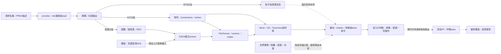
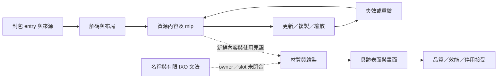
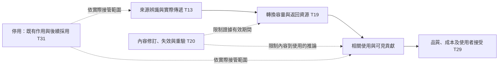

# GE2RB 引擎工作理論與證據邊界

## 現行引擎工作理論

本頁是在既有「機制總覽」位置持續維護的**現行《引擎工作理論》**，承接舊 R04《ENGINE_WORKING_THEORY》及專案成立以來已登錄的理論成果。路徑維持不變；交接包內的R04是歷史原件，不覆寫，也不另建一份競爭的現行理論。逐項論證仍在[T命題正文](命題與證據關聯.md#schema)，原碼分析與活動報告是其支撐材料。

目前已能解釋**檔案如何被選取和解碼、貼圖／模型如何形成資源與引用、材質和幾何如何進入繪圖**的多段規則。高清載入器也已有實作、原生資格及基地遊戲載入證據；這不是仍停在通用猜想。仍缺的是若干當次來源與使用的接合、完整場景狀態、具體表面的畫面因果，以及跨場景品質／成本接受。各項成熟度分開讀，不能用「引擎已懂／未懂」一個標籤概括。[詳細結論](命題與證據關聯.md#t24)

**已知覆蓋與研究總範圍分開。** 本頁目前較多資料／圖形案例反映已取得的證據，不限制可研究領域；[總範圍與選題](../01_決策與計畫/整體計畫.md#engine-research-scope)允許非圖形、未知領域與純原理問題獨立成立。本輪只修此導覽界線，未新增或提升下列GE機制的證據資格。

依[相似引擎案例](../03_證據與歷史/來源索引.md#engine-research-recording-cases)的不同整理方法，既有資料分別採布局表、物件關係、狀態轉移、時序、函式契約及證據／用途對照；[選用與維護規則](命題與證據關聯.md#engine-reuse-representations)在T正文，[反覆查用入口](#engine-reuse-questions)見第8節。另以[REA公開應用案例](命題與證據關聯.md#rea-application-method)檢查「原指令、代理解釋、實作、測試」之間的界線。**已確認·靜態**表示同版原指令／保存資產支持；**已確認·觀測**必須連同離線、宿主、GE或使用者回報及範圍閱讀；**條件推論**尚依賴前提；**缺口**明列未接實關係。外部工具及案例只提供參照，不當GE事實。

先讀下方流程及案例邊界，再按需要進入各節；精確欄位、位址與反例回T正文，來源身份回[理論成果對照](../03_證據與歷史/來源索引.md#theory-coverage)。本頁不維護任務進度，現行活動沿[Issue／Project入口](../01_決策與計畫/研究支線狀態.md#v08-work)。Elevator r30／r36、Ceil與後來批量高清是不同案例，不能用舊案例缺口代替全案現況，也不能用新案例抹除舊限制。

## 機制關係圖與證據斷點

白話地說：遊戲先找到素材，拆成可讀內容，再把貼圖連到模型與材質，由幾何、相機和shader決定如何畫出；結果可能經過中間處理，最後才送到螢幕。已實作的高清入口介入「建立貼圖資源」這一段；若要改光照，還需依做法取得後面的場景、材質或畫面資料。

圖中**實線是已核局部靜態規則或具名實作的連接**，不是同一資產已跑完整條鏈；**虛線是尚缺當次配對或完整機制的部分**。每段資格與適用型別見圖後表。原生引擎流程與模組介入分開標示，來源／材質允許共享與多對多。

| 運作階段 | 已確認的部分 | 條件推論與缺口 |
| --- | --- | --- |
| 1．選取與讀檔 | **靜態：**名稱轉換／key→成功record→provider及slot→read／resfile；未命中有OS檔案分支。PRES描述及搬移分層處理。[T13](命題與證據關聯.md#t13)、[T34](命題與證據關聯.md#t34-runtime-relocation) | 指定一次請求實際取哪份包／快取、混合供給與返回區間須逐案配對；名稱或key命中不等畫面使用 |
| 2．解碼與建立 | **靜態＋離線：**具名blockzip規則、圖數／長度到DDS／D3DX及IXO分段輸出。**模組實作＋限定GE觀測：**另讀高清DDS建立大資源、保留原SourceInfo。[T03](命題與證據關聯.md#t03)、[T19](命題與證據關聯.md#t19-hd-load-boundary) | 各型別有不同consumer，不能把所有輸出當DDS；高清不靠擠進原封包槽位，但仍受資源及下游限制 |
| 3．連成模型與材質 | **靜態：**IXO物件／引用、FileTexture查找、Mesh→SG→Geometry／material已接；SPS另有宣告規則。[T16](命題與證據關聯.md#t16) | 保存引用不是當次場景；共用來源、fallback與持有狀態影響使用者，材質列表位置不等GPU sampler |
| 4．計算與繪製 | **靜態：**選流／stride／宣告、UV及部分shader已核；新增矩陣按需求值、Transform／Camera組合、SkinnedMesh矩陣陣列及ShadowParameter供值。[場景規則](命題與證據關聯.md#t16-scene-state-boundary)、[命令](命題與證據關聯.md#t16-command-execution)。**GE個案：**r30有內容到draw | 尚缺指定實例的輸入寫入、動畫取樣／morph、燈光與陰影圖生成到同幀draw的配對；入列不等worker完成，更不等GPU完成 |
| 5．輸出到可見畫面 | **靜態：**部分shader輸出、Present包裝及[_BlendFilter半texel偏移](命題與證據關聯.md#t16-blend-texel-offset)已核；**觀測：**原UI、Elevator及後來基地各有不同範圍結果。[T24](命題與證據關聯.md#t24) | 尚無通用pass→RT→最終呈現圖；半texel公式不證全畫面合成或地板模糊根因，shader輸出數不證當次MRT綁定 |
| 貫穿各階段：有效期與恢復 | **靜態／host／GE分案：**引用、更新、清理、停用及新程序重載已有局部證據。[第6節](#lifecycle) | 來源buffer、資源、內容修訂及captured狀態的有效期不同；換回檔案、停止新替換與畫面已恢復不能互代 |

**更新不是只有讀檔一次。** 新補查確認部分矩陣會先被標記需要更新，在getter讀取時才交owner計算；直接接來源與計算相依也有不同處理。已接出「屬性失效→取值→局部世界／視角／骨架矩陣→effect」的條件流程，仍不能把不同時點保存的值拼成當幀場景。[逐項規則](命題與證據關聯.md#t16-property-evaluation)與[本輪接點核對／外部案例](../03_證據與歷史/來源索引.md#engine-edge-analysis)分別保存結論及證據範圍。

**個案證據放回各自位置。** 下表不跨列接成一次完整實驗；較新的載入成功不自動替較早未明的表面作答。

| 具名案例／證據性質 | 已支持的局部連接 | 明確斷點 |
| --- | --- | --- |
| 當前來源／Ceil保存副本 | 新包及outer各自綁定；當次表定位得到Ceil字面候選，stored與歷史packed相符 | 包／outer不等S64；字面候選不是引擎唯一來源，失配原因仍未知。[T01／T34](命題與證據關聯.md#t34) |
| REA＋Ceil r3／靜態規則與離線實物 | 同版EXE支持首塊延後、圖數／長度→DDS→D3DX；保存候選據此形成可解表示 | 未觀察這份候選實際被遊戲選用；L02舊raw可重現但已退出正常基準。[T03](命題與證據關聯.md#t03) |
| D3DX宿主／表示對照 | 同輸入同組建立參數下，末兩小mip的有效RGBA正規化身份與直接上傳不同且可重現 | 固定normalizer下的差異，不代GPU畫質；載入後身份不是遊戲已採用的證明。[T19](命題與證據關聯.md#t19) |
| GE r5／實際資源與正常收尾 | 真實populate／draw紀錄可重算；非阻塞上限後正常退出，觀測器撤除 | 已納入資源未命中Ceil，仍受場景／描述／入口限制；撤除觀測器不代替換恢復。[T23](命題與證據關聯.md#t23) |
| Elevator_01／r30與r36，各按原活動 | r30支持精確來源DDS→返回替換完整內容→實際draw，另次程序支持原內容重載；r36另保存同次56個三角形、VS／常數、query及RT0前後影像 | r30未建立可見替換作用；r36僅支持條件性左側視野外，非已證GPU裁切根因。幾何採用／完整狀態及具體表面、高清品質與可見恢復仍未閉合。[T16來源替換](命題與證據關聯.md#t16-source-game-r21)、[同次消費](命題與證據關聯.md#t16-target-consumption) |
| 批量高清／固定混合倍率及較晚8130基地活動 | 混合倍率保存觀測為211次替換／194個唯一來源，尺寸符合設定；較晚覆蓋活動另有基地限定暫用接受 | 兩次版本／活動分列，不相加為一次驗證；載入數不是可見表面數，也不證任務／戰鬥及全場景畫質。[T24](命題與證據關聯.md#t24) |
| L11與後續同版REA／靜態來源鏈 | L11原只到成功record；較晚REA已接外層查找、slot、provider／OS read、resfile與原地／vector解碼 | 尚缺指定資產當次來源實例、快取填入及輸出傳遞，不能再把已核靜態read鏈整段列為缺件。[T13](命題與證據關聯.md#t13) |
| Anagra／具名遊戲活動 | 來源→轉換→512資源→可採樣draw／同幀Present | 不等於正常高清品質，也不與另次恢復合成環境交付 |
| R21／隔離host | 同物件部分更新→內容見證失效→重驗 | 不代GE原生cache或其他pool實際更新 |
| D146／原UI活動 | 指定原UI像素變化保留至呈現前 | 不代環境表面；surrogate與後續推論另判 |

展開各關係的來源、版本、條件與反例定位

| 關係及命題主位置 | 已有支持與來源 | 適用版本、條件與有效期 | 反例、未知及決策作用 |
| --- | --- | --- | --- |
| 來源／成員↔內容：[T01–T09](命題與證據關聯.md#t01) | L02 保存 Ceil 配對；原理論分開配對、自洽、排列 | 僅具名 packed／raw 版本及該轉換；不是任意同名貼圖。原件身份見來源索引 | 共用解碼假設不能獨立證排列；Floor 同期 raw／atlas 身份仍缺。影響內容研究，不能抹去歷史 Floor 成果 |
| 名稱／key→成功查找→read／decode：[T13–T15](命題與證據關聯.md#t13) | L11 五段靜態條件及 R04 的解讀；成功 record 與先寫 key 分開 | L11限原指令範圍；後續同版REA已補caller／read，仍須當次請求、正常返回及provider有效期 | L11::R07 的 initializer 解釋已撤回；命中不保證被用。上游方案需補實際邊界，不能據同源 metadata 排名 |
| 轉換／容量→資源：[T18–T19](命題與證據關聯.md#t18)、[T34](命題與證據關聯.md#t34) | R04 轉述 Anagra 同活動內容到 512 資源／draw；Gina direct 與 file-backed 模型的布局差異 | 限各原活動、caller 模型、metadata 及實際資源描述；本輪重讀理論，不重新核子 log | 最終長度足夠不證每步安全；修正布局不證真實 caller。新環境資產需重新判適用性，不能重做舊結論或直接宣告可部署 |
| 建立／更新→目前內容：[T20–T22](命題與證據關聯.md#t20) | R04、R27 所載小型 managed 控制，失效／重驗與 draw 見證分開 | 具名 DLL／host／runner、pool、API、resource／revision 及觀測窗；不是 GE 私有狀態機 | 指標相同不證內容相同；managed 控制不代證 UpdateTexture 的其他 pool 路徑。只有所選方案需要時才核能力 |
| 資源→材質／draw→像素：[T16–T17](命題與證據關聯.md#t16)、[T23–T24](命題與證據關聯.md#t23) | IXO 局部解析、Anagra draw／Present 與另次 UI 像素活動分別保留；R26 限定正負主張 | 需相同版本與活動的必要連接；內容正向可窄於具名表面主張。Vita 演示限其樣本 | 目前沒有本次 PC 環境完整鏈；候選材質清單不證消費，缺完整觀測的零命中不證缺席。影響資產及觀測邊界選擇 |
| 替換→持有／重綁→撤銷：[T21–T22](命題與證據關聯.md#t21)、[T30–T31](命題與證據關聯.md#t30)、[T38](命題與證據關聯.md#t38) | R04 的 stateblock host 反例、draw 期間替換局部成果；R32 本機恢復 | 各自 host、捕捉狀態、持有者與恢復對象；Release0 是指定 observer 的退休政策 | 清表不足、檔案回復不代狀態撤銷；不把隔離恢復推至 Steam 安裝。影響永久／draw 期間替換及混合的責任 |
| 可見內容→品質／成本：[T28–T29](命題與證據關聯.md#t28) | R04 保留 alpha 統計界線、色彩／資料值及原版／觀測／候選比較方法 | 需具名通道用途、實際取樣、視距／動態與同條件量測；本機可接受數值未定 | alpha 統計不是畫面覆蓋；GPU 尺寸不是高清品質；效能範例不是 GE 數值。先定語義與比較條件，再做產品取捨 |

三層身份共同約束表中關係：來源版本／封包／member／轉換與內容；程序／device／資源世代／子資源／內容修訂；場景／表面／材質語義。「世代」「修訂」是分析概念，不宣稱 GE 有同名欄位。來源層的 hash 不能取代執行期或語義層的見證。

## 1. 身份、關係與證據的適用範圍

理解這份理論，先分清來源檔／成員、轉換後payload／像素／完整表示、執行期物件與內容修訂、材質與表面用途。名稱、hash或指標相同，只表示所用判據沒有區分它們，不自動建立跨層關係。**控制所需的差異必須在整條選取路徑保留；任何一層合併後，下游若沒有新的區別，就不能再對兩個用途作不同處置。** 這是條件推論，不是假定GE使用某種工具的快取架構。

近期兩種反例使這個條件更具體：QPCKHelper按位置比payload而未比key，所以相同bytes不證來源映射相同；Toolkit D3DX入口可用整份來源CRC分候選，後續替換／綁定卻仍按mip0的64位元key合併，所以較細入口不保證單表面控制。Special K的D3D11 full-mip函式仍須連到登錄與選取；其D3D9 memory Ex則已追到整份來源CRC沿wrapper／cache／選檔保留，兩個不同CRC不再被mip0鍵合併。這是入口限定的正向替代，不代表同來源異device／建立參數或不同表面可分開。[身份與跨層限制](命題與證據關聯.md#t01)

[用途補查](命題與證據關聯.md#t16-purpose-followup)另區分「可決定處置」與「已證可見」：Hair的UtilityTexture具名綁定支持功能原版；Pillar_6有普通Diffuse RGB鏈，但8個普通PS仍用alpha作丟棄。只在原／新全部mip零alpha保持、RGB獨立及原生資格成立的限定條件下准入顏色高清，不用blend關閉推定忽略alpha，也不把入包當GE可見收益。

現行理解是有證據範圍的部分模型。本次整合未新增GE觀測；既有Anagra、UI、host、容量修正版與後來批量高清／基地活動均按各自範圍保留。同源轉述不計多次獨立支持，不同案例不能拼成另一條實證鏈。詳細案例與五視圖支持追查各邊。

展開本節案例、數值、反例與適用範圍（現行證據說明）

本理論是帶證據邊界的部分模型，不是官方完整引擎規格。現行需求是PC環境貼圖、保留原作風格、自用且可恢復；角色、UI、Vita及合成host成果依各自版本承接，不轉成環境交付。R04內的F2權威路徑、舊角色優先與歷史下一步按當時理解，不作現行授權。

沿用歷史多視圖模型：關係可以分支、多對多，也可能經快取或重新載入；線性來源→畫面的圖只是一個有界查詢視圖。P547／NP001的承接不是本專案新發明；部分早期原件仍缺，只能保留帳本轉述，不能稱本次已直接複核。[R04](../03_證據與歷史/來源索引.md#r04)、[歷史模型及限制](../03_證據與歷史/歷史研究紀錄.md#c72)

| 身份層 | 必須分清的對象 | 不能據此跨層推出 |
| --- | --- | --- |
| 來源與表示 | 版本、封包、member、實際來源、轉換、壓縮／解碼／正規化bytes | 同名、同payload或同key不等於同一provider或表面 |
| 執行期 | 程序、device、資源觀測世代、subresource、內容修訂及有效期間 | 同指標不等於同內容；hash存在不等於當前內容有效 |
| 語義與使用 | 場景、變體、材質槽、通道用途、具體表面及共享使用者 | 名稱、容量、建立或綁定成功不等於目標像素與風格接受 |

「世代」「修訂」是研究的分析概念，不假定GE有同名欄位。每條關係連到來源、活動、版本、條件、有效期與反例；工具原碼事實、API契約、條件推斷、隔離host觀察及遊戲觀察分開。同一活動的多份報告不是多次獨立支持。[T01](命題與證據關聯.md#t01)

辨識的粒度限制可控制的範圍。名稱正規化可能合併不同拼字；Toolkit自有64位元mip0有效列hash不包含尺寸、格式、其他mip、device或表面；另有D3DX來源CRC可選檔，但沒有改變此快取主key。即使沒有隨機hash碰撞，同byte串不同表示仍可有相同key。若兩個用途在辨識輸入上完全相同，僅依該輸入不能給它們不同處置；須另有可用區別，或明確接受共同處置。批量替換不會消除這個未知，只會把責任移到共享、材質語義、mip、記憶體及生命週期。[T01a](命題與證據關聯.md#t01a)、[T13條件推斷](命題與證據關聯.md#t13-inference-result)

Special K是具名實作參照，不能只因較成熟就當精確識別標準：其D3D11函式可累積單張2D的多級資料，但固定版本的普通scanner先登top-only，後續full登錄被已存在的top判斷略過；Toolkit則明確丟棄full後綴。二者並非相同機制，也都不能由「有fullCRC」推單表面選擇性。正常相容條件與BC／padding讀長、零CRC政策的差異並列保留；沒有新增GE實測結果。[原件、補救與反例](命題與證據關聯.md#v08-sk-identity)

## 2. 來源選取、容器及上游入口

**流程：**請求名稱／PRES描述→選取provider及record→file slot讀取→resfile交給對應解碼／consumer。**已確認·靜態**與**當次選中來源的缺口**分開如下。來源鏈需要同時保留「請求／政策→選中來源實例→實際取得的表示→使用者」。L11的Gina歷史局部路徑會轉換名稱、計key並搜尋record，但key先寫，故相符key不保證查找成功；該歷史活動未交read／decode傳遞。後續同版REA已接靜態名稱／key→record／provider→slot→read→resfile→解碼規則；仍缺的是當次選用、快取／補讀供給及輸出區間，不能將整段靜態鏈重列未明。Ceil共用payload與Cafe條件外置命中各自回答不同問題，不能替這條鏈補caller。[來源與使用](命題與證據關聯.md#t13-inference-result)

以Ceil作取證候選時，路徑仍是可靠定位→正常內容表示→當前draw／表面→替換與恢復。下游入口能暫緩封包重建及上游provider，卻需要自己的資源profile、工具版本對應與共享使用證據；observer的完整內容SHA256不能直接當Toolkit的替換key，hash日誌也不是可編輯圖像。先同尺寸可逆對照、後談高清增尺寸，是減少同時改動因素的條件安排，尚非遊戲驗證結果。[觀測與修改接合](命題與證據關聯.md#t23)、[候選取捨](../01_決策與計畫/決策表.md#current-candidate-route)

當前修改可從現存資產另建基線，不必先證與S64相同；但必須知道選中的是什麼、以何種表示被誰使用，以及改動如何恢復。歷史hash相符只服務舊證據的有限沿用，不能補上實際表面消費；新來源hash也不能代替成員定位。若繼續用該outer找Ceil，F範圍及名稱歧義仍須處理；只有另一條獨立合格的資源識別／使用鏈，才可能省掉這段PRES與S64研究。現有Elevator_01下游成果見[案例表](#v08-relations)，具體表面、共享影響及可見效果恢復仍須補證；不把Ceil／S64缺件沿用為所有資產尚無修改入口的結論。[分層身份與推論範圍](命題與證據關聯.md#t01)

工具研究把選取的隱含條件具名化：GECV packer讀Data而非Mod，Global跨RTBL可能漏傳語言政策，Extra可取舊輸出或不同目錄的RDP，Explorer子暫存又可能丟掉原解析基準。因而固定主檔與相同bytes，仍不足固定來源及依賴。修改未被讀入、選中未使用與另一來源供給是競爭解釋，不能把畫面無差異一律歸因GE拒用。

這些是固定工具原碼事實及條件推論，不是新增GE provider行為。上游重導要接到實際供給邊界；離線工具也要證預定改動進入真正產物。FILE觀測、插件載入、位址修補與provider角色分判；發布名稱不代source↔binary↔插件映射。跨工具同名層級亦須對照：Atlas的set在所比模型中對應PC模板country，只讀其中一個dataset。[層級與保存](命題與證據關聯.md#t34)

發布包又增加了來源選擇的一層：取得的loader包包含7個插件，預設清單只列5個，FILE觀測插件未列入。固定source在有ini時按清單、缺ini時改掃目錄，故包內存在、設定選入、成功載入與功能可用不能合併；刪ini甚至可能擴大候選。Windows相對DLL搜尋與檔案存在檢查也需分清。這是包內容事實與source條件模型，兩者的build對應仍未證，不能直接說該包在本機會如此運作。[設定、觸發與資格](命題與證據關聯.md#t13-inference-result)

新查到的同pin替代也修正了按專案名稱判能力的風險：`GECV_PROXY_GE1`輸出`GE_FIX`，內含可達FixGE2；另一個GE2專案入口未呼叫Install，仍只是那個入口的限制。文字STR的正常4-byte指標重導、延伸bytes寫入與BIN patch亦不能當同一內容供給。這些能力未接環境provider或材質，現階段的增量是可比較入口及表示／恢復責任。[插件分支](命題與證據關聯.md#t35)

來源選取還須看取得時刻：具名舊STR版本先開GE1資料stream，之後才改GE2路徑變數及日誌；後版已將開檔移到選路之後。這說明應核「政策→實際開啟／解析→持有的來源實例→讀取bytes」，不能把後來的路徑字串當已開來源。發布DLL已有x86與PDB配對識別，仍未證實採用哪版；原碼修正與實際功能分判。[選路時序與版本證據](命題與證據關聯.md#acquisition-followup-static)

展開本節案例、數值、反例與適用範圍（現行證據說明）

### 來源存在、成功查找與後續使用

六筆Ceil別名共用payload／span的歷史結果，只證載體關係，不能當六個獨立consumer或runtime cache證據。共享還須分同舊offset、同新payload及同表面使用者；若要只改一項，是否拆引用取決於實際共享範圍。[T02](命題與證據關聯.md#t02)

Cafe在已查inline範圍未出現，不等於資產不存在。大寫完整路徑、無前導斜線的條件下，外置key對到研究QPCK entry35066；未證實際resolver選中它，也未接通Cafe原始成員→RoomFloor_04材質→具體表面。[T10](命題與證據關聯.md#t10)、[T11](命題與證據關聯.md#t11)、[T12](命題與證據關聯.md#t12)

Gina provider的已知靜態機制較具體：保存EXE的member路徑按條件呼叫名稱callback，再計64-bit key，在20-byte records做lower-bound與精確比對；指定callback移除首byte並轉大寫。固定ASCII／prefix前提下Top對到patch entry406，仍非實際請求或唯一來源。N(q₁)=N(q₂)就會有H(N(q₁))=H(N(q₂))，故相同key不能反推出原始拼字或請求者唯一。[T13](命題與證據關聯.md#t13)、[T13a](命題與證據關聯.md#t13a)

key在查找之前寫入，失敗也可能留下相符key；須以同次正常返回、成功record、request及有效provider判命中。reader的AL、member返回的AL與外層node+28屬不同局部邊界，不能混成完整載入鏈。REA對當前EXE已補外層查找0x208dc78→member查找→0x208f517的file slot靜態接線；0x181874c明確是QPCK開啟／TOC初始化。新REA結果把原地／vector解壓接到resfile reader：先查快取、缺額才按條件補讀，非負位置的預讀按0x800邊界定位；成功供給不必發生當次底層I/O。底層0x208fb8c／0x208fa60現已接實兩分支：-2 slot按record與provider以64-bit實體位置seek／精確fread；一般HANDLE按來源範圍走SetFilePointer／ReadFile。這補成同版名稱／key→slot→payload→resfile／解壓的靜態路徑，仍未證Ceil當次實際傳遞。[T13讀取機制](命題與證據關聯.md#t13)0208C529的initializer解釋已撤回，保存證據支持的是range iteration/count；這是L11內部R07，與來源R07的draw-scoped報告不同。[T14](命題與證據關聯.md#t14)、[T15](命題與證據關聯.md#t15)

DIRECT內容配對、Top／Top_utl／Env名稱橋接均有局部成果，但Top與Top_utl可能屬不同NPC根，Env可屬共用來源。S55同源query／catalogue不增加獨立性；精確kind4 complete-read DIRECT與Env旁證不證Top/Ceil實際消費，也不淘汰另一布局。原Top零命中缺terminal，不能排除來源。[T13b](命題與證據關聯.md#t13b)、[T25](命題與證據關聯.md#t25)、[後期provider修正](命題與證據關聯.md#h1099-provider)

解碼輸出亦有兩種承接方式：原地路徑使用連續buffer，vector路徑則回傳可搬移的段表，每項各有資料指標與實得長度；成功只檢AL，不能照偽碼的void或把EAX當完整布林。內容比較須按段序與實得長度組合，不能由首段地址讀總長度。同版載入器的分流現已核到：描述第二名稱精確為ixo時用段表，其他值走原地路徑；物件+0共用欄位以+0x18的0x20000000區分布局，清理亦按此位釋放各段／表或連續buffer。Ceil保存名稱是gnf，故在描述相同的前提下不需vector直接觀測；描述形成的靜態鏈已接於T34，共同後續解析現已接上：owner註冊callback後，以第二名稱選資產consumer；gnf把descriptor資料／長度包成記憶體stream，交type4圖封裝與D3DX。EXE內有具名.prx→callback註冊表，不因模組字尾推外部檔缺件；Ceil當次owner／表面仍待證。[vector規則](命題與證據關聯.md#t13-vector-output)、[選路與生命期](命題與證據關聯.md#t13-vector-handoff) [callback與GNF交接](命題與證據關聯.md#t13-handler-dispatch)

載入前還有來源準備層：描述的mode／tag決定沿用目前來源位移，或由PATH鍵／RDP名稱構造臨時來源。額外名稱從第五項起已有具名鍵值用途；RDP分支的0x800位移單位與直接位移分開。暫時切換只保存並恢復名稱與基底，名稱改變會關slot並清快取區間，並非保存原handle的完整交易；實際開檔仍可能延到reader。原始PRES到runtime的限定轉換已核：選中country區塊另配置後以位置差值修正表／名稱；B轉字串指標mode1，C–F依dataset與初始化模式保留位移或轉資料指標。來源formatter已核為依^、區分大小寫的.dll尾綴及第二字元冒號選基底／保留原字串；保存Cafe引用在此選另一個目錄基底並以斜線拼接，尚非QPCK key或已確認檔案位置。初始化入口已核會清空兩個基底首byte；四組前綴／封包配對依序是/bi→bin_patch.qpck、/bin→bin.qpck、/conf→conf.qpck、/data→data.qpck。後續先查已登錄provider，失敗才將拆出的檔名交CreateFileA；所以外部B不等於只能取鬆散檔案。在空基底及provider有效的條件下，Cafe的/bin路徑有patch優先、base接續的查找機會，實際命中與內容仍未知。名稱轉換及key查找亦已接實：登錄callback去首字元、逐字toupper後，按不含NUL的長度計CRC-64/Jones；TOC用unsigned 64-bit lower_bound再核精確相等。Cafe在空基底／ASCII映射下的候選key已接到現存索引：patch無命中，base唯一一筆189450-byte候選；完整來源身份前後穩定，base與先前outer保存來源一致。該候選後續已保存並解碼為含Cafe具名網格的IXO，靜態材質引用見下節；當次locale／目錄與Cafe表面用途仍未證，不再把算法或索引定位列為待研究。[名稱與key](命題與證據關聯.md#t13-qpck-name-key)。[封包優先與檔案後備](命題與證據關聯.md#t13-source-selection)。保存Ceil的dataset2欄位在已核caller條件下保留來源位移。精確_COMPAT與_COMPATVITA不能混同；未證當次country選擇或consumer實際使用。[載入與修正鏈](命題與證據關聯.md#t34-runtime-relocation)、[來源準備與恢復](命題與證據關聯.md#t13-source-selection)

這版resfile讀取前後的兩個函式實為直接成功與空返回，不能據此推讀取已序列化，也不能單憑它們判競態。provider slot關閉會清空並重用，與共用provider FILE的生命期不同；觀測須保留thread／呼叫配對與slot世代，不能靠指標或時間接近拼接。[T13同步與生命期界線](命題與證據關聯.md#t13)

來源因果與私有呼叫解析回答不同問題：受控修改精確來源，並證明實際介入、下游差異、其他可能供給及恢復，可以回答限定的來源影響，不必先還原全部lookup。反之，查找成功與另一端內容正向不能自行接成資料來源。跨階段可跨呼叫或執行緒，但必須有連續傳遞與相容有效期，不能只按時間接近配對。

### 工具如何影響實際來源

固定GECV-OLD的PRES CLI先產生Data與Mod副本，所讀packer卻從Data取payload；存在Mod目錄或.ini不代表修改會被選入。Extra不同入口還會從當前檔旁或SCRIPT_DIR尋找同名RDP。因而來源鏈必須包含「預定修改項→實際選中來源實例→轉換bytes→採用」，不能把未讀入的改動造成的無差異歸因給GE。[T13現行推斷](命題與證據關聯.md#t13-inference-result)

檔案觀測、插件載入與記憶體修補是三種機制。固定GECV_FILE以原參數轉交CreateFile，沒有ReadFile hook或來源重導；WriteFile只複製當次buffer。GECV_PROXY載入插件，但啟動載入執行緒不證插件完成；GE2專用Install未被所讀入口呼叫；BIN模組將檔名作相對位址、文字hex作修補bytes，不是一般內容provider。歷史四byte文字redirect也不代證貼圖擴容。具體插件、EXE、caller與停用行為才決定能接哪一段。[T35](命題與證據關聯.md#t35)、[入口原碼定位](命題與證據關聯.md#v08-core-results)

## 3. 內容表示、解碼、容量及建立

**流程與已確認·靜態：**具名壓縮資料依blockzip排列規則解碼，再依描述分到不同consumer；貼圖分支由圖數／各圖長度取得DDS並交D3DX，IXO分支則保留分段pointer／length供stream讀取。這些是已核分支，不代表所有PRES內容共用一種格式。[T03](命題與證據關聯.md#t03)、[T13交接](命題與證據關聯.md#t13-vector-handoff)

**高清介入已實作：**在限定D3DX建立入口另讀較大的DDS、建立真正較大的texture，回傳給GE時保留原SourceInfo。它避開原封包槽位容量，仍須核DDS、裝置上限與共享用途；載入成功另與畫質分判。[T19流程及證據](命題與證據關聯.md#t19-hd-load-boundary)

**儲存優化與管理成本：**排列容器可改善讀取局部性，獨立區塊壓縮以解壓CPU換較少磁碟bytes；兩者仍須交完整DDS、核完整SHA，不能減少解壓後顯存需求。管理器只負責安裝／設定／維護，不需加入遊戲常駐路徑；其核檔後端須另整合，載入器加速不自動加速搬移。條件、外部案例與成本分工見[T19](命題與證據關聯.md#t19-storage-manager-cost)，容器僅完成研究host比較，未接產品或改部署。 同DDS的離線篩查已支持管理器串流SHA加速；排序／LZ4容器在暖快取下未得穩定收益，暫不遷移產品格式。實機及冷讀仍分開接受，見[執行結果](../03_證據與歷史/來源索引.md#texture-priority-execution)。 下一輪保畫質研究以增加可靠提前量為先，另研究讓超預讀額度的大DDS先準備有界前綴；部分準備仍須整張驗證後才建立，瞬時副本計入同額度。冷儲存、品質檔及資源共用各有不同前提，見[T19接續方向](命題與證據關聯.md#t19-post-sha-directions)。 預讀順序與統計可持久化跨重啟沿用，但RAM／GPU工作與全SHA驗證每次重建；內容版本失效及非阻塞保存的設計見[T19](命題與證據關聯.md#t19-persistent-prefetch-profile)，離線兩key／雙快照已接入[共享載入框架候選](../03_證據與歷史/來源索引.md#texture-loading-framework)。當張驗證後先提示、成功後才學習，2個CPU準備worker與有界事件／低優先權安靜期保存分工；背景寫入仍有競爭成本，不能把移出hook當成消除等待。小圖於池閒置時沿同額度直接準備，避免單純派工增加延遲。候選包已隔離核驗，EX03與實機狀態不變。 [小圖保存競爭重析](命題與證據關聯.md#t19-checkpoint-interference)指出現有差值未隔離writer，saving亦包含排隊；先分段與同runtime對照，再依序減少無實質變更的保存、讓新需求在安全邊界延後保存，以及按成本選擇小圖預讀。真正dirty與安全邊界延後已接[雙作離線候選](../03_證據與歷史/來源索引.md#shared-framework-execution)，另修inline與worker共用兩份準備名額的反例；機制通過不代實機收益，背景優先權仍不保證零競爭。固定候選的後續離線比較觀察到完成保存交易減少，但小圖保存情境仍有前景退化，沒有普遍穩定收益；因此保留優化同步預設，學習預讀維持選用。完整端點、觀察丟失及快照差異的限制同見T19，沒有把最後排空成本當每次遊戲進場必付等待。

**載入速度的條件模型：**原資料先由引擎取得，高清入口再做來源識別、外部DDS讀取／驗證及高清建立；成功命中不另建立原GPU貼圖。重進場可因引擎少建物件、OS讀取較快或後續駐留／其他工作不同而變快，須以呼叫數、分段時間及首次可見幀分判。優化此hook不能直接消除上游讀取，也不能把D3DX返回當GPU完成；成本式、快取／預讀邊界及可反駁預測見[T19](命題與證據關聯.md#t19-loading-cost-prediction)。這是依已核機制形成的模型，遊戲耗時占比仍待量測。

**大貼圖的後續方向：**固定初始化之外，需分完整bytes掃描、讀驗串行與資源建立／駐留。讀取與增量SHA可在完整驗證前提下重疊；bytes快取只幫重複準備，直接填充仍須證與D3DX內容相容，降低資源量則涉及品質。詳見[T19大貼圖成本](命題與證據關聯.md#t19-large-texture-cost)；完整SHA及讀驗管線已有[離線比較](../03_證據與歷史/來源索引.md#texture-large-loading-comparison)，建立／首次使用也已完成獨立四組比較；候選尚未接入產品或部署。進一步的[D3DX／駐留模型](命題與證據關聯.md#t19-d3dx-residency-cost)區分建立、首次使用及GPU完成：直接填充須證內容等價，PreLoad可能只前移等待，priority不增加容量，LOD降細節才減駐留需求；[四組實測](../03_證據與歷史/來源索引.md#texture-d3dx-residency-comparison)已核內容等價與首次draw完成；限定填充只見小幅且非每輪一致收益，PreLoad無穩定總收益，尚不支持改產品預設。[後續優先](命題與證據關聯.md#t19-loading-next-priority)轉向精確SHA軟體吞吐、具有提前窗口的跨貼圖讀驗及具名資料量取捨；普通小快取已有低命中反例。同SHA的[成熟x86後端比較](../03_證據與歷史/來源索引.md#texture-openssl-sha-comparison)已證本機AVX／BMI路徑在三份DDS的離線讀驗總量下降約43–46%，無SHA指令仍有軟體收益。後續[載入器候選整合](../03_證據與歷史/來源索引.md#texture-sha-loader-integration)已核完整驗證與回退，保持mip／alpha／原SourceInfo，暖快取hook至首draw總量下降約39–40%；最大案例來源為合成控制。正式產品預設及EX03未改，GE進場與交付採用另驗。後續優先另分未命中請求：[參數／長度與SHA組合](../03_證據與歷史/來源索引.md#texture-sha-prefilter-integration)已證可排除控制省掉來源掃描、可能命中者仍完整SHA；收益集中在可排除請求，命中與同長度miss無一致增益，小圖命中負向結果保留。小段指紋否定索引仍未實作，不能取代完整SHA允許；跨DDS CPU準備須有多個已知／可預測需求；若仍逐張同步釋出，增加worker沒有重疊。條件模型的理想節拍為max(P/k,S)，並受首尾等待、實際吞吐、bytes額度與串行caller限制；不可由既有整合總量或並發正確性推加速百分比。[256 MiB有界離線對照](../03_證據與歷史/來源索引.md#texture-cross-preparation-comparison)已證全已知中型批次的2 worker可縮短整批，4 worker未再明顯改善；首張、小圖與只能容一份的大DDS不具相同收益，逐張釋出也無一致改善。該輪是獨立宿主，後續共享框架已接入獨立候選、尚未部署；[有界整合設計](命題與證據關聯.md#t19-bounded-prefetch)先以已核HASH序列猜少量後繼，實際請求仍完整SHA確認，場景依賴／上游身份另待橋接。持續2 worker須保留demand優先與容量，猜錯只退正常高清準備；[有界離線整合](../03_證據與歷史/來源索引.md#texture-bounded-prefetch-integration)已核共享讀驗、額度、late／錯預測與回退，固定正確後繼的中型整批中位少34.0%，但僅6／10輪較快，錯後繼／零提前的小圖退化與時間波動同留。profile仍是受控情境，非GE路線預測；及時命中取決於排隊＋讀驗能否趕在需求前，不能由worker數推保證收益。 接續[準確率與尾延遲分析](命題與證據關聯.md#t19-prefetch-precision-tail)分猜對／及時／需求尾端：34／70只為匹配後繼的及時率；[逐貼圖分段對照](../03_證據與歷史/來源索引.md#texture-prefetch-phase-comparison)已將主要中型圖長段定位到ReadFile呼叫內，[後續離線ETW](../03_證據與歷史/來源索引.md#texture-prefetch-etw-comparison)已對齊正常讀取的File I/O、minifilter與CPU狀態，但未重現原百毫秒尖峰，底層IO／過濾器／排程根因仍未定；小圖另有約7.68 ms排隊／派工長段，最大圖完整SHA仍有實質成本。完整驗證、同DDS額度及trace開關對照均保留，記錄只在全序列結束寫檔，不由開關中位差推固定記錄開銷。短上下文／信心退化與少量前瞻仍待驗；配置重用及鎖外釋放不是目前主要讀檔長段的已證解法。不可變buffer重用另須有效重用與身份，單純將等待移往worker不會加速。尺寸方向涉及品質；詳細條件仍回[T19](命題與證據關聯.md#t19-loading-next-priority)。

**系列移植的已知範圍：**GER的相同D3DX呼叫／SourceInfo保存契約已落成獨立版本及來源綁定，11,049份已抽出影像的兩倍純色包通過逐項原生載入並已部署。其後遊戲日誌已證實入口命中，使用者回報替換成功但載入變慢；全場景覆蓋與介面幾何尚未明確接受。逐次同步讀檔／hash與較大資源建立增加工作，耗時占比仍未量測。[T19移植依據與限制](命題與證據關聯.md#t19-ger-portability)

內容到資源須分別通過表示、容量與產物邊界：索引／引用指向什麼、布局／格式／mip如何解釋、每步是否有容量、實際保存／上傳哪些bytes。**reader接受的資料，未必都保存在中間物件或writer；產物可讀也不反證原內容完整。** 宣告長度、推算長度與實讀長度各有用途，不能互換。[表示責任](命題與證據關聯.md#t34)

近期新增的可比較能力包括RTBL聚合、Extra逐組seek及內嵌引用、QPCK有界讀寫、GEBUtils原位保存、DDS9 staging→DEFAULT載入；各自仍有明確分支限制。聚合不含完整record，推算可能覆蓋原欄位，未知引用可能保存空檔，特定QPCK物件／writer丟欄位或未寫payload。這些只限制相應實作，不能淘汰離線路線或抹去qpckEater的正向。

容量也不只看最終大小。GEBUtils尾隨同值區不證有權覆寫，原位保存與重建引用須分別比；Gina指定布局修正已解除舊容量反例，Anagra已有大資源與draw正向。DDS9的建立、逐級填充、上傳及引用交付另有條件，未傳Lock失敗可使HRESULT不足以判內容。這些責任依候選實際經過的邊界配置，不要求每條路線解完所有格式。[容量與建立](命題與證據關聯.md#t19)

Special K也顯示「返回原物件」未必等於「返回未介入的原表示」：memory Ex預期替換時先把pTex建成1mip，失敗或停用回退不補原請求的完整鏈。其7z分支把solid buffer整體交D3DX，未套成員offset／size；普通DDS路徑不受這項archive反例。工具輸出指標、容器範圍與實際表示應分別核對。[建立與替代範圍](命題與證據關聯.md#t19)

工具接口要比較實際表示：Toolkit保存DX10 DDS而固定DDS9只收legacy，不能直接互通；這不代表GE拒絕該資產。Ceil兩個非零壓縮區間與候選header本身不足判排列；現由REA的當前引擎blockzip指令補上首塊延後規則，Floor有歷史結果而同期raw未齊。詳細支持與反例如下，均不由同源往返裁定內容正確。

歷史S64完整原表仍缺；當前新基線已另取完整outer副本，不能把兩個來源混為同一份原件。當前outer與S64的完整hash不同，但按新表指標取得的Ceil字面候選stored bytes與歷史packed完整hash相同。因此outer失配不代表這份候選內容已變，也未由此解釋差異原因。精確身份與原始結果見[來源索引](../03_證據與歷史/來源索引.md#current-asset-extraction)。

解析需依角色分區：dataset5／6的非空F可在fence前，dataset5長度單位為4；其他F在後段。短名稱與零資料記錄仍保存，少於四名稱不能補作完整路徑或判無用。B共同名稱與同outer內的獨立引用字串分別讀取，讀名稱不要求追外部內容。當前副本已覆蓋全部宣告名稱與B字串，但輔助名稱、短名稱、零資料與內嵌引用的用途仍未解。第四欄精確查詢的一個F span及六筆別名只支持字面候選，不證引擎唯一Ceil。完整規則、實證與限制見[T34](命題與證據關聯.md#ceil-dataset5-rules)。

歷史F-only、v2五名稱及v3 F範圍停止保留原結果。當前字面候選的實體stream模型曾重現L02 raw與舊normalizer hash，但REA已確認引擎原地／vector blockzip均先保存首塊、解後塊、最後解首塊；type 4貼圖reader再讀圖數／長度並把DDS交D3DX。依此修正後，候選開頭自然形成1張圖的長度表，DDS直接取其後bytes，9 mip可解；舊排列預覽與其高清衍生物退出採用。這已提供不同於舊工具的靜態排列依據，仍未觀察此候選實際走該路徑，故尚不能證遊戲表面、共享使用或可逆高清改善。[完整論證](命題與證據關聯.md#t03)、[身份](../03_證據與歷史/來源索引.md#current-ceil-representation)

展開本節案例、數值、反例與適用範圍（現行證據說明）

### 配對、自洽與正確排列

Ceil packed32873／raw87544、研究包零基1247／顯示1248的配對保留；它沒有證明內部排列或表面。頭部MD5與raw MD5不同是已保存差異，欄位意義、遊戲是否檢查及後果仍未知。GECV的first-stream-last與Candidate884的實體順序串接是可區分模型；同源reader/writer往返、七項離線自檢、共享zlib或preview不能投票決定哪一種適用Ceil。Anagra的來源／錯候選更正也不能代判Ceil。[T03](命題與證據關聯.md#t03)、[T04](命題與證據關聯.md#t04)、[T05](命題與證據關聯.md#t05)、[T06](命題與證據關聯.md#t06)、[T07](命題與證據關聯.md#t07)

另一歷史Ceil包的原地槽位32880 bytes，重編32884超出4 bytes；這不要求重編長度恰等原32873。384-byte低熵marker及outer精確inverse是有界離線正向，不能保證正常高清內容容量、原生decoder或安裝恢復。該包的後方52 spans／282 offsets亦不能套到其他包。晚期exact-slot所涉S65／np05PrivateCodec身份失配仍隔離，不據其新通過改判。[載體結果](命題與證據關聯.md#t03-carrier)、[T04a](命題與證據關聯.md#t04a)

Floor壓縮成員可定位，歷史raw尺寸與hash有記錄，同期實體未取得；不是從未有成果。所讀Atlas版本只回傳manifest／preview／數量，hash又不同，不能反證歷史版本未保存raw。preview分區可能涉及布局、內容、正規化或版本，仍無獨立判因；BC3 payload與RGBA8正規化hash直接比較的推論已撤回。新解碼只能是新活動，不能冒充找到舊raw。[T08](命題與證據關聯.md#t08)、[T09](命題與證據關聯.md#t09)

外部RES文字也有版本差異：Group Count曾寫4 bytes，後文寫int8；另有20 bytes與四個4的矛盾。外部40/50/60乘0x800及C/D局部不乘是具名平台描述，不能憑後文較新或作者經驗裁定PC格式。BLZ2說明亦不能直接移植BLZ4。[外部表示判讀](命題與證據關聯.md#external-claims-20261017)

### 容量是逐段契約

至少分來源選取、欄位／位址表示、工具壓縮容量、引擎逐步解碼容量、建立後資源及各級內容。增解析度還須分開引擎所存的邏輯圖像尺寸與GPU尺寸：現有建立caller會保存pSrcInfo寬高；兩倍試作回傳替換尺寸曾收到介面放大的使用者反例。保持原描述的修正通過離線對照，並由使用者確認當次放大問題恢復；仍不代全場景或高清品質驗收，詳[T19](命題與證據關聯.md#t19)。固定工具的stream可增長，不等於metadata單位整除、索引、共享引用與地址可表示；同樣不能把舊SDK固定容量限制套到新的可擴張writer。[T19](命題與證據關聯.md#t19)、[T34](命題與證據關聯.md#t34)

Gina舊407359-byte wrapper在file-backed模型通過，direct模型一個stored步需32768 bytes卻僅有24710–24773；修正stored-first布局後407352-byte wrapper維持同一699224-byte解碼內容，在兩模型、64對齊通過。反例已被指定修正版解除，但實際caller、配置及GE採用仍未知。中途條件Dᵢ≤Aᵢ不能被最終總長取代；修正不只少了7 bytes，亦改分塊，不能把「壓得更小」當根因或普遍補救。[容量推導與修正](命題與證據關聯.md#t19-resource-inference)

Anagra的另一具名遊戲活動已有35247-byte physical member→349688-byte transform→349680-byte DDS→512×512、10 mip、DXT5 resource314→stage0可採樣draw與同幀Present。word7／private root容量及恢復另有活動，不能合成一次量測。raw相等8/10、normalized相等9/10、完整填充10/10分別回答不同問題；不把剩餘差異自動歸因padding，也不抹去資源正向。[T18](命題與證據關聯.md#t18-identity)、[T18a](命題與證據關聯.md#t18a)

GNF路徑的記憶體stream已接到實際複製方法：有效游標下只複製剩餘可讀量並推進游標。可是GNF建立caller未在所讀指令中核對實讀返回量，仍把要求長度交D3DX，且長度0分支取得的是建構總長度而非剩餘量，故表示驗證必須另核完整區間與當次游標；stream截短不自動保證caller完整讀齊。尚無Ceil發生短讀的觀察，也未據此裁定未命中原因。[T19讀取與建立](命題與證據關聯.md#t19)

Ceil候選已實測出載入方法影響身份：相同DDS直接上傳與按REA參數交D3DX，前七mip相同而末兩個小mip的觀測hash穩定不同，完整身份需分開綁定。固定normalizer排除區域外像素，故不能只用「hash計入padding」解釋正規化差異；它仍不等於原DDS損壞或GPU畫質變差。回查GE紀錄兩種身份都未命中，故不能只靠此差異解釋Ceil未見，仍需來源／場景對應。[當前載入控制](命題與證據關聯.md#t19)

D3DX來源pSrcInfo、建立要求、返回資源描述必須分開；來源大圖或HRESULT成功不保證實得尺寸、格式、mip或內容。此例DXT5每層長度為max(1,ceil(w/4))×max(1,ceil(h/4))×16；4×4、2×2、1×1皆為16 bytes，故長度也不唯一識別層。十層349552 bytes加128-byte DDS header吻合結構，不等於獨立排列驗證或GPU配置量。已有同次大圖資源時，應往內容、取樣與像素判斷，不再把容量當唯一原因。

### 封包工具揭露的表示與保存條件

| 已解析機制 | 保留成果、反例及現行含義 |
| --- | --- |
| 外層與內層 | qpckEater可重建20-byte QPCK索引及payload，卻明示未支援BLZ4/PRES重包；外層可寫不保證內層可採用。QuickBMS分QPCK表讀、PRES與RDP估界等路徑，不能概括全是盲掃，也沒有因此取得通用writer／獨立排列資格 |
| PC country與位址 | PC格式文件／模板已有country、dataset、B/F位址模型。固定PresPC在多country不同表前提下重用同一游標，單country不受此反例；模板與C#條件亦不同，自家parser返回不證country正確。跨平台C0/D0、40/50/60及0x800單位不直接認證PC B/F |
| 共享引用 | GEBCS依舊offset去重；若原共用項改成不同新payload，可能沿用錯誤引用。GECV按新payload hash去重是另一模型。Sharp多項RDP→RES共用key0有覆蓋條件反例，單項不觸發；RDP→RDP附加則另有局部支持 |
| 欄位與保存 | GECV的長度除法、列舉順序，GEBCS的UTF8 byte數／字元數、DLC相依傳遞、未讀欄位與短讀，均限定其保存契約。Sharp／Extra可在逐項失敗或完整性警告後留下JSON／bytes；多檔先後寫入與backup存在不證整組一致或原子恢復 |
| 抽取與重建邊界 | Sharp／Global RTBL可掃候選record、取RDP成員、遞迴RES並聚合位置；未找到RTBL重包入口。Global有country seek與語言選取，但dataset仍按連續表推進、地址模式仍屬所讀跨平台模型。正常支持與漏傳、短讀、部分保存的限制須一起承接；詳[T34](命題與證據關聯.md#t34) |
| 替代reader的分層資格 | Extra RES_Loader按各組offset讀表，但未建立PC country／B/F語義、解壓或重建契約；ALPHA_EATER的RTBL內嵌與巢狀路徑另有正向能力。表遍歷、標記、實讀、轉換與保存須逐項接實；未知標記落入讀取／空檔分支是限制，不能抹去上述正向。詳[T34](命題與證據關聯.md#t34) |
| 原位注入與索引 | GEBUtils提供按類型／RDP單項原位寫回；掃描索引、尾隨同值空間及後綴選列各有限制。all與DLC單項CLI派送不同，不能由工具名稱或介面存在判採用；固定GEB範圍不代PC格式。[T34](命題與證據關聯.md#t34) |
| 壓縮與獨立性 | Sharp／Global的BLZ4同碼且沿GECV前提，不是獨立oracle。LibDeflate.NET預設只提供input長度的輸出span，不夠可壓縮時先返回null；因此撤回「成功輸出超65535再截斷」的初步疑點，保留容量／極短或零尾塊條件。這是工具壓縮層，不改寫GE的direct容量模型 |
| GNF與固定adapter | 固定GNF CLI未分派且Pack/Unpack空；GnfFile空stream後讀整數是靜態反例，假設修流後仍有List索引賦值問題。Candidate884固定256×256／BC3／9mip與頭部位置，是有界adapter。兩者不能充任任意GNF或Ceil獨立判據 |

本表是固定原碼與條件分析，沒有執行工具或觀察GE觸發反例；同名其他版本不受自動裁決。精確版本、函式與反轉條件在[T33](命題與證據關聯.md#t33)、[T34](命題與證據關聯.md#t34)、[核心分析](命題與證據關聯.md#v08-core-results)、[PC及相依比較](命題與證據關聯.md#v08-pc-comparison)。

## 4. 消費型別、材質、繪圖與像素

「被消費」必須說明終點：輸入record、私有載入器、材質引用、draw及可見像素並非同一層。名稱／列表可以提供候選，reader可提供靜態引用；只有相應使用證據才能再接到當次資源或表面。資源可能共用，因此只改某一表面的要求比確認內容到draw更強。

### 4.1 從描述建立物件與引用

**已確認·靜態：**同版PC EXE已接出IXO分段stream→物件／connections／entries三階段。FileTexture從獨立assetPath欄取來源，經_fullpath與路徑拆分後只把檔名及副檔名交給callback；resolver再檢查並移除最後副檔名，按快取、目前記錄之前、目前及較低instance的dataset2順序尋找第一個可用貼圖；候選須有gnf／tga／gim類型及精確第一名稱，命中後取已有holder的第0個物件。這解釋為何引用.tga可能對到gnf描述，也說明名稱相同不保證同一來源：先後順序、快取與載入狀態仍參與選擇。失敗有替代分支，connections／entries的成功旗標也不保證全部項目讀齊。[IXO讀取與引用規則](命題與證據關聯.md#t16-ixo-consumption)

**入口缺席須限定查找模型。** QPCK名稱鍵、容器依賴與PC程式入口是不同關係；候選PRX鍵零命中不足以證模組不存在。原PE現已把/god_prot.prx登錄接到原生分派與工作函式，再以子項index選父資源表record；通用入口已定位；BoxA另核保存子表6／8及MCS變更欄。新只讀窗口實測[2,6,3]選到Gallery，god_menu的index7為god_prot；候選[2,7,6/8]未強制執行，目標子項及貼圖採用仍缺，不能以當次未選推全庫不用。新核tree選單由cursor與確認寫requested子索引，兩候選名稱門回-1、不被_Start設定門阻擋；仍不等實際選取或子provider已取得。[BoxA樹選取](命題與證據關聯.md#t13-boxa-static-tree)。相關reader沿既有PRES機制，不能把主入口當子項已執行。[T13名稱鍵與原生入口](命題與證據關聯.md#t13-qpck-name-key)

### 4.2 網格、材質與通道用途

**靜態引用圖與當次使用分層。** connections連接具名屬性，entries保存物件引用；網格經sgArray、SG的geometryArray／surfaceMaterial，再接材質及FileTexture。已保存CafeWall及另取Cafe的型別、索引與共享關係可形成候選圖，但列表位置不等GPU槽，字面唯一不等全遊戲唯一。 續查原PE已把PNTCSG／PNTCW4SG／PNTCCSG的import與引用接到共用SG規則；UserMaterial另核名稱與texture handle依同索引查找，可證mask_col／utility的CPU具名配對，仍不代GPU sampler或當次取樣。Glare反例另證屬性鏈相鄰不能補成貼圖共同取樣：眼黑ZBlack引用該圖，ZGlare的貼圖清單無它。各型別的欄位、數量與同源證據見[T16引用與布局](命題與證據關聯.md#t16-material-links)、[Cafe引用](命題與證據關聯.md#t16-cafe-references)。 事件Model_tbl可經dataset5物件接dataset2模型／動作雙檔；新增原生接線確認首word型別對照、另算配對數，以及工作物件→共同IXO實例→後處理。這縮小雙檔合併的未知，handle虛型別已補核0x9E包含Fixed／User兩材質，但完整重綁／fallback與Head取樣仍未證；只查模型不足涵蓋事件消費，排程也不證當次執行。Julius續核13組索引／UV與4份Skin FX，條件CPU參數鏈及DiffuseTexture→s0已接，但mesh_Head實綁Hair，Head來源仍沒有消費邊；Morph／動作未解連接與當次draw分判。[靜態UV／取樣](命題與證據關聯.md#t16-julius-static-uv-sampler)。[事件雙檔鏈](命題與證據關聯.md#t34-event-model-candidates)

**路徑文字與同名圖不能直接指定消費者。** LoadingDummy的assetPath須依物件型別與建立器判讀；OracleEditor外層Nozzle與四個預覽子容器同名圖的DDS身份不同，來源選取不能只憑材質名稱。具體原生鏈及尚缺的provider觀測見[T16來源界線](命題與證據關聯.md#t16-base-consumer-boundaries)。

**粒子也分宣告、採用與實際取樣。** SPS的IMRS資源宣告須經群組IMRF引用才形成保存採用鏈，EMRF／PTRF等再接發射器與粒子類型。兩份Propagation已接到powder；AG_Spear只有宣告，僅可排除此份SPS的群組採用。14份原件與有界reader支持局部格式，不代表完整引擎parser已解。APBM=0有None(0)註冊標籤，仍不等D3D關混合；空CLBM不補0，ALP保存鍵不代執行期曲線。[T16 SPS規則與界線](命題與證據關聯.md#t16-sps-adoption)

**表示、shader與幾何須共同解讀。** Elevator_01已保存正常DDS表示；同參數D3DX載入後的完整內容能對到歷史資源。原DDS與載入內容的尾mip可能不同，不能把此轉換概括為所有候選的固定規則。UV經TexCrop、頂點色與shader路徑共同作用；相同PS可由不同SG／VS共用，貼圖alpha也不等最終裁切乘積。靜態幾何、UV面積與畫面可見比例分開，完整內容身份亦不包含shader／常數。陰影材質可以引用全白常數圖，零alpha圖也可有具體表面引用；圖值、混合開關、裁切條件與當次採用須分判。常數可確定保留方法，控制用途仍可能未解。[通道／狀態反例](命題與證據關聯.md#t16-material-state)、[內容、取樣與局部對照](命題與證據關聯.md#t16-local-surface)、[shader選擇](命題與證據關聯.md#t16-effect-selection)。 六個field FX另證utility RGB法線、alpha按變體不用或作視差高度；必須再核具名來源與實際變體，不能把Fort常數128直接命名透明度。[Field通道與引用界線](命題與證據關聯.md#t16-field-utility-channels)

### 4.3 命令執行與畫面輸出

**這條鏈現在可用來作局部預測。** 在已辨識的包裝模式下，先判方法是排隊、TLS直通還是空操作，再判命令保存數值副本或物件指標；發布累積前綴、交換讀寫角色、worker順序消費、底層API返回與GPU完成分開。已核命令consumer沒有在所見迴圈排序；這不排除上層提交前排序。不同階段的觀察不能共用一個「已完成」標記。

**已確認·靜態：**新接BeginScene／EndScene的記錄與發布、EndScene消費後的待釋放清單處理，以及effect EndPass／End的延後呼叫／TLS區間；另證CreateVB嘗試建包裝物件而CreateIB直通，三個其他draw入口僅回0。**條件推論：**常數／viewport已複製後，改原陣列不改那筆記錄；動態VB則可能在稍後消費時才取新內容；同批setter先於DIP交底層，還須設定成功且中間沒有其他writer，才能預測draw狀態。**未驗證：**當次effect callback／持有者、各批真正成功、GPU與像素作用及未接producer的0x4e／0x50；其中UP helper的type6長度與D3D9契約不一致，只列靜態疑點。完整條件、反駁方式及原件回[T16預測表](命題與證據關聯.md#t16-command-predictions)與[draw分支](命題與證據關聯.md#t16-draw-target)，本次沒有新增GE預測實測。

外部[DXVK／Wine／bgfx／D3D9案例](../03_證據與歷史/來源索引.md#command-prediction-evidence)用於檢查資料保存、延後清理、排序及完成層次；它們的引用計數、排序與幀數規則均不移植為GE事實。現有資料足以先建立上述條件模型；接續依[研究需求與命令鏈安排](../01_決策與計畫/整體計畫.md#engine-predictive-plan)選會改變答案的缺口。effect receiver／writer、釋放或UP生產端各按所問情境進入，不把任何一條支線當全引擎前置。

**effect包裝器不能用一般getter假設讀出真狀態。** 已核建立時把底層device交D3DX，wrapper另存inner effect與device wrapper；但其GetDevice、GetStateManager及SetStateManager相容槽都是回0的空操作，不寫輸出也不轉交。建立後已查的helper只是listener清單登錄。因此wrapper回成功不證取得／註冊manager，真inner的當次manager與writer仍須沿底層關係取證。[T16 effect關係](命題與證據關聯.md#t16-effect-device-relationship)

**引擎排隊不是底層成功或GPU完成。** RenderThread設定可選原裝置或工作執行緒包裝器；方法可能排隊、依TLS直通，或成功回零卻不做事，必須逐入口判斷。命令發布、worker完成、Present返回與GPU作用不同。PUREDEVICE的stateblock相關Get*不能因S_OK採用；T16已前置r34撤回界線，早期getter快照不再用來排除固定功能原因。成功setter亦須保留stateblock、Reset及未涵蓋writer的限制。_BlendFilter已有局部輸入／目標／draw規則，尚不能據此指定候選的呈現路徑。[命令執行](命題與證據關聯.md#t16-command-execution)、[裝置與交易](命題與證據關聯.md#t16-device-transaction)、[目標消費](命題與證據關聯.md#t16-target-consumption)。

**內容觀察、介入與恢復有不同有效期。** WRITEONLY緩衝不能用draw後回讀代替來源見證；指標／長度表保活也不證payload穩定。來源觀察副本與真正提交是不同讀取，幾何hash須帶表示版本及使用窗口。自有宿主已揭露晚到寫入、改綁、方法表重接等反例；限定准入不等完整交易排他。建立期D3DX替換已避開部分事後改欄位風險，但停用僅阻後續替換，既有資源須重載／重啟；撤檔不代畫面恢復。[上傳與來源限制](命題與證據關聯.md#t16-buffer-upload)、[建立與清理](命題與證據關聯.md#t16-texture-publication)、[恢復](命題與證據關聯.md#t31)。

**Elevator案例已推進到同次條件投影，仍未證該候選的可見表面。** 下列各列是不同活動的支持範圍，不能沿舊ID跨程序拼接；後來批量高清與基地結果另見[T24](命題與證據關聯.md#t24)：

| 證據層 | 已能支持 | 尚不能支持 |
| --- | --- | --- |
| r27–r29幾何／影像 | 取得同幀draw與中間目標；修正VB／IB種類與尺寸選取後取得完整觀察副本 | 大小、物件AABB或相同PS不證資產身份／可見位置；上傳穩定與writer覆蓋仍不足 |
| r30來源與內容 | 精確原DDS→候選返回完整內容→實際draw；另次停用重載回原內容 | 正面及近入口未建立綠色效果；不能由名稱指定表面，也不能判資源未使用 |
| r31–r33輸出與樣本 | 取得RT0與同幀Present前影像；指定draw前後RT0零差分，另次有效query為零 | 零差分不等無GPU作用，零樣本不指定遮蔽原因；其他MRT及第二個draw未取得相同資格 |
| r34–r36狀態與投影 | 撤回PUREDEVICE getter過強採用；取得成功setter、實際VS及同次有序三角形，條件計算支持全部位於左clip平面外 | 附加前錄製／預存Apply、scissor及完整writer仍未知，上傳幾何未採用；計算不升完整GPU狀態或表面因果 |

包圍盒跨w=0與三角形全在左側不矛盾，因盒子包含網格不存在的空間。這讓方向變化成為有依據的判別，而未將深度遮擋定案；實際執行及修正上限由[方向方法](../04_工作封包/03_首輪判別設計.md#visibility-query-method)維護。完整活動差異、數值、反例及推理見[T16的來源實證](命題與證據關聯.md#t16-source-game-r21)、[RT／query／投影論證](命題與證據關聯.md#t16-target-consumption)。高清品質、可見恢復與全遊戲共享影響仍須各自驗收。

外部reader線索本身沒有新增消費邊：R43所指GERExporter線索原件及原帖仍只是非作者的工具名稱回憶，沒有精確reader；X59作者影片文字現已取回，仍是Vita樣本及自訂IXO-1／2稱呼，未附腳本或sample身份。取得線索與取得能力是不同結果。這些外部線索自身仍不足；後續同版REA reader及現存Cafe已補靜態Ceil_01引用，當次資源選中及表面另判，不能把舊研究包與現存內容任意拼接。[reader取得界線](命題與證據關聯.md#t17)

展開本節案例、數值、反例與適用範圍（現行證據說明）

「consumer成功」至少有四個不同終點，不能壓成同一條完成鏈：

| 消費型別 | 已有成果 | 仍未證明 |
| --- | --- | --- |
| input record／selector | target-free的slot及共同selector機械關係 | gameplay action語義、實機用途或材質owner；[T36](命題與證據關聯.md#t36) |
| package／private loader | member367同thread exact descriptor→private root／caller／parent的歷史成功 | SSQ欄位已套到指定UI及像素；[T37](命題與證據關聯.md#t37) |
| 模型／材質 | 同版IXO分區與引用規則；同源CafeWall已核8條序列化鏈；另取現存Cafe核49條，含39條PTCCSG及Ceil_01具名引用 | 首案載入後九層內容與兩個PS已有對應；仍缺FileTexture當次選中來源、其他材質／變體及畫面表面；[T16](命題與證據關聯.md#t16-material-links)、[T17](命題與證據關聯.md#t17) |
| render／pixels | Anagra資源到draw／Present；另次D146原UI在兩程序各178599變化像素保留至呈現前 | 不能跨活動拼成環境或角色高清交付；[T24](命題與證據關聯.md#t24)、[T24a](命題與證據關聯.md#t24a) |

IXO型別靜態結果在有效descriptor下比較names[1]與ixo，正常回傳0不能解讀為模型物件。Alias／Part地址已降級為文字參數，固定16-address前綴不證完整派送表；另一factory線索回傳output-wrapper，不是已完成raw decoder。[型別界線](命題與證據關聯.md#t16-details)、[地址語義修正](命題與證據關聯.md#h1099-static)

NPC第一區段在Rindou48／Alisa47筆有轉用正向，六個嚴格名稱能對到同entry/country的GNF描述；同時已有「數字標籤足夠」及不加限制的零／一基直接索引反例。局部PunchThrough／DoubleSided編碼可讀不證實機狀態。64-byte窗找到FloatAttribute／OffsetU等字面，不見owner不能推owner不存在；873位置預測已被否定。這些既有成果不直接移用Cafe，增加同型NPC或放寬匹配也不會自行補消費邊。[T17詳細修正](命題與證據關聯.md#h1099-ixo)

Vita GE2 GoldVaj的具名IXO viewer演示確實存在，修正「沒有viewer」的無條件說法；它呈現網格、UV及材質／貼圖清單，仍有頂點色回退、骨架與空間疑問。顯示有色模型不證所有貼圖槽、UV或動畫正確；演示未提供PC環境reader資格。GEB場景ID／Map變體線索亦未連到PC Cafe／Ceil／Floor。[演示及場景界線](命題與證據關聯.md#external-claims-20261017)

原D146已由像素證據更正為AcceptInvite文字／面板，不能按檔名猜Aragami語義。衍生2x surrogate的45-pixel活動不代原資產尺度；後來三列mip0是依hash、shader、sampler及幾何接成的跨活動條件推論，新四列需clipping，不能稱所有時刻實測active mip。shader分析v1有component、swizzle與依賴lookup漏判；v2有10/10合成修正，但限straight-line opcode子集，不代實際材質語義。[UI與mip](命題與證據關聯.md#h1099-ui-mip)、[shader修正](命題與證據關聯.md#h1099-shader)

有效內容到同資源／修訂draw的窄正向可以先成立，不普遍要求完整owner圖；它不命名具體表面、不證可見貢獻，也不證單表面選擇性。若目標是只改善某一面，必須能區分共享使用者並有可見對照。Ceil、Floor、Cafe與UI是不同樣本，不能只因便利或有名字就具有環境代表性。[代表性](命題與證據關聯.md#f06)

**場景模型的缺口。** 已知局部幾何、WorldTransform／ViewProjTransform、部分SkinnedMesh欄位及陰影取樣，仍未接成完整的世界實例、相機、骨架姿態、光源產生與pass→RT→呈現關係。shader有多個輸出不等已取得可用G-buffer；這些缺口對換光照比對單純高清載入更直接。[T16分層說明](命題與證據關聯.md#t16-scene-state-boundary)、[T32按做法的相依](命題與證據關聯.md#t32-lighting-structure-options)

## 5. 觀測範圍如何限制正向與負向

觀測描述的是某個入口、窗口及配置能看見的行為。要用「沒有命中」排除解釋，必須先確認情境可達、輸入有效、正控制與必要事件覆蓋成立，且收尾能交代資料完整性。只有有界正向時，只承認它觀察到的層；控制合格的反例也不應因其他未知而被抹去。

匯出檔也只能證明它實際取得的範圍。Toolkit自動匯出在D3D9路徑複製mip0；手動回讀後級失敗時仍可能保存前綴，檔頭只寫已取得級數。因而「DDS可讀」「DUMPED」或匯出數量，不能單獨證明原資源完整、檔案已落盤或目標正在被draw。一般不可鎖定的DEFAULT也可能無法由此入口回讀，不能把無檔案當無資產。[入口與完整性](命題與證據關聯.md#t23)

既有觀測並非只有資源建立：generic路徑已能把逐層內容、修訂與成功draw後查到的綁定接合，也在MANAGED可寫lock時撤回舊見證。缺口部分在分析端：N5只累積歷史mip集合；較完整Gina適配器又綁固定host／十mip。因此「曾在資源出現」「draw時內容有效」「取樣資格」「表面／像素」仍需分判；後續優先適配既有能力，不從零建立觀測框架。[原碼與適用差異](命題與證據關聯.md#t23)

這條現成路徑只查成功SetTexture登錄的2D DXT5候選；GetTexture回查能拒錯配，卻不會自動發現stateblock帶來的新候選。非MANAGED不授目前內容見證，AUTOGEN可見一層不等完整隱藏mip，generic日誌未輸出reset／update事件，不能由零事件推無更新。這是固定配置的觀測限制，不是GE資產能力限制。下次可先問已知環境內容是否到達合格draw；完整物理owner／IXO不是窄正向的共同前置，共享用途、表面、畫質及恢復仍需後續證據。[最小採用契約](../04_工作封包/03_首輪判別設計.md#observer-capability-contract)

標記未建立、事件被篩掉、綁定早已存在、日誌截斷及真正未使用，會產生相近表象。terminal或同步事件也各有局部語義，不能代替整體完成。這些條件用來判證據資格，不要求每個研究都先重做觀測工具。[觀測論證](命題與證據關聯.md#t23)

當前實機也分開了「觀測收尾」與「遊戲可繼續／退出」：舊generic在幀上限後可能永久等待，事件未配對不會取消這個分支；flush worker成功仍不能證主執行緒可退出。修正版以非阻塞terminal結束紀錄，宿主及GE r5已分別驗跨界限繼續執行與正常退出；仍不代完整入口覆蓋或像素。據點內有限零命中不反駁Ceil表示。[T23的實機修正與資格界線](命題與證據關聯.md#t23)

展開本節案例、數值、反例與適用範圍（現行證據說明）

可達情境、有效輸入、測量邊界、正控制、相關事件覆蓋與完整收尾共同限制結論。找不到SetTexture不等於沒有draw：物件可能早已綁定，Toolkit詳細bind日誌也有512次上限；標記未建立、略過更新、漏記與真無消費是不同解釋。GECV_FILE借用字串、同名dump覆寫、分次／非同步寫入、handle重用及暫停hook的空窗，也不能拼成完整read檔案。[T23](命題與證據關聯.md#t23)

Ceil歷史已有基地進入回應及完整資源正控制，不能說完全沒有場景機會；但其中一案提前停且terminal=0，另一案雖正常退出卻漏2272事件。後來擴上限的元件控制不補成同場景零命中反證。原介面是create_texture／逐層normalizedSha256，全九層匹配最多支持內容→資源，不能反推物理GNF owner。[Ceil觀測修正](命題與證據關聯.md#h1099-ceil)

事件signaled只證相應同步事件狀態，不能自行證producer已靜止或日誌封閉；必須按實際writer、flush及窗口語義判讀。[原腳本與API限定](命題與證據關聯.md#v06-claims)

terminal不是「此後不再有事件」的同義詞：R18共49筆、terminal在第19筆，之後仍有事件；同DLL quiescent先清理再flush有局部正負控制；新cutoff另換候選並分14筆窗口內、terminal及窗口外嘗試。三者不同組態，不能拿新控制資格化舊runner；窗口外計數也不提供其完整事件內容。[收尾三版本](命題與證據關聯.md#t23-terminal)

有效負向仍保留：具名正控制及收尾成立的45秒輸入控制可否定該情境的輸入效力；另案只否定已掛XInput入口的呼叫可用性，不是注入按鍵效果或資產失敗。舊proxy ini缺換行導致DLL路徑黏連是已定位根因；CreateDevice另案的desktop／參數／build仍是競爭假說。一般.NET `.Path`為null不必然表示程序身份錯誤；捕獲fixture通過也不證遊戲或崩潰恢復。[輸入分層](命題與證據關聯.md#h1099-input)、[入口根因](命題與證據關聯.md#h1099-runtime-failure)、[捕獲資格](命題與證據關聯.md#h1099-reader)

因此缺觀測時保留未知，有合格反例時只否定它量到的命題；不把所有失敗都歸零，也不把所有未知寫成路線失敗。

## 6. 內容有效期、持有、更新與恢復

來源實例、資源物件、目前內容與替換資格各有有效期。**持有物件不等於保存當刻內容；保存bytes也只保存那次取得的範圍。** 需要持續主張時，須能交代來源修訂、請求歸屬、取得時點與失效／重驗；這是條件模型，不假定GE存在同名世代欄位。[內容有效期](命題與證據關聯.md#t20-inference-result)

Explorer預覽／匯出可用預載快取，子解析卻重讀來源，非同步結果還需與原檔及請求對上；Toolkit自動dump先複製當次mip0 bytes，手動dump先AddRef再延後讀取，可能以舊hash命名新內容。兩類正向能力都保留，但不能合稱完整且同時的內容快照。重掃候選、重試失敗、重新建立與重驗原內容作用對象不同。

恢復須同時處理既有作用和後續再次採用：清mapping未解除device／stateblock持有，刪dump未取消producer，重跑較小原位寫入未必還原先前擴寫範圍。應按實際改動與持有者停止、退回／重建及基線逐項判斷，且不能覆蓋原生合法更新。[恢復責任](命題與證據關聯.md#t31)

替換工具也會移轉責任。DDS9把staging上傳DEFAULT後不保留重載管理，普通D3D9需caller安排Reset前釋放及重建；Toolkit的MANAGED不因此解決全部持有或換裝置問題。FileEx／MemoryEx不等D3D9Ex。選工具時須連同來源保存、更新與退出責任比較，不能只比較建立函式。上述工具／host／sidecar證據仍限原活動，不新增GE恢復證明；GE新程序原內容重載與包／DLL恢復各依原活動閱讀，不能合稱同鏡頭可見恢復。

Special K的初次CRC取得與內容有效期亦有斷點：Unlock只在CRC0時計算，UpdateTexture只在目的CRC0時傳來源鍵，不能當非零舊標記的持續重驗。refresh重建候選、reload重載已存在override，都不補原內容身份；全域remap停用也不蓋過單項強制Override。Reset保留MANAGED／Ex物件不等換裝置，清表不等清持有者。[更新責任](命題與證據關聯.md#t20)、[恢復責任](命題與證據關聯.md#t31)

Special K已讀的SetTexture路徑把wrapper選出的實際原／替換貼圖交給裝置；裝置wrapper的Create／Begin／EndStateBlock則直接轉交，沒有在這三個方法建立原／替換對照。因stateblock可保存貼圖綁定，開關只改下一次選取，不足證明已綁定或已捕獲的替換退出。普通重新綁定原wrapper可重新選原資源，這個補救有效範圍須保留；之後再Apply舊stateblock仍是另一條責任。這是固定原碼與API支持的條件模型，尚未證GE觸發，也未證全庫沒有其他補救。[T21靜態對接](命題與證據關聯.md#t21)

**非同步完成還要核對「現在該交給誰」。** Special K的成功完成列有鎖，普通新job也有暫時引用的配對，確能支持正常交接；但同checksum在途工作可重導目的，完成採用只先查cache有此鍵，再用job的目的指標，未核請求世代、內容修訂或裝置配對。因此來源相同、物件保活與工作成功仍不等目前使用有效。這是工具條件模型，不是GE已發生錯配。[T20](命題與證據關聯.md#t20)

**退出要能到達每一個等待點。** Special K Reset會排空已登錄工作，不能說它完全沒有等待；完成留空鍵後的重新insert卻可能漏登新工作，完成列空也未包含尚在排隊／執行的工作。pool解構雖發退出訊號並join，派工者的內層卻在等另一事件，失敗退役也未必發完成訊號；沒有其他喚醒時，可形成靜態不前進的反例。因此排空、拒收、喚醒、引用解除與關閉同步物件須相接，清表或發訊號都不是整體退出的證據。[T31及條件順序](命題與證據關聯.md#sk-async-device)

**同裝置重設與換裝置須分開。** Special K有primary Reset清理、backend換裝置清持有者，以及啟用材質修改時建立MULTITHREADED裝置等補救。它們不等於將全域貼圖cache按device分隔，也未自動更換在途job原先的pDevice。D3D9Ex保存資源只屬同裝置；API多執行緒保護也不證請求歸屬或Reset呼叫執行緒正確。採用前須核具名裝置／pool與交接，不能把工具的條件缺口直接寫成GE路線失敗。[T01](命題與證據關聯.md#t01)

插件也不能只以「不再選入」表示退出。固定proxy僅attach讀設定，TITLE／GE_FIX改指令、BIN改bytes、STR改指標並配置內容；移除清單不撤回已發生作用，FreeLibrary也不自動修復外部指令或指標。正常文字寫入與ExtendBin的buffer參數差異更要求分清被保存的是地址值還是內容。採用前需取得對應binary、原像及持有者退出，不能由發布檔存在宣告恢復。[插件作用與恢復](命題與證據關聯.md#t31)

展開本節案例、數值、反例與適用範圍（現行證據說明）

### 物件、內容見證與替換資格

R21的336-byte、8×16、5mip MANAGED試件，同resourceId／generation經部分寫入有true→false→true見證及5→4→5完整層；失效中仍輸出hash，重驗後內容不同。這證明物件身份、內容有效性與是否仍屬替換目標是三件事，不證GE原生cache或Gina。宣告42checks、逐列35的缺口保留；局部正向不因計數缺口全部撤回。[T20](命題與證據關聯.md#t20-v3)

內容變更使舊見證失效，完整重新讀取可恢復「目前內容已知」，卻不自動恢復原內容或一次性provider的替換資格。API允許的UpdateTexture對應mip更新與observer較窄descriptor-matched追蹤不是同一契約，MANAGED lock控制不能代SYSTEMMEM→DEFAULT實測。兩個target-free epoch也不等於自然reload。[T20現行推斷](命題與證據關聯.md#t20-inference-result)、[T20a](命題與證據關聯.md#t20a)

Toolkit固定提交的條件反例需要三項同時成立：**已有舊tag、內容改變但未撤回或重驗、後續仍依tag查找。** 支援的完整上傳可重新註冊，局部／DYNAMIC／streaming篩選可能略過；來源無tag時的copy亦不保證清目標舊tag。StretchRect兩rect皆null只表示各自整面，仍可縮放，沿用tag可以表示派生來源，不能代表內容等價。未證GE走到這些條件，不淘汰全部下游方式。

### 建立、補救與綁定的不同對象

Toolkit依實際DDS路徑、命名模式及已啟用mod優先序選檔；Special K名稱在此索引只使用第一段CRC；一般上傳為mip0，D3DX可為整份來源buffer，full後綴不參與選取，仍不能當完整資源身份。DDS loader至少一級完整仍可能成功，後級短讀停止；DX10 array/cube只讀slice0，建成2D不等原shape。有限8-bit未壓縮格式能逐級平均補mip，BC缺級則停；DXT2/4及24-bit轉換也須另保留alpha語義。INJECTED止於建立／上傳分支，UnlockRect未列入其upload_ok，不能代bind、draw或表面。[資源相依定位](命題與證據關聯.md#v08-tool-deepening)

| 補救／事件 | 實際作用 | 仍不能推出 |
| --- | --- | --- |
| rescan與重試 | 更新替換索引、清pending／failed、舊替換轉retired；後續合格bind／上傳才再建立 | 未清原物件TT_HASH／TT_UPLOAD_STATS，不是原內容重驗 |
| Present／on_frame | 先計數、處理retired，再pending建立及readback；入口有UI初始化／裝置條件 | +2幀是釋放策略，不是成功呈現或GPU fence；tracked淘汰不等內容失效 |
| Blink逐Present刷新 | 對被追蹤的0–15階段重新判綁定，遊戲改過則停止追蹤 | 修正「沒有新SetTexture就完全無刷新」的過強概括；仍非所有stateblock／綁定覆蓋 |
| injection停用 | 普通查找回原物件，限制新增pending | 已排pending仍可能建立，但建立不等採用；flag、highlight、map與既有綁定分開 |
| 同裝置Reset | 釋放部分預覽／readback引用，成功後重建UI；MANAGED可按classic D3D9契約保留 | 不因map未清就判bug；失去裝置時成功HRESULT仍不證有效內容 |
| 更換裝置／9Ex | 合格重新註冊會比owner並重建；與普通lookup、pending current device不同 | 未再註冊不保證舊map修復；D3D9Ex不接受MANAGED，PresentEx存在不證完整支援 |

### 撤銷必須處理持有者與後續採用

歷史host的capture→清mapping／恢復原綁定→Apply仍帶回舊替換，反駁「空表等於完全撤銷」。永久SetTexture替換須處理應用可見狀態與captured state；draw-scoped縮短作用時間，但仍有同步、recording、重新取得及失敗恢復責任。後來單裝置observer整合已做18次GPU draw，不能只寫仍是原型；後續28次draw的拒寫控制在拒絕期間realWrites=0、恢復後才寫入，是安全義務正證，不是遊玩成功。[T21](命題與證據關聯.md#t21)、[T22](命題與證據關聯.md#t22-versions)、[T22a](命題與證據關聯.md#t22a)、[T39](命題與證據關聯.md#t39)

外置DDS已有真實D3DX import／observer／sidecar的隔離整合，8×8請求得到16×16替換、19/19契約控制及指定reset／rebind／清理；不是只有構想。固定two-device被動透明性與另一capacity2主動wrapper是不同活動；後者6個recording樣本、22/22像素有支持，舊core四次錯誤setter反例仍保留，不能跨版移入observer／DDS／Recover資格。[T26](命題與證據關聯.md#t26-integrated)、[T27](命題與證據關聯.md#t27)、[主動wrapper](命題與證據關聯.md#t27-active-wrapper)

map、retired、Blink、preview、應用裝置及stateblock是不同持有者。Release0是指定observer退休政策，不是推論底層物件在零引用後仍活著；GetTexture取得引用，也不因pure device必定失敗。停用須同時界定既有作用退出與後續不再採用；恢復原物件不必恢復舊bytes，若原生內容已合法更新，覆寫舊快照反會破壞它。[T38](命題與證據關聯.md#t38)、[T31](命題與證據關聯.md#t31-inference-result)

恢復配套已有modelled tree、workspace transaction kernel、envelope、local activation及無child接合的演進。V2全綠仍漏lease、V3再修，說明測項通過不等責任完備；38／33／23／13等不同版數不能相加當最終覆蓋。terminal=true而restoration=false、稍後恢復但原分類仍INCOMPLETE均有保存反例。held-reader三方案不代writer排他／swap；workspace及synthetic broker成功不代Steam／cloud writer、斷電或當前安裝恢復。[T30](命題與證據關聯.md#t30)、[恢復演進](命題與證據關聯.md#h1099-recovery)、[T40](命題與證據關聯.md#t40)

舊D146 MANAGED活動沒有第二epoch或目標Release，故「回標題必須先release/recreate才可續作」的共同前置已撤回；當次場景log缺失仍保留，不把規劃路線當完成。生命週期責任取決於實際接管範圍，不要求每種路線實作全部API。[managed修正](命題與證據關聯.md#h1099-managed)

## 6a. 持久資料、載入模式與狀態採用

**已確認·靜態：**目前已分出FileRead相容helper、資料槽的建立／getter／清理、雙向記憶體轉換，以及依模式採用資料的函式。一條初始化路徑先清槽，再發布容器指標，之後仍有其他初始化；發布不等全部狀態就緒。兩個wrapper分別把B轉入現有槽、把槽轉入B，按區塊轉換且保留跨塊狀態；所選出向caller的B與槽其實同址，並在轉換後覆寫尾端八bytes。參數基底R已沿指定manager／物件建立及vtable接到固定常數，限有效生命期與未換派送目標；配置長度已接到0x90050、0及0x8288分支與整塊複製，限callback選路及欄位保持；入向工作物件來源及完成前派送已定位，容量與轉換消費長度仍須分開，後者尚未證為實讀量；尾端位置及檔案傳遞未全接實，內層可逆不等整段存讀可逆；清理後舊指標不再有有效性保證。採用函式取第0槽，再按模式／參數決定轉換、欄位或單bit寫入；檔案讀取結果如何接到那個buffer／槽、寫入後的遊戲用途尚未接實。檔案helper把底層非零返回換成「請求長度」，所以不能只看它回完整長度就宣稱讀到全部資料。

**條件推論與缺口：**同一份資料不保證所有載入模式都套用相同欄位；部分模式先有診斷與INT3，未取得例外續行證據前，陷阱後的轉換只列條件候選。對正常預設分支，已有局部狀態拷貝與保留其他bit的規則；這不是完整存檔格式、成功恢復或動態預測驗證。可重用的條件表、原指令及下一缺邊回[T43](命題與證據關聯.md#t43)。本面向獨立於圖形資源重建，研究無須以draw或畫面結果收尾。

## 6b. 平台訊息與共用更新入口

**已確認·靜態：**特定視窗訊息的Dispatch前後，原程式開關一個10 ms timer；callback與無訊息分支經各自條件後呼同一入口，context清空會改變callback的可達分支。入口先經第一context轉送到`[application+0x260]`的虛擬工作，再執行有累積狀態的計時／等待，最後增加counter。指定正常建立鏈已將receiver接到依旗標遍歷bucket／雙向清單的派送器：可呼子節點的一般工作，或先呼生命期回呼再移除／替換；所選SceneTime已接註冊→建立→bucket2條件加入→property計算。它先讀A的求值結果再加全域增量，與B的求值結果比較，只有嚴格超過才呼後續處理；正常返回後仍寫暫存新值，沒有截到上限。getter可能重新求值，不能直接把入口欄位當當前值。超限helper另寫application控制欄位，部分路徑呼DestroyWindow；同一application及旗標保持時可接無訊息分支跳過正常更新，未證程序退出或時間單位。計時部分已接QPC讀值、目標選擇與Sleep等待，不能把整個入口等同遊戲規則或物理tick。[T44條件與責任](命題與證據關聯.md#t44)

**局部核對與未驗證：**六個預先固定案例已在Unicorn用原等待指令核對相符；可回答指定初態下是否要求等待、何時退出及如何改基準值。例如入口剛好達標仍先要求一次Sleep，已超過則不等。這只驗局部與給定外部回覆，未驗真Windows耗時或父層完整狀態機。特殊視窗期間補行更新仍為候選解釋；10 ms、常數60及counter都不是遊戲頻率證明。另有十個預先指定的清單／回呼fixture，執行原派送及增刪替換指令後全部相符：替換者可能同輪再被判別，從當前尾端追加則不由本次bucket遍歷走到，較早追加可能同輪走到。這些是局部條件規則，未驗實際遊戲成員、重入或析構。SceneTime另有六例原callback／property模擬相符，涵蓋小於、等於、超過及dirty求值；threshold／owner是明示fixture，通知清單為空，不授原helper效果或GE可達性。接續可追增量writer、property來源／計算、application身份與重入，或另選child及時鐘欄位，依所問行為選題。

## 7. 從內容變化到品質與使用

品質要把完整內容、材質語義、實際取樣與呈現接起來。資源變大或檔案可讀後仍未改善，可能是內容未被使用、低階／取樣限制或通道語義不同；應回到最後已證邊界，不一律再加解析度。畫面與效能接受值仍待具名活動形成選項。

純色變化支持覆蓋，不能檢驗細節：各mip同色時，選取較小級或模糊取樣也可能保持該色。故「純色有覆蓋、高清仍糊」不矛盾；須分成品細節／倍率、同鏡頭高清載入、斜角／mip取樣及過場後製，不能先判漏換或倍率不足。完整mip供應已具備，遊戲原生貼圖過濾亦已有設定；2026-10-31查讀的副本與設定檔均為16倍AF，應先沿原生設定查當次作用，不將新增AF當缺失功能。已接出的材質設定／底層draw鏈可支持額外取樣對照，但原固定高清載入器未加AF／LOD覆寫，後來另有下述mip0診斷，r36的sampler getter亦不能在PUREDEVICE下代有效狀態追蹤。[判別條件與實作缺口](命題與證據關聯.md#t29-solid-coverage-blur)分開設定值、實際sampler及固定mip0控制。另製[可切換固定mip0診斷](命題與證據關聯.md#t29-mip0-comparison)，已核普通／PUREDEVICE的取樣與恢復及原高清回退；保留原AF與高清DDS。這只補實作入口，尚無過場A/B/A，模糊成因未判定；後續遊戲啟動依使用者停止指示。

近期研究補出的關鍵是：**內容識別與品質表示的粒度可能不同。** mip0相同不代表低階相同，較細來源CRC又可能被後續快取合併；DDS9的autogen可重建輸入低階，GetLevelCount回1也不能單獨證沒有低階。比較配方必須保留實際各級來源、選檔、生成條件與採用結果。外部實作亦分「強制最高來源再生成mip」與「GPU固定取最高層」；後者已另有[GE可切換診斷實作及限定執行紀錄](命題與證據關聯.md#t29-mip0-comparison)，但仍未證地板改善；使用者回報卡頓且未見高清改善，不等同具名同鏡頭效能／畫質量測。[mip與身份](命題與證據關聯.md#t29)

dump header亦不能替代材質語義。Toolkit可把typeless轉成預設UNORM，保存時合併DXT2／3或DXT4／5，未留下alpha mode及sRGB取樣狀態；部分回讀仍可產生自洽DDS。這些限制匯出作裁判的範圍，不等於畫面必然錯誤，也不構成新增GE畫質反例。[觀測範圍](#observation)

轉檔順序、色彩、alpha、mip及保存都依候選所需能力查核；同配置下再分候選增量與觀測成本。上述外部工具正向與反例不補成GE表面或效能量測；既有UI與基地限定結果依[T24](命題與證據關聯.md#t24)各自保留。[品質與代價](命題與證據關聯.md#t29-inference-result)

展開本節案例、數值、反例與適用範圍（現行證據說明）

儲存九mip不證遊戲實際LOD。alpha census的三類數量只給原DDS某層的保守界：alphaFull/valid ≤ C(t) ≤ (alphaFull+alphaGraded)/valid，t=1..254。256×256是28.9429%–48.5001%，16×16是2.3438%–92.5781%，8×8是0%–100%。不是螢幕覆蓋率、輪廓或GE ALPHAREF；128相鄰邊界數也不是通過texel數。[T28](命題與證據關聯.md#t28)、[T29推導](命題與證據關聯.md#t29-quality-detail)

即使coverage相同，空間排列仍可不同；例如2×2兩個255可排成一列或對角。色彩RGB、alpha及normal／mask等數值通道不共用sRGB假設，來源header、轉檔旗標、shader與sampler亦不能互相代證。只見明暗變化不能指定gamma根因；內容處理不合語義先修配方，不直接否定provider。

配方包含精確輸入、各mip來源、尺寸、format、色彩／alpha、filter、壓縮及實際分支。Texconv條件路徑可經解壓、反預乘、resize、轉換、mip、coverage、預乘、重壓與保存；同格式無改動可保留原壓縮資料。DirectXTex resize以base產單級，後續重建不保證保留舊低mip；format metadata亦可導出sRGB處理，不能只看caller旗標。Toolkit逐通道byte平均補級與這條離線處理不是同配方；BC壓縮前通過不代最終輸出通過。[T29](命題與證據關聯.md#t29-inference-result)

內容、表面及取樣具名後，才可比較同尺寸修復、增尺寸細節或針對mip／通道的改善選項，並以正常視距、移動、原風格及成本接受；現在不預填倍率、畫質或材質語義。原版A、僅觀測O、候選C須同口徑：O−A是觀測介入，C−O只是帶該觀測的增量，C−A才是受測組態總差異，且僅C等於交付配置時才可代表部署成本。CPU、GPU、frame-time、載入及記憶體分報；一般同步profiling範例不能代本機效能結果。

## 8. 五個視圖共用同一組證據

五視圖是同一模型的五種查詢方式，不是五套成果或共同前置。資料流問內容去哪；控制流問誰選擇；狀態／時間問何時有效；所有權問誰持有；介入／因果問改動如何影響結果。把它們用在同一具名問題，才看得見跨層缺邊。

| 已有視圖 | 反覆查問的問題 | 使用的表示／主位置 | 沿用界線 |
| --- | --- | --- | --- |
| 資料流 | 哪份來源、哪種表示，變成哪份資源？ | [布局表](命題與證據關聯.md#t16-ixo-layout)、[跨層接合表](命題與證據關聯.md#conditional-model-joins)、[來源／解碼T13](命題與證據關聯.md#t13) | 同bytes不補來源傳遞；檔案offset與runtime成員分開 |
| 控制流 | 誰選中它，哪個分支計算或使用？ | [物件關係](命題與證據關聯.md#t16-scene-state-boundary)、[矩陣求值](命題與證據關聯.md#t16-property-evaluation)、[局部函式契約](命題與證據關聯.md#t16-blend-texel-offset) | 靜態入口與同次採用分開；偽碼簽章不能覆蓋原實參 |
| 狀態／時間 | 值何時更新，命令何時真正使用？ | [狀態轉移](命題與證據關聯.md#t16-property-evaluation)、[發布／消費時序](命題與證據關聯.md#t16-command-execution)、[內容有效期T20](命題與證據關聯.md#t20) | 入列、CPU消費、Present返回、GPU完成分開；不同活動不合成一幀 |
| 所有權 | 誰仍持有或能重新採用它？ | [建立／公開／清理](命題與證據關聯.md#t16-texture-publication)、[恢復對象表T31](命題與證據關聯.md#t31-inference-result) | 清表、清欄位或Release一份引用不等全部退出；共享另判 |
| 介入／因果 | 哪個入口能改指定結果，還欠什麼？ | [用途矩陣T32](命題與證據關聯.md#t32-feature-feasibility)、[光照條件矩陣](命題與證據關聯.md#t32-lighting-structure-options)、[品質T29](命題與證據關聯.md#t29) | 機制可解、方案可提、已採用、畫面有效分判 |

**用既有資料回答下一個問題。** 先選需求，再沿表中表示找前提與缺邊；相同問題可沿同一錨點補證，不按聊天另建一份原理。這些是資料查用範例，不是新增測試結果或執行排程。

| 之後的問題 | 已有資料如何組合 | 現在能回答／仍不能回答 |
| --- | --- | --- |
| 高清DDS為什麼能變大，哪裡還有限制？ | [建立契約T19](命題與證據關聯.md#t19-hd-load-boundary) → [尺寸consumer契約](命題與證據關聯.md#t16-blend-texel-offset) → [用途及品質T29](命題與證據關聯.md#t29) | 可解釋建立期另讀DDS及原SourceInfo，並列下游尺寸風險；未證高清來源實際經該filter，不拿它當模糊根因 |
| 想取得相機／骨架資料來改光照？ | [物件關係](命題與證據關聯.md#t16-scene-state-boundary) → [getter前後狀態](命題與證據關聯.md#t16-property-evaluation) → [變換](命題與證據關聯.md#t16-transform-camera)／[骨架](命題與證據關聯.md#t16-skin-matrix-update) → [光照需求](命題與證據關聯.md#t32-lighting-structure-options) | 已可定位局部求值及交出位置；同幀實例、完整動畫與陰影圖生成仍分項缺，不宣稱整個場景可擷取 |
| 設定已改或功能已停用，為何畫面可能未跟上？ | [命令時序](命題與證據關聯.md#t16-command-execution) → [指標延後讀取](命題與證據關聯.md#t16-draw-target) → [持有／恢復](命題與證據關聯.md#t31) | 可區分記錄／消費、快取／已綁資源及新程序；具體活動仍須配對批次、物件與結果，不能由設定值猜已恢復 |

這五列共用前表的來源及 T 命題，不新增五份支持，也不是五個必做工程。跨視圖須沿[T01接合規則](命題與證據關聯.md#conditional-model-joins)核相同對象、關係種類及有效時段；功能／行為／時間都列到文件，仍不代表它們已互相接實。借用 [NASA 邏輯分解](https://www.nasa.gov/reference/4-3-logical-decomposition/)檢查功能、行為和時間關係，只影響說明與依賴設計，不能證明 GE 引擎事實。

## 9. 尚未接實的關係及局部回饋

**已能形成局部機制相連的工作模型，仍有當次實體、時序、完整場景及品質的缺口。** 高清載入與基地暫用已有成果；不能因本表保留缺口便說尚無可用入口，也不能因文件整理完整便說全引擎已解或全場景產品已接受。[T24](命題與證據關聯.md#t24)區分各層結果。下列關係按修改目的選用，不要求先把全部引擎或工具讀完。

| 缺口與所限主張 | 已有基礎／尚未確定 | 取得方式及決策用途 |
| --- | --- | --- |
| 來源選取、身份與共享（T13／T35） | 同版QPCK、名稱／key、loader與快取局部規則已有依據；Cafe現存成員已保存。r30支持限定D3DX來源輸入→返回內容→draw，未接實archive／provider→該次輸入的全鏈 | 先查保存的請求／來源實例、轉換與返回關係；只對會改變作用範圍的缺邊追caller／值流或當次關係。不以L11的舊缺口抹除r30，也不由相同bytes補成中段實際使用 |
| 表示、容量與內容（T03／T17／T19／T34） | 現存outer與Ceil字面候選、REA支持的r3表示、Cafe解碼及引用成果已保存；Ceil當次採用、S64完整原表、Floor同期原件仍各自不足 | 已有保存／解碼不重跑；所選路線經私有解碼才核精確wrapper／caller容量。下游另建內容仍核格式、mip與通道，不要求先重建萬用packer |
| 材質、實例與表面（T16／T17／T23） | CafeWall的44三角形局部座標／UV、九層載入對照及Cafe靜態引用已核；r30已有來源→內容→draw，r36另有同次有序幾何、VS／常數、query與目標影像 | 保存描述先找可區分使用者；不足且影響選取才追SG／Geometry caller及變換。具體表面與共享範圍未證；不把CafeWall靜態幾何、Cafe引用與r36拼成同一場景實例 |
| 有效期與恢復（T20／T21／T31） | host捕捉狀態反例、指定工具的停用／Reset／換裝置規則及GE另次原內容重載各有支持；沒有同版可見修改與恢復完整對照 | 分檔案、已載內容、cache、資源、綁定及後續重新採用，核所選入口實際責任。採退出停用再啟動，不強加熱切換；靜態清理流程不能代畫面回復 |
| 觀測與工具資格（T23及活動） | 固定r36、REA配對及離線入口已有限定資格，尚有未覆蓋writer／非原子區間；apitrace合成與GE部署資格分開 | 方法失效、資料不足與引擎反例分判；只重驗變動影響的資格。工具不可用不等路線不可行，成功attach／getter也不補完整GPU狀態 |
| 品質、成本與交付（T24／T29／T31） | 已有原生資格、實際批量高清載入及基地限定暫用接受；地板模糊、任務／戰鬥與全場景品質／成本仍未驗齊 | 依具名場景比較正常素材、取樣及正式入口；使用者在可比畫面與成本資料具備後取捨，研究讀回耗時不當交付成本 |
| 場景狀態與光照介入（T16／T32） | 已知局部變換、幾何／材質與shader輸出；完整實例／相機／姿態／光源及中間RT到呈現仍有缺口 | 依後製、中間資料GI、場景重播或重寫renderer所需補證，詳[T16](命題與證據關聯.md#t16-scene-state-boundary)。這些相依不一律施加於高清載入 |

**共通證據的成熟度。** 身份／表示／有效期／使用／畫面／恢復已有共同判讀責任；局部關係可回查原件；同一修改目的下各路線的身份保留、共享作用及恢復比較尚未充分。這三層不能以同一個「已系統化」概括。先按[可比性](../04_工作封包/02_代表資產可比性.md#route-comparability)利用既有關係，缺口按[選題方法](../04_工作封包/03_首輪判別設計.md#common-evidence-method)交保存查讀、定點逆向或必要觀測；不將所有未知設為共同前置。

**靜態可繼續，卻不能代替每一種證據。** 已定位但未讀的直接相依也可入選，不必等新版本或解包；入選理由須是能改變必要責任、候選取捨或推翻現行主張。狀態、缺件及取得／重啟沿[權威指標](../01_決策與計畫/研究支線狀態.md#current-handoff-checkpoint)查Issue／Project；研究相依在[計畫](../01_決策與計畫/整體計畫.md#v08-support)，具體方法在[封包3](../04_工作封包/03_首輪判別設計.md#theory-gap-contract)。未知不自動成為立即任務，局部停止也不等全理論飽和。

支持只接實已證邊；合格反例只否定具名斷言；不足保留競爭解釋；版本／表示／活動拼錯則撤回該推論。反例可以支持上層機制而否定下層實作，例如stateblock逃逸支持「持有者不同」，卻否定「清表足夠」。品質不接受先退內容，caller反證先改容量模型，觀測無效先撤回負向，不連帶抹去其他成果。

## 10. 六組競爭解釋與最小可區分關係

沿用[R04](../03_證據與歷史/來源索引.md#r04)／[R24](../03_證據與歷史/來源索引.md#r24)的四組診斷問題，將來源／表示、物件／時間、消費／品質及恢復拆到可判別的關係。Unity、Godot及Unreal仍只提供機制對照，未證GE採同實作。以下是有條件的候選解釋，不是已發生的故障清單或全部必做遊戲實驗。

**模型邊界與閉環。** 研究覆蓋本案環境資產的來源請求／選取、表示轉換、資源建立、引用／材質、命令／消費、呈現及失效／恢復；品質與成本是產品接受端。閉環指「條件與分支→不同預測→可取得證據→支持／反駁／不足→修正受影響關係及研究決策」，不指把缺邊畫成實線。每條跨層關係沿[T01](命題與證據關聯.md#conditional-model-joins)分開來源身份、執行物件及語義用途；別名、快取、fallback、延後讀取和重新載入可同時存在，不先選一條理想直線。

| 問題組／目前證據起點 | 要區分的解釋與成立條件 | 不同預測、所需證據及反駁界線 |
| --- | --- | --- |
| 來源組：改來源而目標未變；已有QPCK／OS／resfile靜態鏈 | 身份軸為指定記錄、另一記錄／provider或fallback；供給軸為既存快取、新讀或兩者混合。固定請求、解析上下文、來源及快取有效期 | 指定來源也可能沒有當次底層I/O。逐輸出區間連快取填入或補讀，再接轉換；若主張全部由指定來源供給，一段已證不經該來源的供給即可反駁；若主張該來源曾有任何貢獻，則需覆蓋全部相關供給才可排除。局部供給、hash相同與巢狀呼叫不足宣告唯一來源。既有五角色observer尚缺快取履歷及buffer區間，需限定適配。[T13](命題與證據關聯.md#t13) |
| 表示組：保存內容、解碼或載入身份不同；已有Ceil首塊延後與D3DX小mip反例 | 來源／版本不同；塊順序或布局不同；同表示經不同轉換／normalizer；建立參數改變實得資源。先固定上游身份、表示規格、工具與參數 | 同stored、不同塊序可產生不同raw；Ceil r3由原指令支持首塊延後，不能以舊往返hash投票。相同DDS而normalizer／載入法不同，輸出hash可異；只在相同表示與轉換契約下比內容。取得解碼輸入輸出、圖數／長度、D3DX參數及返回完整mip，可判差異出現在哪一段；預覽可讀不證遊戲採用，資源正確不證品質。[T03](命題與證據關聯.md#t03)、[T19](命題與證據關聯.md#t19) |
| 物件組：同名／同內容是否同一使用對象；已有resolver、type4載入及IXO引用 | 非空callback後沿用同一實體；新實體共享Texture／Surface；獨立資源；空結果的本地fallback。非空實體另分候選holder、已知／未知由來的快取、resolver條件替代物件；來源與共享兩軸不能互代 | 靜態已接非空callback→實體重綁→IXO表→正常有效材質entries的handle複製，並核原物件名去重加入實體字串清單；排除這些helper必克隆貼圖或覆寫新實體主名稱。兩次返回同實體預測表／材質同指，但也相容於快取替代物件，不能直接認領為候選。需同一窗口的resolver選中／快取由來、D3DX輸出槽、表項、材質handle及底層資源世代；首見無履歷只判限定物件關係。固定r36停用直通不自動建立來源連結；純觀測已有[自有宿主同窗來源參數→resolver／表項／材質的限定接合](../03_證據與歷史/來源索引.md#combined-observation)；保存程式另核清理先於資源分派，其他載入caller與預設資源不會自動取得限定來源標記，外層成功也不代內層載入成功。GE生命期全覆蓋、未知writer與當次共享仍未證。追加helper先增筆數再複製handle，不以筆數成長代追加完成。resolver的候選持有→局部引用→快取／輸出有正常返回下的引用接續，可限定生命期取證範圍；但handle清理可留下非零殘值，地址相等不證持續存活，實體持有也不凍結資源欄位／內容。物件與名稱快取分兩次追加，來源繼承還須對應填入及有效窗口。名稱membership的caller與shader用途仍未證。[T16引用及入口限制](命題與證據關聯.md#t16-texture-publication) |
| 時間組：同物件／來源新舊不一；已有內容失效與VB延後上傳反例 | 記錄時保存值；消費時解參照仍可變內容；舊快取；主資源新而依賴舊。須固定命令批次、世代及寫入／消費順序 | 原指令可分值複製與指標保存；同次記錄前後／消費前後的身份、內容修訂和writer才能判當次採用。另分發布前綴耗盡、指定批次Present返回及GPU查詢就緒；標記先寫、HRESULT後存，二者不能憑並行單次讀取配成同批結果。VB已證延後讀取限制「所有資料入列凍結」；不能移為IB結論。非原子draw後快照與GPU不同不單獨證競態，須補實際讀取窗口。[T16命令](命題與證據關聯.md#t16-draw-target)、[T20](命題與證據關聯.md#t20) |
| 消費組：draw存在而沒有指定畫面作用；r36條件性左側、零query、RT0零差分 | 幾何未進可見域；進入但測試／通道不產生差分；內容未被該shader使用；寫入中間目標但未傳到該次呈現。各解釋先受幾何／狀態採用和觀測區間約束 | 合格完整投影可否定「該幾何全部在外」，卻不能直接通過像素；有效query正值可否定同區間零通過樣本，仍不證目標內容貢獻。需通道符合用途的受控內容變化或實際取樣／輸出依賴；目標有內容特有變化後再接consumer／Present。沒有這些關係，r36只能支持相容而非根因。[T16可見性](命題與證據關聯.md#t16-target-consumption) |
| 品質組：增尺寸而沒有改善 | 建立／轉換未保留；實際取樣只用低階／另一通道；內容本身未改善；未對所比像素貢獻。先承接消費組，不能由尺寸單獨選分支 | 比來源要求與實得完整資源可反駁「未保留大圖」；再查被消費mip／通道、取樣及可比畫面。資源已正確不重追該段容量；距離相關性不證mip串流，視覺接受仍由使用者決定。[T19](命題與證據關聯.md#t19)、[T29](命題與證據關聯.md#t29) |
| 恢復組：停用仍有效或重載後失效 | 停用只阻新准入；舊物件／captured狀態仍持有；新世代重新套用；撤銷本身未實施。須先核實際開關／部署，再分原程序與重啟 | 停用後既存內容仍在，與新建立回原內容可以同時為真；只反駁「停用即清所有既存內容」。綁定回原物件也不證原bytes回到舊修訂，合法更新不應為湊舊hash而回滾。沿持有／綁定／清理事件判重綁或新建，再核新程序內容與畫面；清欄位、Release請求及撤檔不能互代。r30只補新程序原內容，不補可見恢復。[T31](命題與證據關聯.md#t31) |

**分支可以並存，反駁須對準主張。** 同一資產可以先由指定封包讀入快取、再被多個FileTexture引用，並在稍後命令消費時才讀內容；不能在來源／物件／時間三列各選一項後，當成互斥的根因競賽。分清「全部輸出來自指定來源」「存在一段來源影響」「同一實體」「同一內容修訂」「對畫面有作用」的主張強度。混合供給按區間保留來源，內容更新只撤回需要舊修訂仍有效的推論，不抹除先前來源／引用事實；原資源被寫入不自動證替換資源也變動。異活動只支持條件模型。若相同觀察不能區分兩解釋，記缺哪個關係；沒有觀察能力不能判其中一方為假。

**共同的觀測分支先於負向採用。** 任一列都可能是方法未涵蓋，而非引擎不發生：profile排除、容量用盡、getter不適用、窗口／配對失效、收尾缺失須按該活動核對。已知r19描述篩選與較早12000幀限制就是具名工具反例，不能換成資產缺席；同理，observed標記只說REA觀察到了靜態輸出，不等GE執行該分支。尚無覆蓋證明的未命中只減少可採證據，不否定候選。[T23](命題與證據關聯.md#t23)

**相依與回饋。** 來源組決定傳遞起點；物件組決定引用／共享與恢復的對象；時間組決定哪份內容可用於消費推論；消費組接品質及可見恢復。這些是主張之間的相依，並非所有研究都要從來源重做。反例先修最小受影響關係，再重算依賴它的分支；來源仍成立而目前內容變更時，撤回的是內容見證，不抹來源紀錄。若同一條件下兩分支對可得資料始終同預測，標為目前不可區分並指出缺哪一種讀取／介入，不以任選其一製造閉環。具體方法與研究排序分別回[封包3](../04_工作封包/03_首輪判別設計.md#common-evidence-method)與[決策](../01_決策與計畫/決策表.md#current-candidate-route)。

## 11. 介入位置、工具能力與必要責任

此處「上游／下游」以私有來源選取／解碼及圖形資源建立／消費的邊界相對區分；同稱下游的D3DX輸入替換與逐draw綁定不是同一機制，恢復與共享責任不能互授。共同責任是讓所需身份、表示、有效期及使用範圍在實際路徑上相容；不必先證所有私有機制。工具能力可以提供候選實現，也可能在中途丟失所需差異。D3DX建立期替換已有高清載入實作與基地限定接受；其他入口的個案證據與完整產品接受另判，不能把候選比較寫成所有入口皆未實作。

**保留的Elevator_01有界比較案例：**下表以該候選的可見環境內容及退出／停用／重啟恢復為比較目的，未承諾單實例隔離。它保存當時各入口的證據差異，不是目前全案主線或批量高清的狀態表；後來成果另見[T19](命題與證據關聯.md#t19-hd-load-boundary)／[T24](命題與證據關聯.md#t24)。各路線並非都已執行，正證、反例、未查證與資格不足依原活動採用。

| 介入邊界 | 身份／作用範圍的已有證據 | 持有／恢復的已有證據 | 反例、未知與可比較界線 |
| --- | --- | --- | --- |
| 離線成員／outer | 現存候選可定位及解碼；保存DDS與GE D3DX輸入完整hash相符，仍無當次archive record→輸入傳遞。修改成員會影響哪些請求不能由檔名推定 | 原包／產物隔離及交易方法可重用；目前無同候選寫回後被採用、可見變化及還原鏈 | 固定packer的Data／Mod誤接及其他writer缺陷只否定該實作；重新壓縮、容量與採用資格尚缺，不淘汰整類路線。[T13](命題與證據關聯.md#t13)、[T34](命題與證據關聯.md#t34) |
| 來源選取／provider重導 | 名稱／記錄／快取搜尋有靜態規則；resolver可取已載入holder，尚未與Elevator當次來源配對。更早的入口可能保留來源差異，但未證能隔離共用使用者 | loader／fallback及持有規則局部可查；停止供給不等已載內容回復 | 缺當次環境provider、來源傳遞與具名替代入口資格；舊文字／插件成果不是本候選正證，也不是失敗反例。[T13](命題與證據關聯.md#t13)、[IXO引用](命題與證據關聯.md#t16-ixo-consumption) |
| D3DX建立期輸入替換 | r30已有來源內容→返回資源→draw。固定loader仍傳FileTexture輸出槽；adapter選取沒有使用該區別，不能說引擎已合併。作用跟隨所建資源的別名／使用者，完整範圍未知 | adapter失敗回原輸入、Disable只停後續准入有限定原碼／宿主支持；GE另次新程序原內容重載成立，可見恢復仍缺 | 有實際接線與內容證據，尚無唯一表面或產品接受。兩PS與同來源幾何不證實例數；不能把來源ordinal當既有selector。[建立／清理](命題與證據關聯.md#t16-texture-publication)、[r30](命題與證據關聯.md#t16-source-game-r21) |
| 逐draw資源／綁定替換 | draw位置有選取控制的可能；既有r17是限定診斷元件。與D3DX建立入口分責，不能沿用其來源資格或承諾更精確表面 | 宿主局部Restore與晚到writer／回呼反例已存；當次GE安全介入、內容及效果恢復尚未成立 | 反例限制具名等待／交易方案，不證所有draw替換不可能；相同hash、幾何或PS仍需使用上下文。[交易界線](命題與證據關聯.md#t16-device-transaction) |
| 混合 | 可分來源選取與特定使用者，但尚無同活動雙端身份橋接；兩端同粗key不增加選擇性 | 需同時處理兩端失效及恢復；目前沒有本候選雙端完整結果 | 工具資格不足且收益未由具名單點不足證成，不能以多一層觀測當正向 |

**共通鏈已接與未接：**保存候選→正常DDS屬離線正證；DDS相等→當次來源採用只接到D3DX輸入，archive／provider中段仍缺；D3DX輸入→返回內容→draw有GE正證；材質／IXO引用是另層靜態關係；draw→具體可見區域及效果恢復未接實。檔案、物件、引用、draw與表面不能合稱一個身份。這份整合已能區分「現工具未用某個區別」「局部工具已合併某個key」「GE關係尚未查證」，仍未公平排除其他路線。

Toolkit的mip0 key可合併不同來源；Special K memory Ex可保留不同來源CRC，但同來源異device／建立參數、更新及原mip回退仍有限制，兩者未補GE表面證據。這些固定工具反例／正向僅用來檢查上述責任，不算本候選獨立實驗。[身份模型](命題與證據關聯.md#t01)、[恢復](命題與證據關聯.md#t31)。四路線仍共同負責同版內容、表面、可見改善、成本及停用恢復，不須先有萬用封包writer或全部DirectX owner理論。

proxy／detour／add-on是到達邊界的手段，sidecar是供給bytes的方式，不單獨決定產品路線。純後製可影響呈現，但不等同來源貼圖替換；未知未來路線不迫使現在建立通用框架。現行選項、需求與安排仍在[整體計畫](../01_決策與計畫/整體計畫.md#v08-core-decision)，本頁不另排進度。

光照改善須同時分資料來源、介入時點、運算時機及合成範圍。RTGI由畫面與深度補反彈光；Community Shaders提供原生中間資料補GI及重用遮蔽功能的參照；MGE XE／HedgeGI則分別用場景副本重播陰影、離線烘焙光圖／探針。完整場景可比較GTA IV的物件API、L4D2的固定功能改寫、GTA2的上游場景重建，以及Sonic的跨位元渲染器與舊shader轉換；RTGL1另支持按內容混合光追／光柵。這些可以組合，並非只能在一般後製與全面換引擎之間二選一。RT64目前公開庫的RT未交付，僅供相容性輸出分流參照；Tales的原生陰影精度改善也不冒稱光追。[結構案例及條件](命題與證據關聯.md#t32-lighting-structure-options)

GE已有的條件深度／法線輸出仍不等當幀可用G-buffer，局部Geometry也不等完整世界實例。匹配應分「問題相似」「已有局部入口」與「完整輸入已接通」：GTA IV、L4D2及Sonic對應自訂shader的不同接法，不能由此授GE可用；32位元須另核bridge或跨程序分工，並非直接排除光追。依候選分別補RT編碼／覆蓋、世界變換／相機、烘焙結果取樣、動態更新與跨路徑遮擋，不能把所有缺件列成共同前置。人工世界燈可以先作小場景實驗，不必先完整解出原燈光；完整重照明再處理原陰影／頂點色／霧的分離。現行RTGI不直接支援原生DX9，高清代理與轉換後端共存仍待驗；官方32位元Remix bridge是子集，GTA IV客製相機／骨架擴充不授官方能力。上述均為外部機制及GE條件推論，尚無GE光追實測或產品路線定案。[光照介入條件](命題與證據關聯.md#t32-lighting-raytracing)

其他老遊戲案例亦支持按層改善：原生陰影／霧／反光消費、內部效果尺寸與後製、模型／材質內容，以及HDR輸出各有不同入口。FusionFix／SH2的作者功能資料可對照GE既有材質線索；動漫風格則以TBFix／TZFix的陰影及後製尺寸、TSFix具名角色／武器描邊較貼近問題，GE描邊pass仍未證。MGE XE的遠景光影依賴另建場景資料，RenoDX的HDR涉及shader及輸出鏈，均不能當一般濾鏡或GE現成功能；畫風相似不授引擎相同或DLL共用資格。[案例及GE條件](命題與證據關聯.md#t32-d3d9-application-cases)

**從機制看可延伸功能：**目前可重用的核心是資源內容替換與有界畫面觀察，可服務高清／重繪／換色、已確認UI或特效圖像及純色診斷。材質通道、SPS、Geometry／UV的局部規則，提供材質調整、特效參數及模型檢視／替換的後續入口，但仍要補目標的消費與寫回條件。D3D9另有DSfix在setter控制AF、主畫面／DoF資源及尺寸常數配套，以及GeDoSaTo高解析backbuffer縮放、指定shader／狀態時點後製的具體原碼；可參照其介入分工，GE仍須補目標pass、狀態及恢復證據，不能照搬遊戲專屬尺寸、HUD次序或丟棄非零RT。[案例與適用條件](命題與證據關聯.md#t32-d3d9-application-cases)。自由鏡頭、時間／幀率、新招式與AI則需各自的執行期狀態或玩法邏輯，不能由DDS替換推得。依據、逐功能缺口及外部工具相容性見[T32功能對照](命題與證據關聯.md#t32-feature-feasibility)；此為條件能力評估，沒有新增GE實驗或改動現行產品範圍。

工具成熟度須分作者聲明、實際入口／相依、發布binary映射、相關環境功能與產品接受。GECV／GEBCS三組同碼僅局部去重，不能抹去獨有主程式；Sharp／Global／Extra各有差異，平台不合不代表無結構研究價值；Noesis的GMO／TTD宣告、Vita演示、RESPlus／PSPHD／PortableAsset等線索不補PC IXO reader。未讀或缺原件保留為未知，不編造工具原理，也不把四個代表說成全部工具已研究完。[T32](命題與證據關聯.md#t32)、[完整已知工具集合及資格](../03_證據與歷史/來源索引.md#v08-coverage-sources)

GE2 Script 1.30、QuickBMS與GEBUtils的使用限制仍是指定版本／平台的使用回報，後來的固定原碼核對按具名分支縮限，不能合併為PC普遍限制。CustomDLC的局部替換與怪異行為／攻擊問題並存，支持他人活動的有限成果，不代本專案高清交付。GE2Extra extractor相容列表未列PC，不等同同作者所有viewer均不支援PC。[外部回報資格](命題與證據關聯.md#external-claims-20261017)

外部方法與API的實際用途、固定身份及限制在來源索引；本次寫回重用已登錄解讀，沒有把一般契約升格為新GE事實。下列關係圖及承接沿革仍可供交叉查找。

### 五種視圖如何一起使用

此處原有重複表已整合至[五視圖主位置](#views)，保留題名供舊連結使用。

### 保留原有競爭解釋與局部回饋

此處原有四組假說已整合至[競爭解釋主位置](#hypotheses)；有效負向、INCOMPLETE與INVALID的處置見[局部回饋](#missing-edges)。不新增一套平行假說。

### 既有設計承接沿革（v0.8 初次整合時）

下表保留v0.8初次整合的診斷與處置時點；本次全期成果回寫的實際覆蓋另見[理論成果對照](../03_證據與歷史/來源索引.md#theory-coverage)。原件已有機制設計，不能以後續漏接否定其存在。

| 原設計與現行對照 | 承接判定／缺口類型 | 本輪修正或保留、後續去向 |
| --- | --- | --- |
| R04「目標與表示方法」「五個機制視圖」→原 scope、views、T01 等 | 已承接；原理不存在的概括不成立 | 保留五視圖與三層身份；增加易讀說明和有斷點的關係圖，撤回概括，無需重建引擎模型 |
| R24 /families、/classificationRules→原 hypotheses、T13–T23 | 已承接；不是新假說庫 | 保留四組替代、最小判別、局部回饋及非窮盡限制 |
| R04「增尺寸可行性與跨資產轉用」→T18／T19；v0.7 進度圖 | 過度壓縮；整理缺口 | 將 Anagra 正向、Gina 模型及實際 caller 未知接回方案比較，避免只剩「未閉合」而抹去已做成果 |
| R04「共通契約與路線差異」「架構組合」及 R01 D05→原 route-obligations | 已有責任表，決策入口過度壓縮；整理缺口 | [整體計畫四方式表](../01_決策與計畫/整體計畫.md#v08-options)補用途、支持、關鍵未知、代價與退出；沿用原路線，不新增排名 |
| R04 關係須帶來源、條件、版本、有效時間、反例→T 證據有保存，v0.7 摘要較弱 | 閱讀層漏接；整理缺口 | 前表顯示可轉用條件；詳細證據仍留 T 主位置，不複製一套命題 |
| R01 D01／D07 角色優先→目前環境優先；v0.6 C 優先與 v0.7 草案階段 | 需求與版本衝突 | 現行需求及工作狀態採 v0.8，舊決策入歷史；不刪角色研究，不把歷史建議當當前授權 |
| v0.7 進度圖用 T07 引 Floor、用 T18 代表生命期 | 摘要引用錯置；整理缺口 | 本輪 Floor 指向 T08／T09；生命期指向 T20–T22／T30–T31／T38，T18 留給 Anagra 增尺寸 |
| R04、R24、R01 與現行抽取均重述同一活動 | 多份轉述；不是獨立互證 | 依[去重規則](../03_證據與歷史/來源索引.md#v08-dedup)合併理解，保留獨有反例、修訂與活動差異；不刪原件 |
| Floor raw／atlas、失配 codec 原件；精確歷史叫停點 | 未核對／證據缺口 | 保留原有缺件與不適用身份；原件需依精確成員／生成活動取得。叫停點未定位不影響本輪既有資料整合，也不授權恢復舊活動 |
| PC 環境來源→實際材質／表面；新鮮度、使用及撤銷的具體路徑 | 技術未知 | 交付[研究選項](../01_決策與計畫/整體計畫.md#v08-research)，須新實驗才知的部分留後續，不全部升為當前工作 |
| 第一資產、風格接受與可接受代價 | 需求未決 | 由使用者審閱整體安排及具體候選後取捨；助手不能用技術資料代填 |
| 1,099 筆全部語義及所有子 log | 未核對；範圍限制 | 本輪沒有全面重審；不將未檢查標成已漏接，也不由樣本數推保真完成率 |

下方既有分題機制保留原錨點與技術脈絡；其中歷史工作排序與階段用語不具有現行效力。後續相依依[整體計畫](../01_決策與計畫/整體計畫.md#v08-plan)，實際任務／缺件回Issue、階段回Project Status；[研究支線](../01_決策與計畫/研究支線狀態.md#v08-work)保留原時點與遷移入口。

## 歷次推斷與修訂參考

以下保留仍有獨有事實的批次參考及原錨點；現行機制以上方為準，完整論證回對應T。舊「本輪／目前」只限具名活動，批次先後不增加獨立支持。

展開批次分析摘要與舊版導覽

## 現行原理增量：入口、表示、完整性與實際採用分層

2026-10-18該批增量已整合於[T01身份](命題與證據關聯.md#t01)、[T13來源選取](命題與證據關聯.md#t13-inference-result)、[T19表示／容量](命題與證據關聯.md#t19-resource-inference)、[T20有效期](命題與證據關聯.md#t20-inference-result)、[T31恢復](命題與證據關聯.md#t31-inference-result)；Floor、腳本能力、品質及工具資格分別回T08／T09、T17、T29、T32。原PC及跨平台工具的Data／Mod、country位移、保存與實際採用分層，詳[完整比較](命題與證據關聯.md#v08-pc-comparison)。

本節保留該批次定位，不重列第二份增量表／流程圖；當時的靜態工具事實沒有提供GE caller、材質或畫面實證。原批次處置見[承接核對](../03_證據與歷史/歷史研究紀錄.md#v08-rounds-writeback)，現行機制見[來源](#sources)、[表示](#decode)及[消費](#consumption)。

前輪工具入口研究地圖（定位階段；現行解析結果見上方）

## 現行研究地圖：已有架構，工具覆蓋尚需按能力深化

本輪新增加的是工具入口與能力比較的依據，不是新的GE實測機制。已確認先前代表解析未涵蓋的GECV_FILE／proxy、GNF、GEBCS主程式與保存QuickBMS入口；它們分別可能補來源介入、表示及封包責任。先前Toolkit生命週期分析保留，但不主導研究順序。

~~~mermaid
flowchart LR
 A["既有需求與五視圖"] --> B["已知工具：身份、能力、深度、同源"]
 B --> C["來源介入：GECV_FILE／proxy對照provider"]
 B --> D["表示／封包：GNF、GEBCS、BMS、qpck"]
 B -. "原件取得才提升" .-> E["Noesis／IXO reader與材質關係"]
 C --> F["條件、反例、尚缺的GE消費證據"]
 D --> F
 E --> F
 F --> G["離線／上游／下游／混合重新比較"]
 G --> H["靜態可答／缺原件／需驗證／需求取捨"]
~~~

圖表示研究相依，不表示GE執行順序，也沒有預選路線。原來的資料流、控制流、狀態時序、所有權、介入因果五視圖不變；新增入口須先證明自己處理哪一層，再接回相應命題。詳[主張修訂](命題與證據關聯.md#v08-coverage-claims)、[排序與反轉](../03_證據與歷史/計畫沿革.md#v08-coverage-decision)及[逐題契約](../04_工作封包/03_首輪判別設計.md#v08-coverage-contract)。

### 前輪指定相依深化的原理摘要

本輪把「找到內容、建立替換、持續採用、停用恢復」拆開到實際函式與狀態。Toolkit 有局部補救，但每條補救服務不同對象：重新掃描服務替換檔及失敗重試；合格重新上傳服務內容標記；Blink 服務選取階段重綁；retired／Reset 服務特定引用及裝置條件。它們不能互相當作完成證據。詳[原碼、狀態與所有權表](命題與證據關聯.md#v08-tool-deepening)。

~~~mermaid
flowchart LR
  A["來源／封包表示"] --> B["解碼、容量與逐級內容"]
  B --> C["資源：descriptor＋內容有效期"]
  C -. "GE 使用仍待具名證據" .-> D["材質／draw／表面"]
  C --> E["更新後：重驗與資格重判"]
  E --> C
  D --> F["畫面、效能與風格接受"]
  S["重新掃描與重試"] -. "修替換索引，不能重驗原內容" .-> C
  R["停用：既有作用＋後續採用"] -. "依 pool、裝置、引用及重綁入口" .-> D
~~~

新增的可讀結論是：同一 hash 可只代表同一段有效 bytes；載入成功可仍缺低 mip；建立成功可尚未被繪製；釋放工具引用可仍有其他狀態持有。另一方面，MANAGED 跨 classic Reset 及選取階段逐幀刷新確實提供局部補救，不能忽略它們而過度否定下游方式。每個結論都有條件，沒有新增 GE 實驗。

四方式仍並列；比較重點改為各自維持的表示、身份、內容與恢復責任，見[深化決策](../03_證據與歷史/計畫沿革.md#v08-deep-decision)。

第一輪靜態解析紀錄（保留原錨點；現行結論以上方深化結果為準）

### 本輪工具解析帶來的機制補充

第一輪已完成四類代表原碼的有界解析與交叉推斷；完整 reader／binary／GE 功能資格沒有一併完成。詳細支持、行號、替代及反例集中於[命題主位置](命題與證據關聯.md#v08-tool-analysis)。

| 關係 | 新釐清的內容 | 對取捨的影響 |
| --- | --- | --- |
| 封包→內容 | 外層 entry、內層 metadata、chunk 重組與 DDS 布局各有資格；三組 GECV／GEBCS 原碼同源 | 不以解包／roundtrip 選 writer；內容獨立判別仍有價值 |
| 名稱→材質 | 現有 IXO 腳本實作 literal、有限文法及直接索引判別，沒有完成 owner join | 保留局部成果；需要共享選擇性時才補 owner，不繼續同型擬合 |
| 資源→內容有效期 | Toolkit 的整面 tag 傳遞未排除縮放／dirty 更新；略過更新可能保留舊標記 | tag 改作有條件線索；先問所選量測能否作裁判，再談資產零命中 |
| 內容→呈現 | Toolkit mip helper 與 Texconv 分支會改變實際 mip 鏈；原始 dump 可只有 mip0 | 配方固定每級內容、語義及取樣，不以 DDS 或倍率宣稱畫質合格 |

圖是關係及缺邊摘要，不是單一路徑的 GE 實測。靜態資料可以提前找出錯誤充分條件；是否真的走到該分支，留給具名後續活動。四方式維持並列，新的比較在[當時比較](../03_證據與歷史/計畫沿革.md#v08-tool-decision)。

### 局部完成與仍可深入的範圍

舊專案已做引擎及工具解析。R04 的 IXO 段落明示「不宣稱所有 IXO 靜態研究已飽和」；R24 的結案對象是四組假說整合及文件檢查。兩者均不支持「全引擎已解完」或「其餘只能實測」。[本次依據](../03_證據與歷史/來源索引.md#v08-reassessment-sources)

| 資料狀態 | 對原理研究的處置 |
| --- | --- |
| 已有有效分析，摘要未接回 | 追回具名原碼／活動入口與限制，沿用成果；歷史回覆已找到不等於底層原件已重核 |
| 局部問題已完成，其他原碼／關係未讀 | 保留完成範圍，按決策影響解析未讀部分；不重做相同控制 |
| 現有材料仍可支持條件推斷 | 明示前提、替代與反轉資料，接回方案；原碼行為不能直接代證 GE 行為 |
| 特定關係須新觀察 | 只將該問題轉為驗證候選，不停止其他無相依的靜態分析 |

上述是研究邊界的修正，不是對舊專案每次停止原因的全局診斷。已有資料不足以統一歸因於時間、能力或使用者叫停。參考工具第一輪以封包／內容、模型／材質、載入／介入及品質／呈現四類機制覆蓋，與五視圖共用來源和命題；安排見[重評計畫](../03_證據與歷史/計畫沿革.md#v08-reassessment)。

### 五個推斷單元的整體結論

可以把現有原理讀成三種相連的問題：**內容如何到達使用位置、這項身份證據何時仍有效、介入後如何產生可接受且可恢復的結果。** 原五視圖與分支關係仍在[關係圖](#v08-relations)，下圖只顯示本次推斷相依；箭頭不代表 GE 實際鏈已證。

| 單元與主位置 | 推斷後能排除的誤解 | 對方案的實際影響 |
| --- | --- | --- |
| [來源辨識 T13](命題與證據關聯.md#t13-inference-result) | key 唯一不等於原始請求唯一；兩端內容相同不等於已證傳遞 | 依來源、內容使用或單表面選擇性分別補證，不要求完整 owner 圖才保留窄正向 |
| [容量與資源 T19](命題與證據關聯.md#t19-resource-inference) | 同尺寸標記不替正常內容保證容量；來源資訊、返回尺寸、填充及相等各不同 | 實際經過 decoder 才承擔其逐步容量責任；已到新內容資源時轉問使用 |
| [內容有效期 T20](命題與證據關聯.md#t20-inference-result) | 同物件不代表內容未改；hash 有值不代表有效；恢復見證不代表回到原內容或重獲替換資格 | 按修訂與更新範圍沿用證據；無見證不排除資產，重驗與重新授予替換分開 |
| [品質與代價 T29](命題與證據關聯.md#t29-inference-result) | alpha 計數相同不證輪廓；內容相同不證呈現相同；候選增量低不證整體成本低 | 由技術結果形成改善選項；語義、最終畫面及原版／僅觀測／候選分判，不預填倍率 |
| [停用恢復 T31](命題與證據關聯.md#t31-inference-result) | 清表、還原檔案或一次原綁定不足以證所有相關狀態退出；恢復成功不把原結果改成成功 | 同時處理既有作用與後續重新採用；按方案承諾限定恢復情境，永久拒絕正常操作不算可用 |

第三單元沿用的控制曾在同物件上先失去內容見證、再取得不同的新內容；第五單元沿用的反例則在清表後由捕捉狀態帶回舊替換。兩者共同說明：**內容有效性與替換是否仍生效，必須分開追蹤。** 把它們混成一個「資源還在／不在」，會同時誤判內容與恢復。

這些結果已接回[全局草案與缺口](../03_證據與歷史/計畫沿革.md#v08-completion)。目前已能比較各方案的必要責任，仍不能由跨活動局部成功拼出當前 PC 環境完整鏈。實際消費關係需具名證據；尚未解析的工具原碼與跨機制關係仍可深化，依[研究邊界](#v08-analysis-boundary)分流。

### 第一單元結果：現在可以推到哪裡

已完成來源／查找到消費的第一單元推理，完整前提、反例與改判規則在 [T13 主位置](命題與證據關聯.md#t13-inference-result)。既有局部靜態成果、名稱對應及內容正向繼續保留；新增的是下列條件後果，沒有新增遊戲觀察。

- **名稱轉換會限制可辨識的範圍。** 在指定 callback 與 ASCII 映射條件下，大小寫不同的原始請求可先變成同一字串，再得到同 key。因此，即使沒有 hash 碰撞，也不能由 key 還原唯一原始名稱或使用者；固定索引的唯一命中仍只在該範圍成立。
- **兩端都找到，不代表中間已接上。** 一次查找成功與下游出現相同內容，仍相容於「該結果未用、另一來源或既存內容供給」。需要的是實際傳遞；局部呼叫須正確配對，跨階段可跨呼叫／執行緒但要有連接證據。
- **辨認內容與只改一個表面，能力不同。** 若不同用途共用同內容，純內容規則無法給它們不同處置。要限定一處，需另有可區分使用的身份；若願意共同改變則是另一個需求選項。這是條件模型，尚未證實某組 GE 表面共用。

對四種做法的具體影響是：來源修改要看真正供給與影響範圍；上游重導要保留足以區分請求／provider 的身份；下游替換可以先取得窄範圍內容正向，是否還需表面身份取決於選擇性要求；混合方式須證明跨層連接真的增加區分能力。這些限制尚不足以排出路線勝負。

目前最小未知已能分流：要判來源就補成功 record 到 read／decode 的實際連接或合格來源介入；要判內容使用就補合格內容到 draw；要只改某表面就補目標與共享使用的區別。它們不是必須依序全做的三項前置。尚無新 runtime 資料，第一單元在此交付條件模型與缺邊，保留[後續候選](../04_工作封包/03_首輪判別設計.md#v08-candidate-details)。

### 第二單元結果 來源變大之後能保留什麼

[完整推理在 T19](命題與證據關聯.md#t19-resource-inference)。既有 Gina 模型修正與 Anagra 512×512 正向繼續沿用，這次進一步推出三個決策限制：

- **最終內容相同，不保證載入過程同樣容納得下。** 原件已有同一解碼內容、不同封裝布局在 direct 模型一敗一成的對照。每一步壓縮來源與輸出之間的空間都重要；同尺寸標記通過，不能替未來正常內容保證容量。
- **來源資料與建立後資源要分開讀。** D3DX 的 pSrcInfo 仍是來源檔描述；要知道尺寸是否真的保留，須看同次返回資源。即使尺寸變大，也還要辨認新內容及所需 mip 是否到位。
- **填滿不代表填對。** Anagra 十層完整填充、raw 相等 8/10、normalized 相等 9/10 各有不同範圍。小 mip 可以佔同樣長度，因此大小對得上也不證排列或內容正確；剩餘差異不能直接歸因 padding。

這使四種做法的比較更具體：介入點若仍經私有 decoder，就保留該路徑的逐步容量責任；若確實在其後另建資源，替換內容可避開那段分塊限制，但要負責自己的資源、使用關聯與恢復。混合方式依實際穿越哪些邊界配置責任，不能一面沿用原 loader，一面宣稱已免除它的限制。

下一個有意義的證據取決於最近已證的位置：卡在建立前才查 caller／布局；只有來源資訊就查返回資源；已有大尺寸新內容到 draw，就查目標取樣與可見貢獻。這些是問題分流，不是所有方案都要先跑完的任務清單。當前仍未取得新環境資產的實際鏈，未選資產、倍率或產品路線。

### 接續推斷前的需求與缺口判斷

推斷開始前的判斷是深化機制解釋與局部關係，沿用已有五視圖、四組假說與技術成果；本節保留當時診斷，完成結果以上方五單元為準。具體工作由[推斷決策](../03_證據與歷史/計畫沿革.md#v08-inference-decision)與[契約](../04_工作封包/03_首輪判別設計.md#v08-inference-contract)維護；本節只界定資料狀態。

| 目前材料 | 缺口判定 | 可以繼續推斷到哪裡 |
| --- | --- | --- |
| R04 已有條件式推論與反例回饋；T 命題保留局部支持 | 需要深化選定關係，不是沒有原理或每條都要重做 | 比較局部分支相接的必要前提、競爭解釋及可區分資料；已經說清楚的直接承接 |
| L11 的成功查找、外層節點、read／decode 尚未連成實際鏈；L10 名稱／文法不是材質綁定 | 局部機制可推理，實際連接是技術未知 | 寫條件模型與缺邊，不把相鄰指令、同 key、同指標或同源報告當連接 |
| Ceil 配對／自洽、Floor 原件缺件、Cafe 條件候選 | 三種不同的證據問題 | 各自限定可用內容及替代，不能把 API 或跨案例成功代填獨立判據／原件 |
| 新鮮度、captured state、draw 期間替換有局部結果與反例 | 適用條件與責任需隨方案判斷 | 分辨 at-load、持續 draw 與撤銷；只有所選關係需要時延伸，不先修全部工具 |
| 認為「以前推斷完成但尚未寫回」 | 尚未確認具名漏寫項目 | 必須找到原文結論與現行對應差異才列整理缺口；不得因使用者說做到一半就補造一批未寫回成果 |
| 精確聊天叫停點未定位 | 沿革未知，不等於全部機制未知 | 以已核對的 R04／R24 與現行 T 作承接基線；恢復具體舊操作時才需另追當時邊界 |

此表保留推斷前的缺口診斷；其後已完成上方五個單元的條件結果，沒有提升任何 GE 行為的觀察證據等級。推理增量與原成果承接分別標明，不能把重述當新發現。

### 從內容到畫面，究竟還有什麼關係

**來源能被定位，不等於這次真的被選用。** 封包成員、外置名稱、key 與 provider 是不同線索。既有 provider 靜態研究已分開 callback、key 計算、查找成功及後續消費；即使 key 相符，也可能是失敗路徑留下的值。Ceil 的保存配對支持對應檔案，Cafe 的條件命中提供候選，兩者都不能直接回答某個環境表面正在使用什麼。

**選用內容之後，轉換方式會影響建立出來的資源。** 來源大小、解碼時逐步容量、D3DX 要求與實際建立尺寸不是同一件事。歷史 Anagra 512 個案支持到資源及可採樣 draw／Present，不能寫成所有增尺寸都不可行；Gina 的修正布局在指定模型通過，也不能代替環境資產實際 caller。若新內容已到大尺寸資源，下一個問題應轉向消費、取樣或畫面，不再無限研究封包容量。

**資源被綁定或參與 draw，仍可能沒有目標表面的可見改善。** 材質槽、通道語義、mip、取樣與可見情境各自影響結果。另一活動的 UI 像素成功不能補成環境高清成果。相反地，較窄的有效內容／draw 正向也不因尚未知道完整私有材質 owner 圖而被抹掉。

**上述關係有有效期間。** 相同指標可能內容已更新；相同內容也可能來自不同來源或供多個消費者。reset、reload、captured state 及撤銷會改變關聯。既有 host 反例顯示清除替換表後，stateblock 的 Apply 仍可能帶回舊替換；它限制指定撤銷方案，不證明 GE 一定走該路徑。檔案還原、觀測記錄退休與遊戲中替換真正消失必須分開。

## 既有分題資料與歷次證據登錄

以下文字按其原版本及活動時點閱讀；其中「目前／本輪／下一步」、排序、預算與就緒標籤不代表 v0.8 現行狀態。歷史技術成果與反例仍依各自證據範圍保留。

## 10. 後期反例如何修正五個視圖

五個視圖重用同一組命題，不新增獨立證據。續查補充以下連接界線：

| 機制層 | 補回的主要位置 | 禁止跳接 |
| --- | --- | --- |
| 內容／來源到資源 | [N4→N5觀測](命題與證據關聯.md#h1099-ceil)；[整套provider身份](命題與證據關聯.md#h1099-provider) | 九mip匹配不自動證明物理GNF owner；名稱表不自動證明material |
| IXO與靜態解析 | [局部文法與反例](命題與證據關聯.md#h1099-ixo)；[factory／字串角色](命題與證據關聯.md#h1099-static) | 固定子區段成立不等於全格式；地址標籤不等於reader已完成 |
| 採樣與畫面 | [UI語義及三列mip推論](命題與證據關聯.md#h1099-ui-mip)；[shader版本](命題與證據關聯.md#h1099-shader) | UI因果不移用環境；有條件跨run推論不寫成同run直接觀測 |
| 觀測／進場配套 | [有限輸入反證](命題與證據關聯.md#h1099-input)；[不同根因](命題與證據關聯.md#h1099-runtime-failure) | input失敗不否定資產；指定native失敗不證明driver故障 |
| 生命週期／恢復 | [配套版本鏈](命題與證據關聯.md#h1099-recovery)；[managed責任](命題與證據關聯.md#h1099-managed) | terminal、measurement、restoration分欄；local fixture不等於實際安裝 |

這些更新減少過度推論與不必要前置，但未封閉 Ceil／Floor 的環境材質—表面—像素鏈。

## v0.4 流程成果與引擎理論的邊界

[閱讀／流程比較](../03_證據與歷史/歷史研究紀錄.md#comparison-findings)補強的是來源處理、版本／前態及工作控制的研究依據，沒有新增 Ceil 排列、Floor 原始輸出、材質或表面消費證據。不能用檢查器通過代替引擎機制成立。

provider initializer 的撤回保留，但引用須用[T15 的 L11 內部關係 R07](命題與證據關聯.md#t15)，不是來源索引 R07。理解來源內容、機制成立、工作控制有效三者分開驗收；具體控制選擇見[三候選](../04_工作封包/03_首輪判別設計.md#carrier-candidates)，不在引擎文件另建一套流程規則。

## 歷史規劃與原錨點

以下文字按其原版本及活動時點閱讀；其中「目前／本輪／下一步」、排序、預算與就緒標籤不代表 v0.8 現行狀態。歷史技術成果與反例仍依各自證據範圍保留。

展開舊版正文與導覽（歷史，不是現行工作安排）

## v0.7 引擎理解進度與需求關係

本表是**既有文件的資料層進度圖**，不是新引擎解析，也不是原始研究逐步進度的完整還原。使用者已說明先前解析做到一半叫停；本輪有限回查對話「01」確認過去有草案收斂及外部工具／IXO研究，但未定位最初叫停的精確技術段落，因此不能宣布接著某函式或某測試往下做。

| 機制範圍／原有定位 | 現有理解與證據層 | 尚未閉合 | 對需求及規劃的作用 |
| --- | --- | --- | --- |
| 來源身份與容器：[T01](命題與證據關聯.md#t01)、[T10](命題與證據關聯.md#t10)、[T25](命題與證據關聯.md#t25) | 路徑、key、成員、內容與資源身份須分開；有QPCK／Pres及外置來源的局部紀錄 | Cafe候選key→實際resolver選擇；現行全部輸入身份 | 影響能否找對內容，以及離線／上游介入的入口 |
| 解碼與排列：[T03](命題與證據關聯.md#t03)、[T07](命題與證據關聯.md#t07)、[T33](命題與證據關聯.md#t33) | Ceil保存配對有支持；同假設編解碼自洽；Floor有歷史描述 | Ceil獨立排列依據、Floor同期raw／atlas版本 | 影響內容可信度；先列獨立判據需求，不自動重跑解碼 |
| 載入、選擇與消費：[T13](命題與證據關聯.md#t13)、[T15](命題與證據關聯.md#t15)、[T17](命題與證據關聯.md#t17) | 有局部provider／reader推論；L11內部R07的initializer語義已撤回；IXO演示輸出有網格／材質線索 | 實際caller、來源→資源→環境材質／表面的同版連結 | 影響代表資產、上游重導與表面識別；不把Vita敵方演示填成PC規格 |
| 圖形資源、取樣與畫面：[T23](命題與證據關聯.md#t23)、[T24](命題與證據關聯.md#t24)、[T28](命題與證據關聯.md#t28) | normalized內容→建立資源是有限層級；SetTexture／draw不等於特定像素貢獻 | 環境內容→具體表面→可見改善 | 影響下游替換、品質歸因；未必要求先取得完整私有材質圖 |
| 生命週期與恢復：[T18](命題與證據關聯.md#t18)、[T30](命題與證據關聯.md#t30)、[T38](命題與證據關聯.md#t38) | 已有stateblock等反例及本機恢復局部成果 | 當前路線的更新、reload/reset、停用與實際遊戲恢復 | 依選定介入位置安排，不能把所有恢復題目放到草案前置 |
| 觀測配套：[v0.6限定查核](命題與證據關聯.md#v06-claims) | 有提前停止、overflow與terminal後事件等已記錄限制 | 單一確切配置的完整捕獲與適用窗口 | 只有決策需要該觀測能力時才補；不是遊戲引擎本身的完整模型 |

### 下一步要補的理解

沿用[介入位置與必要責任](#route-obligations)，先把離線來源／封包、上游重導、下游替換、混合四種方向寫成可比較的說明：改哪一層、依賴什麼、現有證據支持到哪裡、哪個未知會改變選擇。四種方向目前都是研究視角，不是已選架構。

缺口分四種處置：既有材料可回答就整理；可定位原件／外部資料可回答就設計有界查閱；必須新反組譯／動態觀測才回答者先列候選；對當前需求無影響者延後。箭頭代表待證關係時須明示，不以畫成一條鏈視為已證。

本次不增加T命題或新技術支持；命題的來源與反例仍在原主位置。以下機制內容保留，v0.6觀測優先的規劃含義由v0.7取代。

---

## v0.6 機制承接範圍

本輪沒有新增引擎運行驗證。重核的差異位於觀測配套：R90 timer 分支有request／completion／退出安排，R92要求唯一末行terminal；這兩項不能自行證明production producer停止。L08歷史反例仍限制觀測資格，R29／R30擴容與恢復不解除此限制。

現行工作關係為「內容與版本→建立資源→材質／表面→可見改善與恢復」，每段獨立補證。新[閉合驗證契約](../04_工作封包/03_首輪判別設計.md#v06-contract)只服務第二段的觀測可信度；原碼靜態閱讀不新增第一、三、四段支持。具體命題與界線見[命題文件](命題與證據關聯.md#v06-claims)。

以下保留舊機制整理；原命題的有範圍成果及反例不因v0.6取消。

---

> v0.5（2026-10-17）歷史內容；[當次範圍與未證事項](../03_證據與歷史/歷史研究紀錄.md#closeout-20261017)。

## v0.5 外部研究接點

本輪IXO、WikiEater及RES增量依既有五視圖接回：資料視圖含來源／平台、member、網格、UV、材質槽；控制視圖仍缺實際reader選取與遊戲消費；時間視圖區分base／patch、舊研究與現行版本；所有權視圖保留provider／資源責任未知；因果視圖不把清單或預覽升格為畫面歸因。演示中的頂點色回退是「有色外觀不等於指定貼圖消費」的具體限制。

唯一技術維護位置為[外部命題增量](命題與證據關聯.md#external-claims-20261017)，原文與畫面定位見[查核紀錄](../03_證據與歷史/歷史研究紀錄.md#external-audit-20261017)。GECV衍生翻譯不補獨立排列，PSP／Vita輸出不自動適用PC環境；尚未取得的邊繼續留空待證。

