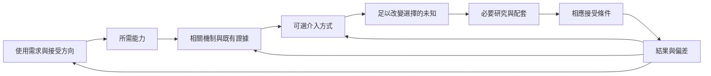

# 計畫沿革

本檔保存已被現行計畫取代的安排、限定條件及原錨點，用於追溯選擇與修正原因。**不是現行待辦或操作授權。** 從[現行計畫](../01_決策與計畫/整體計畫.md#plan-entrypoints)選工作；活動結果仍由[歷史研究紀錄](歷史研究紀錄.md)保存，任務狀態查Issue #2（內部追溯，未隨公開版提供）。

獨立用途是查「計畫如何演變」，與活動紀錄的查「做過什麼、結果如何」分開；不按每次對話另建正文。以下保留整理前完整內容，僅調整跨目錄相對連結與快照標題。當中「現行／本次／下一步」一律按原活動時點讀，新的規則回現行主位置，不續寫在快照裡。

| 要追溯的問題 | 快照入口 |
| --- | --- |
| 舊文件Goal與遊戲範圍限制 | [版本交付](#v09-version-delivery) |
| 六階段貼圖流程的整理前版本 | [貼圖執行安排](#texture-improvement-execution-plan) |
| 工作分層與工具導入理由 | [五層架構](#operating-architecture)、[導入順序](#v09-native-order) |
| r36及早期條件研究安排 | [研究主線](#next-static-priorities)、[全局相依](#v08-support) |
| 更早的路線、分類與範圍 | [四方式深化](#v08-mechanism-deepening)、[v0.7](#v07-plan)、[v0.6](#v06-plan)、[需求沿革](#requirements-history) |

<!-- BEGIN PRESERVED PLAN -->
## 整理前正文

## v0.9 現行執行計畫（2026-10-30貼圖後續流程整合）

**既有版本更新交付範圍：**使用者已明確限定為「完成專案計畫、管理與工具分工的新版本落地，先不做遊戲實驗」。原「執行版本更新計畫」Goal以此範圍驗收；本次文件整併不重新啟動該Goal。長期高清產品目標仍保留，但不作這次版本更新的完成門檻。既有遊戲操作授權不覆蓋這次範圍限制；恢復技術活動須由使用者明確接續該階段，不因Goal自動續行、工具修復或文件列有技術下一步而啟動。

| 版本交付 | 接受依據與交接 |
| --- | --- |
| 正文與決策 | 目標、階段、選擇、方法、失敗去向及責任沿既有主位置閉合；完整產品驗收保留於後續階段 |
| 管理實際落地 | 已審Git基線可回復且遠端身份相符；私人Issues／六階段Project實際存在並完成單一權威切換；不把混合正文／遊戲證據上傳或宣稱全案備份 |
| 工具與協作分工 | Skill、REA／成熟工具、Codex原生功能各有用途、觸發、產物與限制；已用、待實施、暫不需要可辨識；既有隔離實作／審查／整合證據可定位，不為驗收新增空工作樹或遊戲測試 |
| 接續與收尾 | 現行任務不再要求本Goal執行遊戲；誤啟活動殘留已清理、原件與存檔核對，未取得的exit／flush／表面證據保持不足；相依、連結、舊錨點與實際差異核對後可交付 |

目前目標是在3840×2160下改善GE2RB可見貼圖品質，保留原作風格、遊戲內顯示尺寸與動作，並可停用恢復。16,632份已取得來源身份納入評估範圍，按資產族逐批確認保留或改善；不設定全包統一倍率或必須修改的張數。分類後依使用者要求先建立[暫定倍率配置](來源索引.md#texture-scale-settings)，它是待驗證的試作設定；最終採用仍依下列對應、成因及樣本證據判定，不把設定完成當生成或載入完成。先前2倍／4倍試作及清理結果沿[來源](來源索引.md#texture-pack-cleanup)查回。使用者本次要求重新規劃，交付為以下執行安排；不在規劃階段啟動新轉換、部署或遊戲觀測。逐項技術判斷沿[模型／介面先行的方法](../04_工作封包/03_首輪判別設計.md#texture-scale-plan-4k)，長期完成界線依[成果終點](#execution-objective)。

**貼圖改善的執行安排。** 承接r9分類、r3逐來源處置、既有純色包與AI包；分類及載入接線不重做。本次依目前成果與官方工具資料重新排相依，規劃不啟動生成、部署或遊戲。沿使用者「先確認最大顏色覆蓋，再處理AI品質」：以每批可核範圍前進，七項用途研究及頭髮待辦不作全部生產的共同門檻。當前數量／差集快照見[處置與規劃輸入](來源索引.md#texture-hd-followup-inputs)，即時任務仍以Issue #2為主，Project Status不由文件代改。

| 順序 | 工作及交付 | 轉進條件／失敗回流 |
| --- | --- | --- |
| 1．固定覆蓋對帳 | 重用全庫SHA集合、純色／AI manifest與已驗載入器。合併既有有效日誌與使用者目視，按基地、常用戰場、劇情角色、武器預覽、特效等實際可重現路線列已測／未測；分開包內有圖、載入命中、可見變色、AI品質已驗。交具來源key的覆蓋表與下一觀測清單 | 每個已測漏點可分未載入、來源未收錄、選取／載入失敗或已載入但表面未變；日誌截斷或未走場景列不足。單張沒變色不直接要求AI重做 |
| 2．確認漏點並排候選 | 從純色有／AI無的差集，加上實際miss，按來源去重。髮絲待辦、功能候選、常數及明示保留範圍分流；其餘只進逐項篩選，不當全批准入。優先正常遊玩可見且重複使用的缺口，再看可見面積、原圖缺陷與證據可得性 | 該批顏色覆蓋已可交代、來源可靠才進品質比較；測試資產或未觀測來源可作離線候選，不能冒稱遊戲覆蓋。不等全庫映射或七疑點歸零 |
| 3．建立小批配方 | 先重用既有合格同條件配方；新條件至少含實際涉及的普通顏色、透明／裁切、平鋪、圖集／動畫、文字細線及已知失敗例。交原圖、同成品尺寸插值控制、AI候選、DDS與mip比較；原生2倍只在有辨別需要時加入 | 每個代表來源都有具名改善與退化判斷；原作細節、邊界、通道及共享者有問題就回修該配方，不擴全族。未知alpha用途只阻相依項 |
| 4．同條件批次與既有包複核 | 只把已通過樣本條件的來源分批編碼，保存母圖、配方、尺度、全mip、來源／產物hash與回退；新項完整原生載入，未變舊項沿身份重用。既有配方複核按實際風險與可見性安排，旗標不當已證缺陷 | 已生成、離線合格、已部署、遊戲出現、畫質接受分欄；新用途／新通道回3。修訂在獨立版本，不改現行hardlink內容 |
| 5．4K遊戲品質與成本 | 固定同場景原版／AI對照，核近中遠、運動、透明邊緣、動畫、mip過渡及已知共享表面。PresentMon先pilot再固定正式可比區間；記幀時間分布、冷暖載入及可取得的記憶體指標 | 成本容忍在正式比較前依既有契約決定；未量測不報零成本。使用者目視及日誌承接遊戲證據，不使用電腦操作技能代操作；品質不足回3、選錯來源回2 |
| 6．可逆交付與下一批 | 固定已驗包版本、簡單啟用／停用／恢復與Steam入口，交改善範圍、保留項、未測區域、成本及可見恢復證據 | 只有相應範圍品質／成本／恢復都通過才稱該批可接受；張數增加不自動完成產品，下一批沿相同流程 |

**研究支線與主流程的相依。** 既有九項待辦保持：五個用途研究任務涵蓋七來源，另四項髮絲工作依使用者要求延後。Nozzle的provider、Fort的shader變體、FakeChara的屬性消費可解共通機制，Head／Reflection2與bg0／BoxA續按具體問題追；本次只排程依賴，不把已登記待辦自動啟動。若主流程某一候選確實依賴其中機制，只隔離該候選；其餘已具條件者繼續。新GE原理回對應T與總覽，外部工具規則只回方法與來源。

**下一個工作包是覆蓋對帳與分批名單。** 以既有日誌／來源身份完成「純色有、AI無」的逐項差集，列候選、保護及未觀測；再交可重現路線與第一批代表來源，不先全量生成。這個規劃已保存差集快照，尚未完成新一輪遊戲觀測或候選准入。覆蓋缺口有據後，才對該批進AI品質。先前AI樣本／小批流程已有成果，後續從缺的條件續接，不回到環境安裝或首次試作。

**處理與倍率承接。** 顏色可積極進候選，透明、圖集、平鋪與文字走專門配方；功能圖原版、頭髮待辦、UI／劇情保留範圍不變。已選範圍在比較差異不大時優先4倍，2倍保留為有證據的備選；不給全庫強制倍率，也不新增1倍loader。外部工具提供的alpha、邊界與壓縮選項只說明如何比較，不能代GE採樣或品質接受。詳細操作只維護於[AI製作方法](../04_工作封包/03_首輪判別設計.md#texture-ai-production-workflow)，品質與成本沿[驗收契約](../04_工作封包/04_最小交付驗收.md#accept-quality)。

**擴大與成本原則：** 以每個資產族的證據逐批前進；明確分開「原版已足夠」與「尚未查明」。不改骨架／動畫或圖集格序；其他成因回相應問題，不由本規劃擴成模型重製。原包唯讀、母圖與原碼保留，衍生檔僅在確認不再使用後具名清理。實際幀時間、載入時間與記憶體峰值由代表批次量測後評估，未量測前不捏造工期、容量、顯存或效能保證。

既有機制、局部成果及證據邊界見[引擎工作理論](../02_引擎理論/機制總覽.md#v08-mechanism)；工具資格、實際完成與缺件沿[狀態權威指標](../01_決策與計畫/研究支線狀態.md#current-handoff-checkpoint)至Project／Issue查詢；支線只保留切換與證據導覽。

本版先處理研究上下游不對等可能造成的選路偏差：共通判讀規則已具備，跨路線可比證據尚未充分；不將「下游成果較多」改寫成「下游必然較佳」。全案方法已依[選用邊界](../01_決策與計畫/決策表.md#tool-adoption-boundary)及[外部資料／原位重構決策](../01_決策與計畫/決策表.md#theory-structure-assessment)收斂；T16與具名相依的正文修正已落位。先對照同一修改目的的身份保留／合併、作用範圍及生命週期，再決定需要的證據與執行手段、安排下方階段；外部契約、工具靜態結果、合成資格與GE實測分層，不把全部原理未知列成技術接續前置。

內容建置與閱讀依「目標 → 現況 → 選擇 → 階段 → 方法 → 現行交接」；先定本頁目標與[接受方向](#v08-needs)，再查[現行理論](../02_引擎理論/機制總覽.md#v08-mechanism)及來源邊界、[決策](../01_決策與計畫/決策表.md#current-candidate-route)、[階段相依](#v08-support)、[方法](../04_工作封包/03_首輪判別設計.md#current-asset-execution)，最後由[支線](../01_決策與計畫/研究支線狀態.md#v08-work)接續。方法不得反過來創造無關的產品需求或共同門檻。

### 長期產品成果與完成終點

長期產品目標為：以可追溯證據理解GE2RB的貼圖讀取、解碼與使用方式，將結果轉成可用工具與模組，完成至少一項環境貼圖的高清替換，保留原作風格並可停用恢復。完成依據是同一受檢版本中可重現的遊戲內改善，及原狀、替換、停用恢復對照；依[封包4](../04_工作封包/04_最小交付驗收.md#purpose)核內容、具體表面、風格／高清品質、共享影響及成本。

同尺寸可逆修改仍是降低介入不確定性的中途里程碑，不能當成此目標終點；高清內容、可用工具／模組及遊戲內驗證都屬產品實施範圍；本次版本更新的交付範圍以上方專節為準。REA＋Ghidra是目前主要方法；直接Ghidra或其他合格入口可交同責任證據。REA安裝、函式解析、文件更新、預覽或局部測試通過只算階段成果。自主選擇方法，將具名二進位證據接實作與實物測試，遇阻先處理或採替代，必要的使用者取捨才提出；不要求先完整重建引擎。

來源階段交付是可重讀的當前outer、可靠候選bytes及其正常表示；已有成果直接重用，驗收沿[封包3步驟1–4](../04_工作封包/03_首輪判別設計.md#current-asset-execution)；獨立正確性未證者保持限定，不因已有預覽就通過內容資格。其後接表面對應與可逆修改。實作、取件、解析、REA調查依實際缺口交替推進，不要求先完成全部原理研究；工具準備可以是目標內的第一批工作。

每輪的選題、失敗轉進與接續方法只維護於[執行迴圈](../04_工作封包/03_首輪判別設計.md#execution-loop)，當前位置依[支線權威指標](../01_決策與計畫/研究支線狀態.md#current-handoff-checkpoint)指定的主位置維護，切換前為支線。本節規定產品成果終點；目標是否啟動及實際操作範圍不由文件存在推定。

**Goal銜接：**原生目標名稱為「執行版本更新計畫」，依[版本交付範圍](#v09-version-delivery)驗收；撤回將它逕自解讀成產品Goal並連續進行遊戲活動的安排。Goal完成不關閉產品Issue，也不自動啟動下一個技術Goal；任務及條件接續依[權威入口](../01_決策與計畫/研究支線狀態.md#current-handoff-checkpoint)至Project／Issue查詢。日後明確恢復技術實施時仍沿[Steam防盲流程](../04_工作封包/03_首輪判別設計.md#steam-launch-procedure)，既有可重用資格與產品路線不重設。

### 決策、管理、執行與證據的工作架構

按職責分層，工具是各層的實作選擇；更換工具不重建產品目標或任務系統。完整選用理由在[決策表](../01_決策與計畫/決策表.md#v09-tool-decisions)，具體輸入、入口與產物在[工具交接](../04_工作封包/03_首輪判別設計.md#tool-handoffs)。

| 工作層 | 主責與權威內容 | 交給下一層的產物 |
| --- | --- | --- |
| 決策與知識 | 使用者定產品取捨；主代理整合。計畫管目標／相依，決策管選擇，T／總覽管原理 | 具名問題、採用條件與接受標準；聊天不作唯一交接 |
| 任務與版本 | Issue管任務／缺件，Project Status管階段；Git及工作樹管已納管差異 | 任務的輸入、範圍、責任人與交付；提交／審查不等產品完成，也不代全案備份 |
| 專業執行 | REA＋Ghidra／Frida、DirectXTex及按缺口採用的apitrace／PresentMon等 | 有目標、版本、範圍與限制的分析、觀測、轉換或量測；各自沿實際CLI／MCP入口調用 |
| 專案適配與操作 | 固定observer、窄用途腳本與部署交易補GE接線；既有Skill／Codex功能承接調用及協作 | 僅補成熟工具未提供的具名交接；原碼位置、輸入綁定、部署與清理收據分開保存 |
| 證據與驗收 | 原始產物／REA Evidence保存觀察，來源索引定位，T解釋，封包判定，使用者接受品質／成本 | 通過交下一階段；反例修受影響選擇，不足補缺邊，無效修方法；不由工具PASS直接結案 |

REA負責逆向協調及Evidence，GitHub負責任務管理；獨立圖形／素材工具由主代理串接，不預設都是REA內建。工具能力按已用證據、待適配／資格、條件候選及設計參考區分，詳[能力採用邊界](../01_決策與計畫/決策表.md#tool-adoption-boundary)。主代理負責選題、分工與判讀；機械身份、格式及差異交既有工具，避免以聊天記憶替代可重讀產物。

### 已採用的正文建置與維護順序

| 順序 | 必須形成的內容與交接 | 主責位置 |
| --- | --- | --- |
| 1．目標與成功 | 區分計畫文件、單資產可逆修改及高清產品；後續選擇須服務此目標 | 本頁目標／需求與封包4接受判準 |
| 2．現況與證據邊界 | 區分引擎實證、工具模型、歷史結果及工作限制；每項未知指出影響，不一律列前置 | T正文／總覽、來源索引；完成與缺件沿支線權威指標查Issue／Project |
| 3．路線與取捨 | 以現況比較主線、候選、代價及反轉；撤回不當限制 | 決策表；本頁只連選擇 |
| 4．階段產物與相依 | 從技術／產品驗收反推必要成果，再排正向交接；每步有輸入、產物、通過及失敗去向 | 本頁階段相依；四封包各維護輸入、可比性、方法、接受 |
| 5．實作方法與準備 | 方法對應具名產物；現有能力不足才補最小適配與必要控制 | 封包3；來源要求回封包1 |
| 6．現行交接與導覽 | 唯一下一步、條件支線及歷史安排不混列 | Issue／Project維護任務與階段，支線／README導覽；歷史只記實質修正 |

六層內容已寫入對應主位置；本表保留作後續修訂的相依順序，不是尚待從頭建置的待辦。若前一步不能交出下一步輸入，補具體交接或調整次序；新證據只重開受影響層與下游，不重啟全案。文件驗收鏈為「目標有驗收 → 路線服務目標 → 階段產生證據 → 方法交付產物 → 下一步可準備」。

### 專題審查與總整合

三個首輪專題及後續臨時唯讀審查的結論已收斂為本版決策；原專題聊天保留歷史定位，不再列成待回覆工作。主對話統一整合既有正文，不新增專題計畫或整理報告。實際完成及接續沿[支線權威指標](../01_決策與計畫/研究支線狀態.md#current-handoff-checkpoint)查既有Issue／Project。

整合依序核產品所需證據、技術能交的產物、管理如何承接；管理工具偏好不得倒推產品門檻。後續依任務啟用調查者、實作者及唯讀審查者，主代理裁定證據與跨題衝突；角色、工作樹及共享環境交接沿[封包3](../04_工作封包/03_首輪判別設計.md#v09-collaboration-method)。另一代理的審查不是獨立技術實驗。

每項近期重大選擇須有依據、代價、產物、接受與失敗去向；有實際反例才重開受影響決策。技術未知保留明確判別方法，後期品質／成本取捨有決定時點；不以全部引擎未知清零、工具數量或最快完成作成功標準。

### Skill與Codex原生功能的導入順序

這是支援現行階段的順序與相依，不另設產品路線。採用／反轉見[決策](../01_決策與計畫/決策表.md#v09-native-decisions)，實際狀態沿[支線權威指標](../01_決策與計畫/研究支線狀態.md#current-handoff-checkpoint)查詢，操作與驗收分別回封包3／4。

| 順序／觸發 | 交付與下游 |
| --- | --- |
| 先用已有能力 | 每個任務讀適用AGENTS／既有Skill，重用聊天協調、唯讀子代理與差異審查；交可核產物，無需先新建Skill或另開專案 |
| 首項需隔離的程式修改 | 先逐檔白名單與本機Git基線，再按具名任務用工作樹完成實作→審查→整合／回收；沒有隔離需要不建空樹，唯讀準備不必等此流程 |
| 管理遠端接手（既有成果重用） | 已有Issues／Project及明示權威切換；沿既有入口維護，不重建任務庫。後續只對實際受影響的任務原位更新，不作觀測共同前置 |
| 明確恢復目標模式時 | 先區分文件、技術里程碑或產品成果，再依明確請求建立／承接原生Goal並綁相應驗收；不取代Project／Issue任務、不由文件更新自動啟動或升級範圍 |
| 需要額外工具介面時 | 既有CLI不足或反覆跨工具調用有明確收益才接所需MCP／插件，核最小能力後交技術活動；此條件可在相依活動前發生，不必等遠端管理完成 |
| 暫緩項 | 自製Skill、額外Skill安裝、排程及通用代理框架不列共同待辦；穩定重複流程或具名週期需求成立才回決策，不為功能使用率增加工作 |

原生功能可用不等專案已落實，唯讀規畫審查也不等程式協作循環；實際導入與交付按支線查驗。所有導入服務r36接續與可見修改，不重開已完成取件或讓管理取代技術目標。

### 定案範圍與執行就緒度

v0.9收斂的是既有主線的階段分支、工具選擇、管理遷移與協作方式，沒有重建引擎理論或撤銷r36成果。歷史對話的已定目標／授權、助手建議、實際結果及撤回安排依[效力判讀](../01_決策與計畫/決策表.md#v09-dialogue-decisions)承接；單純發想不算已批准或已實施。

文件決策充分依[封包4驗收](../04_工作封包/04_最小交付驗收.md#v09-decision-acceptance)判定：近期動作可交接，後段未知有決定時點、方法與替代；不要求現在消除所有技術未知。Git、Issues、工作樹及角色試行的證據沿支線定位，現行任務查Issue／Project，不能從本計畫推定就緒。

| 層次 | 本版確定的安排 | 尚待的證據／決定時點 |
| --- | --- | --- |
| 產品 | 現存PC環境、原作風格、自用；簡單啟用／停用／狀態，接受退出後重啟恢復 | 比較方法與原作參照先固定；取得可比畫面後由使用者決定品質取捨，pilot後、正式成本比較前固定容忍門檻；未接受不宣告產品通過 |
| 技術 | 當前候選接可見表面，通過後做可逆修改及高清比較；資料不足按階段回流 | 工具GE相容性、表面與共享範圍由相應活動判別，不由文件自檢補證 |
| 管理 | Git＋私有Issues／Projects；切換後Project Status管階段、Issue管任務，僅遷移現行主線 | 既有白名單基線與遠端切換直接承接；目前沿權威指標查Project／Issue，異實體備援缺件不阻獨立唯讀工作，局部Git不稱全案備份 |
| 協作 | 主代理整合、調查／實作按任務分工、審查分離；需隔離修改才用工作樹 | 既有交接／審查／整合依原證據採用；新任務仍須具名範圍與產物，不把角色規格當已執行 |

正文定案、管理落地與後續產品實施分開驗收；本次範圍依[版本交付](#v09-version-delivery)，實際任務由[權威入口](../01_決策與計畫/研究支線狀態.md#current-handoff-checkpoint)查詢。管理與技術相依見[全局安排](#v08-support)，不因遠端不可用而阻塞不相依本機工作；離線通過不自動啟動遊戲。

### 文件架構與研究運作精簡評估（2026-10-17）

既有方案B保留目錄、前置T與理論、分開方法及歷史；分工依[分類表](../README.md#classification-map-20261017)，原評估及六步清單在本頁歷史區，實施結果見[歷史](歷史研究紀錄.md#v08-refactor-audit)。當前任務權威已切換至Issue／Project，不沿當時「支線集中狀態」安排雙寫。

### 現行研究安排與路線相依

現行研究以[資產對應成果](#next-static-priorities)及[階段相依](#v08-support)為準，工具／路線取捨由決策表維護。下方保存早期研究的理由與限定結果，不作目前完成度或待辦副本。

#### 現行主線與條件支線

保留現存新基線，Elevator_01及既有下游入口作接續比較起點；依共通證據決定後續介入，採用與改判只見[決策表](../01_決策與計畫/決策表.md#current-candidate-route)。理論研究的接受目標是能區分解釋、預測證據及被反例修正的系統模型，模型主位置在[總覽](../02_引擎理論/機制總覽.md#hypotheses)；接續從既有來源、引用、時間、消費及恢復之間尚未接實的關係選REA具名題目，不由本段重開已驗收的模型Goal，驗收與任務交接沿[權威入口](../01_決策與計畫/研究支線狀態.md#current-handoff-checkpoint)查詢。此研究目的不縮成補一張畫面，也不等整個遊戲引擎已還原。後續產品技術產物仍是「候選內容／來源 → 當次資源與draw → 目標及可見區域」的可核對關係，須區分內容相符、實際使用與像素貢獻，不能以同幀共現或宿主通過代替。既有REA解碼成果與畫面主線分開承接：Ceil r3已有引擎靜態規則支持的表示，仍未觀察遊戲選用；Elevator_01已有來源→替換內容→實際draw的限定證據，接續補具體可見表面、替換作用及恢復，不重新把資源對應或解碼列為全案缺件。各成果限其原活動，不能拼成Ceil已被使用或高清已成功；依據見[引擎總覽](../02_引擎理論/機制總覽.md#v08-relations)。遊戲證據仍停在r36，離線工具與接續狀態依[交接斷點](../01_決策與計畫/研究支線狀態.md#current-handoff-checkpoint)；兩者不混列為新增GE成果。

| 主線／條件線 | 進入與交接規則 |
| --- | --- |
| 理論接合及現存資產 | 先使共通證據支持有條件分支及反駁需求，判別引用／來源／時間的直接缺邊，再消費既有副本、表示與draw成果；模型接受、工具結果及產品表面成立分判，不重跑已完成取件 |
| 管理與協作準備 | 重用既有白名單Git與遠端切換；新任務沿已定角色交接／審查，隔離程式修改才建工作樹，方法在封包3 |
| 工具適配 | 以具名產物選成熟工具或既有窄入口；判別力與可重查性優先，維護／恢復成本次之，不以最快或工具數量排序 |
| 名稱／外部引用／S64 | 名稱／引用在影響系統分支判別或候選採用時可入選，須列不同預測及所需證據；S64同一性仍只服務具名歷史重用。失敗不連帶阻塞不相依資產，不追與模型或採用無關的完整失配歸因 |
| BlendFilter／完整狀態 | 具名派送／消費／時間關係若使系統解釋不可區分，或阻斷候選採用，即可評限定深化；不必先有可見畫面。已有答案不重做，不預設全引擎、全pass或通用測試框架為前置 |

每項工具或控制須服務具名產物；成熟工具選用及改判只在[決策](../01_決策與計畫/決策表.md#v09-tool-decisions)，入口、交接與失敗去向只在[封包3](../04_工作封包/03_首輪判別設計.md#tool-handoffs)。現行任務沿[權威指標](../01_決策與計畫/研究支線狀態.md#current-handoff-checkpoint)查Issue／Project，本頁不累積各輪待辦。

### 需求與接受方向

| 性質 | 目前內容與依據 | 成果如何判斷／何時取捨 |
| --- | --- | --- |
| 現行要求 | 本次使用者計畫：PC 環境貼圖優先、原作風格、目前電腦自用 | 在具名場景及表面比較原版與候選，正常視距與動態中有可辨改善；由使用者接受畫面 |
| 現行產品里程碑 | 單一環境資產的內容→具體表面→可見改善→停用恢復，須屬相同受檢版本及可追溯活動 | 內容、消費、畫面與恢復各有證據；局部成功不能拼成整體交付 |
| 歷史偏好已變更 | R01 /preimplementationCloseout/decisions 的 D01、D07 以角色為優先；目前改為環境。原作風格與自用仍沿用 | 角色研究保留為方法與局部機制依據；Gina、Anagra 與 UI 不自動成為環境代表或當前待辦 |
| 計畫文件維護 | 目標、主線、階段、方法與交接已定案；沿既有主位置承接新證據 | 新證據只修受影響安排；計畫定案、工具資格、單資產可逆修改及高清產品驗收分別判定 |
| 助手建議 | 先比較能改變路線取捨的缺口，採足夠回答問題的較小研究範圍 | 只有新增資料能排除解釋、修正機制或改變選項才擴查；不要求先還原全引擎 |
| 後續待判與待選 | 受選候選的表面、共享影響與恢復適用性；正式工具／binary、品質與成本 | Elevator_01／下游替換仍為有證據的暫選，改判依決策表；Ceil只在具名缺口需要時重開。內容／表面與工具適用由技術證據判別；取得可比畫面後選品質，pilot後固定正式成本門檻 |
| 操作邊界 | 既有研究／控制按各自活動範圍保存；後續技術工作依使用者指示與相應階段契約執行，不預設時間或來源份數 | 文件定案不代執行結果；當前完成與缺件沿支線權威指標查Issue／Project。舊版三小時、兩題六份、影片次數及單輪不解包限制不作現行常態前提 |

需求定義方法採 [NASA 4.1](https://www.nasa.gov/reference/4-1-stakeholder-expectations-definition/)：由用途與成果界定能力，不由現成腳本反推要做什麼。風格、可接受代價及後續活動由使用者決定；資料判讀、方案準備與自檢由助手完成。

### 由技術證據形成改善選項

續修需求：使用者對「先改善近看細節或一般遊玩距離」回答「由之後技術決定」。因此現在不要求先選觀感優先序；由技術研究提出可達的改善、適用情境與代價，再進行具體取捨。PC 環境優先、原作風格、自用與停用恢復仍保留，技術可行也不自動等於畫面接受。

以下是未來可能形成的成果選項，**不是已觀察到的 GE 故障，也不是已選處理方法**：

| 技術資料如果顯示 | 可以提出的改善選項 | 成立還需要什麼／不值得做時如何退回 |
| --- | --- | --- |
| 內容與表面關聯可靠，資源能保留更多內容，正常用途確有可辨資訊不足 | 改善該表面的細節或近看清晰度；倍率由輸入與輸出證據決定 | 實際建立描述、材質語義、同場景及正常視距／動態比較；單純放大而沒有可接受改善，就保留原內容 |
| 資源已有足夠內容，但 mip／取樣與畫面差異有可歸因關聯 | 比較一般視距或斜視角的清晰度與穩定性 | 實際被消費的資源及相關取樣證據；不由模糊直接推定 mip 或過濾為根因，也不先改遊戲設定 |
| 來源轉換已改壞通道、色彩或 alpha 語義 | 先修正內容處理，再判斷是否需要增尺寸 | 具名通道用途與最終輸出；材質用途未知時保留未知，不根據檔名選 normal／mask 配方 |
| 只能確認建立資源，尚無表面／可見關聯 | 先交付技術可行性範圍及缺件，不承諾某種畫面改善 | 取得相應消費及畫面資料後再形成產品選項；不將創建成功當高清成果 |

此分流由既有 L12／R23 品質研究及本次官方契約核對支持。D3D9 將建立要求、回傳資源及取樣分為不同邊界；Texconv 的尺寸、mip、格式與通道處理也需要分別指定。這些資料改變的是問題拆分與需要保存的欄位，不能提供 GE 的實際設定或效果。詳[來源與影響](來源索引.md#v08-refinement-sources)。

### 原理如何連到專案決策

找到一張看似正確的貼圖，只回答內容的一部分；還要知道遊戲是否選用它、怎樣建立資源、哪個表面使用，以及改動在何時仍有效。既有研究已能分辨這些問題，但不同活動各自只支持其中一些關係。[原理關係圖](../02_引擎理論/機制總覽.md#v08-relations)標出這些邊界。

專案因此採用以下回饋關係，而非固定逐項補完所有引擎未知：

這是工作決策圖。研究資料若已足以回答問題，就直接整理；必須實驗才能回答時，先交付候選活動。模型有反例只修正受影響的機制或方案；使用者不接受畫面則回到內容與需求，不直接淘汰介入方式。

### 四種做法的共同比較

四種介入方式的現行支持、反對、責任及改判，已統一到[決策主位置](../01_決策與計畫/決策表.md#current-candidate-route)；[早期比較表](#v08-mechanism-deepening)保留原適用時點；本入口保留供舊連結使用，不再維護另一份可能落後的路線表。機制責任詳[引擎工作理論](../02_引擎理論/機制總覽.md#route-obligations)，近期判斷及取捨理由詳[決策](../01_決策與計畫/決策表.md#v08-deepening-choice)。

比較成本仍按實際介入點：離線集中在格式、封包版本及檔案回復；上游集中在入口、返回表示／所有權及版本相依；下游集中在識別、共享使用、永久／draw期間綁定、captured state與重建；混合另增加身份橋接及雙邊恢復。現有資料不足作同條件數值排名。若可靠增尺寸已到資源，轉查內容／取樣／畫面，不再把容量當唯一原因；若某個入口或布局不適用，修該候選或比較替代，而非淘汰整條路線。

四者都還需正常內容品質、同場景效果與停用恢復。proxy、detour、add-on是到達邊界的手段，sidecar是供給內容的方式，不能據名稱另選產品架構。Ceil、Floor、Cafe在此檢查關係，沒有選為交付資產。詳細歷史原理及具名正向／反例保留在T正文與各活動紀錄。

### 後續研究選項及會改變選擇的資料

下表保留四類問題及其判別價值，不是固定執行序。現行順序由[條件模型研究裁決](../01_決策與計畫/決策表.md#current-candidate-route)按案例資格、直接相依與可改判資料決定；核心兩線可並列，量測配套僅服務確實依賴它的問題。重構後首輪已執行具名靜態深化；不再把每項靜態問題都設成必須先由使用者選擇，只有新的成本、方向或畫面取捨才另交決策。

| 選項與具體問題 | 已有輸入及最小補證 | 對選擇的影響 | 代價構成與停止點 |
| --- | --- | --- | --- |
| 內容可信度：Ceil 排列是否有獨立判據？Floor 歷史內容能否重接原件？ | T03–T09、L02、既有 X60–X62；需能獨立區分排列的資料，或 Floor 同期 raw／atlas 生成身份與封包成員定位 | 足夠時提高離線／上游內容研究的可行性；僅同源互證時維持未知，不能宣稱內容已可加工 | 原件取得、版本核對及判據分析。既有同集合搜尋不重開；無具名新線索就交付缺件。重解碼是新活動，不能當尋回歷史原件 |
| 環境內容與表面關聯：哪個 PC 環境成員或材質槽真的指向候選內容？ | T10–T17、L11、R26／R27、IXO 平台紀錄。需具名 PC 環境成員與 reader 版本，或既有同活動來源／資源／表面證據 | 可改變代表資產與上游、下游可用入口；若只有候選列表、Vita 展示或來源命中，仍保留多解 | 關聯核對與平台適用性查閱。若只能靠新的 caller 追蹤／遊戲觀測補邊，形成後續活動供取捨，本輪到此停止 |
| 增尺寸與品質條件：候選會卡在來源布局、實際資源、取樣，還是內容語義？ | R04 增尺寸及品質段、T18／T19／T28／T29／T34；需所選環境資產的來源、建立要求、實際資源與通道用途 | 已到大資源則轉查消費／取樣；值或通道語義錯誤先修內容；不是一律研究封包增容 | 能沿用的先整理，缺 GE 行為則另設研究。尚未選資產時，不開發 writer、不產生高清素材、不批量處理 |
| 條件量測配套：所選問題是否需要可靠內容／draw／生命期觀測？ | L08、R29／R30／R32、R90–R92；先定所問命題，再檢查 exact 配置與需要的能力 | 只有觀測缺陷確實阻擋上述問題才啟動修補。零命中若缺覆蓋／收尾，不能排除資產或路線 | 元件版本、依賴、控制、故障恢復與後續維護。舊閉合契約可供改編，不因寫得完整而優先；不合格資料回到量測問題 |

採 [NASA 決策分析](https://www.nasa.gov/reference/6-8-decision-analysis/)的替代與不確定性原則：會改判的未知才值得深化。缺原件是證據取得問題；必須觀測才知是技術未知；畫面偏好是需求取捨，三者不能都寫成「繼續逆向」。

### 全局階段與必要相依

來源、outer及正常表示已有合格產物時直接重用；來源變動才回[封包3步驟1–4](../04_工作封包/03_首輪判別設計.md#current-asset-execution)。以下是從r36斷點接續的階段，不是把既有取件列成待重做。

| 階段 | 輸入與必交產物／通過條件 | 失敗去向 |
| --- | --- | --- |
| 0．方法與正文定案 | 全案方法、主責與原件邊界→唯一選擇、產物相依及無過期下一步；本版文件交付到此，不包含新的技術實施 | 缺依據只補受影響選擇，不重啟整案 |
| 1．條件模型、共通證據與受選活動準備 | 先交跨層身份／時間接合、可區分分支、不同預測與反駁所需證據，再比較路線；保存資料足夠就直接採用，不足才按模型缺邊選REA定點逆向或具名動態核對。重用已完成來源保存、解碼及offline bind／analyze／plan，只補受選活動差異所需的綁定、全新spec／outputRoot及必要資格／審查。[契約](../04_工作封包/03_首輪判別設計.md#v09-offline-entry) | 身份／相依失配只停受影響部分，不默認改root最新檔，不重建已有合格入口；離線通過不等部署資格 |
| 2．資產與可見表面判別 | 合格活動輸入→同次內容、draw、有效區間及目標／影像關係；目前方向假設可用[限定方向分支](../04_工作封包/03_首輪判別設計.md#v09-direction-branches)，需要連續API／共享控制則依工具或候選改判 | 方法無效先修具體原因；有效不足改selector、補具名consumer、受控內容對照或換候選，不原樣反覆轉視角 |
| 3．表面因果與恢復 | 合格來源／內容及場景→以有控制的呈現鏈或具名介入建立表面對應，再交可見修改與恢復對照；依封包2的O／D差異及封包4恢復判準 | 回內容選擇、共享或呈現缺邊；恢復失敗先清理，不進高清 |
| 4．高清與正式入口 | 已定位表面→先評既有r4候選，交正常遊玩配置及品質／成本比較 | 素材回素材，成本調尺寸／壓縮／作用域；可比畫面後決品質，pilot後、正式成本比較前定容忍，不由代理代填 |
| 5．交付驗收 | 固定交付版→簡單啟停、必要生命週期、可見恢復、品質／成本接受 | 缺哪層回哪層；研究結束或原碼合併不完成產品 |

共通證據對照方法見[封包3](../04_工作封包/03_首輪判別設計.md#common-evidence-method)。它先利用已有成果形成有條件、可反駁模型，再交可採路線或具名判別題，不要求四條路線同時通過實驗。框架已有圖表不等接合已證；模型接受須有可區分預測、反駁界線及可取得的證據，後續只針對具名不可區分關係選題，不重開已答helper。具體畫面不是所有理論問題的前置，也不因模型成立便自動恢復遊戲。繪製選取與方向觀測只在對照後的缺口需要時採用，不是所有候選、工具或後續修改的共同前置。管理基線與協作按[封包3](../04_工作封包/03_首輪判別設計.md#v09-management-method)服務這條鏈；不以遠端建置、工作樹試行、shipping build或完整GPU理論作方向觀測共同前置。相同責任已由更強的合格高清對照覆蓋時，可承接同尺寸里程碑，不儀式性重做。判讀／方法主位置在封包3，接受主位置在封包4；目前任務與階段沿支線權威指標查既有Issue／Project。

## 歷史規劃與原錨點

以下文字按其原版本及活動時點閱讀；其中「目前／本輪／下一步」、排序、預算與就緒標籤不代表 v0.9 現行狀態。歷史技術成果與反例仍依各自證據範圍保留。

2026-10-18完成度對照與10月19日承接（歷史診斷，非目前缺件清單）

**判定：整體研究草案的四項交付已具備，可供審閱與研究方向取捨；尚非完整執行方案，也沒有使用者已接受整體安排的證據。** 撤回不分層的「草案已完成」說法。這次實讀現行主位置及直接相依，發現入口仍稱未測試、計畫仍稱任何活動都未就緒等過期文字，已限縮修正；不能以先前連結檢查或8／16項控制通過替代這項語義核對。

**2026-10-19承接：**使用者已選定「近期細案＋全程階段」並要求實施；本次補交的方法與剩餘資格見[近期細案](../04_工作封包/03_首輪判別設計.md#bounded-postgate-design)及[支線](../01_決策與計畫/研究支線狀態.md#v08-work)。以下2026-10-18對照保留當時診斷，不能再把已具名方法寫成完全未設計；使用者採用本次規劃也不等於產品／畫面接受或新測試批准。

本次按原定交付與現行封包4驗收，不以既有產物倒推需求，也不把完整引擎還原、全部工具、產品實現新增為草案完成條件。外部方法與適用範圍見[本次來源](來源索引.md#draft-completeness-methods)。

| 原定成果／接受條件 | 本次查到的現行依據 | 完成度與限制 |
| --- | --- | --- |
| 需求、接受方向及責任 | [需求表](#v08-needs)、[技術形成改善選項](#v08-outcome-refinement)、封包4內容／表面／品質／成本／恢復 | 草案層具備：PC環境、原風格、自用、可恢復及單一資產鏈明確；觀感由後續證據形成選項。資產、品質／效能數值與可接受成本仍待具體活動，不現在代填 |
| 既有設計承接表 | [R04／R24／R01對照](../02_引擎理論/機制總覽.md#v08-inheritance)及其成果對照連結 | 已有具名承接、壓縮、衝突、缺件與處置。支持已登錄範圍，沒有證明1,099筆全史語義或全部子log無漏；這不是要求重審全庫 |
| 可讀原理解釋與關係圖 | [總覽](../02_引擎理論/機制總覽.md#v08-mechanism)的身份、表示、消費、觀測、生命期、品質、五視圖、六缺邊與競爭假說；T正文保留詳細論證 | 文件構成及本次情境走查成立，仍是有條件的部分模型；使用者能否理解／接受尚無直接確認，不把助手自檢當使用者驗收 |
| 方法與研究選項比較 | [四路線比較](#v08-options)、[研究選項](#v08-research)、決策的最強反對理由與改判條件 | 足以支持維持四路線並列、停止泛讀及優先具名來源的研究安排；不足以選定產品路線或宣稱某路線已可交付 |
| 全局草案與必要配套 | [全局階段](#v08-support)、封包1輸入資格、封包2案例、封包3候選／有界契約、封包4驗收、支線缺件 | 全局骨架已具備，R／F、六案例、影片及元件依問題觸發。下一次正式取證仍缺活動特定設計與輸入，詳下列分流 |
| 外部依據與閉環 | 來源索引身份／同源／用途，T及總覽的支持／反例／不足，決策和支線的改判／重啟 | 本次沿具名案例可回查；外部方法不證GE事實或防盲效果，未逐條重新審閱整庫來源 |
| 版本、歷史與當前入口一致 | 原錨點、歷史區及取得器結果分活動保存；本次修正兩入口、計畫／決策中的當前階段混寫 | 修正前不完全符合交接判準；修正後做受影響語義及機械自檢，結果見[歷史](歷史研究紀錄.md#draft-completeness-audit)。不重寫過去結果或替其補授權 |

**剩餘工作的性質與決定時點：**

| 剩餘事項 | 影響與取得／補設計方式 | 何時需要、責任 |
| --- | --- | --- |
| 下一次取證的精確輸入及來源紀錄 | 合格SavedOuter或S64包；來源路徑、身份、穩定性、全新輸出與空間綁定。異版另立候選，不改pin | 正式取證前；助手核對，需新付費／人工取得或安裝改動時先提供具體代價由使用者取捨 |
| 身份通過後的正常、提交、中止與失敗控制細案 | [現有表](../04_工作封包/03_首輪判別設計.md#bounded-main-boundaries)只有階段oracle；仍缺精確觸發／觀察點、作用對象、命令及判讀、清理／復原方法。先選SavedOuter或QpckMember所需路徑，再具名設計；沒有方法時明列不足，不用隨機kill或改pin造覆蓋 | 對應流程採用前；助手準備可審方法。**這是設計缺口，不全是缺檔**；不把所有故障情境或斷電測試升共同前置 |
| 實際操作範圍與代價 | 既有資料量估算可沿用，當次操作步驟、讀寫範圍、恢復、所需人工與成本仍須綁活動；不捏造總工期或上限 | 新活動形成時由助手具體化；涉及新取捨由使用者決定。16組明確批准只及該活動及子程序政策，其他結果存在不等授權自動擴大 |
| 環境消費與產品接受細案 | 具名資產、場景、來源→資源→表面、通道／mip、原版／觀測／候選／停用、品質與效能門檻 | 相應研究／量測前固定；技術形成可達選項後由使用者接受，不阻目前文件審閱 |
| 草案的實際理解與採納 | 尚無證據可代替使用者讀後的理解及方向取捨；局部允許測試不是全案批准 | 交付可讀基線供審閱，不以再次問籠統批准阻止本次評估收尾 |

**收尾判斷：**本次完成的是草案完成度重評與具名交接修正；可審閱基線成立，後續執行細案部分完成、正式取證未就緒、產品未驗收。若新原件／caller改變候選責任，回到對應比較；若只是補新活動的觸發點或路徑，補封包3即可，不推倒全局草案。沒有可信分母，不報完成百分比，也不將研究持續更新等同草案永遠不能交付。

原架構評估與批准的六步清單（歷史快照）

**評估結論：建議B，保留四目錄及既有理論骨架，重整區塊主責、現行正文與歷史分界；本輪只完成評估寫回，重構尚未執行。** A的契約修補有必要，但不足以處理仍存在的混合區塊；C可提供更強物理分離，尚無它能額外解決的具名需求足以抵銷遷移負擔。比較、反對理由及改判條件以[決策表](../01_決策與計畫/決策表.md#v08-architecture-decision)為主；全部16檔處置見[分類表](../README.md#classification-map-20261017)。本結論不改產品路線或工具研究排序。

目的：使用者能直接讀懂現行引擎理論，助手能把新結果更新進同一份解釋，原始依據及修訂仍可回查。範圍是文件與研究運作，不含工具程式架構。逐檔檢查角色、標題及引用；語義只讀現行區、已知重複與直接相依，未重審1,099筆。外部方法按[用途與界線](來源索引.md#v08-architecture-methods)採用；不以字數、檔數或新舊評分。

#### 現況診斷：結構缺陷與執行缺口分開

| 原位置與具體例子 | 判斷及影響 | 本次處置建議 |
| --- | --- | --- |
| [理論正文漏接紀錄](歷史研究紀錄.md#v08-rounds-writeback)；舊封包已要求來源→T→總覽 | **執行／驗收缺口**：只在工具分析提T編號便稱承接完成；不能全部歸咎於目錄，也不能以重構取代正文整合 | 保留已簡化三步契約；以現行解釋是否改變核完成，不再新增流程層 |
| 命題檔的[工具分析](../02_引擎理論/命題與證據關聯.md#v08-core-results)先於[schema／T正文](../02_引擎理論/命題與證據關聯.md#schema)；總覽有多輪「增量」 | **結構負擔**：論證材料與現行解釋混排，容易把保存報告當更新理論。T01於檢查基線第375行，僅是位置證據，不代表效率測量 | 現行說明與T正文先呈現；研究批次材料作參考區；將新增條件融入原解釋 |
| 總覽的「既有分題資料與歷次證據登錄」之後仍有[五視圖](../02_引擎理論/機制總覽.md#views)；命題檔相似歷史提示之後仍有T正文及v0.8修訂 | **效力邊界不清**：籠統「以下不代表現行」可能連有效骨架與現行修訂一起降格；資料本身未必衝突 | 歷史提示只包圍具名舊批次；現行T與五視圖明示有效條件，不靠頁面先後決定權威 |
| [決策表現行區](../01_決策與計畫/決策表.md#v08-decisions)、[支線現行區](../01_決策與計畫/研究支線狀態.md#v08-work)、[封包3](../04_工作封包/03_首輪判別設計.md#v08-core-contract)及計畫皆敘述Sharp／PC完成、缺件、重開條件 | **主責重複**：同一狀態多處可編輯；目前未據此認定全部表格互相矛盾 | 支線管活動狀態／缺件／取得及重啟；封包3管如何做；決策管為何選；計畫管全局相依 |
| [來源索引](來源索引.md#v08-core-sources)同時有身份、深度、能力限制；歷史紀錄有批次結果 | **不宜過度去重的反例**：資格與實讀深度是來源必要欄位；歷史批次敘述也有獨立追溯用途 | 保留來源資格與歷史結果；只有當它們替代現行技術命題或活動狀態時才改為連結 |
| 封包1／2仍有批次讀取摘要；封包4同時保存共用契約、產品條件及歷次自檢 | **用途混合**：規格、實際結果與未啟動案例易混讀；但各封包均有獨有用途 | 保留四封包；分共用規格、條件觸發活動及歷史結果，不合成巨型契約 |
| [分類表](../README.md#classification-map-20261017)位於歷史導覽區，舊表僅列檔案用途，封包4還只寫產品驗收 | **分類描述落後**：未反映研究契約與混合段落的新分工 | 本輪原位置更新16檔與區塊處置，明示為現行評估；後續再按本表整理內容 |

反對過度重構的本地證據：舊規劃已有明示歷史區；T15的撤回與來源歧義可直接查到，不能把所有舊段落視為失效或垃圾。前輪命題已完成的補正繼續有效。本機跨檔連結掃描顯示命題檔有355處引用來自11檔，來源索引有555處來自11檔（包含歷史與重複引用）；這些只顯示遷移相依，不證明拆檔不可行或使用效率。

#### 後續原位重整清單（建議，未執行）

共同前置：開始重構時保存當時受影響檔的完整副本、雜湊及錨點／引用表，不能拿本次評估前快照覆蓋後續新研究。每列完成後先核語義再處理下一列。下列目的均在既有檔案內；不新增目錄、檔案或編號。活動名稱及既有T／G／來源ID沿用。

| 順序／來源區塊 | 固定目的與修改方式 | 引用與復原 |
| --- | --- | --- |
| 1．機制總覽：v08-core-mechanism、v08-deep-mechanism、v08-complete-mechanism及scope～route-obligations | 以v08-mechanism作現行入口，將入口／來源、容量／表示、內容有效期、材質消費、品質及恢復的增量整合進相應說明；五視圖與競爭假說保留。舊批次敘述留具名歷史區，現行內容先呈現；只搬仍成立的條件，不新增GE事實 | 原錨點留於原義段落；內容被整合後，舊增量錨點留短修訂說明並連現行位置。按本列整檔差異復原，不碰其他研究新增 |
| 2．命題檔：v08-claims、schema、T正文與開頭v08-core-results／coverage／deepening／analysis | 排序為閱讀分工→schema／T正文→批次研究參考。對已補的T01／02／08／09／13／17／19／20／29／31／32，把前輪增補和原結論整合成各自現行解釋；C摘錄及具名撤回仍貼近所支持的T，不逐條重審其餘歷史 | 所有T、C、批次及推斷錨點保留；區塊移動須連同成對details邊界；沒有獨有增量的重複摘要改連結，獨有反例不可刪。復原該檔及其直接引用差異 |
| 3．支線v08-work、封包3 v08-core-contract、計畫v08-core-decision及決策v08-decisions的狀態敘述 | 把現行問題的狀態、缺件、具名取得途徑及重啟條件整合到支線v08-work對應列；封包3保留問題／輸入規格／方法／控制／產物／停止判準，連支線取得目前缺件。計畫保留全局相依與建議，決策保留選項／理由／反轉條件。完成活動結果引用歷史 | 技術停止判準仍屬活動契約，狀態改變及重啟資格屬支線；不得刪掉前者來達成去重。舊批次表保留歷史標示。此列涉及四檔，核對一致後一組交付／復原 |
| 4．封包1 v08-inputs、封包2 v08-comparison、封包4 v08-theory-writeback／v08-review及各輪review | 封包1保留輸入資格要求，批次hash／實讀摘要引用來源；封包2保留案例可比性與禁止跳接，實際案例結果引用T；封包4現行共用契約與產品接受條件先呈現，各輪自檢明示歷史，不新增規則 | 不把未選案例升為必做活動；驗收判準與過去結果不得合併。保留原錨點，按三檔同批差異復原 |
| 5．來源索引的批次登錄與歷史研究紀錄 | 身份、版本、同源、實讀深度仍在來源；結論完整論證連T，活動狀態連支線。歷史只保存活動當時結果及修訂，引用現行位置；不得以「舊」為由刪來源或批次證據 | 原pin／hash／來源ID不改；同一來源不同讀取活動保留。沒有越界維護的段落不改；按受影響段落差異復原 |
| 6．兩個現行README及分類表 | 依上述實際結果更新導航／分類；閱讀路徑固定為總覽→T→按需分析／來源，續作為支線→具體契約。入口不重述進度；分類表移出歷史效力的籠統提示範圍 | 所有原入口仍可到達對應內容。完成全體檢查後再提交本批文件結果；失敗只回復本批改動，不刪歷史原件 |

需要復原時先核目前檔案是否仍等於本批改後版本；若已有新研究，僅反向撤回本批差異，不能整檔覆蓋。尚未開始重構，故本輪沒有宣布上述分工已全面實現。C的具體候選是「命題檔批次原碼分析獨立」「封包歷史驗收獨立」，均延後；只有完成B後仍有具名查找／維護失敗才另列目標路徑與兼容遷移，不預建空檔。

**完成邊界與後續：**本次交付評估、分類、比較及此清單。沒有新的引擎內容須回寫T，產品路線與技術缺件未改；不為形式同步而改機制、支線或共用契約。四個案例走查及既有語義界線見[非獨立檢視](歷史研究紀錄.md#v08-architecture-audit)。架構效果仍須在後續實際使用確認，不能用這次紙上比較宣稱已提升效率。

2026-10-18工具研究回看與條件方法（歷史依據）

**總體回看結論：近期研究增加了工具資格與跨層條件的解釋力，尚未新增一項PC環境資產的來源到具體表面證據。研究順序因此回到具名PC證據的取得與對接，不自動續讀下一個工具函式。** 既有五視圖、四路線與v0.8沿用；先前理論重構已完成，現在直接維護正文，不再將重構列為未完成前置。

下表保留先前RTBL／Global、Extra／Explorer、QPCK、GEBUtils、DDS9、Toolkit與Special K工具分析的增量及當時限制，不是目前缺件清單。後續outer保存、同版REA及實際觀測已更新[現行證據鏈](../02_引擎理論/機制總覽.md#v08-relations)；原碼、條件推論、歷史Anagra／UI／host仍各按來源，不拼成同一項環境實證鏈。

| 統整主題 | 該批工具分析增量與論證位置 | 該批次未提供的證據（非現況清單） |
| --- | --- | --- |
| 身份與選取 | **限縮舊主張＋共同責任**：名稱／來源CRC、payload、mip0、完整表示、資源與表面是不同辨識範圍；QPCK位置比較未覆蓋key，Toolkit細來源CRC可在後續粗key快取合併。選取還須保留政策與外部解析基準。[T01](../02_引擎理論/命題與證據關聯.md#t01)、[T13](../02_引擎理論/命題與證據關聯.md#t13-inference-result) | 沒有新環境provider／caller、資源共享使用者或單表面選擇性。SK D3D9 memory Ex已有沿路保留不同來源CRC的靜態支持，D3D11 full欄位仍受登錄路徑限制；兩者都不授GE使用資格 |
| 表示與產物 | **新增可比較能力＋實作限縮**：RTBL聚合、Extra逐組seek／內嵌引用、QPCK有界讀寫、GEBUtils原位保存與DDS9 staging→DEFAULT各有正向。原始／推算／實讀長度、物件欄位／實際保存、布局／容量／mip及header另有分支限制。[T19](../02_引擎理論/命題與證據關聯.md#t19)、[T34](../02_引擎理論/命題與證據關聯.md#t34) | 沒有新增Ceil獨立排列、PC完整外表或通用writer資格；dump的DX10與DDS9的legacy不相容是工具接口差異，不是GE拒用證據 |
| 有效期與恢復 | **共同責任深化**：Explorer快取／即讀與請求歸屬、Toolkit複製bytes／保留物件後回讀，區分內容時點；GEBUtils歷次寫入、worker續寫、不同pool重建要求不同恢復對象。[T20](../02_引擎理論/命題與證據關聯.md#t20-inference-result)、[T31](../02_引擎理論/命題與證據關聯.md#t31) | 沒有新GE更新、裝置重建或安裝恢復通過；清檔、重掃、重試與內容重驗不能互代 |
| 消費與品質 | **限縮代理判據**：dump可保存部分mip，metadata可丟使用語義，autogen可改低階；輸出可讀與較細hash不足證使用或改善。[T23](../02_引擎理論/命題與證據關聯.md#t23)、[T29](../02_引擎理論/命題與證據關聯.md#t29) | 精確IXO owner／slot、環境內容到draw／表面、正常畫面與效能尚無本批新觀察；Anagra draw／Present、UI與隔離host正向按原範圍保留 |

保留的排序原則是避免把「工具細節持續增加」視為「產品缺邊持續縮小」。這不否定工具研究：它已排除若干過強推論，也揭露替代能力；下一題須指出如何改變具名PC候選或推翻現行結論。外部評估、決策及介面方法的實讀與用途見[本次來源](來源索引.md#global-review-sources)。

#### 引擎原理深化安排（2026-10-18）

**原理深化依主線缺口觸發。** 下表保留能服務來源／表示與材質／消費的靜態方法，不是另一份當期待辦；已答跨路線概括不重做，來源與消費也不互為全部完成前置。取得現存outer後，只有實物顯示的模型差異或具名使用問題需要時才追直接相依；狀態回[支線](../01_決策與計畫/研究支線狀態.md#v08-work)，方法回[缺口研究契約](../04_工作封包/03_首輪判別設計.md#theory-gap-contract)。

| 依賴順序 | 下一步的決策用途 | 進入解析與停止規則 |
| --- | --- | --- |
| 先修跨路線概括 | 身份在中途合併、保存丟欄位、持有不等內容快照、工具失敗不等路線失敗，統一回到現行T與理論 | 本次總體回看已處理；以後只有新矛盾或過強主張才重開，不另做全庫審計 |
| 按需取得來源／表示及材質／消費原件 | 現存outer副本可判country／dataset／B/F；IXO reader／sample或loader映射只有能減少所選候選缺邊時才取得 | 先沿現存outer保存主線；S64只服務歷史重用，R43／X59、X38保留具名條件入口。缺件停相依問題，不阻其他可交付階段 |
| 原件合格後靜態對接 | 原表對照既有PC／Atlas／替代reader；IXO對照名稱文法與直接引用；loader映射對照FILE／proxy／BIN及實際caller | 新資料能區分模型才追直接相依。若只能取得異版或Vita材料，另列身份／假說，不移作PC證明；無法穩定排序維持並列 |
| 工具內部條件深化 | 具名caller、修正版或未讀直接相依，若能修正身份、有效期、恢復責任或受選活動即可入選 | SK固定完成／退出／裝置路徑已回答正常補救與條件缺邊；不再把同批入口列為未讀。後續須能改判具名歸屬、喚醒或持有責任，否則等待binary／caller或實際觀察；不把全SK讀完設為前置 |
| 需實際觀察與需求取捨 | 源→資源→表面、實際更新／恢復、畫質／效能；後續技術形成觀感與代價選項 | 靜態材料不能裁決時只保留最小驗證契約；沒有啟動技術驗證。新成本、方向或畫面接受再由使用者取捨 |

Ceil仍是來源／表示研究案例，Cafe仍是材質／來源候選，Floor保留歷史成果及同期原件缺口；這不是產品排名。續行取件已讓loader的包內容、預設插件與固定source輸出名稱形成可比較材料，並補出GE_FIX替代與STR表示差異；**仍未取得asset↔精確build或PC環境供給caller**。上述具名取件保留為條件候選；本次依[新基線與S64比較](../01_決策與計畫/決策表.md#current-baseline-vs-s64)收斂至受選當前資產所需缺邊，Ceil原表／IXO reader不自動全列必取，沒有恢復泛讀。這是條件性停止，不能稱全引擎或工具已飽和。最強反對理由與排序敏感性見[研究取捨](../01_決策與計畫/決策表.md#v08-deepening-choice)。

#### 四路線在新資料下的取捨

共同條件是可追溯輸入、相關表示／有效期、受限主張及可恢復作用範圍；**不要求四路線通過同一套全部工具前置**。既有機制與歷史支持詳[四種做法](#v08-options)，本表統一近期增量及改判證據。

| 路線 | 目前支持與獨有責任 | 最強反對理由／關鍵未知 | 最小改判證據 |
| --- | --- | --- | --- |
| 離線來源／封包 | 有外層writer、局部載體及容量修正正向；可比較原位保存與重建引用。須維持索引→共享引用→表示→實際bytes，回復涵蓋多產物與歷次寫入 | 個別writer有缺陷但不否定全路線；Ceil完整外表、獨立內容與PC採用仍未閉合。原位工具尾隨同值區不等可寫空間 | 同epoch原表／record及來源身份先判哪些反例適用；對應完整保存路徑再改工具資格。實際採用與畫面仍需同活動證據 |
| 上游來源重導 | provider局部分支可定位；若有實際供給邊界可保留原生下游。須維持選取政策、返回表示／壽命、來源區別及fallback | 成功lookup或plugin loader不等環境provider；工具改供內容未必進入實際caller。尚缺source↔release↔插件及成功record→read/decode | 發布包／清單與source候選已可對照；仍需asset精確build及保存caller／傳遞原件；角色或輸出同名不提高執行資格。無已存caller時轉具名觀察設計 |
| 下游資源替換 | 舊sidecar／draw／host有局部正向；DDS9提供另一pool／形狀選擇。須維持識別→選檔→cache→綁定的作用範圍、更新及持有／重建 | Toolkit細source CRC可被粗key合併；SK memory Ex維持來源CRC，可解除此特定合併，但同來源異device／參數、更新、原mip回退及重試仍有限制。dump晚取／部分與GE consumer缺口不由換工具消失 | 實際入口、資源表示／共享範圍、各級來源與新caller／修正版的完整差異路徑；單一hash函式改善不足改判 |
| 混合 | 可用第二介入點保留單邊界缺少的來源或使用區別 | 兩端局部正向不證join；若仍落同共享payload／粗key，增加介入點仍無選擇性，反而增加雙邊失效／恢復負擔 | 指出第二點解除哪一對歧義，並取得同活動身份傳遞、有效期與退出安排；若單一路線足夠則無採混合理由 |

具名取件的新增影響：上游已分發布組合、設定候選、source時點與實際binary資格；GE_FIX替代及STR兩種表示保留，新增「選路政策須先於實際取得，後改字串不改已開來源」的版本反例／補救。發布前核心與現行pin相同不能代完整build。離線新增的是確認歷史投影／結果的保存範圍，未取得完整outer；下游新增SK D3D9不同來源CRC可沿路保持的條件支持，以及更新／恢復反例；下游與混合仍沒有新增GE使用或身份橋接證據。詳細直接見[理論來源](../02_引擎理論/機制總覽.md#sources)與[表示](../02_引擎理論/機制總覽.md#decode)，不另堆逐工具清單。

先前取證準備排序與控制交付說明（歷史；不可沿用原包缺失前提）

依使用者本輪回覆，Ceil原表改由後續具名遊戲包／有界解包取得；保留表示線的重要性，取消對同一批摘要的重複取件。未取得新原件時不以此強行前移其他工具閱讀；精確IXO reader或build證據若先到，仍可先處理相應靜態問題。後續解包已固定[有界取證設計](../04_工作封包/03_首輪判別設計.md#ceil-acquisition-contract)：唯讀原包身份→索引／原record→原outer→完整原表及模型差異；取得程式與實際輸入仍需在活動前資格化，這次沒有啟動。

**深化後的安排：**本輪SK完成／退出／裝置分析已足以限定候選責任；下一步優先把既有材料接成能取得PC證據的準備，不延續一般工具閱讀。四路線仍並列，研究安排改以「完成後能否減少一次具名取證／判別的必要前置」衡量。當前可不等已知缺件開始的工作，主要是下表的取證設計與觀測適用性核對，不能包裝成新增引擎實證。具體狀態仍歸[支線](../01_決策與計畫/研究支線狀態.md#v08-work)。

**當時不依賴缺件的工作比較**

| 建議次序／工作 | 現有輸入與尚值得處理的差異 | 對環境資產目標的產物／停止點 |
| --- | --- | --- |
| 取證主線：原碼交付後轉資格與原件綁定 | [實作交接](../04_工作封包/03_首輪判別設計.md#bounded-implementation-handoff)提供固定原碼及靜態責任核對；本階段不再重做設計或增加通用封包功能 | 下一產物為具名行為控制／host資格與當次來源／新輸出綁定，另立活動後才執行。只完成原碼不授取得成功。若直接取得合格outer，採SavedOuter縮減I/O；實際狀態與缺件由支線維護 |
| 配套：限定觀測版本／組態補證 | 已有[能力差異](../04_工作封包/03_首輪判別設計.md#observer-capability-contract)；本次確認R21報告的observer source／建置腳本與對應DLL bytes，具體身份見[本次來源](來源索引.md#preimplementation-review-sources) | 歷史配對不是全部缺失，亦不授新環境資格。先保存已知對應及未覆蓋相依；等目標format／pool／mip與窗口確定，才補會影響採用的binary／runner／adapter組合。它不改取得器I/O責任，不列其實作前置 |
| 條件性：同步／有界作用是否避開SK新增負擔 | 既有draw期間替換及恢復成果可作比較；只有前兩項形成具名候選活動，且需要決定是否採SK／streaming／第二介入點時，才分析直接相依 | 判斷能否省去某項非同步／持有責任及代價；不預設Immediate模式同步、不預選draw替換，也不擴成SK Apply／所有外層callee全析 |
| 暫不主動：通用品質演算法、更多格式／reader、SK內部或全工具生命週期 | 尚無正常環境內容、具名消費與受選方案；現有品質、恢復及工具限制已足以保留選項 | 新資料能改變具名資產／活動或修正過強主張才重開。單純增加函式覆蓋、更多反例或另一份相同判準，不算產品推進 |

**此次重評結論：**無須等觀測元件完全資格化才實作取得器。取得器的可逆、唯讀保存責任已固定，能為取得缺失outer／原表作直接準備；觀測profile尚會隨正常PC內容及實際入口改變，現在全面補齊所有組態容易返工。兩者不是互斥路線，也不是共同串行門檻。後續實作及已具名隔離控制依此決策推進；它們不新增GE證據，正式解包與其他測試仍未啟動；當前完成範圍見支線，後續方法見封包3。

**控制準備的範圍收斂：**四來源分支與後段控制已補成[近期細案](../04_工作封包/03_首輪判別設計.md#bounded-source-branches)。SavedOuter僅在完整合格outer可得時優先；否則規劃QPCK，異版隔離，完全缺件停止該支。未修改取得器可用條件斷點＋碰撞／受控中止的設計；[宿主及九種控制原碼](../04_工作封包/03_首輪判別設計.md#bounded-postgate-implementation)已交；[宿主資格活動與驅動](../04_工作封包/03_首輪判別設計.md#host-qualification-activity)及[13案執行前綁定](../04_工作封包/03_首輪判別設計.md#host-qualification-preflight)亦已交；實際行為結果／審閱、正式來源／當次活動綁定尚缺，原生Write／Flush故障另明列未覆蓋及最小提案。不能由文檔或既有16／8項通過授後段資格。本次不測試、不取包、不解碼；下一個有價值的工作是取得具名輸入，並在本13案及啟動政策獲准、當次條件再核後依已交資格驅動取得結果、回讀其適用範圍；現階段不再把宿主及資格驅動列實作缺件，不再泛增工具閱讀。

**其他值得做與停止範圍：**整數／短讀／不覆寫／失敗提交及資源釋放的原碼核對有具名交付後，不再以重複走查冒進度。未有新反例而又不執行控制時，停在資格邊界；新PC原件若先取得，可直接唯讀對接其表示，無須等待整套觀測資格。觀測通用解析器、全組態重建、更多SK細節及同源格式閱讀暫緩。若改選不需QPCK／SavedOuter的取證對象、取得可直接採用的合格工具，或現有完整環境內容已足以進draw問題，須重排：分別縮減取得器、比較直接重用、或將該目標的觀測配對提前。單純找到一個歷史DLL不符合最後條件。

四路線目前仍並列為產品候選；上述研究順序不預選交付資產、工具或路線。普通D3D9／D3D9Ex、Vita／PC、同源往返／獨立判據與歷史版本界線不變。無任意時間或來源份數上限；現階段已依新安排完成具名取件及相關靜態解析；後續以具名未讀相依、新原件或具名矛盾觸發，不自動啟動技術驗證。

核心靜態研究的原決策與執行紀錄（歷史時點）

2026-10-17續修。使用者指出決策仍不足；本次回查已知工具覆蓋、PC專用入口及跨平台替代，完成比較後實際追讀必要相依並回寫。[新增分析](../02_引擎理論/命題與證據關聯.md#v08-pc-comparison)、[固定來源及實讀深度](來源索引.md#v08-decision-sources)、[剩餘問題](../01_決策與計畫/研究支線狀態.md#v08-work)相接。v0.8、產品需求與四路線保留；沒有啟動工具測試或遊戲操作。

**修正前輪決策的不足：**列齊工具及完成兩組核心，仍不足支持「下一輪預設續Sharp」。PC PresPC／PresPacker早已有資料，前輪卻把PC schema與實際採用概括成同一缺口，未先查清現成CLI是否讀到修改內容、多語表是否依正確位置讀取。本輪補的是這個比較盲點，沒有撤銷先前FILE／proxy、GNF、GEBCS、Toolkit等有界結果。原決策快照與修訂原因保留於[歷史紀錄](歷史研究紀錄.md#v08-decision-audit)。

**研究交付：**依[唯一共用契約](../04_工作封包/04_最小交付驗收.md#v08-theory-writeback)先完成理論正文整合，再按影響同步安排；本計畫只維護研究選擇與相依，不重複寫回步驟。[前輪承接紀錄](歷史研究紀錄.md#v08-rounds-writeback)保留；本次簡化契約未改技術路線排序。

#### 判準、競爭安排與外部資料

判準依序為：能否改變四路線的必要條件；能否補PC來源、獨立內容或材質使用的關鍵關係；原件能否定位且可用靜態路徑區分；若判別力相近，再比取得、維護及恢復責任。沒有任意時間／份數上限，也不以熟悉度、年齡、功能數或先前投入排序。

依[NASA決策分析](https://www.nasa.gov/reference/6-8-decision-analysis/)，先明確替代與判準，再查會改變排序的不確定性；排序不穩定就保留並列。方法支持比較程序，不能證明GE工具有效。來源及衍生承接沿用PROV；相關環境成熟度、介面及五視圖沿用既有方法，沒有為各環節另湊文章。[本次實際用途與限制](來源索引.md#v08-decision-methods)。

| 可採研究安排 | 最強支持／反對理由 | 本次決定及反轉條件 |
| --- | --- | --- |
| 先把每套工具全部讀完 | 可能遇到未知替代；但文本、音訊、UI或無法映射的發布附件未必解目前問題 | 不作共同前置。若具名模組能補PC表示／reader／來源採用，立即加入相關路徑，不因原本延後而排除 |
| 沿前輪Sharp疑點繼續 | 輸入已定位，可能解保存問題；但平台差異未比較，可能漏PC現成入口 | 撤回預設優先。保留Sharp作替代及反例比較，相關壓縮／抽取分支已讀 |
| 先核PC實際輸入與表示，再比較跨平台替代 | 直接影響離線及上游輸入資格，且可用固定原碼回答；反對是仍不能證GE採用 | **本輪採用並完成所問靜態路徑。** PC CLI→parser／packer／保存，對照Sharp／Global／Extra的位址、語言及失敗契約。沒有從局部反例直接淘汰產品路線 |
| 先找材質reader或插件實際採用鏈 | 對所有路線有高判別力；目前精確routine／發布映射仍缺 | 保留同級的重要缺件，沒有證據排其收益低於封包。原件取得即重排；不以全工具解析為它的前置 |
| 立即試用／修工具 | 可得到運行證據；目前輸入／版本／獨立判準尚未資格化，也超出本輪邊界 | 不採；只形成具名最小契約。靜態疑點不自動授權修碼、建置或測試 |

#### 能力比較及本次已執行的工作

| 需求所需能力／競爭解釋 | 已知候選及本次證據 | 決策結果與保留的不確定性 |
| --- | --- | --- |
| 修改內容確實進入PC產物：Mod是有效覆寫入口，或只是導出副本？ | GECV PC CLI、PresPacker、DataManager、FileUtils；已追到Data→Merge與實際payload來源 | **已答此固定source：Mod未被packer讀入。** PC內層修改入口必須具名，不能先把Mod輸出當成功。其他發布版本／舊SDK不受此概括 |
| 多語／單語及欄位單位：PC schema不存在，或已有實作但不一致？ | PresPC／PresSet、PC格式1.7文件、010模板；Global／Extra多語reader對照 | **已有PC資料與實作；多語游標有條件反例。** 模板與C#不同不是兩份獨立GE證據；樣本適用及消費仍缺 |
| 抽取與重包是否提供獨立內容裁判？ | QPCK／BMS前輪結果；Sharp／Global BLZ同碼；Extra有長度／MD5警告與raw fallback；LibDeflate.NET固定相依 | 分出來源選取、區塊解壓、完整性警告、像素排列四種責任。Extra增加診斷但不拒絕保存；不能裁定Ceil。壓縮失敗邊界先按實際wrapper修正 |
| 材質owner／slot與資源使用 | Noesis精確插件、IXO／GERExporter線索、L11／R26／R27等已知材料 | 尚缺精確reader／同活動連接；重要但不是泛讀更多同型RES工具能解除。維持具名取件，不升為全庫逆向 |
| 來源重導與發布插件是否可用 | 已讀FILE／proxy／BIN、舊provider；發布metadata只是角色聲明 | 前輪角色結論保留；source↔release↔插件映射是身份缺口，實際read/decode為另一層。沒有新映射就不重讀相同loader |
| 更新、mip、選擇性、品質與恢復 | Toolkit、codec／Atlas／Texconv、舊觀測／draw／恢復已有有界解析 | 已答部分沿用；只有具名新表示或更新路徑才擴讀。容器工具成熟度不能代替這些資格，也不能替代PC畫面證據 |

其餘已知工具逐項身份與處置仍見[覆蓋表](來源索引.md#v08-coverage-sources)。GE2 Script／TR2／音訊／ISO、CustomDLC未呈現本需求所需的材質或PC入口，維持延後；GEBUtils固定槽位／保存核心已有結果，修正版或PC區域／引用新證據才重開；PortableAsset轉換器在GIM／色盤表示成為候選後啟動；RESPlus／PSPHD維持缺身份，沒有寫成不存在。這些是有重啟條件的處置，不是已解析完成。

#### 決策充分性與反轉檢查

| 檢查 | 本輪結果／仍不能宣告的部分 |
| --- | --- |
| 已知集合與獨有能力有無漏列 | 沿既有逐項表核對；補入PC CLI／schema與Extra變體差異。名稱或同作者不作整工具去重 |
| 可定位且可能改變本輪安排的資料 | 已取得PC CLI／模板／格式資料、Sharp壓縮相依、Global語言／位址、Extra抽取及保存caller；沿call擴至LibDeflate.NET。沒有把這些仍寫成一律待實測 |
| 最強反對理由 | PC工具有反例不代表離線無價值；同源writer也可有不同保存責任；跨平台工具可能提供可用結構假說。均保留正向與反轉條件 |
| 較成熟工具不適用PC | Global作者文件明限Vita，且Global／Extra位址規則缺PC B/F對應；降低直接採用期待，保留抽取／診斷機制研究價值 |
| 衍生版本新增能力 | Extra的fallback與警告、Sharp外部附加不被同源標籤抹去；但不能替代獨立排列或完整保存驗收 |
| 精確reader取得或觀測漏記 | reader取得可改第一優先能力；零命中若由漏記造成，只修相關觀測資格。這兩種情境不支持現在排除資產或路線 |
| 尚不能穩定排序 | 精確PC內容判據、材質reader與實際插件映射的收益尚不能唯一排序；保持並列，分別列最小補證。資料缺件是未決，不稱飽和 |

**結論：本輪已把目前可定位、會改變上述研究安排的差異追到可判讀邊界，足以修正並執行這輪靜態研究。** 不能宣告整個專案決策、全部工具或引擎知識已飽和；工具採用／資產／產品路線仍未決。已答、同源重述、缺原件、需觀察四種停止理由分列，不用「飽和」遮蔽缺件。

後續按[封包3](../04_工作封包/03_首輪判別設計.md#v08-core-contract)分流：已答路徑承接；未讀RTBL／其他變體按具名問題觸發；PC樣本、精確reader與發布映射各列取得途徑；工具功能、GE採用及畫面仍需後續活動。本次終點是完成決策修正、指定靜態分析及寫回，沒有新增API／框架、建置、測試、素材處理或遊戲操作。自檢為非獨立檢視。

前輪工具覆蓋後的決策與契約（執行前紀錄；現行結果見上方）

### 工具覆蓋補強：決策結果與下一輪深化安排

2026-10-17：本輪已完成已知工具集合的身份／能力／深度／處置比較、外部原件補查、排序敏感性檢查及契約寫回。**完成的是研究決策與深化方案；不是所有工具研究完成。** 既有五視圖、T命題及四路線保持；產品仍是PC環境、原作風格、自用、可停用的單一資產完整鏈，觀感由後續技術形成選項。

這次修正的是完成判準：「四類各有代表實作」只能證代表解析完成，不能證重要工具能力已涵蓋。新來源使比較實際增加GECV_FILE／proxy、GNF、GEBCS主程式與保存QuickBMS的入口；不是只重排現有Toolkit清單。[身份及逐項處置](來源索引.md#v08-coverage-sources)、[主張修訂](../02_引擎理論/命題與證據關聯.md#v08-coverage-claims)、[完整後續契約](../04_工作封包/03_首輪判別設計.md#v08-coverage-contract)。

#### 研究策略比較與決策充分性

| 策略 | 支持／最強反對理由 | 本次決策及反轉條件 |
| --- | --- | --- |
| 全工具全部原碼先讀完 | 可能發現未知能力；但無關功能、同碼及缺件使完成無界，且不能代替GE觀察 | 不採；若具名工具的所有模組都直接影響所問問題，可擴至該工具完整相關相依，不能推成全庫前置 |
| 只補既知疑點 | 定位快、可追清補救；但本輪目錄已顯示先前未覆蓋入口 | 不單獨採；唯有覆蓋表顯示無遺漏替代且問題局部時，才回到此方式 |
| 已知集合覆蓋→相關核心→交叉重評 | 保留新能力與反例，同時分開研究深度及實際資格；代價是先做比較 | **採用**；若新原件顯示差異會改變路線，重開相關排序，不等全表全深讀 |
| 先試用再判 | 可能直得觀察；但版本、判準與恢復尚不足，且超出本輪靜態範圍 | 本輪不採；只有具名觀察能區分且活動條件完整時，另交最小驗證契約 |

本輪按X67決策分析、X88相關環境成熟度、X34介面管理及既有SEI／PROV方法作上述比較；[來源用途及不能支持的範圍](來源索引.md#v08-coverage-sources)。工具是否較成熟分成能力、原碼解釋、歷史執行、PC適用與整合負擔，沒有數字評分或歷史投資加權。

| 深化前檢查點 | 本輪判定與限制 |
| --- | --- |
| 每個起始項目有身份／處置 | 已逐項列明；GERExporter、RESPlus、PSPHD、精確IXO reader仍缺身份／原件，隔離並交取得途徑，未冒稱補齊 |
| 關鍵能力與替代不因去重遺失 | 已分GECV發布／OLD／GEBCS主程式、QuickBMS dispatch及PortableAsset成員；三組相同碼不擴成整工具相同 |
| 策略的支持、反對與改判 | 上表完成；可反轉的是活動範圍與排序，非以方法文件指定產品路線 |
| 可定位且影響安排的資料 | 本輪取得固定tree、README／Classes、發布metadata與BMS入口。未讀核心行為已明確轉成下一輪問題，沒有以取得檔案代替解析 |
| 排序敏感性 | 下表已處理PC不適用、衍生差異、reader取得、觀測漏記；未強迫唯一候選勝出 |
| 並列與最小補證 | 來源介入與表示／封包責任為同一優先層；先共同身份核對，再依下方閱讀順序產出，順序不是產品收益排名 |

**結論：已足以決定下一輪研究策略及具名輸入。** 不宣稱工具採用／產品路線決策已充分，也不稱全引擎或全工具飽和。未知若只由核心解析或新觀察才能回答，按契約交付；缺件不阻擋不相依的路徑。

#### 下一輪範圍與確定的處理順序

先沿既有pin確認GECV-OLD、GEBCS、保存qpck／QuickBMS與舊元件的角色及呼叫入口。其後為可交接的閱讀順序，不是產品路線排序：

1. **來源介入核心。** GECV_FILE／GECV_PROXY_GE2 接回L11／R45：它們究竟重導檔案、調整特定入口或另有來源返回路徑？追到輸入表示、更新／停用及直接相依。先列source與release映射缺口，不以附件名當同版。
2. **表示及封包責任核心。** GECV GNF入口、GEBCS主程式與既有PC庫、保存QuickBMS及qpckEater共同比較。先識別容器／布局／解壓／writer責任，再判有無可獨立區分內容的能力。每題結案立即回四路線，不等整組全讀完。
3. **條件差異。** Sharp／Global_EATER、GE2Extra只有在前兩項留下具名外部來源／索引／保存問題時，按其已定位入口補差異；已有跨平台假說可保留，無PC資料不升格。Noesis／IXO在精確reader取得後可提升至第一層，不排在全工具讀完之後。
4. **沿用及按需資格。** Toolkit、Candidate884、Atlas、Texconv與舊觀測／恢復沿用已讀成果；新問題直接相依才重開。不得以更熟悉或契約較完整為由自動優先。

若前兩項任一缺件，獨立的另一項照常；每題只追直接相依。本文選定的是上述研究安排，尚未執行這些新的完整核心解析。

#### 新資料如何改變四路線比較

| 路線 | 本次比較增量 | 仍不能判定／反轉條件 |
| --- | --- | --- |
| 離線 | QPCK、PRES、GNF及保存責任分層；GEBCS主程式不被三組同碼抹去，QuickBMS不被Vita泛稱排除 | 尚未證獨立布局oracle、完整重包及GE接受。若新實作只是同前提抽取，降低獨立判據期待但保留實作差異 |
| 上游 | 新定位GECV_FILE／proxy，將來源介入實作與舊provider的關係列入核心題目 | 尚未證發布loader對應、read/decode或內容更新。若只是同類file hook，不能宣稱已解私有來源／容量 |
| 下游 | Toolkit已有局部相依深讀，仍可比較；GNF／表示研究可能改其所需前置 | 更新、標記、binary與PC使用資格未新增。若目標不經其受覆蓋路徑，改選工具／方法，不能淘汰資產 |
| 混合 | 可比較來源端提供身份與資源端替換的分工 | 仍須同活動橋接及兩端恢復收益；名稱／hash相同不能填因果。只有增益可具名才增加第二端 |

#### 排序敏感性與停止

| 新資料／情境 | 會如何改判 |
| --- | --- |
| 成熟工具其實不適用PC | 移出直接採用比較，保留能判別的格式／機制差異；不要求先完成移植 |
| 衍生工具存在新增入口或不同保存語義 | 重開其差異解析，不新增一份同源佐證；GEBCS／Sharp即按此處理 |
| 取得精確IXO owner／slot reader | 優先讀與PC環境關聯的主路徑，可超越既定閱讀順序；未取得前不盲搜 |
| 零命中源於觀測漏記 | 重開所用工具的局部覆蓋資格；不否定來源、資產或路線 |
| GNF只做容器提取；BMS只是共用布局假設 | 不再期待它們補獨立像素排列，轉列缺獨立判據；停止同源互證 |
| 來源介入有獨立返回／停用路徑 | 修正上游必要前置，再與下游所需資格比較；仍不以靜態分支宣告可用 |

逐題在已答、同源重述、缺具名原件或須新觀察時停止，分別寫原因與重啟條件。不設時間／來源份數上限。R／F、六案例、影片保持條件支線；全庫語義審查、無定位RWP及Floor盲搜不啟動。

本輪只完成資料查核、研究決策、契約與文件自檢。未建置、測試、解碼、反組譯、處理素材、操作遊戲或部署。功能與執行就緒未宣告。[實際紀錄](歷史研究紀錄.md#v08-coverage-audit)。

前輪指定相依深化的決策紀錄（技術結果保留；現行研究安排以上節為準）

### 靜態原理與工具相依深化：完成結果與重新決策

已完成使用者指定的承接核對、Toolkit 生命週期相依、內容轉換責任及引擎交叉重評。採「追完具名問題的相依，再回方案比較」；先讀 Toolkit 是因有可定位的補救路徑，並未選下游產品路線。[完整分析](../02_引擎理論/命題與證據關聯.md#v08-tool-deepening)、[來源與外部用途](來源索引.md#v08-deep-sources)及[完成檢查](歷史研究紀錄.md#v08-deep-audit)相接。

| 介入方式 | 深化後有支持的能力與必要條件 | 替代解釋／反例與反轉條件 | 必要配套與代價 |
| --- | --- | --- | --- |
| 離線來源／封包修改 | 有可擴張 writer、索引回填及去重；仍須內容排列、長度單位、引用、分塊／caller 容量與遊戲重載成立 | 工具可寫不等於格式／GE 可用；同源往返不裁定 Ceil。獨立 raw／欄位及受檢 caller 能縮小此不確定性；若目標完全繞過該 wrapper，相關工作退出前置 | 原件與備份、逐層不變量、受影響共享引用、原檔恢復及重新採用；不能只算一次轉檔成本 |
| 上游來源重導 | provider 模型可保留來源選擇能力；可能省去外層封包重建，仍可能經相同私有轉換與容量條件 | 同 key 不證唯一來源或使用；已載入內容可能不隨入口停用退出。同活動 record→read／decode 或具名不同 caller 才改判 | 重導身份、版本及有效期、返回表示／容量、後續來源與已載入內容的恢復；未要求全引擎逆向 |
| 下游圖形資源替換 | 固定 Toolkit 支持不同 DDS 尺寸、部分 mip 補級、重試、選取階段刷新與上傳時 owner 重建；可繞過部分私有封包責任 | Reload 不重驗 tag；byte hash 不保證完整表示；INJECTED 不證 draw。若實際路徑為穩定且受覆蓋的 classic D3D9，所需資格可縮小；若是未覆蓋更新／9Ex／換裝置，需換實作或補路徑，而非淘汰資產 | 精確 binary／組態、所選更新與 bind 覆蓋、實得 mip、裝置／引用／停用資格。局部補救降低部分負擔，但不取消生命週期驗證 |
| 必要的混合方式 | 可將來源資訊用於縮小資源／使用歧義；兩端分工可能各自避開高成本邊界 | 兩端同 key／hash 不會自動成因果。只有具名同活動橋接能消除歧義或省下責任時才採；若橋接只是重述同源資料，不增加支持 | 兩端版本、關聯有效期、協同停用與維護；必須說明新增一端換來什麼可觀察收益 |

**本輪決策：保留四路線並列，不以補救函式數量或已讀資料量排名。** 現有資料已足以修正不充分判準、列出必要配套；尚無同版 PC 環境內容到表面的證據，不能只靠一般工具能力選資產或路線。這符合 [NASA 決策分析](https://www.nasa.gov/reference/6-8-decision-analysis/)以選擇與不確定性決定分析投入的用途；方法文件不證 GE 技術事實。

後續依問題分流，沒有預排一條全做的流水線：

- **可繼續靜態分析：**取得具名 owner／slot routine、實際 converter recipe／binary 對應原碼、或新的已保存 caller／消費關係後，追與該主張直接相依的部分。本輪已追清的 Reload／retired／DDS helper 不再同源重讀。
- **先取得原件：**Ceil 獨立判據、Floor 同期 raw／生成身份、精確 IXO owner／reader。缺件只限制各自相依主張，歷史成果保留。
- **必須實際觀察：**工具資格在受選更新／裝置路徑是否成立、內容到 draw／表面、停用後是否再次採用，以及實際品質／成本。只交[最小契約](../04_工作封包/03_首輪判別設計.md#v08-deep-followup)，未執行。
- **使用者取捨：**具體共享作用範圍、改善畫面、停用方式與可見代價，在技術資料形成可比較選項後再決定；維持「觀感由後續技術決定」。

下一個問題仍可在「獨立內容判別」「PC 環境使用關係」「選定工具作裁判所需的局部資格」中比較；它們缺的資料不同，目前沒有足夠依據排唯一順序。Toolkit 資格只服務選用它的活動，不當所有研究前置；R／F、六案例與影片保持條件支線。

本輪終點是靜態問題有結果或具名阻礙、四方式已更新、剩餘問題有取得途徑及改判條件。未新增反組譯、建置、測試、解碼實驗、素材或遊戲操作；執行就緒及產品接受未宣告。沒有任意時間／來源數上限，也不把本輪完成稱為研究飽和。

第一輪靜態解析紀錄（保留原錨點；現行結論以上方深化結果為準）

### 第一輪靜態解析完成後的決策

本輪依使用者要求執行資料研究：完成四類代表實作的靜態解析、引擎交叉推斷、來源與交接寫回。不是再次只交研究設計，也不是完整工具審計；具名缺件及依賴保留在[解析結果](../02_引擎理論/命題與證據關聯.md#v08-tool-analysis)及[後續契約](../04_工作封包/03_首輪判別設計.md#v08-tool-followup)。產品目標、五單元成果及 v0.8 版本不變。

| 選項 | 本輪資料支持及必要配套 | 會改變選擇的資料 |
| --- | --- | --- |
| 離線來源／封包修改 | 有分層 reader／writer 實作；需分開核內容排列、XML／索引／去重、長度及 entry 邊界。特定布局 codec 不能當通用增尺寸工具 | 獨立內容判據與具名資產消費，或無法維持 metadata／容量的反例 |
| 上游來源重導 | 既有 T13／T19 條件模型保留；繞過外層寫入仍可能經私有 decoder 及配置流程 | 同次成功 record→read／decode、實際 caller／布局及正常內容容量。僅同 key 不改判 |
| 下游資源替換 | Toolkit 原碼支持按 DDS 建立不同尺寸資源並於 bind 替換；尚需新鮮身份、更新覆蓋及狀態恢復資格 | 是否覆蓋目標實際路徑、tag 是否對應當前內容、替換是否到指定表面。工具漏記不淘汰資產 |
| 混合 | 可望結合來源定位與資源使用，但兩種 key 不會自行建立同活動因果 | 只有具名橋接能排除歧義或降低維護／觀測成本才增加混合責任；否則維持較小方案 |

**重新決策：先補能區分內容表示或環境關係的資料；若選用 Toolkit 作裁判，先限定它的身份／覆蓋語義。** 這三者按所問問題分流，沒有共同的全工具資格前置。現在不能穩定選出路線贏家；也不能因工具熟悉或契約完整而先做下游觀測。

可繼續的靜態分析需有新增具名輸入，例如精確 IXO owner routine、獨立 Ceil 內容判據、或所選工具實際入口／相依。現有讀取已足以指出能力與失效條件，再讀同源轉述不會補實際消費。尚缺精確 IXO reader、Ceil 獨立判據、Floor 同期 raw／生成身份及實際環境使用；這些不是全都轉成立即技術待辦。

驗證分三時點：選路前只補會改變選擇的內容／關係／裁判資格；實作時核 writer、替換器與轉換配方的整合；產品時判同場景畫面、效能、風格與停用恢復。源碼可讀不等於執行就緒。本輪未新增反組譯、建置、測試、解碼、素材或遊戲操作，也沒有自動恢復舊活動。

外部方法沿用 X33／X67／X69／X70／X83：依決策問題選資料、區分派生與獨立證據，將原碼反例轉成方案條件。具體技術差異再查固定提交及官方 API；不以通用方法代填 GE 行為。不設任意工時／來源份數，也沒有可靠計時可回填實際時數。

執行前的研究邊界重評（歷史安排，完成狀態以上方為準）

### 研究邊界與後續計畫重評

2026-10-17 續修：五個推斷單元完成，不表示所有引擎靜態解析或參考工具研究完成。舊專案已有 provider、BLZ4、容量、生命週期及競爭假說研究；R04 明示未宣稱 IXO 靜態研究飽和，R24 的完成對象是四組假說整合。不能由局部結案推成整體無法再深入，也不能把某條實際消費關係需新觀察擴成「其餘一律等實測」。[依據與閱讀界線](來源索引.md#v08-reassessment-sources)

10 月 16 日的歷史對話已包含舊 writer 缺陷鏈、Ceil 區塊排列、Floor 保存契約、Cafe 候選來源及 Texture Toolkit v1.2.1 關鍵原碼分析。本次追回的是具名歷史回覆與其中的原件入口；不將回覆轉述當成重新核驗原碼或當前安裝結果。精確停止原因仍須按舊活動判斷，不能統一歸因為時間不足、技術做不到或使用者叫停。

| 後續工作安排 | 重新評估結果 |
| --- | --- |
| 每個工具全面讀完，再繼續引擎研究 | 不採；重複實作、無關功能及個別缺件不應成為全局前置 |
| 只查目前已知缺口指定的片段 | 不單獨採用；可能漏掉工具揭露的新機制與替代做法 |
| 先建立機制全貌，讀代表實作，交叉推斷後按決策影響深化 | 採為後續資料研究設計；已有分析先承接，同源工具核差異，缺件僅限制相依主張 |
| 先執行工具再理解結果 | 本階段不採；觀測語義、版本與判準需先具名 |

後續研究按以下順序準備，不以此次回寫宣稱已執行：

1. **承接與覆蓋：**依現有來源、命題與具名歷史回覆，列出已解析、待接回、可靜態補查及需新觀察的部分；不用重新審閱全庫。
2. **第一輪工具機制解析：**涵蓋封包／內容轉換、模型／材質關聯、載入／資源介入、品質／呈現四類。先讀每個獨立實作家族的主要路徑、資料結構、預設與錯誤處理，再核衍生工具差異。版本優先對應既有研究；原碼缺失標部分解析或缺件，不以 README 補成完成。
3. **交叉重建：**每類結果立即接回引擎命題及四種介入方式；區分工具行為、GE 適用前提、替代解釋與歷史實際觀察，不等所有工具讀完才形成推斷。
4. **選擇性深化：**優先處理可能改變路線／資產的未知、內容誤判與越界／恢復缺陷，以及多路線共用的關係。內容與環境關聯是初始重點，更新、恢復與品質仍納入第一輪；沒有充分差異時保留並列。
5. **驗證分流：**選路所必需的最小驗證放在正式實作之前；元件整合在實作期間驗證；畫面、效能與正常使用恢復在相應產品活動驗證。這些目前只形成方案，不執行。

第一輪的完成標準是四類機制都有代表實作解析或具名缺件，能比較能力邊界、同源關係及對選擇的影響。深入分析以問題已回答、再讀無判別力或需新觀察為停止條件，不設時間／來源份數上限，也不要求工具全部等深度解析。完整契約見[工作封包](../04_工作封包/03_首輪判別設計.md#v08-reassessment-contract)。

本輪只完成結論與計畫重評寫回。PC 環境、原作風格、自用、可恢復及單一環境資產完整鏈維持；未選資產或產品路線，未啟動新增反組譯、建置、測試、解碼實驗、素材處理或遊戲操作。

五單元完成與當時推斷安排（歷史；現行進度由支線維護）

### 本輪收斂：已有什麼、還不能選什麼

**已完成的對象是既有引擎資料的條件推斷與 v0.8 整體草案。** 承接診斷、五視圖、四方式比較、研究選項及配套已相接；資料中的正向、反例、失效條件與後續取得途徑均已回寫。這不是全引擎解析完成，也不是 PC 環境高清成果。

五個單元共同形成一個判斷原則：從最近已證實的位置出發，只補會改變所問主張的關係。來源命中後缺傳遞，就補傳遞；已保留新內容到 draw，就轉查表面、取樣及可見效果；內容有效性中斷，就判更新與重驗；停用後再出現替換，就判持有及重新採用的入口。不能一律退回封包、清快取或修完整觀測框架。

| 缺口類型 | 本輪處置及剩餘內容 | 再推進所需資料／改判方式 |
| --- | --- | --- |
| 整理缺口 | 已補來源到消費、逐步容量、內容有效期、品質成本與恢復的決策後果；承接表與現行入口已同步 | 有具名失真或新衝突才局部修訂；沒有剩餘的預排全庫整理 |
| 證據缺口 | Floor 同期 raw／atlas、L13 原始終端輸出及其生成／輸入身份仍缺；歷史成果保留 | 從 L01／L06 對應生成活動或原交接持有位置取得 Floor 原件；L13 回到該次活動的完整輸出及輸入 pin。沒有具名取得入口就保留缺件，不重搜同集合，不以新輸出替歷史 |
| 技術未知 | 所選 PC 環境內容到表面、實際 caller／更新、取樣與停用行為尚無完整同活動見證 | 先具名環境 member／reader／版本或保存的消費資料，再選所缺的一條關係；新解碼、追蹤或遊戲觀測須另成活動 |
| 需求未決 | 資產、可達改善、允許的共享影響、正常使用成本及停用方式 | 技術資料形成具體選項後由使用者取捨；沿用「觀感由之後技術決定」，目前不要求先選倍率或視距偏好 |

**建議保留為下一個決策問題的是「具名 PC 環境內容如何連到實際表面」。** 理由是它直接影響資產選擇及四種介入方式的作用範圍。這是問題重要性的建議，還不足以選定取得證據的方法；現有 NPC 類比、候選列表與來源命中不能代填。內容獨立判別與品質問題仍可並列，未穩定排出路線或活動贏家。

[候選細案](../04_工作封包/03_首輪判別設計.md#v08-candidate-details)已列各自輸入、四種結果、元件需求與工作代價；[完成交接](../04_工作封包/03_首輪判別設計.md#v08-completion-contract)保存五單元的完成範圍。重讀同一報告不能解除所指實際消費缺邊，因此停止該項同源擴讀；這不排除尚未分析的原碼、工具機制或跨機制推斷。後續資料研究依[深化後分流](#v08-deep-decision)安排；來源不足只限制相依主張，不取消已有窄範圍正向。

### 本輪採用的推斷決策與依據

目前需要的是：利用已保存的研究，進一步解釋來源、載入、資源與消費之間可能如何相接，並明確指出哪些前提會改變四種介入方式的可行性。改善觀感仍依使用者要求，由之後的技術證據形成選項；現在不先選資產、倍率或後端。

本次規劃採「從既有局部機制建立條件推斷，保留替代解釋，按決策影響補資料並寫回」。其核心是：**每條推斷都說明依據、必要前提、不能排除的解釋，以及什麼資料會使它被保留、縮限或撤回。** 原理進展可以是縮小解釋集合、澄清相依或撤回錯誤，不要求每輪新增實測成功。

| 比較的做法 | 對目前需求的效果 | 決策 |
| --- | --- | --- |
| 繼續只補摘要、索引及未知清單 | 能改善定位，但沒有推進機制解釋或指出可改判的差異 | 不作主工作；只修具名閱讀缺陷 |
| 依已有證據與外部契約接續條件推斷 | 能保留既有成果，將未接關係轉成可區分解釋與具體寫回；不必先取得完整引擎或遊戲證據 | 已採用並完成五個單元；按決策需要深化，不以此恢復技術操作 |
| 立即恢復新反組譯、工具建置或遊戲觀測 | 可能補實際行為，但尚未由本輪推斷決定最小問題與必要活動 | 本輪不選；只有推斷指出具名證據不可替代時才另形成活動 |
| 等全部原件或精確叫停點找回才開始 | 能減少部分沿革不確定性，卻會阻擋已有充分材料可處理的問題 | 不作普遍前置；缺件僅限制依賴它的主張 |

這是依 [NASA 決策分析](https://www.nasa.gov/reference/6-8-decision-analysis/)的問題、判準、替代與不確定性順序作出的本案選擇；SEI 的[架構重建摘要](https://www.sei.cmu.edu/library/architecture-reconstruction-guidelines-third-edition/)支持從既有系統資料建立可推理表示，不能證明 GE 的機制。逐環節來源與用途見[規劃來源](來源索引.md#v08-inference-sources)。

**承接起點是已核對的文件狀態，不是假定的聊天停止地址。** R04 已保存條件式推論、反例回饋與未閉合關係，R24 已有競爭解釋；精確叫停點尚未定位。若日後要恢復某個舊操作才追該操作沿革，不能把舊 singleNext、排序或授權帶入目前工作。

首個推斷單元為「候選名稱／成功 member 查找，在什麼條件下能連到載入內容，並進一步支持環境材質或表面主張」。選它是因為它影響來源修改、上游重導及下游辨識的共同身份問題，不是選上游路線；不要求下游窄範圍內容正向先完成全部 lookup。具體輸入、競爭解釋、寫回與停止條件在[推斷契約](../04_工作封包/03_首輪判別設計.md#v08-inference-contract)。

**本次已落實的決策後果：**[第一單元](../02_引擎理論/命題與證據關聯.md#t13-inference-result)把單一 key 的識別能力限在名稱轉換／provider 的適用域；把來源供給、內容使用、指定表面選擇性分成不同的最小證據問題。故不以多做同名／key 比對補消費，也不因內容正向缺 owner 就否定它；混合方式僅在橋接能消除具名歧義時才有額外收益。這次完成資料推理，不選產品路線；需要新觀察的缺邊保留為後續候選。

**第二單元的決策後果：**[容量與資源推斷](../02_引擎理論/命題與證據關聯.md#t19-resource-inference)表明，正常內容與標記的容量資格不能因同尺寸而互換；來源資訊不代返回資源，填充完整不代內容相等。比較方式時，先看介入點是否仍經私有 decoder，再配置 caller／逐步容量或替代資源建立責任。已有合格大尺寸內容到 draw 時，研究轉向消費／取樣；不把容量修補設成全域前置，也不據此優先下游。

原件補查後的當時處置（歷史；現行進度由支線維護）

### 本次補查後的研究處置

已回到 L10 的兩份 IXO 原報告與 L12／R23 品質研究核對決策欄位。現在能縮小工作範圍，但仍不足以選產品後端：

- **環境關聯值得保留為核心問題**，因為它影響交付資產與各介入方式。不過「再多查同型 NPC」不再列為預設做法：既有報告已有轉用正向，也已有通用索引解釋的反例。需要的是具名環境樣本上的不同關聯資料。
- **Ceil／Floor 內容問題各自保留**。Ceil 需獨立判據；Floor 需同期原件及生成身份。API 文件和新版轉檔工具都不能代填這兩種證據，沒有新取得入口便不繼續搜尋同集合。
- **品質判別方法可以直接承接**。L12 已設計語義、alpha 與原版／僅觀測／候選的比較，不另建相同研究。依使用者澄清，將它改為從技術可達性產生改善選項。
- **觀測工具與混合方式仍為條件配套**。只有資料問題具名且需要該能力時，才比較補原有元件、局部適配或其他取證方式。

具體輸入、交付件、依賴、成本單位及四種結果分支已放入[候選活動細案](../04_工作封包/03_首輪判別設計.md#v08-candidate-details)。這次完成的是可由既有資料回答的部分；新 caller／材質追蹤、獨立解碼或遊戲觀測仍需後續另選活動。

初版草案完成範圍（歷史；現行進度由支線維護）

### 本輪完成與使用者審閱範圍

本輪交付是可審閱的整體草案。助手已將既有成果、反例與未知接到方案及相應配套；已完成五個單元的條件推斷、方案後果及缺口交接；交付資產、產品後端及新技術操作仍未選定。助手先完成有依據的推理與具體活動準備，使用者取捨方向及代價，不必先批准某個測試才能看全貌。

文件符合規格與滿足使用者理解需求分開；前者由[非獨立自檢](歷史研究紀錄.md#v08-completion-audit)核對，後者仍待審閱回饋。這沿用 [NASA 產品確認](https://www.nasa.gov/reference/5-4-product-validation/)的區分，不把文件驗收當作高清交付或防盲流程效果已驗證。

展開舊版正文與導覽（歷史，不是現行工作安排）

## v0.7 先收斂需求與引擎理解的草案

### 本次重新定位

目前要決定的是**專案需要理解哪些機制、現有理解到哪裡、接下來哪類研究值得做**。v0.6把「工具缺陷已具名」當成下一技術活動的主要理由，沒有先完成這層判斷；本次撤回觀測閉合的預設優先序。

沿用PC環境優先、保留原作風格、自用需求及單一資產完整鏈作產品里程碑。該里程碑是方向，不要求眼前就選資產或測試。引擎理解與配套都服務需求，也不要求先解完全部引擎。

### 重新安排的工作層次

| 層次 | 要回答的問題與產物 | 完成／進入下一層條件 |
| --- | --- | --- |
| 1 需求與解析承接 | 使用情境、產品接受方向；[既有解析進度圖](../02_引擎理論/機制總覽.md#v07-understanding)，區分支持、假說、反例、缺件與暫停 | 能說明每個缺口影響什麼需求；精確停止點找不到就具名保留，不阻擋其他草案整理 |
| 2 機制與研究選項 | 比較離線來源／封包、上游重導、下游替換及混合對哪些機制有依賴；列最小補資料問題 | 能區分「讀現有資料可回答」「需原件／外部資料」「必須動態驗證」「可延後」 |
| 3 草案收斂與取捨 | 提出有理由的研究候選、配套、投入範圍及反轉條件；不因已有腳本就優先 | 使用者能看懂要補什麼、為何影響選擇、結果會如何改變處置；未知可保留 |
| 4 有限驗證設計與執行 | 僅當某個關鍵問題無法由資料研究回答，才形成其測試契約 | 先選定問題與必要活動，再核工具、配置、成本、操作與恢復；本次尚未進入 |
| 5 單一資產成果與後續 | 同版內容→具體表面→可見改善→停用恢復；依品質及成本決定擴展或停止 | 依相關階段的實際證據與使用者接受判定，不由草案完整推定 |

這是可回流的工作順序，不是必須逐一完成全部機制的長瀑布流程。有足夠資料形成一個研究決策時，可只處理該問題；其餘空白仍明列。

### 本輪與後續工作的分界

本輪完成：依既有文件及有限歷史對話整理理解進度、重新比較規劃順序、固定下一次草案研究的輸入與回寫位置、同步入口。沒有新增GE技術結論，也沒有恢復被叫停的新增反組譯／追蹤／解碼工作。

後續仍在草案層：按[工作規格](../04_工作封包/03_首輪判別設計.md#v07-planning)為具名問題補資料、更新選項。任何實作／測試若成為必要，先形成具體方案及代價，再交使用者取捨；不能把這次「重新決策規劃」當作恢復舊實驗的指示。已授權的文件整理與修正正常完成，不重複請示。

### 外部方法與投入

沿用[NASA決策分析X67](來源索引.md#x67)：先界定決策與判準，再比較替代和不確定性；工具選擇在後。沿用[NASA技術規劃X72](來源索引.md#x72)：計畫隨現有知識與階段修正。W3C來源／版本方法繼續用於去重與沿革。這些支持重新安排的方法，不證明GE某條路線較優。

v0.6的180分鐘／12原件屬已結束活動；210分鐘與六控制屬未採納的測試提案，均不轉成v0.7研究或執行預算。本次只作有界規劃修訂；後續候選查核估算與停止上限見封包3，估算不代替使用者的資源決策。

以下v0.6原文保留；其階段排序及C優先建議由本節取代，身份查核與歷史結果不撤銷。

---

## v0.6 現行目標與全局藍圖

2026-10-17 依使用者本輪實施指示更新。技術主線服務「目前電腦自用、保留原作風格的 GE2RB PC 環境高清改善」。第一產品里程碑為 **單一環境資產完整鏈**，資產由內容與實際表面證據選定，不沿用歷史排名。必要配套必須指出服務哪項技術活動；R／F 比較不再是預設前置。

本輪只完成唯讀查核與規劃寫回，回答哪項驗證有判別力、設計與執行各缺什麼。後續測試、遊戲操作、素材處理及部署另成具體活動；本輪文件完成不觸發它們。

| 階段／需求 | 技術決策與可觀察產物 | 必要配套及進入下一階段條件 |
| --- | --- | --- |
| 需求與基線 | 哪些歷史結果適用現行 PC；版本差異與具名輸入表 | 需求變更、來源／版本定位；缺件只限制相關主張。本輪結果見[身份表](來源索引.md#v06-identities) |
| 技術判別 | 內容獨立判別、材質／表面關聯、觀測不足修正三類選擇；[比較表](../01_決策與計畫/決策表.md#v06-decisions) | 精確輸入、替代解釋、正反控制、四種分支；未知有取得或停止處置 |
| 有限驗證 | 取得支持、反例、不足或無效結果，決定能否採某工具／方法 | 確切工具與配置、操作及恢復證據、時間／次數上限。現有[驗證契約](../04_工作封包/03_首輪判別設計.md#v06-contract)執行未就緒 |
| 單一資產高清成果 | 同版內容→材質／具體表面→可見改善→停用恢復的證據鏈 | 同場景對照、材質語義、品質／效能量測、使用者畫面接受；工具通過不能替代本階段 |
| 擴展或停止 | 擴至另一用途資產、修正方法或停止的具名決策 | 比較新增收益、失敗原因及維護成本；依新增資料更新排序 |

### 本輪需求變更與責任

沿用環境優先及原作風格；新增明確採納單一資產里程碑、三小時首輪上限、12 份原件上限及技術優先。取代 v0.5「先選 R／F 才繼續」的順序，保留其已做結果與合成案例。助手負責資料準備、候選分析、設計及非獨立自檢；使用者負責後續成本／方向與實際畫面接受。沒有在本輪代填全專案品質或效能數值。

### 外部方法如何進入閉環

[來源索引](來源索引.md#v06-methods)逐項記錄支持、應用與限制。NASA 4.1 將需求變成果／接受條件；6.1／6.8 用於活動相依與替代比較；W3C PROV／DWBP 區分原件、活動、衍生及版本；工具原碼與 Microsoft 事件 API 用於本輪觀測閉合問題；D3D9 效能文件留給有具體量測問題的階段；NASA 5.4 用於區分活動規格通過與使用者需求滿足。沒有決策影響的延伸閱讀不列必做。

結果依四分支回寫歷史紀錄→受影響命題→決策→支線與契約；新版本只取代具名範圍。來源不足時停止該候選，保留其他可做工作。Floor 同集合盲搜、Ceil 同假設互證、無定位 RWP 搜尋與 1,099 筆全量語義審查維持暫停。

### 本輪成本口徑

批准上限累計 180 分鐘，工具等待、規劃寫回、自檢均計入，等待使用者回覆暫停。120 分鐘檢查剩餘工作、150 分鐘起只收尾，達上限保存不足並停止，不自動延長。估算分別為身份15–25、原件30–45、比較20–30、契約25–40、回寫15–25分鐘，合計105–165分鐘；實際投入另見[活動紀錄](歷史研究紀錄.md#v06-cost)。上限不是必須花滿的工時，也不外推全專案工期。

以下為 v0.5 及更早沿革；現行目標、順序與本輪成本以上段為準。

---

分類整理（2026-10-17）見[設計](#classification-design-20261017)；技術需求與 v0.5 交接沿用下方具名段落。

> v0.5（2026-10-17）歷史內容；[當次範圍與未證事項](歷史研究紀錄.md#closeout-20261017)。

## 現有資料分類設計

本次需求是依防盲流程與歷史結論，先比較方法，再系統性分類現有資料。使用者關心資料是否乾淨、接手是否容易；專案已有的成果、反例、異常與待決要能找回。分類以「這份資料用來回答什麼問題、能支持到哪裡」為核心。選定方案及反轉條件見[分類決策](../01_決策與計畫/決策表.md#classification-decision-20261017)。

### 需求與可檢查條件

| 需求及歷史依據 | 本次可檢查條件 |
| --- | --- |
| 環境貼圖優先，舊角色優先已被取代，見[需求沿革](#requirements-history) | 根入口能直接到現行需求；歷史入口明示舊需求範圍 |
| 降低輸入與查找負擔，保留既有技術成果 | 16 檔均有主要角色；常用問題有直接連結，不設全史必讀 |
| 防止摘要漏反例、錯版提升與同源互證 | 六個具名分類檢查均可定位支持與限制；來源異常保持可見 |
| 狀態、證據與授權分開 | 案例規格不列為實驗結果；整理完成不觸發 R／F 試行 |
| 避免重複制度與維護漂移 | 沿用四目錄及既有主位置；新增檔案只作入口 |

### 各環節的方法與實際產出

外部方法按需要重用，不要求每一步另找一篇文章。下面的分類與驗收設計是本專案的應用判斷；外部文件不證明 GE 技術能力，也不證明本分類已改善真人使用。

| 環節 | 外部方法與適用理由 | 本次產出及回流 |
| --- | --- | --- |
| 需求 | [Cambridge 檔案組織](來源索引.md#x68)：一致命名、讓現行資料易找 | 依需求建立入口；找不到現況時修入口 |
| 決策 | [NASA 決策分析](來源索引.md#x67)：先定判準、比較替代、交代不確定性 | 三方案取捨；結果不足時重開受影響分類 |
| 盤點 | [W3C DWBP](來源索引.md#x70)：覆蓋、描述與版本資訊 | 逐檔分母、JSON 欄位導覽；未讀不冒充已審 |
| 內容設計 | [W3C PROV](來源索引.md#x69)：資料、活動與衍生關係分開 | 歷史抽取、命題、案例、結果各有資格；按活動與版本回查 |
| 實施 | Cambridge 的目錄與版本管理、DWBP 的識別保存 | 保留既有主路徑與錨點；補入口及現行段落導覽 |
| 判讀 | PROV 的來源鏈，配合本專案已知反例 | 同源、合成案例、平台與實際消費分別判斷；不以資料夾名決定真偽 |
| 驗收 | DWBP 的版本及覆蓋檢查，配合上述本地判準 | 檔案覆蓋、舊錨點與新增連結檢查、歷史兩檔雜湊比對 |
| 回饋與停止 | NASA 對資訊價值與分析規模的考量；DWBP 的回饋記錄 | 結果寫入歷史紀錄；出現具體誤讀才調整，不以已投入工時支持繼續擴分類 |

### 主分類與交叉欄位

主分類沿用四個目錄及歷史區，逐檔對照只在[README 分類表](../README.md#classification-map-20261017)維護。分類粒度先到檔案；混合文件中會影響決策的內容再用現有段落、記錄 ID 或 JSON 欄位定位。以下欄位用於判讀，不要求替全部歷史一次補標。

| 分類軸 | 判斷方式與例子 |
| --- | --- |
| 內容角色 | 需求／決策／機制命題／來源索引／活動結果／工作規格／衍生摘要；同檔不同段可有不同角色 |
| 時間與效力 | 現行、歷史、被具名修正取代、尚待選定；來源內的命令仍是研究材料 |
| 主題 | Ceil、Floor、Cafe、封包、解碼、材質、圖形替換、恢復、品質、成本、閱讀流程；可多標，不複製正文 |
| 適用範圍 | 遊戲／平台／build／資產／活動／版本；未知保持未知，Vita 不代填 PC |
| 來源關係 | 原件、抽取、摘要、翻譯、同活動報告、合成輸入；保留來源定位與衍生關係 |
| 判定狀態 | 沿用既有的決策、技術支持、來源資格、活動進度四種狀態；完成整理不等於命題已證 |

來源索引承載「來源身份」與「追溯關係」兩種參考內容，歷史紀錄承載活動及更正；兩者按章節定位即可。暫無資料證明拆成更多檔案能抵銷引用遷移成本。歷史 JSON 的 `topics` 作查找線索，`review`、`sourceKind`、`recordRole`、`activity` 仍須連到 `sources`／`sections` 判讀，不能只看標籤。

### 本次分類檢查

本表是本次文件分類的檢查清單，與 CASESET-20261017-v1 的承載試行分開。由整理助手作非獨立檢視；不生成真人錯誤率或效能結論。

| 檢查輸入 | 應落類與預期 | 失敗後處置 |
| --- | --- | --- |
| 舊交接角色優先與現行環境優先 | 歷史需求對現行需求；可找到取代關係 | 修歷史入口與需求連結 |
| 六案例與三候選 | 合成規格／待比較；沒有本輪執行結果 | 修案例入口，不改題目或答案 |
| R86 閱讀快照差異、流程70組配對 | 來源身份異常與靜態核對結果；可執行性仍待證 | 回來源主位置，保留舊 pin |
| L11 內部 R07 與來源 R07 | 容器內關係與來源編號兩種命名空間 | 補完整定位，回查 provider 修正 |
| WikiEater 的 GECV 翻譯與 IXO | 同源說明、Vita 演示；不補 Ceil 獨立排列或 PC 環境能力 | 修來源關係與平台範圍 |
| Floor 新生成內容、Cafe 候選命中 | 派生產物及候選關聯；不等於歷史原件或實際消費 | 回各命題的限制，不升格為交付 |

檔案缺項、原錨點遺失、新連結無目標或上述語義混淆，均須修正後交付。分類檢查通過即結束本次整理；全量語義重審、技術驗證及承載試行依各自條件處理。日後若實際查找仍混淆，記錄具名問題、走過的入口及錯讀位置，再比較局部改名／拆章的收益；不預設新增資料庫。

## v0.5 本輪收斂與下一步（2026-10-17）

本輪已依使用者授權把具名外部研究、六案例及元件靜態核對寫回既有草稿。完成的是可比較資料與缺件界線，沒有執行承載／遊戲試行、沒有選架構或替換路線。IXO覆蓋限制、閱讀快照失配與來源異常均保留。

閱讀順序：先看[當期待辦](../01_決策與計畫/研究支線狀態.md#current-work-20261017)與[現在待決](../01_決策與計畫/決策表.md#current-decisions-20261017)；要決定試行時看[固定案例](../04_工作封包/03_首輪判別設計.md#fixed-cases-20261017)和[兩種範圍](../04_工作封包/03_首輪判別設計.md#trial-options-20261017)；遇到版本／反例疑問才到[查核原據](歷史研究紀錄.md#external-audit-20261017)。完整歷史保留，不設每次全讀的前置。

四封包接點：封包1固定外部與歷史身份、保留snapshot差異；封包2區分演示、內容及PC表面缺口；封包3維護同版案例、三候選與停止設計；封包4區分文件驗收、有限流程結果與真正高清交付。實際下一步可先完成試行範圍／上限／角色決策；選定後才做相應的最小適配，不重建通用工具。詳細狀態與成本只在上述主要位置維護。

## 1. 目標與已確認要求

建立可在指定 GE2RB PC 基線使用、能辨識目標表面、具可見改善且可停用恢復的高清貼圖模組。使用者明確把環境貼圖排為較高優先，理由涉及畫面影響與難度；這是研究優先要求，尚非選定 Ceil、Floor 或任一技術路線。

**T42 主位置／使用者需求：**環境貼圖優先；不能從優先需求推導資產已具代表性或替換已可行。原 T42 在命題文件保留跳轉。

中文化狀態：歷史研究曾在中文化／第 2 版修改環境；使用者之後明確要求還原官方原版、暫移中文化，並回報重新下載完成。目前基線以 [當前安裝觀察](來源索引.md#baseline-current) 為準；不把舊補丁機制視為現況。

## 1.1 需求沿革與目前承接

原帳本 /historicalSources 的 H6 記錄使用者「保留原作風格優先，容許保守改善」，H8 記錄「先供自己在目前電腦使用，保留未來擴充」；本機交接亦保存相同偏好。這是有來源的歷史使用者偏好，不是本助手新建議；本對話未見明確撤回。原 H7 的角色／模型優先，則被本對話較新的環境貼圖優先要求取代。來源 [R01](來源索引.md#r01)／[R02](來源索引.md#r02)／[R03](來源索引.md#r03)。

草案保留原作風格與目前電腦自用的歷史基準；不把它解讀為資產、工具、架構或執行批准。若要改成重設計／公開發布／多硬體，才重開相應取捨。具體對照畫面、改善程度及成本門檻仍待決／待證，不能由偏好記錄代填。

## 2. 範圍與待決界線

本版保存研究與開發草案。最小交付範圍、具體畫面比較參照／改善門檻、使用成本與研究預算仍待決；歷史原作風格偏好保留，完整可比選項在 [四組選項](../01_決策與計畫/決策表.md#options)。先落檔不表示使用者已同意其中任何建議。

不必先完成全引擎理論；有界問題只需補齊會影響其判斷的前置。後續正式試行開始前，要完成該封包所需基線、觀測資格、可逆操作與停止條件；本次沒有啟動試行。

## 3. 階段與整體完成定義

| 階段 | 產物 | 進入下一階段的門檻 | 目前位置 |
| --- | --- | --- | --- |
| 研究保存 | 來源、命題、缺口、決策及配套可追溯 | 不遺失原義；來源異常保留；主位置唯一 | 本次落地草稿 |
| 基線與可比性 | 受檢版本、候選內容與表面證據地圖 | 封包 1／2 的缺漏不被誤當正證 | 既有觀察已承接；仍有缺口 |
| 判別設計 | 兩個會改變決策的問題及最強替代組合 | 共同輸入、結果解釋、成本／停止與觀測資格明列 | 封包 3 草案；未執行 |
| 有限試行 | 同條件、可判別的活動結果 | 預先同意範圍／資源／可逆處置；不足與無效結果也記錄 | 未啟動 |
| 最小交付 | 同一版本與活動鏈的改善、穩定性、停用恢復證據 | 封包 4 的必要門檻全部有證據，或明確不通過 | 尚未達成 |
| 擴展／收斂 | 依結果調整資產、路線、規模或停止 | 重新比較替代方案與邊際證據價值 | 待前序結果 |
整體完成不能由離線解碼成功、資源建立、SetTexture、draw／Present 或不同活動各自成功拼接宣稱。必須指向同一交付版本、目標表面、接受標準和恢復結果。

## 4. 三種承載方式研究與共同評估

承載方式仍未選定。RWP-03 三個最小設計原文未完整恢復，歷史槽位保留缺件。本輪另列「甲：文件活動卡／乙：活動卡加局部檢查／丙：結構化狀態與執行入口」，是新比較候選，不冒充原方案。新找到的 framework-v1 比較亦不自動對應 RWP 原名。12 份文件是資料保存安排，不是三選一結論。

| 研究封包 | 保留目的 | 缺漏／使用限制 |
| --- | --- | --- |
| RWP-01 | 共同評估準則 | 原完整準則未重獲；下列為本次草稿共用條件，不冒稱原文 |
| RWP-02 | 偏移、漏決策、決策執行脫節案例 | 具體失敗事件需指向活動原件；根因仍是假說 |
| RWP-03 | 三種最小承載設計 | 三方案完整設計與名稱待來源恢復 |
| RWP-04 | 同條件比較設計 | 原比較矩陣未重獲；不得宣稱測試完成 |
| RWP-05 | 具體工作紙上推演 | 原案例與逐步結果待追回；推演不是執行證據 |
| RWP-06 | 把缺口納入有限試行 | 原開始條件與成本上限待追回；未試行 |
共同評估草案：相同工作問題、相同來源資格與資產版本、相同操作邊界；比較能否要求明示決策、攔住無效前置、保留反例、接住執行與驗收、允許恢復及控制維護成本。先約定判準，再比較方案；不以文件數量、角色數或已有投入排名。

三方案都需填：決策主體、輸入資格、工作授權／前置、實際產出、驗收判準、失敗處置、版本變更與維護責任。這些欄位是共同比較條件，並不證明任一承載方式有效。

## 4.1 四種決策軸不可混同

目前保存的「三種承載方式」原完整設計仍缺；原 12 個歷史 D 決策、四個技術介入位置、六個歷史技術候選，以及 A/B 兩問題組合也不是同一軸。歷史 D01–D12 已逐項接到 [歷史決策承接表](../01_決策與計畫/決策表.md#historical-decisions)，只保留問題、分支與最晚決策時點，未採用舊排序或架構。

先保存可用機制，再看當前問題是否真的依賴該層。離線候選不必等完整 DirectX owner 圖；下游候選不必等萬用重包器；混合需要額外跨層關聯與雙邊恢復。詳 [介入位置的必要責任](../02_引擎理論/機制總覽.md#route-obligations)。

## 5. RWP／P／K 與四個工作封包

| 工作封包 | 承接問題 | 產物與去向 |
| --- | --- | --- |
| [1 來源與基線](../04_工作封包/01_來源與基線.md#purpose) | P01/P02、決01/02、工具與來源資格 | 輸入可用／不足／身份衝突；送封包2/3 |
| [2 代表資產可比性](../04_工作封包/02_代表資產可比性.md#purpose) | 決03/04；Ceil/Floor 內容與表面 | 可比範圍、獨立未知；送封包3 |
| [3 首輪判別設計](../04_工作封包/03_首輪判別設計.md#purpose) | 決08/09；K 系列名稱待恢復 | 共同條件、判別規則、成本／停止與決策影響 |
| [4 最小交付驗收](../04_工作封包/04_最小交付驗收.md#purpose) | 決05/06/07；同一交付鏈 | 判準與待定閾值；實際結果日後記在歷史紀錄 |

## 6. 真正前置與可獨立工作

必須先決定：一個會改變選擇的具體問題、此次所需受檢對象、資料使用資格及停止條件。實際改動前再補範圍／恢復與活動資源；實際交付評價前補畫面與使用成本門檻。沒有必要為來源盤點先定完最終風格、全專案工期、工作樹、多角色或 dot 功能。

材質／表面證據可在內容排列尚待證時獨立研究，但不可把未確定輸出當已識別表面。反過來，具名內容於資源／draw 的局部正向也不一律需要先取得完整材質 owner 圖；只有聲稱具體表面、代表性或交付可見效果時，才要求相應語義與因果證據。基線對不上時，只隔離受影響結論；不連帶重開全部舊研究。

## 7. 變更與文件配置

四類目錄承載三種閱讀深度。每條來源—命題—缺口—決策—封包—驗收關係使用穩定編號。原義與反例保留，摘要只引用主位置。新資料先判定是否新增獨立證據或僅重述，再看是否改變決策；需改時記錄被替代範圍與理由。

本次資料落地解決「成果只在對話」的保存問題；能否防止偏移，仍須以後續活動能否實際遵守上述關係評估，不能因目錄存在就判定治理成功。

## 12. 歷史續查納入計畫的變更

本輪計畫改的是對既有能力、未證邊與停止條件的估計，不是採納新技術路線。詳[決策修正表](../01_決策與計畫/決策表.md#history1099-decisions)；技術主要位置由[11組差異索引](歷史研究紀錄.md#history1099-audit)導覽。

| 階段／封包 | 修訂後輸出 | 接續條件 |
| --- | --- | --- |
| 封包1：來源與基線 | 舊原件身份、舊組態適用性、後期source/build與現行baseline分欄；保存缺件／失配 | 報告存在不等於現行可執行；禁止用舊補丁啟用修正推成官方基線需復裝 |
| 封包2：代表資產 | 內容排列、材質／表面、場景機會、量測完整各欄；UI只作有限機制校準 | Ceil與Floor仍保留；有獨立環境證據才升格代表性 |
| 封包3：判別設計 | 可沿用元件清單＋尚缺接合＋最小判別＋結果回到決策 | 不重建已具範圍成果；不以修工具取代判資產；不自動執行舊next |
| 封包4：驗收 | 量測結果、恢復結果、控制預期、適用版本各自判定 | 終止不等於恢復，恢復不等於量測完整，UI／fixture不等於環境交付 |

先完成與所選問題直接相關的文件依賴判讀；無需把所有引擎、輸入、shader或installer問題解完。未來執行的次數、時間、資料量、停止後處置仍須在具體活動預先綁定；本輪不新增預算數值、不測試。A／B切換及成本反轉見決09，不把現有投入當偏向單一路線的理由。

## v0.4 收斂範圍與閱讀／流程成果接入

本輪終點為「承載方式可比較、有限試行可準備，效果保留待證」。新成果修正舊案全無比較／實作的前提；支持局部元件及日常閱讀視圖值得核對沿用，但未證明整套架構有效。具體證據與反例不在此重抄，見[歷史比較](歷史研究紀錄.md#comparison-findings)。

| 工作 | 現在已保存 | 尚不能宣稱 |
| --- | --- | --- |
| A 現況與問題 | 閱讀負擔、狀態落後、摘要漏反例及控制沿革；R07 歧義修正 | 全1,099份無漏、所有問題同一根因、RWP原設計已追回 |
| B 要求接控制 | [控制責任及交接](../01_決策與計畫/決策表.md#convergence-controls)、當次閱讀與反例入口 | 規則已部署或已保證不偏移 |
| C 三候選 | [最小設計](../04_工作封包/03_首輪判別設計.md#carrier-candidates)與各自失效界線 | 結構化格式天然勝出或必須重建工具 |
| D 同條件比較 | 六案例、判準、試行準備與粗估；歷史觀察與假設注入分開 | 本輪三候選已測、成本估算已批准、自然使用效果已證 |
| E 整合與精簡 | 主要位置分工與交叉引用已補進12草稿 | 文件完整等於實際工作閉環有效 |

決策、待補及試行設計分別以[收斂決策](../01_決策與計畫/決策表.md#convergence-decisions)、[支線清單](../01_決策與計畫/研究支線狀態.md#comparison-gaps)、[封包3](../04_工作封包/03_首輪判別設計.md#carrier-trial)為主。封包1管身份，封包2管內容／表面，封包3管判別／停止，封包4管驗收／後續處置。未決成本與角色只阻擋相關試行，不要求先完成全部引擎研究或產品畫面選擇。

<!-- END PRESERVED PLAN -->
